# Mini Multimeter

> **Mục tiêu:** Hiểu đúng project `mini-multimeter` từ phần cứng đến firmware; đủ khả năng trình bày kiến trúc, giải thích thuật toán, lần theo mã nguồn, nhận diện giới hạn và trả lời phỏng vấn **Embedded Firmware Engineer** liên quan trực tiếp đến project.
>
> **Nền tảng:** STM32F103C8T6 (ARM Cortex-M3, 72 MHz), C bare-metal, STM32 Standard Peripheral Library (SPL), super-loop + interrupts, ADC, Timer, GPIO, I2C2, USART1, internal Flash.
>
> **Repository:** [haikevins/mini-multimeter](https://github.com/haikevins/mini-multimeter).
>
> **Nguồn đối chiếu:** `README.md`, `ARCHITECTURE.md`, `docs/hardware.md`, `docs/measurement.md`, `docs/runtime.md`, `docs/validation.md`, `docs/build-and-flash.md` và các file `Application/`, `Services/`, `Drivers/`, `Infrastructure/`, `Platform/` trên nhánh `main` (truy cập ngày **05/11/2026**).
>
> **Mức tương đồng với tài liệu mẫu:** Giữ 7 phần chính, Phụ lục A ngay sau mục lục, bài nói phỏng vấn 90 giây, sơ đồ Mermaid, phân tích luồng/trạng thái, 12 chương kỹ thuật mỗi chương 10 bước và 30 câu hỏi, cùng các ví dụ tính và bảng tra cứu.
>
> **Phân biệt bằng chứng:** **[Code]**: có thể đối chiếu trực tiếp với triển khai; **[Docs]**: số liệu/thiết kế được ghi trong repo; **[Phân tích]**: suy luận kỹ thuật hoặc ví dụ tính toán; **[Đề xuất]**: cải tiến chưa được khẳng định có trong firmware. Các ví dụ mã giả không phải nguyên văn mã nguồn.

---

## Mục lục

1. [Trình bày Project](#phan-1)
2. [Trình bày System Architecture](#phan-2)
3. [Trình bày các State Machine](#phan-3)
4. [Phân tích chi tiết System Architecture theo luồng](#phan-4)
   - [4.1. Reset → Khởi tạo → Super-loop](#luong-1)
   - [4.2. GPIO Button → Event FIFO → UI → LCD](#luong-2)
   - [4.3. Mạch chia áp → ADC → đo điện trở](#luong-3)
   - [4.4. Mạch RC → ADC + SysTick → đo điện dung](#luong-4)
   - [4.5. TIM2 PWM Output → TIM1/TIM3/TIM4 PWM Capture](#luong-5)
   - [4.6. UI Setting → Config Service → Internal Flash](#luong-6)
   - [4.7. Driver/Service → Error Manager → UART Logger](#luong-7)
5. [Phân tích chi tiết State Machine và tình huống runtime](#phan-5)
   - [5.1. UI Navigation và vòng đời màn hình](#chuong-5-1)
   - [5.2. Đo điện trở: trạng thái có/không có linh kiện và ổn định kết quả](#chuong-5-2)
   - [5.3. Đo tụ: chu trình nạp–xả–đo](#chuong-5-3)
   - [5.4. Đo PWM: chọn dải, nhận capture và mất tín hiệu](#chuong-5-4)
   - [5.5. Chỉnh PWM và lưu cấu hình](#chuong-5-5)
   - [5.6. All Mode và quyền sở hữu ngoại vi](#chuong-5-6)
   - [5.7. Lỗi, timeout, khôi phục và các chuyển trạng thái cần tránh](#chuong-5-7)
6. [Ôn tập kiến thức kỹ thuật](#phan-6)
   - [6.1. STM32F103C8T6, ARM Cortex-M3, CMSIS và SPL](#chuong-6-1)
   - [6.2. Clock Tree, SysTick, interrupt và `volatile`](#chuong-6-2)
   - [6.3. GPIO, Pull-up, Debounce và Event FIFO](#chuong-6-3)
   - [6.4. ADC 12 bit, lượng tử hóa, EOC và lấy mẫu theo lô](#chuong-6-4)
   - [6.5. Đo điện trở: mạch chia áp và các bộ lọc số](#chuong-6-5)
   - [6.6. Đo điện dung: hàm mũ RC, ngưỡng và sai số](#chuong-6-6)
   - [6.7. PWM Generation: PSC/ARR/CCR và độ phân giải](#chuong-6-7)
   - [6.8. PWM Input Capture: period, high time và timer range](#chuong-6-8)
   - [6.9. I2C2, PCF8574, LCD1602 và shadow buffer](#chuong-6-9)
   - [6.10. Internal Flash, CRC-32 và tính bền vững dữ liệu](#chuong-6-10)
   - [6.11. USART1, Debug Logger và Error Manager](#chuong-6-11)
   - [6.12. Bare-metal concurrency, kiểm thử và gỡ lỗi](#chuong-6-12)
7. [Câu hỏi phỏng vấn trọng tâm](#phan-7)

**Phụ lục tra cứu nhanh:** [Phụ lục A – Khái niệm, công nghệ và thuật toán](#phu-luc-a) · [Phụ lục B – Thông số và bản đồ mã nguồn](#phu-luc-b) · [Phụ lục C – Bài tập tính toán và kiểm thử](#phu-luc-c) · [Nguồn tham khảo](#nguon-tham-khao).

---

<a id="phu-luc-a"></a>
## Phụ lục A. Khái niệm, công nghệ và thuật toán cốt lõi

> **Cách dùng:** Đọc phụ lục này trước Phần 1–7. Với mỗi thuật ngữ, tự trả lời: **Nó là gì? Hoạt động ra sao? Project cần nó để làm gì?**

<a id="phu-luc-a-0"></a>
### A.0. Quy ước thuật ngữ nhất quán

| Thuật ngữ chuẩn trong tài liệu | Ý nghĩa và quy tắc dùng | Không đánh đồng với |
|---|---|---|
| **MCU/STM32F103C8T6** | Chip thực thi firmware, có CPU, Flash, SRAM và ngoại vi | Board Blue Pill cụ thể hoặc các module ngoại vi |
| **Bare-metal** | Firmware chạy trực tiếp trên MCU, không có RTOS | Không có ngắt; không có cấu trúc ứng dụng |
| **Super-loop** | Vòng `while (1)` gọi liên tiếp các bước xử lý | RTOS scheduler; mọi hàm đều không chặn |
| **ISR** (*Interrupt Service Routine*) | Hàm chạy khi CPU phục vụ ngắt | Hàm cập nhật UI chạy trong main context |
| **Main context** | Luồng thực thi chính bên ngoài ISR | Chỉ riêng hàm `main()` |
| **Application / Services / Drivers / Infrastructure / Platform** | Năm lớp source chính của repo | Tất cả module đều chỉ được gọi qua lớp liền kề; kiến trúc cho phép phụ thuộc xuống lớp thấp hơn |
| **ADC batch** | Một lần yêu cầu chuyển đổi gồm 16 mẫu ADC | Một mẫu EOC hoặc một lần cập nhật LCD |
| **LPF / Median / EMA / Deadband** | Các tầng xử lý số khác chức năng | Mọi bộ lọc đều là trung bình cộng |
| **Resistance presence** | Bộ xác định có điện trở hoặc mạch hở | Kết quả điện trở bằng 0 Ω |
| **Capacitance FSM** | Trạng thái điều khiển nạp–xả–đo tụ | UI State Machine; `Measurement_Status_t` |
| **PWM Output** | TIM2 CH2 tạo xung ở PA1 | PWM Input Capture đo tín hiệu ngoài |
| **PWM Input Capture** | Dùng TIM1/TIM3/TIM4 thu period và high time | Bộ đếm cạnh bằng polling GPIO |
| **Expected frequency** | Tần số kỳ vọng để chọn timer capture | Tần số thực đo đã được tự phát hiện |
| **PSC / ARR / CCR** | Prescaler / Auto-reload / Capture-Compare Register | Giá trị tần số hoặc duty theo đơn vị vật lý |
| **I2C / PCF8574 / LCD1602** | Bus / IC mở rộng GPIO / màn hình ký tự | Cùng một phần cứng |
| **Flash record** | Bản ghi cấu hình gồm metadata, giá trị và CRC | Vùng image firmware hoặc bản backup A/B |
| **CRC-32** | Mã kiểm tra lỗi 32 bit, không phải mật mã | Hash mật mã hoặc chữ ký số |
| **MEASURING / READY / NO_SIGNAL / NO_COMPONENT / ERROR** | Trạng thái đo; ý nghĩa độc lập với giá trị số | Mã lỗi hệ thống hoặc UI state |
| **Timeout** | Giới hạn thời gian chờ một điều kiện | Lỗi luôn làm MCU reset |
| **Validation** | Kết quả thử nghiệm được ghi lại | Chứng nhận hiệu chuẩn/phòng thí nghiệm |

**Cách viết trong toàn tài liệu:** Giữ nguyên tên API, file, macro, enum và thanh ghi trong dấu backtick. Dùng “dải đo” để nói về khoảng tần số/giá trị, “độ phân giải” cho bước nhỏ nhất có thể phân biệt, “độ chính xác” cho độ gần với giá trị chuẩn, “độ ổn định hiển thị” cho khả năng chống nhấp nháy. Ba khái niệm này không thay thế cho nhau.

**Đi nhanh đến nhóm kiến thức:** [A.0. Thuật ngữ](#phu-luc-a-0) · [A.1. Tổng quan](#phu-luc-a-1) · [A.2. MCU](#phu-luc-a-2) · [A.3. ADC/Analog](#phu-luc-a-3) · [A.4. Timer](#phu-luc-a-4) · [A.5. I2C/UART/Flash](#phu-luc-a-5) · [A.6. Architecture/Test](#phu-luc-a-6) · [A.7. Ví dụ thuật toán](#phu-luc-a-7) · [A.8. Dễ nhầm](#phu-luc-a-8).

<a id="phu-luc-a-1"></a>
### A.1. Bức tranh tổng quan: mỗi công nghệ giải quyết vấn đề gì? (trình bày dọc)

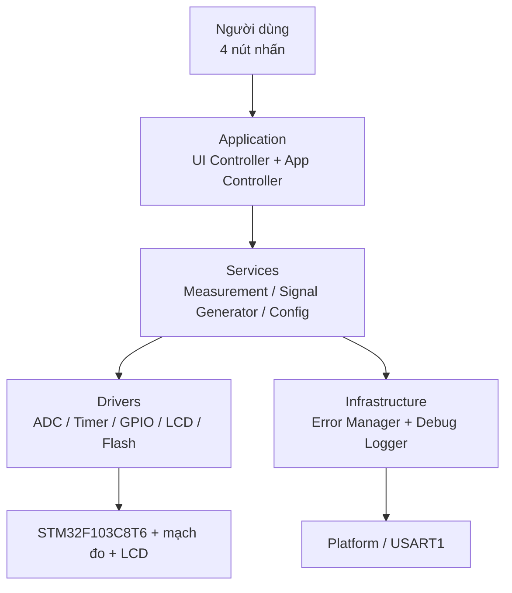

**1. Đọc điện áp tương tự từ mạch đo**  
**Công nghệ:** ADC1 12 bit, các kênh PA3/PA4, EOC interrupt.  
**Ý tưởng:** Biến điện áp thành mã số; 16 mẫu/lô giảm nhiễu; bộ lọc chạy ngoài ISR.

**2. Suy ra điện trở từ điện áp**  
**Công nghệ:** Mạch chia áp, định luật Ohm, median, EMA, hysteresis.  
**Ý tưởng:** Công thức cho giá trị vật lý; bộ lọc và trạng thái có linh kiện quyết định khi nào kết quả đủ ổn định để hiển thị.

**3. Suy ra điện dung từ thời gian**  
**Công nghệ:** Đáp ứng hàm mũ RC, GPIO charge/discharge, ADC thresholds, SysTick.  
**Ý tưởng:** Đo khoảng thời gian điện áp đi từ ngưỡng thấp đến ngưỡng cao, rồi quy đổi thành C.

**4. Đo tần số và duty của xung**  
**Công nghệ:** TIM1/TIM3/TIM4 PWM Input Mode, Input Capture, prescaler.  
**Ý tưởng:** Timer chụp số tick của chu kỳ và mức HIGH; dùng clock timer để tính Hz/%.

**5. Tạo tín hiệu PWM**  
**Công nghệ:** TIM2 CH2, PSC/ARR/CCR, PWM Mode 1.  
**Ý tưởng:** Chọn bộ chia clock và số tick/chu kỳ sao cho tần số, duty gần giá trị người dùng chọn.

**6. Điều khiển giao diện ít tốn tài nguyên**  
**Công nghệ:** Button debounce, FIFO, UI FSM, LCD1602, I2C2, shadow buffer.  
**Ý tưởng:** Tách sự kiện/nút, quyết định màn hình và thao tác ghi LCD; tránh viết lại ký tự không đổi.

**7. Giữ cấu hình sau khi tắt nguồn**  
**Công nghệ:** Internal Flash, record version, magic, CRC-32, read-back verify.  
**Ý tưởng:** Phát hiện bản ghi không hợp lệ, dùng default/migration; không khẳng định chống mất điện tuyệt đối.

**8. Phát hiện lỗi và phục vụ debug**  
**Công nghệ:** Error Manager, timestamps từ SysTick, USART1 logger.  
**Ý tưởng:** Báo lỗi có mã nguồn gốc và mức độ, gộp lỗi lặp, gửi log khi UART đã khởi tạo.

<a id="phu-luc-a-2"></a>
### A.2. Vi điều khiển, clock và thực thi

#### A.2.1. MCU, CPU, Flash và SRAM

- **MCU** là vi điều khiển tích hợp CPU và ngoại vi. **ARM Cortex-M3** là lõi CPU; **STM32F103C8T6** là chip sử dụng lõi này, không phải tên kiến trúc CPU.
- **Flash** lưu chương trình và cấu hình qua mất điện; **SRAM** chứa stack, biến và trạng thái runtime. Trong project, bản ghi cấu hình nằm tại `0x0800FC00`, còn stack/các bộ đệm ADC/FIFO ở SRAM.
- **Memory-mapped I/O**: thanh ghi ngoại vi có địa chỉ trong không gian bộ nhớ CPU; SPL cung cấp các hàm cấu hình/thao tác trên các thanh ghi đó.
- **Startup code** thiết lập stack, khởi tạo `.data`/`.bss`, rồi gọi `main()`. Không tự ý gọi `main()` sau reset mà bỏ qua startup.

#### A.2.2. Clock Tree và các clock liên quan

- `SYSCLK = HCLK = 72 MHz`; `APB2 = 72 MHz`; `APB1 = 36 MHz`. Timer trên APB1 nhận `72 MHz` vì khi prescaler APB1 khác 1, clock timer bằng hai lần PCLK1 theo quy tắc STM32F1.
- `ADCCLK = PCLK2 / 6 = 12 MHz`. ADC chạy khác clock CPU và phải nằm trong mức tối đa của ADC STM32F1.
- `SysTick = 1 ms`: dùng để đo thời gian phần mềm, debounce, timeout, thời gian hiện splash, thời gian nạp tụ. Độ phân giải 1 ms không bằng độ chính xác tuyệt đối 1 ms của mọi phép đo.
- Timer capture đếm theo clock đã chia PSC; PWM output dùng `TIM2 CH2` tại PA1.

#### A.2.3. Interrupt, NVIC, `volatile` và critical section

- **Interrupt** làm CPU tạm dừng luồng chính để chạy ISR. **NVIC** quyết định enable/priorities; priority cao hơn có thể giảm jitter cho capture.
- `volatile` báo compiler rằng giá trị có thể đổi ngoài luồng hiện tại (ví dụ ISR); **không** làm việc đọc/ghi nhiều trường tự động nguyên tử, không thay thế khóa/critical section.
- **Critical section** của `PwmCaptureDriver_Read()` lưu `PRIMASK`, tắt ngắt, copy các trường capture nhất quán, xóa cờ ready rồi phục hồi trạng thái ngắt ban đầu. Tránh dùng `__enable_irq()` một cách vô điều kiện nếu caller vốn đã tắt ngắt.
- Phép `now - start` trên `uint32_t` chịu overflow theo modulo và là cách tính khoảng thời gian an toàn khi khoảng thời gian quan tâm đủ ngắn (dưới nửa chu kỳ đếm trong các phép so sánh thời gian thường dùng).

<a id="phu-luc-a-3"></a>
### A.3. GPIO, ADC và các phương pháp đo Analog

#### A.3.1. GPIO và Debounce

- **Pull-up** giữ chân ở HIGH khi công tắc hở; nhấn nút nối xuống GND tạo LOW (**active-low**).
- **Debounce** là xác nhận trạng thái ổn định qua một khoảng thời gian để không nhận nhiều lần nhấn do tiếp điểm cơ học rung. Repo dùng 20 ms.
- **Event FIFO** tách lúc phát hiện nhấn nút khỏi lúc UI xử lý. FIFO sâu 8 phần tử; nếu quá tải, driver có đường ghi nhận lỗi.

#### A.3.2. ADC 12 bit, lượng tử hóa và sai số

- ADC 12 bit cho mã lý tưởng từ 0 đến 4095. Độ rộng 1 LSB xấp xỉ `Vref/4096`, tức khoảng `0,806 mV` với 3,3 V.
- **Quantization** gây sai số do điện áp liên tục được biểu diễn bằng mức rời rạc. **Sample time** cần đủ dài để tụ lấy mẫu bên trong ADC nạp đến điện áp kênh, đặc biệt khi trở kháng nguồn lớn.
- Một **EOC** = một lần chuyển đổi hoàn tất; **ADC batch** của repo gồm 16 lần EOC. ISR cộng số nguyên, đến đủ mẫu mới công bố dữ liệu.
- **Calibration** ADC tại khởi tạo giúp hiệu chỉnh nội bộ ngoại vi; không đồng nghĩa hiệu chuẩn toàn bộ máy đo với điện trở/mẫu chuẩn.

#### A.3.3. Mạch chia áp và đo điện trở

Với `Rref=10 kΩ` đặt từ 3,3 V xuống nút ADC, `Rx` từ nút ADC xuống GND:

```text
3.3 V ── Rref 10k ──●── Rx ── GND
                    │
                  PA3/ADC1_CH3
```

`Vadc = Vcc · Rx/(Rref+Rx)` nên `Rx = Rref · Vadc/(Vcc−Vadc)`.

**Điểm nhạy:** Khi `Vadc → Vcc`, mẫu số nhỏ, một biến động ADC rất nhỏ có thể làm `Rx` nhảy rất lớn. Vì vậy mã nguồn có bộ nhận diện mạch hở và guard gần mức Vcc.

#### A.3.4. RC và đo điện dung

```text
PA5 ── Rtiming 20k ──●── Cx ── GND
                       │
                     PA4/ADC1_CH4
```

Dạng nạp lý tưởng: `V(t)=Vcc−(Vcc−V0)·exp(−t/RC)`.

Thời gian từ `Vlow` đến `Vhigh`:

`t = R·C·ln((Vcc−Vlow)/(Vcc−Vhigh))`  ⇒  `C = t/[R·ln((Vcc−Vlow)/(Vcc−Vhigh))]`.

Trong firmware dùng ngưỡng `1241` (~1 V), `2482` (~2 V), `R=20 kΩ`, công thức hệ số hiệu chỉnh `C = 1.74563473 × t / 20000` với t tính bằng giây. Đây **không phải** phép đo trực tiếp thời gian 0→63,2% Vcc.

<a id="phu-luc-a-4"></a>
### A.4. Timer và PWM

- **PWM** (*Pulse Width Modulation*): tín hiệu tuần hoàn có chu kỳ `T` và thời gian HIGH `Thigh`; `f=1/T`, `Duty=100×Thigh/T`.
- **Prescaler (PSC)** chia tần số clock: `fCNT=fTIM/(PSC+1)`.
- **Auto-reload (ARR)** xác định số tick chu kỳ: `N=ARR+1` ở chế độ up-counting điển hình.
- **Capture/Compare (CCR)** lưu thời điểm cạnh được chụp hoặc giá trị so sánh để đổi mức output.
- **PWM Mode 1**: thông thường CNT < CCR cho mức active; cấu hình polarity quyết định mức điện thực tế. Repo dùng TIM2 CH2, PA1.
- **PWM Input Mode**: timer ghép hai kênh capture để đo period và high time; slave reset mode đặt lại bộ đếm theo cạnh tham chiếu.
- **Timer overflow**: bộ đếm 16 bit quấn khi vượt ARR; chọn PSC đúng dải giúp chu kỳ tín hiệu nằm trong khoảng biểu diễn được và có độ phân giải đủ cao.

<a id="phu-luc-a-5"></a>
### A.5. I2C, UART, Flash và CRC-32

- **I2C**: bus đồng bộ hai dây SCL/SDA, thường open-drain cần pull-up. Master phát START, địa chỉ 7 bit, R/W, dữ liệu và STOP. ACK/NACK là tín hiệu từ thiết bị nhận; một NACK khi scan địa chỉ chưa được phát hiện là bình thường.
- **PCF8574/PCF8574A**: IC mở rộng cổng I/O qua I2C; backpack biến byte I2C thành các tín hiệu điều khiển LCD1602. **LCD1602** là màn 2 hàng × 16 ký tự, không phải framebuffer đồ họa.
- **Shadow buffer**: giữ nội dung 16 ký tự × 2 ở RAM để so sánh trước khi truyền. Không phải màn hình dự phòng; cũng không làm I2C tự động non-blocking.
- **UART 8-N-1**: một start bit, 8 data bit, không parity, một stop bit; repo cấu hình debug USART1 **9600 baud** ở PA9/PA10. Mỗi ký tự 8-N-1 dùng khoảng 10 bit trên đường truyền ⇒ khoảng 1,04 ms/byte tại 9600 baud (bỏ qua chi tiết thời gian chờ).
- **Internal Flash**: không mất dữ liệu khi tắt nguồn; cần erase theo page trước khi program dữ liệu không tương thích bit; STM32F103 medium-density có page 1 KiB, lập trình theo half-word 16 bit.
- **CRC-32**: thuật toán phát hiện lỗi dữ liệu bằng phép toán bit và đa thức trên GF(2). Triển khai dùng dạng reflected IEEE với `init=0xFFFFFFFF`, `poly=0xEDB88320`, XOR kết thúc `0xFFFFFFFF`. CRC **không chứng minh dữ liệu đến từ ai**, không chống sửa đổi có chủ ý.
- **Magic, version, size, range, CRC** kiểm tra những lớp hợp lệ khác nhau. Một CRC đúng nhưng PWM duty = 250% vẫn là dữ liệu nghiệp vụ không hợp lệ.

<a id="phu-luc-a-6"></a>
### A.6. Kiến trúc phần mềm và kiểm thử

- **FSM**: mô hình gồm trạng thái, sự kiện, điều kiện và chuyển trạng thái. Project có nhiều FSM với mục đích khác nhau: điều hướng UI, nhận diện điện trở, đo tụ và xử lý lưu cấu hình.
- **Separation of concerns**: Application quyết định hành vi màn hình, Services quyết định chính sách đo/cấu hình, Drivers truy cập ngoại vi, Infrastructure thu lỗi/log, Platform cung cấp thời gian/khởi tạo/UART.
- **Non-blocking workflow**: hàm xử lý một bước rồi trả về để super-loop tiếp tục, thay vì chờ điều kiện hoàn tất trong một vòng `while`. Cần phân biệt với **blocking đoạn ngắn** còn tồn tại trong LCD/I2C và giao dịch ghi Flash.
- **Timeout watchdog dạng phần mềm**: so sánh SysTick để phát hiện chờ ADC quá lâu; khác với **IWDG phần cứng** tự reset MCU khi không được refresh. Repo không mô tả một IWDG runtime đang được sử dụng.
- **Hysteresis** dùng ngưỡng vào/ra khác nhau để tránh thay đổi trạng thái liên tục. **Deadband** bỏ qua biến động quanh giá trị ổn định; **debounce** xác nhận tín hiệu cơ học ổn định; ba kỹ thuật cùng chống nhiễu nhưng khác đối tượng.
- **Validation** là các kết quả thử cụ thể được công bố. **Accuracy spec** cần quy trình chuẩn, thiết bị tham chiếu, điều kiện môi trường và độ không đảm bảo đo; không tự suy ra từ các bảng thử nghiệm.

---

<a id="phu-luc-a-7"></a>
### A.7. Ba ví dụ nhỏ để hiểu các thuật toán trong project

#### Ví dụ 1 — CRC-32: cùng dữ liệu và cùng tham số phải cho cùng mã

**CRC-32/ISO-HDLC** (còn gọi CRC-32/IEEE) với chuỗi ASCII `123456789` có kết quả chuẩn `0xCBF43926`. `Flash_Calculate_CRC32()` của project khởi tạo `0xFFFFFFFF`, xử lý byte theo dạng reflected polynomial `0xEDB88320` và đảo bit cuối; input thực của nó là 20 byte đầu của record, **không phải chuỗi ví dụ này**.

```text
Record V1: [20 byte đầu cần bảo vệ] [CRC-32 4 byte]
                          |               ^
                          +--> tính CRC --+
```

**CRC-32 không phải hash mật mã hoặc chữ ký số**: ai sửa dữ liệu có chủ đích có thể tính lại CRC; cơ chế phù hợp để phát hiện cấu hình lưu trữ bị sai ngoài ý muốn.

#### Ví dụ 2 — Adaptive EMA và lý do thay đổi hệ số

Giả sử bộ lọc đang có `y_prev=1000 Ω`, kết quả mới `x=1100 Ω`. Vì mức đổi tương đối là 10%, thuật toán chọn α=0,30: `y_new=1000+0,30×(1100−1000)=1030 Ω`. Nếu chỉ có nhiễu 1% quanh giá trị hiện tại, α=0,05 giúp giảm dao động.

Sau EMA, project **chưa nhất thiết** đổi ngay số trên LCD: vẫn có deadband và 300 ms sustained-change rồi 1 s sample-and-hold ở UI.

#### Ví dụ 3 — Timer capture và công thức duty

Với TIM3 clock 9 MHz, `period_ticks=9000`, `high_ticks=2250` thì frequency = 1000 Hz và duty = 25%. Timer Input Mode đo theo **cạnh xung trên chân input**, không phải suy tần số từ giá trị TIM2 output được cấu hình.

<a id="phu-luc-a-8"></a>
### A.8. Các cặp khái niệm rất dễ nhầm trong phỏng vấn

| Dễ nhầm | Khác nhau ở đâu? |
|---|---|
| **MCU vs CPU** | Cortex-M3 là lõi xử lý; STM32F103C8T6 là MCU gồm core, bộ nhớ và ngoại vi. |
| **Super-loop vs ISR** | Main xử lý tuần tự; ISR có thể chen vào để phản ứng sự kiện phần cứng. |
| **ISR vs RTOS task** | ISR phục vụ ngắt; dự án này không dùng RTOS scheduler. |
| **`volatile` vs atomic snapshot** | `volatile` ảnh hưởng optimizer; atomicity/critical section giải quyết tính nhất quán khi chia sẻ dữ liệu. |
| **Sample time vs conversion time** | Sample time là thời gian lấy mẫu đầu vào; conversion time còn có bước ADC lượng tử hóa. |
| **Average vs Median vs EMA** | Trung bình giảm noise, median chống outlier, EMA làm mượt có trạng thái. |
| **Hysteresis vs Deadband** | Hysteresis giữ trạng thái PRESENT/ABSENT; deadband giữ số R đã công bố. |
| **0 Ω vs No Resistor** | 0 Ω tạo ADC gần 0 V; open tạo ADC gần full-scale. |
| **Capacitor discharge vs timed charge** | Xả là chuẩn bị về low threshold; thời gian nạp low→high mới dùng tính C. |
| **PWM Output vs Input Capture** | TIM2 xuất xung PA1; TIM1/TIM3/TIM4 đo xung tại chân input tương ứng. |
| **Expected frequency vs Measured frequency** | Expected dùng chọn dải capture; measured tính từ ticks thực. |
| **PSC/ARR vs CCR** | PSC/ARR quyết định frequency; CCR quyết định duty trong PWM Mode 1. |
| **PWM 100% setting vs 100% wave** | Code clamp CCR≤ARR; output có thể còn LOW tick. |
| **UI State vs Measurement Status vs CAP State** | Điều hướng, kết quả đo, và FSM đo tụ là ba lớp state khác nhau. |
| **I2C vs PCF8574 vs LCD1602** | Bus truyền, expander GPIO, và màn ký tự; không phải ba tên cùng một thiết bị. |
| **Flash page vs Flash record** | Page lưu 1 KiB; record V1 là 24 byte. |
| **CRC-32 vs digital signature** | CRC phát hiện lỗi dữ liệu; không xác thực nguồn tạo record. |
| **Save Verify vs Power-fail-safe commit** | Read-back bảo đảm dữ liệu vừa ghi khớp; một slot vẫn có thể mất config khi mất nguồn. |
| **Error Manager vs Logger** | Manager lưu/gộp lỗi; logger định dạng/vận chuyển thông điệp. |
| **NO_SIGNAL vs NO_COMPONENT vs ERROR** | Không có PWM capture, không phát hiện linh kiện trong phép đo, và lỗi thao tác là ba nguyên nhân khác nhau. |

**Học sâu theo chủ đề:** [ADC](#chuong-6-4) · [Điện trở](#chuong-6-5) · [Điện dung](#chuong-6-6) · [PWM Output](#chuong-6-7) · [PWM Input](#chuong-6-8) · [Flash](#chuong-6-10).

<a id="phan-1"></a>
## Phần 1. Trình bày Project

### 1.1. Dự án là gì?

**Mini Multimeter** là firmware bare-metal cho STM32F103C8T6, tích hợp đo điện trở, đo điện dung, đo tần số và duty cycle tín hiệu PWM, đồng thời tạo PWM có thể cấu hình. Kết quả/trạng thái hiển thị trên LCD1602 qua I2C, điều khiển bằng bốn nút; thông số phát PWM lưu trong internal Flash để giữ qua reset. Firmware có các tầng Application/Services/Drivers/Infrastructure/Platform, cơ chế trạng thái và hệ thống logging/lỗi.

Điểm nhấn để giới thiệu không phải “tôi đã dùng ADC và LCD”, mà là: **tổ chức nhiều nguồn dữ liệu bất đồng bộ và nhiều chế độ dùng chung ngoại vi trên một MCU ít tài nguyên, bảo đảm phép đo có trạng thái rõ ràng và kết quả hiển thị ổn định.**

### 1.2. Bài toán kỹ thuật project giải quyết

1. **Đo tín hiệu analog:** Mạch chia áp/RC đưa tín hiệu vào ADC, có nhiễu, sai số phần cứng và hiệu ứng lượng tử hóa.
2. **Xử lý nhiều ngoại vi:** ADC, GPIO, các Timer, I2C, UART, Flash cùng tồn tại trên STM32F103.
3. **Giữ giao diện phản hồi:** Tránh dùng delay dài ở tầng ứng dụng; trạng thái đo và UI tiến triển qua super-loop.
4. **Điều khiển lỗi và trạng thái:** Không biến số đo 0 thành tín hiệu báo “không có linh kiện”; có trạng thái tường minh, timeout cho một số đường xử lý và log tập trung.
5. **Lưu cấu hình:** Thay đổi thông số phải bền vững, có version/CRC/range validation và xác minh sau ghi.

### 1.3. Công nghệ được sử dụng và lý do

| Công nghệ | Dùng ở đâu? | Tại sao dùng? |
|---|---|---|
| C bare-metal | Toàn firmware | Kiểm soát vòng lặp, ISR, bộ nhớ và ngoại vi rõ ràng |
| STM32 SPL / CMSIS | Driver/Platform | Truy cập và cấu hình phần cứng STM32F1 |
| ADC1 + EOC IRQ | Đo R/C | Lấy 16 mẫu không phải polling toàn bộ bằng vòng chờ trong main |
| TIM2 PWM Mode 1 | Phát PWM | Phần cứng tạo xung đều, không cần toggle GPIO bằng CPU |
| TIM1/TIM3/TIM4 Input Capture | Đo PWM | Chụp tick cạnh tín hiệu với độ phân giải timer |
| SysTick | Thời gian mềm | Timeout, debounce, UI timing, đo khoảng thời gian RC |
| I2C2 + PCF8574 | LCD1602 | Giảm số GPIO cần cho màn hình |
| Internal Flash + CRC-32 | Lưu cấu hình | Lưu qua mất nguồn và phát hiện dữ liệu sai |
| FSM + FIFO | UI và workflow | Phân tách sự kiện, trạng thái và hành động |
| UART logger/Error Manager | Debug | Theo dõi lỗi tập trung và truy vết hành vi |

### 1.4. Bài giới thiệu 30 giây

> “Em phát triển firmware Mini Multimeter trên STM32F103C8T6 bằng C bare-metal và STM32 SPL. Thiết bị đo điện trở qua ADC và mạch chia áp, đo điện dung bằng thời gian nạp–xả RC, đo tần số/duty bằng Timer Input Capture, đồng thời tạo PWM từ TIM2. Em thiết kế firmware theo các tầng Application, Services và Drivers, dùng super-loop kết hợp interrupt, state machine để quản lý các chế độ đo, lọc tín hiệu để ổn định kết quả, và lưu cấu hình bằng internal Flash có CRC-32. Project có LCD1602 qua I2C, các nút nhấn và logging UART.”

### 1.5. Bài giới thiệu 90 giây — kể theo thách thức

> “Khó khăn đầu tiên là các phép đo có bản chất khác nhau. Điện trở đo gián tiếp từ điện áp mạch chia áp, nên em phải kết hợp ADC batching, low-pass, median, EMA, deadband và hysteresis để hạn chế nhấp nháy cũng như phân biệt linh kiện bị rút khỏi socket. Điện dung không thể đo bằng một giá trị ADC tĩnh, nên em xây state machine điều khiển GPIO nạp/xả qua điện trở 20 kΩ, đọc hai ngưỡng ADC và dùng SysTick để suy ra thời gian. Với PWM, em dùng Input Capture trên ba timer theo dải tần thay vì tự đo cạnh trong vòng lặp chính; việc phát PWM được thực hiện bằng TIM2 và tính PSC/ARR/CCR từ tần số người dùng chọn.
>
> Về software architecture, em tách UI Controller, Measurement Service và Driver; ISR chỉ làm việc tối thiểu và chuyển dữ liệu sang main context. Em cũng triển khai Flash record có magic, version, size, CRC, range check và read-back verify; có Error Manager ghi nhận và gộp lỗi lặp rồi đẩy ra UART. Em hiểu rõ giới hạn hiện tại: đo điện dung dùng SysTick 1 ms, điện trở chưa auto-ranging, PWM capture chưa tự dò dải tần, và lưu Flash một trang chưa power-fail-safe hoàn toàn.”

> **Kỷ luật phỏng vấn:** Chỉ khẳng định “em tự thiết kế/em trực tiếp code” nếu đúng với công việc bạn đã thực hiện. Nếu repo là dự án nhóm hoặc bạn đang học lại code, đổi thành “trong project, phần này được triển khai...” thay vì nhận đóng góp không có căn cứ.

### 1.6. Sản phẩm có và không có gì?

**Có [Code/Docs]:** R/C, PWM frequency/duty capture, PWM generation, LCD1602, bốn nút, thiết lập bước điều chỉnh, Flash record V1 + fallback V0/default, UART debug, Error Manager và một số timeout.

**Không nên nhận là có:** V/A measurement, True RMS, auto-ranging điện trở/tụ, đo AC mains, DMA ADC, RTOS, tự động dò mọi tần số PWM ngoài, dual-slot Flash chống mất nguồn, CRC xác thực mật mã, watchdog phần cứng đang chứng minh được từ code, các chuẩn hiệu chuẩn phòng thí nghiệm.

### 1.7. Thông số kiểm thử được ghi trong repo

| Đường đo | Kết quả công bố | Không được suy ra |
|---|---|---|
| Frequency 100 Hz–100 kHz | Sai số báo cáo <1% trong các case thử | Mọi tín hiệu ở mọi dải đều <1% |
| Duty 10–90% | Sai số báo cáo <1% trong các case thử | PWM 0%/100% đo chính xác như vùng 10–90% |
| Resistance 100 Ω–1 MΩ | Sai số khoảng 2–10% tùy dải | Độ chính xác 2% toàn dải |
| Capacitance 100 nF–1000 µF | Sai số khoảng 8–15% tùy giá trị | Độ chính xác điện dung được hiệu chuẩn chuẩn đo lường |

Nguồn: [docs/validation.md](https://github.com/haikevins/mini-multimeter/blob/main/docs/validation.md). Để phỏng vấn tốt, luôn giải thích *điều kiện thử*, *nguồn sai số* và *cách cải thiện*, không chỉ thuộc bảng số.

### 1.8. Các câu hỏi mở màn nên tự trả lời

**Vì sao bare-metal?** Vì số workflow không lớn và MCU còn giới hạn tài nguyên; super-loop + IRQ thể hiện thứ tự xử lý rõ, giảm overhead của scheduler/task stacks. Đánh đổi: phải tự kiểm soát độ trễ và tránh thao tác blocking quá lâu.

**Vì sao cần nhiều lớp?** Để UI không trực tiếp triển khai thuật toán đo/thanh ghi; Driver có thể tái dùng, Service dễ kiểm thử bằng dữ liệu giả, lỗi tập trung; sửa UI không kéo theo sửa ADC register.

**Khó nhất về kỹ thuật?** Một câu trả lời vững là sự kết hợp *độ chính xác đo, chống nhiễu, trạng thái có/không có tín hiệu và quyền sở hữu ngoại vi khi chuyển mode*. Nên kèm ví dụ cụ thể từ code.

---

<a id="phan-2"></a>
## Phần 2. Trình bày System Architecture

### 2.1. Bài nói khi phỏng vấn (khoảng 90 giây)

> **System Architecture:** Dạ, hệ thống của em gồm hai phần chính: phần cứng STM32F103C8T6 cùng mạch đo, LCD, nút nhấn; và firmware bare-metal tổ chức thành Application, Services, Drivers, Infrastructure, Platform. Em sử dụng super-loop cộng ngắt, không dùng RTOS.
>
> Ở tầng Application, `AppController` điều phối khởi tạo và vòng lặp chính; `UiController` quản lý trạng thái, sự kiện nút; `UiView` chỉ quan tâm tới nội dung LCD. Các Services chứa thuật toán và chính sách đo, còn Drivers cấu hình ADC, Timer, GPIO, I2C và Internal Flash bằng SPL.
>
> Đối với điện trở, ADC đọc điện áp mạch chia áp, sau đó Service xử lý lọc và kiểm tra mạch hở. Đối với điện dung, GPIO điều khiển nạp/xả và ADC giám sát hai ngưỡng để tính thời gian RC. Đối với PWM, TIM2 tạo xung còn TIM1, TIM3 hoặc TIM4 thu period/high time tùy dải tần kỳ vọng.
>
> Hệ thống dùng LCD1602 qua I2C2 và bốn nút active-low. Cấu hình PWM lưu trong một trang Internal Flash có CRC-32 và Verify, đồng thời Error Manager ghi nhận lỗi cho logger UART. Điểm em ưu tiên trong thiết kế là giữ ISR ngắn, chia nhỏ công việc trong main context và phân biệt rõ giới hạn độ chính xác của phần cứng với khả năng lọc số.

### 2.2. High-level System Architecture Diagram

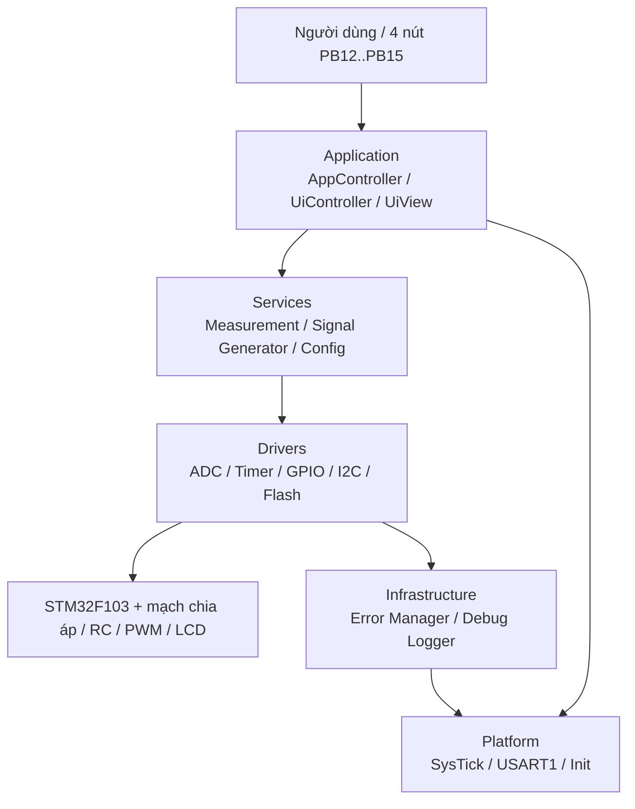

> **Giới hạn sơ đồ:** Đây là luồng phụ thuộc **khái quát**. Trong source, một module tầng Application có thể gọi thẳng Driver/Platform khi có trách nhiệm trực tiếp; không phải mọi cuộc gọi đều đi qua Services. **PWM Output và PWM Input** là hai đường riêng biệt, không được nhầm với một chế độ đo tự động theo mọi tần số ngoài.

### 2.3. Góc nhìn phần cứng

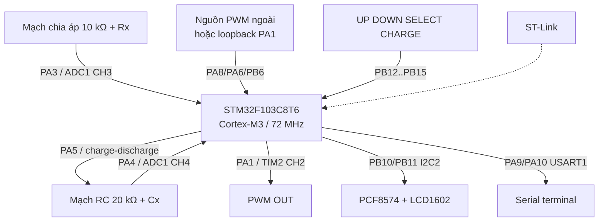

**Đường tín hiệu R/C** cần phân biệt với nguồn PWM. ADC đo mức analog; timer capture đo thời gian cạnh digital; TIM2 tạo PWM tại chân output; I2C phục vụ LCD, không tham gia tính điện trở/tần số.

### 2.4. Góc nhìn software layer

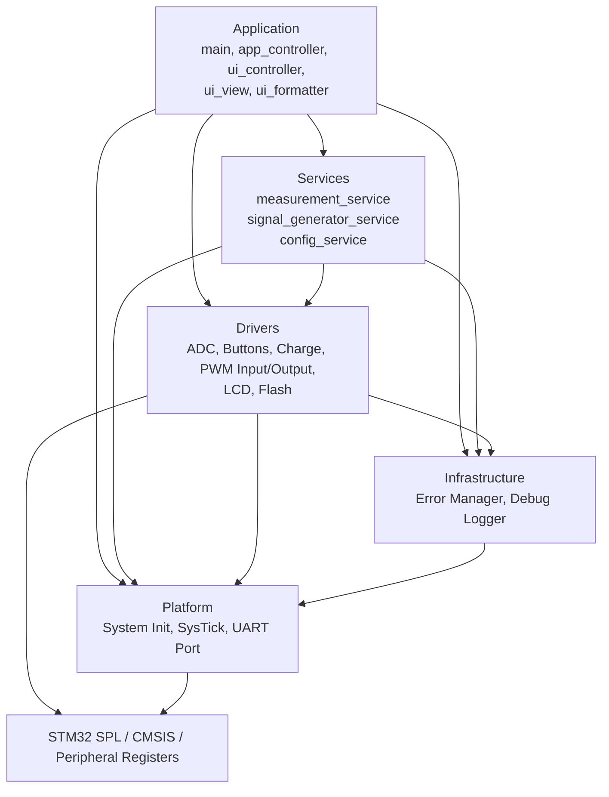

**Đừng diễn giải sai:** `Application` có thể gọi `Drivers` trực tiếp (ví dụ `UiView` gọi LCD Driver); không phải kiến trúc cấm skip một lớp. Quy tắc chính là **phụ thuộc đi xuống**: Drivers không được gọi ngược Services/Application, Platform không phụ thuộc các lớp cao hơn. [ARCHITECTURE.md](https://github.com/haikevins/mini-multimeter/blob/main/ARCHITECTURE.md).

### 2.5. Trách nhiệm và API tiêu biểu

| Module | Vai trò | Đọc gì trong code? |
|---|---|---|
| `main.c` | Entry point | `AppController_Init()`, `AppController_RunOnce()` |
| `app_controller.c` | Thứ tự init + super-loop | Khởi tạo ErrorManager trước logger, drain button FIFO |
| `ui_controller.c` | FSM navigation | Event → state/action, `SAVE_FEEDBACK` |
| `ui_view.c` | Render LCD | Shadow 2×16, redraw policy |
| `ui_formatter.c` | Đổi kết quả sang chuỗi | Quy tắc đơn vị và ký tự màn hình |
| `measurement_service.c` | Chính sách đo | Presence, FSM tụ, timeout, điều phối mode |
| `signal_generator_service.c` | Tính cấu hình PWM | Tìm PSC/ARR, tính CCR |
| `config_service.c` | Settings runtime | Validate/change/save |
| `adc_driver.c` | Hardware ADC | EOC ISR, 16 mẫu, LPF |
| `pwm_capture_driver.c` | TIM input | Enable range, ISR capture, atomic snapshot |
| `pwm_output_driver.c` | TIM2 output | Áp PSC/ARR/CCR vào timer |
| `flash_storage_driver.c` | Persistence | Record V0/V1, CRC, erase/program/verify |
| `error_manager.c` | Lịch sử lỗi | Gộp lỗi 1 s, giữ 8 record |
| `debug_logger.c` / `uart_port.c` | Text logs | Format, USART1 9600 baud |

### 2.6. Luồng khởi động và xử lý chính

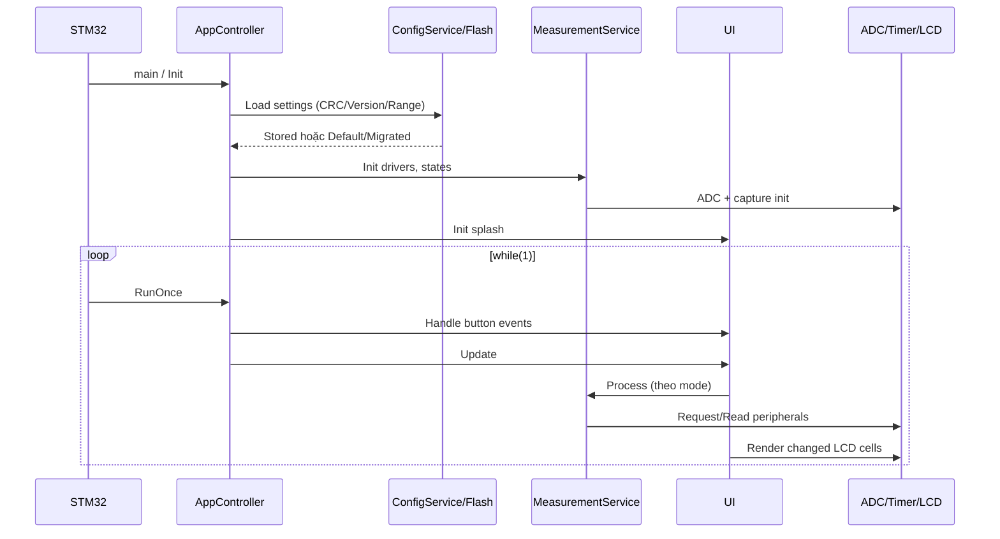

Trong sơ đồ, phần gọi `MeasurementService_Process()` diễn tả **đường xử lý trong lượt cập nhật UI**, không nhất thiết mọi màn hình đều gọi phép đo. Đọc `ui_controller.c` để xác định guard của từng trạng thái.

### 2.7. Quyền sở hữu tài nguyên phần cứng

- **ADC1** dùng chung R và C, nên không thể tự ý cho hai workflow cùng cấu hình kênh/conversion batch mà không phối hợp.
- **TIM1, TIM3, TIM4** phục vụ capture; chỉ một timer được enable theo dải kỳ vọng tại một thời điểm.
- **TIM2 CH2** tạo PWM; trong các màn hình đo frequency/duty, đường output được bật theo quyết định service để hỗ trợ đo/loopback.
- **PA5** là output charge/discharge khi vào đo tụ, phải đưa về trạng thái phù hợp khi thoát mode.
- **I2C2** dùng chung thao tác hiển thị; giới hạn bus và các khoảng blocking ngắn cần tính vào responsiveness.
- **Internal Flash** được lập trình trong transaction có vô hiệu hóa ngắt tạm thời; không nên cho phép các luồng thời gian nhạy chạy kỳ vọng không gián đoạn trong thời gian erase/program.

### 2.8. Phân biệt hai dạng state machine

**UI State Machine** trả lời: “Người dùng đang ở màn hình nào và nút nhấn có tác dụng gì?”.

**Measurement State Machine** trả lời: “Phần cứng/thuật toán đang đo gì, đang chờ ngưỡng nào, dữ liệu đã hợp lệ chưa?”.

Ví dụ có thể đồng thời xảy ra: UI đang ở màn **Capacitor**, `MeasurementService` trả về trạng thái `CHARGING`, còn nội bộ FSM tụ là `CAP_DISCHARGING` ở bước khác của một lần đo. Các enum thuộc phạm vi khác nhau, đừng gộp làm một.

### 2.9. Phân tách ISR và main context

```text
PHẦN CỨNG / NGẮT                    MAIN CONTEXT

ADC1 EOC --> cộng sample          --> lấy batch 16 mẫu
             set ready                --> LPF, Median, EMA
                                      --> tính R / C

TIM Capture --> snapshot CCR       --> đọc sample nhất quán
               set ready              --> tính f / duty

SysTick --> tăng ms tick           --> debounce / timeout

GPIO raw --> ButtonDriver_Process --> FIFO event --> UI FSM
```

**Lý do thiết kế:** ISR cần ngắn để giới hạn interrupt latency; tính float, định dạng chuỗi và gửi LCD qua I2C được thực hiện bên ngoài ISR. Tuy nhiên main context vẫn có thể bị chậm bởi tác vụ đồng bộ; “IRQ-based” không làm toàn bộ ứng dụng real-time hard deterministic.

### 2.10. Phân tích trade-off

- **Super-loop thay RTOS:** đơn giản, ít RAM, dễ lần luồng; đánh đổi độ trễ phụ thuộc tác vụ chặn.
- **ADC batch 16 mẫu:** giảm nhiễu ngẫu nhiên; đổi lại chậm hơn một mẫu đơn và vẫn có sai số hệ thống.
- **Nhiều lớp lọc điện trở:** hiển thị ổn định; đổi lại trễ khi đổi linh kiện.
- **1 ms SysTick đo tụ:** đơn giản, không dùng thêm timer; đổi lại lượng tử hóa thời gian rõ ở tụ nhỏ.
- **3 Timer cho PWM input:** chọn prescaler phù hợp dải; đổi lại chân/timer tăng và chưa tự tìm dải thực tế.
- **Single-page Flash:** tối giản; đổi lại không bảo đảm phục hồi cấu hình cũ khi mất điện trong erase/program.

---
<a id="phan-3"></a>
## Phần 3. Trình bày các State Machine

### 3.1. Bài nói khi phỏng vấn (khoảng 90 giây)

> **State Machine:** Dạ, trong Mini Multimeter em phân biệt **UI State Machine**, **Measurement Mode**, **Capacitance FSM**, **Resistance Presence** và **Measurement Status**. Các cơ chế này liên quan với nhau nhưng không thay thế nhau.
>
> UI FSM quản lý điều hướng từ Splash qua Main, Measure/Transmit tới các màn đo hoặc chỉnh PWM. Sự kiện từ bốn nút đi qua debounce và hàng đợi, rồi `UiController` quyết định chuyển màn. Mỗi lần đổi mode, Measurement Service quản lý vòng đời ADC, timer hoặc GPIO, tránh sử dụng đồng thời tài nguyên không phù hợp.
>
> Khi đo điện trở, một state riêng phân biệt chưa xác định, có linh kiện và mạch hở bằng hysteresis cùng bộ đếm xác nhận. Khi đo tụ, FSM thực hiện nạp sơ bộ, xả về ngưỡng thấp, nạp có đo thời gian, rồi công bố READY hoặc NO_COMPONENT. Khi đo PWM, Timer Input Capture cung cấp dữ liệu mới; quá 1100 ms không có capture thì Service trả NO_SIGNAL.
>
> Thời gian giữ Splash 2 giây và phản hồi lưu 800 ms được thể hiện bằng trạng thái có timestamp, không gọi delay dài trong main. Nhờ vậy em dễ giải thích sự kiện nào hợp lệ ở trạng thái nào, khi chuyển state phải giải phóng tài nguyên gì và có thể đặt test case cho từng nhánh lỗi.

### 3.2. High-level Transition Diagram

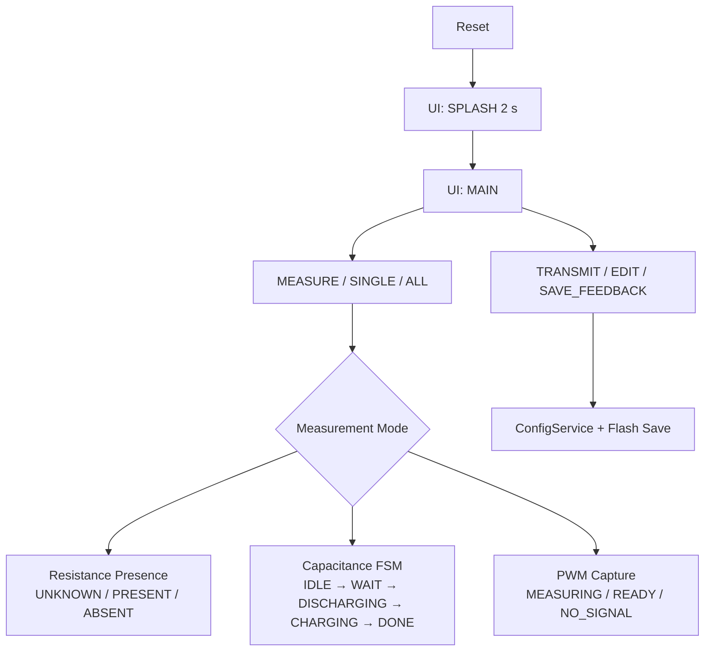

> **Lưu ý:** Các node như `MEASURING`, `READY` và `NO_SIGNAL` là **trạng thái kết quả đo**, không phải menu UI hay enum nội bộ `CAP_*`. Sơ đồ tổng quan không thay thế điều kiện chuyển trạng thái trong mã nguồn.

### 3.3. Vì sao project cần nhiều FSM?

Một FSM xác định tập trạng thái, các sự kiện, điều kiện guard và hành động khi chuyển. Trong project, có ít nhất bốn bài toán có thể diễn tả dưới dạng FSM: điều hướng người dùng, vòng đời chế độ đo, nhận diện sự hiện diện của điện trở và chu trình nạp/xả tụ. Tách các FSM giúp không xuất hiện biến “state” khổng lồ mang nghĩa nhập nhằng.

**Nguyên tắc đọc code:** Trước khi vẽ state machine, xác định (1) enum hoặc biến trạng thái thực có trong source; (2) sự kiện đến từ nút, timer hay ADC; (3) điều kiện chuyển; (4) hành động `Enter`/`Exit` đối với ngoại vi; (5) trạng thái kết quả biểu diễn cho UI.

### 3.4. UI State Machine — nhóm menu

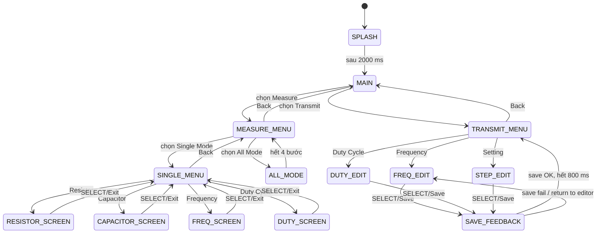

> **Lưu ý:** Nhánh `STEP_EDIT` được triển khai qua hai bước **Frequency Step → Duty Step**, có thể quay lại editor khác nhau sau `SAVE_FEEDBACK`. Sơ đồ rút gọn ở trên chỉ thể hiện nhóm trạng thái, không mô tả đầy đủ từng enum UI. Xem chi tiết 5.5.

**Sự kiện:** `UP`, `DOWN` thay đổi lựa chọn hoặc số đang chỉnh; `SELECT` vào menu/xác nhận/thực hiện bước tiếp; `CHARGE` dùng để khởi động phép đo tụ khi mode cho phép. Debounce không phải trách nhiệm của UI Controller.

### 3.5. Measurement Mode — quyền sở hữu ngoại vi

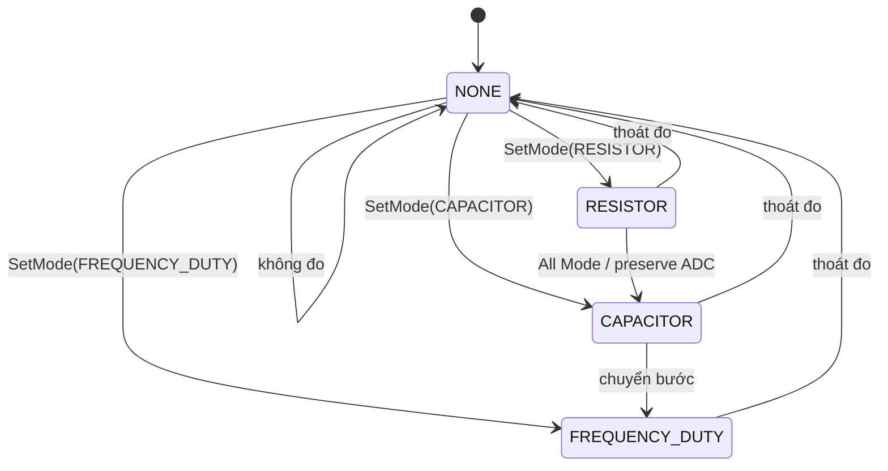

Đây là **mô hình hóa** các giá trị `Measurement_Mode_t`; trong code chuyển mode được xử lý bằng một hàm duy nhất `MeasurementService_SetMode()` có logic exit mode cũ, rồi enter mode mới. Việc chuyển từ Frequency sang Duty khi cả hai dùng `MEASUREMENT_MODE_FREQUENCY_DUTY` không cần restart timer, vì `SetMode` nhận ra mode không đổi và trả về sớm.

### 3.6. Resistance Presence FSM

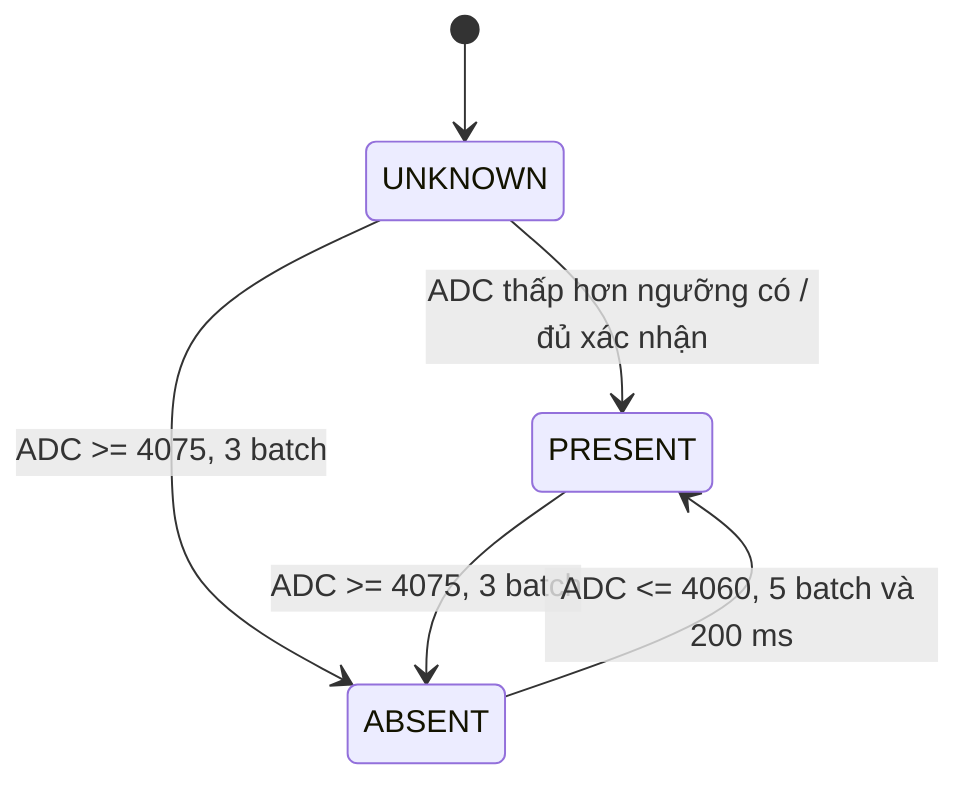

**Không gọi điện trở lớn gần full-scale là “0 Ω”.** Tại `ABSENT`, UI có trạng thái `NO_COMPONENT`. Khi mới vào đo, `UNKNOWN` không vội công bố kết quả trước khi đủ điều kiện. Khi đang `ABSENT`, việc cắm lại điện trở cần xác nhận *bất đối xứng* dài hơn để tránh “chattering”.

**Một trạng thái bị bỏ quên dễ gây bug:** Nếu vừa rút điện trở ra mà ngay sau đó cắm vào, history của EMA/median từ linh kiện trước có thể làm giá trị mới sai lệch. Source reset lọc trong các chuyển presence quan trọng để tránh rò trạng thái.

### 3.7. Capacitance FSM — trạng thái nội bộ thực

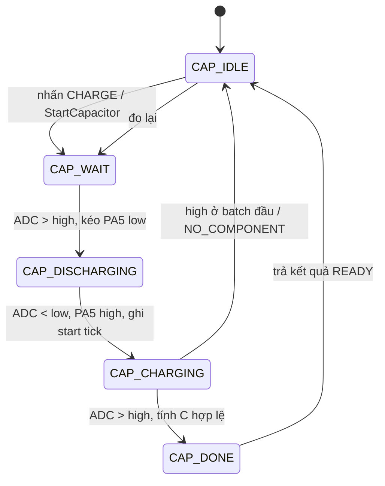

Mỗi trạng thái có vai trò:

| State trong code | Ý nghĩa | Điều kiện đi tiếp |
|---|---|---|
| `CAP_IDLE` | Không có chu trình đo đang chạy | `StartCapacitor()` |
| `CAP_WAIT` | Bắt đầu bước nạp sơ bộ | ADC vượt ngưỡng cao |
| `CAP_DISCHARGING` | Kéo PA5 LOW để xả | ADC dưới ngưỡng thấp |
| `CAP_CHARGING` | Nạp và đo thời gian | ADC vượt ngưỡng cao; phân biệt first batch |
| `CAP_DONE` | Đã có giá trị, chuẩn bị công bố | Chuyển về `CAP_IDLE`, status `READY` |

**Phân biệt với status:** `MEASUREMENT_STATUS_WAIT_CHARGE`, `CHARGING`, `DISCHARGING`, `READY`, `NO_COMPONENT`, `ERROR` mô tả để UI render; `CAP_WAIT` và `CAP_CHARGING` là **biến trạng thái điều khiển kỹ thuật**. Không tự suy ra các tên `CAP_*` chính là label hiển thị.

### 3.8. PWM signal state và timeout

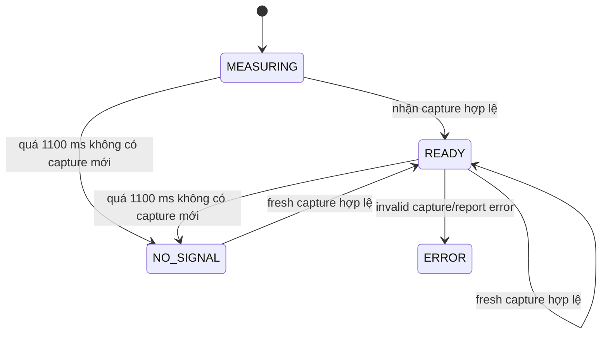

Sơ đồ mô tả logic mong muốn khi chuyển giữa các trạng thái; trường hợp cụ thể `ERROR` hay giữ trạng thái trước phụ thuộc nhánh xử lý trong `MeasurementService_ProcessFrequencyDuty()`, cần kiểm tra bằng code khi sửa. Một mẫu hợp lệ đòi hỏi `period_ticks > 0` và `high_ticks <= period_ticks`.

### 3.9. Flash Load/Save như workflow có điều kiện

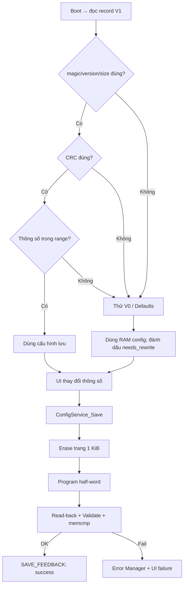

Vùng cấu hình có một page, không phải hai slot. “Tự khôi phục dữ liệu cũ sau mất nguồn giữa erase” là điều **chưa được bảo đảm**.

### 3.10. Bảng trạng thái → sự kiện → hành động

| Phạm vi | State hiện tại | Event/điều kiện | Hành động | State/kết quả tiếp |
|---|---|---|---|---|
| UI | `SPLASH` | hết 2000 ms | render menu | `MAIN` |
| UI | `CAPACITOR` | CHARGE event | gọi `StartCapacitor` | workflow nạp/xả |
| UI | `SAVE_FEEDBACK` | hết 800 ms | điều hướng theo success/return state | Transmit/editor |
| R presence | `PRESENT` | 3 batch gần full-scale | reset filter, báo vắng linh kiện | `ABSENT`, `NO_COMPONENT` |
| R presence | `ABSENT` | 5 batch dưới 4060 + 200 ms | khởi tạo lại lọc | `PRESENT` |
| Cap | `CAP_WAIT` | ADC > 2482 | PA5 LOW | `CAP_DISCHARGING` |
| Cap | `CAP_DISCHARGING` | ADC < 1241 | PA5 HIGH, ghi tick | `CAP_CHARGING` |
| Cap | `CAP_CHARGING` | ADC > 2482 | tính C hoặc báo no-component | `CAP_DONE`/`CAP_IDLE` |
| PWM | đo đang hoạt động | quá 1100 ms không fresh | xóa f/duty, báo mất tín hiệu | `NO_SIGNAL` |
| ADC | pending | quá 100 ms | Cancel, báo lỗi | `ERROR` |

### 3.11. Checklist khi giải thích FSM trong phỏng vấn

Trình bày theo một ví dụ cụ thể: “Khi người dùng nhấn CHARGE...” → sự kiện vào UI → service đổi `CAP_IDLE` sang `CAP_WAIT` → driver đưa PA5 HIGH → ADC batch liên tục → tới ngưỡng cao chuyển xả → tới ngưỡng thấp bắt đầu timing → ngưỡng cao lần hai tính C → status `READY` → UI định dạng/hiển thị. Sau đó chủ động nêu timeout và giới hạn độ phân giải. Cách trình bày này thuyết phục hơn chỉ liệt kê tên enum.

---

<a id="phan-4"></a>
## Phần 4. Phân tích chi tiết System Architecture theo luồng

<a id="luong-1"></a>
### 4.1. Luồng 1 — Reset → Khởi tạo → Super-loop

> **Mục tiêu:** Theo dõi đúng chuỗi sự kiện, đầu vào, điều kiện chuyển và kết quả của riêng luồng này; phân biệt code đã triển khai với phương án cải tiến.

#### Sơ đồ luồng hoạt động

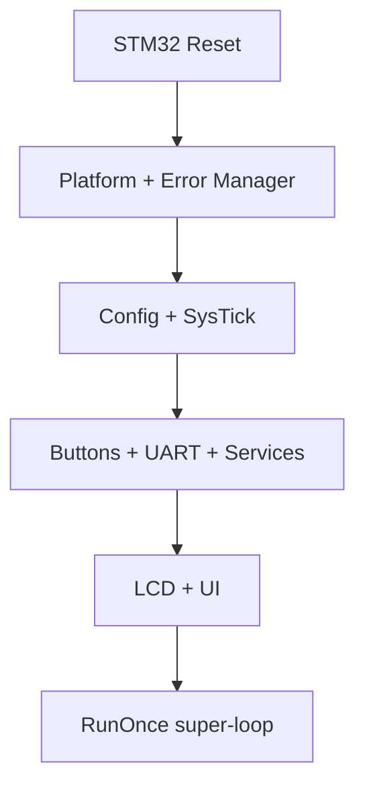


#### 4.1.1. Tại sao `main()` rất ngắn?

Sau khi runtime startup thiết lập môi trường C, `main()` chỉ gọi `AppController_Init()` và lặp `AppController_RunOnce()`. Không nên cho khối thuật toán đo, UI và giao dịch Flash nằm trực tiếp trong `main()`: khi thêm mode mới, `main` sẽ trở thành trung tâm phụ thuộc khó quản lý. Một entry point ngắn cũng tạo đường điều tra lỗi rõ.

**Mã minh họa theo source:**

```c
int main(void)
{
    AppController_Init();
    while (1) {
        AppController_RunOnce();
    }
}
```

#### 4.1.2. Thứ tự khởi tạo quan trọng

Theo `ARCHITECTURE.md` và `docs/runtime.md`, chuỗi chính:

```text
Platform_InitSystem
  → ErrorManager_Init
  → ConfigService_Init / FlashStorage_Load
  → SystemTime_Init
  → ButtonDriver_Init
  → UartPort_Init (USART1 9600)
  → Logger ready / flush lỗi khởi động
  → MeasurementService_Init (ADC, PWM capture)
  → SignalGeneratorService_Init (PWM output)
  → Lcd1602Driver_Init
  → UiController_Init
  → Super-loop
```

**Vì sao Error Manager trước Config/Logger?** Nếu cấu hình Flash bị CRC sai ngay lúc boot, hệ thống vẫn ghi được lỗi vào lịch sử RAM. Sau khi UART/logger sẵn sàng, có thể flush những lỗi đã sinh. Đây là ví dụ thiết kế khởi tạo theo *dependency và observability*, không chỉ theo thứ tự tên file.

**Vì sao SysTick quan trọng?** Debounce và timeout dùng timestamp. Nếu khởi tạo một thành phần sử dụng clock tick trước khi timebase sẵn sàng, cần chắc chắn init của nó không giả định tick đã chạy.

#### 4.1.3. Super-loop thực hiện những công việc nào?

1. `ButtonDriver_Process()` kiểm tra thay đổi mức GPIO và thời gian debounce.
2. Lặp lấy `ButtonEvent_t` còn trong FIFO, chuyển từng event tới `UiController_HandleEvent()`.
3. `UiController_Update()` tiến triển màn hình đang hoạt động, gọi phép đo tương ứng và chỉ redraw khi cần.
4. Kiểm tra bộ đếm timeout UART TX và chuyển các sự kiện lỗi mới tới Error Manager.

**Không có RTOS scheduler**: mỗi bước trả về rồi vòng lặp mới tiếp tục. Nếu một hàm chặn 50 ms, các bước phía sau cũng trễ 50 ms — dù SysTick vẫn tăng qua ngắt.

#### 4.1.4. Rủi ro và điều cần đo

- Startup thất bại do LCD không trả ACK: phải có timeout/quy tắc không giữ CPU mãi trong thao tác I2C.
- Sai clock khiến SysTick, UART, Timer cùng sai; cần kiểm tra cấu hình startup và APB prescaler, không tự tin chỉ vì constant `72 MHz`.
- Vòng lặp không có delay không đồng nghĩa 100% CPU là vấn đề không tồn tại; có thể cân nhắc idle/sleep khi cần tối ưu công suất.
- Việc cấu hình clock GPIOB của capture PB6 có phụ thuộc trình tự init: driver PWM capture hiện bật GPIOA/AFIO nhưng không tự bật GPIOB trong hàm cấu hình timer; Button Driver đã bật GPIOB ở boot bình thường. Nếu tái dùng driver độc lập, cần khắc phục phụ thuộc khởi tạo ngầm này. **[Phân tích code]**

**Câu hỏi phỏng vấn:** “Nếu vừa bật nguồn mà Flash CRC sai, còn UART chưa sẵn sàng thì biết lỗi bằng cách nào?” → Error Manager được init trước, giữ record trong RAM và flush sau khi logger sẵn sàng.

**File cần đọc:** [`Application/main.c`](https://github.com/haikevins/mini-multimeter/blob/main/Application/main.c), [`Application/app_controller.c`](https://github.com/haikevins/mini-multimeter/blob/main/Application/app_controller.c), `Platform/platform_init.c`, `Platform/system_time.c`.

#### Bài nói khi phỏng vấn: Reset → Khởi tạo → Super-loop

> Khi reset, `main()` chỉ gọi `AppController_Init()` rồi chạy `AppController_RunOnce()` liên tục. Thứ tự khởi tạo đảm bảo Error Manager có thể giữ lỗi Flash trước khi UART sẵn sàng; SysTick, nút, đo lường, PWM và LCD được chuẩn bị đúng chuỗi. Trong mỗi vòng lặp, firmware đọc sự kiện nút, xử lý UI và quan sát lỗi UART, còn ADC/TIM dùng ngắt cho dữ liệu bất đồng bộ.

#### Câu hỏi ôn tập: Reset → Khởi tạo → Super-loop

| Câu hỏi | Ý chính cần trả lời |
|---|---|
| Vì sao `main()` ngắn? | Giữ một điểm vào đơn giản; khởi tạo và trách nhiệm runtime nằm ở AppController. |
| Vì sao Error Manager được khởi tạo trước UART? | Lỗi khởi động có thể được lưu trong RAM và flush khi logger sẵn sàng. |
| Super-loop có làm mọi việc non-blocking tuyệt đối không? | Không. LCD/I2C và lưu Flash có thao tác chặn; cần đánh giá worst-case latency. |
| Nếu ISR vẫn chạy nhưng UI chậm? | Đo thời gian chặn ở LCD/Flash, tần suất quét nút và chu kỳ RunOnce. |
| Systick có thực thi toàn bộ UI không? | Không; SysTick cấp tick, UI được cập nhật trong main context. |

#### Điểm cần ghi nhớ

- **Câu hỏi:** Ý chính cần trả lời
- **Vì sao `main()` ngắn:** Giữ một điểm vào đơn giản; khởi tạo và trách nhiệm runtime nằm ở AppController.
- **Vì sao Error Manager được khởi tạo trước UART:** Lỗi khởi động có thể được lưu trong RAM và flush khi logger sẵn sàng.

#### Các file mã nguồn quan trọng

- `Application/main.c`
- `Application/app_controller.c`
- `Platform/system_time.c`


---

<a id="luong-2"></a>
### 4.2. Luồng 2 — GPIO Button → Event FIFO → UI → LCD

#### 4.2.1. Chuỗi sự kiện

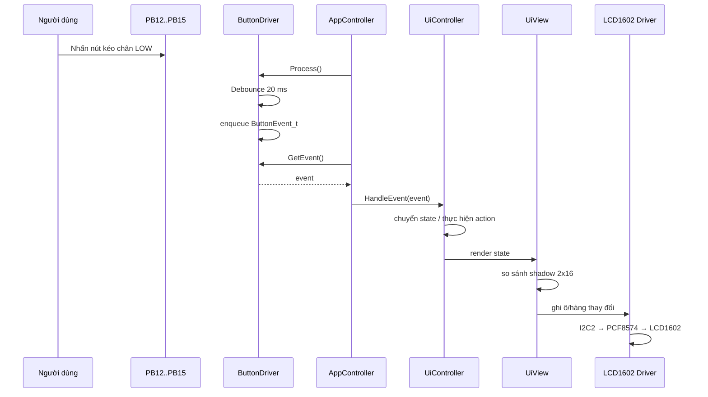

#### 4.2.2. Debounce: phát hiện raw edge chưa phải event hợp lệ

Nút cơ học thường tạo các xung HIGH/LOW ngắn khi đóng/mở. Nếu chỉ kiểm tra `GPIO_ReadInputDataBit()==0` mỗi vòng super-loop, một lần nhấn sẽ tạo rất nhiều sự kiện. Driver dùng mốc **20 ms**: chỉ chấp nhận chuyển trạng thái khi raw level ổn định. Event thường sinh khi *đã xác nhận nhấn* chứ không phải mỗi vòng mức LOW.

**Ví dụ:** Người dùng nhấn SELECT tại t=100 ms; chân rung trong 5 ms và ổn định LOW từ t=105 ms. Khi đo được ổn định đủ 20 ms (khoảng t=125 ms), driver sinh một event SELECT. Đây là ví dụ minh họa nguyên lý; các mốc chính xác phụ thuộc chu kỳ gọi `ButtonDriver_Process()`.

#### 4.2.3. FIFO sự kiện giải quyết vấn đề gì?

Button có thể tạo event ngay trước khi ứng dụng bắt đầu cập nhật màn hình. Nếu UI đọc trực tiếp trạng thái chân, rất khó phân biệt các lần nhấn và xử lý thứ tự. FIFO giúp giữ thứ tự các event, cho phép AppController drain chúng trong main. Độ sâu hữu hạn 8 phần tử: nhấn liên tục nhanh hơn khả năng xử lý sẽ dẫn tới overflow; đó là lỗi được quản lý chứ không phải hàng đợi vô hạn.

#### 4.2.4. Tách UI Controller, View, Formatter

- `ui_controller`: biết đang ở menu nào, con trỏ nào, nút nào có hiệu lực, khi nào gọi `ConfigService_Save()` hoặc `MeasurementService_SetMode()`.
- `ui_view`: biết 2 hàng × 16 ký tự được vẽ ra sao; duy trì shadow; quyết định ghi lại ký tự/hàng.
- `ui_formatter`: đổi float/frequency/duty/resistance thành chuỗi phù hợp 16 ký tự, xử lý đơn vị như Ω/kΩ/MΩ, Hz/kHz (nếu cách hiển thị tương ứng).

**Không để `ui_formatter` gọi trực tiếp ADC hoặc Flash**; nếu muốn unit-test format, chỉ cần input/output text, không cần chạy MCU.

#### 4.2.5. Shadow buffer và lỗi ký tự cũ

LCD ký tự giữ ký tự cũ cho đến khi có lệnh ghi đè. Ví dụ dòng đang chứa `100.00 kOhm`, sau đó chuyển thành `9.0 Ohm`, nếu chỉ ghi phần chuỗi ngắn thì các ký tự cuối vẫn còn. `ui_view` chuẩn hóa đủ 16 ký tự mỗi hàng và chỉ gửi xuống LCD nếu hàng thực sự thay đổi. Cách này tránh lỗi stale characters đồng thời giảm giao dịch I2C.

**Trade-off:** Có thêm 32 byte dữ liệu hiển thị và logic compare, đổi lại giảm thời gian truyền qua I2C 100 kHz. Tuy nhiên, khi ghi màn hình vẫn có thời gian blocking ở LCD Driver (đặc biệt init/clear), nên không được nói “mỗi vòng lặp chắc chắn không bị chặn”.

**File cần đọc:** `Drivers/button_driver.c`, `Application/ui_controller.c`, `Application/ui_view.c`, `Application/ui_formatter.c`, `Drivers/lcd1602_driver.c`.

#### Bài nói khi phỏng vấn: Button → Event FIFO → UI → LCD

> Bốn chân PB12–PB15 dùng active-low với pull-up. ButtonDriver quét và debounce 20 ms, rồi đẩy sự kiện vào FIFO tám phần tử. AppController lấy event, chuyển cho UiController; UiView tạo hai hàng 16 ký tự và tránh ghi lại hàng không đổi thông qua shadow buffer. UI state quyết định nội dung, còn driver LCD thực hiện thao tác I2C2.

#### Câu hỏi ôn tập: Button → Event FIFO → UI → LCD

| Câu hỏi | Ý chính cần trả lời |
|---|---|
| Vì sao không đọc nút trực tiếp trong UI? | Tách mức điện với sự kiện đã debounce, giúp UI độc lập GPIO và dễ test. |
| Bấm nhanh hơn 20 ms có được nhận không? | Có thể không; đó là mục đích loại xung nhiễu và rung tiếp điểm. |
| Nếu FIFO đầy? | Có nguy cơ mất sự kiện; phải quan sát/error và kiểm thử hành vi khi queue quá tải. |
| Vì sao ghi đúng 16 ký tự mỗi hàng? | Xóa ký tự còn sót từ nội dung dài trước đó. |
| Shadow buffer giải quyết vấn đề gì? | Giảm giao dịch LCD/I2C không cần thiết, không phải phần cứng double buffering. |

#### Điểm cần ghi nhớ

- **Câu hỏi:** Ý chính cần trả lời
- **Vì sao không đọc nút trực tiếp trong UI:** Tách mức điện với sự kiện đã debounce, giúp UI độc lập GPIO và dễ test.
- **Bấm nhanh hơn 20 ms có được nhận không:** Có thể không; đó là mục đích loại xung nhiễu và rung tiếp điểm.

#### Các file mã nguồn quan trọng

- `Drivers/button_driver.c`
- `Application/ui_controller.c`
- `Application/ui_view.c`
- `Drivers/lcd1602_driver.c`


---

<a id="luong-3"></a>
### 4.3. Luồng 3 — Mạch chia áp → ADC → đo điện trở

#### 4.3.1. Khối analog đầu vào

```text
3.3 V ── Rref=10 kΩ ──[ADC PA3]── Rx ── GND
```

Khi Rx nhỏ, nút ADC gần GND. Khi Rx lớn, nút ADC gần Vcc. Khi tháo điện trở, nút có xu hướng lên full-scale. Dải lớn có độ nhạy xấu vì mẫu số `Vcc−Vadc` tiến gần 0.

Công thức:

```text
Vadc = (ADC_filtered / 4096) × 3.3
Rx   = 10000 × Vadc / (3.3 − Vadc)
```

**Ví dụ 10 kΩ:** `Vadc≈1,65 V`, ADC≈2048, suy ra `Rx≈10 kΩ`. Tại `Rx=1 MΩ`, `Vadc≈3,267 V`, ADC≈4055, tức chỉ còn vài chục count so với full-scale; vì thế nhiễu dễ bị khuếch đại trong kết quả điện trở.

#### 4.3.2. ADC Request không đợi đủ 16 mẫu

```mermaid
sequenceDiagram
    participant SVC as MeasurementService
    participant DRV as AdcDriver
    participant ADC as ADC1 / EOC ISR
    SVC->>DRV: Request(RESISTOR)
    DRV->>ADC: CH3, sample time, start conversion
    loop 16 EOC
        ADC->>ADC: read DR; sum += sample
        ADC->>ADC: start next conversion (nếu chưa đủ)
    end
    ADC-->>DRV: completed_sum, result_ready
    SVC->>DRV: GetResult(RESISTOR)
    DRV-->>SVC: avg + LPF(alpha=0.2)
    SVC->>SVC: Presence / Median / Convert R / EMA / Deadband
    SVC-->>SVC: update status/value
```

Chi tiết đáng nhớ:

- ADC1 chạy single regular channel, không scan/continuous. Trên `AdcDriver_Request`, driver cấu hình channel và sample time `ADC_SampleTime_239Cycles5`, bật EOC interrupt rồi start conversion.
- ISR chỉ đọc mẫu, cộng `uint32_t`, tăng count và kích hoạt conversion kế tiếp. Khi `count==16`, ISR publish completed sum + ready flag.
- Main context thực hiện phép chia trung bình, LPF và các bộ lọc riêng của điện trở.
- `AdcDriver_Request` từ chối nếu ADC busy, channel không hợp lệ hoặc result còn chờ consume.
- `AdcDriver_Cancel()` vô hiệu EOC, clear pending/ready để một kết quả của màn hình cũ không chảy sang màn hình mới.
- Nếu outstanding request kéo dài **>100 ms**, service Cancel và báo `ADC_CONVERSION_TIMEOUT`.

#### 4.3.3. Vì sao cần nhiều bộ lọc?

| Tầng | Đầu vào → đầu ra | Chống lại điều gì? | Đánh đổi |
|---|---|---|---|
| 16-sample average | 16 ADC counts → average | Nhiễu ngẫu nhiên nhanh | Mất thời gian thu batch |
| LPF alpha=0,2 | average → smoothed ADC | Dao động theo thời gian | Trễ nhẹ |
| Median 5 batches | 5 batch gần nhất → trung vị | Spike/outlier đột biến | Trễ/giảm phản ứng cực nhanh |
| Adaptive EMA | Resistance → smoothed R | Dao động giá trị hiển thị | Alpha nhỏ chậm, alpha lớn nhạy |
| Deadband | Value → giữ/đổi stable | Biến thiên rất nhỏ | Không hiển thị mọi biến động nhỏ |
| 300-ms confirmation | Candidate → stable value | Thay đổi ngắn không bền | Trễ trước đổi số |
| LCD 1-s hold | stable value → LCD | Nhấp nháy khi redraw | Thông tin hiển thị có độ trễ |

**Các tầng không thể thay thế trực tiếp cho nhau.** Median xử lý outlier, EMA làm mượt, deadband chống dao động quanh giá trị đang hiển thị, hysteresis giúp phân loại present/absent.

#### 4.3.4. Adaptive EMA và xác nhận giá trị

EMA tổng quát:

`y[n] = α·x[n] + (1−α)·y[n−1]`.

Trong source:

- Nếu mức thay đổi tương đối `<5%`: `α=0,05` để ổn định.
- Nếu thay đổi `>=5%`: `α=0,30` để bám nhanh hơn.
- Deadband stable output: `max(0,5% × stable_R, 1 Ω)`.
- Chỉ commit giá trị mới nếu ứng viên ở *ngoài deadband cùng hướng* trong ít nhất **300 ms**.
- UI có thêm chính sách cập nhật riêng, không hiển thị lại mọi batch.

**Ví dụ phân biệt:** Khi 10 kΩ thực dao động đo 9,98–10,02 kΩ, dải deadband 0,5% tương đương ±50 Ω, nên LCD giữ nguyên thay vì thay số liên tục. Khi chuyển sang 22 kΩ, chênh >5%, EMA dùng alpha nhanh hơn; sau khi ứng viên ổn định vượt deadband đủ 300 ms, giá trị mới được công bố.

#### 4.3.5. Open socket detection

Nếu không có Rx, `Vadc≈Vcc`, công thức cho R không có giới hạn hữu hạn. Firmware sử dụng:

- `ADC >= 4075` cho dấu hiệu open.
- `ADC <= 4060` cho dấu hiệu present.
- `3 batch` để xác nhận open.
- `5 batch` và `200 ms` liên tục để xác nhận cắm lại.

Khoảng 4060..4075 tạo hysteresis; hai hướng chuyển có thời gian/điều kiện khác nhau. **Đây là cơ chế trạng thái**, không phải chỉ `if (adc>4075) display No Resistor`.

#### 4.3.6. Sai số và giới hạn

- `Rref` có dung sai; Vcc/Vref biến thiên; socket có điện trở tiếp xúc; ADC có offset/gain/noise.
- Đối với Rx lớn, đạo hàm `dR/dV = Rref·Vcc/(Vcc−V)^2` tăng mạnh gần Vcc nên sai số điện trở bị phóng đại.
- Không có phần cứng auto-ranging; giá trị rất lớn có thể bị xem là `NO_COMPONENT` theo ngưỡng chủ ý. Việc tuyên bố chính xác tới “nhiều MΩ” không phù hợp với phần cứng/thuật toán hiện tại.

**File cần đọc:** `Services/measurement_service.c`, `Drivers/adc_driver.c`, `Application/ui_view.c`. **Câu hỏi tự kiểm tra:** Tại sao LPF của ADC nằm trong Driver, nhưng Median/EMA/Deadband lại nằm ở Service?

#### Bài nói khi phỏng vấn: Mạch chia áp → ADC → điện trở

> Mạch Rref 10 kΩ kết hợp Rx tạo điện áp ở PA3; ADC1 CH3 chuyển đổi theo batch 16 mẫu, EOC ISR cộng mẫu rồi main đọc average/LPF. Measurement Service dùng median 5, adaptive EMA, deadband và xác nhận thay đổi 300 ms trước khi công bố giá trị. State riêng phát hiện open/present với hai ngưỡng ADC và xác nhận đếm/time.

#### Câu hỏi ôn tập: Mạch chia áp → ADC → điện trở

| Câu hỏi | Ý chính cần trả lời |
|---|---|
| Tại sao điện áp gần 3,3 V nguy hiểm cho phép tính? | Mẫu số `Vcc−Vadc` rất nhỏ làm nhiễu ADC bị khuếch đại thành sai số R lớn. |
| Đo 0 Ω khác mạch hở thế nào? | 0 Ω cho Vadc gần 0 V; mạch hở cho ADC gần full-scale. |
| Median loại được gì? | Outlier nhất thời; không sửa sai số dung sai Rref. |
| Hysteresis có thay thế deadband không? | Không. Hysteresis dành cho trạng thái mạch hở/có linh kiện, deadband ổn định giá trị số. |
| Lỗi ADC request >100 ms? | Service cancel request, báo ERROR và ghi ADC_CONVERSION_TIMEOUT. |

#### Điểm cần ghi nhớ

- **Câu hỏi:** Ý chính cần trả lời
- **Tại sao điện áp gần 3,3 V nguy hiểm cho phép tính:** Mẫu số `Vcc−Vadc` rất nhỏ làm nhiễu ADC bị khuếch đại thành sai số R lớn.
- **Đo 0 Ω khác mạch hở thế nào:** 0 Ω cho Vadc gần 0 V; mạch hở cho ADC gần full-scale.

#### Các file mã nguồn quan trọng

- `Drivers/adc_driver.c`
- `Services/measurement_service.c`
- `Application/ui_view.c`


---

<a id="luong-4"></a>
### 4.4. Luồng 4 — Mạch RC → ADC + SysTick → đo điện dung

> **Mục tiêu:** Theo dõi đúng chuỗi sự kiện, đầu vào, điều kiện chuyển và kết quả của riêng luồng này; phân biệt code đã triển khai với phương án cải tiến.

#### Sơ đồ luồng hoạt động

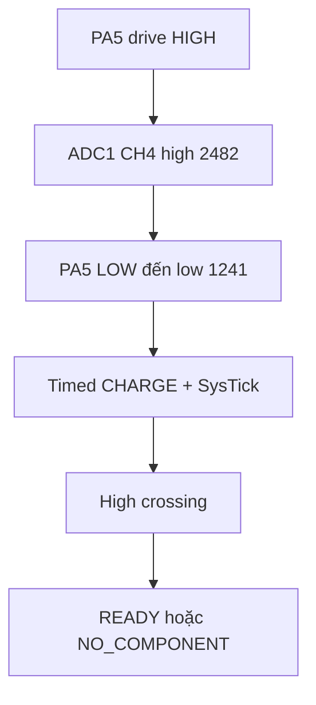


#### 4.4.1. Vì sao không thể chỉ đọc ADC một lần?

Với tụ điện, đại lượng cần suy ra là **C** từ hằng số thời gian nạp/xả. Điện áp tức thời phụ thuộc lịch sử nạp/xả, không đủ để kết luận C nếu không biết thời gian. Firmware điều khiển PA5 qua điện trở 20 kΩ, quan sát PA4/ADC1 CH4 và đo thời gian từ 1 V đến 2 V.

```text
PA5 (GPIO output) ── R=20 kΩ ──●── Cx ── GND
                                │
                              PA4/ADC1_CH4
```

#### 4.4.2. Quy trình có hai lần nạp

Một lỗi giải thích phổ biến là “nhấn CHARGE thì bắt đầu đo thời gian ngay”. Code **không** làm vậy. Nó:

1. Nhấn CHARGE trong màn tụ → `MeasurementService_StartCapacitor()`.
2. Nạp sơ bộ để xác định tụ/nút đã đạt ngưỡng cao.
3. Kéo PA5 LOW, xả đến ngưỡng thấp.
4. Khi ADC thấp hơn ~1 V, đưa PA5 HIGH và **lúc này mới ghi start tick**.
5. Reset filter ADC của nhánh tụ ở mốc bắt đầu timed charge để tránh dữ liệu của bước xả gây trễ ảo.
6. Chờ ADC vượt ngưỡng ~2 V lần nữa, ghi stop tick.
7. Tính C từ khoảng thời gian; nếu high xuất hiện ngay ở first batch, xem như `NO_COMPONENT`/tụ nhỏ hơn dải dự kiến.
8. Đưa PA5 LOW; công bố trạng thái `READY` hoặc `NO_COMPONENT`.

#### 4.4.3. Toán học từ mạch RC

Với tụ nạp từ điện áp `V0`:

`V(t)=Vcc−(Vcc−V0)exp(−t/(RC))`.

Lấy thời điểm điện áp đạt `Vlow` và `Vhigh`, khử mốc thời gian ban đầu:

`t_high − t_low = R·C·ln[(Vcc−Vlow)/(Vcc−Vhigh)]`.

Suy ra:

`C = Δt / {R·ln[(Vcc−Vlow)/(Vcc−Vhigh)]}`.

Dưới giả định `Vcc≈3,3 V`, `Vlow≈1 V`, `Vhigh≈2 V`, hệ số log xấp xỉ 0,57. Source dùng hằng `1,74563473` nhân `t/R`; đây là hệ số quy đổi/hiệu chỉnh được hiện thực trong project. **Không diễn giải sai hằng này là một định luật vật lý chung**: thay ngưỡng ADC, Vcc hoặc điện trở, hệ số cần được tính/hiệu chuẩn lại.

#### 4.4.4. Vì sao SysTick 1 ms gây sai số lớn cho tụ nhỏ?

Theo công thức source: `C ≈ (1,74563473 × t) / 20000`. Với `t=1 ms` → `C≈87,28 nF`. Nghĩa là chỉ một tick SysTick đã tương đương khoảng 87 nF trong quy đổi thời gian lý tưởng. Ở tụ 100 nF, thời gian đo chỉ khoảng 1,15 ms; độ lệch một tick cực kỳ lớn về tỷ lệ. Tại 10 µF, thời gian tương đương khoảng 114,6 ms, nên lượng tử hóa thời gian nhỏ hơn tương đối.

**Bài học phỏng vấn:** Nói rằng phép đo 100 nF có sai số chỉ do “ADC 12 bit” là thiếu. Sai số phụ thuộc mạnh vào **độ phân giải thời gian**, ngưỡng, ADC batch/filter delay, điện trở thực, GPIO và điện dung ký sinh.

#### 4.4.5. Non-blocking đến đâu?

FSM tụ tiến từng bước trong `MeasurementService_ProcessCapacitor()`, không có một `delay_ms(1000)` chờ tụ nạp trong main. Tuy nhiên:

- ADC conversion hoàn tất từng batch qua interrupt; bản thân thời điểm phát hiện ngưỡng bị lượng tử hóa theo lịch đọc batch.
- Nếu tụ rất lớn, bị ngắn mạch hoặc đường analog không bao giờ đạt ngưỡng, FSM có thể kẹt ở trạng thái chờ ngưỡng; code hiện tại **không có timeout tổng thể riêng cho cả chu trình tụ**. Timeout ADC 100 ms chỉ phát hiện **batch ADC không xong**, không phát hiện điện áp mãi không đạt ngưỡng.
- Khi rời mode, service phải hạ charge pin/cancel pending ADC và trả trạng thái phần cứng về an toàn.

**File cần đọc:** `Services/measurement_service.c` (nhóm `CAP_*`, `StartCapacitor`, `ProcessCapacitor`), `Drivers/capacitor_charge_driver.c`, `Drivers/adc_driver.c`, `Platform/system_time.c`.

#### Bài nói khi phỏng vấn: Mạch RC → ADC + SysTick → điện dung

> PA5 điều khiển nạp/xả qua điện trở 20 kΩ, PA4 ADC1 CH4 theo dõi điện áp. FSM đợi nhấn CHARGE, nạp sơ bộ tới ngưỡng cao, xả đến ngưỡng thấp, sau đó nạp có bấm giờ từ khoảng 1 V tới 2 V. Service tính C bằng hằng 1,74563473 × t / 20000 và phân loại NO_COMPONENT khi high ngay batch đầu.

#### Câu hỏi ôn tập: Mạch RC → ADC + SysTick → điện dung

| Câu hỏi | Ý chính cần trả lời |
|---|---|
| Vì sao cần hai pha nạp? | Pha đầu đưa mạch qua vùng đã biết, pha xả tạo điểm xuất phát, pha thứ hai mới đo Δt. |
| Vì sao dùng SysTick có hạn chế? | 1 ms có sai số tương đối lớn khi thời gian đo gần 1–2 ms. |
| NO_COMPONENT có chứng minh không có tụ không? | Không; tụ nhỏ ngoài dải cũng có thể vượt ngưỡng ngay batch đầu. |
| Nếu tụ short, ADC vẫn hoạt động? | FSM có thể chờ ngưỡng không đạt; hiện chưa có timeout tổng thể riêng từng pha. |
| Rời mode khi đang nạp? | Cần gọi exit/cancel và đưa PA5 về LOW để không giữ mạch nạp. |

#### Điểm cần ghi nhớ

- **Câu hỏi:** Ý chính cần trả lời
- **Vì sao cần hai pha nạp:** Pha đầu đưa mạch qua vùng đã biết, pha xả tạo điểm xuất phát, pha thứ hai mới đo Δt.
- **Vì sao dùng SysTick có hạn chế:** 1 ms có sai số tương đối lớn khi thời gian đo gần 1–2 ms.

#### Các file mã nguồn quan trọng

- `Services/measurement_service.c`
- `Drivers/capacitor_charge_driver.c`
- `Drivers/adc_driver.c`


---

<a id="luong-5"></a>
### 4.5. Luồng 5 — TIM2 PWM Output → TIM1/TIM3/TIM4 PWM Capture

#### 4.5.1. Hai đường dữ liệu khác nhau

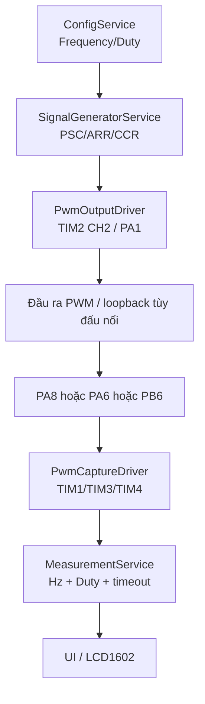

**Không mặc định PA1 đã nối điện với PA8/PA6/PB6.** Đó là kết nối thử nghiệm/loopback bên ngoài (hoặc nguồn PWM ngoài). Trong runtime, việc enable TIM2 output khi vào frequency/duty không thay thế dây tín hiệu vật lý.

#### 4.5.2. PWM Output bằng phần cứng

TIM2 CH2 (PA1) với `fTIM=72 MHz`:

`fPWM = fTIM / ((PSC+1)(ARR+1))`.

Trong PWM Mode 1 và cấu hình polarity hiện tại:

`CNT < CCR2` ⇒ HIGH; `CNT >= CCR2` ⇒ LOW.

Service quét các PSC hợp lệ. Với mỗi PSC, tính số tick chu kỳ gần giá trị mong muốn, đánh giá sai số tần số và chọn cấu hình có sai số nhỏ, dừng khi sai số thỏa `<1%`. Sau đó `CCR2≈(ARR+1)×Duty/100`. Driver áp các thanh ghi đó vào TIM2; timer tự tạo xung mà không cần CPU toggle GPIO mỗi cạnh.

**Ví dụ 1 kHz, 50%:** `PSC=0`, `ARR=71999` vượt 16 bit; cấu hình hợp lệ khác là `PSC=1`, `ARR=35999`, `CCR≈18000` (minh họa bộ đếm 72 MHz / 2 / 36000 = 1 kHz). Trong source, thuật toán chọn một cấu hình hợp lệ theo thứ tự quét, không nhất thiết chính bộ ba trong ví dụ này nếu thứ tự/điều kiện cho kết quả khác.

**Giới hạn 100% duty:** Source kẹp `compare` để **không vượt ARR**, nên khi yêu cầu 100%, CCR không đặt thành ARR+1. Điều đó có thể để lại một tick LOW mỗi chu kỳ thay vì HIGH tuyệt đối. Khi phỏng vấn, có thể nêu phương án dùng forced-active mode hoặc cấu hình đặc biệt để đạt 100% thực sự, nếu yêu cầu sản phẩm đòi hỏi.

#### 4.5.3. PWM Input Capture bằng ba timer

| Expected frequency | Timer / pin | PSC | Counter clock |
|---|---|---:|---:|
| `<200 Hz` | TIM4 / PB6 | 1098 | `72 MHz / 1099 ≈ 65,5 kHz` |
| `200–<4000 Hz` | TIM3 / PA6 | 7 | `9 MHz` |
| `>=4000 Hz` | TIM1 / PA8 | 0 | `72 MHz` |

Đặc điểm cấu hình:

- PWM Input Mode: CH1 chụp period theo rising edge; CH2 chụp high time theo falling edge.
- Slave Reset Mode reset counter từ trigger TI1FP1; hai giá trị dùng chung timebase.
- ISR nhận sự kiện capture, đưa period/high time và timestamp vào cấu trúc; main đọc snapshot trong critical section.
- Driver dừng cả ba timer và xóa cờ cũ trước khi enable một timer mới, tránh hai kênh active hoặc dữ liệu stale.

Công thức:

`frequency_hz = timer_clock_hz / period_ticks`

`duty_percent = 100 × high_ticks / period_ticks`.

**Ví dụ:** TIM3 có counter clock 9 MHz, input 1 kHz → chu kỳ lý tưởng 9000 ticks; 30% HIGH → 2700 ticks; suy ra 1000 Hz và 30%. Trong thực tế jitter, input filter, thời điểm cạnh và cấu hình sẽ ảnh hưởng số tick đo được.

#### 4.5.4. Vì sao không dùng một timer cho tất cả tần số?

Timer 16-bit có tối đa 65536 tick/cycle. Ở 72 MHz, 1 Hz cần 72 triệu tick, tràn nhiều lần. Giảm clock để đo 1 Hz thì ở 100 kHz chỉ còn rất ít tick/chu kỳ ⇒ độ phân giải duty kém. Ba PSC/dải thể hiện trade-off **chống overflow ↔ giữ độ phân giải**. Với TIM4 PSC=1098, 1 Hz tương ứng khoảng 65514 tick, vừa gần giới hạn 16 bit; với TIM1 72 MHz, 100 kHz có 720 tick/chu kỳ.

#### 4.5.5. Expected frequency khác measured frequency

Firmware hiện gọi chọn timer dựa trên **giá trị expected frequency** (liên hệ cấu hình PWM của project), **không tự phân tích tín hiệu input chưa biết để lựa chọn dải**. Nếu bạn đưa tín hiệu 1 Hz vào chân/timer đang được chọn cho 50 kHz, phép đo có thể không hợp lệ vì counter overflow/timeout. Đây là giới hạn thiết kế chứ không phải có auto-ranging hoàn chỉnh.

#### 4.5.6. Không có tín hiệu và dữ liệu lỗi

- Một sample hợp lệ phải thỏa `period_ticks>0` và `high_ticks<=period_ticks`.
- Khi không có fresh capture quá 1100 ms, service đặt frequency/duty về 0 và status `NO_SIGNAL`.
- Việc sample inválid có đường báo lỗi qua Error Manager; không được lấy `period_ticks==0` làm mẫu để chia 0.
- Tín hiệu duty gần 0%/100% có thể thiếu cạnh lên/xuống đúng kỳ vọng của PWM Input Mode; không nên mặc nhiên đảm bảo đo được hai biên này như các duty 10–90% đã validation.

**File cần đọc:** `Services/signal_generator_service.c`, `Drivers/pwm_output_driver.c`, `Drivers/pwm_capture_driver.c`, `Services/measurement_service.c`.

#### Bài nói khi phỏng vấn: TIM2 PWM Output → PWM Input Capture

> Signal Generator tính PSC/ARR/CCR để TIM2 CH2 tạo xung PA1; phần capture sử dụng TIM4/PB6, TIM3/PA6 hoặc TIM1/PA8 theo expected frequency. CH1 đo period, CH2 đo high time trong PWM Input Mode; ISR công bố cặp dữ liệu và main tính Hz/% với snapshot nhất quán.

#### Câu hỏi ôn tập: TIM2 PWM Output → PWM Input Capture

| Câu hỏi | Ý chính cần trả lời |
|---|---|
| Tại sao phải tính `PSC+1` và `ARR+1`? | Prescaler và auto reload mã hóa số đếm dạng trừ một, không phải số tick trực tiếp. |
| Vì sao duty 100% có thể không HIGH hoàn toàn? | Driver clamp CCR về ARR; ở chu kỳ có thể vẫn còn một tick LOW. |
| Timer capture được chọn tự động theo tín hiệu ngoài? | Không; dựa trên tần số kỳ vọng, hiện lấy từ cấu hình PWM generator. |
| Vì sao dùng critical section khi copy capture? | Tránh cặp period/high bị cập nhật xen kẽ bởi ISR. |
| Không có tín hiệu bao lâu thì NO_SIGNAL? | Lâu hơn 1100 ms không có capture mới. |

#### Điểm cần ghi nhớ

- **Câu hỏi:** Ý chính cần trả lời
- **Tại sao phải tính `PSC+1` và `ARR+1`:** Prescaler và auto reload mã hóa số đếm dạng trừ một, không phải số tick trực tiếp.
- **Vì sao duty 100% có thể không HIGH hoàn toàn:** Driver clamp CCR về ARR; ở chu kỳ có thể vẫn còn một tick LOW.

#### Các file mã nguồn quan trọng

- `Services/signal_generator_service.c`
- `Drivers/pwm_output_driver.c`
- `Drivers/pwm_capture_driver.c`
- `Services/measurement_service.c`


---

<a id="luong-6"></a>
### 4.6. Luồng 6 — UI Setting → Config Service → Internal Flash

> **Mục tiêu:** Theo dõi đúng chuỗi sự kiện, đầu vào, điều kiện chuyển và kết quả của riêng luồng này; phân biệt code đã triển khai với phương án cải tiến.

#### Sơ đồ luồng hoạt động

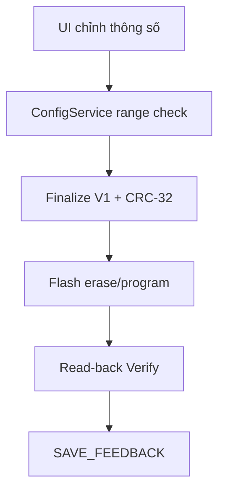


#### 4.6.1. Có những cấu hình nào?

| Trường | Range hợp lệ | Default |
|---|---:|---:|
| `frequency` | 1..100000 Hz | 50000 Hz |
| `duty` | 1..100% | 50% |
| `freq_step` | 1..10000 Hz | 1000 Hz |
| `duty_step` | 1..10% | 1% |

Điều chỉnh bằng `UP/DOWN`; `SELECT` xác nhận, gọi `ConfigService_Save()` và vào màn `SAVE_FEEDBACK` 800 ms. Phép đo PWM sau đó sử dụng các thông số runtime mà Config Service cung cấp.

#### 4.6.2. Bố trí Flash

```text
STM32 Internal Flash 64 KiB (theo cấu hình project)
0x08000000 ┌──────────────────────────────┐
           │ Application code / RO data  │
           │ ...                          │
0x0800FBFF └──────────────────────────────┘
0x0800FC00 ┌──────────────────────────────┐
           │ Last 1 KiB page: config     │
           │ Record V1: 24 bytes         │
           │ Remaining page unused       │
0x0800FFFF └──────────────────────────────┘
```

Keil link region dùng `0xFC00` bytes từ `0x08000000`, chừa 1 KiB trang cuối. Chỉ khai báo `FLASH_STORAGE_ADDRESS=0x0800FC00` mà không reserve link region thì firmware tăng kích thước có thể ghi đè cấu hình.

#### 4.6.3. Flash record 24 byte

```text
Offset   Size   Field
0        4      magic = 0xA5A5A5A5
4        2      version = 1
6        2      record_size = 24
8        4      frequency_value
12       2      duty_value
14       2      freq_step
16       1      duty_step
17       3      reserved[3] = 0
20       4      crc32 (over bytes [0..19])
```

Các offset trên tương ứng bố cục struct được ghi trong source và tài liệu (với layout/ABI build STM32 đang dùng). Không tùy tiện thay đổi packing, size hoặc trường mà giữ nguyên version rồi kỳ vọng record cũ còn đọc đúng.

#### 4.6.4. CRC-32 và các lớp kiểm tra

- `magic`: giúp nhận diện dữ liệu đúng loại, không coi trang xóa `0xFF` là một record.
- `version`: tránh parse layout mới như layout cũ.
- `record_size`: bảo vệ trường hợp struct thay đổi kích thước.
- `CRC-32`: phát hiện dữ liệu bị hỏng trong vùng byte đã bảo vệ.
- `range validation`: phát hiện giá trị vô nghĩa dù CRC có thể đúng.

CRC thực hiện trên 20 byte trước field `crc32`, reflected polynomial `0xEDB88320`, init/final XOR `0xFFFFFFFF`. **CRC là phát hiện lỗi, không phải chữ ký số hay mã hóa.**

#### 4.6.5. Load và migration

Khi boot, driver thử V1. Nếu invalid, nó thử layout V0 hợp lệ để migrate sang cấu trúc V1 trong RAM; nếu không được thì dùng defaults. Trong cả trường hợp migrated/default, driver đánh dấu cần ghi lại sau nhưng **không cưỡng bức erase/program Flash ngay trong boot**. Đây là cách giảm ghi Flash không cần thiết và tránh tăng thao tác rủi ro khi khởi động.

#### 4.6.6. Save transaction

1. Service chụp snapshot cấu hình đang chỉnh, validate range.
2. Driver finalize metadata và CRC; quyết định có cần ghi nếu dữ liệu thực sự thay đổi hay không.
3. Lưu PRIMASK, tắt IRQ khi bước Flash erase/program cần thiết.
4. Unlock/erase trang 1 KiB, program theo half-word 16 bit, lock Flash, phục hồi trạng thái IRQ.
5. Read back record; validate và so sánh byte (`memcmp`).
6. Trả status `OK` hoặc `ERASE/PROGRAM/VERIFY_FAILED` theo nhánh.
7. UI báo kết quả lưu và điều hướng sau 800 ms.

**Vì sao cần verify sau program?** Hàm Flash báo thành công không bảo đảm mọi byte trên Flash khớp cấu hình mong muốn dưới mọi lỗi phần cứng. Read-back + validation kiểm tra trạng thái thực, nhưng **không** giải quyết được mất điện giữa erase/program.

#### 4.6.7. Wear, power loss và rủi ro

- Flash có số chu kỳ erase/program hữu hạn; không nên ghi mỗi vòng super-loop hoặc sau mỗi lần thay đổi giá trị nhất thời. Project chỉ lưu khi có yêu cầu UI và có cơ chế tránh ghi nếu không cần.
- Ghi cùng một trang luôn cần erase page khi cập nhật record ⇒ sau mất điện lúc erase/program, record có thể hỏng; boot fallback default/migration chứ không phục hồi chắc chắn cấu hình mới/cũ.
- **[Đề xuất]** Dùng hai slot A/B với generation, CRC và commit marker, hoặc journal append record; chọn bản hợp lệ mới nhất khi boot.

**File cần đọc:** `Services/config_service.c`, `Drivers/flash_storage_driver.c`, `Application/ui_controller.c`, `MDK/mini-multimeter.uvprojx`/linker setting.

#### Bài nói khi phỏng vấn: UI Setting → Config → Internal Flash

> UI chỉnh frequency, duty và bước nhảy; Config Service quản lý giá trị runtime. Khi yêu cầu lưu, driver tạo record V1 có magic/version/size/payload/CRC-32; nếu thay đổi thì erase trang tại 0x0800FC00, program theo half-word rồi đọc lại validate và so sánh. Lúc boot, V1 hợp lệ được dùng; nếu không có, thử V0 rồi default.

#### Câu hỏi ôn tập: UI Setting → Config → Internal Flash

| Câu hỏi | Ý chính cần trả lời |
|---|---|
| Save có luôn erase Flash không? | Không. Code kiểm tra thay đổi và có thể bỏ qua ghi không cần thiết. |
| CRC bảo vệ tính gì? | Phát hiện record lỗi do lưu/đọc; không xác thực người ghi. |
| Mất điện giữa erase/program thì sao? | Có thể mất record hợp lệ; thiết kế chỉ dùng một trang, chưa có A/B an toàn nguồn. |
| Khi V0 hợp lệ? | Migration sang V1 trong RAM và đánh dấu cần ghi lại ở lần save sau. |
| Vì sao read-back verify? | Program trả OK chưa đủ để bảo đảm byte thực trên Flash khớp record dự kiến. |

#### Điểm cần ghi nhớ

- **Câu hỏi:** Ý chính cần trả lời
- **Save có luôn erase Flash không:** Không. Code kiểm tra thay đổi và có thể bỏ qua ghi không cần thiết.
- **CRC bảo vệ tính gì:** Phát hiện record lỗi do lưu/đọc; không xác thực người ghi.

#### Các file mã nguồn quan trọng

- `Services/config_service.c`
- `Drivers/flash_storage_driver.c`
- `Application/ui_controller.c`


---

<a id="luong-7"></a>
### 4.7. Luồng 7 — Driver/Service → Error Manager → UART Logger

#### 4.7.1. Quan sát lỗi thay vì giấu lỗi trong từng module

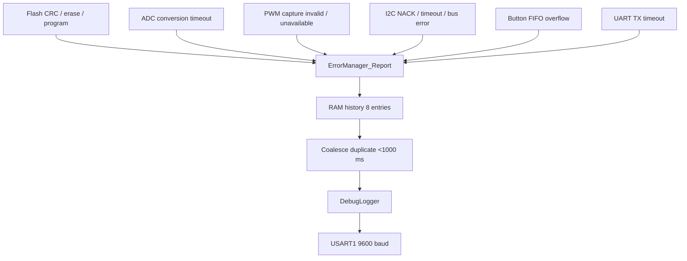

#### 4.7.2. Error record chứa gì?

`source`, `code`, `severity`, `timestamp_ms`, `repeat_count`.

Nếu lỗi giống record kề trước và xảy ra trong khoảng 1000 ms, Error Manager tăng repeat count thay vì tạo record mới. Khi lỗi mới xuất hiện và logger đã sẵn sàng, có thể phát UART ngay; lỗi trước logger được giữ đến `ErrorManager_Flush()`.

#### 4.7.3. Vì sao không dùng `printf` khắp nơi?

Đặt chuỗi UART trực tiếp vào ADC/PWM ISR làm interrupt dài, gây jitter và coupling vào transport. Mô hình Error Manager cho phép module báo `source/code/severity`, sau đó lớp logging quyết định định dạng. Việc gom lỗi lặp hạn chế flood ở một UART có băng thông thấp (9600 baud).

#### 4.7.4. Chú ý khi phân loại lỗi

- `NO_COMPONENT` khi không có điện trở/tụ phù hợp là trạng thái đo **bình thường**, không nhất thiết là sự cố hệ thống.
- `NO_SIGNAL` ở PWM là trạng thái không có cạnh hợp lệ, cũng không tự động là lỗi phần cứng nghiêm trọng.
- ADC request pending quá 100 ms, Flash CRC/range sai, I2C runtime timeout, FIFO overflow hoặc capture pair không hợp lệ là các tình huống nên có mã lỗi/diagnostic.
- `ERROR` của Measurement Status nên là tình trạng không thể tiếp tục phép đo hiện tại một cách tin cậy; giá trị `0` không dùng thay thế.

#### 4.7.5. Ví dụ diễn giải log khởi động

```text
[0000000000][INFO][APP] Boot
[0000000000][WARN][FLASH] 0x0105 BAD_CRC
[0000000000][INFO][APP] Config F=50000Hz D=50% Fstep=1000 Dstep=1 (BAD_CRC)
[0000000001][INFO][LCD] Scanning I2C2 addresses
[0000000015][INFO][LCD] Found at 0x27
[0000000280][INFO][LCD] Init OK
```

Ví dụ này là format log minh họa được tài liệu repo ghi lại. Không cần thuộc riêng timestamp; cần hiểu lỗi Flash được giữ/đưa ra sau khi UART sẵn sàng và hệ thống vẫn có thể dùng defaults để tiếp tục.

**File cần đọc:** `Infrastructure/error_manager.c`, `Infrastructure/debug_logger.c`, `Platform/uart_port.c`, `Application/app_controller.c`.

#### Bài nói khi phỏng vấn: Driver/Service → Error Manager → UART

> Khi driver hoặc service phát hiện lỗi, nó báo mã nguồn và severity qua Error Manager. Lịch sử RAM có tám record, gộp lỗi trùng liền kề trong 1000 ms. Khi UART logger sẵn sàng, các lỗi trước đó được flush; nhật ký USART1 9600 baud giúp quan sát luồng khởi động và lỗi runtime.

#### Câu hỏi ôn tập: Driver/Service → Error Manager → UART

| Câu hỏi | Ý chính cần trả lời |
|---|---|
| Error Manager và Debug Logger khác nhau? | Manager lưu, gộp và phân loại record; logger định dạng/gửi text qua UART. |
| Lỗi trước khi UART init có mất không? | Nếu Error Manager đã init, record có thể tồn tại trong RAM và được flush sau. |
| Log có được lưu qua reset không? | Lịch sử hiện ở RAM, không phải log persistent sau power loss. |
| UART RX có command protocol đầy đủ chưa? | Chưa; có buffer gom đến `!`, chưa có parser lệnh ứng dụng hoàn chỉnh. |
| Logger có thể gây latency? | Có thể; baud 9600 và TX polling/timeout cần được tính vào timing budget. |

#### Điểm cần ghi nhớ

- **Câu hỏi:** Ý chính cần trả lời
- **Error Manager và Debug Logger khác nhau:** Manager lưu, gộp và phân loại record; logger định dạng/gửi text qua UART.
- **Lỗi trước khi UART init có mất không:** Nếu Error Manager đã init, record có thể tồn tại trong RAM và được flush sau.

#### Các file mã nguồn quan trọng

- `Infrastructure/error_manager.c`
- `Infrastructure/debug_logger.c`
- `Platform/uart_port.c`


---
<a id="phan-5"></a>
## Phần 5. Phân tích chi tiết State Machine và tình huống runtime

> **Phương pháp học Phần 5:** Mỗi case được phân tích theo cấu trúc **điều kiện ban đầu → trigger → hành động → trạng thái → kết quả hiển thị → lỗi/giới hạn → câu trả lời phỏng vấn**. Khi kiểm tra source, đừng chỉ đọc switch-case: tìm các hàm enter/exit và các biến static lưu lịch sử.

<a id="chuong-5-1"></a>
### 5.1. UI Navigation và vòng đời màn hình

> **Mục tiêu:** Theo dõi đúng chuỗi sự kiện, đầu vào, điều kiện chuyển và kết quả của riêng luồng này; phân biệt code đã triển khai với phương án cải tiến.

#### Sơ đồ luồng hoạt động

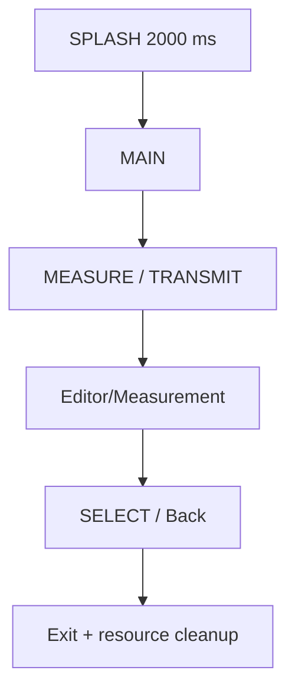


#### 5.1.1. Startup: từ reset đến menu

- `AppController_Init()` chạy các init theo thứ tự; `UiController_Init()` đặt state ban đầu của UI.
- LCD hiện **splash 2000 ms**. UI không gọi một `delay_ms(2000)` để giữ nguyên màn hình: nó lưu tick bắt đầu, mỗi `UiController_Update()` so sánh elapsed và chuyển state khi hết thời gian.
- Trong splash, button events có thể bị bỏ qua theo chính sách UI; super-loop vẫn xử lý các bước khác. Vì vậy “không phản ứng với nút trong splash” khác với “CPU bị chặn 2 s”.
- Sau splash, main menu hiển thị với các nhánh Measure và Transmit.

**Câu hỏi:** “Tại sao dùng tick để vẽ splash?” → Vì ứng dụng có thể cập nhật timeout/sự kiện khác trong khi vẫn giữ splash. Delay dài trong UI làm mất responsiveness và làm trễ các công việc khác.

#### 5.1.2. Menu và cursor memory

Repo có các menu chính: `MAIN`, `MEASURE`, `SINGLE`, `TRANSMIT`. Mỗi menu danh sách giữ vị trí cursor riêng, nên khi quay từ màn con lên, lựa chọn trước vẫn được khôi phục hợp lý. `Back` là hành động điều hướng, không phải một resume index có ích.

```text
MAIN
├── Measure
│   ├── Single Mode
│   │   ├── Resistor
│   │   ├── Capacitor
│   │   ├── Frequency
│   │   ├── Duty Cycle
│   │   └── Back
│   ├── All Mode
│   └── Back
└── Transmit
    ├── Frequency
    ├── Duty Cycle
    ├── Setting
    │   ├── Frequency Step
    │   └── Duty Step
    └── Back
```

#### 5.1.3. Tách event handler với update

- `HandleEvent()` phản ứng với event nhấn nút đã debounce.
- `Update()` tiến triển time-based state, xử lý measurement và render.
- Không đặt việc chờ người dùng bấm nút trong một `while` chặn: input đã được chuyển thành event, UI xử lý theo từng lượt main loop.

#### 5.1.4. Chuyển màn hình phải thay đổi resource ownership

Khi vào Resistor: MeasurementService cấu hình mode và ADC. Khi thoát màn đo: trả mode về NONE; release/disable ngoại vi liên quan. Nếu UI quên gọi exit hoặc `SetMode`, ADC/timer có thể tiếp tục chạy; rồi một màn khác ghi lại cấu hình register và tạo race khó debug. Nên coi **enter/exit là giao dịch tài nguyên**, không chỉ thay đổi text LCD.

#### 5.1.5. Test cases cho UI

| Case | Hành động | Điều mong đợi |
|---|---|---|
| UI-01 | Boot, không bấm nút | Splash ~2 s → Main |
| UI-02 | Bấm UP/DOWN nhanh trong thời gian bounce | Một event cho một lần nhấn ổn định |
| UI-03 | Đang menu Measure, vào Single rồi Back | Cursor của Measure không bị xóa bất ngờ |
| UI-04 | Vào Resistor, nhấn SELECT | Exit measurement → Single Menu |
| UI-05 | Save cấu hình OK | Show feedback ~800 ms, trở về menu đích |
| UI-06 | Save cấu hình lỗi | Hiển thị fail và trở về editor tương ứng |
| UI-07 | Gửi >8 button event trước khi dequeue | FIFO overflow được phát hiện/log |


#### Bài nói khi phỏng vấn: UI Navigation và vòng đời màn hình

> Các event UP/DOWN/SELECT do ButtonDriver tạo đi vào UI FSM; Splash 2000 ms và Save Feedback 800 ms sử dụng timestamp. Khi đi khỏi measurement screen, UI gọi xử lý exit để giải phóng peripheral. Mỗi menu giữ cursor riêng và nút Back không trở thành điểm resume lâu dài.

#### Câu hỏi ôn tập: UI Navigation và vòng đời màn hình

| Câu hỏi | Ý chính cần trả lời |
|---|---|
| Splash có `delay_ms(2000)` trong app không? | Không; là trạng thái có elapsed time, main loop vẫn chạy. |
| SAVE_FEEDBACK có phải trạng thái riêng? | Có, dùng biến return target để biết thành công/thất bại quay về đâu. |
| Điểm cần test khi Back? | Mode exit, PA5 an toàn, timer/ADC cancel và khôi phục con trỏ menu. |
| Nút bị bỏ qua trong Splash có làm main ngừng chạy? | Không; event bị ignore theo UI policy, super-loop còn chạy. |

#### Điểm cần ghi nhớ

- **Câu hỏi:** Ý chính cần trả lời
- **Splash có `delay_ms(2000)` trong app không:** Không; là trạng thái có elapsed time, main loop vẫn chạy.
- **SAVE_FEEDBACK có phải trạng thái riêng:** Có, dùng biến return target để biết thành công/thất bại quay về đâu.

<a id="chuong-5-2"></a>
### 5.2. Đo điện trở: trạng thái có/không có linh kiện và ổn định kết quả

> **Mục tiêu:** Theo dõi đúng chuỗi sự kiện, đầu vào, điều kiện chuyển và kết quả của riêng luồng này; phân biệt code đã triển khai với phương án cải tiến.

#### Sơ đồ luồng hoạt động

```mermaid
flowchart TD
    S1["UNKNOWN"]
    S2["ADC batch mới"]
    S1 --> S2
    S3["Open x3 → ABSENT"]
    S2 --> S3
    S4["Present x5 + 200 ms"]
    S3 --> S4
    S5["PRESENT + filter"]
    S4 --> S5
    S6["READY ổn định"]
    S5 --> S6
```


#### 5.2.1. Khi vừa vào mode

`MeasurementService_SetMode(MEASUREMENT_MODE_RESISTOR, ...)` reset biến đo/lịch sử presence, khởi động ADC1 ở channel điện trở, reset bộ lọc ADC của nhánh R. Status ban đầu là `MEASURING`. Service gọi `AdcDriver_Request(RESISTOR)` khi không có request pending.

**Vì sao reset filter khi vào mode?** Dữ liệu ADC cũ có thể đến từ linh kiện trước hoặc kênh đo khác. Nếu giữ EMA/median như cũ, số đầu tiên trên màn mới không phản ánh đầu vào mới.

#### 5.2.2. Trường hợp socket đang hở

```text
UNKNOWN
  ├─ Batch 1: ADC >= 4075 → open_count = 1
  ├─ Batch 2: ADC >= 4075 → open_count = 2
  └─ Batch 3: ADC >= 4075 → open_count = 3
      → ABSENT
      → measured_R = 0 (giá trị nội bộ)
      → measurement_status = NO_COMPONENT
      → UI hiển thị No Resistor
```

**Quan trọng:** `measured_R = 0` ở đây không có nghĩa firmware kết luận linh kiện 0 Ω; trạng thái `NO_COMPONENT` giải thích đây là giá trị sentinel nội bộ đi kèm status, và UI phải ưu tiên status.

#### 5.2.3. Khi cắm điện trở vào socket đang hở

```text
ABSENT
  ├─ ADC <= 4060: xác nhận present candidate
  ├─ tích lũy đủ 5 batch
  └─ giữ liên tục >=200 ms
     → PRESENT
     → reset lịch sử đo phù hợp
     → có thể công bố READY sau tính toán/lọc
```

Chính sách bất đối xứng: “rút ra” và “cắm vào” có ngưỡng và thời gian xác nhận khác. Điều này tránh việc ADC gần full scale dao động ngẫu nhiên làm màn hình cứ chuyển `No Resistor` ↔ vài MΩ.

#### 5.2.4. Khi thay 10 kΩ bằng 22 kΩ

- ADC filtered dịch lên từ ~2048 đến khoảng 2816 counts theo công thức lý tưởng.
- Median giảm tác động spike một lần; EMA phát hiện thay đổi tương đối lớn nên dùng alpha nhanh `0,30`.
- Candidate mới nằm ngoài deadband ổn định cũ; phải tồn tại cùng hướng trong 300 ms thì stable result mới được nhận.
- UI hiển thị theo pacing của màn Resistance (đặc biệt 1 s sample-and-hold), nên thời điểm số đổi muộn hơn thời điểm service lần đầu thấy khác biệt.

**Cần phân biệt:** `300 ms confirmation` thuộc Measurement Service; `1 s sample-and-hold` thuộc presentation. Chúng là hai lớp latency riêng, không cộng máy móc thành số cố định cho mọi tình huống.

#### 5.2.5. Sai số và dữ liệu ranh giới

- Với Rx rất nhỏ, Vadc gần 0, có thể bị giới hạn bởi điện trở tiếp xúc và offset ADC; code có nhánh bảo vệ mức điện áp gần 0 (`MIN_VOLTAGE`).
- Với Rx rất lớn, Vadc gần Vcc, phép chia không ổn định; code có guard `ADC_VCC−Vadc` nhỏ và cơ chế `NO_COMPONENT`.
- Khi điện áp nằm trong khoảng hysteresis 4060–4075, tránh đổi trạng thái liên tục; hành vi cụ thể phụ thuộc state trước đó.
- Khi ADC batch bị kẹt quá 100 ms, lỗi ADC conversion timeout phải được báo, thay vì hiển thị lại một số READY cũ như không có vấn đề.

#### 5.2.6. Câu hỏi phỏng vấn riêng

**“Tại sao không dùng một moving average duy nhất?”** Vì moving average giảm nhiễu nhưng không thay được median cho outlier, hysteresis để phát hiện linh kiện và deadband để ổn định số đang hiển thị. Mỗi tầng xử lý một vấn đề độc lập.

**“Vì sao 1 MΩ dễ sai hơn 10 kΩ?”** Vì nút ADC gần full-scale, mẫu số của công thức điện trở gần 0; một LSB ADC dẫn đến thay đổi R lớn hơn nhiều ở vùng đó. Dải đo lại không tự đổi Rref.

**“Làm sao chứng minh filter không làm mất thay đổi thực?”** Dùng step test thay điện trở, ghi raw/filtered/published theo timestamp, xác nhận rise/settling time, xác minh giá trị ổn định và các case gần ngưỡng presence.


#### Bài nói khi phỏng vấn: Resistance Presence và ổn định giá trị

> Khi vừa vào mode, presence là UNKNOWN. ADC gần open phải xác nhận ba batch mới vào ABSENT; từ ABSENT muốn quay lại PRESENT cần ít nhất năm batch dưới ngưỡng và 200 ms. Khi PRESENT, median/EMA/deadband giữ số ổn định, không phát lại giá trị mới cho tới khi chênh lệch cùng chiều bền 300 ms.

#### Câu hỏi ôn tập: Resistance Presence và ổn định giá trị

| Câu hỏi | Ý chính cần trả lời |
|---|---|
| Nói 4075/4060 là một ngưỡng được không? | Không, hai ngưỡng tạo hysteresis. |
| 5 batch đủ reinsert chưa? | Chưa; còn điều kiện ít nhất 200 ms liên tục. |
| R vừa rút khi còn READY? | Giữ giá trị cũ trong giai đoạn đếm ba batch để tránh chatter. |
| Deadband có đồng nghĩa NO_COMPONENT? | Không; deadband chỉ giữ giá trị stable khi biến thiên nhỏ. |

#### Điểm cần ghi nhớ

- **Câu hỏi:** Ý chính cần trả lời
- **Nói 4075/4060 là một ngưỡng được không:** Không, hai ngưỡng tạo hysteresis.
- **5 batch đủ reinsert chưa:** Chưa; còn điều kiện ít nhất 200 ms liên tục.

<a id="chuong-5-3"></a>
### 5.3. Đo tụ: chu trình nạp–xả–đo

> **Mục tiêu:** Theo dõi đúng chuỗi sự kiện, đầu vào, điều kiện chuyển và kết quả của riêng luồng này; phân biệt code đã triển khai với phương án cải tiến.

#### Sơ đồ luồng hoạt động

```mermaid
flowchart TD
    S1["CAP_IDLE"]
    S2["CHARGE → CAP_WAIT"]
    S1 --> S2
    S3["High → DISCHARGING"]
    S2 --> S3
    S4["Low → CHARGING"]
    S3 --> S4
    S5["High → CAP_DONE"]
    S4 --> S5
    S6["READY / NO_COMPONENT"]
    S5 --> S6
```


#### 5.3.1. Từng bước theo code

| Bước | Internal state | GPIO PA5 | ADC điều kiện | Hành động |
|---|---|---|---|---|
| 0 | `CAP_IDLE` | không nạp | — | UI `Press Charge` |
| 1 | `CAP_WAIT` | HIGH | `ADC > 2482` | chuyển xả |
| 2 | `CAP_DISCHARGING` | LOW | `ADC < 1241` | set HIGH, ghi start tick, reset ADC filter |
| 3 | `CAP_CHARGING` | HIGH | `ADC > 2482` | ghi stop tick; phân biệt first batch |
| 4 | `CAP_DONE` | LOW | hợp lệ | tính C/status READY rồi về IDLE |

Ngưỡng thực thi trong source dùng dấu `>` và `<` ở những nhánh tương ứng, không phải mọi nơi đều so sánh `>=`/`<=`. Điều này quan trọng khi viết test tại đúng count 1241 hoặc 2482.

#### 5.3.2. “Nạp sơ bộ” có tác dụng gì?

Nếu bắt đầu đo luôn từ điện áp bất kỳ, tụ có thể còn điện từ lần trước làm khoảng đo sai. Bước sơ bộ đưa đường đo về một tình trạng biết được (đạt high rồi xả xuống low) trước khi bắt đầu đo đoạn nạp định lượng. Về nguyên lý, việc thống nhất điểm bắt đầu giúp kết quả nhất quán hơn.

#### 5.3.3. First-batch no-component

Nếu ở bước `CAP_CHARGING` mà ngay batch ADC đầu tiên đã vượt high, firmware coi không có tụ hoặc điện dung quá nhỏ so với dải dự kiến. Vì sao? Với 20 kΩ và tụ >=100 nF, thời gian đi từ 1→2 V theo RC sẽ không gần như tức thời. Nếu điện áp tăng đến high trước khi service nhận được batch đầu, sự kiện không mang đủ thông tin để suy ra C tin cậy.

**Cảnh báo:** Đây là một heuristic phụ thuộc thời gian acquisition, không phải bằng chứng vật lý chắc chắn “không cắm tụ”. Một tụ rất nhỏ có thể bị phân loại giống open socket.

#### 5.3.4. Timeout nào đã có và timeout nào còn thiếu?

**Đã có [Code]:** Nếu một ADC batch đã request nhưng không hoàn thành trong >100 ms, `MeasurementService_GetAdcResult()` báo timeout và `ERROR`.

**Chưa có timeout tổng thể rõ [Code/Phân tích]:** Trường hợp ADC vẫn trả batch bình thường nhưng điện áp không lên high vì tụ ngắn mạch, nguồn không phù hợp, PA5 không chạy, hay tụ lớn ngoài dải — FSM có thể chờ ngưỡng mãi. Tương tự khi xả không xuống low. Cần phân biệt **ADC conversion timeout** với **RC threshold timeout**.

**[Đề xuất]:** thêm deadline cho `CAP_WAIT`, `CAP_DISCHARGING`, `CAP_CHARGING`, phân loại `CAP_TIMEOUT`, đưa PA5 LOW và hiển thị lỗi riêng; timeout phụ thuộc range thiết kế và điều kiện an toàn của linh kiện.

#### 5.3.5. Quan hệ độ phân giải thời gian–dải tụ

| Tụ | Thời gian lý tưởng theo hệ số source | Mức ảnh hưởng 1 ms (xấp xỉ) |
|---:|---:|---|
| 100 nF | ~1,15 ms | Rất lớn; gần 87% khoảng đo |
| 1 µF | ~11,46 ms | Lớn; gần 8,7% |
| 10 µF | ~114,6 ms | Khoảng 0,87% |
| 100 µF | ~1,146 s | Khoảng 0,087% |
| 1000 µF | ~11,46 s | Khoảng 0,0087% |

Các số tính từ `t = C × 20000 / 1.74563473`, **chưa tính** độ trễ phát hiện ngưỡng, ADC, lọc, dung sai R, dòng rò tụ... Đây là bài tập lượng tử hóa, không phải bảng độ chính xác thực tế. Với tụ lớn cần cân nhắc thời gian chờ và timeout tổng thể.

#### 5.3.6. Câu hỏi phỏng vấn riêng

**“Vì sao đo từ 1 V đến 2 V thay vì từ 0 đến 63,2%?”** Vì service định nghĩa hai ngưỡng ADC cụ thể và chỉ dùng khoảng thời gian giữa chúng; tránh phụ thuộc chính xác vào điều kiện bắt đầu 0 V, nhưng phải dùng công thức log đúng với hai ngưỡng và chấp nhận độ trễ phát hiện ngưỡng.

**“Vì sao reset ADC filter khi bắt đầu đo thời gian?”** Để lịch sử LPF từ pha xả không làm kết quả đầu pha nạp bị kéo thấp và làm trễ lúc nhận ngưỡng, tạo sai số.

**“Nếu cải tiến để đo 100 nF chính xác hơn?”** Dùng timer capture/comparator hoặc timebase µs, tối ưu ADC acquisition/detection, chuyển điện trở timing phù hợp, hiệu chuẩn điện trở và offset/latency; cần xác minh bằng oscilloscope và mẫu chuẩn.


#### Bài nói khi phỏng vấn: Capacitance FSM

> Từ CAP_IDLE, CHARGE bắt đầu nạp sơ bộ ở CAP_WAIT. Sau high threshold chuyển CAP_DISCHARGING; xuống low threshold chuyển CAP_CHARGING, ghi tick bắt đầu và reset filter. Crossing high đúng điều kiện cho READY/CAP_DONE; high ngay first batch được phân loại NO_COMPONENT. Rời mode phải đưa GPIO charge về trạng thái an toàn.

#### Câu hỏi ôn tập: Capacitance FSM

| Câu hỏi | Ý chính cần trả lời |
|---|---|
| Bấm CHARGE tác động khi nào? | Chỉ khi UI đang ở màn capacitor/driver được cho phép. |
| High đầu tiên đã là kết quả đo chưa? | Chưa, chỉ kết thúc nạp sơ bộ. |
| Nếu không đạt low threshold? | Có thể kẹt DISCHARGING; nên bổ sung state timeout. |
| NO_COMPONENT có thể là tụ quá nhỏ? | Có, do first-batch heuristic/dải đo. |

#### Điểm cần ghi nhớ

- **Câu hỏi:** Ý chính cần trả lời
- **Bấm CHARGE tác động khi nào:** Chỉ khi UI đang ở màn capacitor/driver được cho phép.
- **High đầu tiên đã là kết quả đo chưa:** Chưa, chỉ kết thúc nạp sơ bộ.

<a id="chuong-5-4"></a>
### 5.4. Đo PWM: chọn dải, nhận capture và mất tín hiệu

> **Mục tiêu:** Theo dõi đúng chuỗi sự kiện, đầu vào, điều kiện chuyển và kết quả của riêng luồng này; phân biệt code đã triển khai với phương án cải tiến.

#### Sơ đồ luồng hoạt động

```mermaid
flowchart TD
    S1["Chọn expected frequency"]
    S2["Disable timer cũ"]
    S1 --> S2
    S3["Enable TIM4/3/1"]
    S2 --> S3
    S4["Input Capture IRQ"]
    S3 --> S4
    S5["Validate period/high"]
    S4 --> S5
    S6["READY / NO_SIGNAL"]
    S5 --> S6
```


#### 5.4.1. Bắt đầu đo frequency/duty

`MeasurementService_SetMode(MEASUREMENT_MODE_FREQUENCY_DUTY, expected_freq)` bật PWM output driver và chọn một capture timer. Một trong TIM1/TIM3/TIM4 được bật theo expected frequency; tài nguyên còn lại tắt và cờ capture cũ bị xóa.

**Nguyên tắc:** Lúc mới vào chế độ, đo chưa phải READY nếu chưa có mẫu hợp lệ. Nếu đọc cached capture trước khi reset flags, một số từ màn hình trước có thể bị hiển thị như dữ liệu mới; code tránh rủi ro bằng prepare/disabling.

#### 5.4.2. Khi có xung mới

1. Timer ghi CCR1/CCR2 theo các cạnh.
2. ISR ghi period/high_time/timestamp và set ready.
3. Main gọi `PwmCaptureDriver_Read()` trong critical section ngắn, lấy một sample nhất quán rồi clear ready.
4. Service kiểm tra `period>0`, `high<=period`.
5. Tính f và duty; cập nhật measured values/status.
6. UI áp chính sách redraw: frequency tối thiểu 300 ms với deadband tương đối/tuyệt đối; duty tối thiểu 300 ms, thay đổi khoảng 0,1 điểm % mới cần redraw.

#### 5.4.3. Khi dừng xung

- Không có capture mới nhưng timer vẫn được chọn/hoạt động; timestamp của capture gần nhất giúp biết dữ liệu đã stale.
- Khi elapsed >1100 ms, service công bố `NO_SIGNAL` và xóa giá trị Hz/duty nội bộ.
- Không nhầm mất tín hiệu với tần số chính xác 0 Hz: một tín hiệu không có cạnh không thể suy ra chu kỳ bằng Input Capture.

#### 5.4.4. Tại sao duty gần 0% hoặc 100% là trường hợp đặc biệt?

PWM Input Mode dựa trên cạnh lên/xuống. Ở 0% hoặc 100% lý tưởng, tín hiệu là DC LOW/HIGH, không có đủ cạnh để đo `Thigh/T`; driver sẽ khó cung cấp một cặp period/high hợp lệ. Một số bộ tạo xung được cấu hình 100% lại tạo một xung LOW 1 tick — xem giới hạn CCR clamp của project. Vì vậy không nên dùng **kết quả 10–90% trong validation** để tuyên bố khả năng đo chính xác 0/100%.

#### 5.4.5. Dải đo và counter overflow

Với TIM1 clock 72 MHz, f=100 kHz ⇒ `period≈720` tick (độ phân giải duty lý tưởng khoảng 0,139%/tick). Nếu dùng TIM1 cho 1 Hz thì phải đếm 72 triệu tick, vượt bộ đếm 16-bit. TIM4 chia clock xuống `~65,5 kHz` để 1 Hz gần 65514 ticks, vẫn vừa đủ biểu diễn một chu kỳ. Điều này lý giải PSC=1098 không phải giá trị ngẫu nhiên.

#### 5.4.6. Nếu expected frequency sai thì sao?

Ví dụ đặt expected 50 kHz nhưng đưa xung ngoài 100 Hz vào: driver có thể đang dùng TIM1 72 MHz, thời gian chu kỳ cần khoảng 720000 tick, vượt 16 bit. Phép đo có thể sai/hết hạn/không hợp lệ tùy phản ứng timer. **[Đề xuất]** Một firmware auto-ranging sẽ đo thô, phát hiện overflow/no-signal, thử dải chậm hơn rồi chốt dải có period hợp lệ; phải tính cả transient khi chuyển timer và debounce kết quả.


#### Bài nói khi phỏng vấn: PWM Range, Capture và mất tín hiệu

> Mode PWM chọn một timer dựa expected frequency và xóa flag cũ trước enable. Khi ISR xuất cặp period/high, Service kiểm tra hợp lệ rồi tính Hz và duty. Nếu dừng xung trên 1100 ms, status NO_SIGNAL. Frequency và Duty dùng cùng tài nguyên capture, nên chuyển giữa hai màn không bắt buộc reinit timer.

#### Câu hỏi ôn tập: PWM Range, Capture và mất tín hiệu

| Câu hỏi | Ý chính cần trả lời |
|---|---|
| Chuyển frequency→duty có được giữ TIM? | Có trong All Mode theo optimization của Service. |
| PSC TIM4 thấp tần là bao nhiêu? | 1098, clock hiệu dụng 72 MHz/1099. |
| Expected frequency lấy từ đâu? | Cấu hình Signal Generator, không phải auto-detect tín hiệu ngoài. |
| Capture mâu thuẫn high>period? | Bỏ mẫu và không công bố giá trị không hợp lệ. |

#### Điểm cần ghi nhớ

- **Câu hỏi:** Ý chính cần trả lời
- **Chuyển frequency→duty có được giữ TIM:** Có trong All Mode theo optimization của Service.
- **PSC TIM4 thấp tần là bao nhiêu:** 1098, clock hiệu dụng 72 MHz/1099.

<a id="chuong-5-5"></a>
### 5.5. Chỉnh PWM và lưu cấu hình

> **Mục tiêu:** Theo dõi đúng chuỗi sự kiện, đầu vào, điều kiện chuyển và kết quả của riêng luồng này; phân biệt code đã triển khai với phương án cải tiến.

#### Sơ đồ luồng hoạt động

```mermaid
flowchart TD
    S1["Edit F/D/Step"]
    S2["UP/DOWN clamp"]
    S1 --> S2
    S3["SELECT → Save"]
    S2 --> S3
    S4["Flash status"]
    S3 --> S4
    S5["SAVE_FEEDBACK 800 ms"]
    S4 --> S5
    S6["Menu hoặc editor"]
    S5 --> S6
```


#### 5.5.1. Tách thời điểm chỉnh và thời điểm lưu

Trong menu Transmit, UI có thể điều chỉnh frequency/duty/step trong RAM. Không phải mỗi lần `UP`/`DOWN` đều cần erase Flash: ghi Flash có thời gian và giới hạn endurance. Khi người dùng SELECT xác nhận, `ConfigService_Save()` được gọi; UI chuyển `SAVE_FEEDBACK` và báo trạng thái của lần save.

#### 5.5.2. Chỉnh frequency

```text
TRANSMIT → Frequency → FREQ_EDIT
  UP/DOWN: thay đổi theo frequency_step
  SELECT: ConfigService_Save()
    → SAVE_FEEDBACK (800 ms)
      ├─ OK: TRANSMIT
      └─ FAIL: FREQ_EDIT
```

Trong service, giá trị frequency hợp lệ 1..100000 Hz; step 1..10000 Hz. Nên clamp hoặc validate trước khi áp cấu hình timer hoặc save, không bao giờ để PSC search nhận `target_frequency=0` rồi chia 0.

#### 5.5.3. Chỉnh duty

```text
TRANSMIT → Duty Cycle → DUTY_EDIT
  UP/DOWN: thay đổi theo duty_step
  SELECT: save → SAVE_FEEDBACK → TRANSMIT hoặc DUTY_EDIT
```

Range project cho duty là 1..100%. Khi người dùng đặt 100%, lưu cấu hình hợp lệ không đồng nghĩa đầu ra hoàn toàn không có pha LOW; phải kiểm tra driver clamp CCR riêng.

#### 5.5.4. Chỉnh bước nhảy

```text
TRANSMIT → Setting → FREQ_STEP
  SELECT → SAVE_FEEDBACK 800 ms
     ├─ OK → DUTY_STEP
     └─ FAIL → FREQ_STEP
DUTY_STEP
  SELECT → SAVE_FEEDBACK 800 ms
     ├─ OK → TRANSMIT
     └─ FAIL → DUTY_STEP
```

`saveFeedbackReturnMenu` dùng để nhớ màn cần quay về sau feedback. Khi refactor, nếu xóa biến này mà không cung cấp mechanism thay thế, từ một state `SAVE_FEEDBACK` không thể biết editor gốc để quay lại đúng màn.

#### 5.5.5. Điện bị ngắt giữa save

**Hiện trạng:** Có thể mất record tại trang Flash duy nhất. Boot sẽ kiểm tra magic/version/CRC/range rồi fallback. Điều này giúp *firmware vẫn khởi động được với defaults*, nhưng **không bảo đảm khôi phục thông số đã lưu lần trước**. Không gọi đây là “transaction atomic”.

**[Đề xuất]:** hai trang A/B, sequence/generation, CRC từng record, commit marker được ghi cuối; sau mất nguồn chọn bản valid mới nhất, không xóa cả hai trong cùng transaction. Cần tính wear và chọn thứ tự erase/program đúng đặc tính NOR Flash.


#### Bài nói khi phỏng vấn: Chỉnh PWM và lưu cấu hình

> Editor có giá trị runtime và bước nhảy. UP/DOWN cập nhật frequency/duty trong giới hạn; SELECT yêu cầu lưu qua ConfigService. UI chuyển vào SAVE_FEEDBACK 800 ms, thành công quay menu đích, lỗi về editor tương ứng. Flash Save chỉ làm thao tác erase/program khi thay đổi.

#### Câu hỏi ôn tập: Chỉnh PWM và lưu cấu hình

| Câu hỏi | Ý chính cần trả lời |
|---|---|
| Bấm SELECT có tác dụng gì? | Lưu và điều hướng theo kết quả save, không tự mặc định thành công. |
| Tại sao màn feedback không block? | Đây là state có mốc thời gian, không delay dài. |
| Cấu hình mặc định? | 50 kHz, 50% duty, frequency step 1000 Hz, duty step 1%. |
| Save hỏng cần hiển thị? | Giữ thông báo lỗi và quay editor, record không được xem là persist thành công. |

#### Điểm cần ghi nhớ

- **Câu hỏi:** Ý chính cần trả lời
- **Bấm SELECT có tác dụng gì:** Lưu và điều hướng theo kết quả save, không tự mặc định thành công.
- **Tại sao màn feedback không block:** Đây là state có mốc thời gian, không delay dài.

<a id="chuong-5-6"></a>
### 5.6. All Mode và quyền sở hữu ngoại vi

#### 5.6.1. Luồng bốn bước

```mermaid
flowchart TB
    R["1. Resistor"] -->|"SELECT"| C["2. Capacitor"]
    C -->|"SELECT"| F["3. Frequency"]
    F -->|"SELECT"| D["4. Duty Cycle"]
    D -->|"SELECT"| BACK["Measure Menu"]
```

All Mode thực hiện **tuần tự** bốn màn đo; không đo đồng thời R/C/frequency/duty. Một điểm tốt về tài nguyên là chuyển giữa các màn liên tiếp có thể reuse phần cứng được phép giữ lại.

#### 5.6.2. `RESISTOR → CAPACITOR`

Cả hai dùng ADC1. Khi chuyển tiếp trực tiếp, service chỉ cancel batch cũ và không disable ADC hoàn toàn; vào tụ sẽ dùng ADC đang sẵn sàng, đưa PA5 về mode điều khiển phù hợp. Điều này giảm thao tác reconfiguration và tránh thời gian startup/calibration lặp không cần thiết.

**Rủi ro tránh được:** Kết quả hoàn tất của ADC channel 3 không được tiêu thụ nhầm như kết quả ADC channel 4. `AdcDriver_Cancel()` xóa pending/ready state, còn `GetResult` có input cụ thể.

#### 5.6.3. `FREQUENCY → DUTY`

Cả hai cùng dùng `MEASUREMENT_MODE_FREQUENCY_DUTY`, chỉ khác thứ tự/format UI. Khi gọi `SetMode` với mode không đổi, service return sớm. TIM2 output và timer capture không bị reset giữa hai màn, giúp duy trì dữ liệu đo và tránh mất tín hiệu tạm thời do tái khởi tạo không cần.

#### 5.6.4. `CAPACITOR → FREQUENCY`

Hai mode dùng tài nguyên khác nhau. Service phải hạ PA5, hủy ADC conversion, thoát điều khiển tụ, disable ADC rồi enable PWM resources; state riêng của tụ được reset. Đây là *chuyển nhóm tài nguyên*, không phải reuse đơn giản như trường hợp Resistance→Capacitance.

#### 5.6.5. Tại sao đây là thiết kế tốt cho bare-metal?

Nếu mọi màn hình tự bật/tắt thiết bị, logic cleanup phân tán và dễ sót. Khi `MeasurementService_SetMode()` sở hữu transition, service có thể kiểm tra previous/new mode và ra quyết định giữ lại hoặc release tài nguyên. Đây là một dạng **resource ownership policy** đặt trong Service thay vì phân tán ở View.


#### Bài nói khi phỏng vấn: All Mode và resource ownership

> All Mode đi theo thứ tự Resistor→Capacitor→Frequency→Duty; SELECT chuyển bước và trở về Measure menu sau bước cuối. Resistor→Capacitor có thể giữ ADC hoạt động nhưng cancel batch cũ. Frequency→Duty giữ Measurement Mode chung, tránh restart capture không cần thiết.

#### Câu hỏi ôn tập: All Mode và resource ownership

| Câu hỏi | Ý chính cần trả lời |
|---|---|
| Tại sao cần resource owner? | Tránh GPIO/timer/ADC ở trạng thái cũ gây đo sai hoặc xung ngoài ý muốn. |
| R→C giữ ADC có nguy cơ dùng sample cũ không? | Cần cancel request cũ và reset history filter đúng chỗ. |
| F→D có đo lại PWM được không? | Có, cùng dữ liệu period/high phục vụ hai công thức. |
| Cần kiểm tra gì sau bước cuối? | Đúng menu, cleanup và không còn PA5 HIGH. |

#### Điểm cần ghi nhớ

- **Câu hỏi:** Ý chính cần trả lời
- **Tại sao cần resource owner:** Tránh GPIO/timer/ADC ở trạng thái cũ gây đo sai hoặc xung ngoài ý muốn.
- **R→C giữ ADC có nguy cơ dùng sample cũ không:** Cần cancel request cũ và reset history filter đúng chỗ.

<a id="chuong-5-7"></a>
### 5.7. Lỗi, timeout, khôi phục và các chuyển trạng thái cần tránh

> **Mục tiêu:** Theo dõi đúng chuỗi sự kiện, đầu vào, điều kiện chuyển và kết quả của riêng luồng này; phân biệt code đã triển khai với phương án cải tiến.

#### Sơ đồ luồng hoạt động

```mermaid
flowchart TD
    S1["ADC pending"]
    S2["Timeout >100 ms"]
    S1 --> S2
    S3["ERROR"]
    S2 --> S3
    S4["PWM no capture >1100ms"]
    S3 --> S4
    S5["NO_SIGNAL"]
    S4 --> S5
    S6["Report diagnostics"]
    S5 --> S6
```


#### 5.7.1. Ma trận fault handling

| Điều kiện | Cơ chế có trong project | Status/log | Giới hạn |
|---|---|---|---|
| ADC không hoàn tất batch | watchdog software >100 ms + cancel | `ERROR` và `ADC_CONVERSION_TIMEOUT` | Chỉ kiểm tra sự hoàn tất batch, không đo chất lượng analog |
| Socket điện trở hở | thresholds + hysteresis | `NO_COMPONENT` | Điện trở rất lớn có thể coi là hở |
| Không có tụ/tụ quá nhỏ | first batch high | `NO_COMPONENT` | Không phân biệt tuyệt đối hai nguyên nhân |
| Chu trình RC không vượt ngưỡng | chưa có timeout tổng thể riêng | có thể chờ lâu | Cần thêm timeout theo state |
| PWM dừng phát | >1100 ms từ capture mới nhất | `NO_SIGNAL` | Expected range sai có thể góp phần gây timeout |
| PWM period/high không hợp lệ | guard + error report | lỗi capture | Cần kiểm tra wiring/pin/clock/input |
| Flash CRC/version/range sai | fallback V0/default | warning/error + thông số default | Không phục hồi chắc chắn giá trị cũ |
| Flash erase/program/verify lỗi | status riêng, báo Error Manager | save fail | Single page không atomic |
| I2C device không có | scan/timeout và diagnostic | LCD error | UI có thể không hiển thị dù firmware chạy |
| UART TX timeout | đếm timeout và báo lỗi | Error Manager | Log cũng có thể thất lạc khi UART lỗi |
| Button FIFO tràn | phát hiện queue overflow | error log | Event đến quá nhanh vẫn có thể mất |

#### 5.7.2. Điều kiện khó trong thử nghiệm

- Chuyển mode khi ADC đang bận: phải cancel, clear stale ready; không để batch R trở thành kết quả C.
- Nhấn CHARGE lặp liên tục: chỉ xử lý đúng trong mode tụ; cần xác nhận service/reset trạng thái không bị giữ kết quả cũ.
- Nhấn SELECT khi đang charge: đảm bảo PA5 được đưa về trạng thái không nạp và pending conversion bị hủy.
- Rút PWM wire sau khi đã READY: status phải trở thành `NO_SIGNAL` thay vì giữ số vô hạn.
- Đổi expected frequency giữa 199/200 Hz và 3999/4000 Hz: chỉ một timer active và stale sample được xóa.
- Phá magic/CRC trong trang config rồi reset: boot dùng fallback; không dereference struct bậy hoặc áp PWM range ngoài cho phép.
- Gây mất nguồn trong ghi Flash: firmware sau reboot có thể dùng defaults, nhưng cần ghi lại điều đó như limitation.

#### 5.7.3. Thứ tự ưu tiên khi xử lý sự cố

1. **An toàn vật lý:** ngắt nguồn áp ngoài, xác minh mức 3,3 V và dây GND chung; không đưa nguồn lưới vào chân ADC.
2. **Khởi tạo/clock:** xem boot log, SysTick và mức baud; LCD I2C scan có nhận address không.
3. **Dữ liệu thô:** đọc ADC count, period_ticks, high_ticks, timestamp trước khi suy diễn lỗi filter.
4. **FSM:** theo dõi mode/status/state, điều kiện guard và các cờ pending/ready.
5. **Kết quả:** kiểm tra đơn vị, công thức, ADC scaling 4096, PSC+1/ARR+1.
6. **Persistence:** kiểm tra magic/version/size/CRC/range và Flash erase-program-verify status.

#### 5.7.4. Bài tập “giải thích bug”

**Case 1:** Tụ luôn hiện Charging khi cắm tụ lớn. Một giả thuyết là thời gian nạp quá dài hoặc nguồn/PA5/Rtiming không đúng; ADC vẫn hoàn tất batch nên watchdog 100 ms không phát hiện. Cách kiểm tra: log ADC CH4, state CAP_*, PA5 level, đo điện áp thực bằng oscilloscope; đề xuất threshold-timeout.

**Case 2:** Sau khi tháo điện trở màn đôi lúc hiển thị vài MΩ. Nếu chưa có hysteresis, một batch bị nhiễu gần full-scale có thể tạo giá trị R rất lớn. Code đã cố ngăn bằng ngưỡng 4075/4060 và xác nhận nhiều batch; cần xác minh đầu vào analog thực tế và việc reset lọc.

**Case 3:** PWM frequency hiển thị sai ở 100 Hz khi expected 50 kHz. Kiểm tra xem driver đang chọn TIM1 ở clock 72 MHz, gây overflow cho chu kỳ dài; không gọi đây là lỗi toán f=clock/period khi capture đã bị overflow.

**Case 4:** Config không giữ sau power loss khi người dùng vừa save. Một trang Flash duy nhất có thể bị hỏng nếu mất nguồn lúc erase/program; CRC giúp phát hiện và fallback, không khôi phục bản cũ. Đề xuất A/B journal.

#### Bài nói khi phỏng vấn: Timeout, lỗi và illegal transition

> ADC batch chờ quá 100 ms sinh ERROR; PWM không có capture mới quá 1100 ms sinh NO_SIGNAL. Capacitance FSM hiện chưa có timeout tổng cho các pha ngưỡng, nên một RC bất thường có thể chờ lâu. Illegal transition cần chặn là xử lý CHARGE ngoài capacitor, dùng sample ADC của mode cũ và để timer capture cũ chạy sau range switch.

#### Câu hỏi ôn tập: Timeout, lỗi và illegal transition

| Câu hỏi | Ý chính cần trả lời |
|---|---|
| Timeout ADC có thay timeout RC không? | Không; ADC vẫn trả batch bình thường trong khi RC không đạt ngưỡng. |
| Một period_ticks=0 có được chia? | Không; validate trước khi tính f. |
| Chuyển range tại sao clear stale flag? | Tránh đọc dữ liệu của timer cũ thành kết quả timer mới. |
| Nếu LCD không giao tiếp? | Xem error/timeout I2C, không được coi là lỗi đo tự động. |

#### Điểm cần ghi nhớ

- **Câu hỏi:** Ý chính cần trả lời
- **Timeout ADC có thay timeout RC không:** Không; ADC vẫn trả batch bình thường trong khi RC không đạt ngưỡng.
- **Một period_ticks=0 có được chia:** Không; validate trước khi tính f.


---
<a id="phan-6"></a>
## Phần 6. Ôn tập kiến thức kỹ thuật chuyên sâu

> Mục tiêu không phải chỉ học thuộc tên peripheral. Với mỗi chương, bạn phải có thể giải thích **nguyên lý → cấu hình STM32 → công thức/thuật toán → luồng code → edge cases → giới hạn → cách kiểm thử**. Ví dụ tính toán dùng các thông số đã công bố, có thể làm tròn.

<a id="chuong-6-1"></a>
### 6.1. STM32F103C8T6, ARM Cortex-M3, CMSIS và SPL

> **Mục tiêu:** Nắm bộ xử lý, khởi động, mô hình bộ nhớ và lý do chia kiến trúc theo module; không nhầm core với peripheral driver.
> **Nguồn kỹ thuật:** Các thông số được gắn với code/docs khi áp dụng; phần nguyên lý cơ bản và phép tính minh họa là kiến thức nền, không giả làm trích dẫn nguyên văn từ source.

#### Sơ đồ tổng quan: STM32F103C8T6, ARM Cortex-M3, CMSIS và SPL

```mermaid
flowchart TD
    S1["Phân biệt MCU với CPU"]
    S2["Đọc Memory Map"]
    S1 --> S2
    S3["Hiểu reset và startup"]
    S2 --> S3
    S4["Phân biệt MSP, SP và stack"]
    S3 --> S4
    S5["Hiểu NVIC"]
    S4 --> S5
    S6["Phân biệt CMSIS và SPL"]
    S5 --> S6
    S7["Đọc cấu hình clock"]
    S6 --> S7
```

#### Phân tích từng bước từ nguyên lý đến implementation

#### Bước 1. Phân biệt MCU với CPU

**Nguyên lý cần hiểu:** STM32F103C8T6 tích hợp lõi Cortex-M3, SRAM, Internal Flash và bộ ngoại vi; Cortex-M3 không phải tên một board cụ thể.

**Liên hệ project:** Trong project chỉ một MCU nhận ADC, điều khiển Timer, LCD và xử lý giao diện; các luồng chạy luân phiên theo ngắt và super-loop.

> **Giới hạn / bẫy phỏng vấn:** Không thể suy ra hiệu năng đo hoặc mức điện áp chân chỉ từ tên Cortex-M3.

#### Bước 2. Đọc Memory Map

**Nguyên lý cần hiểu:** Flash chứa instruction và dữ liệu lưu bền vững, SRAM chứa stack/biến chạy, ngoại vi nằm trong memory-mapped I/O.

**Liên hệ project:** Flash cấu hình có một page riêng ở 0x0800FC00; SRAM chứa FIFO, filter state và Error Manager history.

> **Giới hạn / bẫy phỏng vấn:** Dùng pointer tới địa chỉ Flash như RAM khi ghi mà bỏ qua erase/program là sai về phần cứng.

#### Bước 3. Hiểu reset và startup

**Nguyên lý cần hiểu:** Khi reset, CPU lấy MSP ban đầu và Reset Handler từ vector table; startup thực hiện khởi tạo data/bss trước main.

**Liên hệ project:** Keil startup và CMSIS trong MDK cung cấp phần khởi động; main gọi AppController_Init.

> **Giới hạn / bẫy phỏng vấn:** Nói main là lệnh đầu tiên sau reset bỏ qua startup và SystemInit là không đúng.

#### Bước 4. Phân biệt MSP, SP và stack

**Nguyên lý cần hiểu:** Cortex-M dùng stack để lưu call frame và exception context; ISR có thể lồng nhau tùy ưu tiên.

**Liên hệ project:** Các ISR ADC/TIM/USART dùng stack và chạy đồng thời về mặt chen ngang với main; cần tránh buffer stack quá lớn.

> **Giới hạn / bẫy phỏng vấn:** Không tính stack worst case dễ dẫn đến ghi đè SRAM khi nhiều ngắt lồng.

#### Bước 5. Hiểu NVIC

**Nguyên lý cần hiểu:** NVIC cấp phép, phân nhóm ưu tiên và điều phối exception/interrupt; ưu tiên thấp hơn số có thể preempt cao hơn theo cấu hình.

**Liên hệ project:** TIM capture có preemption priority 0, ADC priority 1 trong thiết kế được tài liệu mô tả.

> **Giới hạn / bẫy phỏng vấn:** Không suy ra mọi ngắt cùng mức hoặc priority của SysTick chỉ từ tên handler.

#### Bước 6. Phân biệt CMSIS và SPL

**Nguyên lý cần hiểu:** CMSIS định nghĩa lõi, NVIC, SysTick và intrinsics; SPL đóng gói API cho GPIO/ADC/TIM/I2C/Flash của STM32F1.

**Liên hệ project:** Driver gọi GPIO_Init, TIM_TimeBaseInit, ADC_* từ SPL và __disable_irq từ CMSIS khi cần.

> **Giới hạn / bẫy phỏng vấn:** SPL không phải HAL và không được giả định API hay timing tương đương HAL mới.

#### Bước 7. Đọc cấu hình clock

**Nguyên lý cần hiểu:** SYSCLK, AHB, APB1/APB2 và clock nhân hai cho timer không giống nhau; ngoại vi phải bật RCC trước khi dùng.

**Liên hệ project:** Project khai báo HCLK 72 MHz, PCLK1 36 MHz, APB1 timer 72 MHz, ADC 12 MHz.

> **Giới hạn / bẫy phỏng vấn:** Tính timer bằng PCLK1=36 MHz thay vì clock timer 72 MHz sẽ sai tần số một hệ số hai.

#### Bước 8. Hiểu chân và alternate function

**Nguyên lý cần hiểu:** Một pin có thể nhận GPIO input, ADC analog hoặc timer alternate function tùy thiết lập mode và mapping.

**Liên hệ project:** PA1 TIM2_CH2 phát PWM, PA3/PA4 là analog input, PB10/PB11 I2C2; các pin capture khác được bật theo dải.

> **Giới hạn / bẫy phỏng vấn:** Một chân đang ở chế độ analog không thể tự được dùng làm GPIO output mà không chuyển mode.

#### Bước 9. Theo dõi vector handler thực

**Nguyên lý cần hiểu:** Handler thường do startup đặt tên cố định, ví dụ ADC1_2_IRQHandler, TIMx_IRQHandler, SysTick_Handler.

**Liên hệ project:** Đọc file vector/startup và source Drivers để biết handler nào nối tới driver và biến shared nào được cập nhật.

> **Giới hạn / bẫy phỏng vấn:** Đổi tên ISR tùy ý mà không khớp vector table sẽ làm ngắt không chạy như dự kiến.

#### Bước 10. Ranh giới kiến trúc

**Nguyên lý cần hiểu:** Application quyết định trạng thái; Service tính toán chính sách; Driver viết ngoại vi; Platform bọc time/uart/init.

**Liên hệ project:** `AppController_RunOnce()` chịu trách nhiệm orchestration, `measurement_service.c` không cập nhật thẳng LCD từng ký tự.

> **Giới hạn / bẫy phỏng vấn:** Không nên mô tả phụ thuộc bắt buộc đi qua lớp liền kề; Architecture cho phép tầng cao gọi trực tiếp tầng thấp khi cần.

#### Case study 1 — Theo dấu một lần reset

```text
Power on
  → Reset Handler (startup / SystemInit)
  → initialize .data, clear .bss
  → main()
  → AppController_Init()
  → AppController_RunOnce() lặp lại
```

**Tự kiểm tra:** Nếu một global có giá trị rác sau reset, phân biệt lỗi startup/linker/định nghĩa biến với lỗi logic `AppController_Init`. Nếu ADC ISR không đến, kiểm tra có clock NVIC/ADC và đúng tên vector handler hay không, thay vì chỉ xem menu LCD.

#### Case study 2 — Bảng vùng nhớ thực sự quan trọng

| Vùng | Địa chỉ gợi nhớ | Vai trò | Có mất khi tắt nguồn? |
|---|---|---|---|
| Internal Flash | Bắt đầu `0x08000000` | Code firmware và bản ghi cấu hình | Không |
| SRAM | Bắt đầu `0x20000000` | Stack, state, queue, filter | Có |
| Peripheral MMIO | Khoảng `0x40000000` trở lên | Thanh ghi RCC/GPIO/ADC/TIM | Không phải lưu bền vững dữ liệu ứng dụng |
| Trang config | `0x0800FC00` | Record V1 24 byte trong trang 1 KiB | Không, nếu đã ghi đúng nhưng vẫn có rủi ro ghi dở |

> **Lưu ý:** Bộ nhớ ngoại vi là các register được CPU ánh xạ địa chỉ, không phải một vùng SRAM có thể đọc/ghi tùy ý như mảng C.


#### Phân tích kỹ thuật bổ sung và tình huống thực tế


#### 6.1.1. Cấu trúc MCU

STM32F103C8T6 là vi điều khiển STM32F1 dùng lõi ARM Cortex-M3. CPU xử lý instruction và exception; thiết bị ngoại vi ADC, TIM, I2C, USART, GPIO tồn tại trong chip, được điều khiển qua thanh ghi memory-mapped. Firmware nằm trong internal Flash, các biến được đặt ở SRAM. Khi dùng ST-Link để nạp/debug, ST-Link giao tiếp debug SWD/JTAG với chip; **không phải** một module firmware chạy trong super-loop.

`STM32F103C8` thường gắn với cấu hình Flash 64 KiB và SRAM 20 KiB (cần kiểm tra đúng part/board đang sử dụng). Linker trong project chừa cuối Flash 1 KiB cho config. Các biến static như `adc_completed_sum`, UI shadow, button FIFO và Error History tốn SRAM; kiến trúc lớp không có nghĩa mỗi lớp là task riêng với stack riêng.

#### 6.1.2. Boot path và interrupt vector

```text
Reset
  → CPU đọc MSP và Reset_Handler từ Vector Table
  → startup khởi tạo .data/.bss, SystemInit/clock liên quan
  → C runtime
  → main()
  → AppController_Init()
  → super-loop
```

Vector Table chứa Reset Handler và các exception/interrupt handlers như `SysTick_Handler`, `ADC1_2_IRQHandler`, TIMx IRQ. Khi phần cứng phát ngắt đã enable, CPU tra handler đúng, lưu context cần thiết và nhảy vào ISR. Nếu tên handler trong source không khớp startup vector hoặc NVIC chưa enable, driver có thể được config nhưng ISR không chạy.

**Khi debug:** Xác minh vector đúng, peripheral flag được set, NVIC channel enable, global interrupts đang mở, priority grouping hợp lệ, và ISR có clear cờ. Nếu ISR không clear cờ, CPU có thể quay lại handler liên tục.

#### 6.1.3. CMSIS, SPL và HAL khác nhau thế nào?

- **CMSIS** chuẩn hóa định danh lõi ARM, các API như `SysTick_Config`, `__disable_irq`, `__get_PRIMASK`, NVIC và kiểu thanh ghi Cortex-M.
- **STM32 Standard Peripheral Library (SPL)** cung cấp `GPIO_Init()`, `ADC_Init()`, `TIM_TimeBaseInit()`, `RCC_APB2PeriphClockCmd()`... Đây là thư viện mà project sử dụng.
- **STM32Cube HAL** là bộ thư viện khác với các API và cấu trúc callback khác; không gọi tên dự án là “dùng HAL” khi code chủ yếu gồm SPL.
- **LL** là abstraction nhẹ theo register của hệ STM32Cube; không đồng nghĩa bare-metal và cũng không phải thư viện đang được project nhắm tới.

#### 6.1.4. Tại sao firmware chọn C thay C++/RTOS?

C dễ liên hệ tới thanh ghi, kiểu cố định `uint8_t`/`uint16_t`/`uint32_t`, điều khiển allocation và ISR; thuận tiện cho môi trường Keil. Không sử dụng RTOS không đồng nghĩa code đơn giản đến mức không cần quản lý concurrency: IRQ chia sẻ dữ liệu với main, timing có deadline và driver có trạng thái. Nếu phát triển thêm USB, logging lớn hoặc UI phức tạp, cần cân nhắc lại scheduler/RTOS theo yêu cầu, không phải một lựa chọn “bắt buộc tốt hơn”.

#### 6.1.5. Tại sao dùng nhiều file `.c/.h`?

`.h` công bố kiểu dữ liệu/API ổn định; `.c` giữ biến static và helper riêng. Ví dụ `Config_t` trên Flash là private trong `flash_storage_driver.c`, còn `ConfigService` làm việc với các giá trị public. Cách này ngăn UI phụ thuộc vào bytes layout của record, giúp thay format mà không bắt buộc sửa toàn bộ UI.

**Câu hỏi tự luyện:** Giải thích từ Reset Handler đến `AppController_RunOnce()`. Chỉ ra một ISR thực của project. Nêu khi nào đặt hàm `static`, khi nào dùng `extern`, và lý do không đưa định nghĩa global variable vào header.

---


#### Bài nói khi phỏng vấn: STM32F103C8T6, ARM Cortex-M3, CMSIS và SPL (khoảng 90 giây)

> Dạ, em sử dụng STM32F103C8T6 là một MCU dùng lõi ARM Cortex-M3, với Internal Flash lưu firmware, SRAM cho stack/biến và các thanh ghi ngoại vi được ánh xạ vào không gian địa chỉ. Sau reset, startup thiết lập môi trường C rồi chuyển vào `main()`. Firmware của em dùng CMSIS cho phần core và STM32 SPL để cấu hình GPIO, ADC, TIM, I2C, UART và Flash. Về kiến trúc, em tách Application, Services, Drivers, Infrastructure và Platform để các quy tắc đo không bị trộn với chi tiết register. Khi debug một lỗi không có ngắt hoặc sai timer, em lần từ clock RCC, pin mode, tên ISR trong startup và NVIC, thay vì chỉ sửa ở UI.

#### Câu hỏi ôn tập Chương 6.1 (30 câu kèm ý chính)

| Câu hỏi | Ý chính cần trả lời |
|---|---|
| 1. Phân biệt MCU với CPU: nguyên lý và vai trò trong project? | STM32F103C8T6 tích hợp lõi Cortex-M3, SRAM, Internal Flash và bộ ngoại vi; Cortex-M3 không phải tên một board cụ thể. Trong project chỉ một MCU nhận ADC, điều khiển Timer, LCD và xử lý giao diện; các luồng chạy luân phiên theo ngắt và super-loop. |
| 2. Rủi ro/giới hạn tại bước “Phân biệt MCU với CPU” là gì? | Không thể suy ra hiệu năng đo hoặc mức điện áp chân chỉ từ tên Cortex-M3. |
| 3. Đọc Memory Map: nguyên lý và vai trò trong project? | Flash chứa instruction và dữ liệu lưu bền vững, SRAM chứa stack/biến chạy, ngoại vi nằm trong memory-mapped I/O. Flash cấu hình có một page riêng ở 0x0800FC00; SRAM chứa FIFO, filter state và Error Manager history. |
| 4. Rủi ro/giới hạn tại bước “Đọc Memory Map” là gì? | Dùng pointer tới địa chỉ Flash như RAM khi ghi mà bỏ qua erase/program là sai về phần cứng. |
| 5. Hiểu reset và startup: nguyên lý và vai trò trong project? | Khi reset, CPU lấy MSP ban đầu và Reset Handler từ vector table; startup thực hiện khởi tạo data/bss trước main. Keil startup và CMSIS trong MDK cung cấp phần khởi động; main gọi AppController_Init. |
| 6. Rủi ro/giới hạn tại bước “Hiểu reset và startup” là gì? | Nói main là lệnh đầu tiên sau reset bỏ qua startup và SystemInit là không đúng. |
| 7. Phân biệt MSP, SP và stack: nguyên lý và vai trò trong project? | Cortex-M dùng stack để lưu call frame và exception context; ISR có thể lồng nhau tùy ưu tiên. Các ISR ADC/TIM/USART dùng stack và chạy đồng thời về mặt chen ngang với main; cần tránh buffer stack quá lớn. |
| 8. Rủi ro/giới hạn tại bước “Phân biệt MSP, SP và stack” là gì? | Không tính stack worst case dễ dẫn đến ghi đè SRAM khi nhiều ngắt lồng. |
| 9. Hiểu NVIC: nguyên lý và vai trò trong project? | NVIC cấp phép, phân nhóm ưu tiên và điều phối exception/interrupt; ưu tiên thấp hơn số có thể preempt cao hơn theo cấu hình. TIM capture có preemption priority 0, ADC priority 1 trong thiết kế được tài liệu mô tả. |
| 10. Rủi ro/giới hạn tại bước “Hiểu NVIC” là gì? | Không suy ra mọi ngắt cùng mức hoặc priority của SysTick chỉ từ tên handler. |
| 11. Phân biệt CMSIS và SPL: nguyên lý và vai trò trong project? | CMSIS định nghĩa lõi, NVIC, SysTick và intrinsics; SPL đóng gói API cho GPIO/ADC/TIM/I2C/Flash của STM32F1. Driver gọi GPIO_Init, TIM_TimeBaseInit, ADC_* từ SPL và __disable_irq từ CMSIS khi cần. |
| 12. Rủi ro/giới hạn tại bước “Phân biệt CMSIS và SPL” là gì? | SPL không phải HAL và không được giả định API hay timing tương đương HAL mới. |
| 13. Đọc cấu hình clock: nguyên lý và vai trò trong project? | SYSCLK, AHB, APB1/APB2 và clock nhân hai cho timer không giống nhau; ngoại vi phải bật RCC trước khi dùng. Project khai báo HCLK 72 MHz, PCLK1 36 MHz, APB1 timer 72 MHz, ADC 12 MHz. |
| 14. Rủi ro/giới hạn tại bước “Đọc cấu hình clock” là gì? | Tính timer bằng PCLK1=36 MHz thay vì clock timer 72 MHz sẽ sai tần số một hệ số hai. |
| 15. Hiểu chân và alternate function: nguyên lý và vai trò trong project? | Một pin có thể nhận GPIO input, ADC analog hoặc timer alternate function tùy thiết lập mode và mapping. PA1 TIM2_CH2 phát PWM, PA3/PA4 là analog input, PB10/PB11 I2C2; các pin capture khác được bật theo dải. |
| 16. Rủi ro/giới hạn tại bước “Hiểu chân và alternate function” là gì? | Một chân đang ở chế độ analog không thể tự được dùng làm GPIO output mà không chuyển mode. |
| 17. Theo dõi vector handler thực: nguyên lý và vai trò trong project? | Handler thường do startup đặt tên cố định, ví dụ ADC1_2_IRQHandler, TIMx_IRQHandler, SysTick_Handler. Đọc file vector/startup và source Drivers để biết handler nào nối tới driver và biến shared nào được cập nhật. |
| 18. Rủi ro/giới hạn tại bước “Theo dõi vector handler thực” là gì? | Đổi tên ISR tùy ý mà không khớp vector table sẽ làm ngắt không chạy như dự kiến. |
| 19. Ranh giới kiến trúc: nguyên lý và vai trò trong project? | Application quyết định trạng thái; Service tính toán chính sách; Driver viết ngoại vi; Platform bọc time/uart/init. `AppController_RunOnce()` chịu trách nhiệm orchestration, `measurement_service.c` không cập nhật thẳng LCD từng ký tự. |
| 20. Rủi ro/giới hạn tại bước “Ranh giới kiến trúc” là gì? | Không nên mô tả phụ thuộc bắt buộc đi qua lớp liền kề; Architecture cho phép tầng cao gọi trực tiếp tầng thấp khi cần. |
| 21. CPU Cortex-M3 có phải là toàn bộ STM32 không? | Không; Cortex-M3 là lõi CPU trong MCU STM32 có Flash/SRAM/ngoại vi. |
| 22. Mã C chạy ở đâu sau reset? | Mã khởi động từ vector/startup, rồi đến main trong firmware ở Internal Flash. |
| 23. SPL khác CMSIS ở lớp nào? | CMSIS lo core/định nghĩa nền; SPL đóng gói ngoại vi STM32F1. |
| 24. ISR có thể dùng stack nhiều hơn main dự kiến không? | Có; khi ngắt lồng nhau và handler dùng nhiều local variables, stack worst-case tăng. |
| 25. Dùng Memory Map khi debug lỗi Flash thế nào? | Xác định địa chỉ và ranh giới page/config, xem linker có giữ page cuối không. |
| 26. Khi nào cần xem linker/scatter? | Khi kiểm tra ranh giới Flash firmware/config và RAM stack/data. |
| 27. Tại sao firmware không dùng RTOS? | Workflow đơn giản đủ điều phối bằng super-loop + IRQ, giảm overhead nhưng phải tự kiểm soát latency. |
| 28. GPIO alternate-function có phải CPU pin mode mặc định không? | Không; cần cấu hình RCC và GPIO mode phù hợp. |
| 29. Có thể dùng 64 KiB Flash như 64 KiB RAM không? | Không; Flash và SRAM khác cách ghi, tốc độ và endurance. |
| 30. Lỗi gì khi ISR không khớp tên vector? | Ngắt không gọi handler mong muốn, có thể rơi vào default handler. |

#### Điểm cần ghi nhớ

- **Phân biệt MCU với CPU:** Trong project chỉ một MCU nhận ADC, điều khiển Timer, LCD và xử lý giao diện; các luồng chạy luân phiên theo ngắt và super-loop.
- **Phân biệt MSP, SP và stack:** Các ISR ADC/TIM/USART dùng stack và chạy đồng thời về mặt chen ngang với main; cần tránh buffer stack quá lớn.
- **Đọc cấu hình clock:** Project khai báo HCLK 72 MHz, PCLK1 36 MHz, APB1 timer 72 MHz, ADC 12 MHz.
- **Ranh giới kiến trúc:** `AppController_RunOnce()` chịu trách nhiệm orchestration, `measurement_service.c` không cập nhật thẳng LCD từng ký tự.

#### Các file mã nguồn và tài liệu nên đọc

- `Platform/platform_init.c`
- `Application/main.c`
- `Application/app_controller.c`
- `MDK/`

**Cách học:** Tự vẽ lại sơ đồ, giải thích từng điều kiện trong code, làm lại phép tính bằng tay và trả lời các câu trên mà không nhìn phần gợi ý.

<a id="chuong-6-2"></a>
### 6.2. Clock Tree, SysTick, interrupt và `volatile`

> **Mục tiêu:** Hiểu thời gian thực trong firmware: lấy clock đúng, giữ ISR ngắn, đồng bộ snapshot và dùng tick an toàn.
> **Nguồn kỹ thuật:** Các thông số được gắn với code/docs khi áp dụng; phần nguyên lý cơ bản và phép tính minh họa là kiến thức nền, không giả làm trích dẫn nguyên văn từ source.

#### Sơ đồ tổng quan: Clock Tree, SysTick, interrupt và volatile

```mermaid
flowchart TD
    S1["Tách SYSCLK, HCLK và bus clock"]
    S2["Tại sao APB1 timer có x2"]
    S1 --> S2
    S3["Tạo tick 1 ms"]
    S2 --> S3
    S4["Tránh delay trong ứng dụng"]
    S3 --> S4
    S5["Phân biệt IRQ latency và ISR execution"]
    S4 --> S5
    S6["Ưu tiên ngắt"]
    S5 --> S6
    S7["volatile để làm gì"]
    S6 --> S7
```

#### Phân tích từng bước từ nguyên lý đến implementation

#### Bước 1. Tách SYSCLK, HCLK và bus clock

**Nguyên lý cần hiểu:** Clock tree chia 72 MHz từ nguồn/PLL tới AHB và APB; mỗi ngoại vi có clock enable và prescaler riêng.

**Liên hệ project:** Project dùng HCLK/APB2 72 MHz, APB1 36 MHz; TIM2/TIM3/TIM4 được tính theo clock timer thực.

> **Giới hạn / bẫy phỏng vấn:** Áp một tần số 72 MHz cho cả ADC và I2C sẽ sai dù SYSCLK đúng.

#### Bước 2. Tại sao APB1 timer có x2

**Nguyên lý cần hiểu:** Với STM32F1, khi APB prescaler khác 1, clock timer trên bus tương ứng thường bằng 2 lần PCLK.

**Liên hệ project:** TIM2 cần 72 MHz dù PCLK1 là 36 MHz, vì vậy công thức PSC/ARR dùng 72e6.

> **Giới hạn / bẫy phỏng vấn:** Nhầm hệ số x2 tạo PWM sai một nửa hoặc gấp đôi mong muốn.

#### Bước 3. Tạo tick 1 ms

**Nguyên lý cần hiểu:** SysTick đếm chu kỳ HCLK để phát ngắt đều đặn, cộng biến tick dùng cho deadline UI và timeout đo.

**Liên hệ project:** `SystemTime_Init` và `SystemTime_GetMs` phục vụ Splash 2000 ms, Save 800 ms, ADC 100 ms, PWM 1100 ms.

> **Giới hạn / bẫy phỏng vấn:** Một tick 1 ms không đủ phân giải để đo chính xác mọi tụ nhỏ.

#### Bước 4. Tránh delay trong ứng dụng

**Nguyên lý cần hiểu:** Non-blocking time check dùng now-start thay vì chờ cứng; mỗi lần RunOnce có thể xử lý nhiều subsystem.

**Liên hệ project:** UI trạng thái Splash/Save_FeedBack chờ bằng timestamp, cho main loop tiếp tục hoạt động.

> **Giới hạn / bẫy phỏng vấn:** Không được nói toàn hệ thống non-blocking vì LCD clear/init và Flash save còn thao tác chặn.

#### Bước 5. Phân biệt IRQ latency và ISR execution

**Nguyên lý cần hiểu:** Latency là thời gian từ event tới lúc handler bắt đầu; thời gian trong handler quyết định thời gian chặn interrupt khác.

**Liên hệ project:** ADC ISR cộng số nguyên, không chạy median, float formatting hoặc I2C.

> **Giới hạn / bẫy phỏng vấn:** Đặt printf trong ISR dễ gây jitter và bỏ lỡ cạnh nhanh.

#### Bước 6. Ưu tiên ngắt

**Nguyên lý cần hiểu:** NVIC preemption priority và subpriority phục vụ thời gian phản ứng khi nhiều nguồn đồng thời.

**Liên hệ project:** Timer capture ưu tiên trên ADC theo docs/runtime; không nên cho xử lý LCD chiếm CPU dài trong ISR.

> **Giới hạn / bẫy phỏng vấn:** Đặt priority theo cảm tính mà không kiểm tra priority grouping có thể không cho preemption như mong đợi.

#### Bước 7. volatile để làm gì

**Nguyên lý cần hiểu:** `volatile` yêu cầu compiler không loại bỏ/lưu cache các truy cập biểu thức volatile, nhưng không khóa dữ liệu và không bảo đảm snapshot nhiều trường.

**Liên hệ project:** Ready flags/tick/capture data được ISR và main chia sẻ; driver cần đọc/ghi đúng quy tắc.

> **Giới hạn / bẫy phỏng vấn:** Sửa vài biến cùng nhau vẫn có thể bị ISR chen giữa dù tất cả đều volatile.

#### Bước 8. Critical section ngắn

**Nguyên lý cần hiểu:** Khóa IRQ trong thời gian tối thiểu để copy dữ liệu shared thống nhất, sau đó bật lại theo trạng thái cũ.

**Liên hệ project:** PWM driver tạo snapshot capture để Service không đọc period/high của hai chu kỳ khác nhau.

> **Giới hạn / bẫy phỏng vấn:** Giữ IRQ disabled khi tính float hoặc gọi LCD khiến jitter và mất xung.

#### Bước 9. Xử lý overflow thời gian

**Nguyên lý cần hiểu:** Unsigned subtraction `(uint32_t)(now - start)` hoạt động qua wrap nếu khoảng cần đo ngắn hơn nửa miền phù hợp.

**Liên hệ project:** Các deadline mili-giây của UI và service đều nhỏ so với chu kỳ wrap 32-bit.

> **Giới hạn / bẫy phỏng vấn:** So sánh trực tiếp `now > start+timeout` có thể hỏng tại ranh giới wrap nếu không thiết kế đúng.

#### Bước 10. Thiết kế test timing

**Nguyên lý cần hiểu:** Đo thời gian qua GPIO toggle, logic analyzer hoặc UART timestamp để thấy các tác vụ blocking và ISR scheduling.

**Liên hệ project:** Test ADC timeout giả, PWM timeout và button latency khi Save Flash hoặc LCD cập nhật.

> **Giới hạn / bẫy phỏng vấn:** Một log có timestamp 1 ms không đo được jitter vài microsecond.

#### Case study 1 — Từ Clock Tree đến PWM và ADC

```text
HCLK 72 MHz
├── APB2 = 72 MHz ── ADC prescaler /6 ──> ADC 12 MHz
└── APB1 = 36 MHz ── timer x2 ────────> TIM2/3/4 72 MHz

TIM2 PSC = 0, ARR = 1439
fPWM = 72,000,000 / (1 × 1440) = 50,000 Hz
```

Nếu ai đó nhầm PCLK1=36 MHz là timer clock, phép tính trên sẽ ra 25 kHz và dẫn đến kết luận sai về mã nguồn. Hãy dùng RCC thực tế và công thức prescaler, không suy từ câu “APB1 là 36 MHz”.

#### Case study 2 — So sánh thời gian không an toàn và an toàn khi overflow

```c
/* Minh họa: không trích nguyên văn source */
if ((uint32_t)(now_ms - started_ms) >= 300U) {
    /* elapsed >= 300 ms */
}
```

Khi `started_ms` rất gần `UINT32_MAX` rồi tick quay về 0, phép trừ số nguyên không dấu vẫn cho chênh lệch modulo đúng với interval ngắn. Tuy nhiên ISR SysTick mà bị khóa quá lâu khiến tick *không tăng* trong lúc đó thì phép trừ không đo được thời gian thực đã mất; đó là lý do critical section phải ngắn.


#### Phân tích kỹ thuật bổ sung và tình huống thực tế


#### 6.2.1. Clock tree phải nhìn theo ngoại vi

```text
SYSCLK/HCLK 72 MHz
  ├── APB2 72 MHz ── ADC prescaler /6 ── ADCCLK 12 MHz
  │               └─ TIM1, GPIOA/B, AFIO, USART1...
  └── APB1 36 MHz ── I2C2, TIM2/TIM3/TIM4...
                      └─ APB1 timers: 72 MHz khi APB1 prescaler !=1
```

Khi tính timer, dùng **timer input clock**, không luôn dùng APB bus clock. Với APB1=36 MHz do chia 2, timer trên APB1 có input 72 MHz theo quy tắc STM32F1. Nếu nhầm PCLK1=36 MHz với TIM2 clock, PWM phát ra lệch gấp đôi hoặc phép đo tần số bị chia đôi.

**Ví dụ:** TIM2 `PSC=71`, `ARR=999` → f=`72e6/(72×1000)=1000 Hz`. Nếu ai dùng nhầm 36e6 thì kết luận sai là 500 Hz.

#### 6.2.2. SysTick 1 ms

SysTick là timer hệ thống thuộc lõi ARM, có thể cấu hình để phát interrupt sau mỗi 1 ms. Handler thường tăng bộ đếm timestamp 32 bit, cho phép dùng `SystemTime_GetTick()` ở main. Project dùng tick này cho debounce, splash/feedback, ADC watchdog, PWM timeout và RC timing.

**Sai lầm:** Dùng `tick` ở đơn vị milliseconds để suy ra độ phân giải đo 1 microsecond; không đúng. Tick=1 ms gây độ lượng tử hóa ít nhất cỡ 1 ms, còn độ chính xác thời gian phụ thuộc clock, thời gian chờ đến lượt xử lý, ngắt bị mask và trình tự nhận threshold.

#### 6.2.3. Interrupt priorities và latency

Theo `docs/runtime.md`, capture TIM1/TIM3/TIM4 có preemption priority 0, subpriority 1; ADC EOC dùng preemption priority 1, subpriority 0. Ý tưởng là timer capture nhạy với cạnh tín hiệu hơn việc hoàn tất một batch ADC. `SysTick_Config()` đặt priority theo CMSIS/startup tương ứng; không suy đoán priority cụ thể của SysTick nếu chưa đọc `system_time.c` và grouping.

Vì sao muốn ISR ngắn? Khi CPU đang xử lý một ISR có priority đủ cao, ISR khác có thể phải chờ; dữ liệu capture có thể bị ghi đè hoặc latency tăng. Chỉ copy CCR/timestamp trong ISR, tính float và render LCD ở main làm thời gian ISR ngắn hơn.

#### 6.2.4. `volatile` là cần nhưng chưa đủ

Trong `adc_driver.c`, các biến viết bởi ISR/đọc ở main được khai báo `volatile`. Compiler không được cache giá trị này vào register rồi giả sử không thay đổi. Nhưng một snapshot gồm `period`, `high_time`, `timestamp`, `ready_flag` **không** tự động được đồng bộ chỉ nhờ `volatile`.

Ví dụ race:

```text
Main đọc period = 9000
IRQ capture mới ghi period = 10000, high = 3000
Main đọc high = 3000
→ Cặp 9000/3000 không còn thuộc cùng mẫu
```

Cách project xử lý: lưu PRIMASK, disable IRQ rất ngắn, copy đủ trường, clear ready và restore PRIMASK. Một critical section dài để `printf` hoặc I2C sẽ nguy hiểm cho độ chính xác capture; không làm thế.

#### 6.2.5. `PRIMASK`, `__disable_irq`, `__enable_irq`

`PRIMASK` có thể mask các interrupt có thể cấu hình ở Cortex-M. Để tắt ngắt tạm thời mà tôn trọng caller:

```c
uint32_t primask = __get_PRIMASK();
__disable_irq();
/* Đọc/cập nhật trạng thái chung thật ngắn */
if (primask == 0U) {
    __enable_irq();
}
```

Điều này ngăn mở IRQ vô tình khi caller đã disable từ trước. Ví dụ chỉ minh họa pattern; phải cẩn thận với ngữ cảnh exception, compiler, memory barriers và độ dài critical section của từng tác vụ.

#### 6.2.6. Tick overflow

Với `uint32_t now`, `uint32_t start`, `elapsed=(uint32_t)(now-start)` hoạt động theo modulo 2³². Tick 1 ms quấn sau khoảng 49,7 ngày; phép trừ unsigned vẫn trả đúng elapsed với các khoảng nhỏ qua điểm wrap, miễn so sánh timeout được thiết kế đúng. Không nên viết `if (now > start+100)` khi cộng có thể overflow.

**Ví dụ:** `start=0xFFFFFFF0`, `now=0x00000020`; `elapsed=0x30=48 ms`, thay vì số âm hoặc kết luận time travel.

**Câu hỏi tự luyện:** Phân biệt NVIC preemption và subpriority; giải thích tại sao timer capture cần priority tương đối cao; chỉ ra các tình huống `volatile` không đủ để tránh race.

---


#### Bài nói khi phỏng vấn: Clock Tree, SysTick, interrupt và volatile (khoảng 90 giây)

> Dạ, khi làm việc với STM32, em luôn xác định clock thực của từng peripheral. Project có HCLK 72 MHz, APB1 36 MHz nhưng timer trên APB1 dùng clock 72 MHz do cơ chế nhân hai khi prescaler khác một; ADC có clock riêng 12 MHz. SysTick cung cấp tick 1 ms để debounce, timeout và đo thời gian RC. Em ưu tiên ISR ngắn: ADC ISR cộng mẫu, Timer ISR chụp dữ liệu, còn float/filter/format LCD chạy ở main context. Với dữ liệu dùng chung, `volatile` không bảo đảm đọc một cặp period/high nhất quán; em cần snapshot hoặc critical section ngắn. Khi kiểm thử, em phân biệt mốc thời gian theo tick với jitter thực ở mức microsecond.

#### Câu hỏi ôn tập Chương 6.2 (30 câu kèm ý chính)

| Câu hỏi | Ý chính cần trả lời |
|---|---|
| 1. Tách SYSCLK, HCLK và bus clock: nguyên lý và vai trò trong project? | Clock tree chia 72 MHz từ nguồn/PLL tới AHB và APB; mỗi ngoại vi có clock enable và prescaler riêng. Project dùng HCLK/APB2 72 MHz, APB1 36 MHz; TIM2/TIM3/TIM4 được tính theo clock timer thực. |
| 2. Rủi ro/giới hạn tại bước “Tách SYSCLK, HCLK và bus clock” là gì? | Áp một tần số 72 MHz cho cả ADC và I2C sẽ sai dù SYSCLK đúng. |
| 3. Tại sao APB1 timer có x2: nguyên lý và vai trò trong project? | Với STM32F1, khi APB prescaler khác 1, clock timer trên bus tương ứng thường bằng 2 lần PCLK. TIM2 cần 72 MHz dù PCLK1 là 36 MHz, vì vậy công thức PSC/ARR dùng 72e6. |
| 4. Rủi ro/giới hạn tại bước “Tại sao APB1 timer có x2” là gì? | Nhầm hệ số x2 tạo PWM sai một nửa hoặc gấp đôi mong muốn. |
| 5. Tạo tick 1 ms: nguyên lý và vai trò trong project? | SysTick đếm chu kỳ HCLK để phát ngắt đều đặn, cộng biến tick dùng cho deadline UI và timeout đo. `SystemTime_Init` và `SystemTime_GetMs` phục vụ Splash 2000 ms, Save 800 ms, ADC 100 ms, PWM 1100 ms. |
| 6. Rủi ro/giới hạn tại bước “Tạo tick 1 ms” là gì? | Một tick 1 ms không đủ phân giải để đo chính xác mọi tụ nhỏ. |
| 7. Tránh delay trong ứng dụng: nguyên lý và vai trò trong project? | Non-blocking time check dùng now-start thay vì chờ cứng; mỗi lần RunOnce có thể xử lý nhiều subsystem. UI trạng thái Splash/Save_FeedBack chờ bằng timestamp, cho main loop tiếp tục hoạt động. |
| 8. Rủi ro/giới hạn tại bước “Tránh delay trong ứng dụng” là gì? | Không được nói toàn hệ thống non-blocking vì LCD clear/init và Flash save còn thao tác chặn. |
| 9. Phân biệt IRQ latency và ISR execution: nguyên lý và vai trò trong project? | Latency là thời gian từ event tới lúc handler bắt đầu; thời gian trong handler quyết định thời gian chặn interrupt khác. ADC ISR cộng số nguyên, không chạy median, float formatting hoặc I2C. |
| 10. Rủi ro/giới hạn tại bước “Phân biệt IRQ latency và ISR execution” là gì? | Đặt printf trong ISR dễ gây jitter và bỏ lỡ cạnh nhanh. |
| 11. Ưu tiên ngắt: nguyên lý và vai trò trong project? | NVIC preemption priority và subpriority phục vụ thời gian phản ứng khi nhiều nguồn đồng thời. Timer capture ưu tiên trên ADC theo docs/runtime; không nên cho xử lý LCD chiếm CPU dài trong ISR. |
| 12. Rủi ro/giới hạn tại bước “Ưu tiên ngắt” là gì? | Đặt priority theo cảm tính mà không kiểm tra priority grouping có thể không cho preemption như mong đợi. |
| 13. volatile để làm gì: nguyên lý và vai trò trong project? | `volatile` yêu cầu compiler không loại bỏ/lưu cache các truy cập biểu thức volatile, nhưng không khóa dữ liệu và không bảo đảm snapshot nhiều trường. Ready flags/tick/capture data được ISR và main chia sẻ; driver cần đọc/ghi đúng quy tắc. |
| 14. Rủi ro/giới hạn tại bước “volatile để làm gì” là gì? | Sửa vài biến cùng nhau vẫn có thể bị ISR chen giữa dù tất cả đều volatile. |
| 15. Critical section ngắn: nguyên lý và vai trò trong project? | Khóa IRQ trong thời gian tối thiểu để copy dữ liệu shared thống nhất, sau đó bật lại theo trạng thái cũ. PWM driver tạo snapshot capture để Service không đọc period/high của hai chu kỳ khác nhau. |
| 16. Rủi ro/giới hạn tại bước “Critical section ngắn” là gì? | Giữ IRQ disabled khi tính float hoặc gọi LCD khiến jitter và mất xung. |
| 17. Xử lý overflow thời gian: nguyên lý và vai trò trong project? | Unsigned subtraction `(uint32_t)(now - start)` hoạt động qua wrap nếu khoảng cần đo ngắn hơn nửa miền phù hợp. Các deadline mili-giây của UI và service đều nhỏ so với chu kỳ wrap 32-bit. |
| 18. Rủi ro/giới hạn tại bước “Xử lý overflow thời gian” là gì? | So sánh trực tiếp `now > start+timeout` có thể hỏng tại ranh giới wrap nếu không thiết kế đúng. |
| 19. Thiết kế test timing: nguyên lý và vai trò trong project? | Đo thời gian qua GPIO toggle, logic analyzer hoặc UART timestamp để thấy các tác vụ blocking và ISR scheduling. Test ADC timeout giả, PWM timeout và button latency khi Save Flash hoặc LCD cập nhật. |
| 20. Rủi ro/giới hạn tại bước “Thiết kế test timing” là gì? | Một log có timestamp 1 ms không đo được jitter vài microsecond. |
| 21. APB1 timer x2 xuất hiện khi nào? | Khi APB prescaler khác 1 theo quy tắc clock timer STM32F1. |
| 22. Độ phân giải SysTick 1 ms có đủ cho 100 nF không? | Không đủ độ phân giải để có sai số thời gian nhỏ khi khoảng RC chỉ xấp xỉ 1,15 ms. |
| 23. Ngắt ưu tiên 0 và 1 khác nhau thế nào? | Priority preemption thấp số thường có mức ưu tiên cao hơn, phụ thuộc grouping; capture ưu tiên hơn ADC trong thiết kế. |
| 24. Khóa IRQ rồi làm I2C dài có nguy cơ gì? | Tăng interrupt latency, mất cạnh/tick, làm dữ liệu đo thiếu hoặc timeout giả. |
| 25. Có thể dùng phép trừ unsigned qua tick overflow không? | Có đối với interval nhỏ và unsigned modulo đúng; phải giữ ISR SysTick hoạt động đều. |
| 26. SysTick là timer hay RTOS scheduler? | SysTick là timer hệ thống có thể cấp tick; ở đây không có RTOS scheduler. |
| 27. Vì sao blocking LCD vẫn ảnh hưởng UI dù ADC dùng IRQ? | IRQ vẫn hoạt động nhưng main không xử lý sự kiện/định dạng khi đang bị chặn. |
| 28. Có nên disable IRQ suốt Flash erase không? | Trong code có vô hiệu hóa IRQ khi transaction Flash; phải nhận thức hệ quả latency và đánh giá giới hạn. |
| 29. Tại sao capture cần priority cao? | Lấy dữ liệu cạnh thời gian nhạy, giảm nguy cơ lệch/mất event do handler khác. |
| 30. Tick 1 ms có đủ định lượng jitter timer 1 µs không? | Không, cần logic analyzer/timer/cycle counter có độ phân giải phù hợp. |

#### Điểm cần ghi nhớ

- **Tách SYSCLK, HCLK và bus clock:** Project dùng HCLK/APB2 72 MHz, APB1 36 MHz; TIM2/TIM3/TIM4 được tính theo clock timer thực.
- **Tránh delay trong ứng dụng:** UI trạng thái Splash/Save_FeedBack chờ bằng timestamp, cho main loop tiếp tục hoạt động.
- **volatile để làm gì:** Ready flags/tick/capture data được ISR và main chia sẻ; driver cần đọc/ghi đúng quy tắc.
- **Thiết kế test timing:** Test ADC timeout giả, PWM timeout và button latency khi Save Flash hoặc LCD cập nhật.

#### Các file mã nguồn và tài liệu nên đọc

- `Platform/system_time.c`
- `Application/app_controller.c`
- `Drivers/adc_driver.c`
- `Drivers/pwm_capture_driver.c`

**Cách học:** Tự vẽ lại sơ đồ, giải thích từng điều kiện trong code, làm lại phép tính bằng tay và trả lời các câu trên mà không nhìn phần gợi ý.

<a id="chuong-6-3"></a>
### 6.3. GPIO, Pull-up, Debounce và Event FIFO

> **Mục tiêu:** Hiểu đường đi từ điện áp chân PB12..PB15 tới một UI event và giới hạn của polling/debounce.
> **Nguồn kỹ thuật:** Các thông số được gắn với code/docs khi áp dụng; phần nguyên lý cơ bản và phép tính minh họa là kiến thức nền, không giả làm trích dẫn nguyên văn từ source.

#### Sơ đồ tổng quan: GPIO, Pull-up, Debounce và Event FIFO

```mermaid
flowchart TD
    S1["GPIO Input Pull-up"]
    S2["Rung tiếp điểm"]
    S1 --> S2
    S3["Polling so với EXTI"]
    S2 --> S3
    S4["Phát hiện press edge"]
    S3 --> S4
    S5["FIFO vòng"]
    S4 --> S5
    S6["Điều kiện chỉ nhận CHARGE"]
    S5 --> S6
    S7["Output push-pull cho PA5"]
    S6 --> S7
```

#### Phân tích từng bước từ nguyên lý đến implementation

#### Bước 1. GPIO Input Pull-up

**Nguyên lý cần hiểu:** Ở chế độ input pull-up, mức nhả thường HIGH; nhấn nối về GND khiến chân LOW.

**Liên hệ project:** UP PB12, DOWN PB13, SELECT PB14, CHARGE PB15 đều active-low.

> **Giới hạn / bẫy phỏng vấn:** Nhầm HIGH là pressed sẽ đảo toàn bộ tương tác UI.

#### Bước 2. Rung tiếp điểm

**Nguyên lý cần hiểu:** Nút cơ khí tạo nhiều dao động mức trong vài mili-giây khi nhấn/thả, nên không nên phát một event cho mỗi cạnh raw.

**Liên hệ project:** ButtonDriver dùng điều kiện mức ổn định 20 ms trước khi tạo press event.

> **Giới hạn / bẫy phỏng vấn:** Debounce quá ngắn gây double press; quá dài có thể bỏ press nhanh.

#### Bước 3. Polling so với EXTI

**Nguyên lý cần hiểu:** Polling kiểm tra trạng thái chân khi main loop chạy; EXTI dùng cạnh GPIO để gọi ISR.

**Liên hệ project:** Dự án quét nút trong ButtonDriver_Process của super-loop thay vì yêu cầu mỗi nút có ngắt riêng.

> **Giới hạn / bẫy phỏng vấn:** Main bị block lâu có thể làm thời gian xác nhận hoặc nhận nút bị lệch.

#### Bước 4. Phát hiện press edge

**Nguyên lý cần hiểu:** Debounced state khác raw state; event được phát khi trạng thái ổn định mới chuyển sang pressed.

**Liên hệ project:** UI nhận sự kiện nhấn đã chuẩn hóa, không phụ thuộc độ dài rung hay bit IDR.

> **Giới hạn / bẫy phỏng vấn:** Nếu phát liên tục khi giữ LOW mà không có chính sách repeat, menu có thể nhảy nhiều mục.

#### Bước 5. FIFO vòng

**Nguyên lý cần hiểu:** FIFO có head/tail/capacity, cho phép sự kiện đến và được xử lý tách biệt thời điểm quét GPIO.

**Liên hệ project:** Project có queue tám phần tử; AppController drain event mỗi vòng.

> **Giới hạn / bẫy phỏng vấn:** Nếu event sinh nhanh hơn xử lý, queue có thể đầy; cần test hành vi drop/report.

#### Bước 6. Điều kiện chỉ nhận CHARGE

**Nguyên lý cần hiểu:** Một input vật lý không nên điều khiển nạp tụ khi UI không ở capacitor mode.

**Liên hệ project:** Button/Service giới hạn CHARGE theo chế độ hoạt động.

> **Giới hạn / bẫy phỏng vấn:** Cho CHARGE hoạt động bất kỳ lúc nào có thể đưa PA5 HIGH ngoài mong muốn.

#### Bước 7. Output push-pull cho PA5

**Nguyên lý cần hiểu:** GPIO push-pull kéo chân gần VCC hoặc GND để điều khiển dòng qua điện trở RC.

**Liên hệ project:** CapacitorChargeDriver cấu hình PA5 khi vào mode; mức HIGH nạp, LOW xả.

> **Giới hạn / bẫy phỏng vấn:** Không bảo đảm điện áp tụ theo mức logic tức thì vì có RC và điện trở tải.

#### Bước 8. Alternate function output

**Nguyên lý cần hiểu:** Timer PWM dùng alternate-function push-pull thay vì CPU tự toggle GPIO từng cạnh.

**Liên hệ project:** TIM2 CH2 tạo xung PA1; điều khiển ra phụ thuộc PSC/ARR/CCR.

> **Giới hạn / bẫy phỏng vấn:** Đổi mode PA1 thành GPIO output sẽ phá PWM phần cứng.

#### Bước 9. Tổ chức trách nhiệm

**Nguyên lý cần hiểu:** Driver biết chân, mức active và debounce; UI biết ý nghĩa UP/DOWN/SELECT theo state.

**Liên hệ project:** `UiController_HandleEvent()` không cần hiểu GPIOB pin bit.

> **Giới hạn / bẫy phỏng vấn:** Nhúng logic menu vào driver gây phụ thuộc ngược và khó unit test.

#### Bước 10. Kiểm thử nút

**Nguyên lý cần hiểu:** Dùng oscilloscope hoặc mô phỏng bounce, giữ nút, nhấn nhanh, nhiều nút cùng lúc và tắc main loop.

**Liên hệ project:** Ghi event/time ở ranh giới driver/UI để xác định bước bị mất.

> **Giới hạn / bẫy phỏng vấn:** Test chỉ với nhấn tay chậm khó thấy lỗi queue overflow và bounce edge case.

#### Case study 1 — Một lần nhấn SELECT

```text
PB14 HIGH (nhả)
  → nhấn: PB14 LOW có rung vài lần
  → sau khi LOW ổn định ≥20 ms
  → ButtonDriver tạo một PRESS event
  → FIFO 8 phần tử
  → AppController drain
  → UiController_HandleEvent(SELECT)
  → UI chuyển state theo màn hình hiện tại
```

Kiểm thử bằng cách nhấn 5–10 ms và 30 ms không nhằm chứng minh mọi nút vật lý giống nhau; mục tiêu là xác định policy 20 ms đã loại được nhiễu nhưng không bỏ sự kiện người dùng thường xuyên.

#### Case study 2 — Tại sao press event không nên là GPIO raw level

Giả sử người dùng giữ PB14 LOW trong 600 ms, vòng lặp chính chạy 500 lần trong khoảng đó. Nếu UI coi `GPIO_ReadInputDataBit()==0` là một lần nhấn tại mỗi vòng thì menu có thể nhảy hàng trăm mục. Driver phải phát **sự kiện cạnh đã xác nhận**, không phát một event cho mỗi lần quét thấy LOW. Nếu muốn long press/auto repeat, cần thêm quy tắc riêng và kiểm thử, không được tự suy ra firmware đang có.


#### Phân tích kỹ thuật bổ sung và tình huống thực tế


#### 6.3.1. Các mode GPIO chủ yếu trong project

- `GPIO_Mode_AIN`: analog input, dùng PA3/PA4 để ADC đọc điện áp.
- `GPIO_Mode_IPU`: digital input với pull-up, dùng bốn nút PB12–PB15; nhấn nối xuống GND tạo logic LOW.
- `GPIO_Mode_IPD`: input pull-down, dùng các chân capture PA8/PA6/PB6 để tránh floating khi không có nguồn PWM.
- `GPIO_Mode_Out_PP`: push-pull output, PA5 điều khiển charge/discharge theo workflow tụ.
- `GPIO_Mode_AF_PP`: alternate-function push-pull, TIM2 CH2 phát PWM PA1 và USART1 TX PA9.
- `GPIO_Mode_AF_OD`: alternate-function open-drain cho I2C2 SCL/SDA PB10/PB11.

**Push-pull vs open-drain:** Push-pull có transistor kéo cả HIGH/LOW chủ động; open-drain thường chỉ kéo LOW và nhường HIGH qua điện trở pull-up. I2C nhiều thiết bị dùng open-drain để tránh các thiết bị đồng thời kéo hai mức ngược nhau.

#### 6.3.2. Debounce 20 ms

Có hai loại thời gian cần phân biệt: **raw change timestamp** ghi khi lần đầu thấy mức mới và **stable level** được xác nhận sau khi tồn tại ít nhất 20 ms. Nếu trong thời gian này raw đảo lại, candidate bị reset. Khi stable chuyển từ HIGH sang LOW, driver enqueue một press event.

**Ví dụ test:** Mô phỏng chuỗi HIGH→LOW(3 ms)→HIGH(2 ms)→LOW(23 ms). Driver không nên phát event cho pulse LOW ngắn 3 ms; chỉ phát khi LOW đủ 20 ms sau lần chuyển cuối. Độ chính xác thời điểm có độ hạt theo SysTick và tần suất gọi `Process()`.

#### 6.3.3. FIFO vòng (ring buffer)

Một cách phổ biến tạo FIFO kích thước N là lưu `head`, `tail`, `count`, push vào `buffer[head]`, head=(head+1)%N; pop từ `tail`. Khi `count==N`, không thể push thêm nếu không có chính sách overflow. Trong project queue capacity=8, nếu event đến dồn dập, phải phát hiện overflow thay vì âm thầm ghi vượt mảng.

**Không khẳng định implementation cụ thể dùng biến head/tail/count theo đúng pseudocode trên nếu chưa đối chiếu code.** Điểm cần thuộc là logic FIFO, event ordering, giới hạn capacity và vị trí kiểm tra.

#### 6.3.4. Khi nào dùng EXTI thay polling?

Project quét nút từ super-loop sau debounce. **[Đề xuất]** EXTI có thể đánh thức CPU từ sleep nhanh, nhưng contact bounce vẫn phải debounce; interrupt ngay mỗi cạnh cũng có thể gây ISR storm. Với UI bốn nút và main loop chạy thường xuyên, polling là lựa chọn hợp lý. Không nói “polling luôn kém hơn interrupt”.

#### 6.3.5. Tình huống real-world

Khi người dùng giữ nút lâu, phải biết firmware có hay không có auto-repeat, long-press; không tự suy diễn chỉ từ debounce. Khi UI bận ghi Flash, sự kiện vẫn có thể bị trễ vì main không quét nút; độ trễ này là tính chất concurrency, không phải lỗi GPIO.

**Câu hỏi tự luyện:** Vì sao nút active-low? Tại sao 20 ms? Nếu debounce 1 ms hoặc 100 ms thì trade-off ra sao? FIFO overflow xảy ra khi nào?

---


#### Bài nói khi phỏng vấn: GPIO, Pull-up, Debounce và Event FIFO (khoảng 90 giây)

> Dạ, bốn nút của thiết bị nối PB12–PB15 theo active-low và pull-up. Em không chuyển trực tiếp mức GPIO raw thành hành động menu, mà dùng ButtonDriver quét và xác nhận ổn định 20 ms trước khi đẩy press event vào FIFO tám phần tử. AppController lấy sự kiện và UiController giải thích SELECT/UP/DOWN tùy màn hình hiện tại. CHARGE chỉ có ý nghĩa khi đo tụ, tránh vô tình kích hoạt chân PA5 ở màn khác. Mô hình này làm rõ trách nhiệm: driver biết pin và debounce, UI biết trạng thái và thao tác. Khi một nút bị bỏ lỡ, em kiểm tra thời gian press, queue overflow và tác vụ chặn main trước khi đổi ngưỡng debounce.

#### Câu hỏi ôn tập Chương 6.3 (30 câu kèm ý chính)

| Câu hỏi | Ý chính cần trả lời |
|---|---|
| 1. GPIO Input Pull-up: nguyên lý và vai trò trong project? | Ở chế độ input pull-up, mức nhả thường HIGH; nhấn nối về GND khiến chân LOW. UP PB12, DOWN PB13, SELECT PB14, CHARGE PB15 đều active-low. |
| 2. Rủi ro/giới hạn tại bước “GPIO Input Pull-up” là gì? | Nhầm HIGH là pressed sẽ đảo toàn bộ tương tác UI. |
| 3. Rung tiếp điểm: nguyên lý và vai trò trong project? | Nút cơ khí tạo nhiều dao động mức trong vài mili-giây khi nhấn/thả, nên không nên phát một event cho mỗi cạnh raw. ButtonDriver dùng điều kiện mức ổn định 20 ms trước khi tạo press event. |
| 4. Rủi ro/giới hạn tại bước “Rung tiếp điểm” là gì? | Debounce quá ngắn gây double press; quá dài có thể bỏ press nhanh. |
| 5. Polling so với EXTI: nguyên lý và vai trò trong project? | Polling kiểm tra trạng thái chân khi main loop chạy; EXTI dùng cạnh GPIO để gọi ISR. Dự án quét nút trong ButtonDriver_Process của super-loop thay vì yêu cầu mỗi nút có ngắt riêng. |
| 6. Rủi ro/giới hạn tại bước “Polling so với EXTI” là gì? | Main bị block lâu có thể làm thời gian xác nhận hoặc nhận nút bị lệch. |
| 7. Phát hiện press edge: nguyên lý và vai trò trong project? | Debounced state khác raw state; event được phát khi trạng thái ổn định mới chuyển sang pressed. UI nhận sự kiện nhấn đã chuẩn hóa, không phụ thuộc độ dài rung hay bit IDR. |
| 8. Rủi ro/giới hạn tại bước “Phát hiện press edge” là gì? | Nếu phát liên tục khi giữ LOW mà không có chính sách repeat, menu có thể nhảy nhiều mục. |
| 9. FIFO vòng: nguyên lý và vai trò trong project? | FIFO có head/tail/capacity, cho phép sự kiện đến và được xử lý tách biệt thời điểm quét GPIO. Project có queue tám phần tử; AppController drain event mỗi vòng. |
| 10. Rủi ro/giới hạn tại bước “FIFO vòng” là gì? | Nếu event sinh nhanh hơn xử lý, queue có thể đầy; cần test hành vi drop/report. |
| 11. Điều kiện chỉ nhận CHARGE: nguyên lý và vai trò trong project? | Một input vật lý không nên điều khiển nạp tụ khi UI không ở capacitor mode. Button/Service giới hạn CHARGE theo chế độ hoạt động. |
| 12. Rủi ro/giới hạn tại bước “Điều kiện chỉ nhận CHARGE” là gì? | Cho CHARGE hoạt động bất kỳ lúc nào có thể đưa PA5 HIGH ngoài mong muốn. |
| 13. Output push-pull cho PA5: nguyên lý và vai trò trong project? | GPIO push-pull kéo chân gần VCC hoặc GND để điều khiển dòng qua điện trở RC. CapacitorChargeDriver cấu hình PA5 khi vào mode; mức HIGH nạp, LOW xả. |
| 14. Rủi ro/giới hạn tại bước “Output push-pull cho PA5” là gì? | Không bảo đảm điện áp tụ theo mức logic tức thì vì có RC và điện trở tải. |
| 15. Alternate function output: nguyên lý và vai trò trong project? | Timer PWM dùng alternate-function push-pull thay vì CPU tự toggle GPIO từng cạnh. TIM2 CH2 tạo xung PA1; điều khiển ra phụ thuộc PSC/ARR/CCR. |
| 16. Rủi ro/giới hạn tại bước “Alternate function output” là gì? | Đổi mode PA1 thành GPIO output sẽ phá PWM phần cứng. |
| 17. Tổ chức trách nhiệm: nguyên lý và vai trò trong project? | Driver biết chân, mức active và debounce; UI biết ý nghĩa UP/DOWN/SELECT theo state. `UiController_HandleEvent()` không cần hiểu GPIOB pin bit. |
| 18. Rủi ro/giới hạn tại bước “Tổ chức trách nhiệm” là gì? | Nhúng logic menu vào driver gây phụ thuộc ngược và khó unit test. |
| 19. Kiểm thử nút: nguyên lý và vai trò trong project? | Dùng oscilloscope hoặc mô phỏng bounce, giữ nút, nhấn nhanh, nhiều nút cùng lúc và tắc main loop. Ghi event/time ở ranh giới driver/UI để xác định bước bị mất. |
| 20. Rủi ro/giới hạn tại bước “Kiểm thử nút” là gì? | Test chỉ với nhấn tay chậm khó thấy lỗi queue overflow và bounce edge case. |
| 21. Nút active-low khi thả là mức gì? | HIGH do pull-up kéo lên, khi nhấn xuống GND thì LOW. |
| 22. Vì sao không auto-repeat chỉ từ GPIO LOW? | Phải phát sự kiện nhấn theo edge đã debounce; auto-repeat là chính sách riêng. |
| 23. CHARGE ngoài capacitor mode có tác dụng gì? | Không nên kích hoạt quy trình nạp/xả; input bị giới hạn theo capacitor mode. |
| 24. Có bao nhiêu event trong FIFO? | Tám phần tử theo cấu hình Driver. |
| 25. Điều gì khiến một nút nhấn bị bỏ lỡ? | Rung tiếp điểm, press ngắn dưới debounce hoặc main bị block/queue đầy. |
| 26. Nếu nhấn hai nút cùng lúc thì sao? | Cần kiểm thử thứ tự và khả năng FIFO; UI xử lý event nối tiếp theo chính sách. |
| 27. Debounce bằng timer ngắt hay main? | Ở bản này ButtonDriver_Process quét trong main super-loop. |
| 28. Nếu GPIO không có pull-up thì sao? | Input có thể floating khi nhả, tạo press event giả. |
| 29. Vì sao nên kiểm tra overflow queue? | Để biết nguyên nhân mất sự kiện khi tốc độ event lớn. |
| 30. PA5 rời mode không đưa LOW thì sao? | Có nguy cơ tiếp tục nạp tụ ngoài quá trình đo. |

#### Điểm cần ghi nhớ

- **GPIO Input Pull-up:** UP PB12, DOWN PB13, SELECT PB14, CHARGE PB15 đều active-low.
- **Phát hiện press edge:** UI nhận sự kiện nhấn đã chuẩn hóa, không phụ thuộc độ dài rung hay bit IDR.
- **Output push-pull cho PA5:** CapacitorChargeDriver cấu hình PA5 khi vào mode; mức HIGH nạp, LOW xả.
- **Kiểm thử nút:** Ghi event/time ở ranh giới driver/UI để xác định bước bị mất.

#### Các file mã nguồn và tài liệu nên đọc

- `Drivers/button_driver.c`
- `Application/app_controller.c`
- `Application/ui_controller.c`
- `Drivers/capacitor_charge_driver.c`

**Cách học:** Tự vẽ lại sơ đồ, giải thích từng điều kiện trong code, làm lại phép tính bằng tay và trả lời các câu trên mà không nhìn phần gợi ý.

<a id="chuong-6-4"></a>
### 6.4. ADC 12 bit, lượng tử hóa, EOC và lấy mẫu theo lô

> **Mục tiêu:** Hiểu đường đi từ điện áp PA3/PA4 qua ADC driver đến result batch, including sample time và watchdog.
> **Nguồn kỹ thuật:** Các thông số được gắn với code/docs khi áp dụng; phần nguyên lý cơ bản và phép tính minh họa là kiến thức nền, không giả làm trích dẫn nguyên văn từ source.

#### Sơ đồ tổng quan: ADC 12 bit, lượng tử hóa, EOC và lấy mẫu theo lô

```mermaid
flowchart TD
    S1["Mã ADC 12 bit"]
    S2["Vref và Vcc"]
    S1 --> S2
    S3["Sampling capacitor"]
    S2 --> S3
    S4["ADC clock riêng"]
    S3 --> S4
    S5["Chọn ADC channel"]
    S4 --> S5
    S6["EOC interrupt"]
    S5 --> S6
    S7["Integer average"]
    S6 --> S7
```

#### Phân tích từng bước từ nguyên lý đến implementation

#### Bước 1. Mã ADC 12 bit

**Nguyên lý cần hiểu:** Bộ chuyển đổi 12-bit lượng tử hóa input thành 4096 mã từ 0..4095; mỗi mã chỉ biểu diễn một khoảng điện áp.

**Liên hệ project:** Source dùng `Vadc=adc/4096×3,3`; 1 LSB danh định khoảng 0,806 mV.

> **Giới hạn / bẫy phỏng vấn:** Không suy ra độ chính xác 0,806 mV vì còn offset, gain, nguồn và nhiễu.

#### Bước 2. Vref và Vcc

**Nguyên lý cần hiểu:** Điện áp tham chiếu quyết định cách ánh xạ điện áp sang mã số, còn nguồn mạch đo quyết định tín hiệu analog.

**Liên hệ project:** Firmware sử dụng giả định Vcc/Vref 3,3 V cho công thức điện trở và ngưỡng tụ.

> **Giới hạn / bẫy phỏng vấn:** Nếu nguồn chia áp và reference khác nhau, phép rút gọn ADC count sang R không còn tự đúng.

#### Bước 3. Sampling capacitor

**Nguyên lý cần hiểu:** ADC phải lấy mẫu đủ lâu để tụ giữ mẫu cân bằng với nguồn tín hiệu; trở kháng nguồn cao cần sample time dài.

**Liên hệ project:** ADC configured sample time 239,5 cycles, ADC clock 12 MHz.

> **Giới hạn / bẫy phỏng vấn:** Một sample time ngắn có thể khiến conversion sai tùy độ lớn Rx và RC node.

#### Bước 4. ADC clock riêng

**Nguyên lý cần hiểu:** ADC có prescaler so với PCLK2; tần số conversion không bằng 72 MHz của CPU.

**Liên hệ project:** PCLK2 72 MHz / 6 = 12 MHz cho ADC; tổng conversion gồm acquisition và conversion cycles.

> **Giới hạn / bẫy phỏng vấn:** Tính thời gian batch chỉ từ số 239,5 cycles mà quên conversion cycles sẽ thiếu.

#### Bước 5. Chọn ADC channel

**Nguyên lý cần hiểu:** ADC1 CH3 đọc PA3 (R), CH4 đọc PA4 (C), phải tránh dùng kết quả channel cũ sau chuyển mode.

**Liên hệ project:** AdcDriver_Request cấu hình kênh theo logical input; Service cancel batch khi cần.

> **Giới hạn / bẫy phỏng vấn:** Một batch của kênh trước không được công bố là dữ liệu kênh mới.

#### Bước 6. EOC interrupt

**Nguyên lý cần hiểu:** End of Conversion báo một mẫu sẵn sàng; ISR đọc dữ liệu và có thể khởi động conversion tiếp theo.

**Liên hệ project:** ISR cộng tổng 16 mẫu rồi publish một batch ready; không gọi LCD, median hay float.

> **Giới hạn / bẫy phỏng vấn:** Nếu EOC IRQ không đến, request treo; cần timeout 100 ms ở Service.

#### Bước 7. Integer average

**Nguyên lý cần hiểu:** Trung bình 16 mẫu giảm ảnh hưởng noise ngẫu nhiên so với một mẫu đơn, với điều kiện noise đủ độc lập.

**Liên hệ project:** ADC driver tính integer sum/16 rồi đưa qua LPF.

> **Giới hạn / bẫy phỏng vấn:** Average không sửa điện áp đặt sai, ADC gain error hoặc sai Rref.

#### Bước 8. LPF mỗi logical input

**Nguyên lý cần hiểu:** Low-pass IIR làm mượt dãy batch; giữ bộ nhớ độc lập R và C tránh lẫn lịch sử điện áp hai chân.

**Liên hệ project:** Alpha ADC driver 0,2, form y=0,2x+0,8y_prev, với state per input.

> **Giới hạn / bẫy phỏng vấn:** Dùng chung state khi chuyển R→C sẽ tạo transient sai ngay đầu phép đo tụ.

#### Bước 9. Result lifecycle

**Nguyên lý cần hiểu:** Một request phải có complete/ready/get/cancel; consumer không đọc dữ liệu cũ như mẫu mới.

**Liên hệ project:** Service duy trì pending/timestamp, GetResult trả khi batch đã xong; timeout hủy request.

> **Giới hạn / bẫy phỏng vấn:** Đọc ready flag không đồng bộ với result có thể tạo stale/tearing nếu thiết kế sai.

#### Bước 10. Đo và chuẩn đoán

**Nguyên lý cần hiểu:** Scope PA3/PA4, log ADC count, đo actual Vref và đối chiếu raw so với filtered để định vị lỗi.

**Liên hệ project:** Test fixed midscale R, open, near-zero và tín hiệu biến thiên nhanh để phân biệt ADC và filter.

> **Giới hạn / bẫy phỏng vấn:** Độ ổn định LCD không đồng nghĩa độ chính xác điện áp nếu không dùng chuẩn đo.

#### Case study 1 — ADC 2048 count đại diện điện áp nào?

Với divisor mà code đang dùng, `Vadc = 2048 / 4096 × 3,3 = 1,65 V`. Một LSB danh định bằng `3,3/4096 ≈ 0,805664 mV`. Đây là **độ phân giải lượng tử hóa**, không phải sai số tổng cộng của đồng hồ; điện trở chuẩn, nhiễu, Vref, tuyến tính ADC và tiếp điểm đều còn tác động.

#### Case study 2 — LPF sau bước nhảy

Giả sử giá trị LPF cũ là `1000`, batch ADC mới bằng `2000`, α=0,2:

| Batch | Input | Filter y |
|---|---:|---:|
| Trước thay đổi | 1000 | 1000 |
| 1 | 2000 | 1200 |
| 2 | 2000 | 1360 |
| 3 | 2000 | 1488 |

Bộ lọc đi dần tới 2000, không đạt ngay. Khi đo tụ theo threshold, lịch sử từ pha xả có thể gây chậm crossing; chính vì vậy Service còn reset filter khi bắt đầu pha timed charge.


#### Phân tích kỹ thuật bổ sung và tình huống thực tế


#### 6.4.1. ADC đo đại lượng nào?

ADC biến điện áp analog ở một chân thành giá trị số. Ở 12 bit, có `2^12=4096` mức mã từ 0 đến 4095. Với Vref≈3,3 V, 1 LSB≈`3,3/4096≈0,000805664 V`. Source dùng chính divisor `4096.0F` khi đổi mã ADC sang điện áp. Một số cách diễn giải ADC lý tưởng dùng 4095 cho full-scale code; quan trọng là **dùng nhất quán với công thức firmware** khi kiểm tra kết quả.

#### 6.4.2. Sample-and-hold, conversion time và source impedance

Trước khi ADC chuyển đổi, tụ sample/hold cần được nạp đến điện áp đầu vào. Nếu mạch nguồn có trở kháng cao và thời gian lấy mẫu quá ngắn, tụ không đạt đúng mức, gây sai số phụ thuộc nguồn. Repo cấu hình sample time `239,5 ADC cycles` và clock ADC 12 MHz. Khoảng sampling riêng xấp xỉ `239,5/12e6≈19,96 µs`; nếu tính thêm conversion cycles, một conversion dài hơn. **Không nhầm sample time với tổng thời gian đo hết 16 mẫu**.

Vì PA3 gần open có trở kháng nhìn từ mạch có thể thay đổi theo Rx, lựa chọn sample time dài giúp giảm lỗi settling so với sampling ngắn, dù không thay thế hiệu chuẩn toàn bộ input.

#### 6.4.3. ADC interrupt-driven batching

Source không gọi một vòng lặp blocking để chờ 16 lần EOC. Nó cấu hình ADC theo channel, bật EOC IRQ; mỗi EOC ISR đọc mẫu mới, tăng `adc_sample_sum`, `adc_sample_count`, bắt đầu conversion tiếp theo khi chưa đủ. Khi count đạt 16, ISR publish tổng và ready flag.

**Vì sao dùng `uint32_t sum`?** 16 mẫu ADC 12 bit tối đa `16×4095=65520`, vẫn vừa `uint16_t` không dấu trong trường hợp này, nhưng dùng `uint32_t` có headroom, rõ mục đích và an toàn hơn nếu số mẫu tăng. **Quan trọng:** không dùng `uint16_t` signed làm tổng vì có thể overflow giá trị âm.

#### 6.4.4. Tại sao filter chạy ngoài ISR?

Nếu mỗi EOC ISR tính float, EMA, median (sort 5 phần tử) và format LCD, latency sẽ tăng, có thể làm chậm timer capture. Cách tốt hơn là ISR chỉ làm công việc tối thiểu (sample + sum + ready); main đọc một kết quả batch rồi thực hiện toán float.

#### 6.4.5. Đường điều khiển request/result

```text
Request()
  ├─ invalid/busy/result pending → return 0
  └─ setup channel + EOC IRQ → return 1
IRQ: 16 EOC → completed_sum + result_ready
GetResult()
  ├─ not ready → return 0
  └─ average + LPF + clear ready → return 1
```

**Một request hoàn thành không có nghĩa UI lập tức redraw:** Measurement Service còn phải kiểm tra presence/status và lọc riêng; View còn có pacing/sampling hold.

#### 6.4.6. LPF và độc lập giữa hai kênh

Source có `adc_filtered[ADC_DRIVER_INPUT_COUNT]` và `adc_filter_initialized[]`, nghĩa là filter history theo **logical input**. Điều này tránh việc ADC đang đo điện trở rồi chuyển kênh tụ mà dùng lại cùng một LPF state; tuy nhiên khi bước đo tụ bắt đầu timed charge, service còn chủ động reset filter riêng kênh tụ.

Công thức LPF:

`filtered = 0,2 × new_average + 0,8 × previous_filtered`.

Với input bước nhảy, bộ lọc không lên giá trị mới ngay. Bên ngoài ADC còn có median/EMA dành riêng cho điện trở; nhờ đó Driver không hard-code chính sách hiển thị R.

#### 6.4.7. Timeout và kịch bản test

`ADC_RESULT_TIMEOUT_MS=100`: nếu đã request mà không thấy result sau >100 ms, cancel, error. Tắt EOC/NVIC giả lập có thể kích hoạt trường hợp này. Khi test, cần đo từ timestamp request tới result để phát hiện timeout giả nếu hệ thống có tác vụ blocking lớn trong main.

**Câu hỏi tự luyện:** Tại sao ADC clock 12 MHz mà không dùng SYSCLK 72 MHz? Vì sao 16 mẫu? Nếu ADC interrupt bị mất thì status nào? Vì sao phải reset filter sau discharge?

---


#### Bài nói khi phỏng vấn: ADC 12 bit, lượng tử hóa, EOC và lấy mẫu theo lô (khoảng 90 giây)

> Dạ, điện trở và điện dung cùng sử dụng ADC1 12-bit nhưng ở các kênh PA3 và PA4 khác nhau. ADC của STM32F1 có clock 12 MHz, sample time dài để giảm sai số settling do trở kháng nguồn; mỗi request thu 16 mẫu bằng ngắt EOC. ISR chỉ tích lũy tổng rồi báo batch hoàn tất; main đọc average và Driver LPF α=0,2, giữ state filter riêng từng logical input. Measurement Service còn quản lý timeout 100 ms nếu một batch không trả kết quả. Em phân biệt độ phân giải lý tưởng 3,3/4096 V với độ chính xác thực tế và không đồng nhất bộ lọc giảm nhiễu với hiệu chuẩn Vref hay dung sai mạch analog.

#### Câu hỏi ôn tập Chương 6.4 (30 câu kèm ý chính)

| Câu hỏi | Ý chính cần trả lời |
|---|---|
| 1. Mã ADC 12 bit: nguyên lý và vai trò trong project? | Bộ chuyển đổi 12-bit lượng tử hóa input thành 4096 mã từ 0..4095; mỗi mã chỉ biểu diễn một khoảng điện áp. Source dùng `Vadc=adc/4096×3,3`; 1 LSB danh định khoảng 0,806 mV. |
| 2. Rủi ro/giới hạn tại bước “Mã ADC 12 bit” là gì? | Không suy ra độ chính xác 0,806 mV vì còn offset, gain, nguồn và nhiễu. |
| 3. Vref và Vcc: nguyên lý và vai trò trong project? | Điện áp tham chiếu quyết định cách ánh xạ điện áp sang mã số, còn nguồn mạch đo quyết định tín hiệu analog. Firmware sử dụng giả định Vcc/Vref 3,3 V cho công thức điện trở và ngưỡng tụ. |
| 4. Rủi ro/giới hạn tại bước “Vref và Vcc” là gì? | Nếu nguồn chia áp và reference khác nhau, phép rút gọn ADC count sang R không còn tự đúng. |
| 5. Sampling capacitor: nguyên lý và vai trò trong project? | ADC phải lấy mẫu đủ lâu để tụ giữ mẫu cân bằng với nguồn tín hiệu; trở kháng nguồn cao cần sample time dài. ADC configured sample time 239,5 cycles, ADC clock 12 MHz. |
| 6. Rủi ro/giới hạn tại bước “Sampling capacitor” là gì? | Một sample time ngắn có thể khiến conversion sai tùy độ lớn Rx và RC node. |
| 7. ADC clock riêng: nguyên lý và vai trò trong project? | ADC có prescaler so với PCLK2; tần số conversion không bằng 72 MHz của CPU. PCLK2 72 MHz / 6 = 12 MHz cho ADC; tổng conversion gồm acquisition và conversion cycles. |
| 8. Rủi ro/giới hạn tại bước “ADC clock riêng” là gì? | Tính thời gian batch chỉ từ số 239,5 cycles mà quên conversion cycles sẽ thiếu. |
| 9. Chọn ADC channel: nguyên lý và vai trò trong project? | ADC1 CH3 đọc PA3 (R), CH4 đọc PA4 (C), phải tránh dùng kết quả channel cũ sau chuyển mode. AdcDriver_Request cấu hình kênh theo logical input; Service cancel batch khi cần. |
| 10. Rủi ro/giới hạn tại bước “Chọn ADC channel” là gì? | Một batch của kênh trước không được công bố là dữ liệu kênh mới. |
| 11. EOC interrupt: nguyên lý và vai trò trong project? | End of Conversion báo một mẫu sẵn sàng; ISR đọc dữ liệu và có thể khởi động conversion tiếp theo. ISR cộng tổng 16 mẫu rồi publish một batch ready; không gọi LCD, median hay float. |
| 12. Rủi ro/giới hạn tại bước “EOC interrupt” là gì? | Nếu EOC IRQ không đến, request treo; cần timeout 100 ms ở Service. |
| 13. Integer average: nguyên lý và vai trò trong project? | Trung bình 16 mẫu giảm ảnh hưởng noise ngẫu nhiên so với một mẫu đơn, với điều kiện noise đủ độc lập. ADC driver tính integer sum/16 rồi đưa qua LPF. |
| 14. Rủi ro/giới hạn tại bước “Integer average” là gì? | Average không sửa điện áp đặt sai, ADC gain error hoặc sai Rref. |
| 15. LPF mỗi logical input: nguyên lý và vai trò trong project? | Low-pass IIR làm mượt dãy batch; giữ bộ nhớ độc lập R và C tránh lẫn lịch sử điện áp hai chân. Alpha ADC driver 0,2, form y=0,2x+0,8y_prev, với state per input. |
| 16. Rủi ro/giới hạn tại bước “LPF mỗi logical input” là gì? | Dùng chung state khi chuyển R→C sẽ tạo transient sai ngay đầu phép đo tụ. |
| 17. Result lifecycle: nguyên lý và vai trò trong project? | Một request phải có complete/ready/get/cancel; consumer không đọc dữ liệu cũ như mẫu mới. Service duy trì pending/timestamp, GetResult trả khi batch đã xong; timeout hủy request. |
| 18. Rủi ro/giới hạn tại bước “Result lifecycle” là gì? | Đọc ready flag không đồng bộ với result có thể tạo stale/tearing nếu thiết kế sai. |
| 19. Đo và chuẩn đoán: nguyên lý và vai trò trong project? | Scope PA3/PA4, log ADC count, đo actual Vref và đối chiếu raw so với filtered để định vị lỗi. Test fixed midscale R, open, near-zero và tín hiệu biến thiên nhanh để phân biệt ADC và filter. |
| 20. Rủi ro/giới hạn tại bước “Đo và chuẩn đoán” là gì? | Độ ổn định LCD không đồng nghĩa độ chính xác điện áp nếu không dùng chuẩn đo. |
| 21. Số mã ADC 12-bit là bao nhiêu? | 4096 mã, từ 0 đến 4095. |
| 22. Vì sao `4096` và `4095` không dùng tùy tiện? | Công thức code dùng 4096; 4095 là maximum code, không được thay mà không xét mô hình. |
| 23. Có thể đo quá Vref bằng ADC bình thường không? | Không; cần bảo vệ chân input và bảo đảm điện áp trong miền hợp lệ của ADC. |
| 24. ADC driver lọc chung hai channel có ổn không? | Không; project giữ LPF riêng từng logical input, tránh lịch sử R/C lẫn nhau. |
| 25. Nếu EOC IRQ không xảy ra thì sao? | Service hủy request và báo lỗi nếu quá 100 ms không có result. |
| 26. Tính thời gian sampling 239,5 chu kỳ ở 12 MHz? | Khoảng 19,96 µs chỉ riêng sampling, chưa tính conversion overhead. |
| 27. Tại sao không làm median trong ISR? | Giảm thời gian ngắt và jitter timer capture. |
| 28. ADC có thể vẫn sai dù 16 mẫu ổn định không? | Có; offset/gain/Vref/Rref sai là systematic error. |
| 29. Result ready một lần có thể đọc nhiều lần không? | Cần xem lifecycle GetResult/clear flag; không coi result cũ là mẫu mới. |
| 30. Khi chuyển R→C cần làm gì? | Cancel batch cũ và bảo đảm channel/filter history phù hợp. |

#### Điểm cần ghi nhớ

- **Mã ADC 12 bit:** Source dùng `Vadc=adc/4096×3,3`; 1 LSB danh định khoảng 0,806 mV.
- **ADC clock riêng:** PCLK2 72 MHz / 6 = 12 MHz cho ADC; tổng conversion gồm acquisition và conversion cycles.
- **Integer average:** ADC driver tính integer sum/16 rồi đưa qua LPF.
- **Đo và chuẩn đoán:** Test fixed midscale R, open, near-zero và tín hiệu biến thiên nhanh để phân biệt ADC và filter.

#### Các file mã nguồn và tài liệu nên đọc

- `Drivers/adc_driver.c`
- `Services/measurement_service.c`
- `Platform/system_time.c`

**Cách học:** Tự vẽ lại sơ đồ, giải thích từng điều kiện trong code, làm lại phép tính bằng tay và trả lời các câu trên mà không nhìn phần gợi ý.

<a id="chuong-6-5"></a>
### 6.5. Đo điện trở: mạch chia áp và các bộ lọc số

> **Mục tiêu:** Chứng minh công thức, hiểu đầy đủ chuỗi median/EMA/hysteresis/deadband và vì sao sai số tăng ở đầu dải.
> **Nguồn kỹ thuật:** Các thông số được gắn với code/docs khi áp dụng; phần nguyên lý cơ bản và phép tính minh họa là kiến thức nền, không giả làm trích dẫn nguyên văn từ source.

#### Sơ đồ tổng quan: Đo điện trở: mạch chia áp và các bộ lọc số

```mermaid
flowchart TD
    S1["Nguyên lý mạch chia áp"]
    S2["ADC count sang voltage"]
    S1 --> S2
    S3["Thấy mạch hở"]
    S2 --> S3
    S4["Startup classification"]
    S3 --> S4
    S5["Reinsert hysteresis"]
    S4 --> S5
    S6["Median 5 batch"]
    S5 --> S6
    S7["Adaptive EMA"]
    S6 --> S7
```

#### Phân tích từng bước từ nguyên lý đến implementation

#### Bước 1. Nguyên lý mạch chia áp

**Nguyên lý cần hiểu:** Hai điện trở Rref phía VCC và Rx phía GND mang cùng dòng điện I=Vcc/(Rref+Rx).

**Liên hệ project:** PA3 đọc nút giữa; Rref=10 kΩ, suy ra Rx=Rref·Vadc/(Vcc−Vadc).

> **Giới hạn / bẫy phỏng vấn:** Đảo vị trí Rref/Rx sẽ phải dùng công thức khác.

#### Bước 2. ADC count sang voltage

**Nguyên lý cần hiểu:** Điện áp tính từ mã ADC thông qua reference danh định; độ nhạy thay đổi theo mức điện áp.

**Liên hệ project:** Firmware dùng `median_adc/4096×3,3` trước khi tính R.

> **Giới hạn / bẫy phỏng vấn:** Tại Vadc gần Vcc, sai lệch một count có thể tạo sai lệch R lớn.

#### Bước 3. Thấy mạch hở

**Nguyên lý cần hiểu:** Với Rx→∞, gần như không có dòng trong divider, PA3 tiến gần Vcc và ADC gần full-scale.

**Liên hệ project:** Open threshold 4075 count, present threshold 4060 count; state không đồng nhất với R=0 Ω.

> **Giới hạn / bẫy phỏng vấn:** Một điện trở rất lớn có thể bị xem là open, không có auto-ranging.

#### Bước 4. Startup classification

**Nguyên lý cần hiểu:** Khi vừa vào mode, chưa có history để kết luận ngay có hoặc không có linh kiện.

**Liên hệ project:** State UNKNOWN cần các batch liên tiếp để chuyển PRESENT/ABSENT; open xác nhận ba batch.

> **Giới hạn / bẫy phỏng vấn:** Hiển thị READY ngay sau một ADC batch có thể gây sai trên socket hở.

#### Bước 5. Reinsert hysteresis

**Nguyên lý cần hiểu:** Hai ngưỡng tách biệt tránh trạng thái nhảy liên tục khi count lân cận full-scale.

**Liên hệ project:** Từ ABSENT cần ít nhất năm batch present và 200 ms trước khi chuyển PRESENT.

> **Giới hạn / bẫy phỏng vấn:** Chỉ kiểm tra năm batch mà bỏ 200 ms không mô tả đủ code.

#### Bước 6. Median 5 batch

**Nguyên lý cần hiểu:** Median lấy giá trị giữa sau khi sắp xếp, loại outlier đơn lẻ tốt hơn mean.

**Liên hệ project:** Service giữ window năm ADC results, insertion sort trong main context, chọn phần tử giữa.

> **Giới hạn / bẫy phỏng vấn:** Median không sửa sai số Rref, điện áp reference hoặc contact resistance.

#### Bước 7. Adaptive EMA

**Nguyên lý cần hiểu:** EMA nhớ giá trị cũ và điều chỉnh hệ số cập nhật theo mức biến thiên tương đối.

**Liên hệ project:** Delta <5% dùng alpha=0,05; delta lớn dùng 0,30 để bám nhanh thay đổi linh kiện.

> **Giới hạn / bẫy phỏng vấn:** Alpha quá nhỏ khiến UI chậm, alpha quá lớn làm nhấp nháy trước noise.

#### Bước 8. Output deadband

**Nguyên lý cần hiểu:** Dù EMA dao động, số trên LCD chỉ đổi khi vượt khoảng giữ đủ lớn.

**Liên hệ project:** Deadband=max(0,5% stable, 1Ω); yêu cầu thay đổi cùng chiều 300 ms.

> **Giới hạn / bẫy phỏng vấn:** Deadband không tương đương median hay hysteresis presence.

#### Bước 9. Display pacing

**Nguyên lý cần hiểu:** LCD cập nhật với chính sách riêng, tránh nhảy số dù Service có nhiều batch trong một giây.

**Liên hệ project:** Resistance UI có khoảng READY qualification và sample-and-hold 1 giây theo docs/runtime.

> **Giới hạn / bẫy phỏng vấn:** Không kết luận firmware đo điện trở chỉ mỗi giây một lần; đo và hiển thị là hai nhịp khác nhau.

#### Bước 10. Sai số và kiểm thử

**Nguyên lý cần hiểu:** Sai số gồm systematic (Rref, Vref), quantization, noise, input leakage và tiếp xúc.

**Liên hệ project:** Repo ghi đo 1kΩ khoảng ~2%, 1MΩ khoảng ~10% trong phạm vi validation; đó không phải cam kết metrology.

> **Giới hạn / bẫy phỏng vấn:** Muốn tăng dải và accuracy cần hardware range/reference và calibration, chỉ tăng filter không đủ.

#### Case study 1 — 10 kΩ và 1 MΩ với Rref=10 kΩ

| Rx | Vadc lý tưởng | ADC count gần đúng | Kết quả thiết kế |
|---:|---:|---:|---|
| 10 kΩ | 1,650 V | 2048 | Trên vùng tương đối nhạy của ADC |
| 100 kΩ | 3,000 V | ~3724 | Tiến gần Vcc |
| 1 MΩ | ~3,267 V | ~4055 | Gần ngưỡng open; nhạy với sai số count |
| Mạch hở | Gần 3,3 V | Gần full-scale | Chuyển NO_COMPONENT nếu xác nhận đủ |

Nên giải thích rõ **Rref đặt phía 3,3 V, Rx phía GND**; đảo hai vị trí thì ADC=count/voltage cho xu hướng ngược lại.

#### Case study 2 — Median, EMA và deadband phục vụ ba mục tiêu khác nhau

```text
ADC batch có spike: [2047, 2048, 4095, 2046, 2049]
Median = 2048  → loại spike đơn lẻ
EMA α = 0,05 hoặc 0,30 → làm mượt chuỗi đã đổi ra Ω
Deadband + 300 ms → quyết định khi nào đổi số 'stable'
```

**Bẫy phỏng vấn:** Nếu Rref có dung sai +5%, median/EMA **không sửa được** hệ số sai đó; cần đo Rref thật hoặc calibrate.


#### Phân tích kỹ thuật bổ sung và tình huống thực tế


#### 6.5.1. Chứng minh công thức điện trở

Từ định luật Ohm của hai điện trở nối tiếp:

`I = Vcc/(Rref+Rx)`.

Điện áp tại Rx:

`Vadc = I×Rx = Vcc×Rx/(Rref+Rx)`.

Nhân chéo: `Vadc(Rref+Rx)=Vcc Rx`, suy ra `Vadc Rref = Rx(Vcc−Vadc)`, vậy:

`Rx=Rref×Vadc/(Vcc−Vadc)`.

Với mã ADC N: `Vadc≈Vcc×N/4096` (khi Vref của ADC cùng Vcc), rút gọn về `Rx≈Rref×N/(4096−N)` theo cùng giả định. Công thức rút gọn cho thấy khi N→4096 thì độ nhạy bùng lên. Khi Vref không cùng Vcc, không được tự rút gọn như trên.

#### 6.5.2. Ví dụ tính toán

**Ví dụ A: ADC=2048.** `Vadc=2048/4096×3,3=1,65 V`, `Rx=10k×1,65/(3,3−1,65)=10 kΩ`.

**Ví dụ B: ADC≈3724.** `Vadc≈3,0 V`, `Rx≈10k×3/(0,3)=100 kΩ`.

**Ví dụ C: Rx=1 MΩ.** `Vadc=3,3×1e6/(1010000)≈3,2673 V`; code ADC lý tưởng≈4055. Nếu N tăng vài count, kết quả R có thể thay đổi đáng kể. Tại open N≈4095, không thể áp công thức tùy tiện rồi tin kết quả số cực lớn.

#### 6.5.3. Tác dụng và độ phức tạp của Median

Median của `n=5` mẫu là giá trị đứng giữa sau khi sắp xếp. Ví dụ `[2045,2048,2050,4095,2047]` → median=2048, trong khi mean bị đẩy lên đáng kể bởi spike 4095. Dùng median tốt khi có outlier lẻ; nếu tín hiệu thật vừa đổi từ thấp sang cao, median cần đa số mẫu mới trước khi nhảy, gây delay có chủ ý.

#### 6.5.4. EMA và lựa chọn alpha

`α=0,05` làm biến động nhỏ giảm rất chậm/ổn định; `α=0,30` bám thay đổi rõ nhanh hơn. Với EMA, ảnh hưởng của trạng thái cũ sau k batch là `(1−α)^k`. Ví dụ `α=0,30`, sau 5 batch còn `(0,7)^5≈16,8%` sai lệch từ giá trị khởi đầu trong trường hợp input bước; với `α=0,05`, sau 5 batch còn `(0,95)^5≈77,4%`, rất chậm. Đây là lý do không dùng alpha nhỏ mọi lúc.

**Đánh đổi:** Hệ thống không thể vừa lọc mọi noise mạnh vừa bám mọi thay đổi tức thì; cần chỉ rõ mục tiêu là đọc linh kiện cầm tay trên LCD ổn định, không phải đo transient tốc độ cao.

#### 6.5.5. Hysteresis vs deadband vs debounce

- **Hysteresis**: hai ngưỡng vào/ra cho một *trạng thái rời rạc* (`PRESENT` vs `ABSENT`).
- **Deadband**: vùng xung quanh *giá trị số đã công bố*; chưa đủ thay đổi thì giữ số cũ.
- **Debounce**: điều kiện *ổn định theo thời gian* của tín hiệu/sự kiện (button hoặc xác nhận giá trị).

Trong project, resistor presence có cả threshold và time/count qualification; output lại có deadband và 300 ms sustained-change. Một vòng lặp `if` đơn giản không thay thế đủ các chức năng này.

#### 6.5.6. Sai số theo đạo hàm

`R = Rref·V/(Vcc−V)` ⇒ `dR/dV = Rref·Vcc/(Vcc−V)^2` nếu Rref,Vcc cố định. Khi V gần Vcc, đạo hàm rất lớn; cùng một sai số ADC voltage gây sai số R lớn hơn so với V≈Vcc/2. Đây là lý do quan trọng nhất cho giới hạn high resistance của mạch chia áp một Rref.

**[Đề xuất]** Hardware auto-ranging đổi Rref theo dải, dùng MOSFET/relay và hiệu chuẩn từng dải; cần xử lý chuyển range tránh jitter và tính cả dòng rò/input impedance.

#### 6.5.7. Câu hỏi tự luyện

Giải thích tại sao nguồn 3,3 V và Vref phải được xác minh. Nêu sự khác biệt giữa systematic error và random noise. Tại sao “đã lọc trung bình 16 mẫu” chưa bảo đảm kết quả chính xác nếu Rref 5% tolerance? Vì sao một Rref 10 kΩ không lý tưởng cho cả 100 Ω lẫn 1 MΩ?

---


#### Bài nói khi phỏng vấn: Đo điện trở: mạch chia áp và các bộ lọc số (khoảng 90 giây)

> Dạ, mạch đo điện trở dùng Rref 10 kΩ nối lên 3,3 V, Rx xuống GND; ADC ở nút giữa. Từ công thức chia áp em suy ra `Rx=Rref*Vadc/(Vcc−Vadc)`. Để tránh số trên LCD nhảy, dữ liệu qua ADC average/LPF, median năm batch, EMA thích nghi α=0,05 hoặc 0,30, rồi deadband và xác nhận thay đổi trong 300 ms. Ngoài số đo, Service còn có presence state để phân biệt mạch hở: ngưỡng open 4075 count và present 4060 count kết hợp số batch/thời gian liên tục. Em cũng giải thích hạn chế quan trọng: khi Rx rất lớn, Vadc gần Vcc nên sai số ADC bị khuếch đại; muốn tăng accuracy phải cải thiện Rref, tham chiếu và dải đo chứ không chỉ lọc số.

#### Câu hỏi ôn tập Chương 6.5 (30 câu kèm ý chính)

| Câu hỏi | Ý chính cần trả lời |
|---|---|
| 1. Nguyên lý mạch chia áp: nguyên lý và vai trò trong project? | Hai điện trở Rref phía VCC và Rx phía GND mang cùng dòng điện I=Vcc/(Rref+Rx). PA3 đọc nút giữa; Rref=10 kΩ, suy ra Rx=Rref·Vadc/(Vcc−Vadc). |
| 2. Rủi ro/giới hạn tại bước “Nguyên lý mạch chia áp” là gì? | Đảo vị trí Rref/Rx sẽ phải dùng công thức khác. |
| 3. ADC count sang voltage: nguyên lý và vai trò trong project? | Điện áp tính từ mã ADC thông qua reference danh định; độ nhạy thay đổi theo mức điện áp. Firmware dùng `median_adc/4096×3,3` trước khi tính R. |
| 4. Rủi ro/giới hạn tại bước “ADC count sang voltage” là gì? | Tại Vadc gần Vcc, sai lệch một count có thể tạo sai lệch R lớn. |
| 5. Thấy mạch hở: nguyên lý và vai trò trong project? | Với Rx→∞, gần như không có dòng trong divider, PA3 tiến gần Vcc và ADC gần full-scale. Open threshold 4075 count, present threshold 4060 count; state không đồng nhất với R=0 Ω. |
| 6. Rủi ro/giới hạn tại bước “Thấy mạch hở” là gì? | Một điện trở rất lớn có thể bị xem là open, không có auto-ranging. |
| 7. Startup classification: nguyên lý và vai trò trong project? | Khi vừa vào mode, chưa có history để kết luận ngay có hoặc không có linh kiện. State UNKNOWN cần các batch liên tiếp để chuyển PRESENT/ABSENT; open xác nhận ba batch. |
| 8. Rủi ro/giới hạn tại bước “Startup classification” là gì? | Hiển thị READY ngay sau một ADC batch có thể gây sai trên socket hở. |
| 9. Reinsert hysteresis: nguyên lý và vai trò trong project? | Hai ngưỡng tách biệt tránh trạng thái nhảy liên tục khi count lân cận full-scale. Từ ABSENT cần ít nhất năm batch present và 200 ms trước khi chuyển PRESENT. |
| 10. Rủi ro/giới hạn tại bước “Reinsert hysteresis” là gì? | Chỉ kiểm tra năm batch mà bỏ 200 ms không mô tả đủ code. |
| 11. Median 5 batch: nguyên lý và vai trò trong project? | Median lấy giá trị giữa sau khi sắp xếp, loại outlier đơn lẻ tốt hơn mean. Service giữ window năm ADC results, insertion sort trong main context, chọn phần tử giữa. |
| 12. Rủi ro/giới hạn tại bước “Median 5 batch” là gì? | Median không sửa sai số Rref, điện áp reference hoặc contact resistance. |
| 13. Adaptive EMA: nguyên lý và vai trò trong project? | EMA nhớ giá trị cũ và điều chỉnh hệ số cập nhật theo mức biến thiên tương đối. Delta <5% dùng alpha=0,05; delta lớn dùng 0,30 để bám nhanh thay đổi linh kiện. |
| 14. Rủi ro/giới hạn tại bước “Adaptive EMA” là gì? | Alpha quá nhỏ khiến UI chậm, alpha quá lớn làm nhấp nháy trước noise. |
| 15. Output deadband: nguyên lý và vai trò trong project? | Dù EMA dao động, số trên LCD chỉ đổi khi vượt khoảng giữ đủ lớn. Deadband=max(0,5% stable, 1Ω); yêu cầu thay đổi cùng chiều 300 ms. |
| 16. Rủi ro/giới hạn tại bước “Output deadband” là gì? | Deadband không tương đương median hay hysteresis presence. |
| 17. Display pacing: nguyên lý và vai trò trong project? | LCD cập nhật với chính sách riêng, tránh nhảy số dù Service có nhiều batch trong một giây. Resistance UI có khoảng READY qualification và sample-and-hold 1 giây theo docs/runtime. |
| 18. Rủi ro/giới hạn tại bước “Display pacing” là gì? | Không kết luận firmware đo điện trở chỉ mỗi giây một lần; đo và hiển thị là hai nhịp khác nhau. |
| 19. Sai số và kiểm thử: nguyên lý và vai trò trong project? | Sai số gồm systematic (Rref, Vref), quantization, noise, input leakage và tiếp xúc. Repo ghi đo 1kΩ khoảng ~2%, 1MΩ khoảng ~10% trong phạm vi validation; đó không phải cam kết metrology. |
| 20. Rủi ro/giới hạn tại bước “Sai số và kiểm thử” là gì? | Muốn tăng dải và accuracy cần hardware range/reference và calibration, chỉ tăng filter không đủ. |
| 21. 0 Ω có phải No Resistor không? | Không: 0 Ω cho Vadc gần 0, open cho Vadc gần full-scale. |
| 22. Ngưỡng 4075 và 4060 giải quyết lỗi gì? | Tạo vùng hysteresis chống chatter khi socket gần mạch hở. |
| 23. Median có sửa dung sai Rref không? | Không; median chủ yếu loại outlier, sai số hệ thống cần hiệu chuẩn. |
| 24. Điện trở 1 MΩ vì sao khó hơn 10 kΩ? | Vadc quá gần Vcc, mẫu số phép tính R rất nhỏ, lỗi count phóng đại. |
| 25. Thay linh kiện liên tục có cần delay UI không? | Có cơ chế lọc/qualification, UI update pacing; không cần delay chặn main 300 ms. |
| 26. Tính Rx nếu ADC=2048? | Với giả định code, Vadc=1,65V và Rx=10 kΩ. |
| 27. Mạch hở gần ADC count bao nhiêu? | Gần full scale 4095, không phải 0. |
| 28. Khi thay điện trở thật, median gây trễ thế nào? | Cửa sổ cần đa số batch mới trước khi median chuyển. |
| 29. Tại sao output deadband là max(rel,abs)? | Tránh deadband quá nhỏ ở R nhỏ và tăng hợp lý theo R lớn. |
| 30. Có nên dùng điện trở 10k chuẩn 5% để tuyên bố 1% accuracy không? | Không; cần calibrate reference, đo sai số tổng theo dải. |

#### Điểm cần ghi nhớ

- **Nguyên lý mạch chia áp:** PA3 đọc nút giữa; Rref=10 kΩ, suy ra Rx=Rref·Vadc/(Vcc−Vadc).
- **Startup classification:** State UNKNOWN cần các batch liên tiếp để chuyển PRESENT/ABSENT; open xác nhận ba batch.
- **Adaptive EMA:** Delta <5% dùng alpha=0,05; delta lớn dùng 0,30 để bám nhanh thay đổi linh kiện.
- **Sai số và kiểm thử:** Repo ghi đo 1kΩ khoảng ~2%, 1MΩ khoảng ~10% trong phạm vi validation; đó không phải cam kết metrology.

#### Các file mã nguồn và tài liệu nên đọc

- `Services/measurement_service.c`
- `Drivers/adc_driver.c`
- `Application/ui_view.c`

**Cách học:** Tự vẽ lại sơ đồ, giải thích từng điều kiện trong code, làm lại phép tính bằng tay và trả lời các câu trên mà không nhìn phần gợi ý.

<a id="chuong-6-6"></a>
### 6.6. Đo điện dung: hàm mũ RC, ngưỡng và sai số

> **Mục tiêu:** Dẫn xuất công thức hai ngưỡng và trace CAP_IDLE → CAP_WAIT → CAP_DISCHARGING → CAP_CHARGING → CAP_DONE.
> **Nguồn kỹ thuật:** Các thông số được gắn với code/docs khi áp dụng; phần nguyên lý cơ bản và phép tính minh họa là kiến thức nền, không giả làm trích dẫn nguyên văn từ source.

#### Sơ đồ tổng quan: Đo điện dung: hàm mũ RC, ngưỡng và sai số

```mermaid
flowchart TD
    S1["Mạng RC vật lý"]
    S2["Đáp ứng hàm mũ"]
    S1 --> S2
    S3["Dẫn xuất hai ngưỡng"]
    S2 --> S3
    S4["Trạng thái CAP_IDLE"]
    S3 --> S4
    S5["CAP_WAIT nạp sơ bộ"]
    S4 --> S5
    S6["CAP_DISCHARGING"]
    S5 --> S6
    S7["CAP_CHARGING có timing"]
    S6 --> S7
```

#### Phân tích từng bước từ nguyên lý đến implementation

#### Bước 1. Mạng RC vật lý

**Nguyên lý cần hiểu:** PA5 điều khiển dòng qua Rtiming=20 kΩ tới nút PA4; Cx xuống GND; PA4 đo điện áp.

**Liên hệ project:** HIGH nạp, LOW xả qua mạch; không có bộ đo tụ chuyên dụng hay op-amp comparator trong firmware.

> **Giới hạn / bẫy phỏng vấn:** GPIO không được coi như nguồn analog vô hạn dòng; phải bảo đảm linh kiện ở dải thiết kế.

#### Bước 2. Đáp ứng hàm mũ

**Nguyên lý cần hiểu:** V(t)=Vcc−(Vcc−Vstart)e^(−t/RC); tại một mốc ngưỡng, thời điểm phụ thuộc log khoảng cách còn lại tới Vcc.

**Liên hệ project:** Service dựa trên thời gian giữa ADC low ≈1 V và high ≈2 V, không phải đo 0→63,2% Vcc.

> **Giới hạn / bẫy phỏng vấn:** Dùng công thức xả thay thế sẽ gây nhầm chiều đo.

#### Bước 3. Dẫn xuất hai ngưỡng

**Nguyên lý cần hiểu:** Δt=RC ln((Vcc−Vlow)/(Vcc−Vhigh)), vì lấy log tại hai thời điểm rồi trừ.

**Liên hệ project:** C=Δt/[R ln((Vcc−Vlow)/(Vcc−Vhigh))]; firmware hiện dùng hệ số 1,74563473/R.

> **Giới hạn / bẫy phỏng vấn:** Hằng code không hoàn toàn bằng hệ số với ngưỡng tròn 1,000 và 2,000 V; không tự quy nguyên nhân.

#### Bước 4. Trạng thái CAP_IDLE

**Nguyên lý cần hiểu:** Khi chưa chọn đo, ngõ điều khiển tụ không nên tiếp tục ép HIGH ngoài ý muốn.

**Liên hệ project:** Service giữ internal CAP_IDLE và chỉ khởi tạo driver charge khi vào capacitor mode.

> **Giới hạn / bẫy phỏng vấn:** Nhầm CAP_IDLE với UI splash hoặc Measurement Status IDLE sẽ sai luồng.

#### Bước 5. CAP_WAIT nạp sơ bộ

**Nguyên lý cần hiểu:** CHARGE bắt đầu chu trình, drive PA5 HIGH để đưa tụ từ điện áp ban đầu bất kỳ đến high threshold.

**Liên hệ project:** ADC CH4 được đọc theo batch, high threshold 2482 counts kết thúc pha nạp đầu.

> **Giới hạn / bẫy phỏng vấn:** Coi thời gian từ lần nạp đầu là kết quả sẽ phụ thuộc điện áp tồn dư trên tụ.

#### Bước 6. CAP_DISCHARGING

**Nguyên lý cần hiểu:** Sau high, PA5 LOW để xả tụ xuống low threshold 1241 counts trước phép đo thực.

**Liên hệ project:** Service đợi batch ADC cho kết quả <=low, rồi reset filter và chuyển nạp có đo giờ.

> **Giới hạn / bẫy phỏng vấn:** Nếu tụ short/đường xả lỗi, state có thể không đạt ngưỡng như dự kiến.

#### Bước 7. CAP_CHARGING có timing

**Nguyên lý cần hiểu:** PA5 HIGH trở lại, snapshot thời gian bắt đầu từ SysTick, chờ ADC vượt high lần nữa.

**Liên hệ project:** Công thức `C=1.74563473*t/20000` với t là giây; status READY sau crossing hợp lệ.

> **Giới hạn / bẫy phỏng vấn:** Độ phân giải 1 ms và latency ADC batch ảnh hưởng mạnh khi C nhỏ.

#### Bước 8. NO_COMPONENT heuristic

**Nguyên lý cần hiểu:** Nếu high threshold bị vượt ngay ở batch đầu của timed charge, hệ thống xem là hở/ngoài dải thấp.

**Liên hệ project:** Firmware có nhánh NO_COMPONENT; nó không chứng minh tụ không tồn tại về mặt vật lý.

> **Giới hạn / bẫy phỏng vấn:** Không mô tả được mọi tụ nhỏ chỉ bằng số học thời gian khi Δt quá ngắn.

#### Bước 9. Timeout đúng đối tượng

**Nguyên lý cần hiểu:** ADC batch result timeout 100 ms giám sát conversion, không giới hạn toàn bộ thời gian chờ điện áp đạt threshold.

**Liên hệ project:** Trong code hiện tại không có timeout tổng riêng cho pha CAP_WAIT/DISCHARGING/CHARGING.

> **Giới hạn / bẫy phỏng vấn:** Tụ rất lớn, mạch bất thường hoặc short có thể khiến FSM chờ lâu dù ADC không bị treo.

#### Bước 10. Hiệu chuẩn và thử nghiệm

**Nguyên lý cần hiểu:** Đo Vc(t) bằng oscilloscope, đối chiếu thời gian thật 1→2 V và ADC tick để xác định sai số.

**Liên hệ project:** Repo validation có tụ 100 nF đến 1000 µF với lỗi công bố khác nhau; test lại theo mẫu chuẩn trước khi nhận định accuracy.

> **Giới hạn / bẫy phỏng vấn:** Mở rộng dải đo cần nhiều Rtiming, timer µs, timeout và bù ký sinh; chưa phải chức năng có trong firmware.

#### Case study 1 — Tính thời gian tương đương 100 nF và 10 µF

Từ chính công thức firmware: `t=C×20000/1,74563473`.

| C thực | Khoảng t lý tưởng theo code | Số tick SysTick ~1 ms |
|---:|---:|---:|
| 100 nF | ~1,146 ms | ~1–2 tick |
| 1 µF | ~11,457 ms | ~11–12 tick |
| 10 µF | ~114,57 ms | ~115 tick |
| 100 µF | ~1,146 s | ~1146 tick |

Chỉ sai một tick ở 100 nF đã tương đương phần lớn khoảng đo, trong khi ở 100 µF tác động theo tỷ lệ nhỏ hơn nhiều. Đây là giới hạn thiết kế timebase, không sửa được chỉ bằng hiển thị thêm chữ số.

#### Case study 2 — Đọc đúng hai lần vượt ngưỡng cao

```text
CHARGE pressed → PA5 HIGH
ADC > high (lần 1) → PA5 LOW
ADC < low → PA5 HIGH, start_tick=now, reset ADC LPF
ADC > high (lần 2) → stop_tick=now, tính C
```

Lần vượt high thứ nhất **không có nghĩa phép đo đã xong**. Nó chỉ chuẩn bị một trạng thái xuất phát tái lập được hơn cho lần nạp đo thời gian.


#### Phân tích kỹ thuật bổ sung và tình huống thực tế


#### 6.6.1. Phương trình vi phân của mạch nạp tụ

Dòng qua điện trở bằng dòng qua tụ:

`(Vcc−Vc)/R = C·dVc/dt`.

Sắp xếp và giải phương trình vi phân bậc một được:

`Vc(t)=Vcc−(Vcc−V0)e^{−t/(RC)}`.

`τ=RC` là hằng số thời gian. Khi nạp từ 0, tại `t=τ` điện áp đạt `Vcc(1−e^{−1})≈63,2% Vcc`. Nhưng firmware **không trực tiếp dùng mốc này**; nó đo qua hai ngưỡng tương đương khoảng 1→2 V.

#### 6.6.2. Công thức hai ngưỡng

Tại `Vlow`, thời điểm là `tlow`; tại `Vhigh`, `thigh`. Dựa trên biểu thức dạng log:

`Δt = R·C·ln((Vcc−Vlow)/(Vcc−Vhigh))`.

`C = Δt/[R·ln((Vcc−Vlow)/(Vcc−Vhigh))]`.

Với `Vcc=3,3`, `Vlow=1`, `Vhigh=2`, ln ratio≈0,57054. Suy ra `C≈1,7527×Δt/R`. Firmware dùng hằng `1,74563473`, rất gần giá trị lý tưởng đã làm tròn nhưng không trùng hoàn toàn — phân biệt **mô hình lý thuyết** với **hằng cụ thể của code**. Sai khác có thể từ cách ánh xạ ngưỡng count/giả định điện áp/hiệu chỉnh; đừng tự khẳng định một nguồn hiệu chuẩn không được source chứng minh.

#### 6.6.3. Khi nào dùng phương trình xả?

Nếu quan sát từ một điện áp ban đầu V0 xuống V thấp qua điện trở R về 0, mô hình xả lý tưởng `Vc(t)=V0e^{−t/(RC)}` và `Δt=RC ln(Vhigh/Vlow)`. Nhưng code thực **đo trong pha nạp**, pha xả chỉ dùng để đưa tụ về low threshold. Không tráo công thức xả vào thuật toán đo đang triển khai.

#### 6.6.4. Sai số thời gian và nguồn sai số bổ sung

- **Tick 1 ms**: giới hạn độ phân giải nặng tại tụ nhỏ. Nếu đo ~1 ms, sai số ±1 ms có thể cỡ 100% theo tỷ lệ.
- **ADC batching/filter**: ngưỡng high được nhận khi batch tiếp theo hoàn thành, không chính xác tuyệt đối tại instant crossing.
- **Rtiming 20 kΩ**: dung sai, drift nhiệt và vị trí lắp ảnh hưởng thời hằng.
- **Vcc/Vref**: ngưỡng ADC count là tỷ lệ Vref; khi Vcc hoặc reference thay đổi, log coefficient thực đổi.
- **GPIO behavior**: output resistance, mức HIGH/LOW thực và dòng qua mạch ảnh hưởng tốc độ.
- **Dòng rò tụ/ADC**: ảnh hưởng lớn hơn với tụ nhỏ hay tụ lớn, ESR và điện dung ký sinh cũng có vai trò.
- **Logic first-batch**: chỉ là heuristic dải đo, không tạo một phép đo C ở mức gần 0 s.

#### 6.6.5. Chọn R để cải thiện dải đo

`Δt ∝ R·C`. Muốn đo tụ nhỏ mà Δt dài hơn, tăng R (nếu các dòng rò và nhiễu cho phép). Muốn đo tụ lớn mà không chờ quá lâu, giảm R (nhưng cần đảm bảo dòng điện nạp/xả an toàn, GPIO drive và điện trở công suất). **[Đề xuất]** Nhiều Rtiming và auto-range tạo trade-off phù hợp cho dải rộng hơn, kèm timeout từng range.

#### 6.6.6. Kiểm thử RC FSM

- Dùng mẫu `100 nF`, `1 µF`, `10 µF`, `100 µF`, `1000 µF` đã có số liệu validation.
- Dùng oscilloscope đo Vc(t), PA5 và đánh dấu ngưỡng 1 V/2 V.
- Đồng thời log tick start/stop, ADC batch high/low, state; so sánh `Δt` thực và phương trình tính.
- Thử open socket, shorted capacitor, tụ còn điện trước khi nhấn CHARGE, rời menu lúc đang charge, tụ quá lớn.
- Mỗi case ghi cả *status* và *giá trị*, không chỉ số cuối màn hình.

**Câu hỏi tự luyện:** Tại sao sau xả mới bắt đầu timer? Vì sao `ADC >= Vhigh` ở batch đầu không nhất thiết chứng minh tụ không tồn tại? Nếu tăng R lên 200 kΩ, điều gì tốt/xấu với tụ 100 nF và 1000 µF?

---

#### Bài nói khi phỏng vấn: Đo điện dung: hàm mũ RC, ngưỡng và sai số (khoảng 90 giây)

> Dạ, đo tụ không thể suy từ điện áp tĩnh của tụ; em dùng đáp ứng RC. PA5 điều khiển nạp/xả qua điện trở 20 kΩ, ADC ở PA4 theo dõi hai ngưỡng khoảng 1 V và 2 V. State Machine nạp sơ bộ tới ngưỡng cao, xả xuống ngưỡng thấp, rồi nạp lần nữa và bấm thời gian bằng SysTick. Code quy đổi theo `C=1.74563473*t/20000`. Nếu điện áp vượt ngưỡng cao ngay batch đầu của timed charge, firmware xem là NO_COMPONENT hoặc tụ nằm dưới dải hữu ích. Điểm em luôn nêu khi phỏng vấn là SysTick 1 ms gây sai số tương đối lớn ở tụ nhỏ, và watchdog ADC 100 ms hiện không thay thế timeout cho toàn bộ chu trình RC.

#### Câu hỏi ôn tập Chương 6.6 (30 câu kèm ý chính)

| Câu hỏi | Ý chính cần trả lời |
|---|---|
| 1. Mạng RC vật lý: nguyên lý và vai trò trong project? | PA5 điều khiển dòng qua Rtiming=20 kΩ tới nút PA4; Cx xuống GND; PA4 đo điện áp. HIGH nạp, LOW xả qua mạch; không có bộ đo tụ chuyên dụng hay op-amp comparator trong firmware. |
| 2. Rủi ro/giới hạn tại bước “Mạng RC vật lý” là gì? | GPIO không được coi như nguồn analog vô hạn dòng; phải bảo đảm linh kiện ở dải thiết kế. |
| 3. Đáp ứng hàm mũ: nguyên lý và vai trò trong project? | V(t)=Vcc−(Vcc−Vstart)e^(−t/RC); tại một mốc ngưỡng, thời điểm phụ thuộc log khoảng cách còn lại tới Vcc. Service dựa trên thời gian giữa ADC low ≈1 V và high ≈2 V, không phải đo 0→63,2% Vcc. |
| 4. Rủi ro/giới hạn tại bước “Đáp ứng hàm mũ” là gì? | Dùng công thức xả thay thế sẽ gây nhầm chiều đo. |
| 5. Dẫn xuất hai ngưỡng: nguyên lý và vai trò trong project? | Δt=RC ln((Vcc−Vlow)/(Vcc−Vhigh)), vì lấy log tại hai thời điểm rồi trừ. C=Δt/[R ln((Vcc−Vlow)/(Vcc−Vhigh))]; firmware hiện dùng hệ số 1,74563473/R. |
| 6. Rủi ro/giới hạn tại bước “Dẫn xuất hai ngưỡng” là gì? | Hằng code không hoàn toàn bằng hệ số với ngưỡng tròn 1,000 và 2,000 V; không tự quy nguyên nhân. |
| 7. Trạng thái CAP_IDLE: nguyên lý và vai trò trong project? | Khi chưa chọn đo, ngõ điều khiển tụ không nên tiếp tục ép HIGH ngoài ý muốn. Service giữ internal CAP_IDLE và chỉ khởi tạo driver charge khi vào capacitor mode. |
| 8. Rủi ro/giới hạn tại bước “Trạng thái CAP_IDLE” là gì? | Nhầm CAP_IDLE với UI splash hoặc Measurement Status IDLE sẽ sai luồng. |
| 9. CAP_WAIT nạp sơ bộ: nguyên lý và vai trò trong project? | CHARGE bắt đầu chu trình, drive PA5 HIGH để đưa tụ từ điện áp ban đầu bất kỳ đến high threshold. ADC CH4 được đọc theo batch, high threshold 2482 counts kết thúc pha nạp đầu. |
| 10. Rủi ro/giới hạn tại bước “CAP_WAIT nạp sơ bộ” là gì? | Coi thời gian từ lần nạp đầu là kết quả sẽ phụ thuộc điện áp tồn dư trên tụ. |
| 11. CAP_DISCHARGING: nguyên lý và vai trò trong project? | Sau high, PA5 LOW để xả tụ xuống low threshold 1241 counts trước phép đo thực. Service đợi batch ADC cho kết quả <=low, rồi reset filter và chuyển nạp có đo giờ. |
| 12. Rủi ro/giới hạn tại bước “CAP_DISCHARGING” là gì? | Nếu tụ short/đường xả lỗi, state có thể không đạt ngưỡng như dự kiến. |
| 13. CAP_CHARGING có timing: nguyên lý và vai trò trong project? | PA5 HIGH trở lại, snapshot thời gian bắt đầu từ SysTick, chờ ADC vượt high lần nữa. Công thức `C=1.74563473*t/20000` với t là giây; status READY sau crossing hợp lệ. |
| 14. Rủi ro/giới hạn tại bước “CAP_CHARGING có timing” là gì? | Độ phân giải 1 ms và latency ADC batch ảnh hưởng mạnh khi C nhỏ. |
| 15. NO_COMPONENT heuristic: nguyên lý và vai trò trong project? | Nếu high threshold bị vượt ngay ở batch đầu của timed charge, hệ thống xem là hở/ngoài dải thấp. Firmware có nhánh NO_COMPONENT; nó không chứng minh tụ không tồn tại về mặt vật lý. |
| 16. Rủi ro/giới hạn tại bước “NO_COMPONENT heuristic” là gì? | Không mô tả được mọi tụ nhỏ chỉ bằng số học thời gian khi Δt quá ngắn. |
| 17. Timeout đúng đối tượng: nguyên lý và vai trò trong project? | ADC batch result timeout 100 ms giám sát conversion, không giới hạn toàn bộ thời gian chờ điện áp đạt threshold. Trong code hiện tại không có timeout tổng riêng cho pha CAP_WAIT/DISCHARGING/CHARGING. |
| 18. Rủi ro/giới hạn tại bước “Timeout đúng đối tượng” là gì? | Tụ rất lớn, mạch bất thường hoặc short có thể khiến FSM chờ lâu dù ADC không bị treo. |
| 19. Hiệu chuẩn và thử nghiệm: nguyên lý và vai trò trong project? | Đo Vc(t) bằng oscilloscope, đối chiếu thời gian thật 1→2 V và ADC tick để xác định sai số. Repo validation có tụ 100 nF đến 1000 µF với lỗi công bố khác nhau; test lại theo mẫu chuẩn trước khi nhận định accuracy. |
| 20. Rủi ro/giới hạn tại bước “Hiệu chuẩn và thử nghiệm” là gì? | Mở rộng dải đo cần nhiều Rtiming, timer µs, timeout và bù ký sinh; chưa phải chức năng có trong firmware. |
| 21. Điện dung lấy từ thời gian nạp hay xả? | Đo thời gian nạp từ low threshold đến high threshold; xả chỉ chuẩn bị. |
| 22. Vì sao firmware cần nạp sơ bộ? | Để đưa tụ từ trạng thái bất định qua một chu trình chuẩn bị, sau đó xả về low. |
| 23. Tụ 100 nF được bao nhiêu tick? | Khoảng 1,15 tick 1 ms theo công thức code. |
| 24. ADC batch watchdog có bảo vệ khỏi tụ short không? | Không; watchdog giám sát ADC conversion, không giám sát thời gian chờ threshold RC. |
| 25. Có thể gọi NO_COMPONENT là không có tụ tuyệt đối không? | Không; tụ quá nhỏ cũng có thể được phân loại NO_COMPONENT vì vượt high ngay batch đầu. |
| 26. Đường nạp thực đo từ 0→63,2% không? | Không; code đo khoảng low ≈1V đến high ≈2V. |
| 27. Nếu tụ đã mang điện trước lúc CHARGE? | Pha nạp sơ bộ/xả nhằm thiết lập điểm xuất phát tương đối nhất quán. |
| 28. Tại sao reset ADC filter ở timed charge? | Tránh lịch sử pha xả làm chậm ngưỡng high do LPF. |
| 29. C=10µF theo code có khoảng t bao nhiêu? | Khoảng 114,6 ms. |
| 30. Cần ưu tiên cải tiến gì để đo 100nF chính xác? | Timebase µs/timer + dải R và calibration/threshold timing. |

#### Điểm cần ghi nhớ

- **Mạng RC vật lý:** HIGH nạp, LOW xả qua mạch; không có bộ đo tụ chuyên dụng hay op-amp comparator trong firmware.
- **Trạng thái CAP_IDLE:** Service giữ internal CAP_IDLE và chỉ khởi tạo driver charge khi vào capacitor mode.
- **CAP_CHARGING có timing:** Công thức `C=1.74563473*t/20000` với t là giây; status READY sau crossing hợp lệ.
- **Hiệu chuẩn và thử nghiệm:** Repo validation có tụ 100 nF đến 1000 µF với lỗi công bố khác nhau; test lại theo mẫu chuẩn trước khi nhận định accuracy.

#### Các file mã nguồn và tài liệu nên đọc

- `Services/measurement_service.c`
- `Drivers/capacitor_charge_driver.c`
- `Drivers/adc_driver.c`

**Cách học:** Tự vẽ lại sơ đồ, giải thích từng điều kiện trong code, làm lại phép tính bằng tay và trả lời các câu trên mà không nhìn phần gợi ý.

<a id="chuong-6-7"></a>
### 6.7. PWM Generation: PSC/ARR/CCR và độ phân giải

> **Mục tiêu:** Tự tính timer registers từ frequency/duty và giải thích chính xác logic tìm cấu hình, kể cả cạnh 100%.
> **Nguồn kỹ thuật:** Các thông số được gắn với code/docs khi áp dụng; phần nguyên lý cơ bản và phép tính minh họa là kiến thức nền, không giả làm trích dẫn nguyên văn từ source.

#### Sơ đồ tổng quan: PWM Generation: PSC/ARR/CCR và độ phân giải

```mermaid
flowchart TD
    S1["PWM phần cứng"]
    S2["APB1 timer clock"]
    S1 --> S2
    S3["PSC và ARR"]
    S2 --> S3
    S4["CCR và duty"]
    S3 --> S4
    S5["Search prescaler"]
    S4 --> S5
    S6["Điều kiện dừng"]
    S5 --> S6
    S7["Ví dụ 1 kHz 50%"]
    S6 --> S7
```

#### Phân tích từng bước từ nguyên lý đến implementation

#### Bước 1. PWM phần cứng

**Nguyên lý cần hiểu:** Timer đếm CNT theo clock đã chia, so sánh CCR để tự tạo xung trên chân alternate function.

**Liên hệ project:** TIM2 CH2 xuất PA1 bằng PWM Mode 1; CPU chỉ thay đổi cấu hình khi người dùng chỉnh.

> **Giới hạn / bẫy phỏng vấn:** Software delay/toggle GPIO không tương đương độ ổn định phần cứng ở tần số cao.

#### Bước 2. APB1 timer clock

**Nguyên lý cần hiểu:** TIM2 thuộc APB1 nhưng prescaler bus khác 1 khiến timer clock được x2.

**Liên hệ project:** Project sử dụng 72 MHz trong công thức TIM2 dù APB1=36 MHz.

> **Giới hạn / bẫy phỏng vấn:** Nhầm 36 MHz làm output sai 2×.

#### Bước 3. PSC và ARR

**Nguyên lý cần hiểu:** Counter clock = fTIM/(PSC+1), chu kỳ có ARR+1 tick, vậy fPWM=fTIM/[(PSC+1)(ARR+1)].

**Liên hệ project:** Service kiểm tra 16-bit PSC/ARR và thử các cấu hình ứng viên theo target.

> **Giới hạn / bẫy phỏng vấn:** Quên +1 là lỗi off-by-one hay gặp khi tính 1 Hz/100 kHz.

#### Bước 4. CCR và duty

**Nguyên lý cần hiểu:** PWM Mode 1/polarity thông thường HIGH khi CNT<CCR, LOW khi CNT≥CCR.

**Liên hệ project:** Service tính CCR≈floor((ARR+1)*duty/100), sau đó clamp compare về ARR.

> **Giới hạn / bẫy phỏng vấn:** Với duty=100%, CCR≤ARR có thể để lại một tick LOW; không khẳng định 100% là hằng HIGH.

#### Bước 5. Search prescaler

**Nguyên lý cần hiểu:** Thử PSC tăng từ thấp lên, với mỗi PSC tính tick count gần nhất cho f target và bỏ candidate ngoài 16-bit.

**Liên hệ project:** `SignalGeneratorService_FindOptimal` dùng làm tròn tick, tính actual_freq bằng integer division và error.

> **Giới hạn / bẫy phỏng vấn:** Đây là heuristic đạt sai số <1%, không phải tối ưu toàn cục mọi PSC/ARR.

#### Bước 6. Điều kiện dừng

**Nguyên lý cần hiểu:** Khi candidate có error*100<target, service xem valid và có thể dừng tìm kiếm.

**Liên hệ project:** Không cập nhật Timer nếu config.valid false; driver chỉ nhận bộ register đã được chọn.

> **Giới hạn / bẫy phỏng vấn:** Nói mọi frequency đều đạt sai số 0 chính xác là vượt bằng chứng của code.

#### Bước 7. Ví dụ 1 kHz 50%

**Nguyên lý cần hiểu:** f=72 MHz; chọn PSC=1, ARR=35999 sẽ được 1000 Hz, CCR=18000 cho 50%.

**Liên hệ project:** Đây là bộ giá trị minh họa hợp lệ, không khẳng định chính là bộ thanh ghi driver chọn ở mọi lần tìm.

> **Giới hạn / bẫy phỏng vấn:** Phải nêu rõ có nhiều cặp PSC/ARR tạo cùng một frequency.

#### Bước 8. Ví dụ 50 kHz 30%

**Nguyên lý cần hiểu:** Đặt PSC=0, ARR=1439 được 1440 tick/chu kỳ; CCR=432 cho duty 30%.

**Liên hệ project:** Kết quả từ công thức được đưa tới output driver áp lên TIM2 CH2.

> **Giới hạn / bẫy phỏng vấn:** Nếu nguồn HSE/PLL thực không đúng 72 MHz, tần số quan sát không khớp dù register toán học đúng.

#### Bước 9. Độ phân giải duty

**Nguyên lý cần hiểu:** Bước duty theo một compare tick là 1/(ARR+1); ở tần số cao ít tick hơn, duty thô hơn.

**Liên hệ project:** Khi f=100kHz và PSC=0, ARR+1=720 thì một tick khoảng 0,139% duty.

> **Giới hạn / bẫy phỏng vấn:** Yêu cầu duty 1% không chứng minh output đúng tuyệt đối dưới tải/đầu nối.

#### Bước 10. Kiểm thử PWM

**Nguyên lý cần hiểu:** Dùng oscilloscope/logic analyzer đo f, Ton/Toff theo các cặp 1Hz/1kHz/100kHz và duty 1/50/100%.

**Liên hệ project:** Kiểm tra actual CCR, sự thay đổi khi Save config và tín hiệu loopback về input capture.

> **Giới hạn / bẫy phỏng vấn:** Đừng đánh giá 100% bằng duty hiển thị khi chưa quan sát LOW tick trên chân PA1.

#### Case study 1 — Chọn bộ timer registers cho 50 kHz, 30% duty

```text
fTIM = 72,000,000 Hz
fPWM = 50,000 Hz
N = fTIM/fPWM = 1440 timer ticks
PSC=0, ARR=1439
CCR ≈ 1440 × 0,30 = 432
→ f = 72,000,000 / (1 × 1440) = 50,000 Hz
→ duty = 432 / 1440 = 30%
```

**Đây là một cấu hình hợp lệ minh họa**, không phải lời khẳng định mọi lần chạy thuật toán search luôn chọn đúng PSC=0 ở mọi target. Service có quy tắc dừng khi gặp nghiệm sai số dưới 1%.

#### Case study 2 — Duty 100% không hoàn toàn 100% trong code

```text
N = ARR + 1
requested duty=100%
compare_raw = N
compare_clamped = ARR = N-1
```

Với PWM Mode 1 và logic `CNT<CCR`, còn lại một count mà `CNT==ARR` làm LOW; duty thực khoảng `(N-1)/N` nếu hardware chạy theo mô tả. Tại tần số 100 kHz và N=720, khoảng 99,861%. Đây là **giới hạn implementation**, không nên tô đẹp thành HIGH liên tục.


#### Phân tích kỹ thuật bổ sung và tình huống thực tế


#### 6.7.1. Chu kỳ PWM từ timer

Với bộ đếm up-counting có clock `fTIM`, Prescaler PSC, Auto-reload ARR:

`fCNT=fTIM/(PSC+1)`.

`T=(ARR+1)/fCNT`, do đó:

`fPWM=fTIM/[(PSC+1)(ARR+1)]`.

Các dấu **+1** là quan trọng vì thanh ghi PSC và ARR bắt đầu đếm từ 0. Ví dụ `PSC=71` tạo chia 72, không phải chia 71.

#### 6.7.2. CCR điều khiển Duty

Trong PWM Mode 1 với polarity thích hợp, output active khi `CNT<CCR`. Số tick active lý tưởng≈CCR, số tick chu kỳ=ARR+1:

`Duty≈100×CCR/(ARR+1)`.

Muốn 25% tại 1 kHz với `PSC=1`, `ARR=35999`, lựa chọn `CCR=9000` ⇒ 9000/36000=25%. Khi muốn 50% thì CCR=18000. Khi muốn 100%, CCR phải bằng ARR+1 nếu muốn HIGH toàn chu kỳ trong mô hình lý tưởng, nhưng source đang kẹp `CCR<=ARR` nên cần coi đó là **giới hạn** (đề cập 4.5).

#### 6.7.3. Tại sao PSC/ARR không duy nhất?

Nhiều cặp `(PSC, ARR)` tạo cùng tần số. Ví dụ 1 kHz:

- `PSC=1`, `ARR=35999` ⇒ 72 MHz/(2×36000)=1 kHz.
- `PSC=7`, `ARR=8999` ⇒ 72 MHz/(8×9000)=1 kHz.
- `PSC=71`, `ARR=999` ⇒ 72 MHz/(72×1000)=1 kHz.

Cặp ARR lớn hơn cho nhiều mức duty hơn vì compare có nhiều tick/chuyển mức. Nếu chọn PSC quá lớn, ARR nhỏ sẽ giảm độ phân giải duty dù tần số đúng. Source duyệt PSC tăng dần và tìm cấu hình có sai số <1%; nó không chứng minh giải pháp tối ưu tuyệt đối theo mọi metric.

#### 6.7.4. Thuật toán trong `signal_generator_service.c`

Pseudocode giải thích:

```text
Clamp target f vào [1,100000]; duty vào [1,100]
for prescaler từ thấp lên cao:
    ticks = round(fTimer / ((prescaler+1) × target_f))
    nếu ticks không nằm trong 1..65535: bỏ qua
    actual = fTimer / ((prescaler+1) × ticks)
    error = |actual − target|
    cập nhật best nếu error nhỏ hơn (hoặc điều kiện tie-break)
    nếu error ×100 < target: chấp nhận và dừng
if không valid: không áp timer
ARR = ticks − 1
CCR = floor((ARR+1) × duty /100), clamp không vượt ARR
PwmOutputDriver_ApplyTimer(PSC, ARR, CCR)
```

**Chi tiết code quan trọng:** Source tính `actual_freq` bằng phép chia số nguyên và `error` là số nguyên Hz. Vì vậy khi đánh giá tính chính xác ở Hz không nguyên hoặc gần ranh giới, phải hiểu mức lượng tử hóa/cách so sánh thực của code. Tham số input frequency là `uint32_t` Hz (nguyên), không phải float.

#### 6.7.5. Độ phân giải tần số và duty

- Duty resolution lý tưởng một tick ≈`100/(ARR+1)` điểm phần trăm. Với ARR+1=36000, 1 tick≈0,00278 điểm %; với ARR+1=720, 1 tick≈0,139 điểm %.
- Frequency granularity thay đổi theo PSC và ARR; ở tần số thấp cần PSC đủ lớn để ARR không overflow.
- **Độ phân giải** không đồng nghĩa độ chính xác: clock sai 1% thì cả tần số đầu ra sai khoảng 1% dù ARR tính đúng.

#### 6.7.6. Những lỗi phổ biến khi cấu hình PWM

1. Quên bật clock TIM2 hoặc GPIOA/AFIO.
2. Chưa config PA1 ở alternate-function push-pull.
3. Nhầm timer clock APB1=36 MHz với input timer=72 MHz.
4. Nhầm PSC/ARR cộng 1.
5. Viết CCR>ARR gây behavior không mong đợi với policy driver.
6. Thay đổi thông số khi timer active mà không xem xét preload/update event, có thể tạo chu kỳ transient.
7. Gọi 100% Duty là HIGH DC tuyệt đối mà không kiểm tra clamp trong source.

#### 6.7.7. Cách kiểm thử

Dùng oscilloscope hoặc logic analyzer đo PA1 tại tần số 1 Hz, 100 Hz, 1 kHz, 50 kHz, 100 kHz và duty 1, 10, 50, 90, 100%. Với mỗi test, log PSC/ARR/CCR, đo f/Thigh thực, so sánh formula. Test 100% để quan sát khả năng còn LOW một tick, tránh chỉ nhìn giá trị duty hiển thị trên UI.

**Câu hỏi tự luyện:** Nếu TIM2 clock 72 MHz, cần tạo 50 kHz duty 30% thì chọn PSC/ARR/CCR nào? Tại sao không lấy ARR=1440 mà không trừ 1? Nếu PSC tăng thì độ phân giải duty thay đổi thế nào?

---


#### Bài nói khi phỏng vấn: PWM Generation: PSC/ARR/CCR và độ phân giải (khoảng 90 giây)

> Dạ, TIM2 Channel 2 tạo PWM trực tiếp trên PA1, dùng timer phần cứng thay vì CPU toggle GPIO. Tần số được quyết định bởi `fTIM/((PSC+1)*(ARR+1))`, còn duty liên quan `CCR2/(ARR+1)`. Signal Generator Service thử các prescaler và tick count phù hợp 16-bit, chọn một cấu hình có sai số dưới 1%, sau đó Driver áp PSC/ARR/CCR lên TIM2. Ví dụ với 50 kHz, PSC=0 và ARR=1439 tạo 1440 tick/chu kỳ, CCR=432 cho 30%. Em phân biệt đây là nghiệm ví dụ với thuật toán lựa chọn thực tế, đồng thời chỉ rõ giới hạn code: duty cài 100% có thể vẫn còn một tick LOW do CCR bị clamp về ARR.

#### Câu hỏi ôn tập Chương 6.7 (30 câu kèm ý chính)

| Câu hỏi | Ý chính cần trả lời |
|---|---|
| 1. PWM phần cứng: nguyên lý và vai trò trong project? | Timer đếm CNT theo clock đã chia, so sánh CCR để tự tạo xung trên chân alternate function. TIM2 CH2 xuất PA1 bằng PWM Mode 1; CPU chỉ thay đổi cấu hình khi người dùng chỉnh. |
| 2. Rủi ro/giới hạn tại bước “PWM phần cứng” là gì? | Software delay/toggle GPIO không tương đương độ ổn định phần cứng ở tần số cao. |
| 3. APB1 timer clock: nguyên lý và vai trò trong project? | TIM2 thuộc APB1 nhưng prescaler bus khác 1 khiến timer clock được x2. Project sử dụng 72 MHz trong công thức TIM2 dù APB1=36 MHz. |
| 4. Rủi ro/giới hạn tại bước “APB1 timer clock” là gì? | Nhầm 36 MHz làm output sai 2×. |
| 5. PSC và ARR: nguyên lý và vai trò trong project? | Counter clock = fTIM/(PSC+1), chu kỳ có ARR+1 tick, vậy fPWM=fTIM/[(PSC+1)(ARR+1)]. Service kiểm tra 16-bit PSC/ARR và thử các cấu hình ứng viên theo target. |
| 6. Rủi ro/giới hạn tại bước “PSC và ARR” là gì? | Quên +1 là lỗi off-by-one hay gặp khi tính 1 Hz/100 kHz. |
| 7. CCR và duty: nguyên lý và vai trò trong project? | PWM Mode 1/polarity thông thường HIGH khi CNT<CCR, LOW khi CNT≥CCR. Service tính CCR≈floor((ARR+1)*duty/100), sau đó clamp compare về ARR. |
| 8. Rủi ro/giới hạn tại bước “CCR và duty” là gì? | Với duty=100%, CCR≤ARR có thể để lại một tick LOW; không khẳng định 100% là hằng HIGH. |
| 9. Search prescaler: nguyên lý và vai trò trong project? | Thử PSC tăng từ thấp lên, với mỗi PSC tính tick count gần nhất cho f target và bỏ candidate ngoài 16-bit. `SignalGeneratorService_FindOptimal` dùng làm tròn tick, tính actual_freq bằng integer division và error. |
| 10. Rủi ro/giới hạn tại bước “Search prescaler” là gì? | Đây là heuristic đạt sai số <1%, không phải tối ưu toàn cục mọi PSC/ARR. |
| 11. Điều kiện dừng: nguyên lý và vai trò trong project? | Khi candidate có error*100<target, service xem valid và có thể dừng tìm kiếm. Không cập nhật Timer nếu config.valid false; driver chỉ nhận bộ register đã được chọn. |
| 12. Rủi ro/giới hạn tại bước “Điều kiện dừng” là gì? | Nói mọi frequency đều đạt sai số 0 chính xác là vượt bằng chứng của code. |
| 13. Ví dụ 1 kHz 50%: nguyên lý và vai trò trong project? | f=72 MHz; chọn PSC=1, ARR=35999 sẽ được 1000 Hz, CCR=18000 cho 50%. Đây là bộ giá trị minh họa hợp lệ, không khẳng định chính là bộ thanh ghi driver chọn ở mọi lần tìm. |
| 14. Rủi ro/giới hạn tại bước “Ví dụ 1 kHz 50%” là gì? | Phải nêu rõ có nhiều cặp PSC/ARR tạo cùng một frequency. |
| 15. Ví dụ 50 kHz 30%: nguyên lý và vai trò trong project? | Đặt PSC=0, ARR=1439 được 1440 tick/chu kỳ; CCR=432 cho duty 30%. Kết quả từ công thức được đưa tới output driver áp lên TIM2 CH2. |
| 16. Rủi ro/giới hạn tại bước “Ví dụ 50 kHz 30%” là gì? | Nếu nguồn HSE/PLL thực không đúng 72 MHz, tần số quan sát không khớp dù register toán học đúng. |
| 17. Độ phân giải duty: nguyên lý và vai trò trong project? | Bước duty theo một compare tick là 1/(ARR+1); ở tần số cao ít tick hơn, duty thô hơn. Khi f=100kHz và PSC=0, ARR+1=720 thì một tick khoảng 0,139% duty. |
| 18. Rủi ro/giới hạn tại bước “Độ phân giải duty” là gì? | Yêu cầu duty 1% không chứng minh output đúng tuyệt đối dưới tải/đầu nối. |
| 19. Kiểm thử PWM: nguyên lý và vai trò trong project? | Dùng oscilloscope/logic analyzer đo f, Ton/Toff theo các cặp 1Hz/1kHz/100kHz và duty 1/50/100%. Kiểm tra actual CCR, sự thay đổi khi Save config và tín hiệu loopback về input capture. |
| 20. Rủi ro/giới hạn tại bước “Kiểm thử PWM” là gì? | Đừng đánh giá 100% bằng duty hiển thị khi chưa quan sát LOW tick trên chân PA1. |
| 21. Tại sao PSC/ARR thường là giá trị trừ một? | Vì counter chạy từ 0 đến ARR và prescaler chia theo PSC+1. |
| 22. APB1 là 36 MHz thì sao TIM2 vẫn 72 MHz? | Timer clock APB1 được nhân đôi khi prescaler APB1 khác 1. |
| 23. Thế nào là sai số f nhỏ hơn 1% trong code? | `abs(actual-target)*100<target`, tính theo tần số integer trong search. |
| 24. Dùng CCR=ARR có ra 100% không? | Có thể còn một tick LOW vì code clamp CCR về ARR. |
| 25. Tại sao duty resolution giảm khi f tăng? | Số tick mỗi chu kỳ giảm nên bước CCR tương ứng tỷ lệ duty lớn hơn. |
| 26. PWM 1Hz có dùng PSC=0 với ARR 16bit được không? | Không; 72 triệu ticks vượt 65536, cần prescaler. |
| 27. Nếu ARR+1=720 thì một tick duty là bao nhiêu? | Khoảng 0,139% mỗi count. |
| 28. Search có đảm bảo tối ưu tuyệt đối không? | Không, dừng ở nghiệm đủ chính xác dưới 1%. |
| 29. Tại sao dùng integer actual frequency có thể ảnh hưởng search? | Integer division làm tròn xuống kết quả tính sai số ở mức 1Hz. |
| 30. PSC và ARR cùng thay đổi có thể gây xung đột gì? | Cần driver áp cấu hình timer theo thứ tự an toàn, test output transition. |

#### Điểm cần ghi nhớ

- **PWM phần cứng:** TIM2 CH2 xuất PA1 bằng PWM Mode 1; CPU chỉ thay đổi cấu hình khi người dùng chỉnh.
- **CCR và duty:** Service tính CCR≈floor((ARR+1)*duty/100), sau đó clamp compare về ARR.
- **Ví dụ 1 kHz 50%:** Đây là bộ giá trị minh họa hợp lệ, không khẳng định chính là bộ thanh ghi driver chọn ở mọi lần tìm.
- **Kiểm thử PWM:** Kiểm tra actual CCR, sự thay đổi khi Save config và tín hiệu loopback về input capture.

#### Các file mã nguồn và tài liệu nên đọc

- `Services/signal_generator_service.c`
- `Drivers/pwm_output_driver.c`
- `Services/config_service.c`

**Cách học:** Tự vẽ lại sơ đồ, giải thích từng điều kiện trong code, làm lại phép tính bằng tay và trả lời các câu trên mà không nhìn phần gợi ý.

<a id="chuong-6-8"></a>
### 6.8. PWM Input Capture: period, high time và timer range

> **Mục tiêu:** Hiểu PWM Input Mode, capture coherent snapshot, chọn TIM1/3/4 và lỗi do expected frequency sai.
> **Nguồn kỹ thuật:** Các thông số được gắn với code/docs khi áp dụng; phần nguyên lý cơ bản và phép tính minh họa là kiến thức nền, không giả làm trích dẫn nguyên văn từ source.

#### Sơ đồ tổng quan: PWM Input Capture: period, high time và timer range

```mermaid
flowchart TD
    S1["Tần số và duty định nghĩa"]
    S2["PWM Input Mode"]
    S1 --> S2
    S3["Input signal pins"]
    S2 --> S3
    S4["Dải thấp và overflow"]
    S3 --> S4
    S5["Dải giữa"]
    S4 --> S5
    S6["Dải cao"]
    S5 --> S6
    S7["Switch range an toàn"]
    S6 --> S7
```

#### Phân tích từng bước từ nguyên lý đến implementation

#### Bước 1. Tần số và duty định nghĩa

**Nguyên lý cần hiểu:** Chu kỳ T là thời gian giữa hai cạnh cùng loại; Ton là mức HIGH; f=1/T, duty=Ton/T.

**Liên hệ project:** Service tính `f=timer_clock/period_ticks` và `duty=high_ticks/period_ticks×100`.

> **Giới hạn / bẫy phỏng vấn:** Dùng số cạnh nhận được trong vài ms mà không xác định cửa sổ không phải công thức Input Capture đang dùng.

#### Bước 2. PWM Input Mode

**Nguyên lý cần hiểu:** CH1 capture period ở rising, CH2 capture high ở falling với slave reset trigger TI1FP1.

**Liên hệ project:** TIM1/3/4 chạy cùng logic PWM-input và tạo hai số tick từ timer hardware.

> **Giới hạn / bẫy phỏng vấn:** Đổi polarity sai khiến high_ticks thực là low time hoặc cặp edge không tương ứng.

#### Bước 3. Input signal pins

**Nguyên lý cần hiểu:** Mỗi timer được nối với chân riêng, phải cấp tín hiệu thật tới đúng chân đang active.

**Liên hệ project:** High TIM1 PA8, Mid TIM3 PA6, Low TIM4 PB6; chỉ một capture timer enabled mỗi lúc.

> **Giới hạn / bẫy phỏng vấn:** Nối loopback PA1 vào sai chân rồi kết luận driver không đo được là lỗi setup test.

#### Bước 4. Dải thấp và overflow

**Nguyên lý cần hiểu:** Tần số thấp có T dài, phải giảm counter clock để 16-bit counter không overflow trước chu kỳ.

**Liên hệ project:** TIM4 PSC=1098, effective clock ≈65514 Hz cho expected <200 Hz.

> **Giới hạn / bẫy phỏng vấn:** Timer clock quá nhanh ở 1 Hz sẽ overflow nhiều lần nếu không dùng extension.

#### Bước 5. Dải giữa

**Nguyên lý cần hiểu:** Giữ tick resolution đủ cho duty ở kHz nhưng không overflow ở cận dưới 200 Hz.

**Liên hệ project:** TIM3 PSC=7, counter clock 9 MHz cho 200.. <4000 Hz.

> **Giới hạn / bẫy phỏng vấn:** Nếu tín hiệu thực thấp hơn expected nhiều, period có thể vượt 65535 ticks.

#### Bước 6. Dải cao

**Nguyên lý cần hiểu:** Tần số cao chu kỳ ngắn, ưu tiên clock 72 MHz để có nhiều tick/chu kỳ.

**Liên hệ project:** TIM1 PSC=0 được chọn cho expected≥4000 Hz.

> **Giới hạn / bẫy phỏng vấn:** Nếu tín hiệu ngoài rất thấp nhưng vẫn chọn TIM1 sẽ overflow, không auto-range.

#### Bước 7. Switch range an toàn

**Nguyên lý cần hiểu:** Khi đổi timer, cần disable cả ba, reset counter, clear capture/update flags và ready flag rồi enable đúng một timer.

**Liên hệ project:** Driver thực hiện quy trình clear stale state theo docs/measurement.

> **Giới hạn / bẫy phỏng vấn:** Nếu không clear, result của dải cũ có thể bị đọc như result mới.

#### Bước 8. Snapshot ISR và main

**Nguyên lý cần hiểu:** CH1/CH2/flag có thể được cập nhật trong IRQ giữa lúc main đọc; cần snapshot nguyên cặp.

**Liên hệ project:** Driver dùng đường publish/get với critical section ngắn để Service lấy period/high coherent.

> **Giới hạn / bẫy phỏng vấn:** Chỉ dùng volatile cho từng biến không tự giữ cặp ticks cùng một chu kỳ.

#### Bước 9. Validate và timeout

**Nguyên lý cần hiểu:** period phải >0, high_ticks≤period; kết quả mới phải đến trước thời hạn.

**Liên hệ project:** Service báo NO_SIGNAL sau >1100 ms không có capture mới.

> **Giới hạn / bẫy phỏng vấn:** Tín hiệu DC thuần 0%/100% không có đủ cạnh để suy ra period bằng PWM Input Mode chuẩn.

#### Bước 10. Tần số kỳ vọng khác đo được

**Nguyên lý cần hiểu:** Chọn timer căn cứ expected frequency hiện từ cấu hình Signal Generator, không phải quét tìm dải từ external signal.

**Liên hệ project:** Kiểm thử với f ngoài khác expected để thấy alias/overflow hoặc độ phân giải kém.

> **Giới hạn / bẫy phỏng vấn:** Mọi tuyên bố auto-ranging PWM external đều không được implementation hỗ trợ.

#### Case study 1 — Tính frequency/duty từ capture

Giả sử mode MID, clock timer hiệu dụng `9 MHz`, capture period `9000 ticks` và high `2250 ticks`:

```text
f = 9,000,000/9000 = 1000 Hz
Duty = 2250/9000 × 100 = 25%
T = 1 ms, Thigh = 0,25 ms
```

Các số tick chỉ minh họa. Bộ capture thật cần đúng chân PA6 và một PWM có tần số nằm trong vùng MID để không overflow/độ phân giải thiếu.

#### Case study 2 — Expected 5 kHz nhưng tín hiệu ngoài 5 Hz

`expected≥4000` khiến TIM1 counter chạy ở 72 MHz. Tín hiệu 5 Hz có chu kỳ 0,2 giây, tương đương 14,4 triệu tick — vượt 16-bit nếu không có logic extension. Vì vậy chọn dải theo expected frequency không tương đương nhận diện đúng mọi tín hiệu ngoài. Cải tiến có thể phát hiện overflow/timeouts rồi chọn lại prescaler, nhưng code hiện tại chưa phải auto-range.


#### Phân tích kỹ thuật bổ sung và tình huống thực tế


#### 6.8.1. Input Capture là gì?

Input Capture chụp giá trị CNT của timer khi tín hiệu tại chân input có cạnh được cấu hình. Thay vì liên tục đọc GPIO trong main rồi tính hiệu timestamp bằng SysTick 1 ms, phần cứng timer quan sát cạnh với độ phân giải clock timer có thể cao tới hàng chục MHz.

PWM Input Mode sử dụng hai capture channel phối hợp: CH1 chụp period ở rising edge, CH2 chụp high time ở falling edge; timer reset theo trigger để giá trị CCR liên hệ trực tiếp tới chu kỳ. Đây không phải “đếm bao nhiêu lần chân HIGH trong 1 giây”; đó là phép **đo độ rộng chu kỳ**.

#### 6.8.2. Minh họa một chu kỳ

```text
PWM:   ________          ________
      |        |        |        |
______|        |________|        |______
      ^        ^        ^
      t0       t1       t2
      |< Thigh >|
      |<------- T ------->|

Period_ticks = (t2-t0) × fCNT
High_ticks   = (t1-t0) × fCNT
```

`f=1/T=fCNT/Period_ticks`, `Duty=100×High_ticks/Period_ticks`.

Nếu slave reset counter theo rising edge, CCR2 đại diện high time còn CCR1 đại diện period ở lần rising kế tiếp theo semantics của timer/PWM input mode.

#### 6.8.3. Clock và giới hạn tràn của ba dải

| Timer | PSC | `fCNT` | Period tại 1 kHz nếu chọn timer đó | Giới hạn period 16 bit (xấp xỉ) |
|---|---:|---:|---:|---:|
| TIM1 | 0 | 72 MHz | 72000 ticks (tràn) | 0,91 ms |
| TIM3 | 7 | 9 MHz | 9000 ticks | 7,28 ms |
| TIM4 | 1098 | ~65,5 kHz | ~65,5 ticks | ~1 s |

Đây là lý do không dùng một dải cho mọi tín hiệu. Đối với TIM4 tại 1 Hz, period xấp xỉ 65514 ticks, sát giới hạn 16 bit nhưng vừa đủ. Nếu tín hiệu chậm hơn 1 Hz, có thể overflow trong một chu kỳ mà code hiện tại chưa thiết kế mở rộng bộ đếm đa overflow.

> Bảng là **phép tính lý thuyết**, không phải toàn bộ các dải frequency driver tự phát hiện. Firmware chọn TIM4 cho expected `<200 Hz`, TIM3 cho `200..3999 Hz`, TIM1 cho `>=4000 Hz`.

#### 6.8.4. Tại sao tần số thấp phải giảm counter clock?

Không thể tăng ARR của timer 16-bit vượt 65535. Để bao phủ chu kỳ 1 giây cần `fCNT≤65536 Hz`. Vì vậy TIM4 dùng `PSC=1098` ⇒ ~65514 tick/s. Đánh đổi là resolution của `Thigh` chỉ khoảng 15,3 µs/tick, nhưng ở 1 Hz tức chu kỳ 1 s thì vẫn có nhiều tick.

#### 6.8.5. Tại sao tần số cao cần counter clock lớn?

Ở 100 kHz, chu kỳ 10 µs. TIM4 65,5 kHz chỉ tăng chưa đến 1 tick/chu kỳ, không đo được. TIM1 72 MHz cho 720 ticks/chu kỳ: đủ để đo period và duty với độ lượng tử hóa tương đối nhỏ hơn. Tuy nhiên cần đảm bảo digital edge sạch, filter và nguồn xung đúng mức logic STM32.

#### 6.8.6. Race trong việc đọc cặp CCR

ISR có thể ghi cấu trúc sample mới ngay khi main đang đọc. Source dùng một critical section để copy đồng bộ `fresh`, `period_ticks`, `high_ticks`, `timer_clock_hz`, `last_capture_time_ms`, rồi clear ready flag. `volatile` trên từng trường không bảo đảm snapshot nguyên tử, nên critical section là chi tiết quan trọng để giải thích.

**Nếu bỏ critical section:** main có thể đọc period của chu kỳ n, high time của chu kỳ n+1, tạo duty không có thật; rồi status `ERROR` nếu high>period hoặc công bố số lệch nhưng hợp lệ về khoảng.

#### 6.8.7. Timeout không có xung

Khi không có fresh capture trong hơn 1100 ms, status là `NO_SIGNAL`. Nhưng phát hiện “không có tín hiệu” bằng timeout có giới hạn ở tần số cực thấp: xung 0,5 Hz có chu kỳ 2 giây, vượt timeout; ngoài ra TIM4 16 bit cũng không đủ đo một chu kỳ 2 giây ở prescaler đang chọn. Do đó dải tối thiểu theo cơ chế này không tự mở rộng tới mọi DC/chậm vô hạn.

#### 6.8.8. Input noise, bounce và filter

Timer input cũng có thể nhận cạnh nhiễu. Source cấu hình input capture filter ở mức thực tế cần xem `TIM_ICFilter` (đang là `0` trong file capture), tức chưa sử dụng digital input filter của timer để loại glitch trong cấu hình đó. **[Đề xuất]** Thêm RC/Schmitt trigger/digital filter phù hợp với bandwidth, nhưng phải tránh làm méo duty ở 100 kHz.

#### 6.8.9. Hướng mở rộng auto-range

Một auto-range chính xác cần: bắt đầu dải trung bình; nếu không có capture/overflow hoặc period sát giới hạn thì thử timer clock thấp hơn; nếu period có quá ít tick thì chuyển sang dải nhanh hơn; loại mẫu stale ngay khi chuyển; có hysteresis thời gian để không ping-pong giữa dải; cấu hình chân input tương thích. Đây là **đề xuất nâng cấp**, không phải behavior hiện tại.

**Câu hỏi tự luyện:** Vì sao TIM1 không phù hợp cho 1 kHz ở PSC=0? Vì sao `high_time<=period` là kiểm tra hợp lệ cần thiết? Tại sao đợi >1100 ms để `NO_SIGNAL` thay vì kết luận ngay khi một vòng UI không thấy fresh capture?

---


#### Bài nói khi phỏng vấn: PWM Input Capture: period, high time và timer range (khoảng 90 giây)

> Dạ, để đo PWM em dùng Timer PWM Input Mode thay vì đếm cạnh trong super-loop. CH1 ghi period từ rising edge và CH2 ghi high time từ falling edge; Service lấy `f=clock/period_ticks` và `duty=high_ticks/period_ticks`. Vì timer 16-bit phải cân bằng resolution và overflow, driver dùng TIM4/PB6 dưới 200 Hz, TIM3/PA6 từ 200 tới dưới 4 kHz và TIM1/PA8 từ 4 kHz trở lên. Một timer active tại một thời điểm; khi đổi dải cần clear counters/flags. Dữ liệu ISR được đọc bằng snapshot nhất quán và timeout 1100 ms đưa kết quả về NO_SIGNAL. Em nêu rõ timer được chọn theo expected frequency từ cấu hình, chưa tự dò mọi external PWM.

#### Câu hỏi ôn tập Chương 6.8 (30 câu kèm ý chính)

| Câu hỏi | Ý chính cần trả lời |
|---|---|
| 1. Tần số và duty định nghĩa: nguyên lý và vai trò trong project? | Chu kỳ T là thời gian giữa hai cạnh cùng loại; Ton là mức HIGH; f=1/T, duty=Ton/T. Service tính `f=timer_clock/period_ticks` và `duty=high_ticks/period_ticks×100`. |
| 2. Rủi ro/giới hạn tại bước “Tần số và duty định nghĩa” là gì? | Dùng số cạnh nhận được trong vài ms mà không xác định cửa sổ không phải công thức Input Capture đang dùng. |
| 3. PWM Input Mode: nguyên lý và vai trò trong project? | CH1 capture period ở rising, CH2 capture high ở falling với slave reset trigger TI1FP1. TIM1/3/4 chạy cùng logic PWM-input và tạo hai số tick từ timer hardware. |
| 4. Rủi ro/giới hạn tại bước “PWM Input Mode” là gì? | Đổi polarity sai khiến high_ticks thực là low time hoặc cặp edge không tương ứng. |
| 5. Input signal pins: nguyên lý và vai trò trong project? | Mỗi timer được nối với chân riêng, phải cấp tín hiệu thật tới đúng chân đang active. High TIM1 PA8, Mid TIM3 PA6, Low TIM4 PB6; chỉ một capture timer enabled mỗi lúc. |
| 6. Rủi ro/giới hạn tại bước “Input signal pins” là gì? | Nối loopback PA1 vào sai chân rồi kết luận driver không đo được là lỗi setup test. |
| 7. Dải thấp và overflow: nguyên lý và vai trò trong project? | Tần số thấp có T dài, phải giảm counter clock để 16-bit counter không overflow trước chu kỳ. TIM4 PSC=1098, effective clock ≈65514 Hz cho expected <200 Hz. |
| 8. Rủi ro/giới hạn tại bước “Dải thấp và overflow” là gì? | Timer clock quá nhanh ở 1 Hz sẽ overflow nhiều lần nếu không dùng extension. |
| 9. Dải giữa: nguyên lý và vai trò trong project? | Giữ tick resolution đủ cho duty ở kHz nhưng không overflow ở cận dưới 200 Hz. TIM3 PSC=7, counter clock 9 MHz cho 200.. <4000 Hz. |
| 10. Rủi ro/giới hạn tại bước “Dải giữa” là gì? | Nếu tín hiệu thực thấp hơn expected nhiều, period có thể vượt 65535 ticks. |
| 11. Dải cao: nguyên lý và vai trò trong project? | Tần số cao chu kỳ ngắn, ưu tiên clock 72 MHz để có nhiều tick/chu kỳ. TIM1 PSC=0 được chọn cho expected≥4000 Hz. |
| 12. Rủi ro/giới hạn tại bước “Dải cao” là gì? | Nếu tín hiệu ngoài rất thấp nhưng vẫn chọn TIM1 sẽ overflow, không auto-range. |
| 13. Switch range an toàn: nguyên lý và vai trò trong project? | Khi đổi timer, cần disable cả ba, reset counter, clear capture/update flags và ready flag rồi enable đúng một timer. Driver thực hiện quy trình clear stale state theo docs/measurement. |
| 14. Rủi ro/giới hạn tại bước “Switch range an toàn” là gì? | Nếu không clear, result của dải cũ có thể bị đọc như result mới. |
| 15. Snapshot ISR và main: nguyên lý và vai trò trong project? | CH1/CH2/flag có thể được cập nhật trong IRQ giữa lúc main đọc; cần snapshot nguyên cặp. Driver dùng đường publish/get với critical section ngắn để Service lấy period/high coherent. |
| 16. Rủi ro/giới hạn tại bước “Snapshot ISR và main” là gì? | Chỉ dùng volatile cho từng biến không tự giữ cặp ticks cùng một chu kỳ. |
| 17. Validate và timeout: nguyên lý và vai trò trong project? | period phải >0, high_ticks≤period; kết quả mới phải đến trước thời hạn. Service báo NO_SIGNAL sau >1100 ms không có capture mới. |
| 18. Rủi ro/giới hạn tại bước “Validate và timeout” là gì? | Tín hiệu DC thuần 0%/100% không có đủ cạnh để suy ra period bằng PWM Input Mode chuẩn. |
| 19. Tần số kỳ vọng khác đo được: nguyên lý và vai trò trong project? | Chọn timer căn cứ expected frequency hiện từ cấu hình Signal Generator, không phải quét tìm dải từ external signal. Kiểm thử với f ngoài khác expected để thấy alias/overflow hoặc độ phân giải kém. |
| 20. Rủi ro/giới hạn tại bước “Tần số kỳ vọng khác đo được” là gì? | Mọi tuyên bố auto-ranging PWM external đều không được implementation hỗ trợ. |
| 21. PWM Input Mode đọc cạnh nào cho period/high? | CH1 bắt chu kỳ rising-to-rising, CH2 lấy high time falling edge theo PWM Input Mode. |
| 22. Có thể giữ 72 MHz cho tín hiệu 1 Hz không? | Không với counter 16-bit nếu không thêm overflow extension; dùng prescaler cho low range. |
| 23. Ba timer capture có cùng một input pin không? | Không: TIM4 PB6, TIM3 PA6, TIM1 PA8. |
| 24. Tại sao phải clear ready khi đổi range? | Tránh lấy cặp capture cũ sau khi chuyển timer. |
| 25. Tín hiệu DC 100% có đo period kiểu này được không? | Không đủ cạnh để đo period theo phương pháp hiện dùng; có thể timeout NO_SIGNAL. |
| 26. Với fTIM=9MHz và period=9000, f đo bao nhiêu? | 1000 Hz. |
| 27. Với high=2250/period=9000 thì duty bao nhiêu? | 25%. |
| 28. Nếu signal wire vào PB6 nhưng active TIM1? | Không capture đúng nguồn ở PA8; cần nối input đúng chân dải. |
| 29. Không có cạnh sau 1100ms nhưng prior value READY? | Service chuyển NO_SIGNAL theo timeout. |
| 30. Tại sao duty 0%/100% khó với capture cạnh? | Thiếu rising/falling edge cần để xác định period/high time. |

#### Điểm cần ghi nhớ

- **Tần số và duty định nghĩa:** Service tính `f=timer_clock/period_ticks` và `duty=high_ticks/period_ticks×100`.
- **Dải thấp và overflow:** TIM4 PSC=1098, effective clock ≈65514 Hz cho expected <200 Hz.
- **Switch range an toàn:** Driver thực hiện quy trình clear stale state theo docs/measurement.
- **Tần số kỳ vọng khác đo được:** Kiểm thử với f ngoài khác expected để thấy alias/overflow hoặc độ phân giải kém.

#### Các file mã nguồn và tài liệu nên đọc

- `Drivers/pwm_capture_driver.c`
- `Services/measurement_service.c`
- `Drivers/pwm_output_driver.c`

**Cách học:** Tự vẽ lại sơ đồ, giải thích từng điều kiện trong code, làm lại phép tính bằng tay và trả lời các câu trên mà không nhìn phần gợi ý.

<a id="chuong-6-9"></a>
### 6.9. I2C2, PCF8574, LCD1602 và shadow buffer

> **Mục tiêu:** Hiểu cách LCD 4-bit chạy qua I2C GPIO expander và cơ chế tránh hiển thị ký tự cũ.
> **Nguồn kỹ thuật:** Các thông số được gắn với code/docs khi áp dụng; phần nguyên lý cơ bản và phép tính minh họa là kiến thức nền, không giả làm trích dẫn nguyên văn từ source.

#### Sơ đồ tổng quan: I2C2, PCF8574, LCD1602 và shadow buffer

```mermaid
flowchart TD
    S1["I2C open-drain"]
    S2["Start, address, ACK, stop"]
    S1 --> S2
    S3["PCF8574 không phải LCD"]
    S2 --> S3
    S4["LCD 4-bit transfer"]
    S3 --> S4
    S5["LCD initialization"]
    S4 --> S5
    S6["Địa chỉ backpack"]
    S5 --> S6
    S7["UI controller vs view"]
    S6 --> S7
```

#### Phân tích từng bước từ nguyên lý đến implementation

#### Bước 1. I2C open-drain

**Nguyên lý cần hiểu:** SCL/SDA là tín hiệu bus kéo xuống, đường lên HIGH dựa pull-up; nhiều thiết bị có thể chia sẻ bus theo địa chỉ.

**Liên hệ project:** PB10=SCL, PB11=SDA của I2C2 100 kHz standard mode.

> **Giới hạn / bẫy phỏng vấn:** Nhầm output push-pull với AF open-drain có thể làm bus hoạt động sai/nguy hiểm khi nhiều thiết bị.

#### Bước 2. Start, address, ACK, stop

**Nguyên lý cần hiểu:** Master tạo START, gửi địa chỉ 7-bit + R/W, chờ ACK và gửi byte, kết thúc STOP.

**Liên hệ project:** LCD driver giao tiếp với backpack PCF8574/PCF8574A qua SPL I2C2.

> **Giới hạn / bẫy phỏng vấn:** Không có ACK hoặc bus busy cần timeout, không chờ vô hạn trong vòng polling.

#### Bước 3. PCF8574 không phải LCD

**Nguyên lý cần hiểu:** PCF8574 là GPIO expander nhận byte I2C và đưa mức ra các chân nối LCD HD44780.

**Liên hệ project:** Firmware ánh xạ control bits RS/E/backlight và nibble dữ liệu của LCD qua expander.

> **Giới hạn / bẫy phỏng vấn:** Tưởng LCD1602 nhận trực tiếp command I2C chuẩn sẽ gây khó hiểu khi đọc driver.

#### Bước 4. LCD 4-bit transfer

**Nguyên lý cần hiểu:** LCD HD44780 nhận byte dưới dạng hai nibble; mỗi nibble cần trình tự tín hiệu enable phù hợp.

**Liên hệ project:** Driver phát chuỗi byte PCF8574 để tạo xung E và data nibble cho LCD.

> **Giới hạn / bẫy phỏng vấn:** Sai thứ tự nibble hoặc timing E làm ký tự lỗi ngay cả khi I2C ACK.

#### Bước 5. LCD initialization

**Nguyên lý cần hiểu:** Sau power-up, LCD yêu cầu trình tự init và delay theo timing thiết bị trước khi nhận command bình thường.

**Liên hệ project:** Driver có các short blocking delay ở LCD init/clear; UI splash không dùng cùng kiểu delay dài.

> **Giới hạn / bẫy phỏng vấn:** Tuyên bố tất cả hàm LCD non-blocking là không chính xác.

#### Bước 6. Địa chỉ backpack

**Nguyên lý cần hiểu:** PCF8574 và PCF8574A có dải địa chỉ tùy chân A0..A2, nên scan có ích.

**Liên hệ project:** Logger docs cho ví dụ phát hiện 0x27; đây là ví dụ log, không đảm bảo mọi module đều ở 0x27.

> **Giới hạn / bẫy phỏng vấn:** Hard-code một địa chỉ tùy ý sẽ thất bại với backpack khác.

#### Bước 7. UI controller vs view

**Nguyên lý cần hiểu:** Controller quản lý menu, edit, state/time; View biến state và giá trị thành nội dung màn.

**Liên hệ project:** `ui_controller.c` không nên phải viết trực tiếp ký tự từng LCD cell.

> **Giới hạn / bẫy phỏng vấn:** Trộn rendering vào FSM tạo code khó test và làm tăng phụ thuộc phần cứng.

#### Bước 8. Shadow buffer

**Nguyên lý cần hiểu:** Shadow buffer lưu hình ảnh trước đó của 2×16 cell; chỉ update row thay đổi để giảm I2C transaction.

**Liên hệ project:** `ui_view.c` ghi đúng 16 ký tự khi row đổi để xóa tail của chuỗi dài trước.

> **Giới hạn / bẫy phỏng vấn:** Shadow buffer không phải framebuffer pixel và không thay đổi tốc độ thực của I2C bus.

#### Bước 9. Formatter và các đơn vị

**Nguyên lý cần hiểu:** Hiển thị R/C/f/duty cần đổi đơn vị, làm tròn và tránh tràn 16 ký tự.

**Liên hệ project:** UiFormatter chuyển giá trị số thành text; UiView quyết định khi render và layout row.

> **Giới hạn / bẫy phỏng vấn:** Đổi Ω↔kΩ sai có thể khiến người dùng hiểu giá trị lớn gấp nghìn lần.

#### Bước 10. Debug LCD không hiển thị

**Nguyên lý cần hiểu:** Tách lỗi nguồn/backpack, ACK I2C, nibble mapping, init timing và UI shadow update.

**Liên hệ project:** Dùng logic analyzer PB10/PB11 và UART log để biết lỗi tại bus hay driver LCD.

> **Giới hạn / bẫy phỏng vấn:** LCD im lặng không chứng minh ADC hoặc Service chưa đo được.

#### Case study 1 — Vì sao xóa ký tự cũ cần ghi đủ 16 ô?

```text
Row cũ: "Frequency 1000Hz"  (16 ký tự)
Row mới: "No Signal"       (9 ký tự)
```

Nếu chỉ ghi 9 ký tự đầu, phần `1000Hz` ở cuối row cũ có thể còn trên LCD. View xây dựng ảnh dòng đủ 16 cell (thêm khoảng trắng) rồi so với shadow; khi khác, viết lại cả dòng. Đây là xử lý ở **UI View**, không phải yêu cầu thay đổi `MeasurementService`.

#### Case study 2 — Debug một LCD không ACK

```text
Kiểm tra nguồn + GND + pull-up
 → Oscilloscope: PB10/PB11 có SCL/SDA?
 → Bus 100 kHz / START / địa chỉ 7-bit?
 → Có ACK PCF8574 không?
 → Nếu ACK: xem nibble/RS/E/init timing
 → Nếu dữ liệu hiển thị sai: xem formatter/16-char shadow
```

Một LCD trống nhưng UART báo số đo hợp lệ gợi ý lỗi ở hiển thị hoặc I2C hơn là ở ADC; nên khoanh vùng theo layer.


#### Phân tích kỹ thuật bổ sung và tình huống thực tế


#### 6.9.1. I2C electrical layer

I2C dùng SCL (clock) và SDA (data). Các thiết bị thường chỉ kéo đường xuống LOW bằng open-drain; mức HIGH nhờ pull-up. Firmware trên STM32 cấu hình PB10/PB11 alternate-function open-drain cho I2C2 100 kHz, giao tiếp với PCF8574/PCF8574A backpack. Cần có điện trở pull-up đúng với bus, điện áp và tổng điện dung đường dây; LCD không phải thiết bị I2C native trực tiếp.

#### 6.9.2. Địa chỉ thiết bị

`PCF8574` và `PCF8574A` có dải địa chỉ 7 bit khác nhau, phụ thuộc chân address. Driver scan các dải địa chỉ backpack có khả năng dùng, không quét mọi 7-bit address trên bus. Một NACK tại address không có thiết bị trong lúc scan là bình thường; NACK khi đã giao tiếp với LCD ở address đã phát hiện có thể là lỗi.

**Quan trọng:** Đừng nhầm **địa chỉ I2C 7 bit** với byte transmit 8 bit có R/W ở bit thấp. Khi một datasheet viết `0x4E/0x4F` có thể đó là địa chỉ 8 bit write/read tương ứng 7-bit `0x27`; phải kiểm tra kiểu API SPL và convention của driver.

#### 6.9.3. LCD1602 HD44780 và PCF8574

LCD1602 chuẩn HD44780 có RS, E, các đường D4..D7 và các chân điều khiển. Backpack PCF8574 ánh xạ các bit trong byte I2C tới tín hiệu RS/E/data/backlight. Driver cần gửi các nibble đúng thứ tự và tạo xung E phù hợp. LCD mất thời gian xử lý một số lệnh (đặc biệt clear/home), vì thế init và ghi lệnh có những khoảng chờ cần thiết.

#### 6.9.4. Vì sao dùng 4-bit LCD qua I2C?

Nếu nối LCD1602 ở parallel 8-bit trực tiếp, tốn nhiều chân GPIO. Dùng PCF8574 backpack giúp STM32 chỉ cần PB10/PB11 cho display, dành chân cho ADC, Timer và nút. Đổi lại mỗi ký tự có thể cần nhiều byte/giao dịch I2C do phải truyền các nibble và xung E qua expander, làm throughput thấp hơn giao tiếp parallel trực tiếp.

#### 6.9.5. Shadow buffer 2×16

Khi View muốn hiển thị hai dòng, nó so sánh ảnh 16 ký tự với shadow đang lưu ở RAM. Nếu giống, không gửi I2C; nếu khác, ghi đủ 16 ký tự của hàng để xóa mọi ký tự cũ. Đây là một dạng **cache of last written display state**, không phải framebuffer pixel.

**Ví dụ:**

```text
Trước: "Freq 100000 Hz  "  (16 ký tự)
Sau:   "No Signal       "  (16 ký tự)
```

Ghi đúng 16 ký tự (gồm spaces) giúp loại hoàn toàn ký tự cũ, trong khi chỉ ghi chuỗi `No Signal` có thể để lại `000 Hz` phía sau.

#### 6.9.6. Chặn ngắn và timeout

LCD Driver dùng timeout khoảng **10 ms** cho các thao tác I2C được mô tả trong `docs/runtime.md`; còn các đoạn delay phục vụ init/clear vẫn có thể blocking. Do đó:

- Không nói “LCD là non-blocking driver” nếu code còn polling/delay.
- Có thể nói “UI splash/save và measurement workflows ở tầng Application/Services được tổ chức không chặn theo state/tick”.
- Nếu LCD mất kết nối, driver phải phát hiện timeout/bus error thay vì đợi vĩnh viễn, và gửi Error Manager khi có thể.

#### 6.9.7. Debug khi LCD không hiển thị

1. Xác minh nguồn, mức điện áp logic và GND chung.
2. Kiểm tra PB10/PB11 đấu đúng SCL/SDA, pull-up và baud I2C 100 kHz.
3. Dùng logic analyzer thấy START/address/ACK hay không.
4. Xem UART log scan có phát hiện địa chỉ `0x27` (hoặc address khác) không.
5. Nếu có ACK mà không có chữ: kiểm tra mapping backpack, LCD contrast, init sequence/nibble/E pulse.
6. Nếu chữ bị sót: kiểm tra đủ 16 ký tự/row và shadow buffer.

**Câu hỏi tự luyện:** Open-drain khác push-pull thế nào? NACK luôn là lỗi không? Shadow buffer giảm lưu lượng I2C như thế nào? Vì sao LCD 2×16 buộc UI formatter cần quy tắc cắt/đơn vị?

---


#### Bài nói khi phỏng vấn: I2C2, PCF8574, LCD1602 và shadow buffer (khoảng 90 giây)

> Dạ, màn LCD1602 được nối qua PCF8574 trên I2C2 PB10/PB11 ở standard mode 100 kHz. PCF8574 là GPIO expander chứ không phải LCD có protocol I2C riêng; Driver phải biến byte hiển thị thành hai nibble với các tín hiệu RS/E phù hợp. Về phần mềm, UiController quyết định state; UiFormatter chuyển số thành text; UiView xây ảnh hai dòng 16 ký tự và dùng shadow buffer để tránh ghi lại dòng không đổi. Khi dòng mới ngắn hơn, View vẫn ghi đủ 16 ô để không sót ký tự cũ. Em cũng phân biệt: UI Splash không block bằng delay dài nhưng driver LCD vẫn có những khoảng polling/delay ngắn theo timing thiết bị.

#### Câu hỏi ôn tập Chương 6.9 (30 câu kèm ý chính)

| Câu hỏi | Ý chính cần trả lời |
|---|---|
| 1. I2C open-drain: nguyên lý và vai trò trong project? | SCL/SDA là tín hiệu bus kéo xuống, đường lên HIGH dựa pull-up; nhiều thiết bị có thể chia sẻ bus theo địa chỉ. PB10=SCL, PB11=SDA của I2C2 100 kHz standard mode. |
| 2. Rủi ro/giới hạn tại bước “I2C open-drain” là gì? | Nhầm output push-pull với AF open-drain có thể làm bus hoạt động sai/nguy hiểm khi nhiều thiết bị. |
| 3. Start, address, ACK, stop: nguyên lý và vai trò trong project? | Master tạo START, gửi địa chỉ 7-bit + R/W, chờ ACK và gửi byte, kết thúc STOP. LCD driver giao tiếp với backpack PCF8574/PCF8574A qua SPL I2C2. |
| 4. Rủi ro/giới hạn tại bước “Start, address, ACK, stop” là gì? | Không có ACK hoặc bus busy cần timeout, không chờ vô hạn trong vòng polling. |
| 5. PCF8574 không phải LCD: nguyên lý và vai trò trong project? | PCF8574 là GPIO expander nhận byte I2C và đưa mức ra các chân nối LCD HD44780. Firmware ánh xạ control bits RS/E/backlight và nibble dữ liệu của LCD qua expander. |
| 6. Rủi ro/giới hạn tại bước “PCF8574 không phải LCD” là gì? | Tưởng LCD1602 nhận trực tiếp command I2C chuẩn sẽ gây khó hiểu khi đọc driver. |
| 7. LCD 4-bit transfer: nguyên lý và vai trò trong project? | LCD HD44780 nhận byte dưới dạng hai nibble; mỗi nibble cần trình tự tín hiệu enable phù hợp. Driver phát chuỗi byte PCF8574 để tạo xung E và data nibble cho LCD. |
| 8. Rủi ro/giới hạn tại bước “LCD 4-bit transfer” là gì? | Sai thứ tự nibble hoặc timing E làm ký tự lỗi ngay cả khi I2C ACK. |
| 9. LCD initialization: nguyên lý và vai trò trong project? | Sau power-up, LCD yêu cầu trình tự init và delay theo timing thiết bị trước khi nhận command bình thường. Driver có các short blocking delay ở LCD init/clear; UI splash không dùng cùng kiểu delay dài. |
| 10. Rủi ro/giới hạn tại bước “LCD initialization” là gì? | Tuyên bố tất cả hàm LCD non-blocking là không chính xác. |
| 11. Địa chỉ backpack: nguyên lý và vai trò trong project? | PCF8574 và PCF8574A có dải địa chỉ tùy chân A0..A2, nên scan có ích. Logger docs cho ví dụ phát hiện 0x27; đây là ví dụ log, không đảm bảo mọi module đều ở 0x27. |
| 12. Rủi ro/giới hạn tại bước “Địa chỉ backpack” là gì? | Hard-code một địa chỉ tùy ý sẽ thất bại với backpack khác. |
| 13. UI controller vs view: nguyên lý và vai trò trong project? | Controller quản lý menu, edit, state/time; View biến state và giá trị thành nội dung màn. `ui_controller.c` không nên phải viết trực tiếp ký tự từng LCD cell. |
| 14. Rủi ro/giới hạn tại bước “UI controller vs view” là gì? | Trộn rendering vào FSM tạo code khó test và làm tăng phụ thuộc phần cứng. |
| 15. Shadow buffer: nguyên lý và vai trò trong project? | Shadow buffer lưu hình ảnh trước đó của 2×16 cell; chỉ update row thay đổi để giảm I2C transaction. `ui_view.c` ghi đúng 16 ký tự khi row đổi để xóa tail của chuỗi dài trước. |
| 16. Rủi ro/giới hạn tại bước “Shadow buffer” là gì? | Shadow buffer không phải framebuffer pixel và không thay đổi tốc độ thực của I2C bus. |
| 17. Formatter và các đơn vị: nguyên lý và vai trò trong project? | Hiển thị R/C/f/duty cần đổi đơn vị, làm tròn và tránh tràn 16 ký tự. UiFormatter chuyển giá trị số thành text; UiView quyết định khi render và layout row. |
| 18. Rủi ro/giới hạn tại bước “Formatter và các đơn vị” là gì? | Đổi Ω↔kΩ sai có thể khiến người dùng hiểu giá trị lớn gấp nghìn lần. |
| 19. Debug LCD không hiển thị: nguyên lý và vai trò trong project? | Tách lỗi nguồn/backpack, ACK I2C, nibble mapping, init timing và UI shadow update. Dùng logic analyzer PB10/PB11 và UART log để biết lỗi tại bus hay driver LCD. |
| 20. Rủi ro/giới hạn tại bước “Debug LCD không hiển thị” là gì? | LCD im lặng không chứng minh ADC hoặc Service chưa đo được. |
| 21. PCF8574 có phải giao thức LCD không? | Không; đó là IC mở rộng GPIO nhận I2C để tạo nibble/control của LCD HD44780. |
| 22. I2C2 dùng chân nào? | SCL PB10, SDA PB11. |
| 23. LCD dùng bao nhiêu nibble để gửi một byte? | Hai nibble 4-bit, mỗi nibble cần điều khiển E/RS phù hợp. |
| 24. Shadow buffer giúp gì khi chuỗi ngắn đi? | Ghi cả 16 cell có padding để xóa ký tự dư từ row dài trước. |
| 25. LCD không sáng nhưng UART vẫn log thì kiểm tra gì trước? | Nguồn/bus I2C/backpack và LCD timing trước, không mặc định lỗi ADC. |
| 26. LCD1602 có 16x2 pixel không? | Không; là màn hình ký tự 2 hàng, 16 ô mỗi hàng. |
| 27. Địa chỉ 0x27 có phải bắt buộc? | Không; phụ thuộc PCF8574/PCF8574A và chân address. |
| 28. Tại sao bus cần pull-up? | I2C open-drain chỉ kéo xuống LOW, lên HIGH nhờ pull-up. |
| 29. Nếu I2C ACK nhưng LCD ký tự lỗi? | Kiểm tra ánh xạ nibble RS/E, init timing và control bytes. |
| 30. Có nên gọi I2C LCD từ ADC ISR? | Không; transaction/delay có thể kéo dài interrupt latency. |

#### Điểm cần ghi nhớ

- **I2C open-drain:** PB10=SCL, PB11=SDA của I2C2 100 kHz standard mode.
- **LCD 4-bit transfer:** Driver phát chuỗi byte PCF8574 để tạo xung E và data nibble cho LCD.
- **UI controller vs view:** `ui_controller.c` không nên phải viết trực tiếp ký tự từng LCD cell.
- **Debug LCD không hiển thị:** Dùng logic analyzer PB10/PB11 và UART log để biết lỗi tại bus hay driver LCD.

#### Các file mã nguồn và tài liệu nên đọc

- `Drivers/lcd1602_driver.c`
- `Application/ui_view.c`
- `Application/ui_formatter.c`
- `Application/ui_controller.c`

**Cách học:** Tự vẽ lại sơ đồ, giải thích từng điều kiện trong code, làm lại phép tính bằng tay và trả lời các câu trên mà không nhìn phần gợi ý.

<a id="chuong-6-10"></a>
### 6.10. Internal Flash, CRC-32 và tính bền vững dữ liệu

> **Mục tiêu:** Hiểu bản ghi 24 byte, chính xác bytes được CRC, migration V0 và rủi ro mất điện giữa save.
> **Nguồn kỹ thuật:** Các thông số được gắn với code/docs khi áp dụng; phần nguyên lý cơ bản và phép tính minh họa là kiến thức nền, không giả làm trích dẫn nguyên văn từ source.

#### Sơ đồ tổng quan: Internal Flash, CRC-32 và tính bền vững dữ liệu

```mermaid
flowchart TD
    S1["Đặc điểm NOR Flash"]
    S2["Cấu trúc record V1"]
    S1 --> S2
    S3["Default và range"]
    S2 --> S3
    S4["CRC-32 reflected"]
    S3 --> S4
    S5["Validate V1"]
    S4 --> S5
    S6["Legacy V0 migration"]
    S5 --> S6
    S7["Default fallback"]
    S6 --> S7
```

#### Phân tích từng bước từ nguyên lý đến implementation

#### Bước 1. Đặc điểm NOR Flash

**Nguyên lý cần hiểu:** Program thường chuyển bit 1→0, erase đưa page về 0xFF; phải erase trước khi viết lại vùng có dữ liệu.

**Liên hệ project:** Project dành page cuối 1 KiB tại 0x0800FC00 để lưu record cấu hình.

> **Giới hạn / bẫy phỏng vấn:** Ghi vào page code hoặc quên reserve trong linker sẽ phá firmware hoặc config.

#### Bước 2. Cấu trúc record V1

**Nguyên lý cần hiểu:** Header magic, version, record_size, setting fields, reserved, crc cho phép phát hiện format cũ/hỏng.

**Liên hệ project:** `Config_t` 24 byte; frequency uint32, duty uint16, freq_step uint16, duty_step uint8, reserved[3], crc32 uint32.

> **Giới hạn / bẫy phỏng vấn:** Không nhầm record 24 byte với toàn page Flash 1024 byte.

#### Bước 3. Default và range

**Nguyên lý cần hiểu:** Giá trị config phải nằm trong miền hợp lệ trước khi dùng phát PWM.

**Liên hệ project:** Default 50000 Hz/50%/1000 Hz/1%; frequency 1..100000, duty 1..100, freq step 1..10000, duty step 1..10.

> **Giới hạn / bẫy phỏng vấn:** CRC hợp lệ vẫn có thể chứa giá trị semantic ngoài dải nếu không kiểm tra range.

#### Bước 4. CRC-32 reflected

**Nguyên lý cần hiểu:** Algorithm lặp XOR byte và shift right với poly 0xEDB88320, init all ones và complement cuối.

**Liên hệ project:** `Flash_Calculate_CRC32` tính trên `offsetof(Config_t,crc32)` tức 20 byte đầu, loại trường CRC.

> **Giới hạn / bẫy phỏng vấn:** Nói CRC dùng để ký số hoặc bảo vệ khỏi sửa file có chủ đích là sai.

#### Bước 5. Validate V1

**Nguyên lý cần hiểu:** Check magic/version/size trước, sau đó CRC và range để biết record có thể dùng hay không.

**Liên hệ project:** Driver trả các trạng thái BAD_MAGIC/BAD_VERSION/BAD_SIZE/BAD_CRC/BAD_RANGE cụ thể.

> **Giới hạn / bẫy phỏng vấn:** Một file có CRC đúng nhưng version không khớp vẫn không được xem là V1 hợp lệ.

#### Bước 6. Legacy V0 migration

**Nguyên lý cần hiểu:** Khi V1 không hợp lệ, code thử đọc V0 theo layout cũ và validate giá trị.

**Liên hệ project:** Nếu V0 hợp lệ, tạo V1 trong RAM và đặt `flash_needs_rewrite`, không ghi ngay vào Flash lúc boot.

> **Giới hạn / bẫy phỏng vấn:** Không đồng nhất migration trong RAM với transactional migration bền vững ngay tức thì.

#### Bước 7. Default fallback

**Nguyên lý cần hiểu:** Nếu cả V1 và V0 không hợp lệ, nạp cấu hình safe default để firmware tiếp tục.

**Liên hệ project:** Flash driver tạo default record ở RAM và đánh dấu cần save lại khi có yêu cầu.

> **Giới hạn / bẫy phỏng vấn:** Default chỉ hỗ trợ vận hành, không phục hồi chính xác giá trị đã mất.

#### Bước 8. Tránh ghi không cần

**Nguyên lý cần hiểu:** Erase/program tốn thời gian và endurance; nếu record mới như cũ thì không cần ghi.

**Liên hệ project:** Driver so sánh thay đổi và `flash_needs_rewrite` trước khi vào transaction.

> **Giới hạn / bẫy phỏng vấn:** Nhấn SELECT không đồng nghĩa Flash được erase mỗi lần nếu setting không đổi.

#### Bước 9. Transaction erase/program/verify

**Nguyên lý cần hiểu:** Save chuẩn bị CRC, lưu PRIMASK, disable IRQ ngắn quanh Flash operation, erase page, program half-word, restore IRQ rồi read-back.

**Liên hệ project:** Driver kiểm tra dữ liệu đọc lại bằng validation + memcmp trước khi commit bản currentConfig trong RAM.

> **Giới hạn / bẫy phỏng vấn:** Power cut giữa erase/program có thể làm mất record vì chỉ một slot, chưa có A/B.

#### Bước 10. Thiết kế production

**Nguyên lý cần hiểu:** Dual slot A/B, sequence/generation, commit marker, wear consideration và brown-out testing nâng mức bền vững.

**Liên hệ project:** Đây là hướng cải tiến từ limitation của docs/validation, không được nói đã có trong code.

> **Giới hạn / bẫy phỏng vấn:** CRC và read-back không tự đảm bảo old config sống sót khi nguồn mất đúng lúc erase.

#### Case study 1 — CRC-32 trên record V1 có những byte nào?

```text
Offset  Size  Field
 0       4   magic
 4       2   version
 6       2   record_size
 8       4   frequency_value
12       2   duty_value
14       2   freq_step
16       1   duty_step
17       3   reserved[3]
20       4   crc32
```

`offsetof(Config_t,crc32)=20`, nên hàm CRC tính **20 byte đầu**, không tính chính bốn byte CRC. Tổng `sizeof(Config_t)=24` theo layout hiện được mô tả; khi thay đổi compiler/packing phải xác minh offset và backward compatibility.

#### Case study 2 — Power cut sau Erase, trước Program

```text
Save() → Flash_Unlock()
       → Erase page 0x0800FC00
       → mất điện trước khi ghi đủ record
       → reboot
       → V1 validation FAIL
       → thử V0 nếu phù hợp; nếu không dùng default
```

Đây là **phục hồi bằng default khi record hỏng**, không phải Rollback về cấu hình cũ. Muốn lưu an toàn hơn phải dùng hai slot hoặc journal và chính sách commit riêng.


#### Phân tích kỹ thuật bổ sung và tình huống thực tế


#### 6.10.1. Bản chất NOR Flash

Một cell Flash có thể bị erase về trạng thái logic 1, sau đó program để chuyển bit từ 1 sang 0. Nếu cần đổi bit 0 thành 1, phải erase đơn vị vật lý phù hợp. STM32F103 medium-density thường erase theo page **1 KiB** và program theo **16-bit half-word**. Điều đó buộc firmware có chu trình khác RAM write:

`Validate → Unlock → Erase → Program → Lock → Read-back Verify`.

Một phép save có thể kéo dài hơn nhiều so với một memory store, và ảnh hưởng ISR bởi cách code mask interrupt quanh erase/program.

#### 6.10.2. Region được chừa trong linker

`IROM1`/application region giới hạn tới `0x0800FBFF`, còn trang cuối `0x0800FC00..0x0800FFFF` dành cho config. Nếu một phiên bản firmware sau lớn quá và linker không reserve, binary có thể tràn lên trang config; khi erase page để save lại có thể xóa code. Vì vậy layout Flash phải thể hiện cả trong **driver address** và **linker/scatter region**.

#### 6.10.3. Record: format và backward compatibility

V1 record gồm `magic(4),version(2),size(2),frequency(4),duty(2),freq_step(2),duty_step(1),reserved(3),crc(4)` = 24 bytes. Có struct V0 legacy không chứa version/size/CRC theo cùng format. Driver thử V1, fallback thử V0, nếu không hợp lệ thì dùng defaults, đánh dấu cần rewrite.

**Tại sao migration trong RAM trước?** Boot có thể làm việc với cấu hình mới mà chưa erase Flash, tránh thực hiện thao tác ghi rủi ro/không cần thiết ở mỗi lần khởi động.

#### 6.10.4. CRC-32 là gì?

CRC là phép tính phần dư đa thức nhị phân trên GF(2). Mỗi bit dữ liệu được đưa vào thanh ghi CRC; phép cộng/trừ trong GF(2) là XOR, nên thuật toán thực thi hiệu quả bằng shift và XOR. CRC-32 có đầu ra 32 bit, kiểm tra lỗi truyền/lưu thường rất tốt, nhưng người sửa dữ liệu có chủ ý có thể tính lại CRC mới. Nó không cung cấp authentication, integrity chống đối thủ hay encryption.

Implementation của repo dùng reflected polynomial `0xEDB88320`, `init=0xFFFFFFFF`, XOR cuối `0xFFFFFFFF`; byte từ `&record` đến trước trường `crc32`. Đây là CRC-32/ISO-HDLC (thường gọi IEEE CRC-32) với quy ước phản chiếu thích hợp.

**Mã giả dễ hiểu:**

```c
uint32_t crc = 0xFFFFFFFFu;
for (uint32_t i = 0; i < length; ++i) {
    crc ^= data[i];
    for (int bit = 0; bit < 8; ++bit) {
        crc = (crc & 1u) ? (crc >> 1) ^ 0xEDB88320u : (crc >> 1);
    }
}
return ~crc;
```

**Test vector kinh điển:** Chuỗi ASCII `123456789` với CRC-32/ISO-HDLC cho `0xCBF43926`. Có thể dùng vector này để unit-test routine, độc lập với cấu hình phần cứng; lưu ý code của repo chỉ dùng độ dài record trước CRC khi save thực tế.

#### 6.10.5. Vì sao CRC cần kết hợp validation?

- Magic hợp lệ nhưng version sai: từ chối vì parser format không tương thích.
- Version hợp lệ nhưng size sai: tránh đọc sai offset/cấu trúc.
- Metadata đúng nhưng CRC sai: có lỗi byte; không nên dùng giá trị.
- CRC đúng nhưng `frequency=0`, `duty=255%`: vẫn không hợp lệ theo nghiệp vụ.
- CRC đúng và range đúng nhưng dữ liệu bị người sửa có chủ ý tính lại CRC: không được gọi là “verified authentic”.

#### 6.10.6. Erase/program/verify và interrupt

Source lưu trạng thái `PRIMASK`, mask IRQ quanh Flash erase/program, sau đó restore và kiểm tra read-back. Vì Flash là nơi CPU chạy code, cần chú ý thời gian chờ khi erase/program (CPU fetch từ Flash cùng bank) và tác động tới các interrupt thời gian nhạy. Không nên nói “save Flash hoàn toàn không làm gián đoạn capture” khi code có disable IRQ và thao tác Flash blocking.

#### 6.10.7. Power-fail safety

Một page duy nhất không có bản ghi dự phòng đã commit. Mất nguồn ở giữa erase hoặc program có thể làm record không hợp lệ. Khi boot, CRC và magic cho phép phát hiện tình huống đó, và firmware dùng cấu hình mặc định/V0 nếu khả thi. **Đây là recovery to safe defaults, không phải rollback phiên bản cấu hình trước**.

**[Đề xuất] dual-slot:**

```text
Page A: config generation N, CRC hợp lệ, committed
Page B: erase → program config generation N+1 → CRC → commit marker
Boot: chọn page hợp lệ/committed có generation mới nhất
Chỉ erase trang cũ sau khi trang mới đã commit hợp lệ
```

Thiết kế production phải kiểm tra quy tắc ghi marker (1→0), dữ liệu đang ghi, power cut ở mọi bước, wear-leveling và generation wrap-around. Đây là proposal, chưa được repo triển khai.

#### 6.10.8. Flash endurance và ghi có điều kiện

Ghi cấu hình sau mỗi một lần UP/DOWN hoặc mỗi vòng loop sẽ tiêu tốn erase cycles nhanh và chặn main. Bởi vậy save gắn với xác nhận UI; driver tránh ghi khi cấu hình không đổi. Cũng phải đánh giá xung PWM đang chạy khi erase/program để hiểu độ gián đoạn thực nếu yêu cầu output liên tục.

#### 6.10.9. Test cases

| Case | Tác động lên record | Kết quả mong đợi |
|---|---|---|
| FLASH-01 | Record hợp lệ | Load đúng 4 trường |
| FLASH-02 | Toàn page `0xFF` | Không coi valid; dùng defaults |
| FLASH-03 | Sửa 1 bit frequency, giữ CRC cũ | `BAD_CRC`, fallback |
| FLASH-04 | Sửa `version` | Không parse như V1 hợp lệ |
| FLASH-05 | CRC tính lại nhưng duty>100 | `BAD_RANGE`, fallback |
| FLASH-06 | Record V0 hợp lệ | Migrate trong RAM, mark rewrite |
| FLASH-07 | Save rồi power cycle | Load giá trị đã lưu |
| FLASH-08 | Fault injection erase/program | Status lỗi, log, không tuyên bố save thành công |
| FLASH-09 | Power cut lúc save | Boot an toàn (không chắc giữ dữ liệu cũ) |

**Câu hỏi tự luyện:** Giải thích test vector CRC-32 `123456789`. Tại sao cần reserve linker? CRC khác SHA-256/ECDSA thế nào? Tại sao data migration không nhất thiết phải erase ngay khi boot?

---


#### Bài nói khi phỏng vấn: Internal Flash, CRC-32 và tính bền vững dữ liệu (khoảng 90 giây)

> Dạ, PWM frequency, duty và các bước điều chỉnh được lưu trong Internal Flash page tại 0x0800FC00. Driver sử dụng `Config_t` phiên bản V1 dài 24 byte: magic, version, record_size, payload, reserved và CRC-32 của 20 byte trước CRC field. Khi boot, firmware kiểm tra metadata, CRC và range; nếu V1 hỏng thì thử migrate V0 hoặc dùng default. Khi save, service snapshot giá trị, driver chỉ ghi khi thay đổi, thực hiện erase/program half-word, rồi đọc lại và so sánh trước khi commit trạng thái trong RAM. Em giải thích rõ đây là phát hiện lỗi và verify sau ghi, chưa phải A/B power-fail-safe: mất điện giữa erase/program có thể làm mất cấu hình cũ.

#### Câu hỏi ôn tập Chương 6.10 (30 câu kèm ý chính)

| Câu hỏi | Ý chính cần trả lời |
|---|---|
| 1. Đặc điểm NOR Flash: nguyên lý và vai trò trong project? | Program thường chuyển bit 1→0, erase đưa page về 0xFF; phải erase trước khi viết lại vùng có dữ liệu. Project dành page cuối 1 KiB tại 0x0800FC00 để lưu record cấu hình. |
| 2. Rủi ro/giới hạn tại bước “Đặc điểm NOR Flash” là gì? | Ghi vào page code hoặc quên reserve trong linker sẽ phá firmware hoặc config. |
| 3. Cấu trúc record V1: nguyên lý và vai trò trong project? | Header magic, version, record_size, setting fields, reserved, crc cho phép phát hiện format cũ/hỏng. `Config_t` 24 byte; frequency uint32, duty uint16, freq_step uint16, duty_step uint8, reserved[3], crc32 uint32. |
| 4. Rủi ro/giới hạn tại bước “Cấu trúc record V1” là gì? | Không nhầm record 24 byte với toàn page Flash 1024 byte. |
| 5. Default và range: nguyên lý và vai trò trong project? | Giá trị config phải nằm trong miền hợp lệ trước khi dùng phát PWM. Default 50000 Hz/50%/1000 Hz/1%; frequency 1..100000, duty 1..100, freq step 1..10000, duty step 1..10. |
| 6. Rủi ro/giới hạn tại bước “Default và range” là gì? | CRC hợp lệ vẫn có thể chứa giá trị semantic ngoài dải nếu không kiểm tra range. |
| 7. CRC-32 reflected: nguyên lý và vai trò trong project? | Algorithm lặp XOR byte và shift right với poly 0xEDB88320, init all ones và complement cuối. `Flash_Calculate_CRC32` tính trên `offsetof(Config_t,crc32)` tức 20 byte đầu, loại trường CRC. |
| 8. Rủi ro/giới hạn tại bước “CRC-32 reflected” là gì? | Nói CRC dùng để ký số hoặc bảo vệ khỏi sửa file có chủ đích là sai. |
| 9. Validate V1: nguyên lý và vai trò trong project? | Check magic/version/size trước, sau đó CRC và range để biết record có thể dùng hay không. Driver trả các trạng thái BAD_MAGIC/BAD_VERSION/BAD_SIZE/BAD_CRC/BAD_RANGE cụ thể. |
| 10. Rủi ro/giới hạn tại bước “Validate V1” là gì? | Một file có CRC đúng nhưng version không khớp vẫn không được xem là V1 hợp lệ. |
| 11. Legacy V0 migration: nguyên lý và vai trò trong project? | Khi V1 không hợp lệ, code thử đọc V0 theo layout cũ và validate giá trị. Nếu V0 hợp lệ, tạo V1 trong RAM và đặt `flash_needs_rewrite`, không ghi ngay vào Flash lúc boot. |
| 12. Rủi ro/giới hạn tại bước “Legacy V0 migration” là gì? | Không đồng nhất migration trong RAM với transactional migration bền vững ngay tức thì. |
| 13. Default fallback: nguyên lý và vai trò trong project? | Nếu cả V1 và V0 không hợp lệ, nạp cấu hình safe default để firmware tiếp tục. Flash driver tạo default record ở RAM và đánh dấu cần save lại khi có yêu cầu. |
| 14. Rủi ro/giới hạn tại bước “Default fallback” là gì? | Default chỉ hỗ trợ vận hành, không phục hồi chính xác giá trị đã mất. |
| 15. Tránh ghi không cần: nguyên lý và vai trò trong project? | Erase/program tốn thời gian và endurance; nếu record mới như cũ thì không cần ghi. Driver so sánh thay đổi và `flash_needs_rewrite` trước khi vào transaction. |
| 16. Rủi ro/giới hạn tại bước “Tránh ghi không cần” là gì? | Nhấn SELECT không đồng nghĩa Flash được erase mỗi lần nếu setting không đổi. |
| 17. Transaction erase/program/verify: nguyên lý và vai trò trong project? | Save chuẩn bị CRC, lưu PRIMASK, disable IRQ ngắn quanh Flash operation, erase page, program half-word, restore IRQ rồi read-back. Driver kiểm tra dữ liệu đọc lại bằng validation + memcmp trước khi commit bản currentConfig trong RAM. |
| 18. Rủi ro/giới hạn tại bước “Transaction erase/program/verify” là gì? | Power cut giữa erase/program có thể làm mất record vì chỉ một slot, chưa có A/B. |
| 19. Thiết kế production: nguyên lý và vai trò trong project? | Dual slot A/B, sequence/generation, commit marker, wear consideration và brown-out testing nâng mức bền vững. Đây là hướng cải tiến từ limitation của docs/validation, không được nói đã có trong code. |
| 20. Rủi ro/giới hạn tại bước “Thiết kế production” là gì? | CRC và read-back không tự đảm bảo old config sống sót khi nguồn mất đúng lúc erase. |
| 21. Một trang Flash có bao nhiêu byte và record bao nhiêu? | Flash page 1 KiB; record V1 24 byte. |
| 22. CRC32 tính trên bao nhiêu byte? | 20 byte đầu theo offsetof tới trường crc32, loại CRC field. |
| 23. Tại sao Check CRC xong còn Check Range? | Một record CRC đúng vẫn có thể chứa duty/frequency không hợp lệ. |
| 24. Migration V0 có ghi Flash ngay lúc boot không? | Không; chuyển trong RAM, đánh dấu rewrite cho save tiếp theo. |
| 25. Tại sao một trang chưa bảo đảm power fail recovery? | Mất điện có thể xóa bản cũ trước khi bản mới được ghi đủ; cần A/B/journal. |
| 26. CRC known vector là gì? | CRC-32/ISO-HDLC của ASCII 123456789 là 0xCBF43926. |
| 27. CRC có bao gồm chính field crc32 không? | Không; offsetof xác định 20 byte đầu. |
| 28. Trong Save, khi nào currentConfig RAM được công nhận? | Sau khi read-back/validate/memcmp thành công. |
| 29. Tại sao không save V0→V1 ngay lúc boot? | Firmware đánh dấu rewrite để lần Save tiếp theo ghi, giảm thao tác Flash trong bootstrap. |
| 30. Nếu mất nguồn sau erase trước program, làm sao? | Dữ liệu cũ có thể mất; fallback/default, không phải A/B restore. |

#### Điểm cần ghi nhớ

- **Đặc điểm NOR Flash:** Project dành page cuối 1 KiB tại 0x0800FC00 để lưu record cấu hình.
- **CRC-32 reflected:** `Flash_Calculate_CRC32` tính trên `offsetof(Config_t,crc32)` tức 20 byte đầu, loại trường CRC.
- **Default fallback:** Flash driver tạo default record ở RAM và đánh dấu cần save lại khi có yêu cầu.
- **Thiết kế production:** Đây là hướng cải tiến từ limitation của docs/validation, không được nói đã có trong code.

#### Các file mã nguồn và tài liệu nên đọc

- `Drivers/flash_storage_driver.c`
- `Services/config_service.c`
- `Application/ui_controller.c`

**Cách học:** Tự vẽ lại sơ đồ, giải thích từng điều kiện trong code, làm lại phép tính bằng tay và trả lời các câu trên mà không nhìn phần gợi ý.

<a id="chuong-6-11"></a>
### 6.11. USART1, Debug Logger và Error Manager

> **Mục tiêu:** Phân biệt logging transport với quản lý lỗi, boot flush, gộp lỗi, và giới hạn UART RX hiện tại.
> **Nguồn kỹ thuật:** Các thông số được gắn với code/docs khi áp dụng; phần nguyên lý cơ bản và phép tính minh họa là kiến thức nền, không giả làm trích dẫn nguyên văn từ source.

#### Sơ đồ tổng quan: USART1, Debug Logger và Error Manager

```mermaid
flowchart TD
    S1["UART async"]
    S2["Đường TX và RX"]
    S1 --> S2
    S3["Logger format"]
    S2 --> S3
    S4["Log levels"]
    S3 --> S4
    S5["Error record"]
    S4 --> S5
    S6["Coalescing lỗi"]
    S5 --> S6
    S7["Boot-time logs"]
    S6 --> S7
```

#### Phân tích từng bước từ nguyên lý đến implementation

#### Bước 1. UART async

**Nguyên lý cần hiểu:** UART serial dùng TX/RX chung baud/format 8-N-1, không cần dây clock chia sẻ.

**Liên hệ project:** USART1 TX PA9, RX PA10, 9600 baud cho diagnostic logs.

> **Giới hạn / bẫy phỏng vấn:** Cấu hình terminal 115200 baud theo project OTA khác sẽ đọc ký tự rác.

#### Bước 2. Đường TX và RX

**Nguyên lý cần hiểu:** TX gửi log tới terminal; RX nhận dữ liệu tới buffer nếu handler hỗ trợ.

**Liên hệ project:** UART RX gom ký tự đến `!` nhưng chưa có command parser ở tầng application.

> **Giới hạn / bẫy phỏng vấn:** Không nói project có CLI điều khiển phép đo bằng UART khi chưa thấy API tương ứng.

#### Bước 3. Logger format

**Nguyên lý cần hiểu:** Có timestamp từ SysTick, level và module để định vị thứ tự sự kiện.

**Liên hệ project:** Định dạng `[timestamp_ms][level][module] message`, compile-time default INFO.

> **Giới hạn / bẫy phỏng vấn:** Không có timestamp độ phân giải µs chỉ nhờ format ms.

#### Bước 4. Log levels

**Nguyên lý cần hiểu:** ERROR/WARN/INFO/TRACE giúp giảm nhiễu và chi phí runtime ở mức build phù hợp.

**Liên hệ project:** Debug Logger lọc theo compile-time level; không phải logger nào cũng luôn phát TRACE.

> **Giới hạn / bẫy phỏng vấn:** Tăng TRACE ở 9600 baud có thể làm main loop chậm thấy rõ.

#### Bước 5. Error record

**Nguyên lý cần hiểu:** Error code/source/severity/timestamp/repeat_count tách việc phát hiện lỗi khỏi việc in văn bản.

**Liên hệ project:** Error Manager giữ lịch sử tám bản ghi trong RAM.

> **Giới hạn / bẫy phỏng vấn:** History RAM không thể được mô tả là nonvolatile diagnostic log qua mất điện.

#### Bước 6. Coalescing lỗi

**Nguyên lý cần hiểu:** Lỗi giống nhau, liền kề và trong cửa sổ 1000 ms được gộp để tránh chiếm hết history.

**Liên hệ project:** `repeat_count` tăng thay vì tạo bản ghi mới cho mỗi lỗi ADC/LCD lặp nhanh.

> **Giới hạn / bẫy phỏng vấn:** Gộp lỗi có thể che bớt tần suất chi tiết nếu không đọc repeat_count.

#### Bước 7. Boot-time logs

**Nguyên lý cần hiểu:** Error Manager có thể khởi tạo trước Flash load và UART, nên không cần gửi ngay lỗi trong giai đoạn sớm.

**Liên hệ project:** Sau khi UartPort và DebugLogger sẵn sàng, ErrorManager_Flush chuyển lỗi đang chờ sang logger.

> **Giới hạn / bẫy phỏng vấn:** Gọi UART trước khi clock/pins init có thể mất log hoặc chờ vô ích.

#### Bước 8. Source và severity

**Nguyên lý cần hiểu:** Một lỗi BAD_CRC Flash được phân biệt với timeout ADC hoặc LCD I2C; severity không đồng nghĩa hệ thống phải reset.

**Liên hệ project:** Flash chuyển status tới ErrorManager_Report với source FLASH và severity theo nhánh.

> **Giới hạn / bẫy phỏng vấn:** Hiển thị ERROR cho mọi warning sẽ làm trải nghiệm xấu dù có safe default.

#### Bước 9. TX timeout

**Nguyên lý cần hiểu:** Chờ cờ TX có timeout để không treo vô hạn; AppController quan sát bộ đếm timeout của UartPort.

**Liên hệ project:** Ứng dụng chuyển timeout mới thành record để chẩn đoán tình trạng logger.

> **Giới hạn / bẫy phỏng vấn:** Logger blocking vẫn tiêu thụ thời gian ngay cả khi có timeout, không phải zero-cost.

#### Bước 10. Debug scenario

**Nguyên lý cần hiểu:** Trace boot, chọn mode, ADC request/result, save, I2C address và error history để khoanh vùng.

**Liên hệ project:** Đối chiếu UART log với oscilloscope hoặc SWD breakpoint, phân biệt triệu chứng và nguyên nhân.

> **Giới hạn / bẫy phỏng vấn:** Log INFO 'Init OK' không tự chứng minh độ chính xác phép đo khi phần cứng chịu noise.

#### Case study 1 — Đọc một boot log

```text
[0000000000][INFO][APP] Boot
[0000000000][WARN][FLASH] 0x0105 BAD_CRC
[0000000000][INFO][APP] Config F=50000Hz D=50% Fstep=1000 Dstep=1 (BAD_CRC)
[0000000001][INFO][LCD] Scanning I2C2 addresses
[0000000015][INFO][LCD] Found at 0x27
```

Đây là **log ví dụ trong docs/runtime**, không phải log do tôi vừa đo trên board. Dòng BAD_CRC cho thấy bản ghi không hợp lệ; chương trình dùng fallback/default theo code, không chứng minh lỗi kết nối LCD hay ADC.

#### Case study 2 — Tại sao 9600 baud cần lưu ý?

Với 8-N-1, mỗi byte truyền khoảng 10 bit. Một dòng log ASCII 80 byte chiếm xấp xỉ `80×10/9600≈83,3 ms` trên đường truyền nếu gửi nối tiếp. Con số này **không khẳng định CPU luôn bận 83 ms** (phụ thuộc API TX), nhưng nhắc rằng logger có thể tạo độ trễ nếu chờ polling từng byte và queue bị tải lớn.


#### Phân tích kỹ thuật bổ sung và tình huống thực tế


#### 6.11.1. UART frame và baud

UART truyền bất đồng bộ, không có clock riêng; hai đầu thống nhất baud, số data bits, parity và stop bits. Project dùng **USART1 PA9 TX / PA10 RX, 9600 8-N-1**. Một byte dữ liệu thường cần 10 bit truyền (1 start+8 data+1 stop), nên tối đa lý thuyết khoảng `9600/10≈960 byte/s` chưa tính overhead software/log formatting.

**Tại sao log nhiều gây trễ?** Một dòng 80 byte mất khoảng 83 ms thời gian line-rate nếu gửi tuần tự bằng cách chờ TXE/TC. Nếu logger dùng polling/blocking, truyền nhiều log trong main có thể ảnh hưởng phản hồi UI; cần xem implementation cụ thể của UartPort và hạn chế log trong đường thời gian nhạy.

#### 6.11.2. USART TX và RX khác nhau

TX dùng AF push-pull để phát mức UART; RX ở input. Trong repo, RX buffer thu đến ký hiệu `!` theo tài liệu nhưng **chưa có giao thức lệnh ứng dụng** hoàn chỉnh trên RX. Vì vậy không mô tả project như một SCPI/UART remote-control instrument có command parser đầy đủ.

#### 6.11.3. Log level

`ERROR` → `WARN` → `INFO` → `TRACE` phản ánh mức chi tiết khác nhau; default compile-time là `INFO`. TRACE có thể tạo nhiều log khi enable/disable ADC/PWM; nên cân nhắc tác động timing/bandwidth khi bật debug quá chi tiết.

Log có dạng:

`[timestamp_ms][LEVEL][module] message`.

Khi debug hãy giữ module name và error code để grep theo nguồn; timestamp giúp nối sự kiện UI và measurement với timeout.

#### 6.11.4. Centralized error history

Mỗi record lưu `source`, `code`, `severity`, `timestamp_ms`, `repeat_count`. Queue/history 8 record trong RAM, không bền qua mất nguồn. Lỗi lặp gần nhất cùng loại trong **1000 ms** được coalesce, tránh flood UART (đặc biệt hữu ích tại 9600 baud).

**Vì sao error source cần thiết?** Mã lỗi `TIMEOUT` không đủ mô tả khi nhiều module đều có timeout. Cặp source+code giúp phân biệt `ADC_CONVERSION_TIMEOUT`, `LCD_I2C_TIMEOUT`, `UART_TX_TIMEOUT` và hỗ trợ cách xử lý phù hợp.

#### 6.11.5. Boot error buffering

Flash load trước UART init; nếu CRC sai ngay lúc boot, Error Manager đã init nên giữ record. Sau khi UartPort/DebugLogger ready, nó flush lỗi ra terminal. Đây là một ví dụ về thiết kế *logging kể cả khi lỗi xảy ra rất sớm*, thay vì buộc Flash Driver phụ thuộc UART đã khởi động.

#### 6.11.6. Lỗi dạng expected condition

Không nên dùng Error Manager mỗi khi không cắm điện trở hoặc không có PWM. `NO_COMPONENT`, `NO_SIGNAL` là trạng thái domain dự kiến; lỗi hệ thống là khi ADC không hoàn thành, capture pair invalid, Flash program fail hoặc I2C bus fault. Nếu đẩy mọi trạng thái no-component thành ERROR, UART sẽ bị spam và người dùng bị báo lỗi giả.

#### 6.11.7. Từ log đến quy trình debug

1. Ghi nhận bước tái hiện lỗi và timestamp.
2. Lọc log theo module (`APP`, `MEASURE`, `FLASH`, `LCD`, `PWM_IN`...).
3. Đối chiếu code của source và status; xem lỗi xảy ra trước/sau một lần SetMode hay Save.
4. Đọc giá trị register/ready flags trên debugger, không phụ thuộc duy nhất vào console.
5. Dùng oscilloscope/logic analyzer khi liên quan mức tín hiệu/timing; UART log không thay thế thiết bị đo điện.

**Câu hỏi tự luyện:** UART 9600 baud 8-N-1 truyền 100 byte ít nhất khoảng bao lâu? Tại sao không `printf` trong ADC ISR? Vì sao Error Manager init trước ConfigService?

---


#### Bài nói khi phỏng vấn: USART1, Debug Logger và Error Manager (khoảng 90 giây)

> Dạ, USART1 trên PA9/PA10 được dùng cho debug ở 9600 baud 8-N-1. Logger định dạng timestamp, level và module; còn Error Manager là nơi ghi nhận source, error code, severity và repeat_count trong history RAM tám bản ghi. Khi cùng một lỗi lặp liền kề trong vòng 1000 ms, Manager gộp thay vì tạo record liên tục. Thứ tự khởi tạo cho phép lưu lỗi cấu hình Flash trước khi UART sẵn sàng, rồi flush sau. Khi phân tích log, em không nhầm warning BAD_CRC với lỗi phần cứng ADC và không nói UART có CLI đầy đủ: phần RX hiện gom dữ liệu tới ký tự `!`, chưa có application command protocol.

#### Câu hỏi ôn tập Chương 6.11 (30 câu kèm ý chính)

| Câu hỏi | Ý chính cần trả lời |
|---|---|
| 1. UART async: nguyên lý và vai trò trong project? | UART serial dùng TX/RX chung baud/format 8-N-1, không cần dây clock chia sẻ. USART1 TX PA9, RX PA10, 9600 baud cho diagnostic logs. |
| 2. Rủi ro/giới hạn tại bước “UART async” là gì? | Cấu hình terminal 115200 baud theo project OTA khác sẽ đọc ký tự rác. |
| 3. Đường TX và RX: nguyên lý và vai trò trong project? | TX gửi log tới terminal; RX nhận dữ liệu tới buffer nếu handler hỗ trợ. UART RX gom ký tự đến `!` nhưng chưa có command parser ở tầng application. |
| 4. Rủi ro/giới hạn tại bước “Đường TX và RX” là gì? | Không nói project có CLI điều khiển phép đo bằng UART khi chưa thấy API tương ứng. |
| 5. Logger format: nguyên lý và vai trò trong project? | Có timestamp từ SysTick, level và module để định vị thứ tự sự kiện. Định dạng `[timestamp_ms][level][module] message`, compile-time default INFO. |
| 6. Rủi ro/giới hạn tại bước “Logger format” là gì? | Không có timestamp độ phân giải µs chỉ nhờ format ms. |
| 7. Log levels: nguyên lý và vai trò trong project? | ERROR/WARN/INFO/TRACE giúp giảm nhiễu và chi phí runtime ở mức build phù hợp. Debug Logger lọc theo compile-time level; không phải logger nào cũng luôn phát TRACE. |
| 8. Rủi ro/giới hạn tại bước “Log levels” là gì? | Tăng TRACE ở 9600 baud có thể làm main loop chậm thấy rõ. |
| 9. Error record: nguyên lý và vai trò trong project? | Error code/source/severity/timestamp/repeat_count tách việc phát hiện lỗi khỏi việc in văn bản. Error Manager giữ lịch sử tám bản ghi trong RAM. |
| 10. Rủi ro/giới hạn tại bước “Error record” là gì? | History RAM không thể được mô tả là nonvolatile diagnostic log qua mất điện. |
| 11. Coalescing lỗi: nguyên lý và vai trò trong project? | Lỗi giống nhau, liền kề và trong cửa sổ 1000 ms được gộp để tránh chiếm hết history. `repeat_count` tăng thay vì tạo bản ghi mới cho mỗi lỗi ADC/LCD lặp nhanh. |
| 12. Rủi ro/giới hạn tại bước “Coalescing lỗi” là gì? | Gộp lỗi có thể che bớt tần suất chi tiết nếu không đọc repeat_count. |
| 13. Boot-time logs: nguyên lý và vai trò trong project? | Error Manager có thể khởi tạo trước Flash load và UART, nên không cần gửi ngay lỗi trong giai đoạn sớm. Sau khi UartPort và DebugLogger sẵn sàng, ErrorManager_Flush chuyển lỗi đang chờ sang logger. |
| 14. Rủi ro/giới hạn tại bước “Boot-time logs” là gì? | Gọi UART trước khi clock/pins init có thể mất log hoặc chờ vô ích. |
| 15. Source và severity: nguyên lý và vai trò trong project? | Một lỗi BAD_CRC Flash được phân biệt với timeout ADC hoặc LCD I2C; severity không đồng nghĩa hệ thống phải reset. Flash chuyển status tới ErrorManager_Report với source FLASH và severity theo nhánh. |
| 16. Rủi ro/giới hạn tại bước “Source và severity” là gì? | Hiển thị ERROR cho mọi warning sẽ làm trải nghiệm xấu dù có safe default. |
| 17. TX timeout: nguyên lý và vai trò trong project? | Chờ cờ TX có timeout để không treo vô hạn; AppController quan sát bộ đếm timeout của UartPort. Ứng dụng chuyển timeout mới thành record để chẩn đoán tình trạng logger. |
| 18. Rủi ro/giới hạn tại bước “TX timeout” là gì? | Logger blocking vẫn tiêu thụ thời gian ngay cả khi có timeout, không phải zero-cost. |
| 19. Debug scenario: nguyên lý và vai trò trong project? | Trace boot, chọn mode, ADC request/result, save, I2C address và error history để khoanh vùng. Đối chiếu UART log với oscilloscope hoặc SWD breakpoint, phân biệt triệu chứng và nguyên nhân. |
| 20. Rủi ro/giới hạn tại bước “Debug scenario” là gì? | Log INFO 'Init OK' không tự chứng minh độ chính xác phép đo khi phần cứng chịu noise. |
| 21. UART baud project là 9600 hay 115200? | 9600 baud, 8-N-1 theo docs/runtime, không phải 115200. |
| 22. Error Manager lưu lỗi qua power loss không? | Không; history tám bản ghi nằm trong SRAM. |
| 23. Một lỗi lặp có tạo record mới liên tục không? | Lỗi giống nhau liền kề trong 1000 ms được gộp tăng repeat_count. |
| 24. UART RX có CLI điều khiển chưa? | Chưa; RX hiện thu đến `!`, chưa có command parser tầng ứng dụng. |
| 25. Log format có thể đo jitter microsecond không? | Không; timestamp logger theo mili-giây. |
| 26. Log 80byte ở 9600 8-N-1 mất bao lâu trên wire? | Xấp xỉ 83ms; thời gian CPU phụ thuộc TX implementation. |
| 27. Lỗi khác source nhưng same code có coalesce không? | Cần so source/code/severity theo logic, không gộp mọi lỗi chỉ vì timestamp gần. |
| 28. Vì sao severity khác status code? | Severity thể hiện mức độ tác động, code định danh nguyên nhân cụ thể. |
| 29. Nếu UART hỏng có thể tin không mất log không? | Không; UART timeout có thể làm log thất lạc, Error Manager vẫn giữ RAM history giới hạn. |
| 30. Thông điệp RX kết thúc bằng ký tự gì? | Dấu ! theo docs/validation; chưa có application CLI hoàn chỉnh. |

#### Điểm cần ghi nhớ

- **UART async:** USART1 TX PA9, RX PA10, 9600 baud cho diagnostic logs.
- **Log levels:** Debug Logger lọc theo compile-time level; không phải logger nào cũng luôn phát TRACE.
- **Boot-time logs:** Sau khi UartPort và DebugLogger sẵn sàng, ErrorManager_Flush chuyển lỗi đang chờ sang logger.
- **Debug scenario:** Đối chiếu UART log với oscilloscope hoặc SWD breakpoint, phân biệt triệu chứng và nguyên nhân.

#### Các file mã nguồn và tài liệu nên đọc

- `Platform/uart_port.c`
- `Infrastructure/debug_logger.c`
- `Infrastructure/error_manager.c`
- `Application/app_controller.c`

**Cách học:** Tự vẽ lại sơ đồ, giải thích từng điều kiện trong code, làm lại phép tính bằng tay và trả lời các câu trên mà không nhìn phần gợi ý.

<a id="chuong-6-12"></a>
### 6.12. Bare-metal concurrency, kiểm thử và gỡ lỗi

> **Mục tiêu:** Biết cách bảo đảm dữ liệu shared và lập test matrix từ unit đến hardware-in-loop, đọc đúng độ tin cậy của số liệu repo.
> **Nguồn kỹ thuật:** Các thông số được gắn với code/docs khi áp dụng; phần nguyên lý cơ bản và phép tính minh họa là kiến thức nền, không giả làm trích dẫn nguyên văn từ source.

#### Sơ đồ tổng quan: Bare-metal concurrency, kiểm thử và gỡ lỗi

```mermaid
flowchart TD
    S1["Super-loop scheduling"]
    S2["Phân biệt concurrency/parallel"]
    S1 --> S2
    S3["Data ownership"]
    S2 --> S3
    S4["Atomic snapshot"]
    S3 --> S4
    S5["Finite State Machine tests"]
    S4 --> S5
    S6["Unit và host tests"]
    S5 --> S6
    S7["Integration tests"]
    S6 --> S7
```

#### Phân tích từng bước từ nguyên lý đến implementation

#### Bước 1. Super-loop scheduling

**Nguyên lý cần hiểu:** Mỗi lần main loop chỉ làm một lượng công việc có giới hạn, còn IRQ phát sinh tùy ngoại vi.

**Liên hệ project:** AppController drain event và UiController_Update thường xuyên; không có RTOS scheduler.

> **Giới hạn / bẫy phỏng vấn:** Một hàm block lâu làm việc khác đói CPU dù các ISR vẫn chạy.

#### Bước 2. Phân biệt concurrency/parallel

**Nguyên lý cần hiểu:** ISR preempt main tạo concurrency trên một CPU; không đồng nghĩa hai thread thực thi song song trên hai core.

**Liên hệ project:** ADC EOC IRQ có thể cập nhật ready flag trong lúc main đang xử lý menu.

> **Giới hạn / bẫy phỏng vấn:** Không cần RTOS mới có race condition.

#### Bước 3. Data ownership

**Nguyên lý cần hiểu:** Mỗi trạng thái/resource cần module sở hữu; tránh hai nơi cùng init/cancel ADC/timer.

**Liên hệ project:** MeasurementService quản lý mode và driver lifetime; UI quyết định mode mục tiêu.

> **Giới hạn / bẫy phỏng vấn:** Bỏ cleanup khi đổi screen dễ làm PA5 ở HIGH hoặc capture stale.

#### Bước 4. Atomic snapshot

**Nguyên lý cần hiểu:** Một biến 32-bit aligned có thể đọc atomic trên Cortex-M3, nhưng cặp field vẫn không là transaction.

**Liên hệ project:** PWM capture period/high/time phải được copy đồng bộ bằng critical section.

> **Giới hạn / bẫy phỏng vấn:** `volatile` không bảo đảm cặp dữ liệu đều thuộc một cycle.

#### Bước 5. Finite State Machine tests

**Nguyên lý cần hiểu:** Mỗi FSM cần state, event, guard, action và expected next state; kịch bản lỗi phải explicit.

**Liên hệ project:** Test CAP_* transitions, resistor UNKNOWN/PRESENT/ABSENT và SAVE_FEEDBACK success/fail.

> **Giới hạn / bẫy phỏng vấn:** Chỉ thử happy path không phát hiện dead-state khi không đạt threshold.

#### Bước 6. Unit và host tests

**Nguyên lý cần hiểu:** Module thuần tính toán như formatting, CRC, PSC/ARR search có thể test với fake driver trên host.

**Liên hệ project:** Chọn input ranh giới 1/100kHz, 1/100% duty, CRC known vector và output format 16-char.

> **Giới hạn / bẫy phỏng vấn:** Host pass không chứng minh timing điện áp/ADC chính xác trên board.

#### Bước 7. Integration tests

**Nguyên lý cần hiểu:** Kiểm tra tương tác UI-Service-Driver: button event đổi mode, ADC result tới LCD, save/reboot load config.

**Liên hệ project:** Dùng test sheet theo firmware commit, board, nguồn và reference instrument.

> **Giới hạn / bẫy phỏng vấn:** Mỗi module đúng riêng vẫn có thể xung đột RCC/IRQ/init ordering khi tích hợp.

#### Bước 8. Hardware measurement

**Nguyên lý cần hiểu:** Oscilloscope/logic analyzer đo PWM, RC, I2C và GPIO; đồng hồ chuẩn/điện trở/tụ tham chiếu đo sai số.

**Liên hệ project:** Repo có validation frequency 100Hz..100kHz và R/C theo nhiều linh kiện.

> **Giới hạn / bẫy phỏng vấn:** Dữ liệu author-reported là bằng chứng trong phạm vi test, không phải chuẩn hiệu chuẩn độc lập.

#### Bước 9. Fault injection

**Nguyên lý cần hiểu:** Cố ý làm thiếu ADC EOC, tháo LCD, ngắt input PWM, corrupt CRC Flash và thử mất nguồn đúng lúc save.

**Liên hệ project:** Quan sát status ERROR/NO_SIGNAL/NO_COMPONENT, fallback config và UART log.

> **Giới hạn / bẫy phỏng vấn:** Mất điện giữa save chưa được A/B bảo vệ, không được khẳng định old config luôn giữ.

#### Bước 10. Ưu tiên cải tiến

**Nguyên lý cần hiểu:** Xếp theo failure impact và effort: RC state timeout, flash redundancy, input auto-ranging, calibration, structured telemetry.

**Liên hệ project:** Mỗi đề xuất cần nêu thử nghiệm trước/sau và giới hạn thực tế của board.

> **Giới hạn / bẫy phỏng vấn:** Không gọi các đề xuất ấy là feature đã có, kể cả khi mô hình FSM cho phép thêm được.

#### Case study 1 — Trace một lỗi điện trở bị kẹt ở MEASURING

```text
LCD status MEASURING
 → UI có gọi MeasurementService_Process không?
 → active_mode = RESISTOR?
 → adc_request_pending và request_started_ms?
 → ADC EOC IRQ có đủ 16 mẫu?
 → GetResult có trả ready đúng input?
 → resistor_presence UNKNOWN hay PRESENT/ABSENT?
 → last status/ERROR và UART log?
```

Đừng bắt đầu bằng đổi threshold ngay. Trước hết phải xác định là không có ADC result, stuck presence hysteresis hay chỉ do UI pacing chưa redraw.

#### Case study 2 — Thang bằng chứng kiểm thử

| Mức | Kiểm được | Chưa chứng minh |
|---|---|---|
| Static/code review | API, state, điều kiện kiểm tra | Board hoạt động đúng |
| Host unit tests | CRC, formatter, timer calculations | Timing điện áp thật |
| Firmware build | Link và biên dịch với toolchain | Analog accuracy |
| HIL/board tests | GPIO/ADC/TIM/I2C/UART thực | Mọi nhiệt độ/nguồn/thiết bị |
| Calibration | Sai số theo chuẩn cụ thể | Độ tin cậy tuyệt đối vô hạn |

Tài liệu validation hiện công bố kết quả thử nghiệm của repo; chưa có phép đo độc lập trong lần viết tài liệu này.


#### Phân tích kỹ thuật bổ sung và tình huống thực tế


#### 6.12.1. Super-loop có concurrency không?

Có **asynchronous concurrency** giữa ISR và main: dù chỉ một CPU core chạy instruction tại một thời điểm, ISR có thể ngắt main giữa hai thao tác đọc/ghi. Các biến `volatile`, critical section, ready flags, mode transition và timeout tồn tại vì lý do đó.

Super-loop có ưu điểm đường xử lý tuần tự dễ audit: `ButtonDriver_Process → UI events → UiController_Update`. Nhưng nếu trong Update có thao tác I2C dài, nó tác động latency của cả chuỗi main. ISR vẫn có thể chen vào nếu không bị mask, làm trạng thái ready chồng lên dữ liệu main chưa tiêu thụ nếu driver không được thiết kế đúng.

#### 6.12.2. Non-blocking và real-time khác nhau

**Non-blocking:** Hàm thực hiện một bước rồi trả về thay vì busy-wait. **Real-time:** Hệ thống đáp ứng deadline xác định. Một workflow non-blocking vẫn có thể trễ do main loop bận. Một hệ thống real-time có thể dùng blocking ngắn có giới hạn nếu deadline vẫn bảo đảm. Project tối ưu phần lớn application workflows theo state/tick, nhưng I2C/LCD/Flash còn thao tác blocking — cần nói chính xác.

#### 6.12.3. Đo latency

Để đánh giá đáp ứng UI/measurement:

- Toggle một GPIO debug ở đầu/cuối `AppController_RunOnce()` rồi đo bằng logic analyzer.
- Đo interrupt response bằng oscilloscope nếu có thể (input capture edge vs debug pin pulse).
- Log request ADC start và result ready elapsed; nếu vượt 100 ms có thể do IRQ không xảy ra hoặc main không consume kịp.
- So sánh vị trí edge thực với `period_ticks`, `high_ticks` và clock timer để tách jitter phần cứng khỏi tính toán.
- Đo thời gian LCD full redraw và Flash save xem có ảnh hưởng tới button response hay không.

#### 6.12.4. Testing pyramid phù hợp firmware

**Pure logic unit tests (host):** `ui_formatter`, công thức ohm/RC, các bộ lọc median/EMA/deadband, validate config, CRC-32, thuật toán tìm PSC/ARR/CCR. Có thể bóc tách các hàm thuần hoặc build một test harness.

**Driver integration trên board:** ADC channel mapping, button debounce, LCD I2C scan, TIM PWM out/capture, Flash erase/program/verify.

**End-to-end/HIL:** UI → menu → đo linh kiện thật → result → save → power cycle; loopback PWM và so sánh oscilloscope/logic analyzer.

**Fault injection:** ADC IRQ bị tắt, I2C NACK, không có nguồn PWM, Flash CRC sai, Button FIFO overflow, power cut trong save.

#### 6.12.5. Cách xử lý lỗi ADC sample stale

Nếu service chuyển mode trong khi ADC request cũ đang chờ, kết quả từ channel cũ có thể bị công bố muộn sau khi menu đã thay đổi. Hướng phòng vệ: on exit `AdcDriver_Cancel()`, clear pending/ready; on entry reset logical filter khi cần; `GetResult(input)` buộc chỉ tiêu thụ đúng input. Đây là pattern kiểm soát asynchronous result của mọi hệ thống nhúng, không chỉ ADC.

#### 6.12.6. Cách xử lý lỗi timer capture stale

Tương tự ADC: timer cũ vẫn có cờ CC/update pending khi đổi dải; nếu enable timer mới nhưng giữ `ready_flag` cũ thì UI có thể nhận kết quả trước đó. Source disable tất cả timer, xóa pending flags, reset counter/state và timestamp rồi mới enable đúng timer mới.

#### 6.12.7. Những cải tiến có thể trình bày có cơ sở

| Vấn đề | Cải tiến | Chi phí/đánh đổi |
|---|---|---|
| Điện trở độ chính xác kém ở hai đầu dải | Auto-ranging Rref + per-range calibration | Thêm analog switch/MOSFET, hiệu chuẩn và kiểm thử |
| Tụ nhỏ khó đo | Timer/capture timebase µs + nhiều R | Dùng timer, bảo vệ dòng/công suất, xử lý nhiều range |
| Tụ kẹt charge/discharge | Timeout per FSM state | Chọn timeout hợp lý theo dải C, tránh false error |
| PWM ngoại không biết frequency | Auto-range theo overflow/period | Chuyển timer phức tạp, cần chống nhảy range |
| Flash mất nguồn lúc save | Dual slot/journal, commit marker | Tốn Flash, phức tạp wear/power fail |
| UART log chặn main | TX ring buffer/IRQ hoặc DMA | RAM buffer + concurrency + overflow policy |
| ADC nhiều mẫu/tốc độ cao | DMA ADC | Thiết lập DMA, buffer ownership và timing |
| Unit-test khó vì phụ thuộc SPL | Bóc pure logic + mock driver APIs | Công sức refactor/test harness |
| Hệ thống có nhiều workflow tăng mạnh | Scheduler/RTOS theo yêu cầu | Thêm RAM stack, priority và synchronization |

**Không nên nói “RTOS/DMA/auto-ranging đã được thực hiện” nếu chỉ đang đề xuất.** Một câu trả lời phỏng vấn tốt nhấn mạnh giới hạn hiện có, ưu/nhược, cách chứng minh cải tiến.

#### 6.12.8. Checklist build và debug

- Mở `MDK/mini-multimeter.uvprojx` bằng Keil µVision với Arm Compiler 6 và đúng STM32F103C8 target.
- Kiểm tra vendor packs/SPL theo `docs/build-and-flash.md` (CMSIS/DFP/SPL), include paths Application/Services/Drivers/Infrastructure/Platform.
- Đảm bảo link region chừa Flash 1 KiB cuối.
- Build sạch và ghi nhận footprint; tài liệu repo công bố build 0 errors/0 warnings và tổng ROM khoảng 30500 byte tại thời điểm log tương ứng.
- Nạp bằng ST-Link; reset; quan sát splash 2 s/menu; kiểm tra UART terminal **9600 8-N-1**.
- Thử từng mode với mẫu/nguồn phù hợp, không đấu áp nguy hiểm.
- So sánh số đo với instrument tham chiếu, ghi cả range và error (%), không chỉ “có hiện số”.

---

#### Bài nói khi phỏng vấn: Bare-metal concurrency, kiểm thử và gỡ lỗi (khoảng 90 giây)

> Dạ, vì firmware bare-metal dùng super-loop cộng interrupt nên em quản lý concurrency bằng phân chia dữ liệu sở hữu giữa ISR và main. ISR chỉ publish batch ADC hoặc capture timer, còn main làm phép tính và cập nhật UI; với cặp period/high phải đọc coherent snapshot chứ không chỉ thêm volatile. Em tổ chức kiểm thử theo tầng: unit test công thức/formatter/CRC, integration giữa UI-Service-Driver, sau đó đo thực bằng oscilloscope, logic analyzer và linh kiện chuẩn. Em cũng dùng fault scenarios như mất PWM input, ADC timeout, corrupt Flash CRC hoặc LCD không ACK. Khi trình bày kết quả, em phân biệt validation do repository công bố với phép đo độc lập; với production em ưu tiên timeout RC, flash redundancy, calibration và auto-ranging theo rủi ro thực tế.

#### Câu hỏi ôn tập Chương 6.12 (30 câu kèm ý chính)

| Câu hỏi | Ý chính cần trả lời |
|---|---|
| 1. Super-loop scheduling: nguyên lý và vai trò trong project? | Mỗi lần main loop chỉ làm một lượng công việc có giới hạn, còn IRQ phát sinh tùy ngoại vi. AppController drain event và UiController_Update thường xuyên; không có RTOS scheduler. |
| 2. Rủi ro/giới hạn tại bước “Super-loop scheduling” là gì? | Một hàm block lâu làm việc khác đói CPU dù các ISR vẫn chạy. |
| 3. Phân biệt concurrency/parallel: nguyên lý và vai trò trong project? | ISR preempt main tạo concurrency trên một CPU; không đồng nghĩa hai thread thực thi song song trên hai core. ADC EOC IRQ có thể cập nhật ready flag trong lúc main đang xử lý menu. |
| 4. Rủi ro/giới hạn tại bước “Phân biệt concurrency/parallel” là gì? | Không cần RTOS mới có race condition. |
| 5. Data ownership: nguyên lý và vai trò trong project? | Mỗi trạng thái/resource cần module sở hữu; tránh hai nơi cùng init/cancel ADC/timer. MeasurementService quản lý mode và driver lifetime; UI quyết định mode mục tiêu. |
| 6. Rủi ro/giới hạn tại bước “Data ownership” là gì? | Bỏ cleanup khi đổi screen dễ làm PA5 ở HIGH hoặc capture stale. |
| 7. Atomic snapshot: nguyên lý và vai trò trong project? | Một biến 32-bit aligned có thể đọc atomic trên Cortex-M3, nhưng cặp field vẫn không là transaction. PWM capture period/high/time phải được copy đồng bộ bằng critical section. |
| 8. Rủi ro/giới hạn tại bước “Atomic snapshot” là gì? | `volatile` không bảo đảm cặp dữ liệu đều thuộc một cycle. |
| 9. Finite State Machine tests: nguyên lý và vai trò trong project? | Mỗi FSM cần state, event, guard, action và expected next state; kịch bản lỗi phải explicit. Test CAP_* transitions, resistor UNKNOWN/PRESENT/ABSENT và SAVE_FEEDBACK success/fail. |
| 10. Rủi ro/giới hạn tại bước “Finite State Machine tests” là gì? | Chỉ thử happy path không phát hiện dead-state khi không đạt threshold. |
| 11. Unit và host tests: nguyên lý và vai trò trong project? | Module thuần tính toán như formatting, CRC, PSC/ARR search có thể test với fake driver trên host. Chọn input ranh giới 1/100kHz, 1/100% duty, CRC known vector và output format 16-char. |
| 12. Rủi ro/giới hạn tại bước “Unit và host tests” là gì? | Host pass không chứng minh timing điện áp/ADC chính xác trên board. |
| 13. Integration tests: nguyên lý và vai trò trong project? | Kiểm tra tương tác UI-Service-Driver: button event đổi mode, ADC result tới LCD, save/reboot load config. Dùng test sheet theo firmware commit, board, nguồn và reference instrument. |
| 14. Rủi ro/giới hạn tại bước “Integration tests” là gì? | Mỗi module đúng riêng vẫn có thể xung đột RCC/IRQ/init ordering khi tích hợp. |
| 15. Hardware measurement: nguyên lý và vai trò trong project? | Oscilloscope/logic analyzer đo PWM, RC, I2C và GPIO; đồng hồ chuẩn/điện trở/tụ tham chiếu đo sai số. Repo có validation frequency 100Hz..100kHz và R/C theo nhiều linh kiện. |
| 16. Rủi ro/giới hạn tại bước “Hardware measurement” là gì? | Dữ liệu author-reported là bằng chứng trong phạm vi test, không phải chuẩn hiệu chuẩn độc lập. |
| 17. Fault injection: nguyên lý và vai trò trong project? | Cố ý làm thiếu ADC EOC, tháo LCD, ngắt input PWM, corrupt CRC Flash và thử mất nguồn đúng lúc save. Quan sát status ERROR/NO_SIGNAL/NO_COMPONENT, fallback config và UART log. |
| 18. Rủi ro/giới hạn tại bước “Fault injection” là gì? | Mất điện giữa save chưa được A/B bảo vệ, không được khẳng định old config luôn giữ. |
| 19. Ưu tiên cải tiến: nguyên lý và vai trò trong project? | Xếp theo failure impact và effort: RC state timeout, flash redundancy, input auto-ranging, calibration, structured telemetry. Mỗi đề xuất cần nêu thử nghiệm trước/sau và giới hạn thực tế của board. |
| 20. Rủi ro/giới hạn tại bước “Ưu tiên cải tiến” là gì? | Không gọi các đề xuất ấy là feature đã có, kể cả khi mô hình FSM cho phép thêm được. |
| 21. Bare-metal có race condition không? | Có: ISR chen main và có thể thay đổi shared state. |
| 22. Unit test có đủ thay hardware validation không? | Không; cần kiểm thử board/analog timing và tích hợp. |
| 23. Nếu PWM mất xung thì status nào? | Quá 1100 ms không capture thì NO_SIGNAL. |
| 24. Có thể khẳng định số liệu validation là hiệu chuẩn không? | Không, là số liệu thử nghiệm repo công bố, chưa là calibration certification. |
| 25. Khó khăn quan trọng nhất khi chuyển sang production là gì? | Timeout/robustness, calibration, flash redundancy, auto-ranging và telemetry cần được đánh giá theo yêu cầu sản phẩm. |
| 26. Nếu UART log báo OK nhưng đo R sai thì debug gì? | Kiểm tra Vref/Rref, ADC raw count, filter, wiring và reference instrument. |
| 27. Nếu mất điện trong config Save có bảo đảm config cũ không? | Không, vì single page không có bản sao transaction. |
| 28. Nếu code unit-test PASS thì có thể claim accuracy chưa? | Chưa; phải đo với phần cứng/linh kiện chuẩn và điều kiện được nêu. |
| 29. Điều nào là known limitation của đo PWM ngoài? | Dải được chọn bằng expected frequency, không auto-discovery. |
| 30. Cần ghi gì vào báo cáo HIL? | Commit firmware, board, nguồn, reference, input, measured, tolerance, status và logs. |

#### Điểm cần ghi nhớ

- **Super-loop scheduling:** AppController drain event và UiController_Update thường xuyên; không có RTOS scheduler.
- **Atomic snapshot:** PWM capture period/high/time phải được copy đồng bộ bằng critical section.
- **Integration tests:** Dùng test sheet theo firmware commit, board, nguồn và reference instrument.
- **Ưu tiên cải tiến:** Mỗi đề xuất cần nêu thử nghiệm trước/sau và giới hạn thực tế của board.

#### Các file mã nguồn và tài liệu nên đọc

- `Application/app_controller.c`
- `Drivers/adc_driver.c`
- `Drivers/pwm_capture_driver.c`
- `Infrastructure/error_manager.c`
- `docs/validation.md`

**Cách học:** Tự vẽ lại sơ đồ, giải thích từng điều kiện trong code, làm lại phép tính bằng tay và trả lời các câu trên mà không nhìn phần gợi ý.

<a id="phan-7"></a>
## Phần 7. Câu hỏi phỏng vấn trọng tâm

> **Cách luyện:** Trước tiên trả lời bằng miệng trong 45–90 giây; sau đó mở file source tương ứng và tự chỉ ra những biến, hàm, công thức làm bằng chứng. Không học thuộc câu trả lời như một đoạn quảng cáo. Mỗi đáp án bên dưới là một khung lý giải có thể rút gọn hoặc mở rộng tùy người phỏng vấn.

### Nhóm 7.A — Tổng quan, kiến trúc và lựa chọn thiết kế

#### Q01. Hãy giới thiệu project trong một phút.

**Trả lời gợi ý:** Đây là firmware bare-metal trên STM32F103C8T6 cho các phép đo điện trở, điện dung, frequency/duty PWM và phát PWM. Điện trở dùng mạch chia áp + ADC; điện dung dùng RC timing; PWM input dùng timer capture còn PWM output dùng TIM2. UI là LCD1602 qua I2C2 và bốn nút; cấu hình được lưu ở internal Flash có CRC. Tôi thiết kế/đọc kiến trúc theo Application–Services–Drivers–Infrastructure–Platform, ISR ngắn và super-loop xử lý FSM, filtering, UI và diagnostics. Tôi cũng hiểu các giới hạn như không auto-ranging và Flash chỉ một page.

**Code nên chỉ:** `main.c`, `app_controller.c`, `measurement_service.c`, `signal_generator_service.c`, `flash_storage_driver.c`.

#### Q02. Vì sao không sử dụng RTOS?

**Trả lời gợi ý:** Số tác vụ đồng thời chưa nhiều và có thể tổ chức bằng state machine. Super-loop giúp thứ tự xử lý rõ, tiết kiệm RAM task stacks và tránh overhead/context switch. Các thao tác cần đáp ứng cạnh/timing dùng ADC/Timer IRQ; phần còn lại chuyển sang main context. Trade-off là ứng dụng phải tự kiểm soát độ dài mỗi iteration và latency khi I2C/Flash chặn; nếu mở rộng tính năng nhiều hơn thì RTOS có thể đáng cân nhắc.

#### Q03. Năm lớp code có nhiệm vụ gì?

**Trả lời gợi ý:** Application quản lý người dùng/entry point; Services xử lý nghiệp vụ đo, phát PWM và lưu cấu hình; Drivers điều khiển ADC/Timer/GPIO/I2C/Flash; Infrastructure cung cấp logger và error history; Platform thiết lập system time, UART, startup wrappers. Phụ thuộc đi từ trên xuống. Application có thể gọi trực tiếp Driver khi chủ sở hữu công việc là View/LCD, nên không ép mọi call phải đi tuần tự từng lớp.

#### Q04. Vì sao tách `ui_controller`, `ui_view`, `ui_formatter`?

**Trả lời gợi ý:** UI Controller biết state và event, View biết cách biến state thành nội dung hai hàng 16 ký tự/đưa xuống LCD, Formatter chỉ đổi số sang text. Chúng có lý do thay đổi khác nhau; sửa cách làm tròn điện trở không cần đụng menu, đổi backpack LCD không cần sửa FSM. Formatter còn dễ unit-test trên host.

#### Q05. ISR có nên tính điện trở và cập nhật LCD luôn không?

**Trả lời gợi ý:** Không. ISR nên ngắn để tránh tăng interrupt latency và jitter cho timer capture. ADC EOC ISR chỉ đọc mẫu, cộng sum, set ready; main lấy batch, thực hiện float/filter, rồi View hiển thị. LCD I2C có thể cần nhiều giao dịch/timeout, hoàn toàn không phù hợp trong ISR nhạy thời gian.

#### Q06. Vai trò của `MeasurementService_SetMode()` là gì?

**Trả lời gợi ý:** Đây là nơi quản lý vòng đời resource khi đổi phép đo. Nó exit mode trước, hủy conversion hoặc disable ADC/timer phù hợp, rồi enter mode mới. Nó còn tối ưu transition Resistor→Capacitor giữ ADC và Frequency→Duty dùng chung `MEASUREMENT_MODE_FREQUENCY_DUTY`, tránh restart phần cứng không cần thiết.

#### Q07. Khi nào một dự án bare-metal vẫn có race condition?

**Trả lời gợi ý:** Khi ISR và main cùng truy cập dữ liệu chia sẻ. `volatile` giúp compiler đọc lại nhưng không bảo đảm một nhóm trường period/high/timestamp nhất quán. Driver capture dùng critical section ngắn để copy snapshot; ADC dùng ready flags và cancel để tránh sample stale. Race không đòi hỏi nhiều thread RTOS.

#### Q08. Chỉ ra một phụ thuộc khởi tạo ngầm có thể cải thiện.

**Trả lời gợi ý:** PWM capture config dùng chân PB6 nhưng trong helper bật clock AFIO/GPIOA, không trực tiếp GPIOB; trình tự boot bình thường đã init Button Driver và bật GPIOB. Nếu test/reuse PWM capture driver độc lập, PB6 có thể chưa có clock. Nên cho driver tự bảo đảm RCC của GPIO port được cấu hình đúng, không phụ thuộc module khác. Đây là nhận xét review từ source, không phải lỗi đã được xác minh trên board.

### Nhóm 7.B — ADC và điện trở

#### Q09. Nguyên lý đo điện trở của project là gì?

**Trả lời gợi ý:** Mạch chia áp gồm Rref 10 kΩ phía 3,3 V và Rx phía GND, PA3 ADC1 CH3 đọc điểm giữa. Từ `Vadc=Vcc×Rx/(Rref+Rx)` suy ra `Rx=Rref×Vadc/(Vcc−Vadc)`. ADC 12 bit đổi count sang voltage bằng `count/4096×3,3`. Khi voltage gần Vcc, kết quả dễ mất ổn định nên có open detection.

#### Q10. Tại sao ADC chọn clock 12 MHz và sample time dài?

**Trả lời gợi ý:** STM32F1 ADC có giới hạn clock riêng và cần thời gian để sample capacitor settle, đặc biệt khi nguồn analog có trở kháng đáng kể. Code chia PCLK2 72 MHz cho 6 được 12 MHz và dùng sample time 239,5 cycles. Sample time dài giúp chính xác hơn với nguồn trở kháng cao nhưng làm một conversion chậm hơn; batch 16 mẫu vẫn nhanh hơn nhiều so với timeout 100 ms trong điều kiện bình thường.

#### Q11. ADC dùng interrupt hay polling?

**Trả lời gợi ý:** Acquisition runtime dùng EOC interrupt. Request cấu hình channel/start conversion và return; ISR tích lũy 16 lần EOC, set ready; main đọc result. Có các vòng chờ khi ADC calibration ở **init**, nên không nói firmware “không hề có polling” ở mọi nơi.

#### Q12. Tại sao lấy 16 mẫu rồi mới lọc?

**Trả lời gợi ý:** Batch average giảm nhiễu ngẫu nhiên trước khi đưa dữ liệu sang tầng xử lý, và ISR chỉ cần phép cộng số nguyên. LPF alpha=0,2 làm mượt qua nhiều batch. Đối với điện trở, Service còn median 5 và adaptive EMA/deadband để xử lý spike và hiển thị ổn định. Lấy nhiều mẫu tăng latency và không sửa sai lệch hệ thống của Rref/Vref.

#### Q13. Median và EMA khác nhau thế nào?

**Trả lời gợi ý:** Median lấy giá trị giữa sau sort, rất mạnh chống outlier cực đoan lẻ; EMA cho đầu ra mượt có bộ nhớ theo thời gian và hệ số alpha điều khiển trade-off phản ứng–lọc. Một spike 4095 giữa các giá trị ~2048 có thể bị median loại. Nhưng khi thay linh kiện thật, median cần vài sample mới chuyển, nên thêm EMA adaptive alpha 0,30 cho bước thay đổi lớn.

#### Q14. Vì sao dùng alpha 0,05 và 0,30?

**Trả lời gợi ý:** Khi sự thay đổi tương đối <5%, alpha 0,05 lọc mạnh giúp LCD ổn định. Khi thay đổi >=5%, alpha 0,30 giúp bám nhanh hơn. Đây là heuristic hướng tới trải nghiệm đọc màn hình; không phải giá trị toán học tối ưu chung cho mọi mạch. Cần validate bằng step test và noise test.

#### Q15. Hysteresis điện trở hoạt động thế nào?

**Trả lời gợi ý:** Có hai ngưỡng ADC 4075 (open) và 4060 (present), cùng điều kiện xác nhận: open sau 3 batch, reinsert sau 5 batch và 200 ms. Khi gần full-scale, noise có thể khiến count qua lại; hysteresis tránh nhảy `READY↔NO_COMPONENT` liên tục. Trạng thái present/absent độc lập với số đo R.

#### Q16. 0 Ω và No Resistor có giống nhau không?

**Trả lời gợi ý:** Không. Với Rx gần 0 Ω, điện áp nút ADC gần 0 V; với socket hở, nút ADC gần 3,3 V và công thức điện trở tiến vô hạn. Firmware dùng `Measurement_Status_t` để UI phân biệt `READY` và `NO_COMPONENT`, không nhìn đơn thuần vào `measured_resistor=0`.

#### Q17. Vì sao điện trở 1 MΩ có sai số lớn hơn 1 kΩ?

**Trả lời gợi ý:** Với Rref 10 kΩ, 1 MΩ khiến điện áp ADC gần Vcc, mẫu số `Vcc−Vadc` rất nhỏ. Sai số count, Vref, contact và leakage được phóng đại qua công thức. Project không có hardware auto-ranging để giữ ADC gần vùng giữa dải cho mọi Rx. Dữ liệu validation công bố mức sai số khoảng 10% ở 1 MΩ, trong khi 1 kΩ khoảng 2% ở test của repo.

#### Q18. Nếu ADC bị treo thì firmware xử lý thế nào?

**Trả lời gợi ý:** Service ghi timestamp khi request batch. Nếu sau >100 ms không nhận result, nó cancel ADC request, cập nhật status `ERROR` và báo `ADC_CONVERSION_TIMEOUT` qua Error Manager. Điều này phát hiện một request không xong; không bảo đảm phát hiện mọi lỗi kiểu sensor lệch nhưng vẫn liên tục trả dữ liệu.

### Nhóm 7.C — Điện dung và RC timing

#### Q19. Công thức đo tụ của project là gì?

**Trả lời gợi ý:** Khi nạp qua 20 kΩ, `V(t)=Vcc−(Vcc−V0)e^{−t/RC}`. Firmware đo thời gian từ ADC thấp khoảng 1 V lên ADC cao khoảng 2 V, dùng `C=1.74563473×t/20000` với t đơn vị giây. Đây là công thức hằng số hóa từ khoảng ngưỡng RC, không phải đo 0→63,2%.

#### Q20. Hãy giải thích toàn bộ FSM tụ.

**Trả lời gợi ý:** Bắt đầu `CAP_IDLE`, nhấn CHARGE sang `CAP_WAIT` để nạp sơ bộ đến high. Sau đó kéo PA5 LOW sang `CAP_DISCHARGING`, chờ dưới low. Khi đạt low, PA5 HIGH, reset ADC filter và ghi start tick để sang `CAP_CHARGING`. Đến high, ghi stop tick, nếu crossing không quá nhanh thì tính C và sang `CAP_DONE`, đưa PA5 LOW và công bố READY. Nếu high ngay trong first completed batch ở timed charge thì báo NO_COMPONENT.

#### Q21. Vì sao cần xả tụ trước khi đo?

**Trả lời gợi ý:** Tụ có thể đang mang điện trước khi nhấn CHARGE; nếu đo từ trạng thái bất kỳ thì khoảng thời gian không nhất quán. Bước nạp sơ bộ rồi xả về low threshold giúp đặt lại điểm đầu biết được, sau đó mới đo khoảng 1→2 V. Tuy nhiên vẫn có sai số nếu discharge/charge threshold bị nhận muộn qua ADC batch/filter.

#### Q22. Vì sao tụ 100 nF khó đo bằng SysTick 1 ms?

**Trả lời gợi ý:** Với công thức code và R=20 kΩ, 100 nF tương ứng Δt khoảng 1,15 ms. Một tick timing tương đương ~87 nF trong quy đổi; chỉ cần sai khác một tick đã là tỷ lệ rất lớn. Muốn đo tụ nhỏ chính xác hơn cần timebase µs/timer capture, tối ưu ngưỡng/ADC hoặc đổi Rtiming, cộng hiệu chuẩn.

#### Q23. Nếu tụ quá lớn khiến mãi không lên 2 V thì sao?

**Trả lời gợi ý:** ADC vẫn có thể hoàn thành batch bình thường nên watchdog 100 ms không kích hoạt. FSM chờ threshold, trong code hiện tại chưa có timeout tổng thể riêng cho quá trình charge/discharge. Tôi sẽ thêm timeout per state dựa trên max C của thiết kế, đưa PA5 về LOW và báo status tương ứng, kiểm thử với open/short/large C.

#### Q24. Vì sao reset filter ADC lúc bắt đầu timed charge?

**Trả lời gợi ý:** LPF đang giữ lịch sử điện áp thấp của pha discharge. Nếu tiếp tục dùng lịch sử đó ở pha charge, filtered ADC đạt ngưỡng high chậm hơn điện áp thực, làm tăng thời gian đo ảo và sai số C. Reset filter giúp sample đầu timed charge không bị quá phụ thuộc vào pha trước.

#### Q25. NO_COMPONENT nghĩa là không hề có tụ?

**Trả lời gợi ý:** Không tuyệt đối. Firmware dùng first-batch early crossing heuristic; một tụ rất nhỏ hoặc hở socket có thể cùng bị phân loại NO_COMPONENT vì thời gian ngắn hơn khả năng phân giải. Đó là giới hạn dải đo, không phải bộ kiểm tra tồn tại vật lý độc lập.

### Nhóm 7.D — PWM Output, Input Capture và timer

#### Q26. Công thức tạo PWM trên TIM2?

**Trả lời gợi ý:** Với clock TIM2 72 MHz, `f=72MHz/((PSC+1)(ARR+1))`; duty lý tưởng `CCR/(ARR+1)×100%` trong PWM Mode 1/polarity hiện dùng. Service tìm PSC/ARR phù hợp, tính CCR; driver áp TIM2 CH2 PA1. Timer phần cứng tự tạo xung, CPU không phải toggle mỗi cạnh.

#### Q27. Tại sao TIM2 72 MHz trong khi APB1 là 36 MHz?

**Trả lời gợi ý:** Theo clock tree STM32F1, khi APB1 prescaler khác 1, timer clock trên APB1 được nhân hai lần PCLK1; 36 MHz×2=72 MHz. Không dùng bus clock trực tiếp để tính PWM mà phải xác minh clock timer thực và prescaler.

#### Q28. Chọn PSC/ARR/CCR cho 50 kHz, duty 30%.

**Trả lời gợi ý:** `N=72e6/50e3=1440` tick. Chọn PSC=0, ARR=1439, CCR≈432 ticks. Khi CNT<432, output active; chu kỳ 1440 ticks, `432/1440=30%`. Đây là một cấu hình lý tưởng hợp lệ 16 bit. Cần kiểm tra polarity, cách driver preload và độ chính xác clock thực tế.

#### Q29. Tại sao project dùng ba timer Input Capture?

**Trả lời gợi ý:** Bộ đếm 16 bit không thể vừa biểu diễn chu kỳ rất dài với clock cao, vừa có độ phân giải cao ở tần số lớn. TIM4 dùng PSC=1098 cho <200 Hz; TIM3 PSC=7 cho 200–<4000 Hz; TIM1 PSC=0 cho >=4000 Hz. Chỉ bật một timer theo expected frequency để cân bằng overflow và resolution.

#### Q30. PWM Input Mode đo duty như thế nào?

**Trả lời gợi ý:** CH1 capture period theo rising edges, CH2 capture high time theo falling edges, timer reset theo trigger cho hai số đo chung một timebase. Tính `f=fCNT/period_ticks`, `Duty=high_ticks/period_ticks×100%`. Cần kiểm tra period>0 và high<=period; cặp register phải được đọc nhất quán bằng critical section.

#### Q31. Tại sao phải dùng critical section khi đọc capture?

**Trả lời gợi ý:** Main có thể bị TIM ISR ngắt khi mới đọc period nhưng chưa đọc high_time, tạo cặp dữ liệu thuộc hai chu kỳ khác nhau. `volatile` không giải quyết tính nguyên tử của snapshot nhiều field. Source lưu PRIMASK, mask IRQ rất ngắn, copy các field rồi restore. Không giữ IRQ disabled trong suốt bước tính float hoặc LCD.

#### Q32. Thế nào là `NO_SIGNAL` trong project?

**Trả lời gợi ý:** Nếu không có capture tươi trong hơn 1100 ms, service đặt measured frequency/duty về 0 và status `NO_SIGNAL`. Một lần main chưa thấy ready flag không đủ kết luận mất tín hiệu vì chu kỳ có thể dài. `NO_SIGNAL` không đồng nghĩa tần số vật lý bằng 0 Hz được đo thành công.

#### Q33. Nếu muốn đo PWM ngoại với tần số bất kỳ thì sao?

**Trả lời gợi ý:** Firmware hiện chọn timer theo expected frequency, thường liên quan giá trị PWM cấu hình, chưa tự tìm dải input. Nếu external frequency khác nhiều, timer có thể overflow hoặc không đủ tick. Tôi sẽ thiết kế auto-range dựa trên timeout/overflow/period count, thử các prescaler và có hysteresis giữ range, nhưng đó là cải tiến đề xuất.

#### Q34. 100% PWM output có chắc HIGH liên tục?

**Trả lời gợi ý:** Chưa chắc. Source tính CCR theo duty rồi clamp không vượt ARR, nên giá trị duty 100% có thể còn một tick LOW trong chu kỳ. Để HIGH thật sự có thể dùng forced-active hoặc cấu hình đặc biệt; cần xem yêu cầu sản phẩm và test trên oscilloscope. Không nhầm “ConfigService lưu duty=100” với “pin luôn HIGH”.

### Nhóm 7.E — I2C/LCD, nút nhấn, UART

#### Q35. Tại sao dùng LCD1602 qua PCF8574?

**Trả lời gợi ý:** LCD1602 parallel tốn nhiều GPIO. PCF8574 chuyển tín hiệu I2C2 PB10/PB11 thành các đường RS/E/data của LCD, tiết kiệm chân cho ADC/Timer/nút. Đổi lại truyền mỗi ký tự phải gửi nhiều bit/nibble và xung E qua I2C, nên chậm hơn parallel và cần timeout/điều khiển bus.

#### Q36. Tại sao I2C dùng open-drain?

**Trả lời gợi ý:** Nhiều thiết bị chia sẻ SDA/SCL; open-drain chỉ kéo LOW hoặc nhả dây để pull-up lên HIGH, giảm xung đột drive đối nghịch. Push-pull dễ gây contention khi một thiết bị kéo HIGH và thiết bị khác ACK bằng LOW. Bus cần pull-up, tốc độ và capacitance phù hợp.

#### Q37. NACK có luôn là lỗi I2C không?

**Trả lời gợi ý:** Không. Khi scan I2C addresses, NACK tại địa chỉ không tồn tại là expected. Nhưng nếu đã phát hiện LCD và đang truyền tới address đó mà nhận NACK/timeout, đó có thể là runtime fault và Driver báo Error Manager. Phải phân biệt giai đoạn discovery với communication bình thường.

#### Q38. Shadow buffer xử lý lỗi gì?

**Trả lời gợi ý:** Tránh ghi lại nội dung không đổi, giảm traffic I2C và tránh ký tự dư khi chuỗi mới ngắn hơn. `ui_view` giữ hai dòng 16 ký tự ở RAM và gửi một hàng đủ 16 ô khi thay đổi. Cách này không loại bỏ blocking I2C/delay cần thiết ở LCD Driver, nên không mô tả quá mức.

#### Q39. Tại sao nút nhấn dùng pull-up active-low và debounce 20 ms?

**Trả lời gợi ý:** Pull-up tạo mức HIGH ổn định lúc không nhấn, nhấn kéo về GND thành LOW. Tiếp điểm cơ học rung vài ms gây nhiều lần đổi mức, nên driver chỉ phát một event sau 20 ms mức mới ổn định. Event vào FIFO tám phần tử, sau đó AppController đưa sang UI; UI không tự debounce.

#### Q40. UART dùng để làm gì và cấu hình thế nào?

**Trả lời gợi ý:** USART1 TX PA9, RX PA10, 9600 baud 8-N-1 để debug logs. Logger có timestamp/level/module; Error Manager giữ record khi UART chưa ready. RX có buffer thu đến `!` theo repo nhưng chưa là một giao thức điều khiển thiết bị hoàn chỉnh. Không nói rằng UART truyền dữ liệu đo theo một protocol binary chuẩn nếu source chưa có.

### Nhóm 7.F — Flash, CRC và fault tolerance

#### Q41. Flash config được lưu ở đâu?

**Trả lời gợi ý:** Trang cuối 1 KiB từ `0x0800FC00` tới `0x0800FFFF`. Linker/Keil chỉ dành `0xFC00` bytes đầu cho code để tránh tràn lên trang config. Record V1 24 byte có magic, version, size, frequency, duty, step và CRC-32.

#### Q42. CRC-32 khác SHA-256 và chữ ký số như thế nào?

**Trả lời gợi ý:** CRC-32 phát hiện lỗi byte ngẫu nhiên do lưu/truyền, tính nhanh và không có khóa. SHA-256 là hash mật mã 256 bit, còn chữ ký số như ECDSA sử dụng private/public key để xác minh nguồn ký khi public key đáng tin. Mini Multimeter **chỉ sử dụng CRC-32 cho record cấu hình**, không có luồng signed firmware ECDSA như project bootloader khác. CRC không chống người chủ ý tính lại mã kiểm tra.

#### Q43. Tại sao cần magic/version/size/range nếu đã có CRC?

**Trả lời gợi ý:** CRC kiểm tra lỗi bit trên bytes, không tự xác định đó có phải record đúng kiểu, đúng version hay giá trị business hợp lệ. Magic giúp nhận diện bản ghi, version/size bảo vệ layout, range tránh áp frequency/duty bất hợp lý, CRC phát hiện corruption. Các kiểm tra bổ sung nhau và đều cần thiết.

#### Q44. Save Flash có bảo đảm atomic khi mất nguồn không?

**Trả lời gợi ý:** Không. Repo lưu một page, erase rồi program, verify; mất nguồn ở giữa có thể làm cả record không hợp lệ. Boot fallback V0/default giúp phần mềm tiếp tục, nhưng không giữ chắc chắn cấu hình trước. Để power-fail-safe hơn tôi đề xuất A/B slots hoặc append journal với generation+CRC+commit marker, kiểm thử power cut ở mọi bước.

#### Q45. Vì sao đọc lại Flash sau khi program?

**Trả lời gợi ý:** Để xác minh bytes thực sự được ghi đúng, đồng thời chạy lại validation metadata/CRC/range và so sánh với record mong muốn. Một API báo program thành công không thay thế read-back dưới mọi lỗi. Tuy nhiên read-back sau commit không giúp khôi phục record trước nếu mất nguồn trong khi erase.

#### Q46. Vì sao phải hạn chế save quá thường xuyên?

**Trả lời gợi ý:** Flash có endurance erase/program hữu hạn; erase một page và program mất thời gian, có thể mask interrupt, ảnh hưởng response/real-time. UI lưu khi SELECT xác nhận và driver có change detection để tránh ghi trùng. Với thiết bị phải cập nhật cấu hình liên tục, cần journal/wear leveling và chiến lược debounce save.

### Nhóm 7.G — Testing, debugging và tư duy phản biện

#### Q47. Cách kiểm thử độ chính xác điện trở?

**Trả lời gợi ý:** Dùng tập điện trở chuẩn từ thấp tới cao, ghi giá trị danh định/giá trị reference, đọc kết quả nhiều lần, tính `(measured−reference)/reference×100%` và độ lệch chuẩn. Test đầu dải, near open threshold, thao tác cắm/rút và thay giá trị; đo cả settling latency. Không chỉ dựa vào LCD có số, vì filtering có thể che noise nhưng không cải thiện systematic error.

#### Q48. Cách kiểm thử PWM frequency và duty?

**Trả lời gợi ý:** Dùng nguồn xung chuẩn hoặc PA1 loopback có nối đúng chân/GND; đo đối chiếu oscilloscope/logic analyzer. Test tần số tại 100 Hz, 200 Hz, 4 kHz, 100 kHz và hai phía ranh giới dải; test duty 10–90% và đặc biệt 1/100%. Ghi expected range, timer được chọn, period/high ticks và thời điểm loss-of-signal.

#### Q49. Nếu LCD treo, firmware còn chạy không?

**Trả lời gợi ý:** Cần xem có timeout trong LCD/I2C và kiểm tra UART logs, GPIO debug hoặc bằng ST-Link. Driver có I2C operation timeout theo tài liệu, nhưng vẫn có blocking delays; vì thế không nên trả lời “LCD lỗi chắc chắn không ảnh hưởng main” mà phải đo latency. Nếu LCD không hiển thị nhưng UART/measurement vẫn chạy, lỗi có thể ở bus/PCF8574/contrast/mapping, không nhất thiết firmware core đã chết.

#### Q50. Muốn giảm độ trễ tổng thể mà vẫn giữ độ ổn định số đo thì sao?

**Trả lời gợi ý:** Đầu tiên đo từng thành phần latency: ADC batch, LPF, median, EMA, 300 ms confirmation và UI 1 s hold. Sau đó phân biệt yêu cầu “stability” với “response”; có thể giảm delay UI, điều chỉnh alpha/hysteresis dựa trên noise/step test và tránh LCD redraw thừa. Không mù quáng tắt mọi filter vì số đo sẽ nhảy và open detection mất ổn định.

#### Q51. Bạn đánh giá chất lượng project hiện tại thế nào?

**Trả lời gợi ý:** Có phân lớp rõ, ISR-minimal, state machines, guard/timeouts cơ bản, diagnostics và Flash CRC/version. Điểm hạn chế là accuracy analog chưa calibrated/auto-ranging, tụ dùng timebase 1 ms và thiếu RC process timeout tổng thể, PWM input cần expected range, Flash một page không atomic, LCD/Flash còn blocking. Đây là firmware học tập/đồ án có chiều sâu tốt, chưa nên xem là sản phẩm đo chuyên dụng có chứng nhận độ chính xác.

#### Q52. Nếu có thêm một tuần cải tiến, bạn ưu tiên gì?

**Trả lời gợi ý:** Tôi sẽ ưu tiên theo rủi ro thực tế: thêm timeout an toàn cho FSM tụ, test và fix phụ thuộc clock GPIOB trong driver PWM capture, bổ sung HIL regression test các trạng thái no-component/no-signal, sau đó cải thiện Flash A/B nếu yêu cầu giữ config quan trọng. Với mục tiêu độ chính xác, cần đo error budget và ưu tiên timebase µs/auto-ranging/calibration dựa trên dữ liệu thay vì thêm filter tùy hứng.

#### Q53. Một bài toán thiết kế: chuyển từ R sang C khi ADC đang bận?

**Trả lời gợi ý:** Service gọi `AdcDriver_Cancel()` để disable EOC, clear pending/result ready và cancel sample count. Giữ ADC hardware enabled vì C dùng cùng ADC1, nhưng đổi logical channel request. Ở thời điểm timed charge còn reset filter CH4. Điều đó tránh lấy nhầm conversion đang hoàn tất cho một màn hình khác.

#### Q54. Vì sao `NO_SIGNAL` và `ERROR` khác nhau?

**Trả lời gợi ý:** `NO_SIGNAL` là điều kiện đầu vào không có cạnh mới đủ lâu; hệ thống đo vẫn có thể hoạt động đúng. `ERROR` dùng khi dữ liệu/ngoại vi không vận hành đúng như mong đợi, như ADC conversion timeout hoặc capture invalid cần diagnostic. Status tách biệt giúp UI hiển thị thông điệp đúng và Error Manager không bị spam bởi điều kiện bình thường.

#### Q55. Làm thế nào phân biệt thông số tài liệu và thực thi?

**Trả lời gợi ý:** Tôi ưu tiên source ở nhánh/commit đang được build, đối chiếu `docs/` để hiểu intent. Ví dụ docs nói duty 1..100% cấu hình hợp lệ, nhưng source PWM clamp CCR≤ARR nên 100% không mặc nhiên là HIGH DC tuyệt đối; docs nói R/C và PWM có validation cụ thể, nhưng không được coi là calibrated spec. Với một claim không được code/docs chứng minh, tôi ghi rõ là đề xuất hoặc giả thiết cần test.

---

### 7.1. Mẫu tự phản biện khi phỏng vấn đào sâu

**Khi được hỏi “Tại sao?” liên tiếp:**

1. *Tại sao dùng ADC interrupt?* → Vì muốn main không busy-wait trong lúc chuyển đổi.
2. *Tại sao chỉ cộng số nguyên ở ISR?* → Giảm latency/jitter, để calculation ở main.
3. *Tại sao dùng 16 mẫu?* → Giảm nhiễu ngẫu nhiên và có batch result; trade-off acquisition latency.
4. *Tại sao còn Median/EMA?* → Mean không triệt outlier; giá trị cần ổn định qua thời gian.
5. *Tại sao LCD vẫn trễ?* → UI có 1 s sample-and-hold; đó là chính sách presentation độc lập với ADC.
6. *Nếu khách hàng muốn cập nhật trong 100 ms?* → Cần đo các delay, thay đổi filter/hold policy, yêu cầu precision/noise mới và kiểm thử.

**Một câu trả lời tốt** kết thúc bằng cách đo/kiểm chứng: “Em sẽ log raw/filtered/stable cùng timestamp và dùng oscilloscope/reference instrument để phân biệt lỗi phần cứng với filter.”

### 7.2. Bảng đối chiếu câu hỏi với file cần mở

| Nhóm câu hỏi | Điểm vào source |
|---|---|
| Q01–Q08 kiến trúc | `ARCHITECTURE.md`, `Application/main.c`, `Application/app_controller.c` |
| Q09–Q18 ADC/R | `Drivers/adc_driver.c`, `Services/measurement_service.c` |
| Q19–Q25 RC/C | `Services/measurement_service.c`, `Drivers/capacitor_charge_driver.c` |
| Q26–Q34 PWM | `Services/signal_generator_service.c`, `Drivers/pwm_output_driver.c`, `Drivers/pwm_capture_driver.c` |
| Q35–Q40 UI/LCD/UART | `Drivers/button_driver.c`, `Application/ui_view.c`, `Drivers/lcd1602_driver.c`, `Platform/uart_port.c` |
| Q41–Q46 Flash | `Services/config_service.c`, `Drivers/flash_storage_driver.c` |
| Q47–Q55 Testing/trade-off | `docs/validation.md`, `docs/runtime.md`, `Infrastructure/error_manager.c` |

---
<a id="phu-luc-b"></a>
## Phụ lục B. Thông số, chân MCU và bản đồ mã nguồn

### B.1. Các thông số phải nhớ khi phỏng vấn

| Hạng mục | Giá trị của project | Nguồn |
|---|---|---|
| MCU / CPU | STM32F103C8T6 / ARM Cortex-M3 | `docs/hardware.md` |
| CPU clock / APB1 / APB2 | 72 MHz / 36 MHz / 72 MHz | `docs/hardware.md` |
| Timer clock APB1 | 72 MHz (APB1 prescaler khác 1) | `docs/hardware.md` |
| ADC clock | 12 MHz (`PCLK2 / 6`) | `docs/hardware.md` |
| SysTick | 1 ms | `docs/hardware.md` |
| ADC batch | 16 mẫu, ISR cộng số nguyên | `Drivers/adc_driver.c` |
| ADC driver LPF | `alpha=0,2` | `docs/measurement.md` |
| Điện trở tham chiếu | 10 kΩ | `docs/measurement.md` |
| Điện trở RC | 20 kΩ | `docs/measurement.md` |
| Điện áp giả định | 3,3 V | `docs/measurement.md` |
| Ngưỡng tụ | ADC 1241 / 2482 (~1 V / 2 V) | `Services/measurement_service.c` |
| Ngưỡng điện trở hở / có | ADC 4075 / 4060 | `Services/measurement_service.c` |
| Debounce | 20 ms; FIFO 8 sự kiện | `docs/runtime.md` |
| Timeout ADC batch | 100 ms | `Services/measurement_service.c` |
| Timeout không có PWM | 1100 ms | `Services/measurement_service.c` |
| PWM output | TIM2 CH2 PA1; 1 Hz–100 kHz; 1–100% | `docs/measurement.md` |
| PWM low/mid/high | TIM4 PB6 / TIM3 PA6 / TIM1 PA8 | `docs/measurement.md` |
| LCD | LCD1602, I2C2 100 kHz, PCF8574/PCF8574A | `docs/hardware.md` |
| UART | USART1 9600 8-N-1 | `docs/runtime.md` |
| Flash record | 24 byte, V1, CRC-32 | `docs/runtime.md` |
| Trang Flash cấu hình | `0x0800FC00`–`0x0800FFFF` | `docs/runtime.md` |
| Splash / save feedback | 2000 ms / 800 ms | `docs/runtime.md` |

### B.2. Bản đồ chân (pin map)

| Tín hiệu | Peripheral | Chân MCU | Chú ý |
|---|---|---|---|
| Điện trở | ADC1 CH3 | PA3 | Analog input, không cấp áp vượt mức cho phép |
| Điện dung | ADC1 CH4 | PA4 | Đọc điện áp tụ |
| Điều khiển nạp/xả | GPIOA | PA5 | Điều khiển qua Rtiming |
| PWM phát | TIM2 CH2 | PA1 | Alternate-function push-pull |
| PWM đo dải cao | TIM1 CH1/CH2 | PA8 | TIM1 PWM Input |
| PWM đo dải giữa | TIM3 CH1/CH2 | PA6 | TIM3 PWM Input |
| PWM đo dải thấp | TIM4 CH1/CH2 | PB6 | TIM4 PWM Input |
| LCD SCL/SDA | I2C2 | PB10/PB11 | AF open-drain |
| Nút UP/DOWN | GPIOB | PB12/PB13 | Pull-up, active-low |
| Nút SELECT/CHARGE | GPIOB | PB14/PB15 | Pull-up, active-low |
| UART TX/RX | USART1 | PA9/PA10 | Debug 9600 baud |

> **An toàn khi thử nghiệm:** Không đấu điện áp lưới, nguồn áp cao hoặc tín hiệu ngoài vượt mức cho phép trực tiếp vào ADC/GPIO STM32. Mạch đo của repo không đồng nghĩa máy đo đa năng có bảo vệ đầu vào đạt chuẩn thương mại. Khi loopback PA1 sang PA8/PA6/PB6 cần **nối GND chung**, chọn đúng chân và kiểm tra mức logic.

### B.3. Bản đồ file và nhiệm vụ

```text
mini-multimeter/
├── Application/
│   ├── main.c                     entry point
│   ├── app_controller.c/.h         bootstrap và super-loop
│   ├── ui_controller.c/.h          UI FSM và menu/action
│   ├── ui_view.c/.h                LCD composition + shadow
│   └── ui_formatter.c/.h           format giá trị đo
├── Services/
│   ├── measurement_service.c/.h    R/C/frequency/duty workflows
│   ├── signal_generator_service.c/.h tính PSC/ARR/CCR PWM
│   └── config_service.c/.h         cấu hình và yêu cầu save
├── Drivers/
│   ├── adc_driver.c/.h             ADC batch + EOC ISR
│   ├── button_driver.c/.h          debounce + FIFO
│   ├── capacitor_charge_driver.c/.h GPIO nạp/xả
│   ├── pwm_capture_driver.c/.h     TIM1/TIM3/TIM4 input capture
│   ├── pwm_output_driver.c/.h      TIM2 CH2 output
│   ├── lcd1602_driver.c/.h         PCF8574 + I2C2 + LCD1602
│   └── flash_storage_driver.c/.h   record + CRC + erase/program/verify
├── Infrastructure/
│   ├── error_manager.c/.h          lịch sử lỗi RAM
│   └── debug_logger.c/.h           log dạng text
├── Platform/
│   ├── platform_init.c/.h          platform bootstrap
│   ├── system_time.c/.h            1 ms tick
│   └── uart_port.c/.h              USART1 transport
├── MDK/                              Keil µVision, startup, CMSIS/RTE
├── docs/                             tài liệu hardware/measurement/runtime...
├── ARCHITECTURE.md
└── README.md
```

**Thứ tự đọc source:** `main.c` → `app_controller.c` → `ui_controller.c` → `measurement_service.c` → `adc_driver.c` → `pwm_capture_driver.c` → `signal_generator_service.c` → `flash_storage_driver.c` → `ui_view.c` → `error_manager.c` → `platform_init.c`. Đọc ngược từ màn hình cần hiểu đến service/driver tương ứng để kết nối các layer.

---


<a id="phu-luc-c"></a>
## Phụ lục C. Bài tập tính toán, test case và lộ trình học

### C.1. Bài tập ADC và điện trở

**Bài 1.** ADC đọc 2048 counts, Vref≈3,3 V, Rref=10 kΩ. Tính Vadc và Rx.

**Lời giải:** `Vadc=2048/4096×3,3=1,65 V`; `Rx=10k×1,65/(3,3−1,65)=10 kΩ`.

**Bài 2.** ADC đọc 1024 counts. Tính Rx.

**Lời giải:** `Vadc=0,825 V`; `Rx=10000×0,825/(3,3−0,825)=3333,33 Ω≈3,33 kΩ`. Có thể dùng rút gọn cùng Vref=Vcc: `10k×1024/(4096−1024)=3333,33 Ω`.

**Bài 3.** Với điện trở 1 MΩ và Rref 10 kΩ, điện áp kỳ vọng tại ADC?

**Lời giải:** `Vadc=3,3×1000000/(1010000)≈3,26733 V`; mã ADC lý tưởng `≈4055` counts. Vì sao ngưỡng present 4060 và open 4075 được chọn như vậy? Để giữ vùng 1 MΩ trong dải và phân biệt socket hở, với đánh đổi giá trị quá lớn có thể bị coi là open.

**Bài 4.** Filter EMA `α=0,2`, y trước=1000 ADC, input mới=2000 ADC; y mới?

**Lời giải:** `y=0,2×2000+0,8×1000=1200 ADC`. Đây là mức lọc driver, không tự bao gồm median/EMA output điện trở.

**Bài 5.** Median của `[2000, 1998, 4095, 2002, 1999]`?

**Lời giải:** Sort `[1998,1999,2000,2002,4095]`; median=`2000`. Mean≈`2418,8`, bị spike 4095 kéo lệch rõ.

**Bài 6.** Stable value=10 kΩ, deadband là `max(0,5%, 1Ω)`. Biên deadband?

**Lời giải:** `0,005×10000=50 Ω`; giới hạn 9950..10050 Ω quanh stable. Nếu ứng viên nằm trong vùng, không cần đổi stable. Nếu ngoài vùng cùng hướng liên tục ≥300 ms, service mới nhận ứng viên theo logic source.

### C.2. Bài tập RC và điện dung

**Bài 7.** Với Δt=100 ms, R=20 kΩ, hệ số source 1,74563473, tính C.

**Lời giải:** `C=1,74563473×0,1/20000=8,72817×10⁻⁶ F≈8,73 µF`.

**Bài 8.** Với C=100 nF, khoảng thời gian mong đợi theo hệ số source là bao nhiêu?

**Lời giải:** `t=C×R/1,74563473=1e−7×20000/1,74563473≈0,001146 s≈1,15 ms`. Giải thích tại sao SysTick 1 ms là giới hạn lớn ở phép đo này.

**Bài 9.** Với C=1000 µF, thời gian 1→2 V theo hệ số source?

**Lời giải:** `t=0,001×20000/1,74563473≈11,46 s`. Nếu ứng dụng chưa có timeout RC tổng thể thì phải chấp nhận chờ lâu ở tụ lớn; không áp timeout 100 ms ADC batch như timeout của toàn chu trình.

**Bài 10.** Nếu tăng Rtiming từ 20 kΩ lên 200 kΩ, thời gian đo thay đổi ra sao?

**Lời giải:** Theo mô hình lý tưởng t∝R, tăng gấp 10. Tụ 100 nF sẽ có thời gian khoảng 11,46 ms, cải thiện lượng tử hóa SysTick; nhưng tụ 1000 µF sẽ cần khoảng 114,6 s và rủi ro dòng rò/nguồn/timeout tăng. Kết luận cần multi-range thay vì một R cố định nếu muốn dải rộng.

### C.3. Bài tập PWM

**Bài 11.** TIM2 clock 72 MHz; `PSC=71`, `ARR=999`, `CCR=250`. f và duty?

**Lời giải:** `f=72e6/(72×1000)=1000 Hz`; duty≈`250/1000×100=25%`.

**Bài 12.** Muốn phát 20 kHz và 60% duty với PSC=0, tính ARR/CCR.

**Lời giải:** `N=72e6/20000=3600`, `ARR=3599`, `CCR=2160`. Nếu output active khi CNT<CCR, duty≈60%.

**Bài 13.** Timer TIM3 đang có counter clock 9 MHz, nhận period=4500 ticks, high=1125 ticks. f và duty?

**Lời giải:** `f=9e6/4500=2000 Hz`; duty=`1125/4500×100=25%`.

**Bài 14.** TIM1 72 MHz đo tín hiệu 100 kHz. Một chu kỳ có bao nhiêu count và resolution duty lý tưởng?

**Lời giải:** `period_ticks=72e6/100000=720`; một tick tương đương `100/720≈0,139` điểm phần trăm. Đây là giới hạn lượng tử hóa timer, chưa tính input noise, edge jitter, clock error.

**Bài 15.** Tại sao TIM1 PSC=0 không đo được chu kỳ 1 kHz bằng phương án một lần capture 16 bit?

**Lời giải:** 1 kHz tại 72 MHz cần 72000 ticks >65535; bộ đếm quấn trước rising edge kế tiếp. Với PSC=7 còn 9000 ticks, đủ chứa period, nên TIM3 thích hợp hơn cho dải đó.

**Bài 16.** Timer capture chọn theo expected=50 kHz nhưng input thực 100 Hz. Điều gì cần kiểm tra?

**Lời giải:** Expected dẫn đến TIM1 PSC=0, 100 Hz cần 720000 ticks/chu kỳ nên overflow; không nên dựa trên period 16-bit mà kết luận f chính xác. Kiểm tra active timer, input pin, pending flags, timeout và đề xuất auto-ranging.

### C.4. Bài tập UART/Flash

**Bài 17.** UART 9600 baud, 8-N-1, gửi dòng log 60 bytes thì thời gian truyền thuần tối thiểu khoảng bao lâu?

**Lời giải:** 60×10 bits=600 bits, 600/9600=0,0625 s=62,5 ms. Nếu dùng UART TX polling ở main, log dày sẽ ảnh hưởng UI responsiveness. Đây chỉ là line-rate lý thuyết, chưa tính chờ phần mềm.

**Bài 18.** Record cấu hình 24 bytes, CRC tính trên bao nhiêu byte?

**Lời giải:** `offsetof(Config_t, crc32)=20`, nên CRC chạy trên 20 bytes từ offset 0 đến 19. Trường CRC ở offset 20..23 bị loại khỏi chính phép tính của nó.

**Bài 19.** Thay frequency 50000 thành 60000 trong Flash nhưng giữ CRC cũ có hợp lệ không?

**Lời giải:** Không. Dữ liệu thay đổi nhưng CRC không đổi nên validation phải báo `BAD_CRC` (trừ các tình huống collision rất hiếm không nên xem là chính sách); boot fallback. Nếu muốn đổi nội dung có chủ ý, phải tính CRC mới, nhưng CRC không phải bằng chứng xác thực.

**Bài 20.** Mất nguồn khi erase page config. Hệ thống có giữ cấu hình cũ không?

**Lời giải:** Không bảo đảm. Vì một page duy nhất bị erase, record trước có thể biến mất; boot có thể dùng defaults/V0. Muốn bền vững, cần A/B hoặc journal với record commit và power-cut testing.

### C.5. Kịch bản kiểm thử end-to-end trên board

#### C.5.1. Chuẩn bị an toàn

- Board STM32F103C8T6, ST-Link, nguồn 3,3 V ổn định và GND chung cho các mạch đo.
- LCD1602 + I2C backpack, nút nhấn, resistor divider Rref 10 kΩ, RC timing resistor 20 kΩ.
- Điện trở/tụ tham chiếu, oscilloscope/logic analyzer hoặc signal generator, UART-to-USB adapter đúng mức logic.
- Kiểm tra pinout ở Phụ lục B; không đưa điện áp lưới hay điện áp vượt mức STM32 trực tiếp vào GPIO/ADC.

#### C.5.2. Test chạy đầu tiên

1. Build Keil, kiểm tra không tràn vùng Flash ứng dụng.
2. Nạp qua ST-Link; reset.
3. LCD splash khoảng 2 s rồi vào MAIN.
4. UART terminal 9600 8-N-1 hiển thị boot/log nếu wiring đúng.
5. Tạo một save hợp lệ, reset và xác minh cấu hình được load từ Flash.

#### C.5.3. Test điện trở

| Test ID | Điều kiện | Kỳ vọng |
|---|---|---|
| R-001 | Socket hở | `NO_COMPONENT` sau qualification |
| R-002 | 1 kΩ | Giá trị gần chuẩn, không nhảy quá nhanh |
| R-003 | 10 kΩ | Gần điểm giữa ADC, tương đối ổn định |
| R-004 | 100 kΩ | Đọc được, cần ghi sai số so với reference |
| R-005 | 1 MΩ | Đọc/giới hạn biên; ghi hiện tượng gần full-scale |
| R-006 | Rút/cắm liên tục | Không chatter kéo dài giữa No Resistor/READY |
| R-007 | Thay 10k→22k | Số đổi sau thời gian filter/confirmation, không kẹt |
| R-008 | Tắt ADC EOC IRQ trong test | `ERROR` sau watchdog >100 ms |

#### C.5.4. Test điện dung

| Test ID | Điều kiện | Kỳ vọng |
|---|---|---|
| C-001 | Vào màn tụ, chưa nhấn CHARGE | `WAIT_CHARGE`/Press Charge |
| C-002 | Tụ 1 µF | FSM nạp sơ bộ→xả→timed charge→READY |
| C-003 | Tụ 100 nF | Quan sát giới hạn timing/batch, ghi sai số |
| C-004 | Tụ 1000 µF | Thời gian dài; kiểm tra UI vẫn phản hồi phù hợp |
| C-005 | Socket hở | Có thể `NO_COMPONENT` bởi first-batch heuristic |
| C-006 | Tụ gần short | Xem FSM có kẹt ngưỡng (known limitation) |
| C-007 | Rời màn hình lúc đang charge | PA5 low/driver exit, không tiếp tục nạp |
| C-008 | Nhấn CHARGE lần nữa | FSM reset và đo chu trình mới đúng |

#### C.5.5. Test PWM input/output

| Test ID | Điều kiện | Kỳ vọng |
|---|---|---|
| P-001 | Output 1 kHz 50% | PA1 đạt f/duty theo PSC/ARR/CCR |
| P-002 | Output 50 kHz 30% | Đúng frequency/compare, xem waveform |
| P-003 | Output 100% | Kiểm tra LOW tick do CCR clamp |
| P-004 | Expected 199 Hz | Chọn TIM4 PB6 |
| P-005 | Expected 200 Hz | Chọn TIM3 PA6 |
| P-006 | Expected 3999 Hz | Chọn TIM3 PA6 |
| P-007 | Expected 4000 Hz | Chọn TIM1 PA8 |
| P-008 | Rút input sau khi READY | `NO_SIGNAL` sau >1100 ms |
| P-009 | Frequency input không trùng expected | Ghi nhận limitation overflow/độ phân giải |
| P-010 | Frequency→Duty trong All Mode | Timer không bị restart không cần thiết |

#### C.5.6. Test Flash và fault handling

| Test ID | Thao tác | Kỳ vọng |
|---|---|---|
| F-001 | Save + reset | Load đúng config |
| F-002 | Save không đổi | Không erase/program không cần thiết |
| F-003 | Corrupt CRC | Log BAD_CRC, dùng fallback/default |
| F-004 | Corrupt magic/version/size | Báo invalid record tương ứng |
| F-005 | Tạo V0 hợp lệ | Migration trong RAM, mark rewrite |
| F-006 | I2C address không có LCD | Scan/timeout/log theo source |
| F-007 | Nạp nhiều button events | Overflow được phát hiện |
| F-008 | Power cut trong save (thử với thiết lập chuyên dụng, an toàn) | Không khẳng định config cũ còn; boot vẫn xử lý invalid |

### C.6. Cách lập bảng kết quả kiểm thử

Với mỗi phép đo, ghi một dòng:

| Trường | Ý nghĩa |
|---|---|
| Test ID | Ví dụ R-003 |
| Firmware commit | SHA của commit đang nạp, không chỉ “main” |
| Board / nguồn | Part STM32, điện áp thực, wiring |
| Reference value | Giá trị chuẩn / thiết bị tham chiếu |
| Measured value | Giá trị từ project |
| Absolute error | `|measured−reference|` |
| Relative error | `|measured−reference|/|reference|×100%` (khi reference≠0) |
| Status | READY/NO_COMPONENT/NO_SIGNAL/ERROR |
| Timing | Start, ready, latency, jitter nếu có |
| Observations | Nhiễu, outlier, việc chuyển range, log |

Đối với PWM, nên có thêm `expected frequency`, `active timer`, `PSC/ARR/CCR`, `period_ticks`, `high_ticks`. Đối với tụ, nên thêm `t_start`, `t_stop`, thresholds, actual Rtiming và ADC counts. Những thông tin này giúp phân biệt lỗi công thức, driver và tín hiệu thực.

### C.7. Lộ trình ôn tập để tự tin phỏng vấn project

**Buổi 1 — Ứng dụng và kiến trúc:** Nói bài 30 giây/90 giây của Phần 1, vẽ phần cứng và layer bằng tay, giải thích `main()` và `AppController_RunOnce()` mà không nhìn tài liệu.

**Buổi 2 — ADC và điện trở:** Tự chứng minh công thức chia áp, tính ba ví dụ, trace `AdcDriver_Request → ADC IRQ → GetResult → MeasurementService → UiView`; giải thích median/EMA/deadband/hysteresis.

**Buổi 3 — Điện dung:** Tự chứng minh phương trình RC, vẽ `CAP_IDLE/CAP_WAIT/CAP_DISCHARGING/CAP_CHARGING/CAP_DONE`; giải thích first-batch và tại sao 100 nF nhạy với 1 ms.

**Buổi 4 — Timer/PWM:** Tính PSC/ARR/CCR cho ba tần số; giải thích TIM1/TIM3/TIM4, Input Capture, overflow, critical section và no-signal timeout.

**Buổi 5 — UI, I2C và sự kiện:** Vẽ menu, debounce 20 ms, FIFO 8 events, snapshot UI/shadow buffer; giải thích vì sao UI không delay 2 s nhưng LCD còn blocking ngắn.

**Buổi 6 — Flash, CRC và lỗi:** Nhớ layout record V1 24 byte, `0x0800FC00`, chuỗi validate/load/save/read-back, CRC vs hash; kể được tình huống power cut và giải pháp A/B.

**Buổi 7 — Mock interview:** Tự trả lời 15 câu ngẫu nhiên Phần 7, mở đúng file code minh chứng trong 30 giây; giải thích ít nhất ba giới hạn mà không hạ thấp/đánh bóng project; đưa ra test plan và thứ tự ưu tiên cải tiến.

> **Tiêu chí đạt:** Không cần thuộc mọi số dòng code, nhưng phải **biết đường đi dữ liệu**, **hiểu phép toán và đại lượng**, **không nhầm code thực tế với tính năng đề xuất**, **tự tính được các ví dụ PSC/ARR/CCR và RC**, và **lần được bug từ status qua service xuống driver**.

---

<a id="nguon-tham-khao"></a>
## Nguồn tham khảo và phạm vi kiểm chứng

### Tài liệu trực tiếp từ repository

1. [Repository — README](https://github.com/haikevins/mini-multimeter): mục tiêu, cấu hình phần cứng, tính năng, build summary.
2. [ARCHITECTURE.md](https://github.com/haikevins/mini-multimeter/blob/main/ARCHITECTURE.md): kiến trúc lớp, runtime, module ownership.
3. [docs/hardware.md](https://github.com/haikevins/mini-multimeter/blob/main/docs/hardware.md): sơ đồ chân, ngoại vi, clock tree.
4. [docs/measurement.md](https://github.com/haikevins/mini-multimeter/blob/main/docs/measurement.md): thuật toán điện trở/điện dung, timer capture và signal generation.
5. [docs/runtime.md](https://github.com/haikevins/mini-multimeter/blob/main/docs/runtime.md): UI, FSM, debounce, Flash persistence, UART và errors.
6. [docs/validation.md](https://github.com/haikevins/mini-multimeter/blob/main/docs/validation.md): bảng thử nghiệm và giới hạn công bố.
7. [docs/build-and-flash.md](https://github.com/haikevins/mini-multimeter/blob/main/docs/build-and-flash.md): Keil, Compiler, packages, Flash reservation, build footprint.

### Các file mã nguồn quan trọng

- [Application/main.c](https://github.com/haikevins/mini-multimeter/blob/main/Application/main.c) — entry point.
- [Application/app_controller.c](https://github.com/haikevins/mini-multimeter/blob/main/Application/app_controller.c) — init, super-loop.
- [Application/ui_controller.c](https://github.com/haikevins/mini-multimeter/blob/main/Application/ui_controller.c) — UI FSM.
- [Application/ui_view.c](https://github.com/haikevins/mini-multimeter/blob/main/Application/ui_view.c) — LCD shadow/redraw.
- [Services/measurement_service.c](https://github.com/haikevins/mini-multimeter/blob/main/Services/measurement_service.c) — R/C/PWM measurement workflows.
- [Services/signal_generator_service.c](https://github.com/haikevins/mini-multimeter/blob/main/Services/signal_generator_service.c) — PSC/ARR/CCR calculation.
- [Services/config_service.c](https://github.com/haikevins/mini-multimeter/blob/main/Services/config_service.c) — runtime configuration.
- [Drivers/adc_driver.c](https://github.com/haikevins/mini-multimeter/blob/main/Drivers/adc_driver.c) — ADC request/EOC ISR.
- [Drivers/button_driver.c](https://github.com/haikevins/mini-multimeter/blob/main/Drivers/button_driver.c) — debounce/FIFO.
- [Drivers/capacitor_charge_driver.c](https://github.com/haikevins/mini-multimeter/blob/main/Drivers/capacitor_charge_driver.c) — charge GPIO.
- [Drivers/pwm_capture_driver.c](https://github.com/haikevins/mini-multimeter/blob/main/Drivers/pwm_capture_driver.c) — Input Capture.
- [Drivers/pwm_output_driver.c](https://github.com/haikevins/mini-multimeter/blob/main/Drivers/pwm_output_driver.c) — TIM2 PWM output.
- [Drivers/lcd1602_driver.c](https://github.com/haikevins/mini-multimeter/blob/main/Drivers/lcd1602_driver.c) — LCD/I2C2.
- [Drivers/flash_storage_driver.c](https://github.com/haikevins/mini-multimeter/blob/main/Drivers/flash_storage_driver.c) — config record/CRC/Flash.
- [Infrastructure/error_manager.c](https://github.com/haikevins/mini-multimeter/blob/main/Infrastructure/error_manager.c) — error records.
- [Infrastructure/debug_logger.c](https://github.com/haikevins/mini-multimeter/blob/main/Infrastructure/debug_logger.c) — UART logging.
- [Platform/system_time.c](https://github.com/haikevins/mini-multimeter/blob/main/Platform/system_time.c) — SysTick timebase.
- [Platform/uart_port.c](https://github.com/haikevins/mini-multimeter/blob/main/Platform/uart_port.c) — USART1 transport.

### Tài liệu nền để đọc thêm

- [STMicroelectronics — STM32F103 documentation](https://www.st.com/en/microcontrollers-microprocessors/stm32f103/documentation.html).
- [STMicroelectronics RM0008 — STM32F1 Reference Manual](https://www.st.com/resource/en/reference_manual/cd00171190-stm32f101xx-stm32f102xx-stm32f103xx-advanced-arm-based-32-bit-mcus-stmicroelectronics.pdf): RCC, GPIO, ADC, TIM, I2C, USART, Flash.
- [Arm CMSIS documentation](https://arm-software.github.io/CMSIS_6/latest/General/index.html): Cortex-M và core functions.
- [Keil µVision documentation](https://www.keil.com/support/man/docs/uv4/): build, target/linker, debug.

### Giới hạn xác minh của tài liệu này

Tài liệu được tổng hợp từ file tài liệu và mã nguồn có thể truy cập công khai trên nhánh `main` của repository vào **05/11/2026**. Những phần gắn [Code] được đối chiếu với các module trọng tâm; các phần [Docs] phản ánh số liệu/tuyên bố tác giả repo ghi lại; các phần [Phân tích] là phép suy luận kỹ thuật có kiểm soát; [Đề xuất] là hướng cải tiến. **Chưa có phiên build mới, chưa chạy ST-Link, chưa đo ADC/TIM/LCD trên board trong quá trình soạn tài liệu này.** Số liệu validation không phải báo cáo kiểm chứng độc lập. Đối với quyết định có yêu cầu an toàn/độ chính xác cao, cần test lại đúng commit, board và bộ thiết bị tham chiếu.

---

**Kết thúc tài liệu.** Hãy quay lại Phần 1 để luyện trình bày, Phần 4–5 để trace code và Phần 6–7 để trả lời câu hỏi đi sâu. Có thể tìm theo tên file/API/constant trong Markdown để nhảy sang module code tương ứng.
