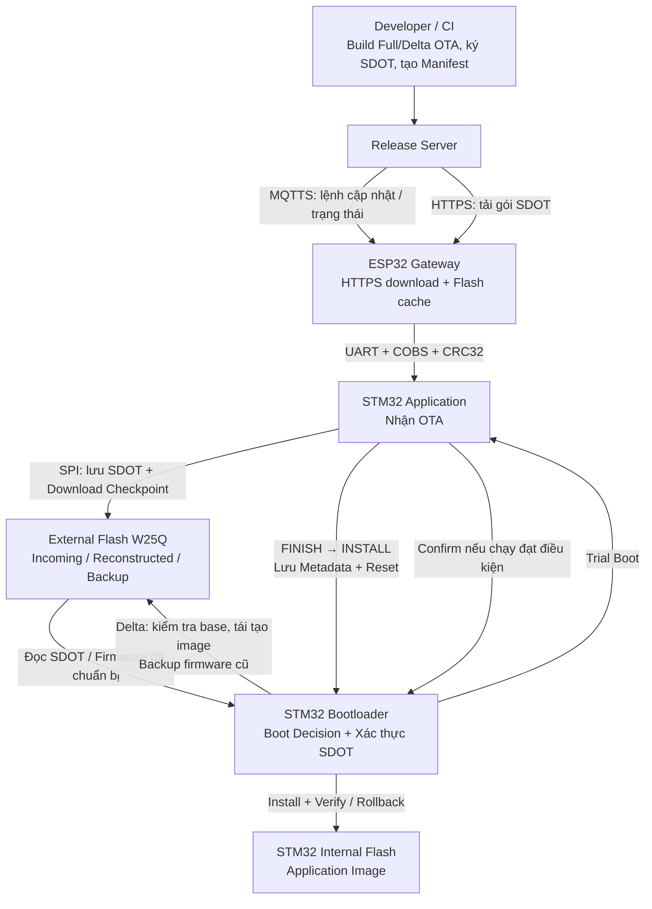
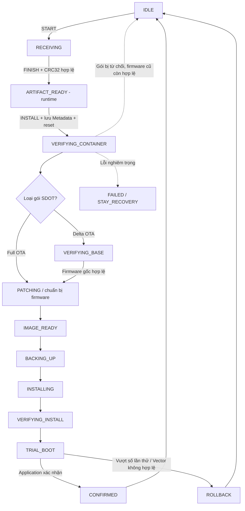

# Secure Delta OTA Bootloader — Interview Study Notes

> **Mục tiêu:** Ôn tập project theo đúng **7 phần** để trình bày và trả lời phỏng vấn **Embedded Firmware Engineer**.  
> **Nền tảng:** STM32F103 + ESP32 Gateway + External Flash W25Q.  
> **Nguồn:** Bản ghi chú Markdown v4 và tài liệu `docs/boot-state-machine.md`, `docs/metadata-and-boot-decision.md` của repository.

## Mục lục

1. [Trình bày Project](#phan-1)
2. [Trình bày System Architecture](#phan-2)
3. [Trình bày Boot State Machine](#phan-3)
4. [Phân tích chi tiết System Architecture](#phan-4)
   - [4.1. Developer/CI → Release Server](#luong-1)
   - [4.2. Release Server → ESP32 Gateway](#luong-2)
   - [4.3. ESP32 Gateway → STM32 Application](#luong-3)
   - [4.4. STM32 Application → STM32 Bootloader](#luong-4)
   - [4.5. STM32 Bootloader → STM32 Internal Flash](#luong-5)
5. [Phân tích chi tiết Boot State Machine](#phan-5)
6. [Ôn tập kiến thức kỹ thuật](#phan-6)
7. [Câu hỏi phỏng vấn trọng tâm](#phan-7)

### Quy ước thuật ngữ

- **Gói cập nhật SDOT**: Artifact Full OTA hoặc Delta OTA đã được đóng gói và ký số; **firmware mới** là image hoàn chỉnh sẽ cài đặt.
- **Metadata**: Trạng thái và thông tin điều khiển cập nhật; **Checkpoint**: Tiến độ đã lưu an toàn để phục hồi sau reset.
- **Power-loss Recovery**: Khôi phục công việc đang dang dở; **Rollback**: Khôi phục firmware đã sao lưu.
- **Xác thực chữ ký**: ECDSA P-256; **kiểm tra hash**: SHA-256; **phát hiện lỗi truyền/lưu trữ**: CRC32.

---

<a id="phan-1"></a>
## Phần 1. Trình bày Project

### 1.1. Giới thiệu tổng quan

Dạ, project đầu tiên của em là **Secure Delta OTA Bootloader**, được phát triển trên **STM32F103** kết hợp với **ESP32 Gateway**.

Mục tiêu của project là cho phép cập nhật firmware từ xa một cách an toàn, đồng thời giảm dung lượng dữ liệu truyền khi cập nhật bằng cơ chế **Delta OTA**.

### 1.2. Kiến trúc và cách hoạt động

Về kiến trúc, **ESP32** đóng vai trò Gateway, kết nối với server để tải firmware, sau đó truyền xuống STM32 thông qua **UART**.

Trên STM32, **Application** tiếp nhận dữ liệu cập nhật và lưu vào Flash ngoài **W25Q** thông qua **SPI**.

Sau đó, **Bootloader** sẽ xác thực firmware, xử lý bản cập nhật, sao lưu firmware cũ và cài đặt firmware mới vào **Internal Flash**.

### 1.3. Công việc thực hiện

Trong project này, em triển khai hai cơ chế là **Full OTA** và **Delta OTA**.

Với Delta OTA, hệ thống chỉ truyền phần thay đổi giữa hai phiên bản firmware, sau đó tái tạo firmware mới từ bản cũ.

Em sử dụng **ECDSA P-256** kết hợp **SHA-256** để xác thực và kiểm tra tính toàn vẹn của firmware, đồng thời triển khai cơ chế chống cập nhật xuống phiên bản cũ không được phép.

### 1.4. Khó khăn và cách giải quyết

Một khó khăn lớn trong project là xử lý trường hợp thiết bị mất nguồn khi đang cập nhật, khiến firmware có thể bị ghi chưa hoàn chỉnh.

Để giải quyết, em sử dụng **State Machine** kết hợp **Metadata** và **Checkpoint**, giúp Bootloader khôi phục quá trình cập nhật sau khi khởi động lại.

Ngoài ra, em triển khai cơ chế **Rollback** để khôi phục firmware đã sao lưu nếu phiên bản mới không hoạt động đúng.

### 1.5. Kết quả đạt được

Kết quả thử nghiệm với **GCC** cho thấy Delta OTA giảm khoảng **85,3%** dung lượng dữ liệu cập nhật so với Full OTA.

Hệ thống cũng ghi nhận **9/9 kịch bản kiểm thử trên phần cứng thành công**, bao gồm các tình huống mất nguồn và cập nhật thất bại.

Qua project này, em hiểu rõ hơn về bootloader, quản lý bộ nhớ Flash, giao tiếp UART, SPI và cách xây dựng hệ thống cập nhật firmware an toàn.

---

---

<a id="phan-2"></a>
## Phần 2. Trình bày System Architecture

> **Mục tiêu:** Giới thiệu kiến trúc tổng thể và luồng cập nhật firmware từ **Developer/CI** đến **STM32 Bootloader** trong khoảng **90 giây**, trước khi đi vào Boot State Machine ở Phần 3. Đây là **sơ đồ tổng quan**, chưa thể hiện toàn bộ giao thức, phân vùng Flash và nhánh xử lý lỗi.

### 2.1. Bài nói khi phỏng vấn (khoảng 90 giây)

Dạ, về **System Architecture**, hệ thống của em gồm **Developer/CI**, **Release Server**, **ESP32 Gateway**, **STM32 Application** và **STM32 Bootloader**. Em tách luồng **phát hành và truyền dữ liệu** khỏi luồng **xác thực và cài đặt firmware**.

- **Tạo bản cập nhật:** **Developer/CI** build firmware, tạo gói **Full OTA** hoặc **Delta OTA**, đóng gói theo định dạng **SDOT**, ký bằng **ECDSA P-256** và tạo **Manifest**. Các artifact được triển khai lên **Release Server**.

- **Phân phối bản cập nhật:** **Release Server** sử dụng **MQTTS** để gửi lệnh cập nhật và **HTTPS** để cung cấp gói SDOT. **ESP32 Gateway** nhận lệnh, tải gói qua HTTPS, kiểm tra kích thước và CRC32 rồi lưu vào Flash cache.

- **Tiếp nhận trên STM32:** ESP32 truyền SDOT đến **STM32 Application** qua **UART**, sử dụng **COBS** để đóng khung và **CRC32** để phát hiện lỗi. Application lưu gói vào **External Flash W25Q** thông qua **SPI**. Sau khi `FINISH` xác nhận nhận đủ dữ liệu, lệnh `INSTALL` mới khiến Application ghi **Metadata** và reset để bàn giao cho Bootloader.

- **Xác thực và cài đặt:** **STM32 Bootloader** đọc Metadata, xác thực chữ ký **ECDSA P-256** và hash **SHA-256**. Nếu là **Delta OTA**, Bootloader kiểm tra firmware gốc rồi tái tạo firmware mới. Sau đó, Bootloader sao lưu firmware hiện tại, cài bản mới vào **Internal Flash** và kiểm tra lại.

- **Chạy thử và phục hồi:** Bootloader cho Application mới chạy ở chế độ **Trial Boot**. Nếu Application xác nhận thành công thì chấp nhận bản cập nhật; nếu không, Bootloader có thể **Rollback** từ bản sao lưu. **Metadata và Checkpoint** hỗ trợ tiếp tục các bước cập nhật an toàn sau mất nguồn hoặc reset bất ngờ.

### 2.2. High-level System Architecture Diagram



> **Lưu ý 1:** **MQTTS truyền lệnh và trạng thái**, còn **HTTPS truyền dữ liệu gói SDOT**. ESP32 Gateway chịu trách nhiệm mạng, tải và chuyển tiếp artifact; không giữ private key ký firmware.
>
> **Lưu ý 2:** `FINISH` chỉ xác nhận **đã nhận đủ gói SDOT** (kích thước và CRC32). Sau lệnh `INSTALL`, STM32 Application mới commit `UPDATE_ARTIFACT_READY` vào **Internal Flash Metadata A/B** và reset. **STM32 Bootloader** mới là thành phần quyết định xác thực và cài đặt.
>
> **Lưu ý 3:** **External Flash W25Q** chứa gói SDOT nhận được, firmware tái tạo và bản Backup; **Internal Flash** chứa Application đang chạy. **CRC32** giúp phát hiện lỗi dữ liệu, còn **ECDSA P-256 + SHA-256** phục vụ xác thực và kiểm tra tính toàn vẹn firmware. **Power-loss Recovery** không đồng nghĩa với **Rollback**.

**Nguồn đối chiếu:** [Repository README](https://github.com/haikevins/secure-delta-ota-bootloader), [System Architecture](https://github.com/haikevins/secure-delta-ota-bootloader/blob/main/docs/architecture.md), [UART OTA Protocol](https://github.com/haikevins/secure-delta-ota-bootloader/blob/main/docs/uart-ota-protocol.md).

---

<a id="phan-3"></a>
## Phần 3. Trình bày Boot State Machine

> **Mục tiêu:** Giới thiệu luồng điều khiển cập nhật của **STM32 Bootloader** trong khoảng **90 giây**, tiếp nối phần System Architecture. Đây là **sơ đồ tổng quan**, chưa thể hiện mọi nhánh xử lý lỗi.

### 3.1. Bài nói khi phỏng vấn (khoảng 90 giây)

Dạ, về **Boot State Machine**, em sử dụng các trạng thái được lưu trong **Metadata** để STM32 Bootloader quyết định hành động sau mỗi lần khởi động, kể cả khi mất nguồn hoặc reset bất ngờ.

- **Tiếp nhận cập nhật:** Ban đầu hệ thống ở `IDLE`. Khi ESP32 Gateway bắt đầu truyền, STM32 Application chuyển sang `RECEIVING`. Nhận đủ gói SDOT và kiểm tra CRC32 thành công thì bộ nhận đạt `ARTIFACT_READY`. Sau lệnh `INSTALL`, Application lưu trạng thái vào Metadata rồi reset.

- **Xác thực và chuẩn bị firmware:** STM32 Bootloader đọc Metadata, chuyển sang `VERIFYING_CONTAINER` để xác thực gói SDOT bằng ECDSA P-256 và SHA-256. Với Delta OTA, Bootloader kiểm tra firmware gốc ở `VERIFYING_BASE` trước khi tái tạo firmware trong `PATCHING`. Với Full OTA, Bootloader bỏ qua `VERIFYING_BASE` nhưng vẫn đi qua `PATCHING` để chuẩn bị firmware mới. Khi hợp lệ, hệ thống chuyển sang `IMAGE_READY`.

- **Sao lưu và cài đặt:** Bootloader chuyển qua `BACKING_UP` để sao lưu firmware hiện tại, rồi `INSTALLING` để ghi firmware mới vào Internal Flash. Sau đó, `VERIFYING_INSTALL` kiểm tra lại dữ liệu đã cài đặt.

- **Chạy thử và khôi phục:** Bootloader chuyển sang `TRIAL_BOOT` để chạy STM32 Application mới. Nếu Application xác nhận thành công, hệ thống qua `CONFIRMED` rồi về `IDLE`. Nếu không xác nhận sau số lần thử cho phép, Bootloader chuyển sang `ROLLBACK` để khôi phục firmware đã sao lưu.

Ngoài ra, **Metadata và Checkpoint** giúp hệ thống tiếp tục Backup, Install hoặc Rollback từ tiến độ an toàn sau khi mất nguồn.

### 3.2. High-level Transition Diagram



> **Lưu ý 1:** `ARTIFACT_READY` xuất hiện đầu tiên trong **runtime** của STM32 Application sau `FINISH`. Lệnh `INSTALL` mới ghi `UPDATE_ARTIFACT_READY` vào **Internal Flash Metadata A/B** để Bootloader xử lý sau reset.
>
> **Lưu ý 2:** `UPDATE_FAILED` đưa Bootloader vào `BOOT_ACTION_STAY_RECOVERY`; bản triển khai hiện tại **không** có chế độ tự nhận lệnh UART `START` để khôi phục từ xa tại trạng thái này.
>
> **Lưu ý 3:** Trước khi được xác nhận, firmware mới chỉ đang ở **Trial Boot**. `active_version` vẫn đại diện cho firmware đã xác nhận trước đó.

**Nguồn đối chiếu:** [Boot State Machine](https://github.com/haikevins/secure-delta-ota-bootloader/blob/main/docs/boot-state-machine.md), [Metadata & Boot Decision](https://github.com/haikevins/secure-delta-ota-bootloader/blob/main/docs/metadata-and-boot-decision.md).

---

<a id="phan-4"></a>
## Phần 4. Phân tích chi tiết System Architecture

> **Mục tiêu:** Đi từ Developer/CI đến Internal Flash của STM32. Mỗi luồng giữ nguyên **sơ đồ → bước xử lý → bài nói phỏng vấn → câu hỏi ôn tập** từ bản v4.

<a id="luong-1"></a>
### 4.1. Developer/CI → Release Server

> **Mục tiêu:** Hiểu cách Developer/CI **build firmware**, tạo gói cập nhật **Full OTA / Delta OTA**, đóng gói và ký số theo định dạng **SDOT**, tạo **Manifest** và chuẩn bị bản phát hành cho **Release Server**.
>
> **Tình huống minh họa:** STM32 đang chạy firmware **v1** và Developer muốn cập nhật lên **v2**.
>
> **Phân biệt hai loại gói:** **Full OTA** chứa toàn bộ firmware mới; **Delta OTA** chứa Delta Patch được tạo từ sự khác biệt giữa firmware gốc và firmware mới.

#### Sơ đồ luồng hoạt động

```text
                   Developer/CI
                        |
                 1. Build firmware
                        v
                application-v2.bin
                        |
              +---------+---------+
              |                   |
              v                   v
         2. Full OTA         2. Delta OTA
         Firmware v2        Firmware v1 + v2
              |                   |
              |              JojoDiff Patch
              |                   |
              +---------+---------+
                        |
          3. Đóng gói SDOT và ký ECDSA P-256
                        |
              +---------+---------+
              |                   |
              v                   v
          Full SDOT           Delta SDOT
              |                   |
              +---------+---------+
                        |
                4. Tạo Manifest
                   và ký số
                        |
              5. Kiểm tra release
                 và triển khai
                        v
                  Release Server
```

#### Bước 1. Developer/CI build firmware

Developer chỉnh sửa mã nguồn **STM32 Application** rồi build để tạo file binary firmware mới, ví dụ **`application-v2.bin`**. Đây là firmware dự kiến được cài đặt vào vùng Application của **STM32 Internal Flash**.

**CI (Continuous Integration)** có thể tự động hóa các công việc **build, kiểm tra và chuẩn bị bản phát hành**. Trong luồng này, Developer/CI là phía **tạo firmware**, chưa phải phía phân phối firmware đến thiết bị.

#### Bước 2. Tạo Full OTA và Delta OTA

Từ firmware mới, release tooling chuẩn bị các gói cập nhật tương ứng:

| Tiêu chí | Full OTA | Delta OTA |
|---|---|---|
| Nội dung | Toàn bộ firmware **v2** | Delta Patch từ **v1 → v2** |
| Dữ liệu cần để tạo | Firmware **v2** | Firmware **v1** và **v2** chính xác |
| Dung lượng | Thường lớn hơn | Có thể nhỏ hơn đáng kể |

Đối với **Delta OTA**, công cụ dùng **JojoDiff** để tạo Delta Patch, sau đó **áp dụng thử patch lên firmware v1** và so sánh kết quả với firmware v2 để kiểm tra tính đúng đắn.

Repository luôn tạo **Full OTA**, nhưng chỉ đưa **Delta OTA** vào release khi mức tiết kiệm đạt ngưỡng cấu hình, mặc định **20%**.

> **Ghi nhớ:** Delta Patch phụ thuộc vào **firmware gốc**. Khi cài đặt, STM32 Bootloader vẫn phải kiểm tra firmware gốc có đúng với bản được dùng để tạo patch hay không.

#### Bước 3. Đóng gói và ký số SDOT

Cả hai loại dữ liệu cập nhật được đóng gói theo định dạng **SDOT (Secure Delta OTA Container)**.

**Cấu trúc cơ bản của SDOT Container:**

```text
+-----------------------------+
| Header                      |
| - Firmware type             |
| - Base version              |
| - Target version            |
| - Base SHA-256              |
| - Target SHA-256            |
| - Product ID                |
+-----------------------------+
| Payload                     |
| Full firmware / Delta Patch |
+-----------------------------+
| ECDSA P-256 Signature       |
+-----------------------------+
```

Hệ thống dùng **SHA-256** để tạo các giá trị hash phục vụ kiểm tra tính toàn vẹn và **ECDSA P-256** để ký số SDOT bằng **private key**.

> **Ghi nhớ:** **Private key** được sử dụng ở phía phát hành firmware, **không truyền xuống ESP32 Gateway hoặc STM32**. Chữ ký SDOT sẽ được STM32 Bootloader xác thực trước khi cài đặt.

#### Bước 4. Tạo và ký số Manifest

Sau khi chuẩn bị các gói **SDOT**, release tooling tạo **`manifest.json`** để mô tả bản phát hành.

Manifest chứa các thông tin như:

- Phiên bản firmware mới.
- **Product ID** và **hardware revision**.
- Thông tin các gói **Full OTA / Delta OTA**.
- Kích thước và **SHA-256** của artifact.
- Đường dẫn tải artifact (**URL**).
- Thông tin khóa ký.

Manifest cũng được ký bằng **ECDSA**; chữ ký được lưu trong **`manifest.json.sig`**.

> **Phân biệt SDOT và Manifest:** **SDOT** chứa firmware hoặc Delta Patch đã ký số; **Manifest** mô tả thông tin bản phát hành và các artifact để hệ thống biết gói nào đang được cung cấp.

#### Bước 5. Kiểm tra và chuyển bản phát hành sang Release Server

Thư mục release có cấu trúc minh họa như sau:

```text
dist/releases/fw-v2/
│
├── application-v2.bin
├── application-v2.full.sdot
├── application-v1-to-v2.delta.sdot
│
├── manifest.json
├── manifest.json.sig
├── signing-public.pem
├── checksums.txt
└── release-notes.md
```

Sau khi tạo release, công cụ **kiểm tra tính hợp lệ của các file**. Bộ release được **triển khai lên Release Server** để sử dụng cho bước phân phối tiếp theo.

Release Server sử dụng bộ release đã triển khai để:

- Xác minh **Manifest** và các gói cập nhật theo thông tin bảo mật tương ứng.
- Cung cấp các artifact qua **HTTPS**.
- Chuẩn bị thông báo cập nhật qua **MQTTS**.

> **Lưu ý:** Việc **tạo và xác minh thư mục release** không đồng nghĩa với việc công cụ release tự động upload dữ liệu lên máy chủ từ xa. Triển khai release lên server là một bước riêng.

#### Bài nói khi phỏng vấn: Developer/CI và Release Server

> **Developer/CI → Release Server:** Đầu tiên, Developer/CI sẽ build STM32 Application để tạo file firmware mới dạng binary.
>
> Tiếp theo, công cụ release chuẩn bị gói cập nhật Full OTA từ toàn bộ firmware mới. Với Delta OTA, hệ thống sử dụng JojoDiff để tạo Delta Patch từ firmware cũ sang firmware mới, sau đó áp dụng thử Patch để kiểm tra khả năng tái tạo chính xác.
>
> Sau đó, các gói cập nhật được đóng gói theo định dạng SDOT và ký số bằng ECDSA P-256. Hệ thống cũng tạo và ký Manifest chứa thông tin phiên bản, kích thước, hash và đường dẫn đến các gói SDOT.
>
> Cuối cùng, công cụ release kiểm tra các file đã tạo. Bộ release hợp lệ được triển khai lên Release Server để xác minh và phân phối cho thiết bị. Như vậy, Developer/CI chịu trách nhiệm tạo và ký gói cập nhật, còn Release Server chịu trách nhiệm phân phối.

#### Câu hỏi ôn tập: Developer/CI → Release Server

| Câu hỏi | Ý chính cần trả lời |
|---|---|
| CI là gì? | Hệ thống tự động hóa build, kiểm thử và chuẩn bị release. |
| Tại sao cần firmware v1 khi tạo Delta OTA? | Vì JojoDiff tạo patch từ sự khác biệt giữa firmware v1 và v2. |
| Tại sao phải áp dụng thử Delta Patch? | Để kiểm tra patch có tái tạo đúng firmware v2 từ firmware v1 hay không. |
| Tại sao vẫn tạo Full OTA? | Để có gói cập nhật đầy đủ khi Delta OTA không phù hợp hoặc không đạt ngưỡng tiết kiệm. |
| SDOT Container dùng để làm gì? | Đóng gói dữ liệu cập nhật cùng thông tin xác thực và chữ ký số. |
| ECDSA P-256 dùng để làm gì? | Ký và xác thực dữ liệu cập nhật bằng cặp private key/public key phù hợp. |
| SHA-256 dùng để làm gì? | Tạo và kiểm tra hash để xác minh tính toàn vẹn của dữ liệu. |
| Manifest khác SDOT ở điểm nào? | Manifest mô tả bản phát hành; SDOT chứa Full Firmware hoặc Delta Patch đã ký số. |
| Release Server có tạo firmware không? | Không. Developer/CI và release tooling tạo artifact; server xác minh và phân phối. |
| Release Server có cần private key ký firmware không? | Không cần private key ký firmware để xác minh và phân phối release. |

**Tài liệu đối chiếu trong repository:** `docs/release-process.md`, `tools/release.py`, `tools/secure_container.py`.

---

---

<a id="luong-2"></a>
### 4.2. Release Server → ESP32 Gateway

> **Mục tiêu:** Hiểu cách Release Server **xác minh và lựa chọn gói cập nhật SDOT**, thông báo cập nhật bằng **MQTTS**, và cách ESP32 Gateway tải gói đó bằng **HTTPS** trước khi truyền xuống STM32 Application.
>
> **Phân biệt hai giao thức:** **MQTTS** dùng để gửi lệnh cập nhật và trao đổi trạng thái; **HTTPS** dùng để tải nội dung gói cập nhật SDOT. Firmware không được truyền trực tiếp trong thông điệp MQTTS.

#### Sơ đồ luồng hoạt động

```text
                  Release Server
                        |
          1. Xác minh bản phát hành
          2. Chọn Full OTA / Delta OTA
                        |
              +---------+---------+
              |                   |
              v                   v
         MQTT Broker         HTTPS Server
              |                   ^
              | 3. Update command |
              |    qua MQTTS      |
              v                   |
         ESP32 Gateway -----------+
              |       4. HTTPS GET gói SDOT
              |
          5. Kiểm tra kích thước, CRC32
             và lưu vào Flash cache
              |
              v
       Gói SDOT đã tải hợp lệ
              |
              | UART + COBS + CRC32
              v
        STM32 Application
```

#### Bước 1. Release Server xác minh bản phát hành

Sau khi Developer/CI tạo các gói cập nhật **SDOT** và **Manifest**, Release Server sử dụng bộ release đã được triển khai để kiểm tra dữ liệu trước khi phân phối.

Các kiểm tra được mô tả trong hệ thống gồm tính hợp lệ của **chữ ký Manifest**, chữ ký và metadata của artifact, cùng các thông tin về **kích thước**, **CRC32** và **SHA-256** theo định dạng tương ứng.

> **Ghi nhớ:** Việc Release Server xác minh bản phát hành **không thay thế** việc STM32 Bootloader xác thực chữ ký SDOT trước khi cài đặt.

#### Bước 2. Release Server chọn Full OTA hoặc Delta OTA

Release Server dựa trên **phiên bản firmware hiện tại** được cung cấp khi yêu cầu phát hành lệnh cập nhật để lựa chọn gói phù hợp:

| Điều kiện | Quyết định |
|---|---|
| Có Delta OTA được tạo cho đúng firmware gốc | Ưu tiên Delta OTA. |
| Không có Delta OTA phù hợp | Dùng Full OTA nếu bản phát hành cho phép. |
| Thiết bị không cần cập nhật | Không phát hành lệnh cập nhật. |

**Ví dụ:** STM32 đang chạy **v1**, Release Server có **v2**; nếu bản phát hành chứa Delta Patch từ **v1 → v2**, Server có thể chọn gói Delta OTA thay vì Full OTA.

> **Lưu ý:** Lựa chọn của Server là bước phân phối. STM32 Bootloader vẫn phải kiểm tra điều kiện phiên bản và **firmware gốc (exact-base validation)** trước khi áp dụng Delta Patch.

#### Bước 3. Release Server gửi lệnh cập nhật qua MQTTS

Sau khi chọn artifact, Release Server tạo thông báo cập nhật để gửi qua **MQTT Broker** bằng kết nối **MQTTS**. ESP32 Gateway subscribe topic tương ứng để nhận lệnh.

**Ví dụ JSON minh họa các trường chính** (giá trị minh họa, không phải payload thực tế của một bản phát hành):

```json
{
  "schema": 1,
  "cmd": "update",
  "update_id": 12345,
  "target_version": 2,
  "size": 1174,
  "crc32": 123456789,
  "url": "https://firmware.example/releases/fw-v2/update.sdot"
}
```

| Trường | Ý nghĩa |
|---|---|
| `cmd` | Loại lệnh, ví dụ lệnh cập nhật. |
| `update_id` | Định danh của quá trình cập nhật. |
| `target_version` | Phiên bản firmware đích. |
| `size` | Kích thước gói SDOT cần tải. |
| `crc32` | CRC32 của gói SDOT, dùng phát hiện lỗi dữ liệu. |
| `url` | Đường dẫn HTTPS để ESP32 tải gói SDOT. |

Lệnh cập nhật trong repository sử dụng **MQTT QoS 1**. QoS 1 có thể dẫn đến gửi lại thông điệp, vì vậy các thành phần nhận lệnh cần xử lý trường hợp trùng lặp phù hợp.

#### Bước 4. ESP32 Gateway tải gói SDOT qua HTTPS

Khi nhận được lệnh cập nhật, ESP32 Gateway kiểm tra thông tin lệnh rồi thực hiện **HTTPS GET** tới địa chỉ trong trường `url`.

Trong quá trình tải, ESP32 kiểm tra kết nối **TLS**, phản hồi **HTTP**, kích thước nội dung và giới hạn bộ nhớ lưu trữ. Nội dung nhận về là **gói cập nhật SDOT**, không phải lệnh MQTTS.

#### Bước 5. ESP32 kiểm tra, lưu gói và chuẩn bị truyền qua UART

ESP32 lưu dữ liệu tải được vào vùng **Flash cache** của Gateway. Sau khi hoàn tất, ESP32 kiểm tra **kích thước** và **CRC32** của gói SDOT; chỉ khi cache hợp lệ mới tiếp tục giai đoạn truyền sang STM32 Application qua **UART**.

ESP32 có thể gửi thông tin **tiến độ/trạng thái** về hệ thống qua MQTT. Trong khi đó, bước **xác thực chữ ký ECDSA P-256 và SHA-256 để quyết định cài đặt** vẫn thuộc về STM32 Bootloader.

> **Phân biệt Manifest và gói SDOT:** Release Server dùng **Manifest** để biết thông tin bản phát hành, còn ESP32 Gateway nhận **URL trực tiếp đến gói SDOT** trong lệnh MQTTS. Luồng OTA hiện tại không yêu cầu ESP32 tải và tự phân tích Manifest để chọn artifact.

#### Bài nói khi phỏng vấn: Release Server và ESP32 Gateway

> **Release Server → ESP32 Gateway:** Sau khi bộ release được triển khai, Release Server xác minh Manifest và các gói cập nhật SDOT trước khi phân phối.
>
> Đầu tiên, dựa trên thông tin phiên bản firmware hiện tại, Server sẽ ưu tiên lựa chọn Delta OTA nếu có gói phù hợp; nếu không, Server sử dụng Full OTA.
>
> Tiếp theo, Server gửi lệnh cập nhật đến ESP32 Gateway qua MQTTS. Lệnh này chứa các thông tin như phiên bản đích, kích thước, CRC32 và đường dẫn HTTPS của gói SDOT.
>
> Khi nhận được lệnh, ESP32 Gateway sử dụng HTTPS để tải gói SDOT và lưu dữ liệu vào Flash cache. Sau khi tải xong, ESP32 kiểm tra kích thước và CRC32 để đảm bảo dữ liệu đã nhận đầy đủ trước khi truyền xuống STM32 Application.
>
> Như vậy, **MQTTS** được sử dụng để gửi lệnh cập nhật, còn **HTTPS** được sử dụng để tải dữ liệu. Việc xác thực chữ ký firmware trước khi cài đặt vẫn do STM32 Bootloader thực hiện.

#### Câu hỏi ôn tập: Release Server → ESP32 Gateway

| Câu hỏi | Ý chính cần trả lời |
|---|---|
| Vì sao sử dụng cả MQTTS và HTTPS? | MQTTS dùng để gửi lệnh/trạng thái; HTTPS dùng để tải dữ liệu firmware. |
| Ai quyết định chọn Full OTA hay Delta OTA? | Release Server chọn artifact phù hợp theo thông tin phiên bản và release. |
| ESP32 có cần tải Manifest không? | Không bắt buộc trong luồng hiện tại; URL artifact được gửi trong lệnh MQTTS. |
| ESP32 kiểm tra gói SDOT bằng gì? | Kiểm tra kích thước và CRC32 sau khi tải. |
| ESP32 có xác thực chữ ký ECDSA thay STM32 không? | Không; STM32 Bootloader là thành phần xác thực và quyết định cài đặt. |
| Tại sao phải lưu vào Flash cache? | Để có gói SDOT hoàn chỉnh, đã kiểm tra, trước khi truyền xuống STM32 qua UART. |
| MQTT QoS 1 nghĩa là gì? | Đảm bảo gửi ít nhất một lần; có thể có thông điệp trùng. |

**Tài liệu đối chiếu trong repository:** `server/README.md`, `gateway-esp32/README.md`, `server/app/services/firmware_service.py`.

---

---

<a id="luong-3"></a>
### 4.3. ESP32 Gateway → STM32 Application

> **Mục tiêu:** Hiểu cách **ESP32 Gateway** truyền gói cập nhật **SDOT** xuống **STM32 Application** qua **UART**, cách STM32 lưu dữ liệu vào **External Flash W25Q** qua **SPI**, và cách hệ thống xử lý lỗi truyền, **Retry**, **Resume** trước khi bàn giao cho **STM32 Bootloader**.
>
> **Phân chia trách nhiệm:** **STM32 Application** nhận, kiểm tra và lưu **gói cập nhật SDOT**; **STM32 Bootloader** xác thực chữ ký, xử lý Full/Delta OTA và cài đặt **firmware mới** vào Internal Flash.

#### Sơ đồ luồng hoạt động

```text
             ESP32 Gateway
                   |
          1. Đọc SDOT từ Flash cache
                   |
          2. HELLO / QUERY
                   v
            STM32 Application
                   |
         Thông tin thiết bị, trạng thái,
         update_id, offset nhận tiếp theo
                   |
                   v
             ESP32 Gateway
                   |
          3. START / RESUME
          4. DATA (COBS + CRC32)
                   v
            STM32 Application
                   |
          5. Kiểm tra CRC32,
             Sequence, Offset
          6. Ghi dữ liệu qua SPI
                   v
          External Flash W25Q
                   |
          7. ACK / NACK (+ Retry)
                   v
             ESP32 Gateway
                   |
          8. FINISH: kiểm tra toàn bộ SDOT
          9. INSTALL: ghi Metadata,
             ACK rồi reset
                   v
            STM32 Bootloader
```

#### Bước 1. ESP32 Gateway chuẩn bị truyền gói cập nhật SDOT

Sau khi tải gói **SDOT** qua HTTPS và kiểm tra **kích thước/CRC32**, ESP32 Gateway đã lưu gói vào vùng **Flash cache** nội bộ. Gateway đọc dữ liệu từ cache để truyền qua UART, thay vì yêu cầu STM32 tự tải firmware qua mạng.

**Cấu hình UART trong repository:**

| Thông số | Giá trị |
|---|---|
| Giao thức | UART, **115200 8-N-1** |
| Data bits / Parity / Stop bits | 8 / None / 1 |
| Flow control | None |
| STM32 USART | USART1 |
| STM32 TX / RX | PA9 / PA10 |
| ESP32 UART mặc định | UART2 |
| ESP32 TX / RX mặc định | GPIO17 / GPIO16 |

Trước khi gửi DATA, Gateway cần kiểm tra trạng thái hiện tại của STM32 để quyết định **START** hay **RESUME**.

#### Bước 2. ESP32 Gateway gửi HELLO và QUERY

ESP32 trao đổi các lệnh **`HELLO`** và **`QUERY`** với STM32 Application. Phản hồi cung cấp các thông tin phục vụ nhận diện thiết bị và đồng bộ tiến độ, ví dụ:

| Thông tin | Ý nghĩa |
|---|---|
| `application_version` | Phiên bản firmware đang chạy |
| `bootloader_version` | Phiên bản STM32 Bootloader |
| `product_id` | Mã sản phẩm |
| `hardware_revision` | Phiên bản phần cứng |
| `capability_flags` | Các tính năng OTA được hỗ trợ |
| `update_state` | Trạng thái cập nhật hiện tại |
| `active_update_id` | Định danh bản cập nhật đang xử lý |
| `next_expected_offset` | Vị trí dữ liệu STM32 chờ nhận tiếp |

**Tại sao cần QUERY?** Vì STM32 có thể chưa nhận dữ liệu, đang nhận dở hoặc đã nhận hoàn tất gói SDOT. Thông tin trả về giúp ESP32 tránh bắt đầu lại không cần thiết và chọn đúng bước tiếp theo.

#### Bước 3. ESP32 Gateway gửi START hoặc RESUME

**`START`** được dùng khi bắt đầu nhận gói cập nhật mới. Các thông tin quan trọng bao gồm:

- `update_id`: Định danh bản cập nhật.
- `artifact_type`: Full OTA hoặc Delta OTA.
- `base_version`: Phiên bản firmware gốc.
- `target_version`: Phiên bản firmware đích.
- `artifact_size`: Kích thước toàn bộ gói SDOT.
- `artifact_crc32`: CRC32 của toàn bộ gói SDOT.

STM32 Application kiểm tra thông tin yêu cầu, trạng thái hiện tại và giới hạn dung lượng vùng **Incoming** của External Flash W25Q. Nếu chấp nhận, STM32 phản hồi **ACK** cùng offset bắt đầu (thông thường là `0`).

**`RESUME`** được dùng khi quá trình nhận trước đó bị gián đoạn. STM32 kiểm tra tính phù hợp của **`update_id`** và thông tin gói SDOT, sau đó cung cấp offset có thể tiếp tục an toàn để ESP32 truyền tiếp.

#### Bước 4. ESP32 Gateway truyền DATA qua UART

ESP32 chia SDOT thành các **DATA packet**, mỗi packet mang tối đa **256 bytes payload**. Cấu trúc packet ở mức khái quát:

```text
+---------------------------+
| Magic                     | 2 bytes
+---------------------------+
| Protocol Version          | 1 byte
+---------------------------+
| Command                   | 1 byte
+---------------------------+
| Update ID                 | 4 bytes
+---------------------------+
| Offset                    | 4 bytes
+---------------------------+
| Sequence                  | 2 bytes
+---------------------------+
| Payload Length            | 2 bytes
+---------------------------+
| Payload                   | 0–256 bytes
+---------------------------+
| Packet CRC32              | 4 bytes
+---------------------------+
```

Packet được **mã hóa COBS** và phân tách trên luồng UART bằng byte kết thúc **`0x00`**.

| Cơ chế | Vai trò |
|---|---|
| **COBS** | Đóng khung và phân tách các packet trên luồng byte UART |
| **CRC32** | Phát hiện lỗi dữ liệu packet |
| **Sequence** | Theo dõi thứ tự packet |
| **Offset** | Chỉ vị trí ghi dữ liệu trong toàn bộ gói SDOT |
| **Update ID** | Gắn packet với đúng quá trình cập nhật |

**Ví dụ** với payload 256 bytes/packet:

```text
ESP32 Gateway                      STM32 Application

DATA (offset = 0)   -------------> Kiểm tra, ghi W25Q
                   <------------- ACK (offset = 256)
DATA (offset = 256) -------------> Kiểm tra, ghi W25Q
                   <------------- ACK (offset = 512)
DATA (offset = 512) -------------> Kiểm tra, ghi W25Q
                   <------------- ACK (offset = 768)
```

> **Ghi nhớ:** CRC32 phát hiện lỗi truyền/lưu dữ liệu, **không** xác thực nguồn phát hành firmware; xác thực bảo mật do STM32 Bootloader thực hiện sau đó.

#### Bước 5. STM32 Application kiểm tra và lưu vào External Flash W25Q

Khi nhận DATA packet, STM32 Application thực hiện theo thứ tự:

1. Giải mã **COBS** để lấy packet gốc.
2. Kiểm tra **CRC32** của packet.
3. Kiểm tra `update_id`, **Sequence** và **Offset**.
4. Xác định địa chỉ thuộc phân vùng **Incoming** trên External Flash W25Q.
5. Xóa sector khi cần và ghi dữ liệu qua **SPI**.
6. Kiểm tra dữ liệu đã ghi và phản hồi kết quả.

```text
Receive DATA → Decode COBS → Verify CRC32
             → Check Update ID / Sequence / Offset
             → Write W25Q via SPI → Verify → ACK / NACK
```

**Vì sao lưu vào External Flash W25Q thay vì ghi thẳng Internal Flash?** Internal Flash chứa STM32 Application đang hoạt động. Việc nhận đầy đủ SDOT vào vùng lưu trữ riêng trước khi cài đặt giảm rủi ro ghi đè ứng dụng đang chạy nếu mất nguồn hoặc truyền bị gián đoạn.

#### Bước 6. STM32 Application phản hồi ACK/NACK và ESP32 Retry

| Phản hồi | Ý nghĩa |
|---|---|
| **ACK** | DATA packet đã được chấp nhận và xử lý thành công |
| **NACK** | DATA packet bị từ chối do lỗi dữ liệu, trạng thái, thứ tự, offset hoặc ghi Flash |

ESP32 chỉ chuyển sang packet tiếp theo khi đã nhận phản hồi phù hợp. Nếu nhận **NACK** hoặc quá thời gian chờ (**timeout**), Gateway có thể **Retry** theo giới hạn cấu hình.

| Thông số | Giá trị mô tả trong giao thức |
|---|---|
| Response timeout | **1500 ms** |
| Maximum retries | **5** |
| DATA payload | Tối đa **256 bytes** |

Nếu ACK bị mất và ESP32 gửi lại packet cũ, STM32 có thể nhận diện **DATA trùng hợp lệ** và trả ACK tương ứng; không được ghi lại một cách mù quáng làm sai tiến độ.

#### Bước 7. Resume khi truyền bị gián đoạn

STM32 Application sử dụng **Download Checkpoint** trong External Flash W25Q để lưu tiến độ nhận OTA. Checkpoint được ghi theo ranh giới sector **4 KB**.

**Ví dụ minh họa:**

```text
Gói SDOT 20 KB
    |
    | Đã nhận khoảng 10 KB
    v
Checkpoint an toàn gần nhất: 8 KB
    |
    | Reset bất ngờ
    v
STM32 khởi động lại, đọc Checkpoint
    |
    v
ESP32 gửi RESUME và truyền lại từ offset 8192
```

**Phân biệt:** **ACK** xác nhận một packet đã được xử lý trong phiên truyền hiện tại; **Checkpoint** là mốc tiến độ đã lưu bền vững để phục hồi sau reset. Offset được ACK gần nhất **không nhất thiết** là offset có thể Resume sau khi mất nguồn.

#### Bước 8. ESP32 Gateway gửi FINISH

Sau khi truyền đủ toàn bộ SDOT, ESP32 gửi **`FINISH`**. STM32 Application kiểm tra:

1. **Kích thước** dữ liệu nhận được có đúng với `artifact_size` không.
2. **CRC32 toàn bộ gói SDOT** có khớp với giá trị dự kiến không.

Nếu hợp lệ, STM32 chuyển sang trạng thái **`ARTIFACT_READY`** của phiên nhận OTA.

> **Phân biệt quan trọng:** `FINISH` xác nhận rằng SDOT đã được **nhận đầy đủ**. Nó **chưa** yêu cầu cài đặt, chưa ghi trạng thái bàn giao `UPDATE_ARTIFACT_READY` vào Internal Flash Metadata và chưa reset STM32.

#### Bước 9. ESP32 Gateway gửi INSTALL, STM32 bàn giao cho Bootloader

Khi `FINISH` thành công, ESP32 gửi **`INSTALL`**. STM32 Application:

1. Kiểm tra trạng thái **`ARTIFACT_READY`** và `update_id`.
2. Kiểm tra thông tin định dạng container SDOT ở mức cần thiết để bàn giao.
3. Ghi trạng thái **`UPDATE_ARTIFACT_READY`** vào **Internal Flash Metadata A/B**.
4. Gửi **ACK** cho ESP32 Gateway.
5. **Reset** để STM32 Bootloader xử lý bản cập nhật.

```text
ESP32 Gateway
      |
      | INSTALL
      v
STM32 Application
      |
      | Kiểm tra ARTIFACT_READY / Update ID / SDOT
      v
Internal Flash Metadata A/B
      |
      | Commit UPDATE_ARTIFACT_READY
      v
Send ACK → Reset STM32 → STM32 Bootloader
```

**Đây là điểm bàn giao giữa Application và Bootloader.** STM32 Application không xác thực chữ ký ECDSA P-256 để quyết định cài đặt ở bước này; đó là nhiệm vụ của STM32 Bootloader sau reset.

#### Bài nói khi phỏng vấn: ESP32 Gateway → STM32 Application

> **ESP32 Gateway → STM32 Application:** Sau khi tải và kiểm tra gói SDOT thành công, ESP32 Gateway bắt đầu truyền dữ liệu xuống STM32 Application thông qua UART.
>
> Đầu tiên, ESP32 sử dụng lệnh HELLO và QUERY để lấy thông tin thiết bị, trạng thái cập nhật và Offset hiện tại. Từ đó, ESP32 quyết định gửi START để bắt đầu nhận mới hoặc RESUME nếu quá trình truyền trước đó bị gián đoạn.
>
> Tiếp theo, ESP32 chia gói SDOT thành các DATA packet, mỗi packet có tối đa 256 bytes Payload, sử dụng COBS để đóng khung và CRC32 để phát hiện lỗi truyền.
>
> Ở phía STM32, Application kiểm tra CRC32, Sequence và Offset, sau đó ghi dữ liệu vào External Flash W25Q qua SPI. Nếu xử lý thành công, STM32 trả về ACK; nếu có lỗi, STM32 trả về NACK để ESP32 Retry.
>
> Ngoài ra, STM32 lưu Checkpoint theo ranh giới sector 4 KB để có thể Resume từ vị trí an toàn sau reset, thay vì phải truyền lại toàn bộ gói SDOT.
>
> Cuối cùng, ESP32 gửi FINISH để STM32 kiểm tra toàn bộ dữ liệu đã nhận, sau đó gửi INSTALL. STM32 Application cập nhật Metadata và reset để bàn giao quá trình cập nhật cho STM32 Bootloader.

#### Câu hỏi ôn tập: ESP32 Gateway → STM32 Application

| Câu hỏi | Ý chính cần trả lời |
|---|---|
| Tại sao ESP32 và STM32 giao tiếp qua UART? | Kết nối đơn giản giữa hai vi điều khiển, không yêu cầu STM32 tự xử lý kết nối mạng. |
| Tại sao cần COBS? | Để đóng khung packet UART và dùng `0x00` làm byte phân tách. |
| CRC32 dùng để làm gì? | Phát hiện lỗi dữ liệu trong truyền và lưu trữ, không dùng để xác thực chữ ký. |
| Sequence khác Offset thế nào? | Sequence theo dõi thứ tự packet; Offset xác định vị trí byte trong SDOT. |
| Tại sao cần ACK/NACK? | Xác nhận dữ liệu đã xử lý thành công hoặc báo lỗi để Retry. |
| Nếu ACK bị mất thì sao? | ESP32 có thể gửi lại; STM32 có cơ chế nhận diện packet trùng hợp lệ. |
| Retry giải quyết vấn đề gì? | Khắc phục lỗi truyền và timeout tạm thời. |
| Resume hoạt động như thế nào? | STM32 đọc Checkpoint và thông báo offset an toàn để ESP32 truyền tiếp. |
| Tại sao Checkpoint theo sector 4 KB? | Phù hợp với đơn vị sector của W25Q, hỗ trợ phục hồi tiến độ nhận. |
| Tại sao dùng External Flash W25Q? | Lưu trữ trọn SDOT mà không ghi đè Application đang chạy. |
| FINISH khác INSTALL thế nào? | FINISH xác nhận nhận đủ SDOT; INSTALL ghi Metadata bàn giao và reset. |
| Ai xác thực chữ ký ECDSA P-256? | STM32 Bootloader, sau khi nhận gói SDOT và bàn giao. |

#### Điểm cần ghi nhớ

- **UART + COBS + CRC32 + ACK/NACK + Retry:** Hỗ trợ truyền packet có kiểm tra lỗi; UART cơ bản không tự bảo đảm toàn bộ gói firmware ở tầng ứng dụng.
- **ACK khác Checkpoint:** ACK theo packet; Checkpoint lưu mốc phục hồi bền vững, vì vậy Resume có thể phải truyền lại dữ liệu đã từng ACK.
- **FINISH khác INSTALL:** FINISH xác minh gói SDOT đã nhận đầy đủ; INSTALL bàn giao cho STM32 Bootloader bằng **Metadata + Reset**.

**Tóm tắt thứ tự lệnh:**

```text
HELLO / QUERY
      |
START / RESUME
      |
     DATA
      |
CRC32 / Sequence / Offset
      |
Write External Flash W25Q
      |
ACK / NACK + Retry
      |
    FINISH
      |
   INSTALL
      |
Metadata + Reset
      |
STM32 Bootloader
```

**Tài liệu đối chiếu trong repository:** `docs/uart-ota-protocol.md`, `docs/architecture.md`, `node-stm32f103/application/src/ota_receiver.c`.

---

---

<a id="luong-4"></a>
### 4.4. STM32 Application → STM32 Bootloader

> **Mục tiêu:** Hiểu cách **STM32 Application** bàn giao gói cập nhật **SDOT** cho **STM32 Bootloader** thông qua **Metadata + Reset**; cách Bootloader xác thực, chuẩn bị firmware mới, sao lưu, cài đặt và quyết định **Trial Boot / Rollback**.
>
> **Phân chia trách nhiệm:** **STM32 Application** nhận và lưu SDOT, sau đó yêu cầu cài đặt. **STM32 Bootloader** đọc Metadata, xác thực chữ ký, xử lý **Full OTA / Delta OTA**, cài đặt firmware mới vào **Internal Flash** và thực hiện các bước phục hồi khi cần.

#### Sơ đồ luồng hoạt động

```text
                STM32 Application
                       |
               1. Nhận INSTALL
               2. Kiểm tra điều kiện
               3. Commit Metadata
                       |
                       v
                  Reset STM32
                       |
                       v
                STM32 Bootloader
                       |
              4. Đọc Metadata A/B
                 + Boot Decision
                       |
                       v
              5. Xác thực SDOT
                 ECDSA P-256 / SHA-256
                       |
                 +-----+-----+
                 |           |
              Full OTA    Delta OTA
                 |           |
                 |       Verify Base
                 |       Apply Patch
                 |           |
                 +-----+-----+
                       |
              6. Reconstructed Image
                 Verify Target Hash
                       |
                       v
                 IMAGE_READY
                       |
             7. Backup firmware cũ
                       |
             8. Install firmware mới
                       |
             9. Verify Installed Image
                       |
                       v
                  TRIAL_BOOT
                       |
                 Application mới
                       |
             +---------+---------+
             |                   |
         Confirmed           Không xác nhận
             |               sau số lần thử
             v                   |
            IDLE              ROLLBACK
                                 |
                       Khôi phục Backup → IDLE
```

> **Lưu ý:** Sơ đồ trên mô tả luồng thành công và nhánh Rollback chính. **Boot State Machine** còn các trạng thái xử lý lỗi và phục hồi sau reset; không phải mọi lỗi đều tự động Rollback.

#### Bước 1. STM32 Application nhận lệnh INSTALL

Sau khi ESP32 Gateway truyền đủ gói **SDOT** qua UART, STM32 Application nhận lệnh **`FINISH`** và kiểm tra **kích thước** cùng **CRC32 của toàn bộ gói SDOT**. Khi kiểm tra thành công, bộ nhận OTA có trạng thái **`ARTIFACT_READY`**.

Tiếp theo, ESP32 Gateway gửi **`INSTALL`**. STM32 Application kiểm tra:

1. Trạng thái nhận OTA hiện tại là **`ARTIFACT_READY`**.
2. **`update_id`** khớp với phiên cập nhật đang xử lý.
3. Thông tin cần thiết để bàn giao SDOT là hợp lệ.

**Điểm cần nhớ:** STM32 Application chưa sử dụng **ECDSA P-256** để quyết định tin cậy và cài đặt firmware; đây là nhiệm vụ của **STM32 Bootloader** sau reset.

#### Bước 2. STM32 Application ghi Metadata A/B

Khi điều kiện `INSTALL` hợp lệ, STM32 Application ghi trạng thái **`UPDATE_ARTIFACT_READY`** vào **Internal Flash Metadata A/B**.

| Thông tin Metadata | Vai trò |
|---|---|
| `state` | Trạng thái hiện tại của quy trình cập nhật. |
| `active_version` | Phiên bản firmware đã được chấp nhận trước đó. |
| `pending_version` | Phiên bản firmware đang chờ xử lý. |
| `active_update_id` | Định danh phiên cập nhật. |
| `copy_offset` | Tiến độ sao chép/ghi firmware khi có Checkpoint. |
| `boot_attempts` | Số lần Trial Boot đã được ghi nhận. |
| `generation` | Phân biệt bản Metadata mới và cũ. |
| `crc32` | Phát hiện Metadata bị lỗi. |

Hai vùng **Internal Flash Metadata** trong thiết kế:

| Vùng | Địa chỉ | Kích thước |
|---|---|---:|
| Metadata A | `0x0800F800` | 1 KB |
| Metadata B | `0x0800FC00` | 1 KB |

**Tại sao cần Metadata A/B?** Khi cập nhật Metadata, hệ thống có thể ghi bản mới vào vùng còn lại, kiểm tra **CRC32** và sử dụng **generation** để lựa chọn bản hợp lệ mới nhất. Nếu mất nguồn trong lúc ghi, vẫn có khả năng đọc được bản Metadata hợp lệ trước đó.

#### Bước 3. STM32 Application reset để bàn giao cho Bootloader

Khi Metadata đã được cập nhật, STM32 Application gửi **ACK** cho ESP32 Gateway, sau đó reset STM32.

```text
STM32 Application
      |
      | INSTALL hợp lệ
      v
Commit UPDATE_ARTIFACT_READY
      |
      v
Gửi ACK → Reset STM32
      |
      v
STM32 Bootloader
```

Trong thiết kế này, vùng Bootloader bắt đầu tại **`0x08000000`**, còn Application bắt đầu tại **`0x08006000`**. Sau reset, STM32 thực thi Bootloader trước và Bootloader dùng Metadata đã lưu để xác định bước tiếp theo.

**Tại sao lưu vào Flash thay vì RAM?** Vì trạng thái trong **RAM** không được đảm bảo tồn tại sau reset hoặc mất nguồn; **Metadata** trong **Internal Flash** là cơ sở cho **Power-loss Recovery**.

#### Bước 4. STM32 Bootloader đọc Metadata và đưa ra Boot Decision

STM32 Bootloader khởi tạo các thành phần cần thiết, đọc **Metadata A/B**, chọn bản hợp lệ mới nhất và đưa ra quyết định xử lý bằng logic **Boot Decision**.

| Trạng thái Metadata | Hành động tiêu biểu |
|---|---|
| `UPDATE_IDLE` | Kiểm tra và khởi động Application đang có. |
| `UPDATE_RECEIVING` | Cho Application tiếp tục quy trình tiếp nhận OTA nếu phù hợp. |
| `UPDATE_ARTIFACT_READY` | Bắt đầu xử lý và xác thực gói SDOT. |
| `UPDATE_VERIFYING_CONTAINER` | Thực hiện xác thực container. |
| `UPDATE_PATCHING` | Chuẩn bị hoặc tái tạo firmware mới. |
| `UPDATE_IMAGE_READY` | Tiến đến bước Backup. |
| `UPDATE_BACKING_UP` | Tiếp tục hoặc khôi phục bước Backup. |
| `UPDATE_INSTALLING` | Tiếp tục Install từ Checkpoint an toàn. |
| `UPDATE_TRIAL_BOOT` | Quản lý khởi động thử Application mới. |
| `UPDATE_ROLLBACK` | Khôi phục firmware đã sao lưu. |
| `UPDATE_FAILED` | Ở lại chế độ Recovery, không mặc nhiên nhận OTA mới qua UART. |

Khi Metadata đang ở **`UPDATE_ARTIFACT_READY`**, Bootloader chọn nhánh **xử lý artifact**, từ đó bước vào xác thực gói SDOT.

**Code cần đọc:** `node-stm32f103/bootloader/src/boot_decision.c` và `node-stm32f103/bootloader/src/boot_manager.c`.

#### Bước 5. STM32 Bootloader xác thực gói cập nhật SDOT

Bootloader đọc gói **SDOT** từ phân vùng **Incoming** của **External Flash W25Q**, sau đó kiểm tra:

1. **Header** và định dạng container.
2. Thông tin nhận diện thiết bị như **Product ID** và **Hardware Revision**.
3. Điều kiện phiên bản, bao gồm chính sách **Anti-rollback / Anti-downgrade** của bản cập nhật.
4. **CRC32** của dữ liệu ở các bước tương ứng để phát hiện lỗi.
5. Các giá trị **SHA-256** cần kiểm tra.
6. **Chữ ký ECDSA P-256** bằng **Public Key tin cậy**.

| Cơ chế | Vai trò |
|---|---|
| CRC32 | Phát hiện lỗi dữ liệu, không xác thực nguồn phát hành. |
| SHA-256 | Tính/đối chiếu hash để kiểm tra tính toàn vẹn. |
| ECDSA P-256 | Xác thực chữ ký trên dữ liệu được ký. |

> **Lưu ý triển khai:** Repository mặc định **chưa provision Public Key production**. Cần provision khóa tin cậy phù hợp trước khi kiểm tra bản firmware ký số trên thiết bị thật; không nên nhầm cơ chế có trong code với một sản phẩm đã cấu hình khóa hoàn chỉnh.

**Code cần đọc:** `node-stm32f103/bootloader/src/secure_container.c`, `node-stm32f103/bootloader/include/trusted_key.h`.

#### Bước 6. STM32 Bootloader xử lý Full OTA hoặc Delta OTA

Sau khi xác thực SDOT, Bootloader dựa vào loại artifact để chuẩn bị **firmware mới**:

| Full OTA | Delta OTA |
|---|---|
| Payload chứa firmware mới hoàn chỉnh. | Payload chứa **Delta Patch**. |
| Chuẩn bị firmware mới từ Payload. | Xác thực **firmware gốc** rồi áp dụng Delta Patch. |
| Không cần tái tạo từ firmware cũ. | Cần **base version** và **base SHA-256** khớp chính xác. |

Với **Delta OTA**, Bootloader kiểm tra **base version**, tính/đối chiếu **Base SHA-256** rồi áp dụng patch để tái tạo firmware mới. Dữ liệu đầu ra được chuẩn bị trong phân vùng **Reconstructed Image** của **External Flash W25Q**.

Sau đó, Bootloader kiểm tra **Target SHA-256** và các điều kiện hợp lệ của firmware mới. Khi đạt yêu cầu, quá trình chuyển đến **`UPDATE_IMAGE_READY`**.

**Điểm quan trọng:** Đến bước này, Application đang chạy trong **Internal Flash** vẫn chưa bị ghi đè.

#### Bước 7. STM32 Bootloader Backup firmware hiện tại

Sau khi firmware mới đã được chuẩn bị và xác minh hợp lệ, Bootloader chuyển sang **`UPDATE_BACKING_UP`** và sao lưu Application hiện tại từ **Internal Flash** sang phân vùng **Backup Image** của **External Flash W25Q**.

```text
Internal Flash (Application hiện tại)
                 |
                 | Đọc firmware hiện tại
                 v
          STM32 Bootloader
                 |
                 | Ghi qua SPI
                 v
External Flash W25Q (Backup Image)
```

Bước Backup có **Checkpoint** theo ranh giới **sector 4 KB** của W25Q, giúp Bootloader xác định tiến độ an toàn sau reset. Bootloader kiểm tra bản Backup trước khi tiến hành Install.

**Tại sao Backup trước Install?** Vì Install sẽ xóa/ghi đè Application trong **Internal Flash**. Nếu firmware mới không chạy đúng, Bootloader cần bản Backup hợp lệ để **Rollback**.

#### Bước 8. STM32 Bootloader Install firmware mới vào Internal Flash

Khi Backup đã được kiểm tra, Bootloader chuyển sang **`UPDATE_INSTALLING`**, đọc firmware mới từ **Reconstructed Image** và thực hiện **Erase + Program** trên vùng Application của **Internal Flash**.

```text
External Flash W25Q (Reconstructed Image)
                 |
                 | Đọc firmware mới
                 v
          STM32 Bootloader
                 |
                 | Erase + Program
                 v
      Internal Flash (Application)
```

Quá trình Install được thực hiện theo từng **trang Internal Flash 1 KB**, đồng thời lưu **Checkpoint** sau những bước ghi và kiểm tra thành công. Nếu xảy ra mất nguồn, Bootloader đọc Metadata sau reset và tiếp tục từ mốc an toàn thay vì xem firmware chưa hoàn chỉnh là hợp lệ.

Sau khi ghi xong, Bootloader chuyển sang **`UPDATE_VERIFYING_INSTALL`** để kiểm tra firmware đã cài đặt trong **Internal Flash**.

#### Bước 9. STM32 Bootloader thực hiện Trial Boot

Nếu kết quả Install hợp lệ, Bootloader chuyển sang **`UPDATE_TRIAL_BOOT`** và cho **STM32 Application mới** chạy thử.

Ở giai đoạn này, Bootloader quản lý **`boot_attempts`** và sử dụng **Watchdog** để xử lý trường hợp Application không tiến đến bước xác nhận. Giới hạn trong repository là **3 lần Trial Boot**.

Application có cơ chế xác nhận sau khoảng **750 ms main loop**. Đây là kiểm tra **khả năng khởi động cơ bản**, **chưa phải health check đầy đủ** của toàn bộ chức năng sản phẩm.

**Điểm cần nhớ:** **Install thành công không có nghĩa cập nhật đã được xác nhận**. Cần hoàn thành Trial Boot và bước Confirm.

#### Bước 10. Confirm hoặc Rollback

**Trường hợp 1 — Application xác nhận thành công:**

STM32 Application ghi trạng thái **`UPDATE_CONFIRMED`** và thực hiện bước bàn giao để Bootloader hoàn tất xác nhận. Bootloader cập nhật **`active_version`** và đưa hệ thống về **`UPDATE_IDLE`**; firmware mới trở thành phiên bản được chấp nhận.

**Trường hợp 2 — Application không xác nhận trong số lần thử cho phép:**

Bootloader chuyển sang **`UPDATE_ROLLBACK`**, dùng **Backup Image** để khôi phục Application trước đó vào **Internal Flash**. Quá trình Rollback cũng sử dụng **Checkpoint** để có thể phục hồi khi bị gián đoạn.

> **Phân biệt:** **Power-loss Recovery** là khôi phục/tiếp tục quy trình cập nhật dựa trên Metadata và Checkpoint; **Rollback** là phục hồi firmware đã sao lưu. Không phải cứ mất nguồn là phải Rollback ngay.

#### Bài nói khi phỏng vấn: STM32 Application → STM32 Bootloader

> **STM32 Application → STM32 Bootloader:** Sau khi nhận đủ gói SDOT, STM32 Application nhận lệnh INSTALL từ ESP32 Gateway, kiểm tra điều kiện bàn giao rồi ghi trạng thái `UPDATE_ARTIFACT_READY` vào Metadata và reset thiết bị.
>
> Khi khởi động lại, STM32 Bootloader đọc Metadata A/B, chọn bản hợp lệ mới nhất và sử dụng Boot State Machine để quyết định bước xử lý tiếp theo.
>
> Đầu tiên, Bootloader đọc gói SDOT từ External Flash W25Q, xác thực chữ ký ECDSA P-256 và kiểm tra tính toàn vẹn bằng SHA-256. Nếu là Full OTA, Bootloader chuẩn bị firmware mới từ Payload. Nếu là Delta OTA, Bootloader kiểm tra phiên bản và hash của firmware gốc, sau đó áp dụng Delta Patch để tái tạo firmware mới.
>
> Tiếp theo, sau khi kiểm tra firmware mới hợp lệ, Bootloader sao lưu firmware hiện tại vào External Flash W25Q, rồi cài đặt bản mới vào Internal Flash và kiểm tra lại kết quả.
>
> Cuối cùng, Bootloader cho Application mới chạy ở chế độ Trial Boot. Nếu Application xác nhận thành công, bản cập nhật được chấp nhận. Nếu không xác nhận sau số lần thử cho phép, Bootloader sẽ Rollback về firmware đã sao lưu.
>
> Trong toàn bộ quá trình, Metadata và Checkpoint được sử dụng để khôi phục tiến độ cập nhật khi có mất nguồn hoặc reset bất ngờ.

#### Câu hỏi ôn tập: STM32 Application → STM32 Bootloader

| Câu hỏi | Ý chính cần trả lời |
|---|---|
| Tại sao Application phải reset để chuyển sang Bootloader? | Để Bootloader xử lý cập nhật dựa trên Metadata đã lưu trong Flash. |
| Tại sao cần Metadata A/B? | Để còn bản Metadata hợp lệ nếu mất nguồn khi ghi bản mới. |
| Bootloader quyết định hành động tiếp theo thế nào? | Đọc Metadata và đánh giá trạng thái qua logic Boot Decision. |
| Tại sao cần xác thực SDOT? | Kiểm tra chữ ký, tính toàn vẹn, điều kiện phần cứng và phiên bản trước khi Install. |
| Full OTA khác Delta OTA thế nào? | Full chứa firmware mới; Delta chứa patch để tái tạo firmware từ base image. |
| Tại sao cần kiểm tra Base SHA-256? | Đảm bảo Delta Patch được áp dụng lên chính xác firmware gốc. |
| Tại sao phải Backup trước Install? | Để có firmware hợp lệ phục vụ Rollback nếu bản mới không hoạt động đúng. |
| Tại sao Install theo trang 1 KB? | Phù hợp đơn vị trang Internal Flash và hỗ trợ Checkpoint an toàn. |
| Nếu mất nguồn khi Install thì sao? | Bootloader đọc Metadata/Checkpoint và tiếp tục từ mốc an toàn. |
| Trial Boot dùng để làm gì? | Cho firmware mới chạy thử trước khi chấp nhận chính thức. |
| Nếu Application mới liên tục reset thì sao? | Bootloader đếm số lần thử, sau ngưỡng thì Rollback nếu có Backup hợp lệ. |
| Power-loss Recovery khác Rollback thế nào? | Recovery xử lý cập nhật bị gián đoạn; Rollback phục hồi firmware đã sao lưu. |

#### Điểm cần ghi nhớ

- **Application không trực tiếp cài đặt firmware mới:** chỉ nhận SDOT, lưu vào External Flash W25Q, ghi Metadata và yêu cầu reset.
- **Xác thực SDOT trước khi ghi đè Application:** ECDSA P-256, SHA-256 và kiểm tra điều kiện cập nhật thuộc STM32 Bootloader.
- **Full OTA khác Delta OTA:** Delta cần **firmware gốc chính xác**, sau đó tái tạo ra firmware mới.
- **Backup trước Install:** Không ghi đè Application cho tới khi firmware mới đã được chuẩn bị và bản Backup hợp lệ.
- **Install khác Confirm:** Cài đặt xong vẫn cần **Trial Boot** trước khi chấp nhận phiên bản mới.
- **Recovery khác Rollback:** Mất nguồn không mặc định đồng nghĩa Rollback; xử lý tùy trạng thái và Checkpoint.
- **Anti-rollback khác Rollback:** Anti-rollback giới hạn phiên bản được phép cài đặt; Rollback phục hồi Backup đã được chấp nhận.

**Tóm tắt luồng chính:**

```text
INSTALL → Metadata + Reset
             |
             v
         Boot Decision
             |
             v
         Verify SDOT
             |
             v
      Full / Delta OTA
             |
             v
   Verify Reconstructed Image
             |
             v
           Backup
             |
             v
           Install
             |
             v
    Verify Installed Image
             |
             v
          Trial Boot
         /         \
    Confirm      Rollback
       |            |
       +-----+------+
             v
            IDLE
```

**Tài liệu đối chiếu trong repository:** `docs/boot-state-machine.md`, `docs/metadata-and-boot-decision.md`, `docs/firmware-container.md`, `docs/memory-map.md`, `node-stm32f103/bootloader/src/boot_manager.c`, `node-stm32f103/bootloader/src/boot_decision.c`, `node-stm32f103/bootloader/src/secure_container.c`, `node-stm32f103/bootloader/src/image_installer.c`, `node-stm32f103/bootloader/src/trial_boot.c`.

---

---

<a id="luong-5"></a>
### 4.5. STM32 Bootloader → STM32 Internal Flash

> **Mục tiêu:** Hiểu cách **STM32 Bootloader** cài đặt firmware mới vào **STM32 Internal Flash**: đọc firmware từ **External Flash W25Q**, xóa và ghi từng trang, kiểm tra dữ liệu đã ghi, cập nhật **Checkpoint** và chuyển sang **Trial Boot**.
>
> **Điều kiện đầu vào:** Gói SDOT đã được xác thực; firmware mới đã nằm trong vùng **Reconstructed Image** của External Flash W25Q; bản **Backup** của firmware hiện tại đã được tạo và kiểm tra. Ở phần này tập trung vào quá trình **Install** thay vì lặp lại quá trình xác thực SDOT hay tạo Delta Patch.

#### Sơ đồ luồng hoạt động

```text
                 STM32 Bootloader
                        |
                   Kiểm tra Backup
                        |
                        v
                  UPDATE_INSTALLING
                        |
                        v
             External Flash W25Q
               Reconstructed Image
                        |
                    SPI Read
                        v
                  SRAM Page Buffer
                        | 1 KB / trang
                        v
                STM32 Internal Flash
             Application Region (38 KB)
                        |
            +-----------+-----------+
            |  Erase page (1 KB)    |
            |  Program (16-bit)     |
            |  Read-back Verify     |
            +-----------+-----------+
                        |
                 Commit Checkpoint
                        |
              Lặp đến hết firmware
                        |
                        v
              UPDATE_VERIFYING_INSTALL
                        |
               CRC32 + Vector Table
                        |
                        v
                 UPDATE_TRIAL_BOOT
                        |
              Jump to STM32 Application
                        |
              +---------+---------+
              |                   |
           Confirm             Failure
              |                   |
              v                   v
        UPDATE_CONFIRMED     UPDATE_ROLLBACK
              |                   |
              v                   v
             IDLE            Restore Backup
```

**Điểm cần nhớ:** STM32 Bootloader **không** ghi trực tiếp dữ liệu UART từ ESP32 vào Internal Flash. Firmware hoàn chỉnh đã được chuẩn bị và kiểm tra ở **External Flash W25Q** trước khi bắt đầu Install.

#### Phân vùng STM32 Internal Flash

| Phân vùng | Địa chỉ bắt đầu | Dung lượng | Vai trò |
|---|---|---:|---|
| **Bootloader** | `0x08000000` | 24 KB | Chương trình khởi động, xử lý cập nhật và phục hồi |
| **Application** | `0x08006000` | 38 KB | Chứa firmware hiện tại hoặc firmware mới đang cài đặt |
| **Metadata A** | `0x0800F800` | 1 KB | Lưu Metadata và Checkpoint |
| **Metadata B** | `0x0800FC00` | 1 KB | Bản Metadata dự phòng |

```text
STM32 Internal Flash (64 KB)
0x08000000  +-----------------------------+
            | Bootloader (24 KB)          |
0x08006000  +-----------------------------+
            | Application (38 KB)         |
            | <- vùng được cài đặt OTA -> |
0x0800F800  +-----------------------------+
            | Metadata A (1 KB)           |
0x0800FC00  +-----------------------------+
            | Metadata B (1 KB)           |
0x08010000  +-----------------------------+
```

**Tại sao phải phân vùng?** Để quá trình cập nhật chỉ xóa/ghi vùng **Application**, không ghi đè **Bootloader** (phải luôn sẵn sàng khởi động hoặc phục hồi) và vùng **Metadata** (phải lưu được trạng thái sau reset).

#### Bước 1. STM32 Bootloader kiểm tra điều kiện trước khi Install

- Firmware mới đã được xác thực và chuẩn bị trong **Reconstructed Image**.
- Firmware hiện tại đã được sao lưu trong **Backup Image** của External Flash W25Q.
- Bản Backup đã được kiểm tra hợp lệ; Bootloader mới được phép bắt đầu ghi đè Application.
- Bootloader chuyển sang trạng thái `UPDATE_INSTALLING`.

**Tại sao Backup trước Install?** Vì quá trình Install phải xóa nội dung Application hiện tại. Nếu firmware mới không hoạt động hoặc cần phục hồi, bản Backup là nguồn dữ liệu để **Rollback**.

#### Bước 2. Đọc firmware mới từ External Flash W25Q vào SRAM

Bootloader đọc từng phần của firmware mới trong **Reconstructed Image** qua **SPI**, đưa vào **SRAM Page Buffer** trước khi ghi Internal Flash.

```c
static uint8_t g_install_page_buffer[INTERNAL_FLASH_PAGE_SIZE];
```

Trong project, `INTERNAL_FLASH_PAGE_SIZE` tương ứng **1.024 bytes (1 KB)**.

```text
External Flash W25Q          STM32 Bootloader           STM32 Internal Flash
Reconstructed Image  --SPI--> SRAM Page Buffer  -----> Application Region
                              (1 KB)
```

**Lý do dùng buffer 1 KB:** Phù hợp đơn vị xóa theo trang của STM32F103, không cần giữ toàn bộ firmware trong SRAM hạn chế của vi điều khiển.

#### Bước 3. Xóa từng trang Internal Flash

Trước khi ghi firmware mới, Bootloader mở khóa Flash, xóa cờ lỗi và xóa trang Application tương ứng. Ví dụ minh họa:

```c
FLASH_Unlock();
FLASH_ClearFlag(FLASH_FLAG_EOP |
                FLASH_FLAG_PGERR |
                FLASH_FLAG_WRPRTERR);
FLASH_ErasePage(0x08006000);  // Trang đầu của Application
```

Địa chỉ được tính từ `APPLICATION_START_ADDRESS + page_offset`. Trước khi ghi, Bootloader cần bảo đảm địa chỉ nằm trong vùng Application; không được xóa Bootloader hay Metadata.

**Tại sao phải Erase trước Program?** Flash đã lập trình không thể tùy ý đổi bit `0 → 1`. Erase đưa trang về trạng thái xóa (thường là `0xFF`) trước khi lập trình dữ liệu mới.

#### Bước 4. Ghi firmware mới theo Half-word 16-bit

Sau khi xóa trang, Bootloader lập trình dữ liệu từ SRAM Page Buffer xuống Internal Flash theo từng **Half-word (2 bytes)** bằng thao tác tương ứng:

```c
FLASH_ProgramHalfWord(address, halfword);
```

```text
SRAM Buffer                  Internal Flash
Byte 0 + Byte 1  --------->  0x08006000 (16-bit)
Byte 2 + Byte 3  --------->  0x08006002 (16-bit)
...
```

Với dữ liệu có số byte lẻ, byte thiếu trong Half-word cuối có thể được bổ sung bằng `0xFF` khi lập trình. Đây là đơn vị ghi phù hợp với STM32F103.

#### Bước 5. Read-back Verify sau mỗi trang

Sau khi ghi xong một trang, Bootloader khóa Flash và **đọc lại** dữ liệu tại vùng Application, so sánh với dữ liệu trong SRAM Page Buffer.

```text
SRAM Page Buffer (expected)
            |
            v
          Compare <----- Internal Flash (actual)
            |
       Match / Mismatch
```

- **Khớp:** Trang được xác nhận đã ghi thành công.
- **Không khớp:** Trả về lỗi kiểm tra trang, ví dụ `IMAGE_INSTALLER_PAGE_VERIFY_FAILED`.

**Tại sao cần Read-back Verify?** Vì thao tác Program báo thành công chưa đủ bảo đảm từng byte trong Flash giống dữ liệu mong đợi.

#### Bước 6. Lưu Checkpoint sau khi trang đã Verify thành công

Chỉ sau khi trang đã được ghi và kiểm tra thành công, Bootloader mới cập nhật tiến độ `copy_offset` trong **Metadata A/B**.

| Trang | Địa chỉ bắt đầu | Checkpoint sau khi trang được xác nhận |
|---|---|---:|
| Page 0 | `0x08006000` | 1.024 bytes |
| Page 1 | `0x08006400` | 2.048 bytes |
| Page 2 | `0x08006800` | 3.072 bytes |
| Page 3 | `0x08006C00` | 4.096 bytes |
| Page 4 | `0x08007000` | 5.120 bytes |

**Ví dụ Power-loss Recovery:** Thiết bị mất nguồn khi đang ghi **Page 4**. Do Page 4 chưa được Verify, Checkpoint an toàn cuối cùng vẫn là `copy_offset = 4096`. Sau reset, Bootloader đọc Metadata, nhận biết `UPDATE_INSTALLING`, sau đó **xóa và ghi lại Page 4** thay vì tiếp tục từ byte đang ghi dở.

Quá trình Install theo Checkpoint được tổ chức trong `ResumePageCheckpointedCopy()` và việc lưu trạng thái sử dụng `MetadataStorage_Commit()`.

#### Bước 7. Kiểm tra toàn bộ firmware đã cài đặt

Khi ghi xong toàn bộ firmware mới, Bootloader chuyển sang `UPDATE_VERIFYING_INSTALL`, sau đó:

1. Tính và so sánh **CRC32** của Application đã ghi với CRC32 mong đợi.
2. Kiểm tra **Vector Table** của Application, bao gồm **Initial MSP** và **Reset Handler**.

| Địa chỉ | Nội dung |
|---|---|
| `0x08006000` | Initial Stack Pointer (MSP) |
| `0x08006004` | Reset Handler |

Bootloader kiểm tra MSP có thuộc vùng SRAM hợp lệ và căn chỉnh phù hợp; Reset Handler phải trỏ vào vùng Application hợp lệ và có Thumb bit phù hợp.

**Lưu ý:** CRC32 và Vector Table là bước kiểm tra dữ liệu đã cài đặt/khả năng khởi động, **không thay thế ECDSA P-256**. Chữ ký SDOT đã được xác thực ở giai đoạn trước.

#### Bước 8. Chuyển sang Trial Boot và nhảy đến STM32 Application

Nếu firmware sau Install hợp lệ, Bootloader cập nhật trạng thái `UPDATE_TRIAL_BOOT` rồi chuẩn bị chuyển quyền điều khiển cho Application mới.

Các việc cần thực hiện gồm ghi nhận số lần thử vào Metadata, thiết lập Watchdog cho Trial Boot, kiểm tra Vector Table và chuẩn bị môi trường CPU trước khi Jump:

- Dừng SysTick, xử lý trạng thái Interrupt/NVIC và cấu hình clock phù hợp.
- Cập nhật **VTOR** trỏ đến Vector Table của Application.
- Nạp **MSP** từ từ đầu tiên của Vector Table.
- Nhảy tới **Reset Handler** từ từ thứ hai của Vector Table.

```text
STM32 Bootloader
   | Validate Vector Table
   | Stop SysTick / prepare IRQs and clock
   | VTOR <- 0x08006000
   | MSP  <- *(0x08006000)
   | Reset_Handler <- *(0x08006004)
   v
STM32 Application
```

Trong repository, chức năng này gắn với `ApplicationJump_Execute()`.

#### Bước 9. Application xác nhận hoặc Bootloader thực hiện Rollback

- **Confirm:** Khi Application mới chạy đủ điều kiện xác nhận (trong demo hiện tại là khoảng **750 ms main loop**), Application ghi `UPDATE_CONFIRMED` và reset. Bootloader hoàn tất xác nhận phiên bản mới, quay lại `UPDATE_IDLE`.
- **Rollback:** Nếu Application mới không xác nhận thành công trong giới hạn **3 lần Trial Boot**, Bootloader sử dụng **Backup Image** trong External Flash W25Q để khôi phục firmware trước đó vào vùng Application của Internal Flash. Quá trình khôi phục cũng sử dụng Checkpoint.

**Không đồng nhất ba khái niệm:** `Install` là ghi firmware mới; `Trial Boot` là chạy thử; `Confirm` mới là chấp nhận phiên bản mới. **Power-loss Recovery** không đồng nghĩa **Rollback**.

#### Bài nói khi phỏng vấn: STM32 Bootloader → STM32 Internal Flash

> **STM32 Bootloader → STM32 Internal Flash:** Sau khi firmware mới được xác thực và chuẩn bị thành công, STM32 Bootloader kiểm tra bản Backup trước khi bắt đầu cài đặt vào Internal Flash.
>
> Đầu tiên, Bootloader đọc firmware mới từ phân vùng Reconstructed Image trong External Flash W25Q qua SPI và đưa vào SRAM Page Buffer có kích thước 1 KB.
>
> Tiếp theo, Bootloader mở khóa Internal Flash, xóa từng trang 1 KB và ghi firmware mới theo đơn vị Half-word 16-bit.
>
> Sau khi ghi mỗi trang, Bootloader đọc lại dữ liệu để kiểm tra. Nếu thành công, hệ thống cập nhật Checkpoint vào Metadata. Nhờ vậy, nếu xảy ra mất nguồn hoặc reset, Bootloader có thể tiếp tục từ trang chưa được xác nhận hoàn tất.
>
> Khi đã ghi đủ firmware, Bootloader kiểm tra CRC32 và Vector Table, rồi chuyển sang Trial Boot. Cuối cùng, Bootloader cập nhật VTOR, nạp MSP và nhảy đến Reset Handler của Application mới.
>
> Nếu Application xác nhận hoạt động thành công, bản cập nhật được chấp nhận. Nếu không xác nhận sau số lần thử cho phép, Bootloader thực hiện Rollback về firmware đã sao lưu.

#### Câu hỏi ôn tập: STM32 Bootloader → STM32 Internal Flash

| Câu hỏi | Ý chính cần trả lời |
|---|---|
| Tại sao phải chia Internal Flash thành Bootloader, Application và Metadata? | Tách chương trình khởi động, vùng firmware được cập nhật và trạng thái cập nhật. |
| Tại sao Bootloader không được ghi đè chính nó? | Bootloader phải còn nguyên vẹn để khởi động và phục hồi khi cập nhật lỗi. |
| Tại sao phải Erase trước Program? | Flash không thể đổi bit `0 → 1` nếu chưa xóa. |
| Tại sao dùng Flash Page 1 KB? | Đây là kích thước trang xóa Internal Flash được sử dụng trên STM32F103C8T6. |
| Tại sao ghi theo Half-word 16-bit? | Đơn vị lập trình Flash tương ứng với STM32F103. |
| Tại sao cần SRAM Page Buffer? | Chứa dữ liệu của một trang trước khi xóa và ghi; không cần giữ toàn bộ firmware trong RAM. |
| Tại sao cần Read-back Verify? | Kiểm tra dữ liệu ghi vào Flash trùng với dữ liệu mong đợi. |
| Checkpoint có vai trò gì? | Ghi lại tiến độ trang đã cài đặt an toàn để Resume sau reset. |
| Nếu mất nguồn khi đang ghi một trang? | Xóa và ghi lại trang chưa được Checkpoint. |
| Tại sao phải kiểm tra Vector Table? | Đảm bảo MSP và Reset Handler có giá trị hợp lệ trước khi Jump. |
| VTOR là gì? | Thanh ghi chỉ vị trí Vector Table phục vụ exception và interrupt. |
| Tại sao phải đổi MSP khi Jump? | Application có stack riêng, được khai báo trong Vector Table. |
| Trial Boot là gì? | Cho firmware mới chạy thử trước khi Confirm. |
| Rollback có ghi lại Internal Flash không? | Có, khôi phục Backup Image vào vùng Application. |

#### Các file mã nguồn quan trọng

| File | Vai trò |
|---|---|
| `node-stm32f103/bootloader/src/image_installer.c` | Backup, Install, Verify, Rollback; xóa/ghi Flash và Checkpoint |
| `node-stm32f103/bootloader/src/boot_manager.c` | Điều phối Boot State Machine |
| `node-stm32f103/bootloader/src/application_jump.c` | Kiểm tra Vector Table và Jump sang Application |
| `node-stm32f103/bootloader/src/metadata_storage.c` | Đọc/ghi Metadata A/B |
| `node-stm32f103/shared/include/memory_map.h` | Khai báo phân vùng Internal Flash |

Các hàm đáng đọc trong `image_installer.c`:

- `ProgramBufferedApplicationPage()` — Erase, Program Half-word, Verify một trang.
- `ResumePageCheckpointedCopy()` — Copy theo trang và lưu Checkpoint.
- `VerifyInstalledApplication()` — Kiểm tra Application đã cài đặt.

#### Điểm cần ghi nhớ

- **Erase → Program → Verify** là ba thao tác riêng biệt.
- **Checkpoint** chỉ được lưu sau khi trang đã Verify thành công.
- **Install xong chưa phải Confirm:** Phải vượt qua **Trial Boot**.
- **Rollback** khôi phục firmware cũ đã sao lưu; **Power-loss Recovery** xử lý tiến độ Install bị gián đoạn.
- **Không phải lỗi nào cũng tự phục hồi:** Nếu Metadata, firmware nguồn hoặc Backup không hợp lệ, Bootloader có thể dừng ở trạng thái Recovery/`UPDATE_FAILED`.

**Tóm tắt luồng chính:**

```text
Verify Backup
      |
      v
Read Reconstructed Image
      |
      v
Load SRAM Page Buffer (1 KB)
      |
      v
Erase Application Flash Page (1 KB)
      |
      v
Program Half-word (16-bit)
      |
      v
Read-back Verify
      |
      v
Commit Checkpoint -> Next Page (repeat)
      |
      v
Verify CRC32 + Vector Table
      |
      v
Trial Boot
      |
      +---- Confirm ----> IDLE
      |
      +---- Failure ----> Rollback
```

**Tài liệu đối chiếu trong repository:** `docs/memory-map.md`, `docs/boot-state-machine.md`, `docs/boot-jump.md`, `node-stm32f103/bootloader/src/image_installer.c`, `node-stm32f103/bootloader/src/application_jump.c`, `node-stm32f103/bootloader/src/metadata_storage.c`.

---

---

<a id="phan-5"></a>
## Phần 5. Phân tích chi tiết Boot State Machine

> **Mục tiêu:** Liên kết từng trạng thái đã trình bày ở Phần 3 với **Boot Decision**, hành động của Bootloader và cơ chế **Power-loss Recovery / Rollback**. Phần này tóm tắt những kiến thức chính để bắt đầu đọc code; có thể mở rộng từng trạng thái khi ôn chuyên sâu.

### 5.1. Bảng trạng thái và hành động của Bootloader

| Trạng thái lưu trong Metadata | Hành động chính sau reset |
|---|---|
| `UPDATE_IDLE` | Kiểm tra Application; nhảy vào firmware đang hoạt động nếu hợp lệ. |
| `UPDATE_RECEIVING` | Chạy Application hiện tại để có thể tiếp tục nhận OTA. |
| `UPDATE_ARTIFACT_READY` | Xác thực và xử lý gói SDOT đã lưu. |
| `UPDATE_VERIFYING_CONTAINER` | Khởi động lại việc xác thực gói SDOT. |
| `UPDATE_VERIFYING_BASE` | Khởi động lại kiểm tra firmware gốc của Delta OTA. |
| `UPDATE_PATCHING` | Xóa vùng Reconstructed Image và chuẩn bị lại firmware mới từ đầu. |
| `UPDATE_IMAGE_READY` | Tiếp tục bước sao lưu firmware hiện tại. |
| `UPDATE_BACKING_UP` | Khôi phục hoặc tiếp tục Backup theo Metadata tiến độ. |
| `UPDATE_INSTALLING` | Tiếp tục cài đặt từ trang Internal Flash đã kiểm tra an toàn gần nhất. |
| `UPDATE_VERIFYING_INSTALL` | Kiểm tra lại toàn bộ firmware đã cài đặt. |
| `UPDATE_TRIAL_BOOT` | Cho Application mới chạy thử; hoặc Rollback khi không đủ điều kiện. |
| `UPDATE_CONFIRMED` | Hoàn tất xác nhận firmware mới, chuyển về `UPDATE_IDLE`. |
| `UPDATE_ROLLBACK` | Tiếp tục khôi phục firmware đã sao lưu. |
| `UPDATE_FAILED` | Ở lại chế độ Recovery (`BOOT_ACTION_STAY_RECOVERY`). |

**Cách code phối hợp:** `BootDecision_Evaluate()` ánh xạ trạng thái thành hành động; `BootManager_Run()` điều phối việc thực thi rồi đánh giá lại trạng thái sau khi hoàn tất bước tương ứng.

### 5.2. Metadata A/B và tính bền vững của trạng thái

- Internal Flash lưu **Metadata A** tại `0x0800F800` và **Metadata B** tại `0x0800FC00`, mỗi vùng là một trang **1 KB**.
- Khi lưu Metadata, hệ thống chọn trang cũ/không hợp lệ để ghi bản mới có **generation** tăng lên, kiểm tra CRC32 và đọc lại trước khi chấp nhận.
- Nếu reset giữa lúc ghi bản mới, bản Metadata hợp lệ trước đó vẫn còn để Bootloader lựa chọn khi khởi động lại.
- **Không đồng nhất** Metadata trạng thái boot trong Internal Flash với checkpoint nhận OTA trong External Flash W25Q.

### 5.3. Power-loss Recovery theo từng giai đoạn

| Giai đoạn | Cách khôi phục khi reset bất ngờ |
|---|---|
| `RECEIVING` | STM32 Application sử dụng checkpoint nhận OTA theo sector **4 KB** của W25Q, rồi cho ESP32 Resume từ offset an toàn. |
| `VERIFYING_CONTAINER` / `VERIFYING_BASE` | Bắt đầu lại bước xác thực tương ứng. |
| `PATCHING` | Bắt đầu lại việc chuẩn bị Reconstructed Image để không dùng firmware tái tạo dở. |
| `BACKING_UP` | Dùng Metadata tiến độ và checkpoint ở ranh giới sector **4 KB**. |
| `INSTALLING` | Tiếp tục từ trang Internal Flash **1 KB** chưa được xác nhận thành công. |
| `VERIFYING_INSTALL` | Kiểm tra lại toàn bộ firmware đã cài đặt. |
| `ROLLBACK` | Tiếp tục khôi phục theo từng trang Internal Flash **1 KB**. |

**Nguyên tắc:** Chỉ ghi Checkpoint sau khi đơn vị dữ liệu tương ứng đã được ghi và kiểm tra thành công. Một trang chưa được xác nhận có thể được xóa và ghi lại từ đầu.

### 5.4. Trial Boot, Confirm và Rollback

1. Bootloader cài đặt xong nhưng **chưa** cập nhật `active_version` thành phiên bản mới được xác nhận.
2. Trước mỗi lần Trial Boot, Bootloader lưu `boot_attempts` và khởi động **IWDG**.
3. STM32 Application trong demo xác nhận sau khoảng **750 ms main loop**, rồi ghi `UPDATE_CONFIRMED` và reset về Bootloader.
4. Bootloader hoàn tất xác nhận và đưa trạng thái về `UPDATE_IDLE`.
5. Nếu không được xác nhận sau tối đa **3 lần thử**, hoặc Application không hợp lệ, Bootloader chuyển sang `UPDATE_ROLLBACK` để khôi phục Backup.

**Phân biệt:** **Power-loss Recovery** tiếp tục/khôi phục bước cập nhật đang dang dở; **Rollback** phục hồi bản firmware đã sao lưu khi firmware mới không được chấp nhận.

### 5.5. File mã nguồn nên đọc

| File | Nội dung cần hiểu |
|---|---|
| `node-stm32f103/bootloader/src/boot_decision.c` | Ánh xạ Metadata state sang Boot Action. |
| `node-stm32f103/bootloader/src/boot_manager.c` | Điều phối transition, retry và khôi phục. |
| `node-stm32f103/bootloader/src/secure_container.c` | Xác thực SDOT, chuẩn bị Full/Delta Image. |
| `node-stm32f103/bootloader/src/image_installer.c` | Backup, Install, Verify và Rollback. |
| `node-stm32f103/bootloader/storage/metadata_storage.c` | Lưu/đọc Metadata A/B và kiểm tra generation/CRC32. |

**Nguồn đối chiếu:** [Boot State Machine](https://github.com/haikevins/secure-delta-ota-bootloader/blob/main/docs/boot-state-machine.md), [Metadata & Boot Decision](https://github.com/haikevins/secure-delta-ota-bootloader/blob/main/docs/metadata-and-boot-decision.md).

---

<a id="phan-6"></a>
## Phần 6. Ôn tập kiến thức kỹ thuật

> **Trạng thái:** Đây là **đề cương ôn tập**. Các bài học chi tiết, ví dụ code và phần giải đáp theo từng chương sẽ được bổ sung sau; không xem đề cương này là nội dung đã học xong.

| Chương | Chủ đề | Kiến thức trọng tâm | Liên hệ project |
|---|---|---|---|
| **6.1** | STM32F103 & ARM Cortex-M3 | Memory Map, MSP/PSP, NVIC, Clock, Reset | Nền tảng STM32 Bootloader/Application. |
| **6.2** | Boot Process, Vector Table & Linker Script | Reset Handler, VTOR, `.data`/`.bss`, Application Jump | `boot-jump.md`, `application_jump.c`. |
| **6.3** | STM32 Internal Flash Programming | Erase 1 KB, Program Half-word 16-bit, Verify | `image_installer.c`. |
| **6.4** | External SPI Flash W25Q | Page Program, Sector Erase, WIP/WEL, phân vùng | Incoming, Reconstructed, Backup. |
| **6.5** | UART Communication & OTA Protocol | UART framing, COBS, CRC32, ACK/NACK, Retry, Resume | ESP32 Gateway ↔ STM32 Application. |
| **6.6** | SPI Communication | SCK, MOSI, MISO, CS, CPOL/CPHA, timing | STM32 ↔ External Flash W25Q. |
| **6.7** | Full OTA, Delta OTA & JojoDiff | Binary Diff, Base/Target SHA-256, Reconstruct | SDOT Full/Delta và Reconstructed Image. |
| **6.8** | Cryptography & Firmware Security | SHA-256, ECDSA P-256, Trust Anchor, Anti-rollback | `secure_container.c`, `trusted_key.h`. |
| **6.9** | Metadata, Checkpoint & Fault Tolerance | Metadata A/B, CRC32, generation, idempotency | Power-loss Recovery, Boot Decision. |
| **6.10** | Watchdog, Debugging & Testing | IWDG, GDB/SWD, Fault Injection, HIL, Benchmark | Trial Boot, 9/9 HIL, báo cáo GCC. |

**Cấu trúc học cho mỗi chương:** Nguyên lý → Tại sao project sử dụng → Mã nguồn liên quan → Tình huống lỗi → Câu hỏi phỏng vấn.

**Kiến thức Embedded tổng quát cần ôn song song:** C (pointer, `volatile`, `const`, `static`, bitwise), ngắt, Timer, I2C, debugging, build/link và Git. Đây là nội dung mở rộng để chuẩn bị phỏng vấn, không phải tất cả đều được triển khai trong project.

---

<a id="phan-7"></a>
## Phần 7. Câu hỏi phỏng vấn trọng tâm

> **Cách sử dụng:** Trả lời bằng lời của mình trước, sau đó đối chiếu với Phần 4–6. Các bảng hỏi đáp theo từng luồng vẫn được giữ nguyên ở **Phần 4**.

| Nhóm | Câu hỏi trọng tâm | Hướng trả lời cần nắm |
|---|---|---|
| Tổng quan | Vì sao tách ESP32 Gateway và STM32? | Kết nối mạng và vận chuyển tách khỏi xác thực/cài đặt firmware. |
| Kiến trúc | Vì sao gói SDOT phải lưu vào External Flash W25Q? | Tách giai đoạn tải khỏi ghi Internal Flash; cần vùng Incoming, Reconstructed, Backup. |
| Release | Vì sao có cả Full OTA và Delta OTA? | Full không cần đúng base; Delta tiết kiệm dữ liệu nhưng cần kiểm tra base. |
| Release | Manifest khác SDOT thế nào? | Manifest mô tả release; SDOT chứa payload và chữ ký cập nhật. |
| Network | Tại sao dùng cả MQTTS và HTTPS? | MQTTS điều khiển/thông báo; HTTPS truyền artifact. |
| UART | COBS và CRC32 giải quyết hai vấn đề nào? | Đóng khung và phát hiện lỗi dữ liệu. |
| UART | Nếu mất ACK sau khi STM32 đã ghi một DATA packet? | ESP32 Retry; STM32 xử lý dữ liệu trùng/offset theo protocol. |
| Recovery | Resume khác Retry ở điểm nào? | Retry xử lý packet; Resume phục hồi từ checkpoint sau gián đoạn. |
| Boot | STM32 biết phải Boot App hay xử lý cập nhật bằng cách nào? | Metadata A/B + `BootDecision_Evaluate()`. |
| Boot | Vì sao phải cập nhật Metadata rồi mới reset? | Truyền trạng thái bền vững từ Application sang Bootloader. |
| Bảo mật | Vì sao chỉ dùng SHA-256 là chưa đủ? | Hash tự nó không chứng minh được ai phát hành; cần chữ ký số tin cậy. |
| Bảo mật | Anti-rollback khác Rollback thế nào? | Ngăn downgrade không được phép vs khôi phục Backup đã chấp nhận. |
| Delta | Vì sao phải kiểm tra Base SHA-256? | Patch chỉ hợp lệ trên đúng firmware gốc. |
| Flash | Vì sao phải Erase trước Program và Verify sau Program? | Đặc tính NOR Flash và kiểm tra dữ liệu đã ghi. |
| Recovery | Mất nguồn khi Install giữa một trang thì sao? | Dùng Checkpoint 1 KB; xóa và ghi lại trang chưa Verify. |
| Metadata | Mất nguồn khi ghi Metadata mới thì sao? | Chọn bản A/B hợp lệ, generation mới nhất và CRC32 đúng. |
| Trial | Install thành công đã đồng nghĩa Confirm chưa? | Chưa; phải chạy Trial Boot và Application xác nhận. |
| Trial | Application mới reset liên tục sẽ ra sao? | Tiêu thụ lần Trial Boot; tối đa 3 lần chưa Confirm thì Rollback. |
| Giới hạn | `UPDATE_FAILED` có nhận OTA mới qua UART ngay không? | Không; bản hiện tại ở `STAY_RECOVERY`, không phải UART recovery service. |
| Kiểm thử | 9/9 HIL chứng minh được điều gì, chưa chứng minh được điều gì? | 9 kịch bản đã ghi nhận thành công; không suy ra mọi tình huống hay độ bền vô hạn. |

**Ba câu hỏi về kinh nghiệm cá nhân cần chuẩn bị riêng:** (1) Em trực tiếp triển khai phần nào? (2) Lỗi khó nhất em đã debug và cách xác minh bản sửa? (3) Nếu triển khai production, em sẽ cải thiện điều gì? Hãy trả lời theo **trải nghiệm thực tế**, không suy diễn từ tài liệu.

---

---

> **Tài liệu repository:** [README](https://github.com/haikevins/secure-delta-ota-bootloader) · [Boot State Machine](https://github.com/haikevins/secure-delta-ota-bootloader/blob/main/docs/boot-state-machine.md) · [Metadata & Boot Decision](https://github.com/haikevins/secure-delta-ota-bootloader/blob/main/docs/metadata-and-boot-decision.md)
