# Secure Delta OTA Bootloader — Interview Study Notes

> **Mục tiêu:** Ôn tập project theo đúng **7 phần** để trình bày và trả lời phỏng vấn **Embedded Firmware Engineer**.  
> **Nền tảng:** STM32F103 + ESP32 Gateway + External Flash W25Q.  
> **Nguồn:** Bản ghi chú Markdown v4 và tài liệu `docs/boot-state-machine.md`, `docs/metadata-and-boot-decision.md` của repository.

## Mục lục

1. [Trình bày Project](#phan-1)
2. [Trình bày System Architecture](#phan-2)
3. [Trình bày Boot State Machine](#phan-3)
4. [Phân tích chi tiết System Architecture](#phan-4)
   - [4.1. Developer/CI → Release Server](#luong-1)
   - [4.2. Release Server → ESP32 Gateway](#luong-2)
   - [4.3. ESP32 Gateway → STM32 Application](#luong-3)
   - [4.4. STM32 Application → STM32 Bootloader](#luong-4)
   - [4.5. STM32 Bootloader → STM32 Internal Flash](#luong-5)
5. [Phân tích chi tiết Boot State Machine](#phan-5)
6. [Ôn tập kiến thức kỹ thuật](#phan-6)
   - [6.1. STM32F103 & ARM Cortex-M3](#chuong-6-1)
7. [Câu hỏi phỏng vấn trọng tâm](#phan-7)

### Quy ước thuật ngữ

- **Gói cập nhật SDOT**: Artifact Full OTA hoặc Delta OTA đã được đóng gói và ký số; **firmware mới** là image hoàn chỉnh sẽ cài đặt.
- **Metadata**: Trạng thái và thông tin điều khiển cập nhật; **Checkpoint**: Tiến độ đã lưu an toàn để phục hồi sau reset.
- **Power-loss Recovery**: Khôi phục công việc đang dang dở; **Rollback**: Khôi phục firmware đã sao lưu.
- **Xác thực chữ ký**: ECDSA P-256; **kiểm tra hash**: SHA-256; **phát hiện lỗi truyền/lưu trữ**: CRC32.

---

<a id="phan-1"></a>
## Phần 1. Trình bày Project

### 1.1. Giới thiệu tổng quan

Dạ, project đầu tiên của em là **Secure Delta OTA Bootloader**, được phát triển trên **STM32F103** kết hợp với **ESP32 Gateway**.

Mục tiêu của project là cho phép cập nhật firmware từ xa một cách an toàn, đồng thời giảm dung lượng dữ liệu truyền khi cập nhật bằng cơ chế **Delta OTA**.

### 1.2. Kiến trúc và cách hoạt động

Về kiến trúc, **ESP32** đóng vai trò Gateway, kết nối với server để tải firmware, sau đó truyền xuống STM32 thông qua **UART**.

Trên STM32, **Application** tiếp nhận dữ liệu cập nhật và lưu vào Flash ngoài **W25Q** thông qua **SPI**.

Sau đó, **Bootloader** sẽ xác thực firmware, xử lý bản cập nhật, sao lưu firmware cũ và cài đặt firmware mới vào **Internal Flash**.

### 1.3. Công việc thực hiện

Trong project này, em triển khai hai cơ chế là **Full OTA** và **Delta OTA**.

Với Delta OTA, hệ thống chỉ truyền phần thay đổi giữa hai phiên bản firmware, sau đó tái tạo firmware mới từ bản cũ.

Em sử dụng **ECDSA P-256** kết hợp **SHA-256** để xác thực và kiểm tra tính toàn vẹn của firmware, đồng thời triển khai cơ chế chống cập nhật xuống phiên bản cũ không được phép.

### 1.4. Khó khăn và cách giải quyết

Một khó khăn lớn trong project là xử lý trường hợp thiết bị mất nguồn khi đang cập nhật, khiến firmware có thể bị ghi chưa hoàn chỉnh.

Để giải quyết, em sử dụng **State Machine** kết hợp **Metadata** và **Checkpoint**, giúp Bootloader khôi phục quá trình cập nhật sau khi khởi động lại.

Ngoài ra, em triển khai cơ chế **Rollback** để khôi phục firmware đã sao lưu nếu phiên bản mới không hoạt động đúng.

### 1.5. Kết quả đạt được

Kết quả thử nghiệm với **GCC** cho thấy Delta OTA giảm khoảng **85,3%** dung lượng dữ liệu cập nhật so với Full OTA.

Hệ thống cũng ghi nhận **9/9 kịch bản kiểm thử trên phần cứng thành công**, bao gồm các tình huống mất nguồn và cập nhật thất bại.

Qua project này, em hiểu rõ hơn về bootloader, quản lý bộ nhớ Flash, giao tiếp UART, SPI và cách xây dựng hệ thống cập nhật firmware an toàn.

---

---

<a id="phan-2"></a>
## Phần 2. Trình bày System Architecture

> **Mục tiêu:** Giới thiệu kiến trúc tổng thể và luồng cập nhật firmware từ **Developer/CI** đến **STM32 Bootloader** trong khoảng **90 giây**, trước khi đi vào Boot State Machine ở Phần 3. Đây là **sơ đồ tổng quan**, chưa thể hiện mọi chi tiết giao thức, phân vùng Flash và nhánh xử lý lỗi.

### 2.1. Bài nói khi phỏng vấn (khoảng 90 giây)

Dạ, về **System Architecture**, hệ thống của em gồm **Developer/CI**, **Release Server**, **ESP32 Gateway**, **STM32 Application** và **STM32 Bootloader**. Em tách luồng **phát hành và truyền dữ liệu** khỏi luồng **xác thực và cài đặt firmware**.

- **Tạo bản cập nhật:** **Developer/CI** build firmware, tạo gói **Full OTA** hoặc **Delta OTA**, đóng gói theo định dạng **SDOT**, ký bằng **ECDSA P-256** và tạo **Manifest**. Các artifact được triển khai lên **Release Server**.

- **Phân phối bản cập nhật:** **Release Server** sử dụng **MQTTS** để gửi lệnh cập nhật và **HTTPS** để cung cấp gói SDOT. **ESP32 Gateway** nhận lệnh, tải gói qua HTTPS, kiểm tra kích thước và CRC32 rồi lưu vào Flash cache.

- **Tiếp nhận trên STM32:** ESP32 truyền SDOT đến **STM32 Application** qua **UART**, sử dụng **COBS** để đóng khung và **CRC32** để phát hiện lỗi. Application lưu gói vào **External Flash W25Q** thông qua **SPI**. Sau khi `FINISH` xác nhận nhận đủ dữ liệu, lệnh `INSTALL` mới khiến Application ghi **Metadata** và reset để bàn giao cho Bootloader.

- **Xác thực và cài đặt:** **STM32 Bootloader** đọc Metadata, xác thực chữ ký **ECDSA P-256** và hash **SHA-256**. Nếu là **Delta OTA**, Bootloader kiểm tra firmware gốc rồi tái tạo firmware mới. Sau đó, Bootloader sao lưu firmware hiện tại, cài bản mới vào **Internal Flash** và kiểm tra lại.

- **Chạy thử và phục hồi:** Bootloader cho Application mới chạy ở chế độ **Trial Boot**. Nếu Application xác nhận thành công thì chấp nhận bản cập nhật; nếu không, Bootloader có thể **Rollback** từ bản sao lưu. **Metadata và Checkpoint** hỗ trợ tiếp tục các bước cập nhật an toàn sau mất nguồn hoặc reset bất ngờ.

### 2.2. High-level System Architecture Diagram

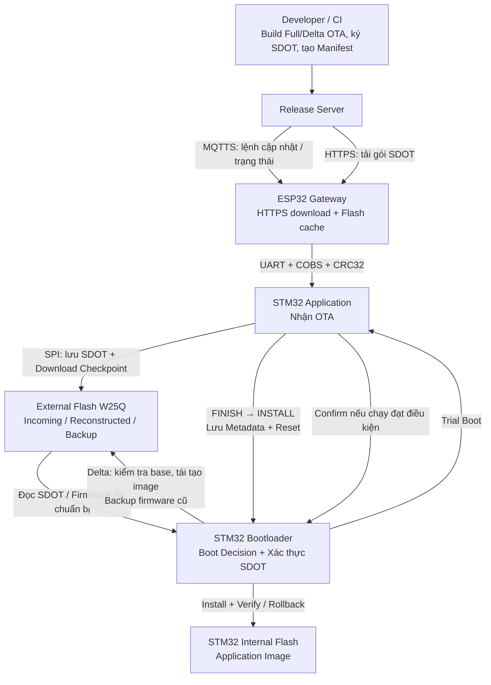

> **Lưu ý 1:** **MQTTS truyền lệnh và trạng thái**, còn **HTTPS truyền dữ liệu gói SDOT**. ESP32 Gateway chịu trách nhiệm mạng, tải và chuyển tiếp artifact; không giữ private key ký firmware.
>
> **Lưu ý 2:** `FINISH` chỉ xác nhận **đã nhận đủ gói SDOT** (kích thước và CRC32). Sau lệnh `INSTALL`, STM32 Application mới commit `UPDATE_ARTIFACT_READY` vào **Internal Flash Metadata A/B** và reset. **STM32 Bootloader** mới là thành phần quyết định xác thực và cài đặt.
>
> **Lưu ý 3:** **External Flash W25Q** chứa gói SDOT nhận được, firmware tái tạo và bản Backup; **Internal Flash** chứa Application đang chạy. **CRC32** giúp phát hiện lỗi dữ liệu, còn **ECDSA P-256 + SHA-256** phục vụ xác thực và kiểm tra tính toàn vẹn firmware. **Power-loss Recovery** không đồng nghĩa với **Rollback**.

**Nguồn đối chiếu:** [Repository README](https://github.com/haikevins/secure-delta-ota-bootloader), [System Architecture](https://github.com/haikevins/secure-delta-ota-bootloader/blob/main/docs/architecture.md), [UART OTA Protocol](https://github.com/haikevins/secure-delta-ota-bootloader/blob/main/docs/uart-ota-protocol.md).

---

<a id="phan-3"></a>
## Phần 3. Trình bày Boot State Machine

> **Mục tiêu:** Giới thiệu luồng điều khiển cập nhật của **STM32 Bootloader** trong khoảng **90 giây**, tiếp nối phần System Architecture. Đây là **sơ đồ tổng quan**, chưa thể hiện mọi nhánh xử lý lỗi.

### 3.1. Bài nói khi phỏng vấn (khoảng 90 giây)

Dạ, về **Boot State Machine**, em sử dụng các trạng thái được lưu trong **Metadata** để STM32 Bootloader quyết định hành động sau mỗi lần khởi động, kể cả khi mất nguồn hoặc reset bất ngờ.

- **Tiếp nhận cập nhật:** Ban đầu hệ thống ở `IDLE`. Khi ESP32 Gateway bắt đầu truyền, STM32 Application chuyển sang `RECEIVING`. Nhận đủ gói SDOT và kiểm tra CRC32 thành công thì bộ nhận đạt `ARTIFACT_READY`. Sau lệnh `INSTALL`, Application lưu trạng thái vào Metadata rồi reset.

- **Xác thực và chuẩn bị firmware:** STM32 Bootloader đọc Metadata, chuyển sang `VERIFYING_CONTAINER` để xác thực gói SDOT bằng ECDSA P-256 và SHA-256. Với Delta OTA, Bootloader kiểm tra firmware gốc ở `VERIFYING_BASE` trước khi tái tạo firmware trong `PATCHING`. Với Full OTA, Bootloader bỏ qua `VERIFYING_BASE` nhưng vẫn đi qua `PATCHING` để chuẩn bị firmware mới. Khi hợp lệ, hệ thống chuyển sang `IMAGE_READY`.

- **Sao lưu và cài đặt:** Bootloader chuyển qua `BACKING_UP` để sao lưu firmware hiện tại, rồi `INSTALLING` để ghi firmware mới vào Internal Flash. Sau đó, `VERIFYING_INSTALL` kiểm tra lại dữ liệu đã cài đặt.

- **Chạy thử và khôi phục:** Bootloader chuyển sang `TRIAL_BOOT` để chạy STM32 Application mới. Nếu Application xác nhận thành công, hệ thống qua `CONFIRMED` rồi về `IDLE`. Nếu không xác nhận sau số lần thử cho phép, Bootloader chuyển sang `ROLLBACK` để khôi phục firmware đã sao lưu.

Ngoài ra, **Metadata và Checkpoint** giúp hệ thống tiếp tục Backup, Install hoặc Rollback từ tiến độ an toàn sau khi mất nguồn.

### 3.2. High-level Transition Diagram

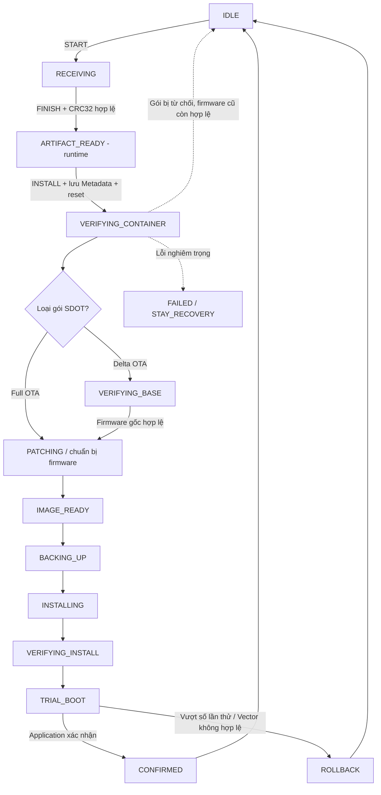

> **Lưu ý 1:** `ARTIFACT_READY` xuất hiện đầu tiên trong **runtime** của STM32 Application sau `FINISH`. Lệnh `INSTALL` mới ghi `UPDATE_ARTIFACT_READY` vào **Internal Flash Metadata A/B** để Bootloader xử lý sau reset.
>
> **Lưu ý 2:** `UPDATE_FAILED` đưa Bootloader vào `BOOT_ACTION_STAY_RECOVERY`; bản triển khai hiện tại **không** có chế độ tự nhận lệnh UART `START` để khôi phục từ xa tại trạng thái này.
>
> **Lưu ý 3:** Trước khi được xác nhận, firmware mới chỉ đang ở **Trial Boot**. `active_version` vẫn đại diện cho firmware đã xác nhận trước đó.

**Nguồn đối chiếu:** [Boot State Machine](https://github.com/haikevins/secure-delta-ota-bootloader/blob/main/docs/boot-state-machine.md), [Metadata & Boot Decision](https://github.com/haikevins/secure-delta-ota-bootloader/blob/main/docs/metadata-and-boot-decision.md).

---

<a id="phan-4"></a>
## Phần 4. Phân tích chi tiết System Architecture

> **Mục tiêu:** Phân tích sâu **System Architecture** đã giới thiệu ở **Phần 2**, theo cùng bố cục với **Phần 5**: **sơ đồ luồng → các bước xử lý → bài nói khi phỏng vấn → câu hỏi ôn tập → điểm cần ghi nhớ**. Phần 2 dùng để trình bày tổng quan khoảng 90 giây; Phần 4 dùng để giải thích chi tiết từng luồng từ **Developer/CI** đến **STM32 Internal Flash**.
>
> **Phạm vi:** Giữ nguyên nội dung và số liệu kỹ thuật trong bản ghi chú; các sơ đồ Mermaid nhấn mạnh luồng chính, không thay thế mọi điều kiện và nhánh lỗi của mã nguồn.

<a id="luong-1"></a>
### 4.1. Developer/CI → Release Server

> **Mục tiêu:** Hiểu cách Developer/CI **build firmware**, tạo gói cập nhật **Full OTA / Delta OTA**, đóng gói và ký số theo định dạng **SDOT**, tạo **Manifest** và chuẩn bị bản phát hành cho **Release Server**.
>
> **Tình huống minh họa:** STM32 đang chạy firmware **v1** và Developer muốn cập nhật lên **v2**.
>
> **Phân biệt hai loại gói:** **Full OTA** chứa toàn bộ firmware mới; **Delta OTA** chứa Delta Patch được tạo từ sự khác biệt giữa firmware gốc và firmware mới.

#### Sơ đồ luồng hoạt động

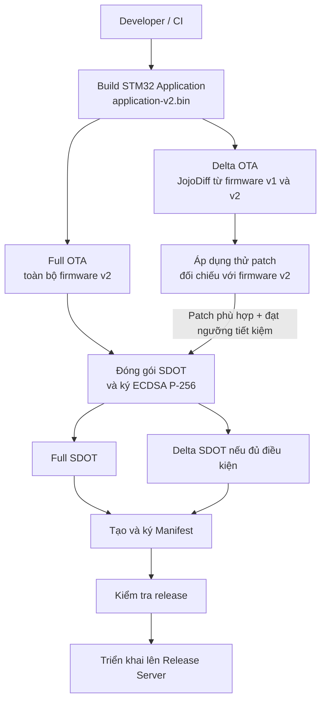

#### Bước 1. Developer/CI build firmware

Developer chỉnh sửa mã nguồn **STM32 Application** rồi build để tạo file binary firmware mới, ví dụ **`application-v2.bin`**. Đây là firmware dự kiến được cài đặt vào vùng Application của **STM32 Internal Flash**.

**CI (Continuous Integration)** có thể tự động hóa các công việc **build, kiểm tra và chuẩn bị bản phát hành**. Trong luồng này, Developer/CI là phía **tạo firmware**, chưa phải phía phân phối firmware đến thiết bị.

#### Bước 2. Tạo Full OTA và Delta OTA

Từ firmware mới, release tooling chuẩn bị các gói cập nhật tương ứng:

| Tiêu chí | Full OTA | Delta OTA |
|---|---|---|
| Nội dung | Toàn bộ firmware **v2** | Delta Patch từ **v1 → v2** |
| Dữ liệu cần để tạo | Firmware **v2** | Firmware **v1** và **v2** chính xác |
| Dung lượng | Thường lớn hơn | Có thể nhỏ hơn đáng kể |

Đối với **Delta OTA**, công cụ dùng **JojoDiff** để tạo Delta Patch, sau đó **áp dụng thử patch lên firmware v1** và so sánh kết quả với firmware v2 để kiểm tra tính đúng đắn.

Repository luôn tạo **Full OTA**, nhưng chỉ đưa **Delta OTA** vào release khi mức tiết kiệm đạt ngưỡng cấu hình, mặc định **20%**.

> **Ghi nhớ:** Delta Patch phụ thuộc vào **firmware gốc**. Khi cài đặt, STM32 Bootloader vẫn phải kiểm tra firmware gốc có đúng với bản được dùng để tạo patch hay không.

#### Bước 3. Đóng gói và ký số SDOT

Cả hai loại dữ liệu cập nhật được đóng gói theo định dạng **SDOT (Secure Delta OTA Container)**.

**Cấu trúc cơ bản của SDOT Container:**

```text
+-----------------------------+
| Header                      |
| - Firmware type             |
| - Base version              |
| - Target version            |
| - Base SHA-256              |
| - Target SHA-256            |
| - Product ID                |
+-----------------------------+
| Payload                     |
| Full firmware / Delta Patch |
+-----------------------------+
| ECDSA P-256 Signature       |
+-----------------------------+
```

Hệ thống dùng **SHA-256** để tạo các giá trị hash phục vụ kiểm tra tính toàn vẹn và **ECDSA P-256** để ký số SDOT bằng **private key**.

> **Ghi nhớ:** **Private key** được sử dụng ở phía phát hành firmware, **không truyền xuống ESP32 Gateway hoặc STM32**. Chữ ký SDOT sẽ được STM32 Bootloader xác thực trước khi cài đặt.

#### Bước 4. Tạo và ký số Manifest

Sau khi chuẩn bị các gói **SDOT**, release tooling tạo **`manifest.json`** để mô tả bản phát hành.

Manifest chứa các thông tin như:

- Phiên bản firmware mới.
- **Product ID** và **hardware revision**.
- Thông tin các gói **Full OTA / Delta OTA**.
- Kích thước và **SHA-256** của artifact.
- Đường dẫn tải artifact (**URL**).
- Thông tin khóa ký.

Manifest cũng được ký bằng **ECDSA**; chữ ký được lưu trong **`manifest.json.sig`**.

> **Phân biệt SDOT và Manifest:** **SDOT** chứa firmware hoặc Delta Patch đã ký số; **Manifest** mô tả thông tin bản phát hành và các artifact để hệ thống biết gói nào đang được cung cấp.

#### Bước 5. Kiểm tra và chuyển bản phát hành sang Release Server

Thư mục release có cấu trúc minh họa như sau:

```text
dist/releases/fw-v2/
│
├── application-v2.bin
├── application-v2.full.sdot
├── application-v1-to-v2.delta.sdot
│
├── manifest.json
├── manifest.json.sig
├── signing-public.pem
├── checksums.txt
└── release-notes.md
```

Sau khi tạo release, công cụ **kiểm tra tính hợp lệ của các file**. Bộ release được **triển khai lên Release Server** để sử dụng cho bước phân phối tiếp theo.

Release Server sử dụng bộ release đã triển khai để:

- Xác minh **Manifest** và các gói cập nhật theo thông tin bảo mật tương ứng.
- Cung cấp các artifact qua **HTTPS**.
- Chuẩn bị thông báo cập nhật qua **MQTTS**.

> **Lưu ý:** Việc **tạo và xác minh thư mục release** không đồng nghĩa với việc công cụ release tự động upload dữ liệu lên máy chủ từ xa. Triển khai release lên server là một bước riêng.

#### Bài nói khi phỏng vấn: Developer/CI và Release Server

> **Developer/CI → Release Server:** Đầu tiên, Developer/CI sẽ build STM32 Application để tạo file firmware mới dạng binary.
>
> Tiếp theo, công cụ release chuẩn bị gói cập nhật Full OTA từ toàn bộ firmware mới. Với Delta OTA, hệ thống sử dụng JojoDiff để tạo Delta Patch từ firmware cũ sang firmware mới, sau đó áp dụng thử Patch để kiểm tra khả năng tái tạo chính xác.
>
> Sau đó, các gói cập nhật được đóng gói theo định dạng SDOT và ký số bằng ECDSA P-256. Hệ thống cũng tạo và ký Manifest chứa thông tin phiên bản, kích thước, hash và đường dẫn đến các gói SDOT.
>
> Cuối cùng, công cụ release kiểm tra các file đã tạo. Bộ release hợp lệ được triển khai lên Release Server để xác minh và phân phối cho thiết bị. Như vậy, Developer/CI chịu trách nhiệm tạo và ký gói cập nhật, còn Release Server chịu trách nhiệm phân phối.

#### Câu hỏi ôn tập: Developer/CI → Release Server

| Câu hỏi | Ý chính cần trả lời |
|---|---|
| CI là gì? | Hệ thống tự động hóa build, kiểm thử và chuẩn bị release. |
| Tại sao cần firmware v1 khi tạo Delta OTA? | Vì JojoDiff tạo patch từ sự khác biệt giữa firmware v1 và v2. |
| Tại sao phải áp dụng thử Delta Patch? | Để kiểm tra patch có tái tạo đúng firmware v2 từ firmware v1 hay không. |
| Tại sao vẫn tạo Full OTA? | Để có gói cập nhật đầy đủ khi Delta OTA không phù hợp hoặc không đạt ngưỡng tiết kiệm. |
| SDOT Container dùng để làm gì? | Đóng gói dữ liệu cập nhật cùng thông tin xác thực và chữ ký số. |
| ECDSA P-256 dùng để làm gì? | Ký và xác thực dữ liệu cập nhật bằng cặp private key/public key phù hợp. |
| SHA-256 dùng để làm gì? | Tạo và kiểm tra hash để xác minh tính toàn vẹn của dữ liệu. |
| Manifest khác SDOT ở điểm nào? | Manifest mô tả bản phát hành; SDOT chứa Full Firmware hoặc Delta Patch đã ký số. |
| Release Server có tạo firmware không? | Không. Developer/CI và release tooling tạo artifact; server xác minh và phân phối. |
| Release Server có cần private key ký firmware không? | Không cần private key ký firmware để xác minh và phân phối release. |

#### Điểm cần ghi nhớ

- **Developer/CI tạo artifact; Release Server phân phối**. Kiểm tra release tại máy build không đồng nghĩa đã tự động upload lên server.
- **Full OTA** có firmware đích hoàn chỉnh; **Delta OTA** dùng patch từ đúng firmware gốc và phải được kiểm tra khả năng tái tạo.
- **SDOT khác Manifest:** SDOT chứa dữ liệu cập nhật đã ký số; Manifest mô tả release và các artifact.
- **Private key** ở phía phát hành; STM32 Bootloader dùng public key tin cậy để kiểm tra chữ ký trước cài đặt.

**Tài liệu/code đối chiếu:** `docs/release-process.md`, `tools/release.py`, `tools/secure_container.py`.

---

<a id="luong-2"></a>
### 4.2. Release Server → ESP32 Gateway

> **Mục tiêu:** Hiểu cách Release Server **xác minh và lựa chọn gói cập nhật SDOT**, thông báo cập nhật bằng **MQTTS**, và cách ESP32 Gateway tải gói đó bằng **HTTPS** trước khi truyền xuống STM32 Application.
>
> **Phân biệt hai giao thức:** **MQTTS** dùng để gửi lệnh cập nhật và trao đổi trạng thái; **HTTPS** dùng để tải nội dung gói cập nhật SDOT. Firmware không được truyền trực tiếp trong thông điệp MQTTS.

#### Sơ đồ luồng hoạt động

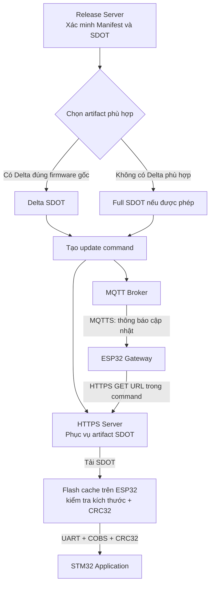

#### Bước 1. Release Server xác minh bản phát hành

Sau khi Developer/CI tạo các gói cập nhật **SDOT** và **Manifest**, Release Server sử dụng bộ release đã được triển khai để kiểm tra dữ liệu trước khi phân phối.

Các kiểm tra được mô tả trong hệ thống gồm tính hợp lệ của **chữ ký Manifest**, chữ ký và metadata của artifact, cùng các thông tin về **kích thước**, **CRC32** và **SHA-256** theo định dạng tương ứng.

> **Ghi nhớ:** Việc Release Server xác minh bản phát hành **không thay thế** việc STM32 Bootloader xác thực chữ ký SDOT trước khi cài đặt.

#### Bước 2. Release Server chọn Full OTA hoặc Delta OTA

Release Server dựa trên **phiên bản firmware hiện tại** được cung cấp khi yêu cầu phát hành lệnh cập nhật để lựa chọn gói phù hợp:

| Điều kiện | Quyết định |
|---|---|
| Có Delta OTA được tạo cho đúng firmware gốc | Ưu tiên Delta OTA. |
| Không có Delta OTA phù hợp | Dùng Full OTA nếu bản phát hành cho phép. |
| Thiết bị không cần cập nhật | Không phát hành lệnh cập nhật. |

**Ví dụ:** STM32 đang chạy **v1**, Release Server có **v2**; nếu bản phát hành chứa Delta Patch từ **v1 → v2**, Server có thể chọn gói Delta OTA thay vì Full OTA.

> **Lưu ý:** Lựa chọn của Server là bước phân phối. STM32 Bootloader vẫn phải kiểm tra điều kiện phiên bản và **firmware gốc (exact-base validation)** trước khi áp dụng Delta Patch.

#### Bước 3. Release Server gửi lệnh cập nhật qua MQTTS

Sau khi chọn artifact, Release Server tạo thông báo cập nhật để gửi qua **MQTT Broker** bằng kết nối **MQTTS**. ESP32 Gateway subscribe topic tương ứng để nhận lệnh.

**Ví dụ JSON minh họa các trường chính** (giá trị minh họa, không phải payload thực tế của một bản phát hành):

```json
{
  "schema": 1,
  "cmd": "update",
  "update_id": 12345,
  "target_version": 2,
  "size": 1174,
  "crc32": 123456789,
  "url": "https://firmware.example/releases/fw-v2/update.sdot"
}
```

| Trường | Ý nghĩa |
|---|---|
| `cmd` | Loại lệnh, ví dụ lệnh cập nhật. |
| `update_id` | Định danh của quá trình cập nhật. |
| `target_version` | Phiên bản firmware đích. |
| `size` | Kích thước gói SDOT cần tải. |
| `crc32` | CRC32 của gói SDOT, dùng phát hiện lỗi dữ liệu. |
| `url` | Đường dẫn HTTPS để ESP32 tải gói SDOT. |

Lệnh cập nhật trong repository sử dụng **MQTT QoS 1**. QoS 1 có thể dẫn đến gửi lại thông điệp, vì vậy các thành phần nhận lệnh cần xử lý trường hợp trùng lặp phù hợp.

#### Bước 4. ESP32 Gateway tải gói SDOT qua HTTPS

Khi nhận được lệnh cập nhật, ESP32 Gateway kiểm tra thông tin lệnh rồi thực hiện **HTTPS GET** tới địa chỉ trong trường `url`.

Trong quá trình tải, ESP32 kiểm tra kết nối **TLS**, phản hồi **HTTP**, kích thước nội dung và giới hạn bộ nhớ lưu trữ. Nội dung nhận về là **gói cập nhật SDOT**, không phải lệnh MQTTS.

#### Bước 5. ESP32 kiểm tra, lưu gói và chuẩn bị truyền qua UART

ESP32 lưu dữ liệu tải được vào vùng **Flash cache** của Gateway. Sau khi hoàn tất, ESP32 kiểm tra **kích thước** và **CRC32** của gói SDOT; chỉ khi cache hợp lệ mới tiếp tục giai đoạn truyền sang STM32 Application qua **UART**.

ESP32 có thể gửi thông tin **tiến độ/trạng thái** về hệ thống qua MQTT. Trong khi đó, bước **xác thực chữ ký ECDSA P-256 và SHA-256 để quyết định cài đặt** vẫn thuộc về STM32 Bootloader.

> **Phân biệt Manifest và gói SDOT:** Release Server dùng **Manifest** để biết thông tin bản phát hành, còn ESP32 Gateway nhận **URL trực tiếp đến gói SDOT** trong lệnh MQTTS. Luồng OTA hiện tại không yêu cầu ESP32 tải và tự phân tích Manifest để chọn artifact.

#### Bài nói khi phỏng vấn: Release Server và ESP32 Gateway

> **Release Server → ESP32 Gateway:** Sau khi bộ release được triển khai, Release Server xác minh Manifest và các gói cập nhật SDOT trước khi phân phối.
>
> Đầu tiên, dựa trên thông tin phiên bản firmware hiện tại, Server sẽ ưu tiên lựa chọn Delta OTA nếu có gói phù hợp; nếu không, Server sử dụng Full OTA.
>
> Tiếp theo, Server gửi lệnh cập nhật đến ESP32 Gateway qua MQTTS. Lệnh này chứa các thông tin như phiên bản đích, kích thước, CRC32 và đường dẫn HTTPS của gói SDOT.
>
> Khi nhận được lệnh, ESP32 Gateway sử dụng HTTPS để tải gói SDOT và lưu dữ liệu vào Flash cache. Sau khi tải xong, ESP32 kiểm tra kích thước và CRC32 để đảm bảo dữ liệu đã nhận đầy đủ trước khi truyền xuống STM32 Application.
>
> Như vậy, **MQTTS** được sử dụng để gửi lệnh cập nhật, còn **HTTPS** được sử dụng để tải dữ liệu. Việc xác thực chữ ký firmware trước khi cài đặt vẫn do STM32 Bootloader thực hiện.

#### Câu hỏi ôn tập: Release Server → ESP32 Gateway

| Câu hỏi | Ý chính cần trả lời |
|---|---|
| Vì sao sử dụng cả MQTTS và HTTPS? | MQTTS dùng để gửi lệnh/trạng thái; HTTPS dùng để tải dữ liệu firmware. |
| Ai quyết định chọn Full OTA hay Delta OTA? | Release Server chọn artifact phù hợp theo thông tin phiên bản và release. |
| ESP32 có cần tải Manifest không? | Không bắt buộc trong luồng hiện tại; URL artifact được gửi trong lệnh MQTTS. |
| ESP32 kiểm tra gói SDOT bằng gì? | Kiểm tra kích thước và CRC32 sau khi tải. |
| ESP32 có xác thực chữ ký ECDSA thay STM32 không? | Không; STM32 Bootloader là thành phần xác thực và quyết định cài đặt. |
| Tại sao phải lưu vào Flash cache? | Để có gói SDOT hoàn chỉnh, đã kiểm tra, trước khi truyền xuống STM32 qua UART. |
| MQTT QoS 1 nghĩa là gì? | Đảm bảo gửi ít nhất một lần; có thể có thông điệp trùng. |

#### Điểm cần ghi nhớ

- **MQTTS dùng cho lệnh/trạng thái; HTTPS dùng để tải SDOT**. Không truyền toàn bộ firmware trong lệnh MQTT.
- **Release Server** chọn gói phù hợp với phiên bản được cung cấp; **STM32 Bootloader** vẫn phải tự kiểm tra phiên bản và firmware gốc khi cài đặt.
- **ESP32 Gateway** tải và lưu SDOT vào Flash cache, kiểm tra kích thước và CRC32 trước khi truyền xuống STM32.
- **CRC32 không phải chữ ký số**; việc xác thực ECDSA P-256 và hash bảo mật khi quyết định cài đặt thuộc STM32 Bootloader.

**Tài liệu/code đối chiếu:** `server/README.md`, `gateway-esp32/README.md`, `server/app/services/firmware_service.py`.

---

<a id="luong-3"></a>
### 4.3. ESP32 Gateway → STM32 Application

> **Mục tiêu:** Hiểu cách **ESP32 Gateway** truyền gói cập nhật **SDOT** xuống **STM32 Application** qua **UART**, cách STM32 lưu dữ liệu vào **External Flash W25Q** qua **SPI**, và cách hệ thống xử lý lỗi truyền, **Retry**, **Resume** trước khi bàn giao cho **STM32 Bootloader**.
>
> **Phân chia trách nhiệm:** **STM32 Application** nhận, kiểm tra và lưu **gói cập nhật SDOT**; **STM32 Bootloader** xác thực chữ ký, xử lý Full/Delta OTA và cài đặt **firmware mới** vào Internal Flash.

#### Sơ đồ luồng hoạt động

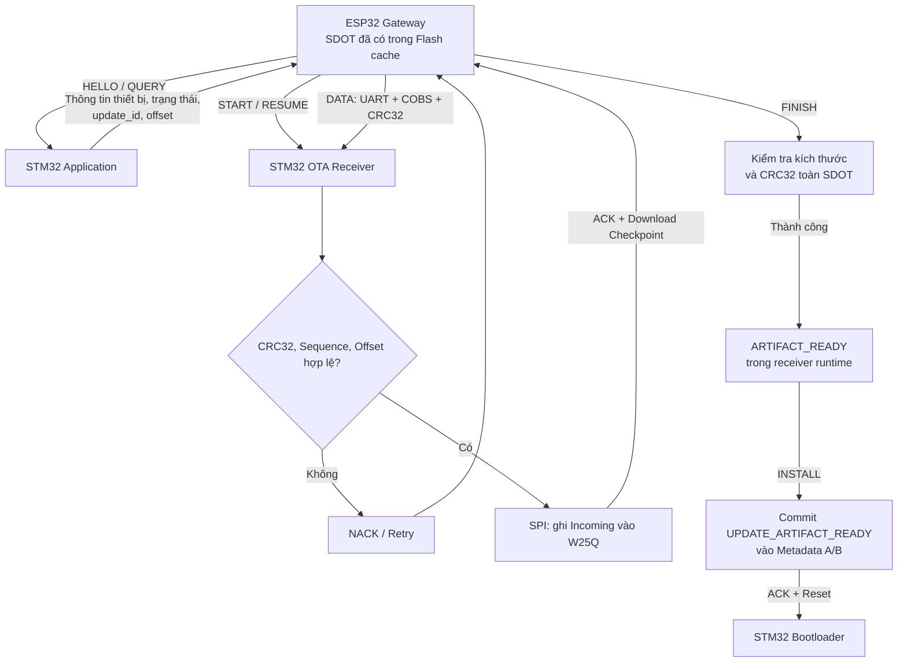

#### Bước 1. ESP32 Gateway chuẩn bị truyền gói cập nhật SDOT

Sau khi tải gói **SDOT** qua HTTPS và kiểm tra **kích thước/CRC32**, ESP32 Gateway đã lưu gói vào vùng **Flash cache** nội bộ. Gateway đọc dữ liệu từ cache để truyền qua UART, thay vì yêu cầu STM32 tự tải firmware qua mạng.

**Cấu hình UART trong repository:**

| Thông số | Giá trị |
|---|---|
| Giao thức | UART, **115200 8-N-1** |
| Data bits / Parity / Stop bits | 8 / None / 1 |
| Flow control | None |
| STM32 USART | USART1 |
| STM32 TX / RX | PA9 / PA10 |
| ESP32 UART mặc định | UART2 |
| ESP32 TX / RX mặc định | GPIO17 / GPIO16 |

Trước khi gửi DATA, Gateway cần kiểm tra trạng thái hiện tại của STM32 để quyết định **START** hay **RESUME**.

#### Bước 2. ESP32 Gateway gửi HELLO và QUERY

ESP32 trao đổi các lệnh **`HELLO`** và **`QUERY`** với STM32 Application. Phản hồi cung cấp các thông tin phục vụ nhận diện thiết bị và đồng bộ tiến độ, ví dụ:

| Thông tin | Ý nghĩa |
|---|---|
| `application_version` | Phiên bản firmware đang chạy |
| `bootloader_version` | Phiên bản STM32 Bootloader |
| `product_id` | Mã sản phẩm |
| `hardware_revision` | Phiên bản phần cứng |
| `capability_flags` | Các tính năng OTA được hỗ trợ |
| `update_state` | Trạng thái cập nhật hiện tại |
| `active_update_id` | Định danh bản cập nhật đang xử lý |
| `next_expected_offset` | Vị trí dữ liệu STM32 chờ nhận tiếp |

**Tại sao cần QUERY?** Vì STM32 có thể chưa nhận dữ liệu, đang nhận dở hoặc đã nhận hoàn tất gói SDOT. Thông tin trả về giúp ESP32 tránh bắt đầu lại không cần thiết và chọn đúng bước tiếp theo.

#### Bước 3. ESP32 Gateway gửi START hoặc RESUME

**`START`** được dùng khi bắt đầu nhận gói cập nhật mới. Các thông tin quan trọng bao gồm:

- `update_id`: Định danh bản cập nhật.
- `artifact_type`: Full OTA hoặc Delta OTA.
- `base_version`: Phiên bản firmware gốc.
- `target_version`: Phiên bản firmware đích.
- `artifact_size`: Kích thước toàn bộ gói SDOT.
- `artifact_crc32`: CRC32 của toàn bộ gói SDOT.

STM32 Application kiểm tra thông tin yêu cầu, trạng thái hiện tại và giới hạn dung lượng vùng **Incoming** của External Flash W25Q. Nếu chấp nhận, STM32 phản hồi **ACK** cùng offset bắt đầu (thông thường là `0`).

**`RESUME`** được dùng khi quá trình nhận trước đó bị gián đoạn. STM32 kiểm tra tính phù hợp của **`update_id`** và thông tin gói SDOT, sau đó cung cấp offset có thể tiếp tục an toàn để ESP32 truyền tiếp.

#### Bước 4. ESP32 Gateway truyền DATA qua UART

ESP32 chia SDOT thành các **DATA packet**, mỗi packet mang tối đa **256 bytes payload**. Cấu trúc packet ở mức khái quát:

```text
+---------------------------+
| Magic                     | 2 bytes
+---------------------------+
| Protocol Version          | 1 byte
+---------------------------+
| Command                   | 1 byte
+---------------------------+
| Update ID                 | 4 bytes
+---------------------------+
| Offset                    | 4 bytes
+---------------------------+
| Sequence                  | 2 bytes
+---------------------------+
| Payload Length            | 2 bytes
+---------------------------+
| Payload                   | 0–256 bytes
+---------------------------+
| Packet CRC32              | 4 bytes
+---------------------------+
```

Packet được **mã hóa COBS** và phân tách trên luồng UART bằng byte kết thúc **`0x00`**.

| Cơ chế | Vai trò |
|---|---|
| **COBS** | Đóng khung và phân tách các packet trên luồng byte UART |
| **CRC32** | Phát hiện lỗi dữ liệu packet |
| **Sequence** | Theo dõi thứ tự packet |
| **Offset** | Chỉ vị trí ghi dữ liệu trong toàn bộ gói SDOT |
| **Update ID** | Gắn packet với đúng quá trình cập nhật |

**Ví dụ** với payload 256 bytes/packet:

```text
ESP32 Gateway                      STM32 Application

DATA (offset = 0)   -------------> Kiểm tra, ghi W25Q
                   <------------- ACK (offset = 256)
DATA (offset = 256) -------------> Kiểm tra, ghi W25Q
                   <------------- ACK (offset = 512)
DATA (offset = 512) -------------> Kiểm tra, ghi W25Q
                   <------------- ACK (offset = 768)
```

> **Ghi nhớ:** CRC32 phát hiện lỗi truyền/lưu dữ liệu, **không** xác thực nguồn phát hành firmware; xác thực bảo mật do STM32 Bootloader thực hiện sau đó.

#### Bước 5. STM32 Application kiểm tra và lưu vào External Flash W25Q

Khi nhận DATA packet, STM32 Application thực hiện theo thứ tự:

1. Giải mã **COBS** để lấy packet gốc.
2. Kiểm tra **CRC32** của packet.
3. Kiểm tra `update_id`, **Sequence** và **Offset**.
4. Xác định địa chỉ thuộc phân vùng **Incoming** trên External Flash W25Q.
5. Xóa sector khi cần và ghi dữ liệu qua **SPI**.
6. Kiểm tra dữ liệu đã ghi và phản hồi kết quả.

```text
Receive DATA → Decode COBS → Verify CRC32
             → Check Update ID / Sequence / Offset
             → Write W25Q via SPI → Verify → ACK / NACK
```

**Vì sao lưu vào External Flash W25Q thay vì ghi thẳng Internal Flash?** Internal Flash chứa STM32 Application đang hoạt động. Việc nhận đầy đủ SDOT vào vùng lưu trữ riêng trước khi cài đặt giảm rủi ro ghi đè ứng dụng đang chạy nếu mất nguồn hoặc truyền bị gián đoạn.

#### Bước 6. STM32 Application phản hồi ACK/NACK và ESP32 Retry

| Phản hồi | Ý nghĩa |
|---|---|
| **ACK** | DATA packet đã được chấp nhận và xử lý thành công |
| **NACK** | DATA packet bị từ chối do lỗi dữ liệu, trạng thái, thứ tự, offset hoặc ghi Flash |

ESP32 chỉ chuyển sang packet tiếp theo khi đã nhận phản hồi phù hợp. Nếu nhận **NACK** hoặc quá thời gian chờ (**timeout**), Gateway có thể **Retry** theo giới hạn cấu hình.

| Thông số | Giá trị mô tả trong giao thức |
|---|---|
| Response timeout | **1500 ms** |
| Maximum retries | **5** |
| DATA payload | Tối đa **256 bytes** |

Nếu ACK bị mất và ESP32 gửi lại packet cũ, STM32 có thể nhận diện **DATA trùng hợp lệ** và trả ACK tương ứng; không được ghi lại một cách mù quáng làm sai tiến độ.

#### Bước 7. Resume khi truyền bị gián đoạn

STM32 Application sử dụng **Download Checkpoint** trong External Flash W25Q để lưu tiến độ nhận OTA. Checkpoint được ghi theo ranh giới sector **4 KB**.

**Ví dụ minh họa:**

```text
Gói SDOT 20 KB
    |
    | Đã nhận khoảng 10 KB
    v
Checkpoint an toàn gần nhất: 8 KB
    |
    | Reset bất ngờ
    v
STM32 khởi động lại, đọc Checkpoint
    |
    v
ESP32 gửi RESUME và truyền lại từ offset 8192
```

**Phân biệt:** **ACK** xác nhận một packet đã được xử lý trong phiên truyền hiện tại; **Checkpoint** là mốc tiến độ đã lưu bền vững để phục hồi sau reset. Offset được ACK gần nhất **không nhất thiết** là offset có thể Resume sau khi mất nguồn.

#### Bước 8. ESP32 Gateway gửi FINISH

Sau khi truyền đủ toàn bộ SDOT, ESP32 gửi **`FINISH`**. STM32 Application kiểm tra:

1. **Kích thước** dữ liệu nhận được có đúng với `artifact_size` không.
2. **CRC32 toàn bộ gói SDOT** có khớp với giá trị dự kiến không.

Nếu hợp lệ, STM32 chuyển sang trạng thái **`ARTIFACT_READY`** của phiên nhận OTA.

> **Phân biệt quan trọng:** `FINISH` xác nhận rằng SDOT đã được **nhận đầy đủ**. Nó **chưa** yêu cầu cài đặt, chưa ghi trạng thái bàn giao `UPDATE_ARTIFACT_READY` vào Internal Flash Metadata và chưa reset STM32.

#### Bước 9. ESP32 Gateway gửi INSTALL, STM32 bàn giao cho Bootloader

Khi `FINISH` thành công, ESP32 gửi **`INSTALL`**. STM32 Application:

1. Kiểm tra trạng thái **`ARTIFACT_READY`** và `update_id`.
2. Kiểm tra thông tin định dạng container SDOT ở mức cần thiết để bàn giao.
3. Ghi trạng thái **`UPDATE_ARTIFACT_READY`** vào **Internal Flash Metadata A/B**.
4. Gửi **ACK** cho ESP32 Gateway.
5. **Reset** để STM32 Bootloader xử lý bản cập nhật.

```text
ESP32 Gateway
      |
      | INSTALL
      v
STM32 Application
      |
      | Kiểm tra ARTIFACT_READY / Update ID / SDOT
      v
Internal Flash Metadata A/B
      |
      | Commit UPDATE_ARTIFACT_READY
      v
Send ACK → Reset STM32 → STM32 Bootloader
```

**Đây là điểm bàn giao giữa Application và Bootloader.** STM32 Application không xác thực chữ ký ECDSA P-256 để quyết định cài đặt ở bước này; đó là nhiệm vụ của STM32 Bootloader sau reset.

#### Bài nói khi phỏng vấn: ESP32 Gateway → STM32 Application

> **ESP32 Gateway → STM32 Application:** Sau khi tải và kiểm tra gói SDOT thành công, ESP32 Gateway bắt đầu truyền dữ liệu xuống STM32 Application thông qua UART.
>
> Đầu tiên, ESP32 sử dụng lệnh HELLO và QUERY để lấy thông tin thiết bị, trạng thái cập nhật và Offset hiện tại. Từ đó, ESP32 quyết định gửi START để bắt đầu nhận mới hoặc RESUME nếu quá trình truyền trước đó bị gián đoạn.
>
> Tiếp theo, ESP32 chia gói SDOT thành các DATA packet, mỗi packet có tối đa 256 bytes Payload, sử dụng COBS để đóng khung và CRC32 để phát hiện lỗi truyền.
>
> Ở phía STM32, Application kiểm tra CRC32, Sequence và Offset, sau đó ghi dữ liệu vào External Flash W25Q qua SPI. Nếu xử lý thành công, STM32 trả về ACK; nếu có lỗi, STM32 trả về NACK để ESP32 Retry.
>
> Ngoài ra, STM32 lưu Checkpoint theo ranh giới sector 4 KB để có thể Resume từ vị trí an toàn sau reset, thay vì phải truyền lại toàn bộ gói SDOT.
>
> Cuối cùng, ESP32 gửi FINISH để STM32 kiểm tra toàn bộ dữ liệu đã nhận, sau đó gửi INSTALL. STM32 Application cập nhật Metadata và reset để bàn giao quá trình cập nhật cho STM32 Bootloader.

#### Câu hỏi ôn tập: ESP32 Gateway → STM32 Application

| Câu hỏi | Ý chính cần trả lời |
|---|---|
| Tại sao ESP32 và STM32 giao tiếp qua UART? | Kết nối đơn giản giữa hai vi điều khiển, không yêu cầu STM32 tự xử lý kết nối mạng. |
| Tại sao cần COBS? | Để đóng khung packet UART và dùng `0x00` làm byte phân tách. |
| CRC32 dùng để làm gì? | Phát hiện lỗi dữ liệu trong truyền và lưu trữ, không dùng để xác thực chữ ký. |
| Sequence khác Offset thế nào? | Sequence theo dõi thứ tự packet; Offset xác định vị trí byte trong SDOT. |
| Tại sao cần ACK/NACK? | Xác nhận dữ liệu đã xử lý thành công hoặc báo lỗi để Retry. |
| Nếu ACK bị mất thì sao? | ESP32 có thể gửi lại; STM32 có cơ chế nhận diện packet trùng hợp lệ. |
| Retry giải quyết vấn đề gì? | Khắc phục lỗi truyền và timeout tạm thời. |
| Resume hoạt động như thế nào? | STM32 đọc Checkpoint và thông báo offset an toàn để ESP32 truyền tiếp. |
| Tại sao Checkpoint theo sector 4 KB? | Phù hợp với đơn vị sector của W25Q, hỗ trợ phục hồi tiến độ nhận. |
| Tại sao dùng External Flash W25Q? | Lưu trữ trọn SDOT mà không ghi đè Application đang chạy. |
| FINISH khác INSTALL thế nào? | FINISH xác nhận nhận đủ SDOT; INSTALL ghi Metadata bàn giao và reset. |
| Ai xác thực chữ ký ECDSA P-256? | STM32 Bootloader, sau khi nhận gói SDOT và bàn giao. |

#### Điểm cần ghi nhớ

- **UART + COBS + CRC32 + ACK/NACK + Retry:** Hỗ trợ truyền packet có kiểm tra lỗi; UART cơ bản không tự bảo đảm toàn bộ gói firmware ở tầng ứng dụng.
- **ACK khác Checkpoint:** ACK theo packet; Checkpoint lưu mốc phục hồi bền vững, vì vậy Resume có thể phải truyền lại dữ liệu đã từng ACK.
- **FINISH khác INSTALL:** FINISH xác minh gói SDOT đã nhận đầy đủ; INSTALL bàn giao cho STM32 Bootloader bằng **Metadata + Reset**.

**Tóm tắt thứ tự lệnh:**

```text
HELLO / QUERY
      |
START / RESUME
      |
     DATA
      |
CRC32 / Sequence / Offset
      |
Write External Flash W25Q
      |
ACK / NACK + Retry
      |
    FINISH
      |
   INSTALL
      |
Metadata + Reset
      |
STM32 Bootloader
```

**Tài liệu/code đối chiếu:** `docs/uart-ota-protocol.md`, `docs/architecture.md`, `node-stm32f103/application/src/ota_receiver.c`.

---

<a id="luong-4"></a>
### 4.4. STM32 Application → STM32 Bootloader

> **Mục tiêu:** Hiểu cách **STM32 Application** bàn giao gói cập nhật **SDOT** cho **STM32 Bootloader** thông qua **Metadata + Reset**; cách Bootloader xác thực, chuẩn bị firmware mới, sao lưu, cài đặt và quyết định **Trial Boot / Rollback**.
>
> **Phân chia trách nhiệm:** **STM32 Application** nhận và lưu SDOT, sau đó yêu cầu cài đặt. **STM32 Bootloader** đọc Metadata, xác thực chữ ký, xử lý **Full OTA / Delta OTA**, cài đặt firmware mới vào **Internal Flash** và thực hiện các bước phục hồi khi cần.

#### Sơ đồ luồng hoạt động

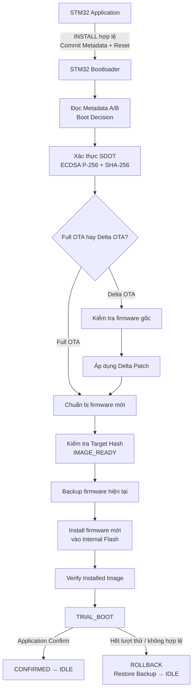

> **Lưu ý:** Sơ đồ trên mô tả luồng thành công và nhánh Rollback chính. **Boot State Machine** còn các trạng thái xử lý lỗi và phục hồi sau reset; không phải mọi lỗi đều tự động Rollback.

#### Bước 1. STM32 Application nhận lệnh INSTALL

Sau khi ESP32 Gateway truyền đủ gói **SDOT** qua UART, STM32 Application nhận lệnh **`FINISH`** và kiểm tra **kích thước** cùng **CRC32 của toàn bộ gói SDOT**. Khi kiểm tra thành công, bộ nhận OTA có trạng thái **`ARTIFACT_READY`**.

Tiếp theo, ESP32 Gateway gửi **`INSTALL`**. STM32 Application kiểm tra:

1. Trạng thái nhận OTA hiện tại là **`ARTIFACT_READY`**.
2. **`update_id`** khớp với phiên cập nhật đang xử lý.
3. Thông tin cần thiết để bàn giao SDOT là hợp lệ.

**Điểm cần nhớ:** STM32 Application chưa sử dụng **ECDSA P-256** để quyết định tin cậy và cài đặt firmware; đây là nhiệm vụ của **STM32 Bootloader** sau reset.

#### Bước 2. STM32 Application ghi Metadata A/B

Khi điều kiện `INSTALL` hợp lệ, STM32 Application ghi trạng thái **`UPDATE_ARTIFACT_READY`** vào **Internal Flash Metadata A/B**.

| Thông tin Metadata | Vai trò |
|---|---|
| `state` | Trạng thái hiện tại của quy trình cập nhật. |
| `active_version` | Phiên bản firmware đã được chấp nhận trước đó. |
| `pending_version` | Phiên bản firmware đang chờ xử lý. |
| `active_update_id` | Định danh phiên cập nhật. |
| `copy_offset` | Tiến độ sao chép/ghi firmware khi có Checkpoint. |
| `boot_attempts` | Số lần Trial Boot đã được ghi nhận. |
| `generation` | Phân biệt bản Metadata mới và cũ. |
| `crc32` | Phát hiện Metadata bị lỗi. |

Hai vùng **Internal Flash Metadata** trong thiết kế:

| Vùng | Địa chỉ | Kích thước |
|---|---|---:|
| Metadata A | `0x0800F800` | 1 KB |
| Metadata B | `0x0800FC00` | 1 KB |

**Tại sao cần Metadata A/B?** Khi cập nhật Metadata, hệ thống có thể ghi bản mới vào vùng còn lại, kiểm tra **CRC32** và sử dụng **generation** để lựa chọn bản hợp lệ mới nhất. Nếu mất nguồn trong lúc ghi, vẫn có khả năng đọc được bản Metadata hợp lệ trước đó.

#### Bước 3. STM32 Application reset để bàn giao cho Bootloader

Khi Metadata đã được cập nhật, STM32 Application gửi **ACK** cho ESP32 Gateway, sau đó reset STM32.

```text
STM32 Application
      |
      | INSTALL hợp lệ
      v
Commit UPDATE_ARTIFACT_READY
      |
      v
Gửi ACK → Reset STM32
      |
      v
STM32 Bootloader
```

Trong thiết kế này, vùng Bootloader bắt đầu tại **`0x08000000`**, còn Application bắt đầu tại **`0x08006000`**. Sau reset, STM32 thực thi Bootloader trước và Bootloader dùng Metadata đã lưu để xác định bước tiếp theo.

**Tại sao lưu vào Flash thay vì RAM?** Vì trạng thái trong **RAM** không được đảm bảo tồn tại sau reset hoặc mất nguồn; **Metadata** trong **Internal Flash** là cơ sở cho **Power-loss Recovery**.

#### Bước 4. STM32 Bootloader đọc Metadata và đưa ra Boot Decision

STM32 Bootloader khởi tạo các thành phần cần thiết, đọc **Metadata A/B**, chọn bản hợp lệ mới nhất và đưa ra quyết định xử lý bằng logic **Boot Decision**.

| Trạng thái Metadata | Hành động tiêu biểu |
|---|---|
| `UPDATE_IDLE` | Kiểm tra và khởi động Application đang có. |
| `UPDATE_RECEIVING` | Cho Application tiếp tục quy trình tiếp nhận OTA nếu phù hợp. |
| `UPDATE_ARTIFACT_READY` | Bắt đầu xử lý và xác thực gói SDOT. |
| `UPDATE_VERIFYING_CONTAINER` | Thực hiện xác thực container. |
| `UPDATE_PATCHING` | Chuẩn bị hoặc tái tạo firmware mới. |
| `UPDATE_IMAGE_READY` | Tiến đến bước Backup. |
| `UPDATE_BACKING_UP` | Tiếp tục hoặc khôi phục bước Backup. |
| `UPDATE_INSTALLING` | Tiếp tục Install từ Checkpoint an toàn. |
| `UPDATE_TRIAL_BOOT` | Quản lý khởi động thử Application mới. |
| `UPDATE_ROLLBACK` | Khôi phục firmware đã sao lưu. |
| `UPDATE_FAILED` | Ở lại chế độ Recovery, không mặc nhiên nhận OTA mới qua UART. |

Khi Metadata đang ở **`UPDATE_ARTIFACT_READY`**, Bootloader chọn nhánh **xử lý artifact**, từ đó bước vào xác thực gói SDOT.

**Code cần đọc:** `node-stm32f103/bootloader/src/boot_decision.c` và `node-stm32f103/bootloader/src/boot_manager.c`.

#### Bước 5. STM32 Bootloader xác thực gói cập nhật SDOT

Bootloader đọc gói **SDOT** từ phân vùng **Incoming** của **External Flash W25Q**, sau đó kiểm tra:

1. **Header** và định dạng container.
2. Thông tin nhận diện thiết bị như **Product ID** và **Hardware Revision**.
3. Điều kiện phiên bản, bao gồm chính sách **Anti-rollback / Anti-downgrade** của bản cập nhật.
4. **CRC32** của dữ liệu ở các bước tương ứng để phát hiện lỗi.
5. Các giá trị **SHA-256** cần kiểm tra.
6. **Chữ ký ECDSA P-256** bằng **Public Key tin cậy**.

| Cơ chế | Vai trò |
|---|---|
| CRC32 | Phát hiện lỗi dữ liệu, không xác thực nguồn phát hành. |
| SHA-256 | Tính/đối chiếu hash để kiểm tra tính toàn vẹn. |
| ECDSA P-256 | Xác thực chữ ký trên dữ liệu được ký. |

> **Lưu ý triển khai:** Repository mặc định **chưa provision Public Key production**. Cần provision khóa tin cậy phù hợp trước khi kiểm tra bản firmware ký số trên thiết bị thật; không nên nhầm cơ chế có trong code với một sản phẩm đã cấu hình khóa hoàn chỉnh.

**Code cần đọc:** `node-stm32f103/bootloader/src/secure_container.c`, `node-stm32f103/bootloader/include/trusted_key.h`.

#### Bước 6. STM32 Bootloader xử lý Full OTA hoặc Delta OTA

Sau khi xác thực SDOT, Bootloader dựa vào loại artifact để chuẩn bị **firmware mới**:

| Full OTA | Delta OTA |
|---|---|
| Payload chứa firmware mới hoàn chỉnh. | Payload chứa **Delta Patch**. |
| Chuẩn bị firmware mới từ Payload. | Xác thực **firmware gốc** rồi áp dụng Delta Patch. |
| Không cần tái tạo từ firmware cũ. | Cần **base version** và **base SHA-256** khớp chính xác. |

Với **Delta OTA**, Bootloader kiểm tra **base version**, tính/đối chiếu **Base SHA-256** rồi áp dụng patch để tái tạo firmware mới. Dữ liệu đầu ra được chuẩn bị trong phân vùng **Reconstructed Image** của **External Flash W25Q**.

Sau đó, Bootloader kiểm tra **Target SHA-256** và các điều kiện hợp lệ của firmware mới. Khi đạt yêu cầu, quá trình chuyển đến **`UPDATE_IMAGE_READY`**.

**Điểm quan trọng:** Đến bước này, Application đang chạy trong **Internal Flash** vẫn chưa bị ghi đè.

#### Bước 7. STM32 Bootloader Backup firmware hiện tại

Sau khi firmware mới đã được chuẩn bị và xác minh hợp lệ, Bootloader chuyển sang **`UPDATE_BACKING_UP`** và sao lưu Application hiện tại từ **Internal Flash** sang phân vùng **Backup Image** của **External Flash W25Q**.

```text
Internal Flash (Application hiện tại)
                 |
                 | Đọc firmware hiện tại
                 v
          STM32 Bootloader
                 |
                 | Ghi qua SPI
                 v
External Flash W25Q (Backup Image)
```

Bước Backup có **Checkpoint** theo ranh giới **sector 4 KB** của W25Q, giúp Bootloader xác định tiến độ an toàn sau reset. Bootloader kiểm tra bản Backup trước khi tiến hành Install.

**Tại sao Backup trước Install?** Vì Install sẽ xóa/ghi đè Application trong **Internal Flash**. Nếu firmware mới không chạy đúng, Bootloader cần bản Backup hợp lệ để **Rollback**.

#### Bước 8. STM32 Bootloader Install firmware mới vào Internal Flash

Khi Backup đã được kiểm tra, Bootloader chuyển sang **`UPDATE_INSTALLING`**, đọc firmware mới từ **Reconstructed Image** và thực hiện **Erase + Program** trên vùng Application của **Internal Flash**.

```text
External Flash W25Q (Reconstructed Image)
                 |
                 | Đọc firmware mới
                 v
          STM32 Bootloader
                 |
                 | Erase + Program
                 v
      Internal Flash (Application)
```

Quá trình Install được thực hiện theo từng **trang Internal Flash 1 KB**, đồng thời lưu **Checkpoint** sau những bước ghi và kiểm tra thành công. Nếu xảy ra mất nguồn, Bootloader đọc Metadata sau reset và tiếp tục từ mốc an toàn thay vì xem firmware chưa hoàn chỉnh là hợp lệ.

Sau khi ghi xong, Bootloader chuyển sang **`UPDATE_VERIFYING_INSTALL`** để kiểm tra firmware đã cài đặt trong **Internal Flash**.

#### Bước 9. STM32 Bootloader thực hiện Trial Boot

Nếu kết quả Install hợp lệ, Bootloader chuyển sang **`UPDATE_TRIAL_BOOT`** và cho **STM32 Application mới** chạy thử.

Ở giai đoạn này, Bootloader quản lý **`boot_attempts`** và sử dụng **Watchdog** để xử lý trường hợp Application không tiến đến bước xác nhận. Giới hạn trong repository là **3 lần Trial Boot**.

Application có cơ chế xác nhận sau khoảng **750 ms main loop**. Đây là kiểm tra **khả năng khởi động cơ bản**, **chưa phải health check đầy đủ** của toàn bộ chức năng sản phẩm.

**Điểm cần nhớ:** **Install thành công không có nghĩa cập nhật đã được xác nhận**. Cần hoàn thành Trial Boot và bước Confirm.

#### Bước 10. Confirm hoặc Rollback

**Trường hợp 1 — Application xác nhận thành công:**

STM32 Application ghi trạng thái **`UPDATE_CONFIRMED`** và thực hiện bước bàn giao để Bootloader hoàn tất xác nhận. Bootloader cập nhật **`active_version`** và đưa hệ thống về **`UPDATE_IDLE`**; firmware mới trở thành phiên bản được chấp nhận.

**Trường hợp 2 — Application không xác nhận trong số lần thử cho phép:**

Bootloader chuyển sang **`UPDATE_ROLLBACK`**, dùng **Backup Image** để khôi phục Application trước đó vào **Internal Flash**. Quá trình Rollback cũng sử dụng **Checkpoint** để có thể phục hồi khi bị gián đoạn.

> **Phân biệt:** **Power-loss Recovery** là khôi phục/tiếp tục quy trình cập nhật dựa trên Metadata và Checkpoint; **Rollback** là phục hồi firmware đã sao lưu. Không phải cứ mất nguồn là phải Rollback ngay.

#### Bài nói khi phỏng vấn: STM32 Application → STM32 Bootloader

> **STM32 Application → STM32 Bootloader:** Sau khi nhận đủ gói SDOT, STM32 Application nhận lệnh INSTALL từ ESP32 Gateway, kiểm tra điều kiện bàn giao rồi ghi trạng thái `UPDATE_ARTIFACT_READY` vào Metadata và reset thiết bị.
>
> Khi khởi động lại, STM32 Bootloader đọc Metadata A/B, chọn bản hợp lệ mới nhất và sử dụng Boot State Machine để quyết định bước xử lý tiếp theo.
>
> Đầu tiên, Bootloader đọc gói SDOT từ External Flash W25Q, xác thực chữ ký ECDSA P-256 và kiểm tra tính toàn vẹn bằng SHA-256. Nếu là Full OTA, Bootloader chuẩn bị firmware mới từ Payload. Nếu là Delta OTA, Bootloader kiểm tra phiên bản và hash của firmware gốc, sau đó áp dụng Delta Patch để tái tạo firmware mới.
>
> Tiếp theo, sau khi kiểm tra firmware mới hợp lệ, Bootloader sao lưu firmware hiện tại vào External Flash W25Q, rồi cài đặt bản mới vào Internal Flash và kiểm tra lại kết quả.
>
> Cuối cùng, Bootloader cho Application mới chạy ở chế độ Trial Boot. Nếu Application xác nhận thành công, bản cập nhật được chấp nhận. Nếu không xác nhận sau số lần thử cho phép, Bootloader sẽ Rollback về firmware đã sao lưu.
>
> Trong toàn bộ quá trình, Metadata và Checkpoint được sử dụng để khôi phục tiến độ cập nhật khi có mất nguồn hoặc reset bất ngờ.

#### Câu hỏi ôn tập: STM32 Application → STM32 Bootloader

| Câu hỏi | Ý chính cần trả lời |
|---|---|
| Tại sao Application phải reset để chuyển sang Bootloader? | Để Bootloader xử lý cập nhật dựa trên Metadata đã lưu trong Flash. |
| Tại sao cần Metadata A/B? | Để còn bản Metadata hợp lệ nếu mất nguồn khi ghi bản mới. |
| Bootloader quyết định hành động tiếp theo thế nào? | Đọc Metadata và đánh giá trạng thái qua logic Boot Decision. |
| Tại sao cần xác thực SDOT? | Kiểm tra chữ ký, tính toàn vẹn, điều kiện phần cứng và phiên bản trước khi Install. |
| Full OTA khác Delta OTA thế nào? | Full chứa firmware mới; Delta chứa patch để tái tạo firmware từ base image. |
| Tại sao cần kiểm tra Base SHA-256? | Đảm bảo Delta Patch được áp dụng lên chính xác firmware gốc. |
| Tại sao phải Backup trước Install? | Để có firmware hợp lệ phục vụ Rollback nếu bản mới không hoạt động đúng. |
| Tại sao Install theo trang 1 KB? | Phù hợp đơn vị trang Internal Flash và hỗ trợ Checkpoint an toàn. |
| Nếu mất nguồn khi Install thì sao? | Bootloader đọc Metadata/Checkpoint và tiếp tục từ mốc an toàn. |
| Trial Boot dùng để làm gì? | Cho firmware mới chạy thử trước khi chấp nhận chính thức. |
| Nếu Application mới liên tục reset thì sao? | Bootloader đếm số lần thử, sau ngưỡng thì Rollback nếu có Backup hợp lệ. |
| Power-loss Recovery khác Rollback thế nào? | Recovery xử lý cập nhật bị gián đoạn; Rollback phục hồi firmware đã sao lưu. |

#### Điểm cần ghi nhớ

- **Application không trực tiếp cài đặt firmware mới:** chỉ nhận SDOT, lưu vào External Flash W25Q, ghi Metadata và yêu cầu reset.
- **Xác thực SDOT trước khi ghi đè Application:** ECDSA P-256, SHA-256 và kiểm tra điều kiện cập nhật thuộc STM32 Bootloader.
- **Full OTA khác Delta OTA:** Delta cần **firmware gốc chính xác**, sau đó tái tạo ra firmware mới.
- **Backup trước Install:** Không ghi đè Application cho tới khi firmware mới đã được chuẩn bị và bản Backup hợp lệ.
- **Install khác Confirm:** Cài đặt xong vẫn cần **Trial Boot** trước khi chấp nhận phiên bản mới.
- **Recovery khác Rollback:** Mất nguồn không mặc định đồng nghĩa Rollback; xử lý tùy trạng thái và Checkpoint.
- **Anti-rollback khác Rollback:** Anti-rollback giới hạn phiên bản được phép cài đặt; Rollback phục hồi Backup đã được chấp nhận.

**Tóm tắt luồng chính:**

```text
INSTALL → Metadata + Reset
             |
             v
         Boot Decision
             |
             v
         Verify SDOT
             |
             v
      Full / Delta OTA
             |
             v
   Verify Reconstructed Image
             |
             v
           Backup
             |
             v
           Install
             |
             v
    Verify Installed Image
             |
             v
          Trial Boot
         /         \
    Confirm      Rollback
       |            |
       +-----+------+
             v
            IDLE
```

**Tài liệu/code đối chiếu:** `docs/boot-state-machine.md`, `docs/metadata-and-boot-decision.md`, `docs/firmware-container.md`, `docs/memory-map.md`, `node-stm32f103/bootloader/src/boot_manager.c`, `node-stm32f103/bootloader/src/boot_decision.c`, `node-stm32f103/bootloader/src/secure_container.c`, `node-stm32f103/bootloader/src/image_installer.c`, `node-stm32f103/bootloader/src/trial_boot.c`.

---

<a id="luong-5"></a>
### 4.5. STM32 Bootloader → STM32 Internal Flash

> **Mục tiêu:** Hiểu cách **STM32 Bootloader** cài đặt firmware mới vào **STM32 Internal Flash**: đọc firmware từ **External Flash W25Q**, xóa và ghi từng trang, kiểm tra dữ liệu đã ghi, cập nhật **Checkpoint** và chuyển sang **Trial Boot**.
>
> **Điều kiện đầu vào:** Gói SDOT đã được xác thực; firmware mới đã nằm trong vùng **Reconstructed Image** của External Flash W25Q; bản **Backup** của firmware hiện tại đã được tạo và kiểm tra. Ở phần này tập trung vào quá trình **Install** thay vì lặp lại quá trình xác thực SDOT hay tạo Delta Patch.

#### Sơ đồ luồng hoạt động

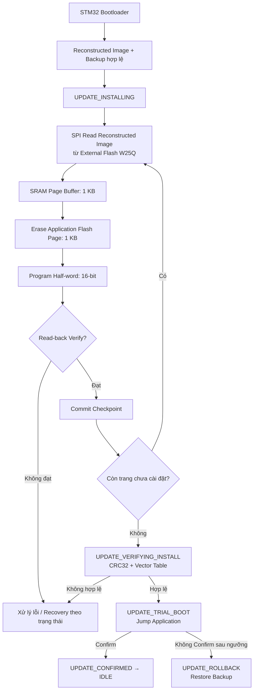

**Điểm cần nhớ:** STM32 Bootloader **không** ghi trực tiếp dữ liệu UART từ ESP32 vào Internal Flash. Firmware hoàn chỉnh đã được chuẩn bị và kiểm tra ở **External Flash W25Q** trước khi bắt đầu Install.

#### Phân vùng STM32 Internal Flash

| Phân vùng | Địa chỉ bắt đầu | Dung lượng | Vai trò |
|---|---|---:|---|
| **Bootloader** | `0x08000000` | 24 KB | Chương trình khởi động, xử lý cập nhật và phục hồi |
| **Application** | `0x08006000` | 38 KB | Chứa firmware hiện tại hoặc firmware mới đang cài đặt |
| **Metadata A** | `0x0800F800` | 1 KB | Lưu Metadata và Checkpoint |
| **Metadata B** | `0x0800FC00` | 1 KB | Bản Metadata dự phòng |

```text
STM32 Internal Flash (64 KB)
0x08000000  +-----------------------------+
            | Bootloader (24 KB)          |
0x08006000  +-----------------------------+
            | Application (38 KB)         |
            | <- vùng được cài đặt OTA -> |
0x0800F800  +-----------------------------+
            | Metadata A (1 KB)           |
0x0800FC00  +-----------------------------+
            | Metadata B (1 KB)           |
0x08010000  +-----------------------------+
```

**Tại sao phải phân vùng?** Để quá trình cập nhật chỉ xóa/ghi vùng **Application**, không ghi đè **Bootloader** (phải luôn sẵn sàng khởi động hoặc phục hồi) và vùng **Metadata** (phải lưu được trạng thái sau reset).

#### Bước 1. STM32 Bootloader kiểm tra điều kiện trước khi Install

- Firmware mới đã được xác thực và chuẩn bị trong **Reconstructed Image**.
- Firmware hiện tại đã được sao lưu trong **Backup Image** của External Flash W25Q.
- Bản Backup đã được kiểm tra hợp lệ; Bootloader mới được phép bắt đầu ghi đè Application.
- Bootloader chuyển sang trạng thái `UPDATE_INSTALLING`.

**Tại sao Backup trước Install?** Vì quá trình Install phải xóa nội dung Application hiện tại. Nếu firmware mới không hoạt động hoặc cần phục hồi, bản Backup là nguồn dữ liệu để **Rollback**.

#### Bước 2. Đọc firmware mới từ External Flash W25Q vào SRAM

Bootloader đọc từng phần của firmware mới trong **Reconstructed Image** qua **SPI**, đưa vào **SRAM Page Buffer** trước khi ghi Internal Flash.

```c
static uint8_t g_install_page_buffer[INTERNAL_FLASH_PAGE_SIZE];
```

Trong project, `INTERNAL_FLASH_PAGE_SIZE` tương ứng **1.024 bytes (1 KB)**.

```text
External Flash W25Q          STM32 Bootloader           STM32 Internal Flash
Reconstructed Image  --SPI--> SRAM Page Buffer  -----> Application Region
                              (1 KB)
```

**Lý do dùng buffer 1 KB:** Phù hợp đơn vị xóa theo trang của STM32F103, không cần giữ toàn bộ firmware trong SRAM hạn chế của vi điều khiển.

#### Bước 3. Xóa từng trang Internal Flash

Trước khi ghi firmware mới, Bootloader mở khóa Flash, xóa cờ lỗi và xóa trang Application tương ứng. Ví dụ minh họa:

```c
FLASH_Unlock();
FLASH_ClearFlag(FLASH_FLAG_EOP |
                FLASH_FLAG_PGERR |
                FLASH_FLAG_WRPRTERR);
FLASH_ErasePage(0x08006000);  // Trang đầu của Application
```

Địa chỉ được tính từ `APPLICATION_START_ADDRESS + page_offset`. Trước khi ghi, Bootloader cần bảo đảm địa chỉ nằm trong vùng Application; không được xóa Bootloader hay Metadata.

**Tại sao phải Erase trước Program?** Flash đã lập trình không thể tùy ý đổi bit `0 → 1`. Erase đưa trang về trạng thái xóa (thường là `0xFF`) trước khi lập trình dữ liệu mới.

#### Bước 4. Ghi firmware mới theo Half-word 16-bit

Sau khi xóa trang, Bootloader lập trình dữ liệu từ SRAM Page Buffer xuống Internal Flash theo từng **Half-word (2 bytes)** bằng thao tác tương ứng:

```c
FLASH_ProgramHalfWord(address, halfword);
```

```text
SRAM Buffer                  Internal Flash
Byte 0 + Byte 1  --------->  0x08006000 (16-bit)
Byte 2 + Byte 3  --------->  0x08006002 (16-bit)
...
```

Với dữ liệu có số byte lẻ, byte thiếu trong Half-word cuối có thể được bổ sung bằng `0xFF` khi lập trình. Đây là đơn vị ghi phù hợp với STM32F103.

#### Bước 5. Read-back Verify sau mỗi trang

Sau khi ghi xong một trang, Bootloader khóa Flash và **đọc lại** dữ liệu tại vùng Application, so sánh với dữ liệu trong SRAM Page Buffer.

```text
SRAM Page Buffer (expected)
            |
            v
          Compare <----- Internal Flash (actual)
            |
       Match / Mismatch
```

- **Khớp:** Trang được xác nhận đã ghi thành công.
- **Không khớp:** Trả về lỗi kiểm tra trang, ví dụ `IMAGE_INSTALLER_PAGE_VERIFY_FAILED`.

**Tại sao cần Read-back Verify?** Vì thao tác Program báo thành công chưa đủ bảo đảm từng byte trong Flash giống dữ liệu mong đợi.

#### Bước 6. Lưu Checkpoint sau khi trang đã Verify thành công

Chỉ sau khi trang đã được ghi và kiểm tra thành công, Bootloader mới cập nhật tiến độ `copy_offset` trong **Metadata A/B**.

| Trang | Địa chỉ bắt đầu | Checkpoint sau khi trang được xác nhận |
|---|---|---:|
| Page 0 | `0x08006000` | 1.024 bytes |
| Page 1 | `0x08006400` | 2.048 bytes |
| Page 2 | `0x08006800` | 3.072 bytes |
| Page 3 | `0x08006C00` | 4.096 bytes |
| Page 4 | `0x08007000` | 5.120 bytes |

**Ví dụ Power-loss Recovery:** Thiết bị mất nguồn khi đang ghi **Page 4**. Do Page 4 chưa được Verify, Checkpoint an toàn cuối cùng vẫn là `copy_offset = 4096`. Sau reset, Bootloader đọc Metadata, nhận biết `UPDATE_INSTALLING`, sau đó **xóa và ghi lại Page 4** thay vì tiếp tục từ byte đang ghi dở.

Quá trình Install theo Checkpoint được tổ chức trong `ResumePageCheckpointedCopy()` và việc lưu trạng thái sử dụng `MetadataStorage_Commit()`.

#### Bước 7. Kiểm tra toàn bộ firmware đã cài đặt

Khi ghi xong toàn bộ firmware mới, Bootloader chuyển sang `UPDATE_VERIFYING_INSTALL`, sau đó:

1. Tính và so sánh **CRC32** của Application đã ghi với CRC32 mong đợi.
2. Kiểm tra **Vector Table** của Application, bao gồm **Initial MSP** và **Reset Handler**.

| Địa chỉ | Nội dung |
|---|---|
| `0x08006000` | Initial Stack Pointer (MSP) |
| `0x08006004` | Reset Handler |

Bootloader kiểm tra MSP có thuộc vùng SRAM hợp lệ và căn chỉnh phù hợp; Reset Handler phải trỏ vào vùng Application hợp lệ và có Thumb bit phù hợp.

**Lưu ý:** CRC32 và Vector Table là bước kiểm tra dữ liệu đã cài đặt/khả năng khởi động, **không thay thế ECDSA P-256**. Chữ ký SDOT đã được xác thực ở giai đoạn trước.

#### Bước 8. Chuyển sang Trial Boot và nhảy đến STM32 Application

Nếu firmware sau Install hợp lệ, Bootloader cập nhật trạng thái `UPDATE_TRIAL_BOOT` rồi chuẩn bị chuyển quyền điều khiển cho Application mới.

Các việc cần thực hiện gồm ghi nhận số lần thử vào Metadata, thiết lập Watchdog cho Trial Boot, kiểm tra Vector Table và chuẩn bị môi trường CPU trước khi Jump:

- Dừng SysTick, xử lý trạng thái Interrupt/NVIC và cấu hình clock phù hợp.
- Cập nhật **VTOR** trỏ đến Vector Table của Application.
- Nạp **MSP** từ từ đầu tiên của Vector Table.
- Nhảy tới **Reset Handler** từ từ thứ hai của Vector Table.

```text
STM32 Bootloader
   | Validate Vector Table
   | Stop SysTick / prepare IRQs and clock
   | VTOR <- 0x08006000
   | MSP  <- *(0x08006000)
   | Reset_Handler <- *(0x08006004)
   v
STM32 Application
```

Trong repository, chức năng này gắn với `ApplicationJump_Execute()`.

#### Bước 9. Application xác nhận hoặc Bootloader thực hiện Rollback

- **Confirm:** Khi Application mới chạy đủ điều kiện xác nhận (trong demo hiện tại là khoảng **750 ms main loop**), Application ghi `UPDATE_CONFIRMED` và reset. Bootloader hoàn tất xác nhận phiên bản mới, quay lại `UPDATE_IDLE`.
- **Rollback:** Nếu Application mới không xác nhận thành công trong giới hạn **3 lần Trial Boot**, Bootloader sử dụng **Backup Image** trong External Flash W25Q để khôi phục firmware trước đó vào vùng Application của Internal Flash. Quá trình khôi phục cũng sử dụng Checkpoint.

**Không đồng nhất ba khái niệm:** `Install` là ghi firmware mới; `Trial Boot` là chạy thử; `Confirm` mới là chấp nhận phiên bản mới. **Power-loss Recovery** không đồng nghĩa **Rollback**.

#### Bài nói khi phỏng vấn: STM32 Bootloader → STM32 Internal Flash

> **STM32 Bootloader → STM32 Internal Flash:** Sau khi firmware mới được xác thực và chuẩn bị thành công, STM32 Bootloader kiểm tra bản Backup trước khi bắt đầu cài đặt vào Internal Flash.
>
> Đầu tiên, Bootloader đọc firmware mới từ phân vùng Reconstructed Image trong External Flash W25Q qua SPI và đưa vào SRAM Page Buffer có kích thước 1 KB.
>
> Tiếp theo, Bootloader mở khóa Internal Flash, xóa từng trang 1 KB và ghi firmware mới theo đơn vị Half-word 16-bit.
>
> Sau khi ghi mỗi trang, Bootloader đọc lại dữ liệu để kiểm tra. Nếu thành công, hệ thống cập nhật Checkpoint vào Metadata. Nhờ vậy, nếu xảy ra mất nguồn hoặc reset, Bootloader có thể tiếp tục từ trang chưa được xác nhận hoàn tất.
>
> Khi đã ghi đủ firmware, Bootloader kiểm tra CRC32 và Vector Table, rồi chuyển sang Trial Boot. Cuối cùng, Bootloader cập nhật VTOR, nạp MSP và nhảy đến Reset Handler của Application mới.
>
> Nếu Application xác nhận hoạt động thành công, bản cập nhật được chấp nhận. Nếu không xác nhận sau số lần thử cho phép, Bootloader thực hiện Rollback về firmware đã sao lưu.

#### Câu hỏi ôn tập: STM32 Bootloader → STM32 Internal Flash

| Câu hỏi | Ý chính cần trả lời |
|---|---|
| Tại sao phải chia Internal Flash thành Bootloader, Application và Metadata? | Tách chương trình khởi động, vùng firmware được cập nhật và trạng thái cập nhật. |
| Tại sao Bootloader không được ghi đè chính nó? | Bootloader phải còn nguyên vẹn để khởi động và phục hồi khi cập nhật lỗi. |
| Tại sao phải Erase trước Program? | Flash không thể đổi bit `0 → 1` nếu chưa xóa. |
| Tại sao dùng Flash Page 1 KB? | Đây là kích thước trang xóa Internal Flash được sử dụng trên STM32F103C8T6. |
| Tại sao ghi theo Half-word 16-bit? | Đơn vị lập trình Flash tương ứng với STM32F103. |
| Tại sao cần SRAM Page Buffer? | Chứa dữ liệu của một trang trước khi xóa và ghi; không cần giữ toàn bộ firmware trong RAM. |
| Tại sao cần Read-back Verify? | Kiểm tra dữ liệu ghi vào Flash trùng với dữ liệu mong đợi. |
| Checkpoint có vai trò gì? | Ghi lại tiến độ trang đã cài đặt an toàn để Resume sau reset. |
| Nếu mất nguồn khi đang ghi một trang? | Xóa và ghi lại trang chưa được Checkpoint. |
| Tại sao phải kiểm tra Vector Table? | Đảm bảo MSP và Reset Handler có giá trị hợp lệ trước khi Jump. |
| VTOR là gì? | Thanh ghi chỉ vị trí Vector Table phục vụ exception và interrupt. |
| Tại sao phải đổi MSP khi Jump? | Application có stack riêng, được khai báo trong Vector Table. |
| Trial Boot là gì? | Cho firmware mới chạy thử trước khi Confirm. |
| Rollback có ghi lại Internal Flash không? | Có, khôi phục Backup Image vào vùng Application. |

#### Các file mã nguồn quan trọng

| File | Vai trò |
|---|---|
| `node-stm32f103/bootloader/src/image_installer.c` | Backup, Install, Verify, Rollback; xóa/ghi Flash và Checkpoint |
| `node-stm32f103/bootloader/src/boot_manager.c` | Điều phối Boot State Machine |
| `node-stm32f103/bootloader/src/application_jump.c` | Kiểm tra Vector Table và Jump sang Application |
| `node-stm32f103/bootloader/src/metadata_storage.c` | Đọc/ghi Metadata A/B |
| `node-stm32f103/shared/include/memory_map.h` | Khai báo phân vùng Internal Flash |

Các hàm đáng đọc trong `image_installer.c`:

- `ProgramBufferedApplicationPage()` — Erase, Program Half-word, Verify một trang.
- `ResumePageCheckpointedCopy()` — Copy theo trang và lưu Checkpoint.
- `VerifyInstalledApplication()` — Kiểm tra Application đã cài đặt.

#### Điểm cần ghi nhớ

- **Erase → Program → Verify** là ba thao tác riêng biệt.
- **Checkpoint** chỉ được lưu sau khi trang đã Verify thành công.
- **Install xong chưa phải Confirm:** Phải vượt qua **Trial Boot**.
- **Rollback** khôi phục firmware cũ đã sao lưu; **Power-loss Recovery** xử lý tiến độ Install bị gián đoạn.
- **Không phải lỗi nào cũng tự phục hồi:** Nếu Metadata, firmware nguồn hoặc Backup không hợp lệ, Bootloader có thể dừng ở trạng thái Recovery/`UPDATE_FAILED`.

**Tóm tắt luồng chính:**

```text
Verify Backup
      |
      v
Read Reconstructed Image
      |
      v
Load SRAM Page Buffer (1 KB)
      |
      v
Erase Application Flash Page (1 KB)
      |
      v
Program Half-word (16-bit)
      |
      v
Read-back Verify
      |
      v
Commit Checkpoint -> Next Page (repeat)
      |
      v
Verify CRC32 + Vector Table
      |
      v
Trial Boot
      |
      +---- Confirm ----> IDLE
      |
      +---- Failure ----> Rollback
```

**Tài liệu/code đối chiếu:** `docs/memory-map.md`, `docs/boot-state-machine.md`, `docs/boot-jump.md`, `node-stm32f103/bootloader/src/image_installer.c`, `node-stm32f103/bootloader/src/application_jump.c`, `node-stm32f103/bootloader/src/metadata_storage.c`.

---

<a id="phan-5"></a>
## Phần 5. Phân tích chi tiết Boot State Machine

> **Mục tiêu:** Phân tích sâu luồng trạng thái đã giới thiệu ở **Phần 3**, theo cách trình bày của **Phần 4**: **sơ đồ → các bước xử lý → bài nói khi phỏng vấn → câu hỏi ôn tập → điểm cần ghi nhớ**. Phần 3 dùng để trình bày tổng quan khoảng 90 giây; Phần 5 dùng để trả lời câu hỏi kỹ thuật chuyên sâu về **Boot Decision, Metadata A/B, xác thực SDOT, Backup/Install, Trial Boot, Rollback và Power-loss Recovery**.
>
> **Phạm vi:** Nội dung bám theo repository, nhất là `docs/boot-state-machine.md` và `docs/metadata-and-boot-decision.md`. Các sơ đồ dưới đây tập trung vào **những nhánh chính đã được mô tả/triển khai**, không thay thế toàn bộ điều kiện và mã lỗi trong source code.

### 5.1. Khởi động STM32 Bootloader → Đọc Metadata → Boot Decision

> **Mục tiêu:** Hiểu vì sao Bootloader biết phải chạy Application, xử lý gói cập nhật, tiếp tục một bước bị mất nguồn hay khôi phục firmware cũ sau mỗi lần reset.
>
> **Phân biệt trách nhiệm:** `BootDecision_Evaluate()` **quyết định hành động** dựa trên Metadata và tính hợp lệ của Application; `BootManager_Run()` **điều phối thực hiện** hành động tương ứng rồi đánh giá lại trạng thái.

#### Sơ đồ luồng hoạt động

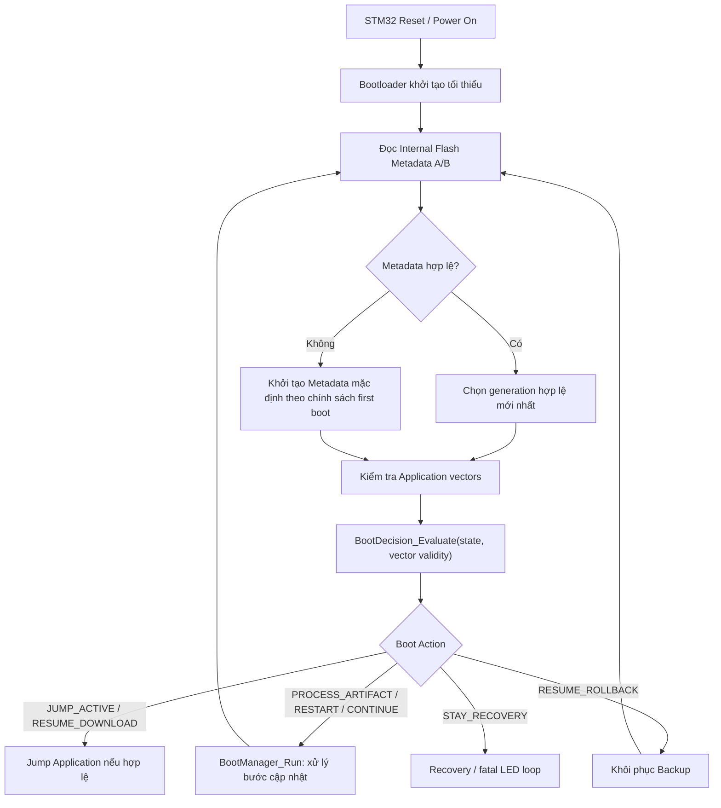

#### Bước 1. Bootloader chạy trước STM32 Application

Sau khi thiết bị khởi động hoặc reset, mã **Bootloader** tại vùng Internal Flash đầu tiên được thực thi. Theo memory map của project:

| Vùng Internal Flash | Địa chỉ bắt đầu | Kích thước |
|---|---|---:|
| Bootloader | `0x08000000` | 24 KB |
| Application | `0x08006000` | 38 KB |
| Metadata A | `0x0800F800` | 1 KB |
| Metadata B | `0x0800FC00` | 1 KB |

Bootloader khởi tạo các thành phần tối thiểu để đọc trạng thái, truy cập bộ nhớ và đưa ra quyết định. Nó **không mặc định nhảy ngay vào Application**; phải xem trạng thái cập nhật có yêu cầu công việc khác hay không.

#### Bước 2. Đọc và lựa chọn bản Metadata A/B

`BootMetadata_t` lưu các thông tin như `state`, `active_version`, `pending_version`, `active_update_id`, `copy_offset`, `boot_attempts`, `generation`, `last_error` và `crc32`.

Quá trình chọn bản Metadata được mô tả như sau:

```text
Đọc Metadata A và Metadata B
           |
           v
Kiểm tra magic / version / state / progress / CRC32
           |
           v
Chọn bản hợp lệ có generation mới nhất
           |
           +-- Có bản hợp lệ --> Dùng trạng thái đã lưu
           |
           +-- Không có bản hợp lệ --> Xử lý first-boot/default theo chính sách
```

Để ghi trạng thái mới, hệ thống **ghi vào trang không được chọn**, kiểm tra lại dữ liệu và chỉ sau đó sử dụng `generation` mới. Nhờ vậy, mất nguồn giữa lúc Erase/Program Metadata thường không phá hủy bản Metadata hợp lệ trước đó.

**Ví dụ:** Metadata A đang hợp lệ với `generation = 10`. Lần cập nhật mới ghi vào Metadata B với `generation = 11`. Nếu ghi B bị gián đoạn và CRC32 sai, Bootloader vẫn có thể chọn A. Nếu B ghi và xác minh thành công, B trở thành bản mới nhất.

> **Lưu ý:** CRC32 ở đây giúp **phát hiện bản ghi Metadata bị hỏng**, không phải xác thực chữ ký firmware. Metadata A/B trong **Internal Flash** cũng khác với **Download Checkpoint** lưu ở External Flash W25Q.

#### Bước 3. Kiểm tra điều kiện cho phép Jump Application

Trước khi chuyển quyền điều khiển, Bootloader kiểm tra **Application vector table** và điều kiện chính sách. Những kiểm tra được mô tả trong repository gồm:

- Giá trị **MSP** ban đầu nằm trong vùng SRAM hợp lệ và đúng alignment.
- **Reset Handler** nằm trong vùng Application Flash và có **Thumb bit** hợp lệ.
- Kích thước Application nằm trong giới hạn được cho phép.
- Kiểm tra image hash khi trạng thái và metadata tin cậy yêu cầu.

Do đó, `UPDATE_IDLE` **không đồng nghĩa** với việc nhảy vào bất kỳ dữ liệu nào trong vùng Application: image vẫn phải hợp lệ.

#### Bước 4. `BootDecision_Evaluate()` ánh xạ trạng thái thành Boot Action

| Trạng thái Metadata | Boot Action chính / cách xử lý |
|---|---|
| `UPDATE_IDLE` | `BOOT_ACTION_JUMP_ACTIVE` nếu Application hợp lệ. |
| `UPDATE_RECEIVING` | `BOOT_ACTION_RESUME_DOWNLOAD`, thường nhảy vào Application hợp lệ để tiếp tục nhận OTA. |
| `UPDATE_ARTIFACT_READY` | `BOOT_ACTION_PROCESS_ARTIFACT`. |
| `UPDATE_VERIFYING_CONTAINER`, `UPDATE_VERIFYING_BASE` | `BOOT_ACTION_RESTART_VALIDATION`. |
| `UPDATE_PATCHING` | `BOOT_ACTION_RESTART_PATCH`. |
| `UPDATE_IMAGE_READY`, `UPDATE_BACKING_UP` | `BOOT_ACTION_CONTINUE_BACKUP`. |
| `UPDATE_INSTALLING` | `BOOT_ACTION_RESUME_INSTALL`. |
| `UPDATE_VERIFYING_INSTALL` | `BOOT_ACTION_VERIFY_INSTALL`. |
| `UPDATE_TRIAL_BOOT` | `BOOT_ACTION_BOOT_TRIAL` hoặc `BOOT_ACTION_RESUME_ROLLBACK` khi hết lượt/không hợp lệ. |
| `UPDATE_CONFIRMED` | `BOOT_ACTION_FINALIZE_CONFIRMATION`. |
| `UPDATE_ROLLBACK` | `BOOT_ACTION_RESUME_ROLLBACK`. |
| `UPDATE_FAILED` | `BOOT_ACTION_STAY_RECOVERY`. |

**Vì sao tách Boot Decision khỏi Boot Manager?** Decision có thể kiểm thử logic trạng thái mà không cần truy cập trực tiếp phần cứng; Manager chịu trách nhiệm thực thi các công việc Flash, xác thực, Jump hoặc Rollback thực tế.

#### Bước 5. Boot Manager thực thi, commit rồi đánh giá lại

Ví dụ khi Metadata lưu `UPDATE_IMAGE_READY`, Boot Decision yêu cầu tiếp tục Backup. Manager thực hiện giai đoạn phù hợp, **commit trạng thái/tiến độ** sau khi hoàn thành an toàn rồi đánh giá lại để chuyển sang Install. Cơ chế này cho phép sau reset, Bootloader **không phải suy đoán bằng RAM** đã đi đến đâu.

#### Bài nói khi phỏng vấn: Boot Decision và Metadata A/B

> **Boot Decision:** Khi STM32 reset, Bootloader đọc hai bản Metadata A/B trong Internal Flash, kiểm tra CRC32 và `generation` để chọn bản hợp lệ mới nhất. Sau đó Bootloader kiểm tra Application vector và gọi `BootDecision_Evaluate()` để quyết định nhảy vào Application, xử lý OTA, tiếp tục Install hay Rollback.
>
> Phần quyết định được tách khỏi phần thực thi: `BootDecision_Evaluate()` ánh xạ state sang action, còn `BootManager_Run()` thực hiện thao tác tương ứng và lưu tiến độ an toàn. Hai bản Metadata độc lập giúp hệ thống vẫn đọc được trạng thái trước đó nếu mất nguồn trong lúc ghi một bản mới.

#### Câu hỏi ôn tập: Boot Decision và Metadata A/B

| Câu hỏi | Ý chính cần trả lời |
|---|---|
| Vì sao Bootloader cần Metadata? | Để biết trạng thái OTA sau reset và chọn hành động tương ứng. |
| `state` khác `Boot Action` thế nào? | State là trạng thái bền vững; action là hành động Boot Decision suy ra từ state và điều kiện khác. |
| Vì sao dùng Metadata A/B? | Cho phép ghi bản mới mà không xóa bản hợp lệ đang được chọn. |
| `generation` để làm gì? | Chọn bản Metadata hợp lệ mới nhất. |
| CRC32 Metadata có chống giả mạo firmware không? | Không; nó chỉ phát hiện dữ liệu Metadata hỏng. |
| Vì sao phải kiểm tra vector trước khi Jump? | Tránh chuyển quyền điều khiển tới image/stack/reset handler không hợp lệ. |
| `BootDecision_Evaluate()` khác `BootManager_Run()` thế nào? | Một bên chọn hành động; một bên điều phối các thao tác thực tế. |

#### Điểm cần ghi nhớ

- **Reset → Metadata A/B → Application validity → Boot Decision → Boot Action.**
- Không dựa vào RAM để xác định tiến độ OTA sau mất nguồn.
- Một state có thể dẫn tới hành động khác nhau tùy điều kiện, đặc biệt là `UPDATE_TRIAL_BOOT`.

**Tài liệu/code đối chiếu:** `docs/metadata-and-boot-decision.md`, `docs/boot-state-machine.md`, `node-stm32f103/bootloader/src/boot_decision.c`, `node-stm32f103/bootloader/src/boot_manager.c`, `node-stm32f103/bootloader/storage/metadata_storage.c`.

---

### 5.2. `IDLE` → `RECEIVING` → `ARTIFACT_READY` → Bàn giao cho Bootloader

> **Mục tiêu:** Hiểu sự khác nhau giữa trạng thái **runtime của STM32 Application** khi nhận OTA và trạng thái **persisted** mà Bootloader sử dụng sau reset.
>
> **Tình huống:** STM32 đang chạy firmware v1; ESP32 đã tải gói SDOT để cập nhật lên v2.

#### Sơ đồ luồng hoạt động

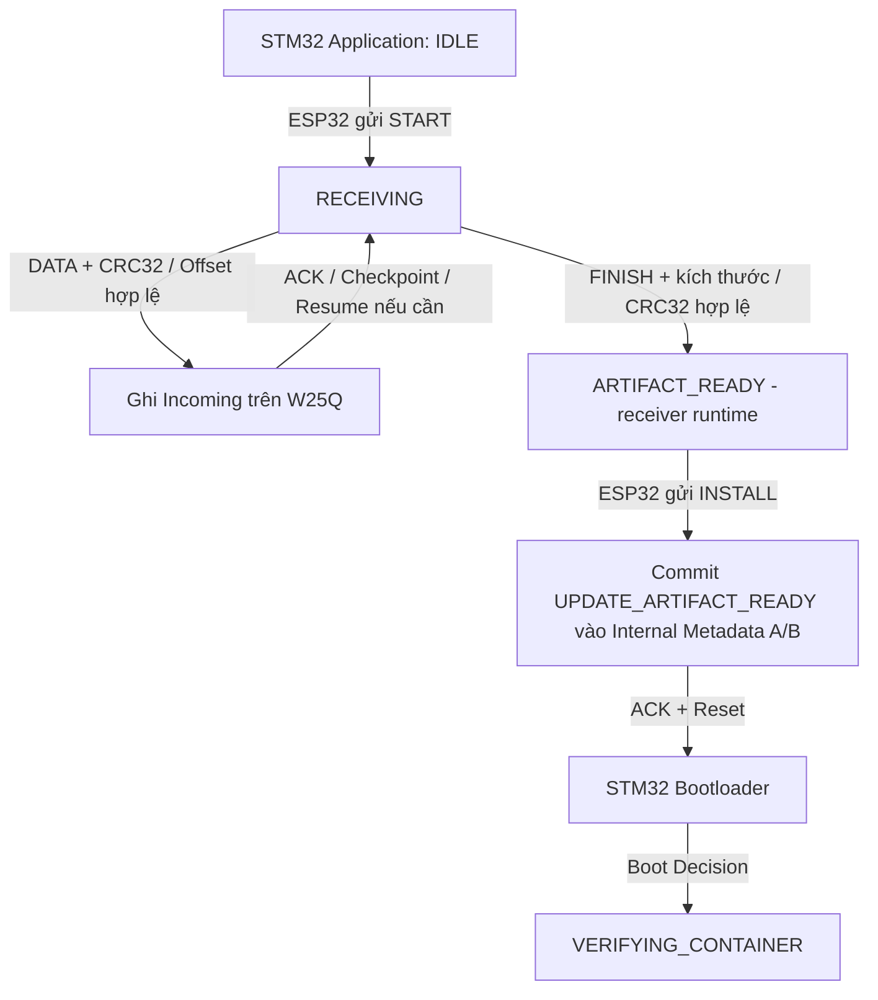

#### Bước 1. `IDLE` — Application vẫn đang hoạt động bình thường

Trong trạng thái chưa cập nhật, Bootloader cho **Application hợp lệ** chạy. ESP32 Gateway có thể dùng `HELLO` và `QUERY` để lấy thông tin thiết bị, phiên bản firmware, `update_id` và `next_expected_offset` trước khi truyền gói OTA.

`UPDATE_IDLE` trong **Internal Flash Metadata** thể hiện không có tiến trình cập nhật cần Bootloader tiếp tục. Nó không có nghĩa mọi trạng thái của UART receiver đều được Bootloader xử lý trực tiếp.

#### Bước 2. `RECEIVING` — STM32 Application tiếp nhận gói SDOT

Khi ESP32 gửi `START`, Application tiếp nhận gói cập nhật qua **UART**. Dữ liệu được chia thành các DATA packet, dùng **COBS** để đóng khung và **CRC32** để phát hiện lỗi truyền.

Application kiểm tra `update_id`, `Sequence`, `Offset`, sau đó ghi dữ liệu vào phân vùng **Incoming** của **External Flash W25Q** qua **SPI**. ESP32 dùng **ACK/NACK**, Timeout, Retry để tiếp tục truyền; nếu đã có tiến độ trước đó, có thể dùng `RESUME`.

**Lưu ý quan trọng:** Trong giai đoạn này, firmware v1 trong **Internal Flash** chưa bị ghi đè. Những thao tác `DATA` và `RESUME` chủ yếu thay đổi dữ liệu nhận và **Download Checkpoint**, không tạo một trạng thái Bootloader riêng cho mỗi packet.

#### Bước 3. `ARTIFACT_READY` sau `FINISH` — đã nhận đủ, chưa cài đặt

Khi nhận `FINISH`, STM32 Application kiểm tra:

1. Dữ liệu nhận được có đúng tổng kích thước `artifact_size` hay không.
2. **CRC32 toàn bộ gói SDOT** có đúng với giá trị dự kiến hay không.

Nếu thành công, receiver đạt **`ARTIFACT_READY` trong runtime**. Tuy nhiên, đây **chưa phải** điểm xác thực chữ ký bảo mật và cũng **chưa phải** thao tác cài firmware vào Internal Flash.

> **Phân biệt cần nhớ:** `ARTIFACT_READY` của receiver xuất hiện sau `FINISH`; `UPDATE_ARTIFACT_READY` của Bootloader là **trạng thái đã commit trong Internal Flash Metadata** sau lệnh `INSTALL`.

#### Bước 4. `INSTALL` — Commit Metadata và Reset

Sau `FINISH`, ESP32 gửi `INSTALL`. STM32 Application kiểm tra `ARTIFACT_READY` và `update_id`, ghi trạng thái `UPDATE_ARTIFACT_READY` vào **Metadata A/B**, phản hồi **ACK** rồi reset thiết bị.

```text
FINISH hợp lệ
    |
    v
ARTIFACT_READY (Application runtime)
    |
    | ESP32 gửi INSTALL
    v
Commit UPDATE_ARTIFACT_READY (Internal Flash Metadata)
    |
    v
ACK → Reset → STM32 Bootloader xử lý SDOT
```

Khi Bootloader chạy lại, `BootDecision_Evaluate()` nhận thấy yêu cầu cập nhật đã lưu và chọn xử lý SDOT thay vì khởi động Application theo luồng `IDLE`.

#### Bước 5. Nếu reset khi đang `RECEIVING` thì sao?

STM32 Application dùng **Download Checkpoint** ở External Flash W25Q, được commit theo ranh giới **sector 4 KB**. Sau reset, receiver lấy mốc an toàn gần nhất và ESP32 **truyền lại từ offset đó** thay vì tin rằng offset ACK trong RAM là bền vững.

**Ví dụ:** Đã ACK đến khoảng 10 KB nhưng checkpoint bền vững gần nhất là 8 KB. Sau mất nguồn, thiết bị có thể yêu cầu `RESUME` từ **8192 bytes**, nhận lại phần chưa được checkpoint an toàn.

#### Bài nói khi phỏng vấn: Tiếp nhận OTA và bàn giao

> **IDLE → RECEIVING → ARTIFACT_READY:** Ban đầu STM32 chạy Application hiện tại. ESP32 gửi lệnh START để bắt đầu truyền gói SDOT qua UART. STM32 kiểm tra CRC32, Sequence và Offset rồi lưu gói vào W25Q, có ACK/NACK và Checkpoint hỗ trợ Resume.
>
> Khi FINISH thành công, trạng thái ARTIFACT_READY chỉ xác nhận gói đã được nhận đầy đủ. Sau lệnh INSTALL, Application mới commit `UPDATE_ARTIFACT_READY` vào Internal Flash Metadata và reset. Từ thời điểm đó STM32 Bootloader mới xác thực chữ ký SDOT và quyết định cài đặt. Nhờ vậy, Application không phải tự ghi đè firmware đang chạy.

#### Câu hỏi ôn tập: Trạng thái tiếp nhận

| Câu hỏi | Ý chính cần trả lời |
|---|---|
| `FINISH` khác `INSTALL` ở đâu? | FINISH xác nhận nhận đủ SDOT; INSTALL commit Metadata rồi reset để bàn giao. |
| Vì sao `ARTIFACT_READY` có hai ngữ cảnh? | Một bên là receiver runtime; bên kia là Metadata bền vững cho Bootloader. |
| Tại sao lưu SDOT vào W25Q? | Tránh ghi đè Application trong lúc truyền còn có thể gián đoạn. |
| ACK có tương đương Checkpoint không? | Không. ACK theo packet; Checkpoint là mốc phục hồi bền vững. |
| Reset giữa `RECEIVING` xử lý sao? | Đọc checkpoint 4 KB và Resume từ offset an toàn. |
| STM32 Application có xác thực chữ ký ECDSA trước INSTALL không? | Không; Bootloader quyết định độ tin cậy khi xử lý SDOT. |

#### Điểm cần ghi nhớ

- **`FINISH` ≠ `INSTALL`**; nhận đủ artifact không có nghĩa đã xác thực/cài đặt firmware.
- **UART Receiver runtime ≠ Bootloader persisted state**.
- **Download Checkpoint 4 KB** phục vụ Resume; Application hiện tại chưa bị ghi đè ở giai đoạn nhận.

**Tài liệu/code đối chiếu:** `docs/uart-ota-protocol.md`, `docs/boot-state-machine.md`, `node-stm32f103/application/src/ota_receiver.c`.

---

### 5.3. `VERIFYING_CONTAINER` → `VERIFYING_BASE` → `PATCHING` → `IMAGE_READY`

> **Mục tiêu:** Phân tích cách Bootloader **xác thực nguồn cập nhật**, kiểm tra **base image** của Delta OTA, chuẩn bị firmware mục tiêu và xác minh firmware mới **trước khi** ghi đè Application đang hoạt động.
>
> **Phân biệt Full/Delta:** Full OTA mang **toàn bộ firmware mới**; Delta OTA mang **patch** và phải khớp firmware gốc. **Cả Full và Delta** đều đi qua trạng thái persisted `UPDATE_PATCHING` trong triển khai hiện tại.

#### Sơ đồ luồng hoạt động

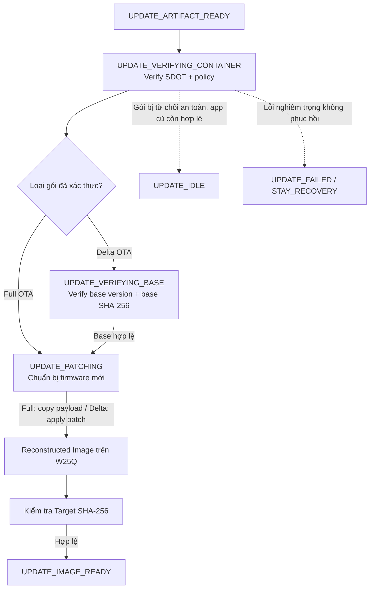

#### Bước 1. `UPDATE_ARTIFACT_READY` yêu cầu xử lý SDOT

Sau `INSTALL + Reset`, Bootloader đọc Metadata và chọn `BOOT_ACTION_PROCESS_ARTIFACT`. Gói SDOT đã lưu trong phân vùng **Incoming** của W25Q được đưa vào quy trình xác thực/cài đặt.

Tại thời điểm này, Bootloader chưa xóa Application hiện tại. Nếu nguồn cập nhật không đáp ứng chính sách bảo mật, hệ thống phải **từ chối trước giai đoạn Backup/Install**.

#### Bước 2. `UPDATE_VERIFYING_CONTAINER` — Kiểm tra gói SDOT

Bootloader phân tích và xác minh thông tin trong SDOT, bao gồm:

1. Định dạng/Header và kích thước gói.
2. **Product ID**, **Hardware Revision** và chính sách phiên bản/Anti-downgrade.
3. Các giá trị **CRC32** phục vụ phát hiện lỗi dữ liệu ở lớp tương ứng.
4. Giá trị **SHA-256** và **chữ ký ECDSA P-256** với **Public Key tin cậy**.

| Cơ chế | Vai trò trong luồng |
|---|---|
| **CRC32** | Phát hiện dữ liệu hỏng trong truyền/lưu trữ. |
| **SHA-256** | Tính/đối chiếu hash của dữ liệu được quy định. |
| **ECDSA P-256** | Xác thực chữ ký số của gói cập nhật bằng Public Key tin cậy. |
| **Product/Version policy** | Ngăn cài nhầm thiết bị hoặc phiên bản không được phép. |

**Tình huống minh họa:** Một gói SDOT có CRC32 đúng nhưng chữ ký ECDSA sai **không được coi là bản cập nhật tin cậy**. CRC32 không thể thay thế bước xác thực chữ ký.

> **Lưu ý triển khai:** Tài liệu của project ghi rõ repository **chưa provision Public Key production mặc định**. Khi giải thích ở phỏng vấn, cần phân biệt **code có cơ chế xác thực** với việc thiết bị thực tế **đã được provision khóa tin cậy để xác thực firmware ký số**.

#### Bước 3. `UPDATE_VERIFYING_BASE` — Chỉ dành cho Delta OTA

Với **Delta OTA**, Bootloader phải kiểm tra firmware gốc mà patch yêu cầu, gồm **base version** và **Base SHA-256**. Patch chỉ hợp lệ khi firmware gốc đang có **khớp chính xác** với firmware dùng để tạo patch bên phát hành.

Ví dụ: Delta Patch được tạo từ **v1-A → v2**. Nếu thiết bị đang có firmware **v1-B** dù cùng số version v1 nhưng hash khác, Bootloader phải **từ chối áp dụng patch**. Vì thuật toán patch đọc các byte/offset của base image, dùng sai base sẽ không đảm bảo tạo được target image mong muốn.

**Full OTA** không cần `VERIFYING_BASE` nhưng vẫn cần xác thực SDOT và Target Image.

#### Bước 4. `UPDATE_PATCHING` — Chuẩn bị Full/Delta image

Trong repository, **cả hai loại signed SDOT** đều đi qua trạng thái persisted **`UPDATE_PATCHING`**:

| Full OTA | Delta OTA |
|---|---|
| Copy payload firmware đầy đủ vào vùng **Reconstructed Image** của W25Q. | Áp dụng Delta Patch lên firmware gốc đã kiểm tra để tạo image mới ở **Reconstructed Image**. |
| Không cần base image. | Bắt buộc xác minh base version và Base SHA-256. |
| Vẫn phải xác minh Target Image sau chuẩn bị. | Vẫn phải xác minh Target Image sau tái tạo. |

```text
                Signed SDOT hợp lệ
                        |
             +----------+----------+
             |                     |
          Full OTA               Delta OTA
             |                     |
       Copy Full Payload      Verify Base Image
             |                     |
             |               Apply Delta Patch
             +----------+----------+
                        |
                        v
             Reconstructed Image (W25Q)
                        |
                 Verify Target SHA-256
                        |
                        v
                 UPDATE_IMAGE_READY
```

**Vì sao vẫn dùng W25Q?** Vì cần tạo và xác minh **firmware hoàn chỉnh** trước khi xóa/ghi Application ở Internal Flash. Điều này giảm rủi ro cài một image không hợp lệ.

#### Bước 5. `UPDATE_IMAGE_READY` — Ứng viên mới đã được kiểm tra

Bootloader kiểm tra **Target SHA-256** và các điều kiện hợp lệ của image đã chuẩn bị. Sau khi thành công, trạng thái chuyển sang `UPDATE_IMAGE_READY`, từ đó cho phép bắt đầu **Backup** firmware cũ.

`IMAGE_READY` **không phải** trạng thái cập nhật đã hoàn tất: Application cũ vẫn đang ở Internal Flash và firmware mới chưa được cài đặt.

#### Bước 6. Mất nguồn trong xác thực hoặc `PATCHING`

- `UPDATE_VERIFYING_CONTAINER`: Sau reset, Bootloader **bắt đầu lại** việc kiểm tra SDOT.
- `UPDATE_VERIFYING_BASE`: Sau reset, Bootloader **kiểm tra lại** base image.
- `UPDATE_PATCHING`: Bootloader **xóa vùng Reconstructed Image rồi chuẩn bị lại** từ đầu, tránh tái sử dụng dữ liệu tái tạo dở.

Đây là **Power-loss Recovery bằng restart bước an toàn**, không phải Rollback: firmware cũ trong Internal Flash chưa bị ghi đè.

#### Bài nói khi phỏng vấn: Xác thực và chuẩn bị firmware

> **VERIFYING_CONTAINER → IMAGE_READY:** Khi Bootloader thấy `UPDATE_ARTIFACT_READY`, nó đọc gói SDOT ở W25Q và xác thực chữ ký ECDSA P-256, hash SHA-256, Product ID và chính sách phiên bản. Với Delta OTA, nó còn kiểm tra version và hash của firmware gốc trước khi áp dụng patch.
>
> Cả Full OTA và Delta OTA đều đi qua `UPDATE_PATCHING`: Full OTA copy payload vào vùng Reconstructed Image, còn Delta OTA tái tạo image từ firmware gốc và patch. Sau đó Bootloader kiểm tra Target SHA-256, chỉ khi image hợp lệ mới chuyển sang `UPDATE_IMAGE_READY`. Nếu mất nguồn trong lúc patch, hệ thống chuẩn bị lại image từ đầu; Application hiện tại chưa bị ghi đè.

#### Câu hỏi ôn tập: Xác thực và tái tạo image

| Câu hỏi | Ý chính cần trả lời |
|---|---|
| Vì sao CRC32 đúng vẫn phải kiểm tra ECDSA? | CRC32 không xác thực nguồn phát hành firmware. |
| ECDSA Public Key nằm ở đâu? | Bootloader dùng khóa tin cậy đã được provision; private key thuộc phía phát hành. |
| Vì sao Delta cần Base SHA-256? | Để chắc chắn patch được áp dụng đúng firmware gốc. |
| Full OTA có đi qua `UPDATE_PATCHING` không? | Có. Full copy payload; Delta áp dụng patch. |
| Vì sao dùng vùng Reconstructed Image? | Có thể kiểm tra firmware hoàn chỉnh trước khi xóa Application. |
| Reset khi `PATCHING` thì sao? | Xóa vùng Reconstructed và chuẩn bị lại từ đầu. |
| `IMAGE_READY` nghĩa là đã cài firmware chưa? | Chưa; chỉ xác nhận candidate image đã chuẩn bị và kiểm tra hợp lệ. |

#### Điểm cần ghi nhớ

- **Verify SDOT → (Delta: Verify Base) → Prepare Image → Verify Target Hash → IMAGE_READY.**
- **Full và Delta đều dùng `UPDATE_PATCHING`**, nhưng cách chuẩn bị image khác nhau.
- Có trường hợp **từ chối artifact rồi trở về IDLE an toàn**; không phải mọi lỗi xác thực đều làm mất firmware cũ hay buộc Rollback.

**Tài liệu/code đối chiếu:** `docs/boot-state-machine.md`, `docs/firmware-container.md`, `node-stm32f103/bootloader/src/secure_container.c`, `node-stm32f103/bootloader/include/trusted_key.h`.

---

### 5.4. `IMAGE_READY` → `BACKING_UP` → `INSTALLING` → `VERIFYING_INSTALL`

> **Mục tiêu:** Hiểu vì sao Bootloader phải **Backup trước khi Install**, cách ghi Internal Flash theo trang và cách lưu Checkpoint để phục hồi khi thiết bị mất nguồn đúng lúc đang ghi firmware.

#### Sơ đồ luồng hoạt động

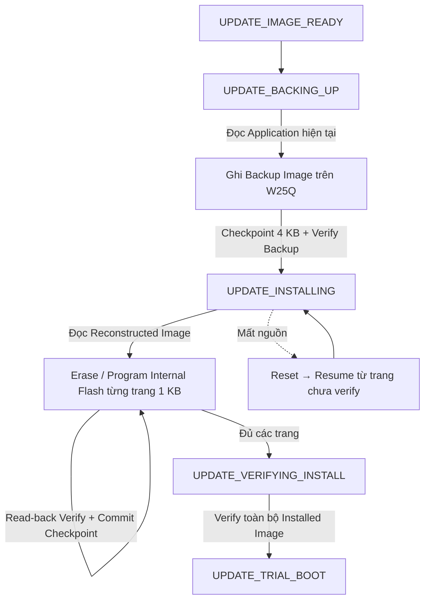

#### Bước 1. `UPDATE_IMAGE_READY` cho phép chuyển sang Backup

Điều kiện vào bước này là **firmware mới đã được chuẩn bị và kiểm tra** trong phân vùng Reconstructed Image của W25Q. Bootloader **không ghi trực tiếp SDOT/Delta Patch** vào Internal Flash Application.

Với Delta OTA, dữ liệu ở Reconstructed Image đã là **target firmware hoàn chỉnh**, không còn chỉ là patch.

#### Bước 2. `UPDATE_BACKING_UP` — Sao lưu firmware hiện tại

Bootloader đọc Application v1 từ **Internal Flash** rồi ghi vào phân vùng **Backup Image** trên W25Q qua SPI. Bước Backup dùng Checkpoint ở ranh giới sector **4 KB** và xác minh bản Backup trước khi cho phép Install.

```text
Internal Flash (Application v1)
              |
              | Read
              v
         Bootloader
              |
              | SPI write + verify
              v
External W25Q (Backup Image v1)
              |
              v
     Backup hợp lệ → INSTALLING
```

**Tại sao bắt buộc Backup trước khi Install?** Vì thao tác Erase/Program sẽ phá dữ liệu Application v1 trong Internal Flash. Nếu firmware v2 không thể khởi động/xác nhận, Bootloader cần **Backup hợp lệ** để Rollback.

> **Phân biệt:** Backup là bước **chuẩn bị phương án khôi phục**; Rollback là bước **thực sự khôi phục** firmware cũ khi bản mới không được chấp nhận.

#### Bước 3. `UPDATE_INSTALLING` — Cài đặt firmware mới theo trang 1 KB

Sau khi Backup hợp lệ, Bootloader đọc firmware mới từ **Reconstructed Image**, sau đó Erase và Program vùng **Application của Internal Flash**.

Chu kỳ cài đặt cho một trang được diễn giải như sau:

```text
Đọc dữ liệu target của trang từ W25Q
                  |
                  v
           Erase Flash page
                  |
                  v
           Program dữ liệu
                  |
                  v
           Read-back Verify
                  |
           +------+------+
           |             |
         Thành công     Thất bại
           |             |
     Commit Checkpoint   Không đánh dấu trang hoàn tất
           |
           v
       Trang tiếp theo
```

Với STM32F103 của project, **Internal Flash page = 1 KB**. Checkpoint chỉ được commit **sau khi trang tương ứng ghi và kiểm tra thành công**.

#### Bước 4. Mất nguồn khi đang `INSTALLING`

Giả sử đang cài image 20 KB, đã kiểm tra/commit thành công 8 trang đầu (8 KB), nhưng mất nguồn khi đang ghi trang thứ 9:

1. Sau reset, Bootloader đọc Metadata A/B và nhận trạng thái `UPDATE_INSTALLING`.
2. Dựa trên tiến độ đã lưu, Bootloader biết **8 KB trước đã được xác nhận**.
3. Bootloader bắt đầu lại từ **trang đầu tiên chưa được xác nhận**, có thể Erase và Program lại trang đang dang dở.
4. Chỉ khi toàn bộ các trang hợp lệ mới chuyển sang Verify Installed Image.

**Nguyên tắc:** Không coi một trang bị ghi dở là hợp lệ chỉ vì có dữ liệu trên Flash. Checkpoint phải phản ánh **đơn vị đã xác minh**, không phải chỉ số byte đã thử ghi.

#### Bước 5. `UPDATE_VERIFYING_INSTALL` — Kiểm tra firmware đã cài đặt

Sau khi Program xong, Bootloader **kiểm tra lại toàn bộ Installed Image** trong Internal Flash. Điều này khác với việc kiểm tra Reconstructed Image trước đó: nguồn firmware có thể đúng nhưng quá trình Erase/Program có thể gặp lỗi.

Nếu reset trong trạng thái `UPDATE_VERIFYING_INSTALL`, Bootloader **thực hiện lại bước Verify**. Khi image đã cài đặt hợp lệ, hệ thống mới chuyển sang `UPDATE_TRIAL_BOOT`.

#### Bước 6. Nếu nguồn Reconstructed Image hoặc Install không còn tin cậy

Theo tài liệu trạng thái, khi quá trình cài đặt không thể tiếp tục vì nguồn reconstructed image không hợp lệ, hệ thống **thử Rollback từ Backup đã xác minh**. Không nên mô tả mọi lỗi ghi Flash đều chắc chắn khôi phục thành công: còn phụ thuộc tính hợp lệ của Backup và bộ nhớ.

#### Bài nói khi phỏng vấn: Backup, Install và Verify

> **IMAGE_READY → VERIFYING_INSTALL:** Sau khi xác minh target image, Bootloader chuyển sang `BACKING_UP` để sao lưu Application đang chạy vào vùng Backup Image trên W25Q và kiểm tra bản Backup. Sau đó Bootloader mới `INSTALLING`, đọc target image từ Reconstructed Image và Erase/Program vùng Application của Internal Flash.
>
> Install diễn ra theo các trang 1 KB. Với mỗi trang, hệ thống đọc lại để Verify rồi mới commit Checkpoint. Nếu mất nguồn, Bootloader tiếp tục từ trang chưa xác minh gần nhất. Cuối cùng `VERIFYING_INSTALL` kiểm tra toàn bộ image đã cài trước khi chuyển sang Trial Boot.

#### Câu hỏi ôn tập: Backup và Install

| Câu hỏi | Ý chính cần trả lời |
|---|---|
| Vì sao `IMAGE_READY` chưa cài đặt ngay? | Cần Backup firmware cũ hợp lệ trước khi ghi đè Application. |
| Backup lưu ở đâu? | Phân vùng Backup Image trên External Flash W25Q. |
| Backup Checkpoint theo đơn vị nào? | Sector W25Q 4 KB. |
| Install Checkpoint theo đơn vị nào? | Trang Internal Flash 1 KB. |
| Vì sao Checkpoint chỉ commit sau Verify? | Để không bỏ qua trang chưa được ghi chắc chắn. |
| Nếu mất nguồn giữa trang Flash? | Resume từ trang chưa được xác nhận, Erase/Program lại an toàn. |
| `VERIFYING_INSTALL` khác Target SHA-256 trước Install? | Kiểm tra dữ liệu thật đã được ghi vào Internal Flash. |
| Khi nào cần Rollback? | Khi firmware mới không thể được chấp nhận và có Backup phù hợp để phục hồi. |

#### Điểm cần ghi nhớ

- **Prepare + Verify candidate → Backup + Verify → Install từng trang + Verify → Verify toàn image.**
- **4 KB** là ranh giới Checkpoint cho Backup W25Q; **1 KB** cho Install Internal Flash.
- **Power-loss Recovery** khi đang cài đặt thường là **Resume**, không mặc định là Rollback.

**Tài liệu/code đối chiếu:** `docs/boot-state-machine.md`, `docs/memory-map.md`, `node-stm32f103/bootloader/src/image_installer.c`, `node-stm32f103/bootloader/src/boot_manager.c`.

---

### 5.5. `TRIAL_BOOT` → `CONFIRMED` / `ROLLBACK` → `IDLE`

> **Mục tiêu:** Hiểu vì sao **Install thành công chưa phải cập nhật thành công**, cách Bootloader quản lý số lần thử, cách Application xác nhận bản mới và cách quay về firmware cũ nếu Trial Boot thất bại.

#### Sơ đồ luồng hoạt động

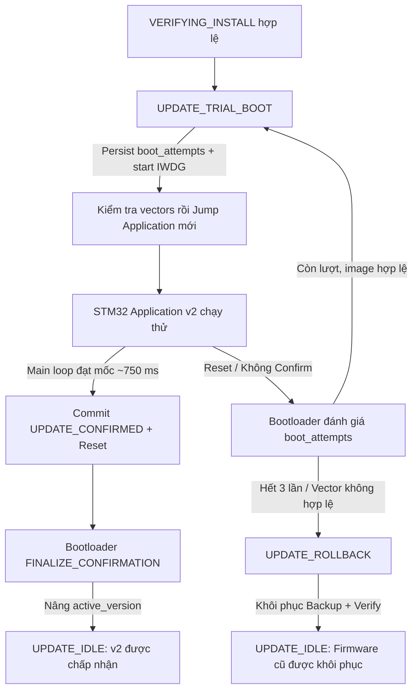

#### Bước 1. Vào `UPDATE_TRIAL_BOOT` sau khi Verify Installed Image

Bootloader chuyển sang **Trial Boot** khi firmware v2 đã cài và kiểm tra hợp lệ. Đây mới là **firmware ứng viên đang chạy thử**; phiên bản mới chưa được ghi nhận là firmware đã xác nhận chính thức.

**Quy tắc quan trọng:** `active_version` vẫn là phiên bản **đã được xác nhận trước đó** cho đến khi quá trình Confirm hoàn tất. Không nâng `active_version` ngay sau khi `INSTALLING` thành công.

#### Bước 2. Persist `boot_attempts`, bật IWDG rồi Jump

Trước mỗi lần cho firmware mới chạy thử, Bootloader:

1. Cập nhật và **lưu bền vững** số lần thử `boot_attempts`.
2. Khởi động **IWDG** theo chính sách Trial Boot.
3. Kiểm tra tính hợp lệ của Application vector trước khi Jump.
4. Bàn giao quyền điều khiển cho STM32 Application mới nếu hợp lệ.

Lưu bộ đếm **trước khi Jump** giúp reset do Watchdog hoặc lỗi Application vẫn bị tính là một lần thử, thay vì mất thông tin vì bộ đếm chỉ nằm trong RAM.

#### Bước 3. Application v2 thực hiện xác nhận hoạt động

Trong bản demo hiện tại, Application dùng `TrialConfirmation_Init()` và `TrialConfirmation_Process(now_ms)`. Sau khoảng **750 ms** của main loop đã khởi tạo, Application có thể gọi cơ chế Confirm, ghi `UPDATE_CONFIRMED` rồi **reset về Bootloader**.

Đây là kiểm tra **main-loop liveness cơ bản** (khởi tạo clock/SysTick, GPIO, UART/OTA agent và chạy vòng lặp), **không tương đương** một bộ health check hoàn chỉnh ở mức sản phẩm.

Repository cũng mô tả lệnh UART `CONFIRM` tùy chọn gọi cùng cơ chế xác nhận; khi trình bày, không nên khẳng định mọi hệ thống thực tế chỉ xác nhận theo đúng 750 ms.

#### Bước 4. `UPDATE_CONFIRMED` — Hoàn tất chấp nhận firmware mới

Sau khi Application commit Confirm và reset, Bootloader đọc Metadata rồi chọn `BOOT_ACTION_FINALIZE_CONFIRMATION`. Ở bước này, Bootloader cập nhật `active_version` theo bản đã xác nhận, hoàn tất chính sách với Backup, sau đó chuyển về `UPDATE_IDLE`.

```text
Application v2 Trial Boot
         |
         | Confirm hoạt động
         v
Commit UPDATE_CONFIRMED → Reset
         |
         v
Bootloader FINALIZE_CONFIRMATION
         |
         v
Nâng active_version → UPDATE_IDLE
```

**Điểm cần nhớ:** Có hai mốc khác nhau:

- **Install + Verify thành công:** Firmware mới *đã được ghi đúng*.
- **Confirm + Finalize thành công:** Firmware mới *được chấp nhận làm phiên bản hoạt động*.

#### Bước 5. Không Confirm sau số lần thử cho phép → `UPDATE_ROLLBACK`

Nếu Application mới bị reset lặp lại, không Confirm hoặc vector không hợp lệ, Bootloader xem `boot_attempts` và chính sách Trial Boot. Giới hạn hiện tại là **3 lần thử chưa xác nhận**.

Khi hết lượt hoặc gặp điều kiện cần phục hồi, Bootloader chuyển sang `UPDATE_ROLLBACK` và đọc **Backup Image** từ W25Q để khôi phục firmware cũ vào Internal Flash. Rollback có **Checkpoint theo trang 1 KB** và kiểm tra lại dữ liệu đã phục hồi.

#### Bước 6. Mất nguồn khi đang `ROLLBACK`

Bootloader không coi vùng Application đang khôi phục dở là ứng dụng hợp lệ. Sau reset, nó đọc Metadata `UPDATE_ROLLBACK` và tiếp tục từ **trang chưa được xác nhận an toàn**. Khi phục hồi/Verify thành công, hệ thống có thể quay về `UPDATE_IDLE` với firmware cũ.

**Giới hạn thực tế:** Rollback đòi hỏi bản Backup hợp lệ và Flash hoạt động được. Nếu dữ liệu nguồn hoặc trạng thái không thể phục hồi, cần xử lý lỗi/recovery; không nên hứa rằng Rollback luôn thành công trong mọi trường hợp hỏng bộ nhớ.

#### Bài nói khi phỏng vấn: Trial Boot, Confirm và Rollback

> **TRIAL_BOOT → CONFIRMED/ROLLBACK:** Sau khi firmware mới được cài và Verify, Bootloader chưa chấp nhận ngay mà cho chạy Trial Boot. Trước khi Jump, Bootloader lưu số lần thử `boot_attempts` và bật IWDG.
>
> Trong bản demo, Application xác nhận sau khoảng 750 ms main loop hoạt động, ghi `UPDATE_CONFIRMED` rồi reset về Bootloader. Bootloader mới cập nhật `active_version` và chuyển về `IDLE`. Nếu Application không Confirm sau tối đa 3 lần thử hoặc vector không hợp lệ, Bootloader Rollback từ Backup trên W25Q. Việc Rollback cũng có Checkpoint để tiếp tục nếu mất nguồn.

#### Câu hỏi ôn tập: Trial Boot và Rollback

| Câu hỏi | Ý chính cần trả lời |
|---|---|
| Vì sao không Confirm ngay sau Install? | Ghi image đúng chưa chứng minh Application mới chạy được. |
| `active_version` đổi khi nào? | Khi Bootloader hoàn tất bước Confirm, không phải khi Install xong. |
| Vì sao lưu `boot_attempts` trước Jump? | Đếm được cả lần chạy thử kết thúc bằng reset/Watchdog. |
| IWDG có vai trò gì? | Giúp xử lý Application không xác nhận/không tiếp tục chạy như mong đợi. |
| Giới hạn Trial Boot trong repo? | 3 lần thử chưa Confirm. |
| 750 ms là health check đầy đủ chưa? | Chưa; là liveness check cơ bản của demo. |
| Rollback khác Anti-rollback ở đâu? | Rollback phục hồi Backup; Anti-rollback/Anti-downgrade là chính sách giới hạn version được phép cài. |
| Nếu mất nguồn giữa Rollback? | Tiếp tục từ checkpoint trang 1 KB. |

#### Điểm cần ghi nhớ

- **Install thành công ≠ Confirm thành công.**
- `active_version` chỉ được nâng sau khi bước **Finalize Confirmation** hoàn tất.
- **3 trial attempts + IWDG + Backup** hỗ trợ phát hiện/khôi phục khi Application mới không được xác nhận.
- **750 ms** là cơ chế demo, không phải kết quả kiểm thử toàn bộ chức năng sản phẩm.

**Tài liệu/code đối chiếu:** `docs/boot-state-machine.md`, `docs/metadata-and-boot-decision.md`, `node-stm32f103/bootloader/src/boot_manager.c`, `node-stm32f103/bootloader/src/image_installer.c`.

---

### 5.6. Power-loss Recovery, trạng thái `FAILED` và các chuyển trạng thái không hợp lệ

> **Mục tiêu:** Tổng hợp hành vi phục hồi theo **từng state**, chỉ rõ trường hợp nào **Resume**, trường hợp nào **Restart**, trường hợp nào **Rollback** và khi nào phải **STAY_RECOVERY**.

#### Sơ đồ quyết định sau reset bất ngờ

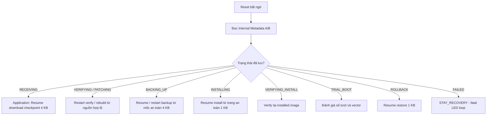

#### Bước 1. Phân loại giai đoạn bị gián đoạn

| State / Giai đoạn | Hành vi khi khởi động lại | Đơn vị tiến độ chính |
|---|---|---|
| `RECEIVING` | Application khôi phục Download Checkpoint; ESP32 Resume từ offset an toàn. | Sector W25Q **4 KB**. |
| `VERIFYING_CONTAINER` | Kiểm tra lại gói SDOT. | Restart bước xác thực. |
| `VERIFYING_BASE` | Kiểm tra lại base image. | Restart bước xác thực. |
| `PATCHING` | Xóa Reconstructed Image và chuẩn bị lại Full/Delta image. | Restart chuẩn bị image. |
| `BACKING_UP` | Khôi phục/tiếp tục Backup đã xác minh. | Sector W25Q **4 KB**. |
| `INSTALLING` | Resume từ trang Internal Flash chưa xác minh. | Trang Internal Flash **1 KB**. |
| `VERIFYING_INSTALL` | Kiểm tra lại toàn bộ installed image. | Restart Verify. |
| `TRIAL_BOOT` | Quyết định thử lại hoặc Rollback theo attempts/vector. | `boot_attempts` đã persist. |
| `ROLLBACK` | Tiếp tục khôi phục từ Backup. | Trang Internal Flash **1 KB**. |
| `FAILED` | `BOOT_ACTION_STAY_RECOVERY`. | Không tự thực hiện UART START để phục hồi từ xa. |

#### Bước 2. Phân biệt Restart, Resume và Rollback

| Khái niệm | Ý nghĩa | Ví dụ trong project |
|---|---|---|
| **Restart step** | Làm lại một bước an toàn từ đầu. | Kiểm tra lại SDOT; xóa Reconstructed và Apply Patch lại. |
| **Resume** | Tiếp tục từ mốc tiến độ bền vững đã xác minh. | Resume Download 4 KB; Install/Rollback theo trang 1 KB. |
| **Rollback** | Thay firmware mới không được chấp nhận bằng bản Backup hợp lệ. | Trial Boot vượt số lần thử, khôi phục Application v1. |
| **STAY_RECOVERY** | Không Jump Application và ở lại nhánh xử lý lỗi nghiêm trọng. | `UPDATE_FAILED` trong triển khai hiện tại. |

**Ví dụ để phân biệt:** Mất nguồn trong `PATCHING` không nhất thiết phải Rollback, vì Application cũ vẫn chưa bị ghi đè; Bootloader có thể **Restart Patch**. Ngược lại, sau khi v2 đã cài nhưng Trial Boot thất bại, Bootloader cần **Rollback** từ Backup v1.

#### Bước 3. `UPDATE_FAILED` không phải UART Recovery mode hoàn chỉnh

Trong repository, `UPDATE_FAILED` ánh xạ tới `BOOT_ACTION_STAY_RECOVERY`. Bootloader ở nhánh báo lỗi/LED fatal và **không chạy Application UART receiver để tự nhận `START`** trong trạng thái này.

Vì vậy, khi phỏng vấn, nên trình bày đúng giới hạn: project **có phát hiện và giữ thiết bị ở trạng thái Recovery đối với lỗi nghiêm trọng**, nhưng không nên nói rằng thiết bị có thể tự nhận firmware mới từ ESP32 ở mọi tình huống `FAILED`.

**Phân biệt thêm:** Một gói SDOT bị từ chối có kiểm soát trong khi Application cũ vẫn hợp lệ **có thể được dọn pending update và trở lại `UPDATE_IDLE`**. Không phải cứ sai chữ ký hoặc sai base là hệ thống luôn đi tới `UPDATE_FAILED`.

#### Bước 4. Các chuyển trạng thái phải từ chối

Theo tài liệu thiết kế, những tình huống sau là **illegal transitions**:

1. Nhận `DATA` khi receiver không ở `RECEIVING`.
2. Gửi `INSTALL` khi vẫn đang `RECEIVING` và chưa `FINISH` hợp lệ.
3. Đi vào `PATCHING` khi chưa vượt qua kiểm tra chữ ký và base cần thiết.
4. Đi vào `INSTALLING` khi Backup chưa được xác minh.
5. Nhận `CONFIRMED` khi chưa từng ở `TRIAL_BOOT`.
6. Xóa Backup trước khi firmware mới được Confirm.
7. Chấp nhận `update_id` khác khi đang nhận dở mà không thực hiện luồng ABORT/new START cleanup phù hợp.

Những ràng buộc này bảo vệ tính nhất quán của State Machine: **mỗi bước chỉ được bắt đầu khi những điều kiện an toàn ở bước trước đã hoàn tất**.

#### Bước 5. Tình huống phỏng vấn: thiết bị mất nguồn ở nhiều vị trí

**Tình huống A — Mất nguồn sau khi đã ACK 10 KB nhưng checkpoint mới đến 8 KB:**

- Không tin offset ACK trong phiên UART trước đó là tiến độ bền vững.
- Application khôi phục checkpoint W25Q và ESP32 Resume từ khoảng 8 KB.

**Tình huống B — Mất nguồn giữa Apply Patch:**

- Bootloader thấy `UPDATE_PATCHING`.
- Xóa vùng Reconstructed Image và tạo lại firmware mới từ gói SDOT/base hợp lệ.
- Chưa cần Rollback vì Application cũ chưa bị ghi đè.

**Tình huống C — Mất nguồn giữa Install trang thứ 9:**

- Bootloader thấy `UPDATE_INSTALLING`.
- Resume từ **trang chưa được Verify/Checkpoint**.
- Không Jump vào Application đang ghi dở.

**Tình huống D — Firmware mới reset liên tục trong Trial Boot:**

- `boot_attempts` đã được lưu bền vững trước mỗi lần thử.
- Khi hết **3 lần thử** hoặc có vector không hợp lệ, Bootloader đi vào Rollback từ Backup.

#### Bài nói khi phỏng vấn: Power-loss Recovery và xử lý lỗi

> **Power-loss Recovery:** Sau reset, Bootloader đọc Metadata A/B để biết công việc đang dở. Nếu đang Verify hoặc Patch, nó Restart bước tương ứng từ nguồn tin cậy; nếu đang Backup, Install hoặc Rollback, nó tiếp tục từ Checkpoint đã xác minh. Nhờ vậy không đánh dấu dữ liệu ghi dở là hợp lệ.
>
> Em phân biệt Power-loss Recovery với Rollback: Recovery là tiếp tục/restart công việc an toàn sau mất nguồn; Rollback là phục hồi firmware đã sao lưu khi phiên bản mới không được chấp nhận. Với lỗi không thể phục hồi, `UPDATE_FAILED` sẽ khiến Bootloader ở `STAY_RECOVERY`; bản hiện tại không có UART OTA receiver tự chạy ở nhánh này.

#### Câu hỏi ôn tập: Recovery và illegal transitions

| Câu hỏi | Ý chính cần trả lời |
|---|---|
| Reset ở `PATCHING` phải làm gì? | Xóa Reconstructed Image và chuẩn bị lại. |
| Reset ở `INSTALLING` phải làm gì? | Resume từ trang 1 KB chưa được xác nhận. |
| Reset ở `ROLLBACK` phải làm gì? | Tiếp tục Restore theo checkpoint 1 KB. |
| Vì sao không Save Checkpoint trước Verify? | Có thể đánh dấu nhầm dữ liệu đang ghi dở là hợp lệ. |
| Mất nguồn có luôn dẫn đến Rollback không? | Không; nhiều state chỉ cần Restart/Resume. |
| `UPDATE_FAILED` có nhận `START` từ UART không? | Không trong triển khai hiện tại. |
| Có thể Install khi chưa Backup thành công không? | Không; đây là chuyển trạng thái không hợp lệ. |
| Gói SDOT bị từ chối có nhất thiết vào FAILED không? | Không; có nhánh từ chối sạch và quay lại IDLE khi firmware cũ hợp lệ. |

#### Điểm cần ghi nhớ

- **State/Metadata quyết định cách khôi phục; Checkpoint quyết định mốc tiến độ đã an toàn.**
- **Restart / Resume / Rollback / STAY_RECOVERY là bốn kết quả khác nhau**, không nên dùng lẫn.
- Bản triển khai hiện tại hỗ trợ Power-loss Recovery và Rollback, nhưng **`FAILED` không tương đương OTA recovery từ xa**.

**Tài liệu/code đối chiếu:** `docs/boot-state-machine.md`, `docs/metadata-and-boot-decision.md`, `docs/uart-ota-protocol.md`, `node-stm32f103/bootloader/src/boot_decision.c`, `node-stm32f103/bootloader/src/boot_manager.c`.

---

### 5.7. Tổng hợp các trạng thái và file mã nguồn nên đọc

#### Bảng ghi nhớ nhanh

| Nhóm | Trạng thái liên quan | Câu hỏi cốt lõi |
|---|---|---|
| **Tiếp nhận** | `IDLE`, `RECEIVING`, `ARTIFACT_READY` | Gói SDOT đã nhận đủ chưa, đã bàn giao bằng INSTALL chưa? |
| **Xác thực/chuẩn bị** | `VERIFYING_CONTAINER`, `VERIFYING_BASE`, `PATCHING`, `IMAGE_READY` | SDOT có được tin cậy không, firmware gốc và target image có đúng không? |
| **Thay firmware** | `BACKING_UP`, `INSTALLING`, `VERIFYING_INSTALL` | Đã có Backup hợp lệ chưa, các trang Flash đã được Verify chưa? |
| **Chấp nhận/khôi phục** | `TRIAL_BOOT`, `CONFIRMED`, `ROLLBACK` | Application mới có Confirm được không, có cần phục hồi bản cũ không? |
| **Lỗi nghiêm trọng** | `FAILED` | Có thể Boot an toàn không, hay phải `STAY_RECOVERY`? |

#### Các file mã nguồn quan trọng

| File | Nội dung cần đọc |
|---|---|
| `shared/include/boot_metadata.h` | Enum `UPDATE_*`, cấu trúc `BootMetadata_t` và thông tin trạng thái bền vững. |
| `node-stm32f103/bootloader/src/boot_decision.c` | `BootDecision_Evaluate()` và ánh xạ Update State → Boot Action. |
| `node-stm32f103/bootloader/src/boot_manager.c` | Điều phối Verify, Prepare, Backup, Install, Trial, Confirm, Rollback. |
| `node-stm32f103/bootloader/storage/metadata_storage.c` | Metadata A/B, generation, CRC32, commit và read-back verification. |
| `node-stm32f103/bootloader/src/secure_container.c` | Xác thực SDOT, xử lý Full/Delta và Reconstructed Image. |
| `node-stm32f103/bootloader/src/image_installer.c` | Backup, Install, Verify và Rollback theo tiến độ an toàn. |
| `node-stm32f103/application/src/ota_receiver.c` | Trạng thái receiver, FINISH/INSTALL và bàn giao OTA. |

> **Cách học đề xuất:** Đọc **Phần 3** để nói luồng tổng quan, sau đó lần lượt học **5.1 → 5.6** để giải thích vì sao từng chuyển trạng thái an toàn. Khi được hỏi chi tiết code, đối chiếu bảng file ở 5.7 và tài liệu của repo.

**Nguồn đối chiếu:** [Boot State Machine](https://github.com/haikevins/secure-delta-ota-bootloader/blob/main/docs/boot-state-machine.md), [Metadata & Boot Decision](https://github.com/haikevins/secure-delta-ota-bootloader/blob/main/docs/metadata-and-boot-decision.md), [UART OTA Protocol](https://github.com/haikevins/secure-delta-ota-bootloader/blob/main/docs/uart-ota-protocol.md), [System Architecture](https://github.com/haikevins/secure-delta-ota-bootloader/blob/main/docs/architecture.md).

---

<a id="phan-6"></a>
## Phần 6. Ôn tập kiến thức kỹ thuật

> **Tiến độ:** **Chương 6.1 đã được phát triển thành bài học chi tiết** theo đúng trình tự **nguyên lý → liên hệ project → mã nguồn → tình huống lỗi → câu hỏi phỏng vấn**. Các chương **6.2–6.10** vẫn là đề cương và sẽ được phát triển tiếp; không xem chúng là nội dung đã học xong.

| Chương | Chủ đề | Kiến thức trọng tâm | Liên hệ project | Trạng thái |
|---|---|---|---|---|
| **[6.1](#chuong-6-1)** | STM32F103 & ARM Cortex-M3 | Memory Map, MSP/PSP, NVIC, Clock, Reset | Nền tảng STM32 Bootloader/Application. | **Đã triển khai** |
| **6.2** | Boot Process, Vector Table & Linker Script | Reset Handler, VTOR, `.data`/`.bss`, Application Jump | `boot-jump.md`, `application_jump.c`. | Đề cương |
| **6.3** | STM32 Internal Flash Programming | Erase 1 KB, Program Half-word 16-bit, Verify | `image_installer.c`. | Đề cương |
| **6.4** | External SPI Flash W25Q | Page Program, Sector Erase, WIP/WEL, phân vùng | Incoming, Reconstructed, Backup. | Đề cương |
| **6.5** | UART Communication & OTA Protocol | UART framing, COBS, CRC32, ACK/NACK, Retry, Resume | ESP32 Gateway ↔ STM32 Application. | Đề cương |
| **6.6** | SPI Communication | SCK, MOSI, MISO, CS, CPOL/CPHA, timing | STM32 ↔ External Flash W25Q. | Đề cương |
| **6.7** | Full OTA, Delta OTA & JojoDiff | Binary Diff, Base/Target SHA-256, Reconstruct | SDOT Full/Delta và Reconstructed Image. | Đề cương |
| **6.8** | Cryptography & Firmware Security | SHA-256, ECDSA P-256, Trust Anchor, Anti-rollback | `secure_container.c`, `trusted_key.h`. | Đề cương |
| **6.9** | Metadata, Checkpoint & Fault Tolerance | Metadata A/B, CRC32, generation, idempotency | Power-loss Recovery, Boot Decision. | Đề cương |
| **6.10** | Watchdog, Debugging & Testing | IWDG, GDB/SWD, Fault Injection, HIL, Benchmark | Trial Boot, 9/9 HIL, báo cáo GCC. | Đề cương |

**Kiến thức Embedded tổng quát cần ôn song song:** C (pointer, `volatile`, `const`, `static`, bitwise), ngắt, Timer, I2C, debugging, build/link và Git. Đây là nội dung mở rộng phục vụ phỏng vấn; không phải tất cả đều là tính năng đã triển khai trong project.

---

<a id="chuong-6-1"></a>
### 6.1. STM32F103 & ARM Cortex-M3

> **Mục tiêu:** Hiểu bộ xử lý Cortex-M3 và các tài nguyên STM32F103C8T6 mà **Bootloader** và **Application** cùng sử dụng; biết cách liên hệ **Memory Map, MSP/PSP, NVIC, Clock và Reset** với một lần khởi động, chuyển quyền điều khiển và phục hồi OTA. Chương này ôn nền tảng phần cứng; chi tiết startup/linker được đào sâu tiếp ở **6.2**.
>
> **Phân biệt nguồn thông tin:** Các **địa chỉ phân vùng và thứ tự handoff** dưới đây được đối chiếu với repository. Các giải thích như **Thread/Handler mode**, **MSP/PSP**, **NVIC**, **RCC/PLL** là kiến thức nền Cortex-M3/STM32F1 và được chỉ rõ khi liên hệ vào project.

#### Sơ đồ tổng quan: Cortex-M3 trong project

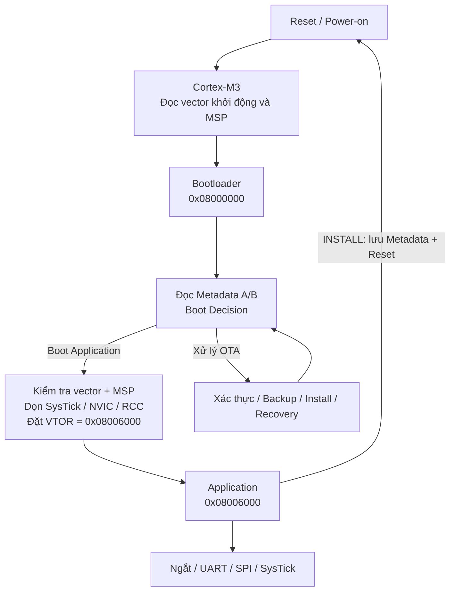

> **Ý nghĩa:** Trên **một MCU**, Bootloader và Application **không chạy như hai bộ xử lý độc lập**. Chúng dùng chung CPU, SRAM và ngoại vi, nhưng chiếm **hai vùng chương trình** khác nhau. Khi Application bắt đầu, ngữ cảnh CPU và ngắt phải phù hợp với **vector table của Application**.

#### Bước 1. Nắm phần cứng STM32F103C8T6 và vai trò Cortex-M3

**STM32F103C8T6** là vi điều khiển 32-bit dùng nhân **Arm Cortex-M3**, với cấu hình danh định mà project xây dựng trên đó:

| Thành phần | Thông tin | Liên hệ Secure Delta OTA |
|---|---|---|
| CPU | Cortex-M3, thực thi Thumb/Thumb-2; tần số tối đa theo dòng chip là **72 MHz** | Chạy thuật toán Boot Decision, hash, kiểm tra chữ ký, sao chép và ghi Flash. |
| Internal Flash | **64 KiB** | Chứa Bootloader, Application và Metadata A/B. |
| SRAM | **20 KiB** | Stack, biến runtime và bộ đệm khi xử lý UART/SPI/Flash. |
| NVIC + SysTick | Bộ điều khiển ngắt và bộ đếm thời gian thuộc phần lõi | Ngắt giao tiếp và tick của Application; cần dọn trạng thái khi jump. |
| RCC | Điều khiển clock hệ thống và clock ngoại vi | Ảnh hưởng baudrate UART, tốc độ SPI, delay và SysTick. |
| Reset / Watchdog | Cơ chế khởi động lại MCU | Bàn giao từ Application sang Bootloader và phục hồi OTA. |

**Cần nhớ về CPU:** Cortex-M3 có các thanh ghi **R0–R12**, **SP (R13)**, **LR (R14)**, **PC (R15)** và các thanh ghi trạng thái/điều khiển như **xPSR**, **CONTROL**, **PRIMASK**, **BASEPRI**. Phần lớn code C không thao tác trực tiếp những thanh ghi này, nhưng thao tác **Jump Application** cần đặc biệt quan tâm **SP, PC, CONTROL và trạng thái ngắt**.

**Phân biệt tần số tối đa và tần số đang chạy:** **72 MHz là khả năng tối đa của dòng MCU, không phải khẳng định firmware hiện tại luôn chạy ở 72 MHz**. Tần số thực tế phụ thuộc cấu hình RCC/SystemInit của image đang chạy.

#### Bước 2. Hiểu Memory Map và các vùng thật sự được project sử dụng

**Memory Map** là cách CPU gán các dải địa chỉ cho Flash, SRAM, ngoại vi và thanh ghi hệ thống. Địa chỉ không đồng nghĩa với việc mọi vùng đều là RAM có thể đọc/ghi tùy ý.

**Các vùng địa chỉ quan trọng trên Cortex-M3/STM32F1:**

| Dải / địa chỉ tiêu biểu | Ý nghĩa | Ví dụ trong project |
|---|---|---|
| `0x00000000` | Vùng **alias** được ánh xạ theo lựa chọn khởi động của STM32 | Sau boot thông thường từ User Flash, vector đầu được truy cập qua alias khởi động. |
| `0x08000000` | Điểm bắt đầu **Internal Flash** vật lý | Vector table Bootloader. |
| `0x20000000` | Điểm bắt đầu **SRAM** | Stack và biến runtime. |
| `0x40000000` trở lên | Vùng ngoại vi **memory-mapped I/O** | UART, SPI, GPIO, RCC, FLASH controller. |
| `0xE000E000` trở lên | Thanh ghi hệ thống **Cortex-M** | NVIC, SysTick, SCB/VTOR. |

**Phân vùng Internal Flash chính xác theo repository:**

| Vùng | Địa chỉ bắt đầu | Địa chỉ kết thúc (inclusive) | Dung lượng |
|---|---|---|---:|
| Bootloader | `0x08000000` | `0x08005FFF` | **24 KiB** |
| Application | `0x08006000` | `0x0800F7FF` | **38 KiB** |
| Metadata A | `0x0800F800` | `0x0800FBFF` | **1 KiB** |
| Metadata B | `0x0800FC00` | `0x0800FFFF` | **1 KiB** |
| SRAM | `0x20000000` | `0x20004FFF` | **20 KiB** |

```text
Internal Flash — 64 KiB (địa chỉ tăng dần)
0x08000000  +----------------------------------+
            | BOOTLOADER          24 KiB       |
0x08006000  +----------------------------------+
            | APPLICATION         38 KiB       |
            | Vector table + code + constants |
0x0800F800  +----------------------------------+
            | Metadata A           1 KiB       |
0x0800FC00  +----------------------------------+
            | Metadata B           1 KiB       |
0x08010000  +----------------------------------+ (địa chỉ kết thúc exclusive)

SRAM — 20 KiB
0x20000000  +----------------------------------+
            | .data / .bss / Heap / Stack      |
0x20005000  +----------------------------------+ (top-of-stack; exclusive end)
```

**Điểm cần hiểu sâu:**

1. **Bootloader** phải nằm trong vùng riêng để quá trình **Install** không xóa chính chương trình đang ghi Flash.
2. **Application** có vector table riêng tại `0x08006000`, không nằm ở `0x08000000`.
3. Hai trang **Metadata A/B** lưu trạng thái boot/update bền vững, phục vụ phục hồi khi reset/mất nguồn.
4. **SRAM không phải nơi lưu Checkpoint sau mất nguồn**. Thông tin sống còn phải được ghi vào Flash thích hợp.
5. **W25Q SPI NOR không nằm trong dải Internal Flash/SRAM nêu trên**: CPU truy cập nó qua **SPI driver**, không được mặc định dereference một địa chỉ memory-mapped như Internal Flash.

**Ví dụ ôn tập:** Application bắt đầu tại `0x08006000` và giới hạn **38 KiB**. Vì vậy, khi Install, Bootloader phải bảo đảm phạm vi erase/program kết thúc **trước `0x0800F800`**, không chạm vào Metadata A/B. Quy tắc này được thể hiện trong `shared/include/memory_map.h` và `docs/memory-map.md`.

#### Bước 3. Hiểu Reset, Boot Vector và trạng thái CPU ngay sau khởi động

Khi MCU **reset**, phần cứng lựa chọn vùng boot theo cấu hình chân/option tương ứng. Với chế độ **boot từ User Flash** được thiết kế cho project, CPU lấy **word đầu** làm **giá trị MSP ban đầu** và **word thứ hai** làm **địa chỉ Reset Handler**; nó bắt đầu thực thi Bootloader trước. Việc chọn boot từ User Flash/System Memory/SRAM là chức năng boot của STM32F1, **không phải** lựa chọn Full OTA hay Delta OTA của ứng dụng.

```text
Vector table đầu Bootloader (User Flash)
0x08000000 : Initial MSP          -> ví dụ top-of-SRAM 0x20005000
0x08000004 : Reset_Handler        -> địa chỉ mã Bootloader (Thumb bit = 1)
...

Vector table đầu Application
0x08006000 : Initial MSP          -> nằm trong SRAM, align 8 bytes
0x08006004 : Reset_Handler        -> nằm trong vùng Application, Thumb bit = 1
...
```

**Luồng điển hình của project:**

1. Reset đưa CPU vào ngữ cảnh khởi động; **Bootloader Reset Handler** được chạy trước.
2. Startup khởi tạo môi trường C; Bootloader đọc **Metadata A/B** để đưa ra **Boot Decision**.
3. Nếu cần cập nhật hoặc khôi phục, Bootloader xử lý trong vùng riêng của nó.
4. Nếu Application được phép chạy, Bootloader **kiểm tra vector, dọn ngắt/clock và handoff** sang Application.

> **Giới hạn của ví dụ:** Hai word vector được đưa ra để học địa chỉ; không mặc định `Reset_Handler` có giá trị số cố định. Giá trị thật phụ thuộc bản firmware đã link. Thứ tự khởi tạo `.data`, `.bss`, gọi `SystemInit()` và `main()` sẽ được phân tích riêng trong **Chương 6.2**.

#### Bước 4. Phân biệt MSP, PSP, Thread Mode và Handler Mode

**Stack** trên Cortex-M3 là vùng SRAM dùng lưu địa chỉ trả về, biến cục bộ, ngữ cảnh gọi hàm và ngữ cảnh ngắt. Stack thường phát triển **từ địa chỉ cao xuống thấp**.

| Khái niệm | Vai trò | Cần nhớ khi phỏng vấn |
|---|---|---|
| **MSP** (Main Stack Pointer) | Stack pointer chính, được nạp từ vector[0] lúc reset | **Handler Mode luôn sử dụng MSP**. |
| **PSP** (Process Stack Pointer) | Stack pointer có thể dùng cho Thread Mode | Thường gặp trong RTOS; bare-metal có thể chỉ dùng MSP. |
| **Thread Mode** | Thực thi chương trình bình thường | Có thể dùng MSP hoặc PSP tùy `CONTROL.SPSEL`. |
| **Handler Mode** | Thực thi exception/interrupt | Dùng MSP. |
| `CONTROL` | Chọn stack trong Thread Mode và đặc quyền thực thi | Handoff cần đưa về ngữ cảnh phù hợp với reset/startup. |
| `PRIMASK` | Có thể chặn các exception có mức ưu tiên cấu hình được | Nếu không trả về trạng thái phù hợp, Application có thể không nhận ngắt. |

**Ví dụ áp dụng từ repository:**

- Trước khi Jump, `ApplicationJump_Validate()` đọc `vector[0]` và kiểm tra **MSP trong SRAM**, **canh hàng 8 bytes**.
- `vector[1]` phải có **Thumb bit** và trỏ đến vùng Application.
- Handoff sử dụng **assembly helper** để đặt MSP rồi nhảy tới Reset Handler **mà không dùng epilogue của hàm C trên stack cũ**.
- Helper cũng trả các thanh ghi như `CONTROL`, `PRIMASK` về trạng thái phù hợp với khởi động lại; không chỉ đổi PC.

**Vì sao không được Jump kiểu `((void (*)(void))app_reset)();`?** Một lời gọi C thông thường không bảo đảm đổi **MSP**, **VTOR**, ngắt pending và clock về đúng ngữ cảnh. Kết quả có thể là HardFault, dùng nhầm stack hoặc nhảy được nhưng ngắt chạy sai handler.

#### Bước 5. NVIC, Exception và SysTick có ảnh hưởng gì đến Bootloader → Application?

**NVIC** (Nested Vectored Interrupt Controller) quản lý việc enable, pending và mức ưu tiên của nhiều interrupt. **Exception** còn bao gồm các sự kiện cấp lõi như Reset, NMI, HardFault, SysTick; chúng không hoàn toàn giống các IRQ ngoại vi.

- **Enable**: ngắt ngoại vi có được phép đi vào CPU hay không.
- **Pending**: có yêu cầu ngắt đang chờ phục vụ hay không.
- **Priority**: ngắt nào được ưu tiên; trên Cortex-M, **số ưu tiên nhỏ hơn thường mang ưu tiên cao hơn**.
- **Vector Table**: bảng địa chỉ handler tương ứng cho từng exception/IRQ.
- **SysTick**: timer 24-bit của core; có thể tạo tick định kỳ phục vụ scheduling/delay.

**Một lỗi rất thực tế:** Bootloader bật UART/SysTick rồi Jump thẳng sang Application mà **không dọn pending IRQ và không đổi VTOR**. Khi IRQ xảy ra, CPU có thể lấy địa chỉ handler từ vector table Bootloader thay vì Application. Vì vậy chỉ đổi PC là chưa đủ.

**Luồng cleanup đã được mô tả trong `docs/boot-jump.md`:**

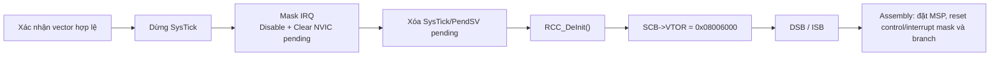

**Liên hệ test:** Tài liệu `docs/boot-jump.md` ghi nhận Application kiểm tra `SCB->VTOR == 0x08006000`, cấu hình **SysTick 1 ms** và phát nhịp **PC13**. Đây là bằng chứng về việc Application đã vào Reset Handler và ngắt được định tuyến qua vector table của Application; **không phải bằng chứng về bảo mật chữ ký SDOT**.

#### Bước 6. Clock Tree và RCC — vì sao phải quan tâm khi chuyển image?

**Clock Tree** cung cấp xung cho CPU và các ngoại vi. Trên STM32F103, các thành phần nền tảng cần phân biệt gồm **HSI** (oscillator nội **8 MHz**), **HSE** (oscillator ngoài, tùy phần cứng), **PLL**, **SYSCLK**, **AHB/HCLK**, **APB1/PCLK1**, **APB2/PCLK2**.

```text
HSI (nội 8 MHz) -------+
                       +--> [Clock select / PLL / prescaler] --> SYSCLK
HSE (ngoài) -----------+                                  |
                                                          +--> HCLK (CPU / AHB)
                                                          +--> PCLK1 (APB1)
                                                          +--> PCLK2 (APB2)
```

**Vì sao clock quan trọng trong OTA?**

| Nếu clock cấu hình không phù hợp | Biểu hiện có thể gặp |
|---|---|
| Baudrate UART lệch so với tính toán | Sai packet, CRC32 lỗi, timeout và Retry liên tục. |
| SPI clock khác dự kiến | Giao tiếp W25Q lỗi hoặc tốc độ thấp. |
| SysTick reload tính theo `SystemCoreClock` sai | Tick 1 ms và delay thực tế không chính xác. |
| Bootloader để lại PLL/prescaler và Application giả định trạng thái reset | Startup và timing không ổn định. |

**Theo code của project:** Trước khi bàn giao, `application_jump.c` gọi **`RCC_DeInit()`** để đưa clock tree về trạng thái gần reset dựa trên **HSI**; **Application `SystemInit()`** chịu trách nhiệm cấu hình lại clock cho chính image của nó. Không nên suy ra Bootloader và Application luôn dùng cùng một tần số hệ thống từ cấu hình tối đa 72 MHz của MCU.

> **Câu hỏi thường gặp:** “Đặt lại RCC có đồng nghĩa reset toàn bộ chip không?” **Không.** `RCC_DeInit()` xử lý trạng thái cấu hình clock/RCC liên quan, không thay thế **system reset** và cũng không tự xóa toàn bộ trạng thái NVIC, SysTick hay SRAM. Vì vậy handoff còn nhiều bước cleanup khác.

#### Bước 7. Các loại Reset và vì sao OTA cần trạng thái bền vững

**Reset** khiến mã boot được thực thi lại, nhưng **không phải mọi loại reset đều có nguyên nhân giống nhau**. Ở mức ôn tập STM32F1, cần phân biệt:

| Tình huống | Ví dụ kích hoạt | Quan hệ với project |
|---|---|---|
| **Power-on / Power-down reset** | Cấp nguồn, sụt nguồn vượt ngưỡng | Có thể xảy ra trong Receive/Backup/Install; cần **Power-loss Recovery**. |
| **External reset** | Tác động chân NRST | Bootloader chạy lại và đọc Metadata để biết trạng thái. |
| **Software system reset** | Application chủ động yêu cầu reset sau `INSTALL` | Bàn giao OTA cho Bootloader khi Metadata đã commit. |
| **Watchdog reset** | Application trial không đáp ứng đúng hạn | Bootloader quản lý số lần Trial Boot và có thể Rollback. |

**Điểm mấu chốt:** RAM không phải cơ chế lưu trạng thái cập nhật có thể tin cậy qua mất nguồn. Để biết đang **`UPDATE_INSTALLING`**, đã ghi an toàn đến đâu hay đã **`UPDATE_TRIAL_BOOT`** bao nhiêu lần, hệ thống cần **Metadata/Checkpoint** trong Flash. Sau reset, Bootloader **đọc lại** trạng thái này để quyết định **resume, xử lý lại một bước an toàn hoặc rollback**, tùy thời điểm lỗi.

**Reset không đồng nghĩa Rollback:** Nếu mất nguồn lúc Install, Bootloader có thể **tiếp tục Install từ Checkpoint**; Rollback là cơ chế riêng dùng **Backup Image** khi cần khôi phục firmware đã được chấp nhận.

#### Bước 8. Tự đọc mã nguồn: nối kiến thức phần cứng với project

**Ví dụ đọc Vector Table (để học, chưa phải hàm Jump hoàn chỉnh):**

```c
#include <stdint.h>

#define APP_BASE 0x08006000UL

void example_read_application_vectors(uint32_t *initial_msp,
                                      uint32_t *reset_entry)
{
    *initial_msp = *(volatile const uint32_t *)(APP_BASE + 0UL);
    *reset_entry = *(volatile const uint32_t *)(APP_BASE + 4UL);
}

/* Ví dụ chỉ để đọc vector: chưa kiểm tra range/alignment/Thumb bit.
   Handoff thật cần dọn NVIC/SysTick/RCC, đặt VTOR và chuyển MSP
   trong assembly như implementation của repository. */
```

**Cách kiểm tra khi đọc code:**

1. `memory_map.h`: tìm `APPLICATION_START_ADDRESS`, `INTERNAL_SRAM_BASE`, `INTERNAL_SRAM_END`, `BOOT_METADATA_A_ADDRESS`.
2. `application_jump.c`: tìm kiểm tra vector table, **MSP range + 8-byte alignment**, **Thumb bit** và **Reset Handler range**.
3. Trong chính file đó, theo dõi `SysTick->CTRL`, `NVIC->ICER`, `NVIC->ICPR`, `RCC_DeInit()` và `SCB->VTOR`.
4. `application_handoff.s`: xem cách restore ngữ cảnh và thực hiện branch mà không chạy epilogue C sau khi đổi MSP.
5. `application.ld` / `bootloader.ld`: kiểm tra vùng `FLASH`, `RAM` và vị trí `.isr_vector`.

> **Chưa kết luận từ chương này:** Khả năng Jump an toàn chỉ chứng minh firmware có cấu trúc vector hợp lệ và ngữ cảnh phù hợp; **không thay thế xác thực ECDSA P-256**. Quy trình tin cậy cập nhật nằm ở **Phần 4, 5** và sẽ được ôn kỹ trong **6.8**.

#### Tình huống lỗi thực tế và hướng suy luận

| Tình huống | Nguyên nhân cần kiểm tra trước | Cách khoanh vùng |
|---|---|---|
| MCU reset xong không vào Application | Sai Boot Decision, vector không hợp lệ, MSP ngoài SRAM hoặc Reset Handler ngoài partition | Đọc Metadata, vector[0]/vector[1], PC và fault status bằng GDB/SWD. |
| Jump xong vào `HardFault_Handler` | MSP sai/alignment sai, Reset Handler không hợp lệ hoặc ngắt dùng sai vector | Kiểm tra `SCB->VTOR`, MSP/PSP, PC/LR và SCB fault registers. |
| Application chạy được nhưng UART/SysTick ngừng hoạt động | PRIMASK còn chặn IRQ, NVIC chưa dọn, vector table/clock chưa cấu hình đúng | Kiểm tra `PRIMASK`, `CONTROL`, `NVIC->ISER/ISPR`, `SCB->VTOR`, clock. |
| Bất thường sau khi đổi clock | HSI/HSE/PLL/prescaler không khớp giả định timing | Đọc trạng thái RCC, đối chiếu clock của USART/SPI/SysTick. |
| Mất điện giữa Install rồi boot lại | Internal Flash có thể chứa image chưa hoàn chỉnh | Đọc Metadata/Checkpoint; **không Jump** vào firmware chưa Verify thành công. |

#### Bài nói khi phỏng vấn: STM32F103 & Cortex-M3 (khoảng 90 giây)

> Dạ, trong project Secure Delta OTA Bootloader, em sử dụng **STM32F103C8T6** với nhân **Arm Cortex-M3**, **64 KiB Internal Flash** và **20 KiB SRAM**.
>
> Em chia Internal Flash thành **24 KiB Bootloader**, **38 KiB Application** và **hai trang Metadata A/B, mỗi trang 1 KiB**. Bootloader bắt đầu tại `0x08000000`, còn Application bắt đầu tại `0x08006000`.
>
> Khi reset, MCU chạy Bootloader trước. Bootloader đọc Metadata để quyết định xử lý cập nhật hay chạy Application. Trước khi nhảy vào Application, hệ thống kiểm tra **MSP** và **Reset Handler** từ vector table, dừng **SysTick**, dọn ngắt **NVIC**, đưa **RCC** về trạng thái phù hợp, đặt lại **VTOR** rồi chuyển quyền điều khiển bằng assembly.
>
> Trên Cortex-M3, **MSP** được dùng khi reset và trong Handler Mode, còn **PSP** có thể được chọn trong Thread Mode. Em cần hiểu sự khác biệt này để tránh lỗi stack hoặc HardFault khi bàn giao từ Bootloader sang Application.
>
> Ngoài ra, các trạng thái OTA quan trọng được lưu trong Flash thay vì SRAM, để sau reset hoặc mất nguồn Bootloader có thể đọc lại Metadata/Checkpoint và tiếp tục hoặc khôi phục theo trạng thái an toàn.

#### Câu hỏi ôn tập: STM32F103 & ARM Cortex-M3

| Câu hỏi | Ý chính cần trả lời |
|---|---|
| STM32F103 khác Cortex-M3 ở đâu? | STM32F103 là **MCU hoàn chỉnh**; Cortex-M3 là **nhân xử lý** bên trong. |
| Project sử dụng bao nhiêu Internal Flash và SRAM? | **64 KiB Internal Flash**, **20 KiB SRAM** trên STM32F103C8T6. |
| Vì sao Bootloader và Application có địa chỉ Flash riêng? | Tránh tự ghi đè Bootloader; boot/jump và giới hạn ghi Flash rõ ràng. |
| Application bắt đầu ở đâu? | `0x08006000`; Bootloader bắt đầu ở `0x08000000`. |
| Tại sao Metadata A/B không đặt trong RAM? | Cần trạng thái bền vững qua reset và mất nguồn. |
| MSP khác PSP như thế nào? | MSP dùng lúc reset và Handler Mode; PSP có thể dùng trong Thread Mode. |
| Vector[0] và vector[1] chứa gì? | MSP ban đầu và địa chỉ Reset Handler (Thumb bit phải hợp lệ). |
| VTOR dùng để làm gì? | Chỉ vị trí vector table mà CPU dùng để định tuyến exception/interrupt. |
| Vì sao phải dọn NVIC/SysTick trước khi Jump? | Không để lại pending/enable/tick của Bootloader gây ngắt sai trong Application. |
| Vì sao phải dùng assembly khi đổi MSP? | Không để epilogue C dùng stack của Bootloader sau khi chuyển MSP. |
| Số priority NVIC càng lớn có ưu tiên càng cao không? | **Không**; giá trị priority số nhỏ hơn thường ưu tiên cao hơn. |
| Clock 72 MHz có chắc là tần số hiện tại không? | **Không**; đây là giới hạn tối đa của dòng MCU, tần số thực do RCC chọn. |
| HSI trên STM32F103 là bao nhiêu? | Oscillator nội HSI **8 MHz**. |
| `RCC_DeInit()` có reset toàn bộ MCU không? | Không; nó dọn cấu hình clock, không thay thế system reset. |
| Mất nguồn khi đang Install có phải luôn Rollback? | Không; Bootloader đánh giá Metadata/Checkpoint để Resume hoặc Rollback đúng tình huống. |
| Kiểm tra vector có đủ chứng minh firmware được ký tin cậy không? | Không; vector validation khác **xác thực SDOT/ECDSA**. |

#### Điểm cần ghi nhớ

- **STM32F103 là MCU**, **Cortex-M3 là CPU core** bên trong; hiểu core phải đi cùng hiểu Flash/SRAM/NVIC/RCC của chip.
- **Địa chỉ và dung lượng cụ thể:** Bootloader `0x08000000` (24 KiB), Application `0x08006000` (38 KiB), Metadata A/B (1 KiB mỗi vùng), SRAM `0x20000000`–`0x20004FFF` (20 KiB).
- **MSP ≠ PSP:** Reset dùng MSP; Handler Mode dùng MSP; Thread Mode có thể chọn PSP.
- **Jump Application ≠ gọi hàm C thông thường:** Phải kiểm tra vector, dọn SysTick/NVIC, xử lý RCC, đặt VTOR và khôi phục ngữ cảnh CPU.
- **72 MHz là giới hạn, không phải mặc định chạy 72 MHz**; dựa vào cấu hình clock thật để tính UART, SPI và SysTick.
- **Reset ≠ xóa trạng thái OTA trong Flash**; Metadata/Checkpoint là căn cứ phục hồi, còn Rollback chỉ là một nhánh xử lý.
- **Vector validation ≠ firmware authentication**; chữ ký ECDSA được kiểm tra trong luồng cập nhật khác.

#### Các file mã nguồn và tài liệu nên đọc

| Tài liệu / File | Tại sao cần đọc |
|---|---|
| [`docs/memory-map.md`](https://github.com/haikevins/secure-delta-ota-bootloader/blob/main/docs/memory-map.md) | Phân vùng Internal Flash, SRAM, W25Q và giới hạn erase/write. |
| [`shared/include/memory_map.h`](https://github.com/haikevins/secure-delta-ota-bootloader/blob/main/shared/include/memory_map.h) | Các hằng địa chỉ thực sự dùng trong code. |
| [`docs/boot-jump.md`](https://github.com/haikevins/secure-delta-ota-bootloader/blob/main/docs/boot-jump.md) | Trình tự kiểm tra vector, dọn NVIC/SysTick, RCC, VTOR và assembly handoff. |
| [`node-stm32f103/bootloader/src/application_jump.c`](https://github.com/haikevins/secure-delta-ota-bootloader/blob/main/node-stm32f103/bootloader/src/application_jump.c) | Kiểm tra MSP/Reset Handler và C-side cleanup trước khi Jump. |
| [`node-stm32f103/bootloader/src/application_handoff.s`](https://github.com/haikevins/secure-delta-ota-bootloader/blob/main/node-stm32f103/bootloader/src/application_handoff.s) | Cách chuyển stack, control và branch trong assembly. |
| [`node-stm32f103/application/linker/application.ld`](https://github.com/haikevins/secure-delta-ota-bootloader/blob/main/node-stm32f103/application/linker/application.ld) | Vùng đặt Application và địa chỉ vector table trong linker script. |
| [`node-stm32f103/bootloader/linker/bootloader.ld`](https://github.com/haikevins/secure-delta-ota-bootloader/blob/main/node-stm32f103/bootloader/linker/bootloader.ld) | Vùng đặt Bootloader và SRAM. |
| [ST STM32F103C8 Product Overview](https://www.st.com/en/microcontrollers-microprocessors/stm32f103c8.html) | Thông số chip: Cortex-M3, 64 KiB Flash, 20 KiB SRAM, tốc độ tối đa, HSI. |
| [ST PM0056 — Cortex-M3 Programming Manual](https://www.st.com/resource/en/programming_manual/pm0056-stm32f10xxx20xxx21xxxl1xxxx-cortexm3-programming-manual-stmicroelectronics.pdf) | Kiến thức nền MSP/PSP, NVIC, exception, thanh ghi core. |

> **Gợi ý tự kiểm tra:** Giải thích bằng lời vì sao chỉ `SCB->VTOR = 0x08006000` chưa đủ để chuyển an toàn từ Bootloader sang Application. Nếu trả lời được cả **MSP, ngắt pending, SysTick, RCC và Reset Handler**, bạn đã nắm cốt lõi Chương 6.1.

---

<a id="phan-7"></a>
## Phần 7. Câu hỏi phỏng vấn trọng tâm

> **Cách sử dụng:** Trả lời bằng lời của mình trước, sau đó đối chiếu với Phần 4–6. Các bảng hỏi đáp theo từng luồng vẫn được giữ nguyên ở **Phần 4**.

| Nhóm | Câu hỏi trọng tâm | Hướng trả lời cần nắm |
|---|---|---|
| Tổng quan | Vì sao tách ESP32 Gateway và STM32? | Kết nối mạng và vận chuyển tách khỏi xác thực/cài đặt firmware. |
| Kiến trúc | Vì sao gói SDOT phải lưu vào External Flash W25Q? | Tách giai đoạn tải khỏi ghi Internal Flash; cần vùng Incoming, Reconstructed, Backup. |
| Release | Vì sao có cả Full OTA và Delta OTA? | Full không cần đúng base; Delta tiết kiệm dữ liệu nhưng cần kiểm tra base. |
| Release | Manifest khác SDOT thế nào? | Manifest mô tả release; SDOT chứa payload và chữ ký cập nhật. |
| Network | Tại sao dùng cả MQTTS và HTTPS? | MQTTS điều khiển/thông báo; HTTPS truyền artifact. |
| UART | COBS và CRC32 giải quyết hai vấn đề nào? | Đóng khung và phát hiện lỗi dữ liệu. |
| UART | Nếu mất ACK sau khi STM32 đã ghi một DATA packet? | ESP32 Retry; STM32 xử lý dữ liệu trùng/offset theo protocol. |
| Recovery | Resume khác Retry ở điểm nào? | Retry xử lý packet; Resume phục hồi từ checkpoint sau gián đoạn. |
| Boot | STM32 biết phải Boot App hay xử lý cập nhật bằng cách nào? | Metadata A/B + `BootDecision_Evaluate()`. |
| Boot | Vì sao phải cập nhật Metadata rồi mới reset? | Truyền trạng thái bền vững từ Application sang Bootloader. |
| Bảo mật | Vì sao chỉ dùng SHA-256 là chưa đủ? | Hash tự nó không chứng minh được ai phát hành; cần chữ ký số tin cậy. |
| Bảo mật | Anti-rollback khác Rollback thế nào? | Ngăn downgrade không được phép vs khôi phục Backup đã chấp nhận. |
| Delta | Vì sao phải kiểm tra Base SHA-256? | Patch chỉ hợp lệ trên đúng firmware gốc. |
| Flash | Vì sao phải Erase trước Program và Verify sau Program? | Đặc tính NOR Flash và kiểm tra dữ liệu đã ghi. |
| Recovery | Mất nguồn khi Install giữa một trang thì sao? | Dùng Checkpoint 1 KB; xóa và ghi lại trang chưa Verify. |
| Metadata | Mất nguồn khi ghi Metadata mới thì sao? | Chọn bản A/B hợp lệ, generation mới nhất và CRC32 đúng. |
| Trial | Install thành công đã đồng nghĩa Confirm chưa? | Chưa; phải chạy Trial Boot và Application xác nhận. |
| Trial | Application mới reset liên tục sẽ ra sao? | Tiêu thụ lần Trial Boot; tối đa 3 lần chưa Confirm thì Rollback. |
| Giới hạn | `UPDATE_FAILED` có nhận OTA mới qua UART ngay không? | Không; bản hiện tại ở `STAY_RECOVERY`, không phải UART recovery service. |
| Kiểm thử | 9/9 HIL chứng minh được điều gì, chưa chứng minh được điều gì? | 9 kịch bản đã ghi nhận thành công; không suy ra mọi tình huống hay độ bền vô hạn. |

**Ba câu hỏi về kinh nghiệm cá nhân cần chuẩn bị riêng:** (1) Em trực tiếp triển khai phần nào? (2) Lỗi khó nhất em đã debug và cách xác minh bản sửa? (3) Nếu triển khai production, em sẽ cải thiện điều gì? Hãy trả lời theo **trải nghiệm thực tế**, không suy diễn từ tài liệu.

---

---

> **Tài liệu repository:** [README](https://github.com/haikevins/secure-delta-ota-bootloader) · [Boot State Machine](https://github.com/haikevins/secure-delta-ota-bootloader/blob/main/docs/boot-state-machine.md) · [Metadata & Boot Decision](https://github.com/haikevins/secure-delta-ota-bootloader/blob/main/docs/metadata-and-boot-decision.md)
