# Secure Delta OTA Bootloader

## Mục lục

1. [Trình bày Project](#phan-1)
2. [Trình bày System Architecture](#phan-2)
3. [Trình bày Boot State Machine](#phan-3)
4. [Phân tích chi tiết System Architecture](#phan-4)
   - [4.1. Developer/CI → Release Server](#luong-1)
   - [4.2. Release Server → ESP32 Gateway](#luong-2)
   - [4.3. ESP32 Gateway → STM32 Application](#luong-3)
   - [4.4. STM32 Application → STM32 Bootloader](#luong-4)
   - [4.5. STM32 Bootloader → STM32 Internal Flash](#luong-5)
5. [Phân tích chi tiết Boot State Machine](#phan-5)
   - [5.1. Khởi động STM32 Bootloader → Đọc Metadata → Boot Decision](#chuong-5-1)
   - [5.2. `IDLE` → `RECEIVING` → `ARTIFACT_READY` → Bàn giao cho Bootloader](#chuong-5-2)
   - [5.3. `VERIFYING_CONTAINER` → `VERIFYING_BASE` → `PATCHING` → `IMAGE_READY`](#chuong-5-3)
   - [5.4. `IMAGE_READY` → `BACKING_UP` → `INSTALLING` → `VERIFYING_INSTALL`](#chuong-5-4)
   - [5.5. `TRIAL_BOOT` → `CONFIRMED` / `ROLLBACK` → `IDLE`](#chuong-5-5)
   - [5.6. Power-loss Recovery, trạng thái `FAILED` và các chuyển trạng thái không hợp lệ](#chuong-5-6)
   - [5.7. Tổng hợp các trạng thái và file mã nguồn nên đọc](#chuong-5-7)
6. [Ôn tập kiến thức kỹ thuật](#phan-6)
   - [6.1. STM32F103 & ARM Cortex-M3](#chuong-6-1)
   - [6.2. Boot Process, Vector Table & Linker Script](#chuong-6-2)
   - [6.3. STM32 Internal Flash Programming](#chuong-6-3)
   - [6.4. External SPI Flash W25Q](#chuong-6-4)
   - [6.5. UART Communication & OTA Protocol](#chuong-6-5)
   - [6.6. SPI Communication](#chuong-6-6)
   - [6.7. Full OTA, Delta OTA & JojoDiff](#chuong-6-7)
   - [6.8. Cryptography & Firmware Security](#chuong-6-8)
   - [6.9. Metadata, Checkpoint & Fault Tolerance](#chuong-6-9)
   - [6.10. Watchdog, Debugging & Testing](#chuong-6-10)
7. [Câu hỏi phỏng vấn trọng tâm](#phan-7)

**Phụ lục tra cứu nhanh:** [Phụ lục A – Khái niệm, công nghệ và thuật toán chính](#phu-luc-a)

<a id="phu-luc-a"></a>
## Phụ lục A. Các khái niệm, công nghệ và thuật toán cốt lõi của project

<a id="phu-luc-a-0"></a>
### A.1. Quy ước thuật ngữ thống nhất cho toàn tài liệu

| Thuật ngữ chuẩn | Ý nghĩa / quy tắc sử dụng |
|---|---|---|
| **STM32 Bootloader / STM32 Application / ESP32 Gateway / Release Server / Developer/CI** | Tên của năm thành phần kiến trúc; khi ngữ cảnh rõ có thể viết tắt thành **Bootloader / Application / Gateway / Server / CI**. |
| **Internal Flash / External Flash W25Q / Flash cache của ESP32** | Ba vùng lưu trữ riêng; khi nói Metadata hay SDOT nên chỉ rõ vùng chứa. |
| **Gói SDOT (tệp cập nhật đã đóng gói)** | Gói SDOT được truyền qua mạng/UART rồi lưu ở vùng **Incoming**; chứa header, Payload và chữ ký. |
| **Payload** | Phần dữ liệu trong container/packet; khi dễ nhầm cần viết **SDOT Payload** hoặc **DATA payload**. |
| **Manifest** | Tệp mô tả release (`manifest.json`); chữ ký Manifest được quản lý riêng. | Gói SDOT chứa dữ liệu cập nhật. |
| **Full OTA / Delta OTA / Delta Patch** | Full OTA chứa firmware đích hoàn chỉnh; Delta OTA chứa Delta Patch để tái tạo firmware. | Delta Patch không phải firmware có thể khởi động. |
| **Base Image (firmware gốc)** | Binary *chính xác* đã dùng tạo Delta Patch; kiểm tra bằng Base SHA-256. | Không phải cứ cùng `base_version` là có Base Image đúng. |
| **Target Image (firmware đích)** | Binary hoàn chỉnh mong muốn sau Full/Delta; được kiểm tra bằng Target SHA-256. | **Reconstructed Image** là tên vùng lưu trữ trên W25Q, nơi đặt Target Image đã chuẩn bị. |
| **Reconstructed Image / Backup Image / Incoming** | Tên các phân vùng logic W25Q: chứa Target Image, chứa bản sao Application cũ, và chứa gói SDOT. | Không đổi tên vùng này thành thuật toán hay trạng thái. |
| **JojoDiff / JANPatch** | JojoDiff **tạo** Delta Patch tại host; JANPatch **áp dụng** patch để dựng Target Image. | Công cụ tạo patch không phải bộ giải mã trên STM32. |
| **UART / SPI / HTTPS / MQTTS / MQTT** | UART truyền SDOT giữa ESP32 và STM32; SPI truy cập W25Q; MQTTS là MQTT qua TLS để gửi lệnh/trạng thái; HTTPS tải gói SDOT. | MQTT (giao thức) không tự đồng nghĩa MQTTS (kết nối TLS). |
| **COBS / CRC32 / ACK / NACK / Retry / Resume** | COBS đóng khung; CRC32 phát hiện lỗi; ACK/NACK phản hồi; Retry gửi lại packet/lệnh; Resume tiếp tục nhận theo Checkpoint sau gián đoạn. | ACK hiện tại không thay thế Checkpoint bền vững. |
| **SHA-256 / ECDSA P-256 / Trusted Public Key / Private Key** | SHA-256 tạo digest; ECDSA ký/xác minh; Private Key ở phía phát hành, Trusted Public Key ở phía Bootloader. | CRC32 hoặc SHA-256 đơn độc không xác thực nguồn ký; ECDSA không mã hóa nội dung firmware. |
| **Metadata / Checkpoint** | Metadata mô tả trạng thái và quyết định cập nhật; Checkpoint xác nhận tiến độ *đã lưu bền vững*. | `generation` chọn bản Metadata mới; `copy_offset`/Checkpoint là tiến độ, không phải generation. |
| **Internal Flash Metadata A/B / External Flash Metadata A/B** | Hai cặp bản lưu A/B độc lập trên hai loại Flash; ghi rõ vùng khi bàn đến layout hoặc phục hồi. | Không dùng "Metadata A/B" để khẳng định chúng cùng một địa chỉ hoặc cùng cấu trúc. |
| **Boot State Machine / Boot Decision / Boot Action** | Boot State Machine là mô hình trạng thái; Boot Decision suy ra hành động khi khởi động; Boot Action là kết quả quyết định. | State không đồng nghĩa Action. |
| **Trial Boot / Confirm / Rollback** | Trial Boot chạy thử Application; Confirm công nhận firmware mới; Rollback khôi phục Backup Image. | Install xong chưa chắc Confirm. |
| **Power-loss Recovery / Rollback / Anti-rollback** | Recovery tiếp tục/làm lại việc an toàn; Rollback phục hồi firmware đã sao lưu; Anti-rollback ngăn cập nhật xuống phiên bản cũ không cho phép. | Ba cơ chế độc lập về mục tiêu. |
| **Watchdog / IWDG** | Watchdog là khái niệm; **IWDG** là Independent Watchdog của STM32F103 dùng trong Trial Boot. | Watchdog reset không tự thực hiện Rollback; Bootloader xử lý sau reset. |
| **Verify / Validation / xác thực / kiểm tra** | Nêu rõ đối tượng: **CRC32 check**, **SHA-256 hash check**, **ECDSA signature verification**, **Flash read-back Verify**, hoặc **Release Validation**. | Không coi mọi từ "Verify" là xác thực chữ ký số. |

<a id="phu-luc-a-2"></a>
### A.2. Application, Bootloader và bộ nhớ Flash

#### A.2.1. Firmware và Application

- **Firmware** là chương trình máy được biên dịch thành image (ví dụ `.bin`) để chạy trên MCU. 
- **Application** là firmware thực hiện chức năng bình thường của thiết bị.

#### A.2.2. Bootloader, Reset Vector, Vector Table, MSP và VTOR

- **Bootloader** là chương trình chạy trước để quyết định có chuyển sang Application hay xử lý cập nhật.
- **Bootloader** chạy sau reset tại vùng Flash khởi động, đọc **Metadata**, chọn Boot Action, xác thực/cài đặt firmware khi cần, hoặc chuyển quyền sang Application. Trong project: Bootloader tại `0x08000000`, Application tại `0x08006000`.
- **Vector Table** là bảng các địa chỉ phục vụ khởi động và xử lý ngắt. Word đầu là **giá trị MSP ban đầu** (Main Stack Pointer), word kế tiếp là địa chỉ **Reset Handler**. **VTOR** (Vector Table Offset Register) chỉ vị trí bảng vector dùng khi phát sinh exception/interrupt.
- **Application Jump** không chỉ là gọi một hàm: Bootloader cần kiểm tra vector hợp lệ, dọn trạng thái ngoại vi/ngắt phù hợp, thiết lập MSP/VTOR đúng và chuyển đến Reset Handler của Application. Nếu bỏ qua, một interrupt cũ có thể gọi sai handler.
- **Linker Script** xác định vùng địa chỉ các section (`.text`, `.data`, `.bss`) của firmware. **Startup code** copy `.data` từ Flash vào RAM và khởi tạo `.bss` bằng 0 trước khi vào `main()`.

#### A.2.3. Internal Flash, External SPI NOR Flash và SRAM

| Loại bộ nhớ | Bản chất | Vai trò trong project |
|---|---|---|
| **Internal Flash** | Bộ nhớ không mất dữ liệu khi tắt nguồn, nằm trong STM32 | Bootloader, Application đang chạy và **Internal Flash Metadata A/B**. |
| **External SPI NOR Flash W25Q** | Bộ nhớ không mất dữ liệu, STM32 truy cập qua SPI | Incoming SDOT, Reconstructed Image, Backup Image và **External Flash Metadata/Checkpoint**. |
| **SRAM** | Bộ nhớ làm việc mất dữ liệu khi mất nguồn | Stack, biến runtime, bộ đệm chunk dùng khi truyền/hash/ghi Flash. |

**Đặc tính NOR Flash:** Khi **Erase**, các bit trong vùng bị xóa quay về `1`; khi **Program**, phần cứng thường chỉ chuyển bit `1 → 0`. Muốn đặt lại bit từ `0 → 1` phải xóa đơn vị Erase phù hợp. Vì vậy phải phân biệt:

- **Erase:** Xóa theo đơn vị vật lý (trong project, trang **Internal Flash STM32 1 KiB**, sector **W25Q 4 KiB**).
- **Program:** Ghi dữ liệu; STM32F103 lập trình Flash theo **half-word 16 bit**, W25Q **Page Program tối đa 256 byte** trong một trang.
- **Read-back Verify:** Đọc lại dữ liệu đã ghi để xác minh trước khi đánh dấu thao tác thành công.

<a id="phu-luc-a-3"></a>
### A.3. Công nghệ OTA, thuật toán Delta và bản phát hành

#### A.3.1. OTA (Over-the-Air Update), Full OTA và Delta OTA

**OTA** là cập nhật firmware từ xa, không cần nạp trực tiếp bằng cáp debug. Trong hệ thống này, OTA bao gồm **phát hành → tải qua mạng → truyền UART → lưu W25Q → xác thực → cài đặt → xác nhận hoặc khôi phục**.

- **Full OTA:** Gói chứa **toàn bộ firmware mục tiêu**. Ưu điểm: không phụ thuộc image hiện tại. Nhược điểm: thường truyền nhiều byte hơn.
- **Delta OTA:** Gói chứa **Delta Patch** — mô tả cách biến đổi **Base Image** (firmware cũ chính xác) thành **Target Image** (firmware mới). Ưu điểm: thường nhỏ hơn nếu hai bản giống nhau nhiều; đổi lại cần kiểm tra đúng base và thực hiện tái tạo.
- **Base/Target SHA-256:** Hai giá trị băm để đối chiếu **firmware gốc** và **firmware tái tạo**. Với Delta OTA, chỉ cùng số phiên bản là **chưa đủ**: Base Image phải trùng byte/hash với image đã dùng để tạo patch.

#### A.3.2. Binary Diff, JojoDiff, JANPatch và Round-trip

- **Binary Diff** là kỹ thuật tìm sự khác nhau giữa **hai dãy byte**, không cần hiểu source code C. Vì firmware `.bin` chứa cả mã máy và dữ liệu, diff phụ thuộc mạnh vào cách build/link và vị trí byte thay đổi.
- **JojoDiff** là công cụ/định dạng tạo **patch** được dùng ở phía host để so sánh firmware v1 và v2. Patch chứa các chỉ thị cho việc tái tạo dữ liệu mới từ dữ liệu cũ, thay vì gửi cả firmware mới.
- **JANPatch** là thành phần **áp dụng patch** ở phía thiết bị để tạo Target Image từ Base Image và Delta Patch. **JojoDiff tạo patch** không đồng nghĩa **JANPatch tạo patch**.
- **Round-trip Validation** là kiểm tra: `apply_patch(base, patch) == target`. Việc áp dụng thử ở máy build giảm nguy cơ phát hành patch không tái tạo chính xác; STM32 vẫn phải tự kiểm tra base/target khi cài.
- **Chính sách chọn Delta:** Repository chỉ phát hành Delta khi tiết kiệm đủ ngưỡng cấu hình (mặc định **20%**); nếu không, **Full OTA** vẫn là phương án khả dụng.

```text
Base firmware v1 ──┐
                   ├── JojoDiff (host) ──> Delta Patch
Target firmware v2 ┘                          │
                                             │ + đúng Base v1
                                             ▼
                                      JANPatch (STM32)
                                             │
                                             ▼
                                  Reconstructed firmware v2
                                             │
                                      Verify Target SHA-256
```

#### A.3.3. SDOT Container, SCX1, Manifest và Release

- **SDOT (Secure Delta OTA Container)** là tệp cập nhật SDOT mang **Header + Payload (Full hoặc Delta) + Digital Signature**. Header chứa loại gói, version, product/hardware identity, hash và thông tin để Bootloader xác thực/cài đặt đúng.
- **SCX1** là phần mở rộng header bắt buộc trong profile SDOT có chữ ký đang triển khai: **120 byte header cố định + 20 byte SCX1 = 140 byte signed header**, sau đó đến Payload và chữ ký ECDSA P-256 dạng raw `r||s` **64 byte**. Đây là đặc tả của project, không phải định dạng OTA phổ quát.
- **Manifest** (`manifest.json`) là **bảng mô tả release**: phiên bản, sản phẩm, các gói cập nhật, size/hash, URL...; nó **không phải** Payload SDOT. Manifest được ký riêng. ESP32 trong luồng hiện tại nhận **URL SDOT trực tiếp trong lệnh MQTTS**, không bắt buộc tự tải/parse Manifest để chọn gói.
- **CI / Release Tooling** là chuỗi thao tác build, test, tạo Full/Delta, đóng gói, ký và kiểm tra các tệp cập nhật. **Release Server** phân phối các tệp cập nhật đã chuẩn bị; không phải thành phần tạo mã máy firmware.

<a id="phu-luc-a-4"></a>
### A.4. Giao tiếp, đóng khung và truyền dữ liệu tin cậy

#### A.4.1. UART, SPI, HTTPS và MQTTS

| Công nghệ | Định nghĩa dễ nhớ | Vai trò trong project |
|---|---|---|
| **UART** (Universal Asynchronous Receiver/Transmitter) | Truyền **bất đồng bộ**, không có dây clock riêng; hai phía thống nhất baud rate và frame | ESP32 ↔ STM32 Application, cấu hình **115200 8-N-1**. |
| **SPI** (Serial Peripheral Interface) | Giao tiếp **đồng bộ** dùng SCK, MOSI, MISO, CS; phía Master tạo clock | STM32 ↔ W25Q; SPI1 **Mode 0**. |
| **HTTPS** | HTTP chạy trên TLS, hỗ trợ bảo vệ kết nối tải dữ liệu | ESP32 tải file SDOT từ server. |
| **MQTTS** | MQTT chạy trên TLS, thường dùng publish/subscribe | Server thông báo lệnh cập nhật; gateway báo trạng thái. |

#### A.4.2. Packet, Framing, COBS và byte `0x00`

- **Packet** là đơn vị dữ liệu tầng giao thức, thường gồm **Header, Payload, CRC**. Header cho biết lệnh, ID, offset, sequence và độ dài.
- **Framing** là cách biết chính xác một packet bắt đầu/kết thúc ở đâu trên dòng byte UART liên tục. UART cung cấp các byte, **không tự phân tách OTA packet**.
- **COBS (Consistent Overhead Byte Stuffing)** là thuật toán mã hóa để dữ liệu frame **không còn byte `0x00` bên trong**, từ đó dùng `0x00` làm ký hiệu kết thúc frame. Bộ nhận tìm byte phân tách `0x00`, giải mã COBS rồi mới xử lý packet gốc.
- **CRC32 packet** được tính trên các byte packet **trước COBS** (không bao gồm chính trường CRC hay byte phân tách). COBS **không thay thế** CRC32: COBS giải quyết biên frame, CRC32 phát hiện lỗi byte.

**Ví dụ COBS minh họa:** `11 22 00 33` có thể được mã hóa thành `03 11 22 02 33`, sau đó thêm byte phân tách `00` trên UART. Đây chỉ là ví dụ encoding; gói OTA thật còn có header và CRC.

#### A.4.3. Update ID, Sequence, Offset, ACK/NACK, Retry và Resume

- **Update ID** định danh một phiên cập nhật; không để packet của gói khác lẫn vào phiên đang nhận.
- **Sequence** là số thứ tự packet; **Offset** là vị trí byte trong **toàn bộ SDOT** nơi payload DATA phải được ghi. Hai trường không thể tùy tiện thay cho nhau.
- **ACK** báo packet được chấp nhận; **NACK** báo packet bị từ chối (CRC sai, offset sai, trạng thái không phù hợp, lỗi Flash...). **Retry** gửi lại packet khi NACK/timeout.
- **Resume** là **tiếp tục cả một lần tải bị gián đoạn**, sau khi khởi động lại và đọc **Checkpoint bền vững**. `last ACK` không nhất thiết trùng `last persisted offset`.
- **FINISH** chỉ kiểm tra gói SDOT đã **nhận đủ và CRC toàn bộ hợp lệ**; **INSTALL** mới commit `UPDATE_ARTIFACT_READY` vào Internal Flash Metadata và reset để Bootloader xử lý.

Trong protocol v1: payload `DATA` tối đa **256 byte**, response timeout **1500 ms**, retry tối đa **5** và Checkpoint nhận được lưu theo ranh giới **sector 4 KiB**. MQTTS với QoS 1 có thể giao thông điệp nhiều hơn một lần; lệnh cần được xử lý an toàn khi trùng.

<a id="phu-luc-a-5"></a>
### A.5. Mật mã, kiểm tra toàn vẹn và xác thực nguồn phát hành

#### A.5.1. CRC32 (Cyclic Redundancy Check 32-bit)

**CRC32** là phương pháp tính **mã kiểm tra lỗi 32 bit**, không phải thuật toán mật mã. Nó diễn giải các bit dữ liệu như một đa thức nhị phân rồi tính **phần dư phép chia đa thức trên GF(2)**. Trên GF(2), phép cộng/trừ tương đương **XOR**, không dùng nhớ như cộng số nguyên thông thường.

**Luồng nguyên lý:** dữ liệu → xử lý bit/byte với đa thức sinh cố định → thanh ghi dư 32 bit → CRC. Bên nhận tính lại bằng **cùng tham số CRC** (polynomial, init, phản xạ bit, XOR cuối) rồi so sánh. Nếu khác nhau: dữ liệu bị lỗi; nếu bằng nhau: chỉ cho thấy **không phát hiện lỗi bằng CRC**, không chứng minh nguồn gửi đáng tin.

- **Vì sao 32 bit?** Thanh ghi kết quả dài **32 bit = 4 byte**, có giới hạn xác suất va chạm tương ứng; không phải vì packet luôn dài 32 bit.
- **Ưu điểm:** Nhanh, chi phí thấp, phù hợp cho UART packet, SDOT payload và Metadata.
- **Giới hạn:** Kẻ tấn công có thể sửa dữ liệu và **tính lại CRC**. Một số mẫu lỗi cũng có thể không bị phát hiện. **CRC32 không chứng minh tính xác thực**.

#### A.5.2. Cryptographic Hash và SHA-256 (Secure Hash Algorithm 256-bit)

**Hash function** ánh xạ dữ liệu có kích thước bất kỳ thành **digest** có kích thước cố định. **SHA-256** là hàm băm mật mã sinh **256 bit = 32 byte**. Các tính chất quan trọng để hiểu ở mức phỏng vấn:

- **Deterministic:** Cùng input byte → cùng hash.
- **Preimage resistance:** Từ một digest, về mặt tính toán khó tìm input tạo ra digest đó.
- **Second-preimage resistance:** Khó tìm một input khác có cùng hash với input đã cho.
- **Collision resistance:** Khó tìm **bất kỳ hai input khác nhau** có cùng hash; tuy nhiên không phải về mặt toán học là "không thể trùng".
- **Avalanche effect:** Thay đổi nhỏ ở input thường làm nhiều bit của digest thay đổi.
- **Streaming:** Có thể cập nhật SHA-256 theo từng chunk 256 byte; rất phù hợp STM32 có RAM hạn chế.

**Vai trò trong project:** tính digest của vùng SDOT được ký, kiểm tra **Base SHA-256** của firmware cũ và **Target SHA-256** của image hoàn chỉnh. **Hash một mình không chứng minh ai tạo ra firmware**: kẻ tấn công sửa cả firmware lẫn trường hash nếu chúng không được ký.

#### A.5.3. Mật mã bất đối xứng, Public Key và Private Key

**Asymmetric Cryptography** dùng **cặp khóa liên quan về toán học**:

- **Private Key** là bí mật, chỉ phía phát hành firmware được dùng để **ký**. Không đưa khóa bí mật vào ESP32, STM32 hay commit lên Git.
- **Public Key** có thể phân phối công khai, nhưng Bootloader phải có **bản khóa công khai tin cậy** để xác minh chữ ký. Khóa "public" không đồng nghĩa "lấy tùy ý từ file tải về là đáng tin".
- Với elliptic curve: có thể hình dung **Public Key `Q = d × G`**, trong đó `d` là Private Key, `G` là điểm gốc của đường cong; tính ngược `d` từ `Q` được thiết kế là rất khó.

**Digital Signature (chữ ký số)** cung cấp bằng chứng rằng nội dung đã ký khớp với một Private Key tương ứng với Public Key tin cậy. **Chữ ký không mã hóa firmware** và không làm cho firmware trở nên bí mật.

#### A.5.4. ECDSA P-256 (Elliptic Curve Digital Signature Algorithm)

- **ECDSA** là thuật toán **ký/xác minh chữ ký số** dựa trên elliptic curve, không phải thuật toán băm và không phải mã hóa nội dung.
- **P-256** là đường cong elliptic chuẩn với khóa/bài toán có kích thước danh nghĩa **256 bit**. Tên đúng là **ECDSA P-256**, không phải "P-25".
- **Ký (host):** serialise chính xác các byte cần bảo vệ → tính `SHA-256(signed_bytes)` → dùng Private Key ECDSA tạo chữ ký gồm hai số nguyên `(r,s)`.
- **Xác minh (STM32 Bootloader):** tính lại digest **trên đúng các byte đó** → dùng **Trusted Public Key** và `(r,s)` để kiểm tra chữ ký. Nếu sai, từ chối trước Install.
- **Định dạng signature trong SDOT:** raw `r[32] || s[32]` = **64 byte**; khác với chữ ký **DER** có độ dài biến thiên do OpenSSL thường xuất ra. Phía host chuyển DER ↔ raw khi đóng gói/kiểm tra.
- **Lưu ý triển khai mật mã:** Chữ ký ECDSA cần nonce `k` an toàn/không lặp; quản lý Private Key và chọn thư viện mật mã đáng tin cậy quan trọng không kém thuật toán.

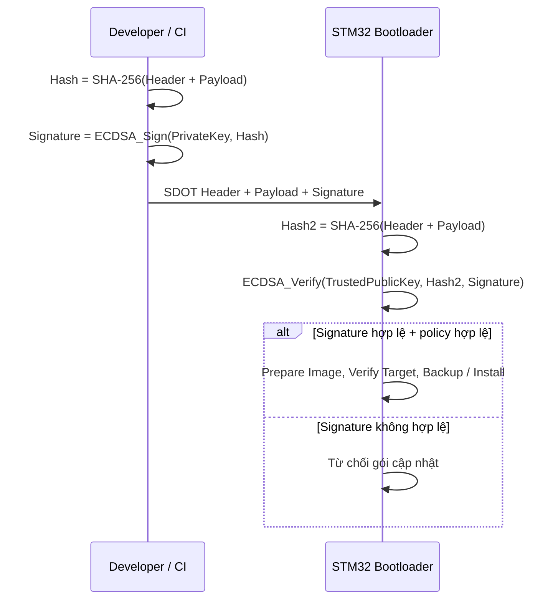

#### A.5.5. Trust Anchor, Key Provisioning, Key ID, Anti-rollback

- **Trust Anchor** là mốc tin cậy gốc mà thiết bị sử dụng để quyết định chữ ký nào được phép. Trong project đó là **Trusted Public Key** được provision ở phía Bootloader, **không phải public key gửi kèm một gói mạng bất kỳ**.
- **Key Provisioning** là bước cấu hình/nạp khóa tin cậy vào firmware/thiết bị trước khi xác thực bản phát hành. Bản repository mặc định **chưa provision khóa production** (`TRUSTED_KEY_PROVISIONED = 0`); không được suy ra thiết bị production đã sẵn sàng chỉ vì code có ECDSA.
- **Key ID** là mã định danh khóa để chọn/đối chiếu khóa cấu hình; **Key ID một mình không phải chữ ký** và không tạo ra sự tin cậy.
- **Anti-rollback / Anti-downgrade** là chính sách **ngăn cài phiên bản thấp hơn mức cho phép**. Khác với **Rollback** (khôi phục bản Backup cũ đã được chấp nhận nếu bản thử nghiệm không chạy tốt).
- **Signed OTA ≠ hardware Secure Boot / encryption:** Hệ thống xác minh gói cập nhật trước Install, nhưng không đồng nghĩa có **hardware Root of Trust bất biến**, chống đọc Flash vật lý hoặc mã hóa payload SDOT.

<a id="phu-luc-a-6"></a>
### A.6. State Machine, lưu trạng thái bền vững và phục hồi

#### A.6.1. State Machine, Metadata và Boot Decision

- **Finite State Machine (FSM)** là mô hình có **tập trạng thái hữu hạn** và điều kiện chuyển trạng thái rõ ràng. Trong OTA, các trạng thái như `UPDATE_VERIFYING_CONTAINER`, `UPDATE_PATCHING`, `UPDATE_INSTALLING`, `UPDATE_TRIAL_BOOT` giúp hạn chế thao tác sai thứ tự.
- **Metadata** là **thông tin điều khiển** được lưu bền vững: `state`, `active_version`, `pending_version`, `active_update_id`, `boot_attempts`, `copy_offset`, `generation`, `crc32`... **Không phải** toàn bộ bytes firmware.
- **Boot Decision** là logic biến Metadata + điều kiện hệ thống thành hành động tiếp theo: boot Application, xử lý SDOT, Resume Install, Rollback, hay Stay Recovery.
- **Metadata A/B** là **hai bản lưu độc lập**, được cập nhật luân phiên. Bản mới chỉ được chấp nhận sau khi ghi và Verify; nếu mất nguồn giữa commit, bản cũ vẫn có thể hợp lệ. **CRC32** kiểm tra record, còn **generation** cho biết bản hợp lệ nào mới hơn.

#### A.6.2. Atomicity, Commit, Checkpoint và Idempotency

- **Atomicity (tính nguyên tử)** là ý tưởng một cập nhật trạng thái hoặc **hoàn tất**, hoặc **không được xem là đã hoàn tất**. Flash không tự làm mọi thao tác ghi nhiều byte thành atomic; thiết kế A/B, record validation và thứ tự commit tạo ra *hiệu ứng commit an toàn trước mất nguồn*.
- **Checkpoint** là **mốc tiến độ đã lưu và xác minh bền vững**, chẳng hạn offset theo sector W25Q **4 KiB** khi nhận/backup, hay theo trang STM32 Internal Flash **1 KiB** lúc cài đặt. Chỉ Checkpoint sau khi đơn vị đó hoàn tất/Verify.
- **Idempotency** nghĩa là chạy lại một thao tác nhiều lần không làm sai kết quả so với một lần (trong điều kiện thiết kế cho phép). Ví dụ: sau mất nguồn giữa Install, xóa và ghi lại **trang chưa Checkpoint** từ image hợp lệ, thay vì tiếp tục vào giữa dữ liệu dở.
- **Power-loss Recovery** là đọc Metadata/Checkpoint sau reset để **tiếp tục hoặc làm lại bước an toàn**. Nó khác với **Rollback**: Recovery xử lý thao tác dang dở, Rollback **khôi phục Application Backup**.

#### A.6.3. Trial Boot, Confirm, Rollback, Watchdog và Fault Injection

- **Backup Image:** Bản sao Application đã xác nhận trước đó, lưu trên W25Q **trước khi** ghi đè Internal Flash, được dùng cho Rollback.
- **Trial Boot:** Khởi động **candidate firmware** để quan sát khả năng chạy. **Install thành công ≠ Confirm thành công**; `active_version` vẫn là bản đã xác nhận trước khi đóng Trial.
- **Confirm:** Application đánh dấu phiên bản mới đã đạt điều kiện kiểm tra; Bootloader finalize trạng thái thành phiên bản được chấp nhận. Trong demo, điểm xác nhận khoảng **750 ms main loop** chỉ kiểm tra khả năng chạy cơ bản, **chưa phải full health check**.
- **Rollback:** Khôi phục Backup hợp lệ khi firmware Trial không được xác nhận sau giới hạn; project giới hạn **3 lần Trial Boot**.
- **IWDG (Independent Watchdog):** Bộ đếm độc lập có thể **reset MCU** nếu phần mềm không phục vụ trong thời gian cho phép. Watchdog **không trực tiếp thực hiện Rollback**: nó tạo reset, còn Bootloader đọc trạng thái/attempts để quyết định.
- **Fault Injection:** Chủ động gây lỗi tại điểm xác định (mất nguồn, cắt dữ liệu, chữ ký bị sửa...) để thử các invariant của hệ thống. **HIL (Hardware-in-the-Loop)** dùng phần cứng thật trong chu trình kiểm thử; kết quả **9/9 scenario PASS** là bằng chứng trong phạm vi 9 kịch bản đó, **không phải bảo đảm tuyệt đối**.

**Học kỹ:** [3 – Boot State Machine](#phan-3) · [5 – Phân tích State Machine](#phan-5) · [6.9 – Metadata & Recovery](#chuong-6-9) · [6.10 – Watchdog & Testing](#chuong-6-10).

<a id="phu-luc-a-7"></a>
### A.7. Ba ví dụ nhỏ để hiểu thuật toán (minh họa, không phải mã nguồn repo)

#### Ví dụ 1 — CRC32: cùng dữ liệu phải cho cùng kết quả

Với biến thể chuẩn **CRC-32/ISO-HDLC (còn gọi CRC-32/IEEE)**, chuỗi ASCII `123456789` có CRC **`0xCBF43926`**. Giá trị đó phụ thuộc **chính xác** vào bộ tham số CRC: polynomial `0x04C11DB7`, init `0xFFFFFFFF`, reflected input/output và XOR cuối `0xFFFFFFFF`. Đổi tham số thì kết quả CRC có thể khác, dù dữ liệu giống nhau. Khi giải thích một hàm `CRC32_*` trong code, cần kiểm tra bộ tham số thực tế thay vì mặc định mọi CRC32 đều cùng cấu hình.

```text
Sender:   bytes → CRC32(parameters) → gửi bytes + crc
Receiver: bytes → CRC32(parameters) → so sánh với crc nhận được
                                    ├─ Khác → lỗi dữ liệu
                                    └─ Trùng → không phát hiện lỗi (CHƯA xác thực nguồn gửi)
```

#### Ví dụ 2 — SHA-256: "abc" có digest 32 byte

```text
SHA-256("abc") =
ba7816bf8f01cfea414140de5dae2223b00361a396177a9cb410ff61f20015ad
```

Khi thay đổi chỉ một byte của input, digest thường thay đổi rất mạnh (avalanche effect). **Không** thể lấy digest này làm bằng chứng chữ ký; bất kỳ ai cũng có thể băm dữ liệu. Khi dùng SHA-256 trong OTA, digest mong đợi phải được bảo vệ bởi chữ ký hoặc một mốc tin cậy khác.

#### Ví dụ 3 — ECDSA: vì sao không thể chỉ gửi hash?

```text
Developer: firmware.bin → SHA-256 → digest
Developer: ECDSA_Sign(private_key, digest) → (r, s)

STM32: nhận firmware + signature
STM32: SHA-256(firmware / signed_region) → digest2
STM32: ECDSA_Verify(trusted_public_key, digest2, (r, s)) → PASS / FAIL
```

Kẻ tấn công có thể tạo một file firmware khác và băm lại nó, nhưng **không thể giả mạo chữ ký hợp lệ** nếu không có Private Key và các giả định mật mã/triển khai được giữ. Với project, firmware không được ký trực tiếp như sơ đồ tối giản mà là **vùng `Header 140 B + Payload SDOT`**; Bootloader xác minh SDOT trước khi quyết định cài đặt.

<a id="phu-luc-a-8"></a>
### A.8. Những cặp khái niệm rất dễ bị hỏi nhầm khi phỏng vấn

| Dễ nhầm | Khác nhau ở điểm cốt lõi |
|---|---|
| **CRC32 vs SHA-256** | CRC32 phát hiện lỗi ngoài ý muốn; SHA-256 là hash mật mã nhưng **đứng một mình vẫn không xác thực tác giả**. |
| **SHA-256 vs ECDSA** | SHA-256 tạo digest; ECDSA dùng khóa để ký/xác minh digest của dữ liệu đã xác định. |
| **Digital Signature vs Encryption** | Signature xác thực nội dung/nguồn ký; encryption bảo vệ tính bí mật của dữ liệu. |
| **Public Key vs Private Key** | Private Key chỉ phía ký giữ; Public Key tin cậy được Bootloader dùng để Verify. |
| **COBS vs CRC32** | COBS tạo biên frame; CRC32 phát hiện frame có byte lỗi. |
| **UART vs SPI** | UART không có dây clock riêng; SPI dùng clock do master tạo và đường CS chọn slave. |
| **MQTTS vs HTTPS** | MQTTS điều khiển/thông báo; HTTPS tải gói SDOT. |
| **SDOT vs Manifest** | SDOT chứa payload cập nhật đã ký; Manifest mô tả các gói cập nhật của bản phát hành. |
| **Full OTA vs Delta OTA** | Full mang cả target; Delta cần exact base + patch. |
| **JojoDiff vs JANPatch** | JojoDiff **tạo** patch trên host; JANPatch **áp dụng** patch phía thiết bị. |
| **Firmware Image vs Gói SDOT** | Firmware Image là binary hoàn chỉnh để chạy; SDOT là container vận chuyển/cập nhật. |
| **ACK vs Checkpoint** | ACK phản ánh xử lý packet trong phiên hiện tại; Checkpoint là tiến độ đã lưu qua reset. |
| **Retry vs Resume** | Retry gửi lại packet/lệnh; Resume tiếp tục cập nhật qua gián đoạn bằng Checkpoint. |
| **FINISH vs INSTALL** | FINISH xác nhận nhận đủ gói; INSTALL mới commit Metadata và reset sang Bootloader. |
| **Power-loss Recovery vs Rollback** | Recovery tiếp tục/làm lại bước dở; Rollback khôi phục firmware đã sao lưu. |
| **Anti-rollback vs Rollback** | Anti-rollback là chính sách phiên bản; Rollback là hành động phục hồi khi candidate lỗi. |
| **SPI BSY vs W25Q WIP** | BSY là trạng thái ngoại vi SPI STM32; WIP là tiến độ Program/Erase **bên trong chip W25Q**. |
| **Trial Boot vs Confirm** | Trial chỉ chạy thử; Confirm mới chấp nhận chính thức firmware mới. |
| **Secure OTA vs Hardware Secure Boot** | Xác thực gói OTA chưa mặc nhiên tạo Root of Trust phần cứng bất biến. |

**Nguồn đối chiếu implementation:** [README](https://github.com/haikevins/secure-delta-ota-bootloader) · [SDOT Container](https://github.com/haikevins/secure-delta-ota-bootloader/blob/main/docs/firmware-container.md) · [UART Protocol](https://github.com/haikevins/secure-delta-ota-bootloader/blob/main/docs/uart-ota-protocol.md) · [External SPI Flash](https://github.com/haikevins/secure-delta-ota-bootloader/blob/main/docs/external-spi-flash.md) · [Metadata / Boot Decision](https://github.com/haikevins/secure-delta-ota-bootloader/blob/main/docs/metadata-and-boot-decision.md) · [Release Process](https://github.com/haikevins/secure-delta-ota-bootloader/blob/main/docs/release-process.md) · [Boot State Machine](https://github.com/haikevins/secure-delta-ota-bootloader/blob/main/docs/boot-state-machine.md).

---

### Quy ước thuật ngữ

> Toàn bộ tài liệu áp dụng chung **[bảng thuật ngữ chuẩn tại Phụ lục A.0](#phu-luc-a-0)**. Tên hàm, trường dữ liệu, enum trạng thái `UPDATE_*`, câu lệnh và đường dẫn trong repository được giữ nguyên, không dịch hay đổi tên.

- **Gói SDOT** là gói cập nhật đã đóng gói và ký; **Target Image** là firmware đích hoàn chỉnh; **Reconstructed Image** là vùng trên W25Q dùng để chứa image đã chuẩn bị. Đây là ba đối tượng khác nhau.
- **Metadata** lưu trạng thái và thông tin điều khiển cập nhật; **Checkpoint** lưu mốc tiến độ an toàn. **Internal Flash Metadata A/B** khác với vùng Metadata/Checkpoint của **External Flash W25Q**.
- **Power-loss Recovery** tiếp tục hoặc làm lại thao tác bị gián đoạn; **Rollback** phục hồi **Backup Image**. **Anti-rollback** là chính sách ngăn cài phiên bản cũ không được phép, không phải Rollback.
- **CRC32** phát hiện lỗi dữ liệu; **SHA-256** tạo hash mật mã; **ECDSA P-256** xác minh chữ ký với **Trusted Public Key**. Chỉ có hash không xác thực được nguồn phát hành.

---

<a id="phan-1"></a>
## Phần 1. Trình bày Project

### 1.1. Giới thiệu tổng quan

Dạ, project đầu tiên của em là **Secure Delta OTA Bootloader**, được phát triển trên **STM32F103** kết hợp với **ESP32 Gateway**.

Mục tiêu của project là cho phép cập nhật firmware từ xa một cách an toàn, đồng thời giảm dung lượng dữ liệu truyền khi cập nhật bằng cơ chế **Delta OTA**.

### 1.2. Kiến trúc và cách hoạt động

Về kiến trúc, **ESP32** đóng vai trò Gateway, kết nối với server để tải firmware, sau đó truyền xuống STM32 thông qua **UART**.

Trên STM32, **Application** tiếp nhận dữ liệu cập nhật và lưu vào **External Flash W25Q** thông qua **SPI**.

Sau đó, **Bootloader** sẽ xác thực firmware, xử lý bản cập nhật, sao lưu firmware cũ và cài đặt firmware mới vào **Internal Flash**.

### 1.3. Công việc thực hiện

Trong project này, em triển khai hai cơ chế là **Full OTA** và **Delta OTA**.

Với Delta OTA, hệ thống chỉ truyền phần thay đổi giữa hai phiên bản firmware, sau đó tái tạo firmware mới từ bản cũ.

Em sử dụng **ECDSA P-256** kết hợp **SHA-256** để xác thực và kiểm tra tính toàn vẹn của firmware, đồng thời triển khai cơ chế chống cập nhật xuống phiên bản cũ không được phép.

### 1.4. Khó khăn và cách giải quyết

Một khó khăn lớn trong project là xử lý trường hợp thiết bị mất nguồn khi đang cập nhật, khiến firmware có thể bị ghi chưa hoàn chỉnh.

Để giải quyết, em sử dụng **State Machine** kết hợp **Metadata** và **Checkpoint**, giúp Bootloader khôi phục quá trình cập nhật sau khi khởi động lại.

Ngoài ra, em triển khai cơ chế **Rollback** để khôi phục firmware đã sao lưu nếu phiên bản mới không hoạt động đúng.

### 1.5. Kết quả đạt được

Kết quả thử nghiệm với **GCC** cho thấy Delta OTA giảm khoảng **85,3%** dung lượng dữ liệu cập nhật so với Full OTA.

Hệ thống cũng ghi nhận **9/9 kịch bản kiểm thử trên phần cứng thành công**, bao gồm các tình huống mất nguồn và cập nhật thất bại.

Qua project này, em hiểu rõ hơn về Bootloader, quản lý bộ nhớ Flash, giao tiếp UART, SPI và cách xây dựng hệ thống cập nhật firmware an toàn.

---

<a id="phan-2"></a>
## Phần 2. Trình bày System Architecture

### 2.1. Bài nói khi phỏng vấn

Dạ, về **System Architecture**, hệ thống của em gồm **Developer/CI**, **Release Server**, **ESP32 Gateway**, **STM32 Application** và **STM32 Bootloader**. Em tách luồng **phát hành và truyền dữ liệu** khỏi luồng **xác thực và cài đặt firmware**.

- **Developer/CI** build firmware, tạo gói **Full OTA** hoặc **Delta OTA**, đóng gói theo định dạng **SDOT**, ký bằng **ECDSA P-256** và tạo **Manifest**. Các gói cập nhật được triển khai lên **Release Server**.

- **Release Server** sử dụng **MQTTS** để gửi lệnh cập nhật và **HTTPS** để cung cấp gói SDOT. **ESP32 Gateway** nhận lệnh, tải gói qua HTTPS, kiểm tra kích thước và CRC32 rồi lưu vào Flash cache.

- ESP32 truyền SDOT đến **STM32 Application** qua **UART**, sử dụng **COBS** để đóng khung và **CRC32** để phát hiện lỗi. Application lưu gói vào **External Flash W25Q** thông qua **SPI**. Sau khi `FINISH` xác nhận nhận đủ dữ liệu, lệnh `INSTALL` mới khiến Application ghi **Metadata** và reset để bàn giao cho Bootloader.

- **STM32 Bootloader** đọc Metadata, xác thực chữ ký **ECDSA P-256** và hash **SHA-256**. Nếu là **Delta OTA**, Bootloader kiểm tra firmware gốc rồi tái tạo firmware mới. Sau đó, Bootloader sao lưu firmware hiện tại, cài bản mới vào **Internal Flash** và kiểm tra lại.

- Bootloader cho Application mới chạy ở chế độ **Trial Boot**. Nếu Application xác nhận thành công thì chấp nhận bản cập nhật; nếu không, Bootloader có thể **Rollback** từ bản sao lưu. **Metadata và Checkpoint** hỗ trợ tiếp tục các bước cập nhật an toàn sau mất nguồn hoặc reset bất ngờ.

### 2.2. System Architecture Diagram

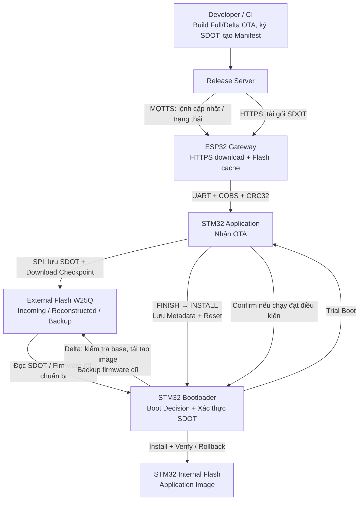

---

<a id="phan-3"></a>
## Phần 3. Trình bày Boot State Machine

### 3.1. Bài nói khi phỏng vấn

Dạ, về **Boot State Machine**, em sử dụng các trạng thái được lưu trong **Metadata** để STM32 Bootloader quyết định hành động sau mỗi lần khởi động, kể cả khi mất nguồn hoặc reset bất ngờ.

- Ban đầu hệ thống ở `IDLE`. Khi ESP32 Gateway bắt đầu truyền, STM32 Application chuyển sang `RECEIVING`. Nhận đủ gói SDOT và kiểm tra CRC32 thành công thì bộ nhận đạt `ARTIFACT_READY`. Sau lệnh `INSTALL`, Application lưu trạng thái vào Metadata rồi reset.

- STM32 Bootloader đọc Metadata, chuyển sang `VERIFYING_CONTAINER` để xác thực gói SDOT bằng ECDSA P-256 và SHA-256. Với Delta OTA, Bootloader kiểm tra firmware gốc ở `VERIFYING_BASE` trước khi tái tạo firmware trong `PATCHING`. Với Full OTA, Bootloader bỏ qua `VERIFYING_BASE` nhưng vẫn đi qua `PATCHING` để chuẩn bị firmware mới. Khi hợp lệ, hệ thống chuyển sang `IMAGE_READY`.

- Bootloader chuyển qua `BACKING_UP` để sao lưu firmware hiện tại, rồi `INSTALLING` để ghi firmware mới vào Internal Flash. Sau đó, `VERIFYING_INSTALL` kiểm tra lại dữ liệu đã cài đặt.

- Bootloader chuyển sang `TRIAL_BOOT` để chạy STM32 Application mới. Nếu Application xác nhận thành công, hệ thống qua `CONFIRMED` rồi về `IDLE`. Nếu không xác nhận sau số lần thử cho phép, Bootloader chuyển sang `ROLLBACK` để khôi phục firmware đã sao lưu.

Ngoài ra, **Metadata và Checkpoint** giúp hệ thống tiếp tục Backup, Install hoặc Rollback từ tiến độ an toàn sau khi mất nguồn.

### 3.2. Boot Diagram

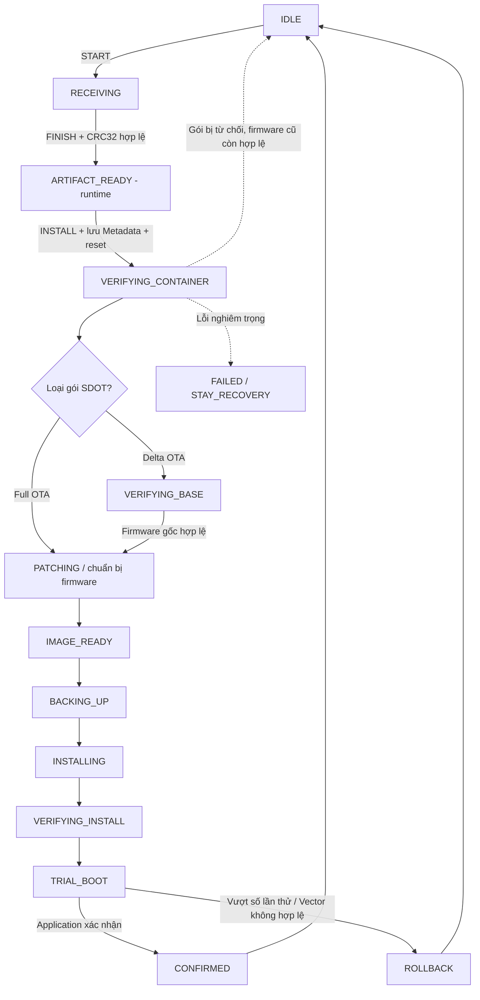

---

<a id="phan-4"></a>
## Phần 4. Phân tích chi tiết System Architecture

<a id="luong-1"></a>
### 4.1. Developer/CI → Release Server

> **Tình huống minh họa:** STM32 đang chạy firmware **v1** và Developer muốn cập nhật lên **v2**.

#### Sơ đồ luồng hoạt động

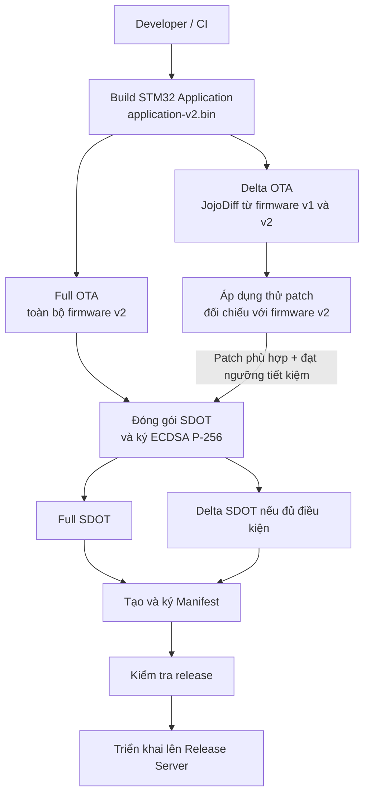

#### Bước 1. Developer/CI build firmware

Developer chỉnh sửa mã nguồn **STM32 Application** rồi build để tạo file binary firmware mới, ví dụ **`application-v2.bin`**. Đây là firmware dự kiến được cài đặt vào vùng Application của **STM32 Internal Flash**.

**CI (Continuous Integration)** có thể tự động hóa các công việc **build, kiểm tra và chuẩn bị bản phát hành**. Trong luồng này, Developer/CI là phía **tạo firmware**, chưa phải phía phân phối firmware đến thiết bị.

#### Bước 2. Tạo Full OTA và Delta OTA

Từ firmware mới, release tooling chuẩn bị các gói cập nhật tương ứng:

| Tiêu chí | Full OTA | Delta OTA |
|---|---|---|
| Nội dung | Toàn bộ firmware **v2** | Delta Patch từ **v1 → v2** |
| Dữ liệu cần để tạo | Firmware **v2** | Firmware **v1** và **v2** chính xác |
| Dung lượng | Thường lớn hơn | Có thể nhỏ hơn đáng kể |

Đối với **Delta OTA**, công cụ dùng **JojoDiff** để tạo Delta Patch, sau đó **áp dụng thử patch lên firmware v1** và so sánh kết quả với firmware v2 để kiểm tra tính đúng đắn.

Repository luôn tạo **Full OTA**, nhưng chỉ đưa **Delta OTA** vào release khi mức tiết kiệm đạt ngưỡng cấu hình, mặc định **20%**.

> **Ghi nhớ:** Delta Patch phụ thuộc vào **firmware gốc**. Khi cài đặt, STM32 Bootloader vẫn phải kiểm tra firmware gốc có đúng với bản được dùng để tạo patch hay không.

#### Bước 3. Đóng gói và ký số SDOT

Cả hai loại dữ liệu cập nhật được đóng gói theo định dạng **SDOT (Secure Delta OTA Container)**.

**Cấu trúc cơ bản của SDOT Container:**

```text
+-----------------------------+
| Header                      |
| - Firmware type             |
| - Base version              |
| - Target version            |
| - Base SHA-256              |
| - Target SHA-256            |
| - Product ID                |
+-----------------------------+
| Payload                     |
| Full firmware / Delta Patch |
+-----------------------------+
| ECDSA P-256 Signature       |
+-----------------------------+
```

Hệ thống dùng **SHA-256** để tạo các giá trị hash phục vụ kiểm tra tính toàn vẹn và **ECDSA P-256** để ký số SDOT bằng **private key**.

> **Ghi nhớ:** **Private key** được sử dụng ở phía phát hành firmware, **không truyền xuống ESP32 Gateway hoặc STM32**. Chữ ký SDOT sẽ được STM32 Bootloader xác thực trước khi cài đặt.

#### Bước 4. Tạo và ký số Manifest

Sau khi chuẩn bị các gói **SDOT**, release tooling tạo **`manifest.json`** để mô tả bản phát hành.

Manifest chứa các thông tin như:

- Phiên bản firmware mới.
- **Product ID** và **hardware revision**.
- Thông tin các gói **Full OTA / Delta OTA**.
- Kích thước và **SHA-256** của từng gói cập nhật.
- Đường dẫn tải gói cập nhật (**URL**).
- Thông tin khóa ký.

Manifest cũng được ký bằng **ECDSA**; chữ ký được lưu trong **`manifest.json.sig`**.

> **Phân biệt SDOT và Manifest:** **SDOT** chứa firmware hoặc Delta Patch đã ký số; **Manifest** mô tả thông tin bản phát hành và các gói cập nhật để hệ thống biết gói nào đang được cung cấp.

#### Bước 5. Kiểm tra và chuyển bản phát hành sang Release Server

Thư mục release có cấu trúc minh họa như sau:

```text
dist/releases/fw-v2/
│
├── application-v2.bin
├── application-v2.full.sdot
├── application-v1-to-v2.delta.sdot
│
├── manifest.json
├── manifest.json.sig
├── signing-public.pem
├── checksums.txt
└── release-notes.md
```

Sau khi tạo release, công cụ **kiểm tra tính hợp lệ của các file**. Bộ release được **triển khai lên Release Server** để sử dụng cho bước phân phối tiếp theo.

Release Server sử dụng bộ release đã triển khai để:

- Xác minh **Manifest** và các gói cập nhật theo thông tin bảo mật tương ứng.
- Cung cấp các gói SDOT qua **HTTPS**.
- Chuẩn bị thông báo cập nhật qua **MQTTS**.

> **Lưu ý:** Việc **tạo và xác minh thư mục release** không đồng nghĩa với việc công cụ release tự động upload dữ liệu lên máy chủ từ xa. Triển khai release lên server là một bước riêng.

#### Bài nói khi phỏng vấn: Developer/CI và Release Server

> **Developer/CI → Release Server:** Đầu tiên, Developer/CI sẽ build STM32 Application để tạo file firmware mới dạng binary.
>
> Tiếp theo, công cụ release chuẩn bị gói cập nhật Full OTA từ toàn bộ firmware mới. Với Delta OTA, hệ thống sử dụng JojoDiff để tạo Delta Patch từ firmware cũ sang firmware mới, sau đó áp dụng thử Patch để kiểm tra khả năng tái tạo chính xác.
>
> Sau đó, các gói cập nhật được đóng gói theo định dạng SDOT và ký số bằng ECDSA P-256. Hệ thống cũng tạo và ký Manifest chứa thông tin phiên bản, kích thước, hash và đường dẫn đến các gói SDOT.
>
> Cuối cùng, công cụ release kiểm tra các file đã tạo. Bộ release hợp lệ được triển khai lên Release Server để xác minh và phân phối cho thiết bị. Như vậy, Developer/CI chịu trách nhiệm tạo và ký gói cập nhật, còn Release Server chịu trách nhiệm phân phối.

#### Câu hỏi ôn tập: Developer/CI → Release Server

| Câu hỏi | Ý chính cần trả lời |
|---|---|
| CI là gì? | Hệ thống tự động hóa build, kiểm thử và chuẩn bị release. |
| Tại sao cần firmware v1 khi tạo Delta OTA? | Vì JojoDiff tạo patch từ sự khác biệt giữa firmware v1 và v2. |
| Tại sao phải áp dụng thử Delta Patch? | Để kiểm tra patch có tái tạo đúng firmware v2 từ firmware v1 hay không. |
| Tại sao vẫn tạo Full OTA? | Để có gói cập nhật đầy đủ khi Delta OTA không phù hợp hoặc không đạt ngưỡng tiết kiệm. |
| SDOT Container dùng để làm gì? | Đóng gói dữ liệu cập nhật cùng thông tin xác thực và chữ ký số. |
| ECDSA P-256 dùng để làm gì? | Ký và xác thực dữ liệu cập nhật bằng cặp private key/public key phù hợp. |
| SHA-256 dùng để làm gì? | Tạo và kiểm tra hash để xác minh tính toàn vẹn của dữ liệu. |
| Manifest khác SDOT ở điểm nào? | Manifest mô tả bản phát hành; SDOT chứa Full Firmware hoặc Delta Patch đã ký số. |
| Release Server có tạo firmware không? | Không. Developer/CI và release tooling tạo các tệp cập nhật; server xác minh và phân phối. |
| Release Server có cần private key ký firmware không? | Không cần private key ký firmware để xác minh và phân phối release. |

#### Điểm cần ghi nhớ

- **Developer/CI tạo các tệp cập nhật; Release Server phân phối**. Kiểm tra release tại máy build không đồng nghĩa đã tự động upload lên server.
- **Full OTA** có firmware đích hoàn chỉnh; **Delta OTA** dùng patch từ đúng firmware gốc và phải được kiểm tra khả năng tái tạo.
- **SDOT khác Manifest:** SDOT chứa dữ liệu cập nhật đã ký số; Manifest mô tả release và các gói cập nhật.
- **Private key** ở phía phát hành; STM32 Bootloader dùng public key tin cậy để kiểm tra chữ ký trước cài đặt.

**Tài liệu/code đối chiếu:** `docs/release-process.md`, `tools/release.py`, `tools/secure_container.py`.

---

<a id="luong-2"></a>
### 4.2. Release Server → ESP32 Gateway

> **Mục tiêu:** Hiểu cách Release Server **xác minh và lựa chọn gói cập nhật SDOT**, thông báo cập nhật bằng **MQTTS**, và cách ESP32 Gateway tải gói đó bằng **HTTPS** trước khi truyền xuống STM32 Application.
>
> **Phân biệt hai giao thức:** **MQTTS** dùng để gửi lệnh cập nhật và trao đổi trạng thái; **HTTPS** dùng để tải nội dung gói cập nhật SDOT. Firmware không được truyền trực tiếp trong thông điệp MQTTS.

#### Sơ đồ luồng hoạt động

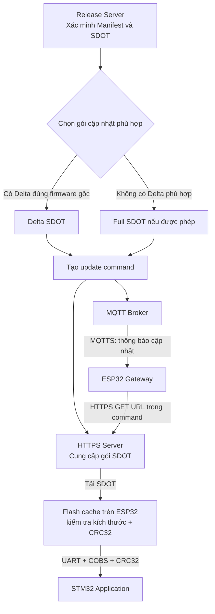

#### Bước 1. Release Server xác minh bản phát hành

Sau khi Developer/CI tạo các gói cập nhật **SDOT** và **Manifest**, Release Server sử dụng bộ release đã được triển khai để kiểm tra dữ liệu trước khi phân phối.

Các kiểm tra được mô tả trong hệ thống gồm tính hợp lệ của **chữ ký Manifest**, chữ ký và Metadata của gói SDOT, cùng các thông tin về **kích thước**, **CRC32** và **SHA-256** theo định dạng tương ứng.

> **Ghi nhớ:** Việc Release Server xác minh bản phát hành **không thay thế** việc STM32 Bootloader xác thực chữ ký SDOT trước khi cài đặt.

#### Bước 2. Release Server chọn Full OTA hoặc Delta OTA

Release Server dựa trên **phiên bản firmware hiện tại** được cung cấp khi yêu cầu phát hành lệnh cập nhật để lựa chọn gói phù hợp:

| Điều kiện | Quyết định |
|---|---|
| Có Delta OTA được tạo cho đúng firmware gốc | Ưu tiên Delta OTA. |
| Không có Delta OTA phù hợp | Dùng Full OTA nếu bản phát hành cho phép. |
| Thiết bị không cần cập nhật | Không phát hành lệnh cập nhật. |

**Ví dụ:** STM32 đang chạy **v1**, Release Server có **v2**; nếu bản phát hành chứa Delta Patch từ **v1 → v2**, Server có thể chọn gói Delta OTA thay vì Full OTA.

> **Lưu ý:** Lựa chọn của Server là bước phân phối. STM32 Bootloader vẫn phải kiểm tra điều kiện phiên bản và **firmware gốc (exact-base validation)** trước khi áp dụng Delta Patch.

#### Bước 3. Release Server gửi lệnh cập nhật qua MQTTS

Sau khi chọn gói cập nhật, Release Server tạo thông báo cập nhật để gửi qua **MQTT Broker** bằng kết nối **MQTTS**. ESP32 Gateway subscribe topic tương ứng để nhận lệnh.

**Ví dụ JSON minh họa các trường chính** (giá trị minh họa, không phải payload thực tế của một bản phát hành):

```json
{
  "schema": 1,
  "cmd": "update",
  "update_id": 12345,
  "target_version": 2,
  "size": 1174,
  "crc32": 123456789,
  "url": "https://firmware.example/releases/fw-v2/update.sdot"
}
```

| Trường | Ý nghĩa |
|---|---|
| `cmd` | Loại lệnh, ví dụ lệnh cập nhật. |
| `update_id` | Định danh của quá trình cập nhật. |
| `target_version` | Phiên bản firmware đích. |
| `size` | Kích thước gói SDOT cần tải. |
| `crc32` | CRC32 của gói SDOT, dùng phát hiện lỗi dữ liệu. |
| `url` | Đường dẫn HTTPS để ESP32 tải gói SDOT. |

Lệnh cập nhật trong repository sử dụng **MQTT QoS 1**. QoS 1 có thể dẫn đến gửi lại thông điệp, vì vậy các thành phần nhận lệnh cần xử lý trường hợp trùng lặp phù hợp.

#### Bước 4. ESP32 Gateway tải gói SDOT qua HTTPS

Khi nhận được lệnh cập nhật, ESP32 Gateway kiểm tra thông tin lệnh rồi thực hiện **HTTPS GET** tới địa chỉ trong trường `url`.

Trong quá trình tải, ESP32 kiểm tra kết nối **TLS**, phản hồi **HTTP**, kích thước nội dung và giới hạn bộ nhớ lưu trữ. Nội dung nhận về là **gói cập nhật SDOT**, không phải lệnh MQTTS.

#### Bước 5. ESP32 kiểm tra, lưu gói và chuẩn bị truyền qua UART

ESP32 lưu dữ liệu tải được vào vùng **Flash cache** của Gateway. Sau khi hoàn tất, ESP32 kiểm tra **kích thước** và **CRC32** của gói SDOT; chỉ khi cache hợp lệ mới tiếp tục giai đoạn truyền sang STM32 Application qua **UART**.

ESP32 có thể gửi thông tin **tiến độ/trạng thái** về hệ thống qua MQTT. Trong khi đó, bước **xác thực chữ ký ECDSA P-256 và SHA-256 để quyết định cài đặt** vẫn thuộc về STM32 Bootloader.

> **Phân biệt Manifest và gói SDOT:** Release Server dùng **Manifest** để biết thông tin bản phát hành, còn ESP32 Gateway nhận **URL trực tiếp đến gói SDOT** trong lệnh MQTTS. Luồng OTA hiện tại không yêu cầu ESP32 tải và tự phân tích Manifest để chọn gói cập nhật.

#### Bài nói khi phỏng vấn: Release Server và ESP32 Gateway

> **Release Server → ESP32 Gateway:** Sau khi bộ release được triển khai, Release Server xác minh Manifest và các gói cập nhật SDOT trước khi phân phối.
>
> Đầu tiên, dựa trên thông tin phiên bản firmware hiện tại, Server sẽ ưu tiên lựa chọn Delta OTA nếu có gói phù hợp; nếu không, Server sử dụng Full OTA.
>
> Tiếp theo, Server gửi lệnh cập nhật đến ESP32 Gateway qua MQTTS. Lệnh này chứa các thông tin như phiên bản đích, kích thước, CRC32 và đường dẫn HTTPS của gói SDOT.
>
> Khi nhận được lệnh, ESP32 Gateway sử dụng HTTPS để tải gói SDOT và lưu dữ liệu vào Flash cache. Sau khi tải xong, ESP32 kiểm tra kích thước và CRC32 để đảm bảo dữ liệu đã nhận đầy đủ trước khi truyền xuống STM32 Application.
>
> Như vậy, **MQTTS** được sử dụng để gửi lệnh cập nhật, còn **HTTPS** được sử dụng để tải dữ liệu. Việc xác thực chữ ký firmware trước khi cài đặt vẫn do STM32 Bootloader thực hiện.

#### Câu hỏi ôn tập: Release Server → ESP32 Gateway

| Câu hỏi | Ý chính cần trả lời |
|---|---|
| Vì sao sử dụng cả MQTTS và HTTPS? | MQTTS dùng để gửi lệnh/trạng thái; HTTPS dùng để tải dữ liệu firmware. |
| Ai quyết định chọn Full OTA hay Delta OTA? | Release Server chọn gói cập nhật phù hợp theo thông tin phiên bản và release. |
| ESP32 có cần tải Manifest không? | Không bắt buộc trong luồng hiện tại; URL gói SDOT được gửi trong lệnh MQTTS. |
| ESP32 kiểm tra gói SDOT bằng gì? | Kiểm tra kích thước và CRC32 sau khi tải. |
| ESP32 có xác thực chữ ký ECDSA thay STM32 không? | Không; STM32 Bootloader là thành phần xác thực và quyết định cài đặt. |
| Tại sao phải lưu vào Flash cache? | Để có gói SDOT hoàn chỉnh, đã kiểm tra, trước khi truyền xuống STM32 qua UART. |
| MQTT QoS 1 nghĩa là gì? | Đảm bảo gửi ít nhất một lần; có thể có thông điệp trùng. |

#### Điểm cần ghi nhớ

- **MQTTS dùng cho lệnh/trạng thái; HTTPS dùng để tải SDOT**. Không truyền toàn bộ firmware trong lệnh MQTT.
- **Release Server** chọn gói phù hợp với phiên bản được cung cấp; **STM32 Bootloader** vẫn phải tự kiểm tra phiên bản và firmware gốc khi cài đặt.
- **ESP32 Gateway** tải và lưu SDOT vào Flash cache, kiểm tra kích thước và CRC32 trước khi truyền xuống STM32.
- **CRC32 không phải chữ ký số**; việc xác thực ECDSA P-256 và hash bảo mật khi quyết định cài đặt thuộc STM32 Bootloader.

**Tài liệu/code đối chiếu:** `server/README.md`, `gateway-esp32/README.md`, `server/app/services/firmware_service.py`.

---

<a id="luong-3"></a>
### 4.3. ESP32 Gateway → STM32 Application

> **Mục tiêu:** Hiểu cách **ESP32 Gateway** truyền gói cập nhật **SDOT** xuống **STM32 Application** qua **UART**, cách STM32 lưu dữ liệu vào **External Flash W25Q** qua **SPI**, và cách hệ thống xử lý lỗi truyền, **Retry**, **Resume** trước khi bàn giao cho **STM32 Bootloader**.
>
> **Phân chia trách nhiệm:** **STM32 Application** nhận, kiểm tra và lưu **gói cập nhật SDOT**; **STM32 Bootloader** xác thực chữ ký, xử lý Full/Delta OTA và cài đặt **firmware mới** vào Internal Flash.

#### Sơ đồ luồng hoạt động

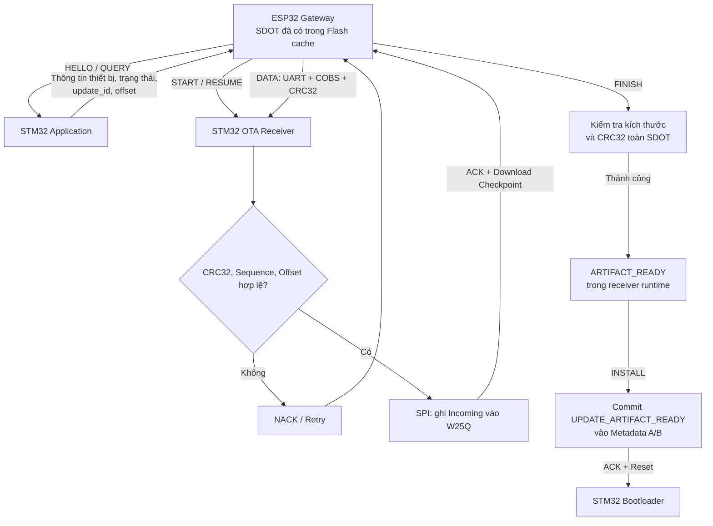

#### Bước 1. ESP32 Gateway chuẩn bị truyền gói cập nhật SDOT

Sau khi tải gói **SDOT** qua HTTPS và kiểm tra **kích thước/CRC32**, ESP32 Gateway đã lưu gói vào vùng **Flash cache** nội bộ. Gateway đọc dữ liệu từ cache để truyền qua UART, thay vì yêu cầu STM32 tự tải firmware qua mạng.

**Cấu hình UART trong repository:**

| Thông số | Giá trị |
|---|---|
| Giao thức | UART, **115200 8-N-1** |
| Data bits / Parity / Stop bits | 8 / None / 1 |
| Flow control | None |
| STM32 USART | USART1 |
| STM32 TX / RX | PA9 / PA10 |
| ESP32 UART mặc định | UART2 |
| ESP32 TX / RX mặc định | GPIO17 / GPIO16 |

Trước khi gửi DATA, Gateway cần kiểm tra trạng thái hiện tại của STM32 để quyết định **START** hay **RESUME**.

#### Bước 2. ESP32 Gateway gửi HELLO và QUERY

ESP32 trao đổi các lệnh **`HELLO`** và **`QUERY`** với STM32 Application. Phản hồi cung cấp các thông tin phục vụ nhận diện thiết bị và đồng bộ tiến độ, ví dụ:

| Thông tin | Ý nghĩa |
|---|---|
| `application_version` | Phiên bản firmware đang chạy |
| `bootloader_version` | Phiên bản STM32 Bootloader |
| `product_id` | Mã sản phẩm |
| `hardware_revision` | Phiên bản phần cứng |
| `capability_flags` | Các tính năng OTA được hỗ trợ |
| `update_state` | Trạng thái cập nhật hiện tại |
| `active_update_id` | Định danh bản cập nhật đang xử lý |
| `next_expected_offset` | Vị trí dữ liệu STM32 chờ nhận tiếp |

**Tại sao cần QUERY?** Vì STM32 có thể chưa nhận dữ liệu, đang nhận dở hoặc đã nhận hoàn tất gói SDOT. Thông tin trả về giúp ESP32 tránh bắt đầu lại không cần thiết và chọn đúng bước tiếp theo.

#### Bước 3. ESP32 Gateway gửi START hoặc RESUME

**`START`** được dùng khi bắt đầu nhận gói cập nhật mới. Các thông tin quan trọng bao gồm:

- `update_id`: Định danh bản cập nhật.
- `artifact_type`: Full OTA hoặc Delta OTA.
- `base_version`: Phiên bản firmware gốc.
- `target_version`: Phiên bản firmware đích.
- `artifact_size`: Kích thước toàn bộ gói SDOT.
- `artifact_crc32`: CRC32 của toàn bộ gói SDOT.

STM32 Application kiểm tra thông tin yêu cầu, trạng thái hiện tại và giới hạn dung lượng vùng **Incoming** của External Flash W25Q. Nếu chấp nhận, STM32 phản hồi **ACK** cùng offset bắt đầu (thông thường là `0`).

**`RESUME`** được dùng khi quá trình nhận trước đó bị gián đoạn. STM32 kiểm tra tính phù hợp của **`update_id`** và thông tin gói SDOT, sau đó cung cấp offset có thể tiếp tục an toàn để ESP32 truyền tiếp.

#### Bước 4. ESP32 Gateway truyền DATA qua UART

ESP32 chia SDOT thành các **DATA packet**, mỗi packet mang tối đa **256 bytes payload**. Cấu trúc packet ở mức khái quát:

```text
+---------------------------+
| Magic                     | 2 bytes
+---------------------------+
| Protocol Version          | 1 byte
+---------------------------+
| Command                   | 1 byte
+---------------------------+
| Update ID                 | 4 bytes
+---------------------------+
| Offset                    | 4 bytes
+---------------------------+
| Sequence                  | 2 bytes
+---------------------------+
| Payload Length            | 2 bytes
+---------------------------+
| Payload                   | 0–256 bytes
+---------------------------+
| Packet CRC32              | 4 bytes
+---------------------------+
```

Packet được **mã hóa COBS** và phân tách trên luồng UART bằng byte kết thúc **`0x00`**.

| Cơ chế | Vai trò |
|---|---|
| **COBS** | Đóng khung và phân tách các packet trên luồng byte UART |
| **CRC32** | Phát hiện lỗi dữ liệu packet |
| **Sequence** | Theo dõi thứ tự packet |
| **Offset** | Chỉ vị trí ghi dữ liệu trong toàn bộ gói SDOT |
| **Update ID** | Gắn packet với đúng quá trình cập nhật |

**Ví dụ** với payload 256 bytes/packet:

```text
ESP32 Gateway                      STM32 Application

DATA (offset = 0)   -------------> Kiểm tra, ghi W25Q
                   <------------- ACK (offset = 256)
DATA (offset = 256) -------------> Kiểm tra, ghi W25Q
                   <------------- ACK (offset = 512)
DATA (offset = 512) -------------> Kiểm tra, ghi W25Q
                   <------------- ACK (offset = 768)
```

> **Ghi nhớ:** CRC32 phát hiện lỗi truyền/lưu dữ liệu, **không** xác thực nguồn phát hành firmware; xác thực bảo mật do STM32 Bootloader thực hiện sau đó.

#### Bước 5. STM32 Application kiểm tra và lưu vào External Flash W25Q

Khi nhận DATA packet, STM32 Application thực hiện theo thứ tự:

1. Giải mã **COBS** để lấy packet gốc.
2. Kiểm tra **CRC32** của packet.
3. Kiểm tra `update_id`, **Sequence** và **Offset**.
4. Xác định địa chỉ thuộc phân vùng **Incoming** trên External Flash W25Q.
5. Xóa sector khi cần và ghi dữ liệu qua **SPI**.
6. Kiểm tra dữ liệu đã ghi và phản hồi kết quả.

```text
Receive DATA → Decode COBS → Verify CRC32
             → Check Update ID / Sequence / Offset
             → Write W25Q via SPI → Verify → ACK / NACK
```

**Vì sao lưu vào External Flash W25Q thay vì ghi thẳng Internal Flash?** Internal Flash chứa STM32 Application đang hoạt động. Việc nhận đầy đủ SDOT vào vùng lưu trữ riêng trước khi cài đặt giảm rủi ro ghi đè ứng dụng đang chạy nếu mất nguồn hoặc truyền bị gián đoạn.

#### Bước 6. STM32 Application phản hồi ACK/NACK và ESP32 Retry

| Phản hồi | Ý nghĩa |
|---|---|
| **ACK** | DATA packet đã được chấp nhận và xử lý thành công |
| **NACK** | DATA packet bị từ chối do lỗi dữ liệu, trạng thái, thứ tự, offset hoặc ghi Flash |

ESP32 chỉ chuyển sang packet tiếp theo khi đã nhận phản hồi phù hợp. Nếu nhận **NACK** hoặc quá thời gian chờ (**timeout**), Gateway có thể **Retry** theo giới hạn cấu hình.

| Thông số | Giá trị mô tả trong giao thức |
|---|---|
| Response timeout | **1500 ms** |
| Maximum retries | **5** |
| DATA payload | Tối đa **256 bytes** |

Nếu ACK bị mất và ESP32 gửi lại packet cũ, STM32 có thể nhận diện **DATA trùng hợp lệ** và trả ACK tương ứng; không được ghi lại một cách mù quáng làm sai tiến độ.

#### Bước 7. Resume khi truyền bị gián đoạn

STM32 Application sử dụng **Download Checkpoint** trong External Flash W25Q để lưu tiến độ nhận OTA. Checkpoint được ghi theo ranh giới sector **4 KB**.

**Ví dụ minh họa:**

```text
Gói SDOT 20 KB
    |
    | Đã nhận khoảng 10 KB
    v
Checkpoint an toàn gần nhất: 8 KB
    |
    | Reset bất ngờ
    v
STM32 khởi động lại, đọc Checkpoint
    |
    v
ESP32 gửi RESUME và truyền lại từ offset 8192
```

**Phân biệt:** **ACK** xác nhận một packet đã được xử lý trong phiên truyền hiện tại; **Checkpoint** là mốc tiến độ đã lưu bền vững để phục hồi sau reset. Offset được ACK gần nhất **không nhất thiết** là offset có thể Resume sau khi mất nguồn.

#### Bước 8. ESP32 Gateway gửi FINISH

Sau khi truyền đủ toàn bộ SDOT, ESP32 gửi **`FINISH`**. STM32 Application kiểm tra:

1. **Kích thước** dữ liệu nhận được có đúng với `artifact_size` không.
2. **CRC32 toàn bộ gói SDOT** có khớp với giá trị dự kiến không.

Nếu hợp lệ, STM32 chuyển sang trạng thái **`ARTIFACT_READY`** của phiên nhận OTA.

> **Phân biệt quan trọng:** `FINISH` xác nhận rằng SDOT đã được **nhận đầy đủ**. Nó **chưa** yêu cầu cài đặt, chưa ghi trạng thái bàn giao `UPDATE_ARTIFACT_READY` vào Internal Flash Metadata và chưa reset STM32.

#### Bước 9. ESP32 Gateway gửi INSTALL, STM32 bàn giao cho Bootloader

Khi `FINISH` thành công, ESP32 gửi **`INSTALL`**. STM32 Application:

1. Kiểm tra trạng thái **`ARTIFACT_READY`** và `update_id`.
2. Kiểm tra thông tin định dạng container SDOT ở mức cần thiết để bàn giao.
3. Ghi trạng thái **`UPDATE_ARTIFACT_READY`** vào **Internal Flash Metadata A/B**.
4. Gửi **ACK** cho ESP32 Gateway.
5. **Reset** để STM32 Bootloader xử lý bản cập nhật.

```text
ESP32 Gateway
      |
      | INSTALL
      v
STM32 Application
      |
      | Kiểm tra ARTIFACT_READY / Update ID / SDOT
      v
Internal Flash Metadata A/B
      |
      | Commit UPDATE_ARTIFACT_READY
      v
Send ACK → Reset STM32 → STM32 Bootloader
```

**Đây là điểm bàn giao giữa Application và Bootloader.** STM32 Application không xác thực chữ ký ECDSA P-256 để quyết định cài đặt ở bước này; đó là nhiệm vụ của STM32 Bootloader sau reset.

#### Bài nói khi phỏng vấn: ESP32 Gateway → STM32 Application

> **ESP32 Gateway → STM32 Application:** Sau khi tải và kiểm tra gói SDOT thành công, ESP32 Gateway bắt đầu truyền dữ liệu xuống STM32 Application thông qua UART.
>
> Đầu tiên, ESP32 sử dụng lệnh HELLO và QUERY để lấy thông tin thiết bị, trạng thái cập nhật và Offset hiện tại. Từ đó, ESP32 quyết định gửi START để bắt đầu nhận mới hoặc RESUME nếu quá trình truyền trước đó bị gián đoạn.
>
> Tiếp theo, ESP32 chia gói SDOT thành các DATA packet, mỗi packet có tối đa 256 bytes Payload, sử dụng COBS để đóng khung và CRC32 để phát hiện lỗi truyền.
>
> Ở phía STM32, Application kiểm tra CRC32, Sequence và Offset, sau đó ghi dữ liệu vào External Flash W25Q qua SPI. Nếu xử lý thành công, STM32 trả về ACK; nếu có lỗi, STM32 trả về NACK để ESP32 Retry.
>
> Ngoài ra, STM32 lưu Checkpoint theo ranh giới sector 4 KB để có thể Resume từ vị trí an toàn sau reset, thay vì phải truyền lại toàn bộ gói SDOT.
>
> Cuối cùng, ESP32 gửi FINISH để STM32 kiểm tra toàn bộ dữ liệu đã nhận, sau đó gửi INSTALL. STM32 Application cập nhật Metadata và reset để bàn giao quá trình cập nhật cho STM32 Bootloader.

#### Câu hỏi ôn tập: ESP32 Gateway → STM32 Application

| Câu hỏi | Ý chính cần trả lời |
|---|---|
| Tại sao ESP32 và STM32 giao tiếp qua UART? | Kết nối đơn giản giữa hai vi điều khiển, không yêu cầu STM32 tự xử lý kết nối mạng. |
| Tại sao cần COBS? | Để đóng khung packet UART và dùng `0x00` làm byte phân tách. |
| CRC32 dùng để làm gì? | Phát hiện lỗi dữ liệu trong truyền và lưu trữ, không dùng để xác thực chữ ký. |
| Sequence khác Offset thế nào? | Sequence theo dõi thứ tự packet; Offset xác định vị trí byte trong SDOT. |
| Tại sao cần ACK/NACK? | Xác nhận dữ liệu đã xử lý thành công hoặc báo lỗi để Retry. |
| Nếu ACK bị mất thì sao? | ESP32 có thể gửi lại; STM32 có cơ chế nhận diện packet trùng hợp lệ. |
| Retry giải quyết vấn đề gì? | Khắc phục lỗi truyền và timeout tạm thời. |
| Resume hoạt động như thế nào? | STM32 đọc Checkpoint và thông báo offset an toàn để ESP32 truyền tiếp. |
| Tại sao Checkpoint theo sector 4 KB? | Phù hợp với đơn vị sector của W25Q, hỗ trợ phục hồi tiến độ nhận. |
| Tại sao dùng External Flash W25Q? | Lưu trữ trọn SDOT mà không ghi đè Application đang chạy. |
| FINISH khác INSTALL thế nào? | FINISH xác nhận nhận đủ SDOT; INSTALL ghi Metadata bàn giao và reset. |
| Ai xác thực chữ ký ECDSA P-256? | STM32 Bootloader, sau khi nhận gói SDOT và bàn giao. |

#### Điểm cần ghi nhớ

- **UART + COBS + CRC32 + ACK/NACK + Retry:** Hỗ trợ truyền packet có kiểm tra lỗi; UART cơ bản không tự bảo đảm toàn bộ gói firmware ở tầng ứng dụng.
- **ACK khác Checkpoint:** ACK theo packet; Checkpoint lưu mốc phục hồi bền vững, vì vậy Resume có thể phải truyền lại dữ liệu đã từng ACK.
- **FINISH khác INSTALL:** FINISH xác minh gói SDOT đã nhận đầy đủ; INSTALL bàn giao cho STM32 Bootloader bằng **Metadata + Reset**.

**Tóm tắt thứ tự lệnh:**

```text
HELLO / QUERY
      |
START / RESUME
      |
     DATA
      |
CRC32 / Sequence / Offset
      |
Write External Flash W25Q
      |
ACK / NACK + Retry
      |
    FINISH
      |
   INSTALL
      |
Metadata + Reset
      |
STM32 Bootloader
```

**Tài liệu/code đối chiếu:** `docs/uart-ota-protocol.md`, `docs/architecture.md`, `node-stm32f103/application/src/ota_receiver.c`.

---

<a id="luong-4"></a>
### 4.4. STM32 Application → STM32 Bootloader

> **Mục tiêu:** Hiểu cách **STM32 Application** bàn giao gói cập nhật **SDOT** cho **STM32 Bootloader** thông qua **Metadata + Reset**; cách Bootloader xác thực, chuẩn bị firmware mới, sao lưu, cài đặt và quyết định **Trial Boot / Rollback**.
>
> **Phân chia trách nhiệm:** **STM32 Application** nhận và lưu SDOT, sau đó yêu cầu cài đặt. **STM32 Bootloader** đọc Metadata, xác thực chữ ký, xử lý **Full OTA / Delta OTA**, cài đặt firmware mới vào **Internal Flash** và thực hiện các bước phục hồi khi cần.

#### Sơ đồ luồng hoạt động

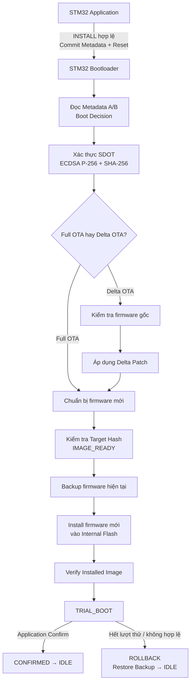

> **Lưu ý:** Sơ đồ trên mô tả luồng thành công và nhánh Rollback chính. **Boot State Machine** còn các trạng thái xử lý lỗi và phục hồi sau reset; không phải mọi lỗi đều tự động Rollback.

#### Bước 1. STM32 Application nhận lệnh INSTALL

Sau khi ESP32 Gateway truyền đủ gói **SDOT** qua UART, STM32 Application nhận lệnh **`FINISH`** và kiểm tra **kích thước** cùng **CRC32 của toàn bộ gói SDOT**. Khi kiểm tra thành công, bộ nhận OTA có trạng thái **`ARTIFACT_READY`**.

Tiếp theo, ESP32 Gateway gửi **`INSTALL`**. STM32 Application kiểm tra:

1. Trạng thái nhận OTA hiện tại là **`ARTIFACT_READY`**.
2. **`update_id`** khớp với phiên cập nhật đang xử lý.
3. Thông tin cần thiết để bàn giao SDOT là hợp lệ.

**Điểm cần nhớ:** STM32 Application chưa sử dụng **ECDSA P-256** để quyết định tin cậy và cài đặt firmware; đây là nhiệm vụ của **STM32 Bootloader** sau reset.

#### Bước 2. STM32 Application ghi Metadata A/B

Khi điều kiện `INSTALL` hợp lệ, STM32 Application ghi trạng thái **`UPDATE_ARTIFACT_READY`** vào **Internal Flash Metadata A/B**.

| Thông tin Metadata | Vai trò |
|---|---|
| `state` | Trạng thái hiện tại của quy trình cập nhật. |
| `active_version` | Phiên bản firmware đã được chấp nhận trước đó. |
| `pending_version` | Phiên bản firmware đang chờ xử lý. |
| `active_update_id` | Định danh phiên cập nhật. |
| `copy_offset` | Tiến độ sao chép/ghi firmware khi có Checkpoint. |
| `boot_attempts` | Số lần Trial Boot đã được ghi nhận. |
| `generation` | Phân biệt bản Metadata mới và cũ. |
| `crc32` | Phát hiện Metadata bị lỗi. |

Hai vùng **Internal Flash Metadata** trong thiết kế:

| Vùng | Địa chỉ | Kích thước |
|---|---|---:|
| Metadata A | `0x0800F800` | 1 KB |
| Metadata B | `0x0800FC00` | 1 KB |

**Tại sao cần Metadata A/B?** Khi cập nhật Metadata, hệ thống có thể ghi bản mới vào vùng còn lại, kiểm tra **CRC32** và sử dụng **generation** để lựa chọn bản hợp lệ mới nhất. Nếu mất nguồn trong lúc ghi, vẫn có khả năng đọc được bản Metadata hợp lệ trước đó.

#### Bước 3. STM32 Application reset để bàn giao cho Bootloader

Khi Metadata đã được cập nhật, STM32 Application gửi **ACK** cho ESP32 Gateway, sau đó reset STM32.

```text
STM32 Application
      |
      | INSTALL hợp lệ
      v
Commit UPDATE_ARTIFACT_READY
      |
      v
Gửi ACK → Reset STM32
      |
      v
STM32 Bootloader
```

Trong thiết kế này, vùng Bootloader bắt đầu tại **`0x08000000`**, còn Application bắt đầu tại **`0x08006000`**. Sau reset, STM32 thực thi Bootloader trước và Bootloader dùng Metadata đã lưu để xác định bước tiếp theo.

**Tại sao lưu vào Flash thay vì RAM?** Vì trạng thái trong **RAM** không được đảm bảo tồn tại sau reset hoặc mất nguồn; **Metadata** trong **Internal Flash** là cơ sở cho **Power-loss Recovery**.

#### Bước 4. STM32 Bootloader đọc Metadata và đưa ra Boot Decision

STM32 Bootloader khởi tạo các thành phần cần thiết, đọc **Metadata A/B**, chọn bản hợp lệ mới nhất và đưa ra quyết định xử lý bằng logic **Boot Decision**.

| Trạng thái Metadata | Hành động tiêu biểu |
|---|---|
| `UPDATE_IDLE` | Kiểm tra và khởi động Application đang có. |
| `UPDATE_RECEIVING` | Cho Application tiếp tục quy trình tiếp nhận OTA nếu phù hợp. |
| `UPDATE_ARTIFACT_READY` | Bắt đầu xử lý và xác thực gói SDOT. |
| `UPDATE_VERIFYING_CONTAINER` | Thực hiện xác thực container. |
| `UPDATE_PATCHING` | Chuẩn bị hoặc tái tạo firmware mới. |
| `UPDATE_IMAGE_READY` | Tiến đến bước Backup. |
| `UPDATE_BACKING_UP` | Tiếp tục hoặc khôi phục bước Backup. |
| `UPDATE_INSTALLING` | Tiếp tục Install từ Checkpoint an toàn. |
| `UPDATE_TRIAL_BOOT` | Quản lý khởi động thử Application mới. |
| `UPDATE_ROLLBACK` | Khôi phục firmware đã sao lưu. |
| `UPDATE_FAILED` | Ở lại chế độ Recovery, không mặc nhiên nhận OTA mới qua UART. |

Khi Metadata đang ở **`UPDATE_ARTIFACT_READY`**, Bootloader chọn nhánh **xử lý gói SDOT**, từ đó bước vào xác thực gói SDOT.

**Code cần đọc:** `node-stm32f103/bootloader/src/boot_decision.c` và `node-stm32f103/bootloader/src/boot_manager.c`.

#### Bước 5. STM32 Bootloader xác thực gói cập nhật SDOT

Bootloader đọc gói **SDOT** từ phân vùng **Incoming** của **External Flash W25Q**, sau đó kiểm tra:

1. **Header** và định dạng container.
2. Thông tin nhận diện thiết bị như **Product ID** và **Hardware Revision**.
3. Điều kiện phiên bản, bao gồm chính sách **Anti-rollback / Anti-downgrade** của bản cập nhật.
4. **CRC32** của dữ liệu ở các bước tương ứng để phát hiện lỗi.
5. Các giá trị **SHA-256** cần kiểm tra.
6. **Chữ ký ECDSA P-256** bằng **Public Key tin cậy**.

| Cơ chế | Vai trò |
|---|---|
| CRC32 | Phát hiện lỗi dữ liệu, không xác thực nguồn phát hành. |
| SHA-256 | Tính/đối chiếu hash để kiểm tra tính toàn vẹn. |
| ECDSA P-256 | Xác thực chữ ký trên dữ liệu được ký. |

> **Lưu ý triển khai:** Repository mặc định **chưa provision Public Key production**. Cần provision khóa tin cậy phù hợp trước khi kiểm tra bản firmware ký số trên thiết bị thật; không nên nhầm cơ chế có trong code với một sản phẩm đã cấu hình khóa hoàn chỉnh.

**Code cần đọc:** `node-stm32f103/bootloader/src/secure_container.c`, `node-stm32f103/bootloader/include/trusted_key.h`.

#### Bước 6. STM32 Bootloader xử lý Full OTA hoặc Delta OTA

Sau khi xác thực SDOT, Bootloader dựa vào loại gói cập nhật để chuẩn bị **firmware mới**:

| Full OTA | Delta OTA |
|---|---|
| Payload chứa firmware mới hoàn chỉnh. | Payload chứa **Delta Patch**. |
| Chuẩn bị firmware mới từ Payload. | Xác thực **firmware gốc** rồi áp dụng Delta Patch. |
| Không cần tái tạo từ firmware cũ. | Cần **base version** và **base SHA-256** khớp chính xác. |

Với **Delta OTA**, Bootloader kiểm tra **base version**, tính/đối chiếu **Base SHA-256** rồi áp dụng patch để tái tạo firmware mới. Dữ liệu đầu ra được chuẩn bị trong phân vùng **Reconstructed Image** của **External Flash W25Q**.

Sau đó, Bootloader kiểm tra **Target SHA-256** và các điều kiện hợp lệ của firmware mới. Khi đạt yêu cầu, quá trình chuyển đến **`UPDATE_IMAGE_READY`**.

**Điểm quan trọng:** Đến bước này, Application đang chạy trong **Internal Flash** vẫn chưa bị ghi đè.

#### Bước 7. STM32 Bootloader Backup firmware hiện tại

Sau khi firmware mới đã được chuẩn bị và xác minh hợp lệ, Bootloader chuyển sang **`UPDATE_BACKING_UP`** và sao lưu Application hiện tại từ **Internal Flash** sang phân vùng **Backup Image** của **External Flash W25Q**.

```text
Internal Flash (Application hiện tại)
                 |
                 | Đọc firmware hiện tại
                 v
          STM32 Bootloader
                 |
                 | Ghi qua SPI
                 v
External Flash W25Q (Backup Image)
```

Bước Backup có **Checkpoint** theo ranh giới **sector 4 KB** của W25Q, giúp Bootloader xác định tiến độ an toàn sau reset. Bootloader kiểm tra bản Backup trước khi tiến hành Install.

**Tại sao Backup trước Install?** Vì Install sẽ xóa/ghi đè Application trong **Internal Flash**. Nếu firmware mới không chạy đúng, Bootloader cần bản Backup hợp lệ để **Rollback**.

#### Bước 8. STM32 Bootloader Install firmware mới vào Internal Flash

Khi Backup đã được kiểm tra, Bootloader chuyển sang **`UPDATE_INSTALLING`**, đọc firmware mới từ **Reconstructed Image** và thực hiện **Erase + Program** trên vùng Application của **Internal Flash**.

```text
External Flash W25Q (Reconstructed Image)
                 |
                 | Đọc firmware mới
                 v
          STM32 Bootloader
                 |
                 | Erase + Program
                 v
      Internal Flash (Application)
```

Quá trình Install được thực hiện theo từng **trang Internal Flash 1 KB**, đồng thời lưu **Checkpoint** sau những bước ghi và kiểm tra thành công. Nếu xảy ra mất nguồn, Bootloader đọc Metadata sau reset và tiếp tục từ mốc an toàn thay vì xem firmware chưa hoàn chỉnh là hợp lệ.

Sau khi ghi xong, Bootloader chuyển sang **`UPDATE_VERIFYING_INSTALL`** để kiểm tra firmware đã cài đặt trong **Internal Flash**.

#### Bước 9. STM32 Bootloader thực hiện Trial Boot

Nếu kết quả Install hợp lệ, Bootloader chuyển sang **`UPDATE_TRIAL_BOOT`** và cho **STM32 Application mới** chạy thử.

Ở giai đoạn này, Bootloader quản lý **`boot_attempts`** và sử dụng **Watchdog** để xử lý trường hợp Application không tiến đến bước xác nhận. Giới hạn trong repository là **3 lần Trial Boot**.

Application có cơ chế xác nhận sau khoảng **750 ms main loop**. Đây là kiểm tra **khả năng khởi động cơ bản**, **chưa phải health check đầy đủ** của toàn bộ chức năng sản phẩm.

**Điểm cần nhớ:** **Install thành công không có nghĩa cập nhật đã được xác nhận**. Cần hoàn thành Trial Boot và bước Confirm.

#### Bước 10. Confirm hoặc Rollback

**Trường hợp 1 — Application xác nhận thành công:**

STM32 Application ghi trạng thái **`UPDATE_CONFIRMED`** và thực hiện bước bàn giao để Bootloader hoàn tất xác nhận. Bootloader cập nhật **`active_version`** và đưa hệ thống về **`UPDATE_IDLE`**; firmware mới trở thành phiên bản được chấp nhận.

**Trường hợp 2 — Application không xác nhận trong số lần thử cho phép:**

Bootloader chuyển sang **`UPDATE_ROLLBACK`**, dùng **Backup Image** để khôi phục Application trước đó vào **Internal Flash**. Quá trình Rollback cũng sử dụng **Checkpoint** để có thể phục hồi khi bị gián đoạn.

> **Phân biệt:** **Power-loss Recovery** là khôi phục/tiếp tục quy trình cập nhật dựa trên Metadata và Checkpoint; **Rollback** là phục hồi firmware đã sao lưu. Không phải cứ mất nguồn là phải Rollback ngay.

#### Bài nói khi phỏng vấn: STM32 Application → STM32 Bootloader

> **STM32 Application → STM32 Bootloader:** Sau khi nhận đủ gói SDOT, STM32 Application nhận lệnh INSTALL từ ESP32 Gateway, kiểm tra điều kiện bàn giao rồi ghi trạng thái `UPDATE_ARTIFACT_READY` vào Metadata và reset thiết bị.
>
> Khi khởi động lại, STM32 Bootloader đọc Metadata A/B, chọn bản hợp lệ mới nhất và sử dụng Boot State Machine để quyết định bước xử lý tiếp theo.
>
> Đầu tiên, Bootloader đọc gói SDOT từ External Flash W25Q, xác thực chữ ký ECDSA P-256 và kiểm tra tính toàn vẹn bằng SHA-256. Nếu là Full OTA, Bootloader chuẩn bị firmware mới từ Payload. Nếu là Delta OTA, Bootloader kiểm tra phiên bản và hash của firmware gốc, sau đó áp dụng Delta Patch để tái tạo firmware mới.
>
> Tiếp theo, sau khi kiểm tra firmware mới hợp lệ, Bootloader sao lưu firmware hiện tại vào External Flash W25Q, rồi cài đặt bản mới vào Internal Flash và kiểm tra lại kết quả.
>
> Cuối cùng, Bootloader cho Application mới chạy ở chế độ Trial Boot. Nếu Application xác nhận thành công, bản cập nhật được chấp nhận. Nếu không xác nhận sau số lần thử cho phép, Bootloader sẽ Rollback về firmware đã sao lưu.
>
> Trong toàn bộ quá trình, Metadata và Checkpoint được sử dụng để khôi phục tiến độ cập nhật khi có mất nguồn hoặc reset bất ngờ.

#### Câu hỏi ôn tập: STM32 Application → STM32 Bootloader

| Câu hỏi | Ý chính cần trả lời |
|---|---|
| Tại sao Application phải reset để chuyển sang Bootloader? | Để Bootloader xử lý cập nhật dựa trên Metadata đã lưu trong Flash. |
| Tại sao cần Metadata A/B? | Để còn bản Metadata hợp lệ nếu mất nguồn khi ghi bản mới. |
| Bootloader quyết định hành động tiếp theo thế nào? | Đọc Metadata và đánh giá trạng thái qua logic Boot Decision. |
| Tại sao cần xác thực SDOT? | Kiểm tra chữ ký, tính toàn vẹn, điều kiện phần cứng và phiên bản trước khi Install. |
| Full OTA khác Delta OTA thế nào? | Full chứa firmware mới; Delta chứa patch để tái tạo firmware từ Base Image. |
| Tại sao cần kiểm tra Base SHA-256? | Đảm bảo Delta Patch được áp dụng lên chính xác firmware gốc. |
| Tại sao phải Backup trước Install? | Để có firmware hợp lệ phục vụ Rollback nếu bản mới không hoạt động đúng. |
| Tại sao Install theo trang 1 KB? | Phù hợp đơn vị trang Internal Flash và hỗ trợ Checkpoint an toàn. |
| Nếu mất nguồn khi Install thì sao? | Bootloader đọc Metadata/Checkpoint và tiếp tục từ mốc an toàn. |
| Trial Boot dùng để làm gì? | Cho firmware mới chạy thử trước khi chấp nhận chính thức. |
| Nếu Application mới liên tục reset thì sao? | Bootloader đếm số lần thử, sau ngưỡng thì Rollback nếu có Backup hợp lệ. |
| Power-loss Recovery khác Rollback thế nào? | Recovery xử lý cập nhật bị gián đoạn; Rollback phục hồi firmware đã sao lưu. |

#### Điểm cần ghi nhớ

- **Application không trực tiếp cài đặt firmware mới:** chỉ nhận SDOT, lưu vào External Flash W25Q, ghi Metadata và yêu cầu reset.
- **Xác thực SDOT trước khi ghi đè Application:** ECDSA P-256, SHA-256 và kiểm tra điều kiện cập nhật thuộc STM32 Bootloader.
- **Full OTA khác Delta OTA:** Delta cần **firmware gốc chính xác**, sau đó tái tạo ra firmware mới.
- **Backup trước Install:** Không ghi đè Application cho tới khi firmware mới đã được chuẩn bị và bản Backup hợp lệ.
- **Install khác Confirm:** Cài đặt xong vẫn cần **Trial Boot** trước khi chấp nhận phiên bản mới.
- **Recovery khác Rollback:** Mất nguồn không mặc định đồng nghĩa Rollback; xử lý tùy trạng thái và Checkpoint.
- **Anti-rollback khác Rollback:** Anti-rollback giới hạn phiên bản được phép cài đặt; Rollback phục hồi Backup đã được chấp nhận.

**Tóm tắt luồng chính:**

```text
INSTALL → Metadata + Reset
             |
             v
         Boot Decision
             |
             v
         Verify SDOT
             |
             v
      Full / Delta OTA
             |
             v
   Verify Reconstructed Image
             |
             v
           Backup
             |
             v
           Install
             |
             v
    Verify Installed Image
             |
             v
          Trial Boot
         /         \
    Confirm      Rollback
       |            |
       +-----+------+
             v
            IDLE
```

**Tài liệu/code đối chiếu:** `docs/boot-state-machine.md`, `docs/metadata-and-boot-decision.md`, `docs/firmware-container.md`, `docs/memory-map.md`, `node-stm32f103/bootloader/src/boot_manager.c`, `node-stm32f103/bootloader/src/boot_decision.c`, `node-stm32f103/bootloader/src/secure_container.c`, `node-stm32f103/bootloader/src/image_installer.c`, `node-stm32f103/bootloader/src/trial_boot.c`.

---

<a id="luong-5"></a>
### 4.5. STM32 Bootloader → STM32 Internal Flash

> **Mục tiêu:** Hiểu cách **STM32 Bootloader** cài đặt firmware mới vào **STM32 Internal Flash**: đọc firmware từ **External Flash W25Q**, xóa và ghi từng trang, kiểm tra dữ liệu đã ghi, cập nhật **Checkpoint** và chuyển sang **Trial Boot**.
>
> **Điều kiện đầu vào:** Gói SDOT đã được xác thực; firmware mới đã nằm trong vùng **Reconstructed Image** của External Flash W25Q; bản **Backup** của firmware hiện tại đã được tạo và kiểm tra. Ở phần này tập trung vào quá trình **Install** thay vì lặp lại quá trình xác thực SDOT hay tạo Delta Patch.

#### Sơ đồ luồng hoạt động

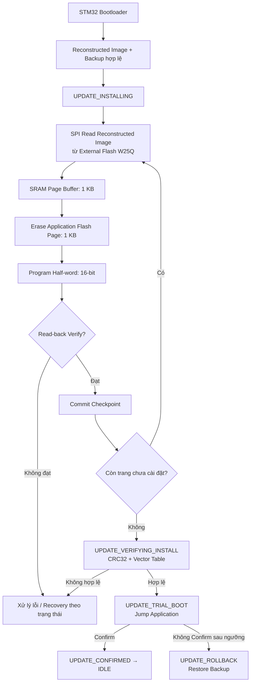

**Điểm cần nhớ:** STM32 Bootloader **không** ghi trực tiếp dữ liệu UART từ ESP32 vào Internal Flash. Firmware hoàn chỉnh đã được chuẩn bị và kiểm tra ở **External Flash W25Q** trước khi bắt đầu Install.

#### Phân vùng STM32 Internal Flash

| Phân vùng | Địa chỉ bắt đầu | Dung lượng | Vai trò |
|---|---|---:|---|
| **Bootloader** | `0x08000000` | 24 KB | Chương trình khởi động, xử lý cập nhật và phục hồi |
| **Application** | `0x08006000` | 38 KB | Chứa firmware hiện tại hoặc firmware mới đang cài đặt |
| **Metadata A** | `0x0800F800` | 1 KB | Lưu Metadata và Checkpoint |
| **Metadata B** | `0x0800FC00` | 1 KB | Bản Metadata dự phòng |

```text
STM32 Internal Flash (64 KB)
0x08000000  +-----------------------------+
            | Bootloader (24 KB)          |
0x08006000  +-----------------------------+
            | Application (38 KB)         |
            | <- vùng được cài đặt OTA -> |
0x0800F800  +-----------------------------+
            | Metadata A (1 KB)           |
0x0800FC00  +-----------------------------+
            | Metadata B (1 KB)           |
0x08010000  +-----------------------------+
```

**Tại sao phải phân vùng?** Để quá trình cập nhật chỉ xóa/ghi vùng **Application**, không ghi đè **Bootloader** (phải luôn sẵn sàng khởi động hoặc phục hồi) và vùng **Metadata** (phải lưu được trạng thái sau reset).

#### Bước 1. STM32 Bootloader kiểm tra điều kiện trước khi Install

- Firmware mới đã được xác thực và chuẩn bị trong **Reconstructed Image**.
- Firmware hiện tại đã được sao lưu trong **Backup Image** của External Flash W25Q.
- Bản Backup đã được kiểm tra hợp lệ; Bootloader mới được phép bắt đầu ghi đè Application.
- Bootloader chuyển sang trạng thái `UPDATE_INSTALLING`.

**Tại sao Backup trước Install?** Vì quá trình Install phải xóa nội dung Application hiện tại. Nếu firmware mới không hoạt động hoặc cần phục hồi, bản Backup là nguồn dữ liệu để **Rollback**.

#### Bước 2. Đọc firmware mới từ External Flash W25Q vào SRAM

Bootloader đọc từng phần của firmware mới trong **Reconstructed Image** qua **SPI**, đưa vào **SRAM Page Buffer** trước khi ghi Internal Flash.

```c
static uint8_t g_install_page_buffer[INTERNAL_FLASH_PAGE_SIZE];
```

Trong project, `INTERNAL_FLASH_PAGE_SIZE` tương ứng **1.024 bytes (1 KB)**.

```text
External Flash W25Q          STM32 Bootloader           STM32 Internal Flash
Reconstructed Image  --SPI--> SRAM Page Buffer  -----> Application Region
                              (1 KB)
```

**Lý do dùng buffer 1 KB:** Phù hợp đơn vị xóa theo trang của STM32F103, không cần giữ toàn bộ firmware trong SRAM hạn chế của vi điều khiển.

#### Bước 3. Xóa từng trang Internal Flash

Trước khi ghi firmware mới, Bootloader mở khóa Flash, xóa cờ lỗi và xóa trang Application tương ứng. Ví dụ minh họa:

```c
FLASH_Unlock();
FLASH_ClearFlag(FLASH_FLAG_EOP |
                FLASH_FLAG_PGERR |
                FLASH_FLAG_WRPRTERR);
FLASH_ErasePage(0x08006000);  // Trang đầu của Application
```

Địa chỉ được tính từ `APPLICATION_START_ADDRESS + page_offset`. Trước khi ghi, Bootloader cần bảo đảm địa chỉ nằm trong vùng Application; không được xóa Bootloader hay Metadata.

**Tại sao phải Erase trước Program?** Flash đã lập trình không thể tùy ý đổi bit `0 → 1`. Erase đưa trang về trạng thái xóa (thường là `0xFF`) trước khi lập trình dữ liệu mới.

#### Bước 4. Ghi firmware mới theo Half-word 16-bit

Sau khi xóa trang, Bootloader lập trình dữ liệu từ SRAM Page Buffer xuống Internal Flash theo từng **Half-word (2 bytes)** bằng thao tác tương ứng:

```c
FLASH_ProgramHalfWord(address, halfword);
```

```text
SRAM Buffer                  Internal Flash
Byte 0 + Byte 1  --------->  0x08006000 (16-bit)
Byte 2 + Byte 3  --------->  0x08006002 (16-bit)
...
```

Với dữ liệu có số byte lẻ, byte thiếu trong Half-word cuối có thể được bổ sung bằng `0xFF` khi lập trình. Đây là đơn vị ghi phù hợp với STM32F103.

#### Bước 5. Read-back Verify sau mỗi trang

Sau khi ghi xong một trang, Bootloader khóa Flash và **đọc lại** dữ liệu tại vùng Application, so sánh với dữ liệu trong SRAM Page Buffer.

```text
SRAM Page Buffer (expected)
            |
            v
          Compare <----- Internal Flash (actual)
            |
       Match / Mismatch
```

- **Khớp:** Trang được xác nhận đã ghi thành công.
- **Không khớp:** Trả về lỗi kiểm tra trang, ví dụ `IMAGE_INSTALLER_PAGE_VERIFY_FAILED`.

**Tại sao cần Read-back Verify?** Vì thao tác Program báo thành công chưa đủ bảo đảm từng byte trong Flash giống dữ liệu mong đợi.

#### Bước 6. Lưu Checkpoint sau khi trang đã Verify thành công

Chỉ sau khi trang đã được ghi và kiểm tra thành công, Bootloader mới cập nhật tiến độ `copy_offset` trong **Metadata A/B**.

| Trang | Địa chỉ bắt đầu | Checkpoint sau khi trang được xác nhận |
|---|---|---:|
| Page 0 | `0x08006000` | 1.024 bytes |
| Page 1 | `0x08006400` | 2.048 bytes |
| Page 2 | `0x08006800` | 3.072 bytes |
| Page 3 | `0x08006C00` | 4.096 bytes |
| Page 4 | `0x08007000` | 5.120 bytes |

**Ví dụ Power-loss Recovery:** Thiết bị mất nguồn khi đang ghi **Page 4**. Do Page 4 chưa được Verify, Checkpoint an toàn cuối cùng vẫn là `copy_offset = 4096`. Sau reset, Bootloader đọc Metadata, nhận biết `UPDATE_INSTALLING`, sau đó **xóa và ghi lại Page 4** thay vì tiếp tục từ byte đang ghi dở.

Quá trình Install theo Checkpoint được tổ chức trong `ResumePageCheckpointedCopy()` và việc lưu trạng thái sử dụng `MetadataStorage_Commit()`.

#### Bước 7. Kiểm tra toàn bộ firmware đã cài đặt

Khi ghi xong toàn bộ firmware mới, Bootloader chuyển sang `UPDATE_VERIFYING_INSTALL`, sau đó:

1. Tính và so sánh **CRC32** của Application đã ghi với CRC32 mong đợi.
2. Kiểm tra **Vector Table** của Application, bao gồm **Initial MSP** và **Reset Handler**.

| Địa chỉ | Nội dung |
|---|---|
| `0x08006000` | Initial Stack Pointer (MSP) |
| `0x08006004` | Reset Handler |

Bootloader kiểm tra MSP có thuộc vùng SRAM hợp lệ và căn chỉnh phù hợp; Reset Handler phải trỏ vào vùng Application hợp lệ và có Thumb bit phù hợp.

**Lưu ý:** CRC32 và Vector Table là bước kiểm tra dữ liệu đã cài đặt/khả năng khởi động, **không thay thế ECDSA P-256**. Chữ ký SDOT đã được xác thực ở giai đoạn trước.

#### Bước 8. Chuyển sang Trial Boot và nhảy đến STM32 Application

Nếu firmware sau Install hợp lệ, Bootloader cập nhật trạng thái `UPDATE_TRIAL_BOOT` rồi chuẩn bị chuyển quyền điều khiển cho Application mới.

Các việc cần thực hiện gồm ghi nhận số lần thử vào Metadata, thiết lập Watchdog cho Trial Boot, kiểm tra Vector Table và chuẩn bị môi trường CPU trước khi Jump:

- Dừng SysTick, xử lý trạng thái Interrupt/NVIC và cấu hình clock phù hợp.
- Cập nhật **VTOR** trỏ đến Vector Table của Application.
- Nạp **MSP** từ từ đầu tiên của Vector Table.
- Nhảy tới **Reset Handler** từ từ thứ hai của Vector Table.

```text
STM32 Bootloader
   | Validate Vector Table
   | Stop SysTick / prepare IRQs and clock
   | VTOR <- 0x08006000
   | MSP  <- *(0x08006000)
   | Reset_Handler <- *(0x08006004)
   v
STM32 Application
```

Trong repository, chức năng này gắn với `ApplicationJump_Execute()`.

#### Bước 9. Application xác nhận hoặc Bootloader thực hiện Rollback

- **Confirm:** Khi Application mới chạy đủ điều kiện xác nhận (trong demo hiện tại là khoảng **750 ms main loop**), Application ghi `UPDATE_CONFIRMED` và reset. Bootloader hoàn tất xác nhận phiên bản mới, quay lại `UPDATE_IDLE`.
- **Rollback:** Nếu Application mới không xác nhận thành công trong giới hạn **3 lần Trial Boot**, Bootloader sử dụng **Backup Image** trong External Flash W25Q để khôi phục firmware trước đó vào vùng Application của Internal Flash. Quá trình khôi phục cũng sử dụng Checkpoint.

**Không đồng nhất ba khái niệm:** `Install` là ghi firmware mới; `Trial Boot` là chạy thử; `Confirm` mới là chấp nhận phiên bản mới. **Power-loss Recovery** không đồng nghĩa **Rollback**.

#### Bài nói khi phỏng vấn: STM32 Bootloader → STM32 Internal Flash

> **STM32 Bootloader → STM32 Internal Flash:** Sau khi firmware mới được xác thực và chuẩn bị thành công, STM32 Bootloader kiểm tra bản Backup trước khi bắt đầu cài đặt vào Internal Flash.
>
> Đầu tiên, Bootloader đọc firmware mới từ phân vùng Reconstructed Image trong External Flash W25Q qua SPI và đưa vào SRAM Page Buffer có kích thước 1 KB.
>
> Tiếp theo, Bootloader mở khóa Internal Flash, xóa từng trang 1 KB và ghi firmware mới theo đơn vị Half-word 16-bit.
>
> Sau khi ghi mỗi trang, Bootloader đọc lại dữ liệu để kiểm tra. Nếu thành công, hệ thống cập nhật Checkpoint vào Metadata. Nhờ vậy, nếu xảy ra mất nguồn hoặc reset, Bootloader có thể tiếp tục từ trang chưa được xác nhận hoàn tất.
>
> Khi đã ghi đủ firmware, Bootloader kiểm tra CRC32 và Vector Table, rồi chuyển sang Trial Boot. Cuối cùng, Bootloader cập nhật VTOR, nạp MSP và nhảy đến Reset Handler của Application mới.
>
> Nếu Application xác nhận hoạt động thành công, bản cập nhật được chấp nhận. Nếu không xác nhận sau số lần thử cho phép, Bootloader thực hiện Rollback về firmware đã sao lưu.

#### Câu hỏi ôn tập: STM32 Bootloader → STM32 Internal Flash

| Câu hỏi | Ý chính cần trả lời |
|---|---|
| Tại sao phải chia Internal Flash thành Bootloader, Application và Metadata? | Tách chương trình khởi động, vùng firmware được cập nhật và trạng thái cập nhật. |
| Tại sao Bootloader không được ghi đè chính nó? | Bootloader phải còn nguyên vẹn để khởi động và phục hồi khi cập nhật lỗi. |
| Tại sao phải Erase trước Program? | Flash không thể đổi bit `0 → 1` nếu chưa xóa. |
| Tại sao dùng Flash Page 1 KB? | Đây là kích thước trang xóa Internal Flash được sử dụng trên STM32F103C8T6. |
| Tại sao ghi theo Half-word 16-bit? | Đơn vị lập trình Flash tương ứng với STM32F103. |
| Tại sao cần SRAM Page Buffer? | Chứa dữ liệu của một trang trước khi xóa và ghi; không cần giữ toàn bộ firmware trong RAM. |
| Tại sao cần Read-back Verify? | Kiểm tra dữ liệu ghi vào Flash trùng với dữ liệu mong đợi. |
| Checkpoint có vai trò gì? | Ghi lại tiến độ trang đã cài đặt an toàn để Resume sau reset. |
| Nếu mất nguồn khi đang ghi một trang? | Xóa và ghi lại trang chưa được Checkpoint. |
| Tại sao phải kiểm tra Vector Table? | Đảm bảo MSP và Reset Handler có giá trị hợp lệ trước khi Jump. |
| VTOR là gì? | Thanh ghi chỉ vị trí Vector Table phục vụ exception và interrupt. |
| Tại sao phải đổi MSP khi Jump? | Application có stack riêng, được khai báo trong Vector Table. |
| Trial Boot là gì? | Cho firmware mới chạy thử trước khi Confirm. |
| Rollback có ghi lại Internal Flash không? | Có, khôi phục Backup Image vào vùng Application. |

#### Các file mã nguồn quan trọng

| File | Vai trò |
|---|---|
| `node-stm32f103/bootloader/src/image_installer.c` | Backup, Install, Verify, Rollback; xóa/ghi Flash và Checkpoint |
| `node-stm32f103/bootloader/src/boot_manager.c` | Điều phối Boot State Machine |
| `node-stm32f103/bootloader/src/application_jump.c` | Kiểm tra Vector Table và Jump sang Application |
| `node-stm32f103/bootloader/storage/metadata_storage.c` | Đọc/ghi Metadata A/B |
| `shared/include/memory_map.h` | Khai báo phân vùng Internal Flash |

Các hàm đáng đọc trong `image_installer.c`:

- `ProgramBufferedApplicationPage()` — Erase, Program Half-word, Verify một trang.
- `ResumePageCheckpointedCopy()` — Copy theo trang và lưu Checkpoint.
- `VerifyInstalledApplication()` — Kiểm tra Application đã cài đặt.

#### Điểm cần ghi nhớ

- **Erase → Program → Verify** là ba thao tác riêng biệt.
- **Checkpoint** chỉ được lưu sau khi trang đã Verify thành công.
- **Install xong chưa phải Confirm:** Phải vượt qua **Trial Boot**.
- **Rollback** khôi phục firmware cũ đã sao lưu; **Power-loss Recovery** xử lý tiến độ Install bị gián đoạn.
- **Không phải lỗi nào cũng tự phục hồi:** Nếu Metadata, firmware nguồn hoặc Backup không hợp lệ, Bootloader có thể dừng ở trạng thái Recovery/`UPDATE_FAILED`.

**Tóm tắt luồng chính:**

```text
Verify Backup
      |
      v
Read Reconstructed Image
      |
      v
Load SRAM Page Buffer (1 KB)
      |
      v
Erase Application Flash Page (1 KB)
      |
      v
Program Half-word (16-bit)
      |
      v
Read-back Verify
      |
      v
Commit Checkpoint -> Next Page (repeat)
      |
      v
Verify CRC32 + Vector Table
      |
      v
Trial Boot
      |
      +---- Confirm ----> IDLE
      |
      +---- Failure ----> Rollback
```

**Tài liệu/code đối chiếu:** `docs/memory-map.md`, `docs/boot-state-machine.md`, `docs/boot-jump.md`, `node-stm32f103/bootloader/src/image_installer.c`, `node-stm32f103/bootloader/src/application_jump.c`, `node-stm32f103/bootloader/storage/metadata_storage.c`.

---

<a id="phan-5"></a>
## Phần 5. Phân tích chi tiết Boot State Machine

> **Mục tiêu:** Phân tích sâu luồng trạng thái đã giới thiệu ở **Phần 3**, theo cách trình bày của **Phần 4**: **sơ đồ → các bước xử lý → bài nói khi phỏng vấn → câu hỏi ôn tập → điểm cần ghi nhớ**. Phần 3 dùng để trình bày tổng quan khoảng 90 giây; Phần 5 dùng để trả lời câu hỏi kỹ thuật chuyên sâu về **Boot Decision, Metadata A/B, xác thực SDOT, Backup/Install, Trial Boot, Rollback và Power-loss Recovery**.
>
> **Phạm vi:** Nội dung bám theo repository, nhất là `docs/boot-state-machine.md` và `docs/metadata-and-boot-decision.md`. Các sơ đồ dưới đây tập trung vào **những nhánh chính đã được mô tả/triển khai**, không thay thế toàn bộ điều kiện và mã lỗi trong source code.

<a id="chuong-5-1"></a>
### 5.1. Khởi động STM32 Bootloader → Đọc Metadata → Boot Decision

> **Mục tiêu:** Hiểu vì sao Bootloader biết phải chạy Application, xử lý gói cập nhật, tiếp tục một bước bị mất nguồn hay khôi phục firmware cũ sau mỗi lần reset.
>
> **Phân biệt trách nhiệm:** `BootDecision_Evaluate()` **quyết định hành động** dựa trên Metadata và tính hợp lệ của Application; `BootManager_Run()` **điều phối thực hiện** hành động tương ứng rồi đánh giá lại trạng thái.

#### Sơ đồ luồng hoạt động

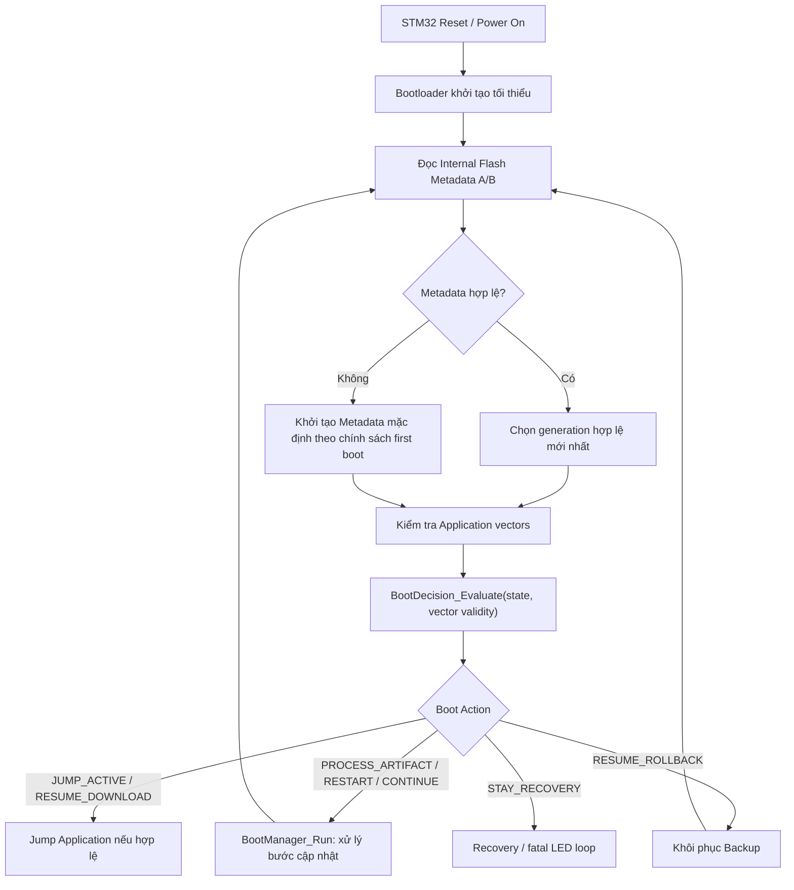

#### Bước 1. Bootloader chạy trước STM32 Application

Sau khi thiết bị khởi động hoặc reset, mã **Bootloader** tại vùng Internal Flash đầu tiên được thực thi. Theo memory map của project:

| Vùng Internal Flash | Địa chỉ bắt đầu | Kích thước |
|---|---|---:|
| Bootloader | `0x08000000` | 24 KB |
| Application | `0x08006000` | 38 KB |
| Metadata A | `0x0800F800` | 1 KB |
| Metadata B | `0x0800FC00` | 1 KB |

Bootloader khởi tạo các thành phần tối thiểu để đọc trạng thái, truy cập bộ nhớ và đưa ra quyết định. Nó **không mặc định nhảy ngay vào Application**; phải xem trạng thái cập nhật có yêu cầu công việc khác hay không.

#### Bước 2. Đọc và lựa chọn bản Metadata A/B

`BootMetadata_t` lưu các thông tin như `state`, `active_version`, `pending_version`, `active_update_id`, `copy_offset`, `boot_attempts`, `generation`, `last_error` và `crc32`.

Quá trình chọn bản Metadata được mô tả như sau:

```text
Đọc Metadata A và Metadata B
           |
           v
Kiểm tra magic / version / state / progress / CRC32
           |
           v
Chọn bản hợp lệ có generation mới nhất
           |
           +-- Có bản hợp lệ --> Dùng trạng thái đã lưu
           |
           +-- Không có bản hợp lệ --> Xử lý first-boot/default theo chính sách
```

Để ghi trạng thái mới, hệ thống **ghi vào trang không được chọn**, kiểm tra lại dữ liệu và chỉ sau đó sử dụng `generation` mới. Nhờ vậy, mất nguồn giữa lúc Erase/Program Metadata thường không phá hủy bản Metadata hợp lệ trước đó.

**Ví dụ:** Metadata A đang hợp lệ với `generation = 10`. Lần cập nhật mới ghi vào Metadata B với `generation = 11`. Nếu ghi B bị gián đoạn và CRC32 sai, Bootloader vẫn có thể chọn A. Nếu B ghi và xác minh thành công, B trở thành bản mới nhất.

> **Lưu ý:** CRC32 ở đây giúp **phát hiện bản ghi Metadata bị hỏng**, không phải xác thực chữ ký firmware. Metadata A/B trong **Internal Flash** cũng khác với **Download Checkpoint** lưu ở External Flash W25Q.

#### Bước 3. Kiểm tra điều kiện cho phép Jump Application

Trước khi chuyển quyền điều khiển, Bootloader kiểm tra **Application vector table** và điều kiện chính sách. Những kiểm tra được mô tả trong repository gồm:

- Giá trị **MSP** ban đầu nằm trong vùng SRAM hợp lệ và đúng alignment.
- **Reset Handler** nằm trong vùng Application Flash và có **Thumb bit** hợp lệ.
- Kích thước Application nằm trong giới hạn được cho phép.
- Kiểm tra image hash khi trạng thái và Metadata tin cậy yêu cầu.

Do đó, `UPDATE_IDLE` **không đồng nghĩa** với việc nhảy vào bất kỳ dữ liệu nào trong vùng Application: image vẫn phải hợp lệ.

#### Bước 4. `BootDecision_Evaluate()` ánh xạ trạng thái thành Boot Action

| Trạng thái Metadata | Boot Action chính / cách xử lý |
|---|---|
| `UPDATE_IDLE` | `BOOT_ACTION_JUMP_ACTIVE` nếu Application hợp lệ. |
| `UPDATE_RECEIVING` | `BOOT_ACTION_RESUME_DOWNLOAD`, thường nhảy vào Application hợp lệ để tiếp tục nhận OTA. |
| `UPDATE_ARTIFACT_READY` | `BOOT_ACTION_PROCESS_ARTIFACT`. |
| `UPDATE_VERIFYING_CONTAINER`, `UPDATE_VERIFYING_BASE` | `BOOT_ACTION_RESTART_VALIDATION`. |
| `UPDATE_PATCHING` | `BOOT_ACTION_RESTART_PATCH`. |
| `UPDATE_IMAGE_READY`, `UPDATE_BACKING_UP` | `BOOT_ACTION_CONTINUE_BACKUP`. |
| `UPDATE_INSTALLING` | `BOOT_ACTION_RESUME_INSTALL`. |
| `UPDATE_VERIFYING_INSTALL` | `BOOT_ACTION_VERIFY_INSTALL`. |
| `UPDATE_TRIAL_BOOT` | `BOOT_ACTION_BOOT_TRIAL` hoặc `BOOT_ACTION_RESUME_ROLLBACK` khi hết lượt/không hợp lệ. |
| `UPDATE_CONFIRMED` | `BOOT_ACTION_FINALIZE_CONFIRMATION`. |
| `UPDATE_ROLLBACK` | `BOOT_ACTION_RESUME_ROLLBACK`. |
| `UPDATE_FAILED` | `BOOT_ACTION_STAY_RECOVERY`. |

**Vì sao tách Boot Decision khỏi Boot Manager?** Decision có thể kiểm thử logic trạng thái mà không cần truy cập trực tiếp phần cứng; Manager chịu trách nhiệm thực thi các công việc Flash, xác thực, Jump hoặc Rollback thực tế.

#### Bước 5. Boot Manager thực thi, commit rồi đánh giá lại

Ví dụ khi Metadata lưu `UPDATE_IMAGE_READY`, Boot Decision yêu cầu tiếp tục Backup. Manager thực hiện giai đoạn phù hợp, **commit trạng thái/tiến độ** sau khi hoàn thành an toàn rồi đánh giá lại để chuyển sang Install. Cơ chế này cho phép sau reset, Bootloader **không phải suy đoán bằng RAM** đã đi đến đâu.

#### Bài nói khi phỏng vấn: Boot Decision và Metadata A/B

> **Boot Decision:** Khi STM32 reset, Bootloader đọc hai bản Metadata A/B trong Internal Flash, kiểm tra CRC32 và `generation` để chọn bản hợp lệ mới nhất. Sau đó Bootloader kiểm tra Application vector và gọi `BootDecision_Evaluate()` để quyết định nhảy vào Application, xử lý OTA, tiếp tục Install hay Rollback.
>
> Phần quyết định được tách khỏi phần thực thi: `BootDecision_Evaluate()` ánh xạ state sang action, còn `BootManager_Run()` thực hiện thao tác tương ứng và lưu tiến độ an toàn. Hai bản Metadata độc lập giúp hệ thống vẫn đọc được trạng thái trước đó nếu mất nguồn trong lúc ghi một bản mới.

#### Câu hỏi ôn tập: Boot Decision và Metadata A/B

| Câu hỏi | Ý chính cần trả lời |
|---|---|
| Vì sao Bootloader cần Metadata? | Để biết trạng thái OTA sau reset và chọn hành động tương ứng. |
| `state` khác `Boot Action` thế nào? | State là trạng thái bền vững; action là hành động Boot Decision suy ra từ state và điều kiện khác. |
| Vì sao dùng Metadata A/B? | Cho phép ghi bản mới mà không xóa bản hợp lệ đang được chọn. |
| `generation` để làm gì? | Chọn bản Metadata hợp lệ mới nhất. |
| CRC32 Metadata có chống giả mạo firmware không? | Không; nó chỉ phát hiện dữ liệu Metadata hỏng. |
| Vì sao phải kiểm tra vector trước khi Jump? | Tránh chuyển quyền điều khiển tới image/stack/reset handler không hợp lệ. |
| `BootDecision_Evaluate()` khác `BootManager_Run()` thế nào? | Một bên chọn hành động; một bên điều phối các thao tác thực tế. |

#### Điểm cần ghi nhớ

- **Reset → Metadata A/B → Application validity → Boot Decision → Boot Action.**
- Không dựa vào RAM để xác định tiến độ OTA sau mất nguồn.
- Một state có thể dẫn tới hành động khác nhau tùy điều kiện, đặc biệt là `UPDATE_TRIAL_BOOT`.

**Tài liệu/code đối chiếu:** `docs/metadata-and-boot-decision.md`, `docs/boot-state-machine.md`, `node-stm32f103/bootloader/src/boot_decision.c`, `node-stm32f103/bootloader/src/boot_manager.c`, `node-stm32f103/bootloader/storage/metadata_storage.c`.

---

<a id="chuong-5-2"></a>
### 5.2. `IDLE` → `RECEIVING` → `ARTIFACT_READY` → Bàn giao cho Bootloader

> **Mục tiêu:** Hiểu sự khác nhau giữa trạng thái **runtime của STM32 Application** khi nhận OTA và trạng thái **persisted** mà Bootloader sử dụng sau reset.
>
> **Tình huống:** STM32 đang chạy firmware v1; ESP32 đã tải gói SDOT để cập nhật lên v2.

#### Sơ đồ luồng hoạt động

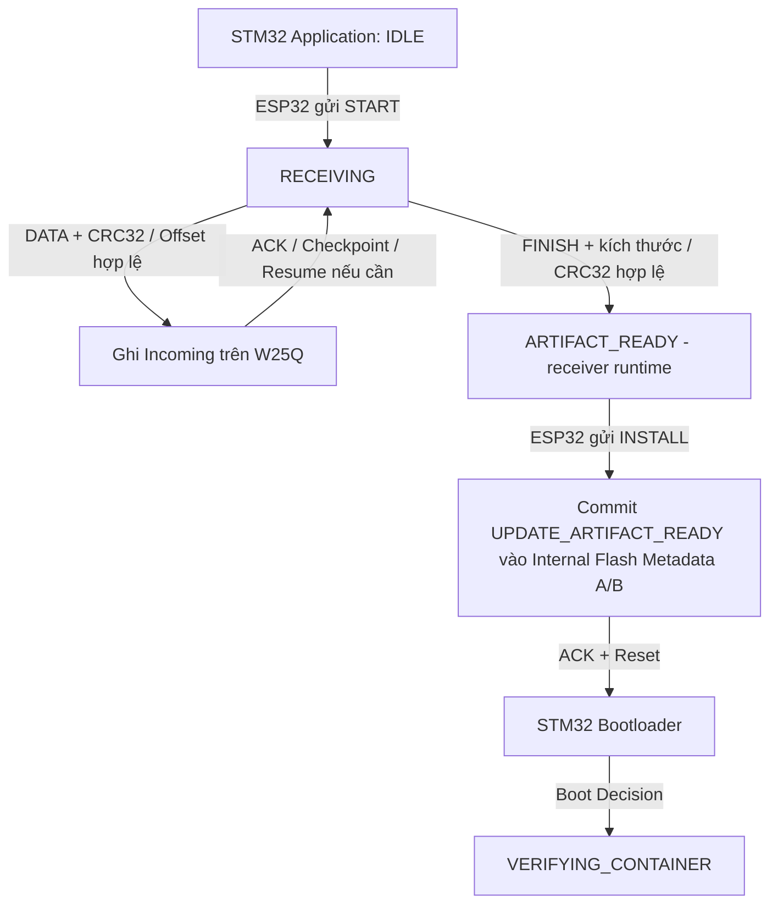

#### Bước 1. `IDLE` — Application vẫn đang hoạt động bình thường

Trong trạng thái chưa cập nhật, Bootloader cho **Application hợp lệ** chạy. ESP32 Gateway có thể dùng `HELLO` và `QUERY` để lấy thông tin thiết bị, phiên bản firmware, `update_id` và `next_expected_offset` trước khi truyền gói OTA.

`UPDATE_IDLE` trong **Internal Flash Metadata** thể hiện không có tiến trình cập nhật cần Bootloader tiếp tục. Nó không có nghĩa mọi trạng thái của UART receiver đều được Bootloader xử lý trực tiếp.

#### Bước 2. `RECEIVING` — STM32 Application tiếp nhận gói SDOT

Khi ESP32 gửi `START`, Application tiếp nhận gói cập nhật qua **UART**. Dữ liệu được chia thành các DATA packet, dùng **COBS** để đóng khung và **CRC32** để phát hiện lỗi truyền.

Application kiểm tra `update_id`, `Sequence`, `Offset`, sau đó ghi dữ liệu vào phân vùng **Incoming** của **External Flash W25Q** qua **SPI**. ESP32 dùng **ACK/NACK**, Timeout, Retry để tiếp tục truyền; nếu đã có tiến độ trước đó, có thể dùng `RESUME`.

**Lưu ý quan trọng:** Trong giai đoạn này, firmware v1 trong **Internal Flash** chưa bị ghi đè. Những thao tác `DATA` và `RESUME` chủ yếu thay đổi dữ liệu nhận và **Download Checkpoint**, không tạo một trạng thái Bootloader riêng cho mỗi packet.

#### Bước 3. `ARTIFACT_READY` sau `FINISH` — đã nhận đủ, chưa cài đặt

Khi nhận `FINISH`, STM32 Application kiểm tra:

1. Dữ liệu nhận được có đúng tổng kích thước `artifact_size` hay không.
2. **CRC32 toàn bộ gói SDOT** có đúng với giá trị dự kiến hay không.

Nếu thành công, receiver đạt **`ARTIFACT_READY` trong runtime**. Tuy nhiên, đây **chưa phải** điểm xác thực chữ ký bảo mật và cũng **chưa phải** thao tác cài firmware vào Internal Flash.

> **Phân biệt cần nhớ:** `ARTIFACT_READY` của receiver xuất hiện sau `FINISH`; `UPDATE_ARTIFACT_READY` của Bootloader là **trạng thái đã commit trong Internal Flash Metadata** sau lệnh `INSTALL`.

#### Bước 4. `INSTALL` — Commit Metadata và Reset

Sau `FINISH`, ESP32 gửi `INSTALL`. STM32 Application kiểm tra `ARTIFACT_READY` và `update_id`, ghi trạng thái `UPDATE_ARTIFACT_READY` vào **Metadata A/B**, phản hồi **ACK** rồi reset thiết bị.

```text
FINISH hợp lệ
    |
    v
ARTIFACT_READY (Application runtime)
    |
    | ESP32 gửi INSTALL
    v
Commit UPDATE_ARTIFACT_READY (Internal Flash Metadata)
    |
    v
ACK → Reset → STM32 Bootloader xử lý SDOT
```

Khi Bootloader chạy lại, `BootDecision_Evaluate()` nhận thấy yêu cầu cập nhật đã lưu và chọn xử lý SDOT thay vì khởi động Application theo luồng `IDLE`.

#### Bước 5. Nếu reset khi đang `RECEIVING` thì sao?

STM32 Application dùng **Download Checkpoint** ở External Flash W25Q, được commit theo ranh giới **sector 4 KB**. Sau reset, receiver lấy mốc an toàn gần nhất và ESP32 **truyền lại từ offset đó** thay vì tin rằng offset ACK trong RAM là bền vững.

**Ví dụ:** Đã ACK đến khoảng 10 KB nhưng Checkpoint bền vững gần nhất là 8 KB. Sau mất nguồn, thiết bị có thể yêu cầu `RESUME` từ **8192 bytes**, nhận lại phần chưa được Checkpoint an toàn.

#### Bài nói khi phỏng vấn: Tiếp nhận OTA và bàn giao

> **IDLE → RECEIVING → ARTIFACT_READY:** Ban đầu STM32 chạy Application hiện tại. ESP32 gửi lệnh START để bắt đầu truyền gói SDOT qua UART. STM32 kiểm tra CRC32, Sequence và Offset rồi lưu gói vào W25Q, có ACK/NACK và Checkpoint hỗ trợ Resume.
>
> Khi FINISH thành công, trạng thái ARTIFACT_READY chỉ xác nhận gói đã được nhận đầy đủ. Sau lệnh INSTALL, Application mới commit `UPDATE_ARTIFACT_READY` vào Internal Flash Metadata và reset. Từ thời điểm đó STM32 Bootloader mới xác thực chữ ký SDOT và quyết định cài đặt. Nhờ vậy, Application không phải tự ghi đè firmware đang chạy.

#### Câu hỏi ôn tập: Trạng thái tiếp nhận

| Câu hỏi | Ý chính cần trả lời |
|---|---|
| `FINISH` khác `INSTALL` ở đâu? | FINISH xác nhận nhận đủ SDOT; INSTALL commit Metadata rồi reset để bàn giao. |
| Vì sao `ARTIFACT_READY` có hai ngữ cảnh? | Một bên là receiver runtime; bên kia là Metadata bền vững cho Bootloader. |
| Tại sao lưu SDOT vào W25Q? | Tránh ghi đè Application trong lúc truyền còn có thể gián đoạn. |
| ACK có tương đương Checkpoint không? | Không. ACK theo packet; Checkpoint là mốc phục hồi bền vững. |
| Reset giữa `RECEIVING` xử lý sao? | Đọc Checkpoint 4 KB và Resume từ offset an toàn. |
| STM32 Application có xác thực chữ ký ECDSA trước INSTALL không? | Không; Bootloader quyết định độ tin cậy khi xử lý SDOT. |

#### Điểm cần ghi nhớ

- **`FINISH` ≠ `INSTALL`**; nhận đủ gói SDOT không có nghĩa đã xác thực/cài đặt firmware.
- **UART Receiver runtime ≠ Bootloader persisted state**.
- **Download Checkpoint 4 KB** phục vụ Resume; Application hiện tại chưa bị ghi đè ở giai đoạn nhận.

**Tài liệu/code đối chiếu:** `docs/uart-ota-protocol.md`, `docs/boot-state-machine.md`, `node-stm32f103/application/src/ota_receiver.c`.

---

<a id="chuong-5-3"></a>
### 5.3. `VERIFYING_CONTAINER` → `VERIFYING_BASE` → `PATCHING` → `IMAGE_READY`

> **Mục tiêu:** Phân tích cách Bootloader **xác thực nguồn cập nhật**, kiểm tra **Base Image** của Delta OTA, chuẩn bị firmware mục tiêu và xác minh firmware mới **trước khi** ghi đè Application đang hoạt động.
>
> **Phân biệt Full/Delta:** Full OTA mang **toàn bộ firmware mới**; Delta OTA mang **patch** và phải khớp firmware gốc. **Cả Full và Delta** đều đi qua trạng thái persisted `UPDATE_PATCHING` trong triển khai hiện tại.

#### Sơ đồ luồng hoạt động

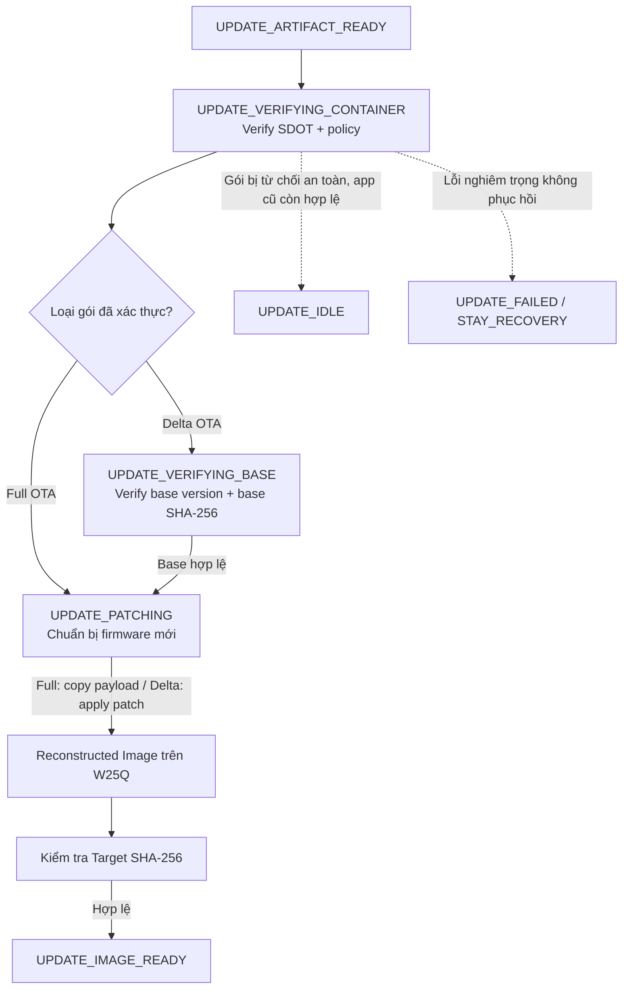

#### Bước 1. `UPDATE_ARTIFACT_READY` yêu cầu xử lý SDOT

Sau `INSTALL + Reset`, Bootloader đọc Metadata và chọn `BOOT_ACTION_PROCESS_ARTIFACT`. Gói SDOT đã lưu trong phân vùng **Incoming** của W25Q được đưa vào quy trình xác thực/cài đặt.

Tại thời điểm này, Bootloader chưa xóa Application hiện tại. Nếu nguồn cập nhật không đáp ứng chính sách bảo mật, hệ thống phải **từ chối trước giai đoạn Backup/Install**.

#### Bước 2. `UPDATE_VERIFYING_CONTAINER` — Kiểm tra gói SDOT

Bootloader phân tích và xác minh thông tin trong SDOT, bao gồm:

1. Định dạng/Header và kích thước gói.
2. **Product ID**, **Hardware Revision** và chính sách phiên bản/Anti-downgrade.
3. Các giá trị **CRC32** phục vụ phát hiện lỗi dữ liệu ở lớp tương ứng.
4. Giá trị **SHA-256** và **chữ ký ECDSA P-256** với **Public Key tin cậy**.

| Cơ chế | Vai trò trong luồng |
|---|---|
| **CRC32** | Phát hiện dữ liệu hỏng trong truyền/lưu trữ. |
| **SHA-256** | Tính/đối chiếu hash của dữ liệu được quy định. |
| **ECDSA P-256** | Xác thực chữ ký số của gói cập nhật bằng Public Key tin cậy. |
| **Product/Version policy** | Ngăn cài nhầm thiết bị hoặc phiên bản không được phép. |

**Tình huống minh họa:** Một gói SDOT có CRC32 đúng nhưng chữ ký ECDSA sai **không được coi là bản cập nhật tin cậy**. CRC32 không thể thay thế bước xác thực chữ ký.

> **Lưu ý triển khai:** Tài liệu của project ghi rõ repository **chưa provision Public Key production mặc định**. Khi giải thích ở phỏng vấn, cần phân biệt **code có cơ chế xác thực** với việc thiết bị thực tế **đã được provision khóa tin cậy để xác thực firmware ký số**.

#### Bước 3. `UPDATE_VERIFYING_BASE` — Chỉ dành cho Delta OTA

Với **Delta OTA**, Bootloader phải kiểm tra firmware gốc mà patch yêu cầu, gồm **base version** và **Base SHA-256**. Patch chỉ hợp lệ khi firmware gốc đang có **khớp chính xác** với firmware dùng để tạo patch bên phát hành.

Ví dụ: Delta Patch được tạo từ **v1-A → v2**. Nếu thiết bị đang có firmware **v1-B** dù cùng số version v1 nhưng hash khác, Bootloader phải **từ chối áp dụng patch**. Vì thuật toán patch đọc các byte/offset của Base Image, dùng sai base sẽ không đảm bảo tạo được Target Image mong muốn.

**Full OTA** không cần `VERIFYING_BASE` nhưng vẫn cần xác thực SDOT và Target Image.

#### Bước 4. `UPDATE_PATCHING` — Chuẩn bị Full/Delta image

Trong repository, **cả hai loại signed SDOT** đều đi qua trạng thái persisted **`UPDATE_PATCHING`**:

| Full OTA | Delta OTA |
|---|---|
| Copy payload firmware đầy đủ vào vùng **Reconstructed Image** của W25Q. | Áp dụng Delta Patch lên firmware gốc đã kiểm tra để tạo image mới ở **Reconstructed Image**. |
| Không cần Base Image. | Bắt buộc xác minh base version và Base SHA-256. |
| Vẫn phải xác minh Target Image sau chuẩn bị. | Vẫn phải xác minh Target Image sau tái tạo. |

```text
                Signed SDOT hợp lệ
                        |
             +----------+----------+
             |                     |
          Full OTA               Delta OTA
             |                     |
       Copy Full Payload      Verify Base Image
             |                     |
             |               Apply Delta Patch
             +----------+----------+
                        |
                        v
             Reconstructed Image (W25Q)
                        |
                 Verify Target SHA-256
                        |
                        v
                 UPDATE_IMAGE_READY
```

**Vì sao vẫn dùng W25Q?** Vì cần tạo và xác minh **firmware hoàn chỉnh** trước khi xóa/ghi Application ở Internal Flash. Điều này giảm rủi ro cài một image không hợp lệ.

#### Bước 5. `UPDATE_IMAGE_READY` — Ứng viên mới đã được kiểm tra

Bootloader kiểm tra **Target SHA-256** và các điều kiện hợp lệ của image đã chuẩn bị. Sau khi thành công, trạng thái chuyển sang `UPDATE_IMAGE_READY`, từ đó cho phép bắt đầu **Backup** firmware cũ.

`IMAGE_READY` **không phải** trạng thái cập nhật đã hoàn tất: Application cũ vẫn đang ở Internal Flash và firmware mới chưa được cài đặt.

#### Bước 6. Mất nguồn trong xác thực hoặc `PATCHING`

- `UPDATE_VERIFYING_CONTAINER`: Sau reset, Bootloader **bắt đầu lại** việc kiểm tra SDOT.
- `UPDATE_VERIFYING_BASE`: Sau reset, Bootloader **kiểm tra lại** Base Image.
- `UPDATE_PATCHING`: Bootloader **xóa vùng Reconstructed Image rồi chuẩn bị lại** từ đầu, tránh tái sử dụng dữ liệu tái tạo dở.

Đây là **Power-loss Recovery bằng restart bước an toàn**, không phải Rollback: firmware cũ trong Internal Flash chưa bị ghi đè.

#### Bài nói khi phỏng vấn: Xác thực và chuẩn bị firmware

> **VERIFYING_CONTAINER → IMAGE_READY:** Khi Bootloader thấy `UPDATE_ARTIFACT_READY`, nó đọc gói SDOT ở W25Q và xác thực chữ ký ECDSA P-256, hash SHA-256, Product ID và chính sách phiên bản. Với Delta OTA, nó còn kiểm tra version và hash của firmware gốc trước khi áp dụng patch.
>
> Cả Full OTA và Delta OTA đều đi qua `UPDATE_PATCHING`: Full OTA copy payload vào vùng Reconstructed Image, còn Delta OTA tái tạo image từ firmware gốc và patch. Sau đó Bootloader kiểm tra Target SHA-256, chỉ khi image hợp lệ mới chuyển sang `UPDATE_IMAGE_READY`. Nếu mất nguồn trong lúc patch, hệ thống chuẩn bị lại image từ đầu; Application hiện tại chưa bị ghi đè.

#### Câu hỏi ôn tập: Xác thực và tái tạo image

| Câu hỏi | Ý chính cần trả lời |
|---|---|
| Vì sao CRC32 đúng vẫn phải kiểm tra ECDSA? | CRC32 không xác thực nguồn phát hành firmware. |
| ECDSA Public Key nằm ở đâu? | Bootloader dùng khóa tin cậy đã được provision; private key thuộc phía phát hành. |
| Vì sao Delta cần Base SHA-256? | Để chắc chắn patch được áp dụng đúng firmware gốc. |
| Full OTA có đi qua `UPDATE_PATCHING` không? | Có. Full copy payload; Delta áp dụng patch. |
| Vì sao dùng vùng Reconstructed Image? | Có thể kiểm tra firmware hoàn chỉnh trước khi xóa Application. |
| Reset khi `PATCHING` thì sao? | Xóa vùng Reconstructed và chuẩn bị lại từ đầu. |
| `IMAGE_READY` nghĩa là đã cài firmware chưa? | Chưa; chỉ xác nhận candidate image đã chuẩn bị và kiểm tra hợp lệ. |

#### Điểm cần ghi nhớ

- **Verify SDOT → (Delta: Verify Base) → Prepare Image → Verify Target Hash → IMAGE_READY.**
- **Full và Delta đều dùng `UPDATE_PATCHING`**, nhưng cách chuẩn bị image khác nhau.
- Có trường hợp **từ chối gói SDOT rồi trở về IDLE an toàn**; không phải mọi lỗi xác thực đều làm mất firmware cũ hay buộc Rollback.

**Tài liệu/code đối chiếu:** `docs/boot-state-machine.md`, `docs/firmware-container.md`, `node-stm32f103/bootloader/src/secure_container.c`, `node-stm32f103/bootloader/include/trusted_key.h`.

---

<a id="chuong-5-4"></a>
### 5.4. `IMAGE_READY` → `BACKING_UP` → `INSTALLING` → `VERIFYING_INSTALL`

> **Mục tiêu:** Hiểu vì sao Bootloader phải **Backup trước khi Install**, cách ghi Internal Flash theo trang và cách lưu Checkpoint để phục hồi khi thiết bị mất nguồn đúng lúc đang ghi firmware.

#### Sơ đồ luồng hoạt động

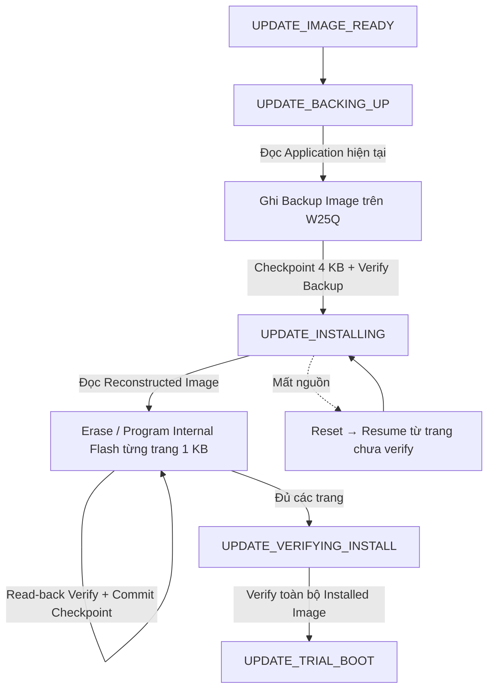

#### Bước 1. `UPDATE_IMAGE_READY` cho phép chuyển sang Backup

Điều kiện vào bước này là **firmware mới đã được chuẩn bị và kiểm tra** trong phân vùng Reconstructed Image của W25Q. Bootloader **không ghi trực tiếp SDOT/Delta Patch** vào Internal Flash Application.

Với Delta OTA, dữ liệu ở Reconstructed Image đã là **target firmware hoàn chỉnh**, không còn chỉ là patch.

#### Bước 2. `UPDATE_BACKING_UP` — Sao lưu firmware hiện tại

Bootloader đọc Application v1 từ **Internal Flash** rồi ghi vào phân vùng **Backup Image** trên W25Q qua SPI. Bước Backup dùng Checkpoint ở ranh giới sector **4 KB** và xác minh bản Backup trước khi cho phép Install.

```text
Internal Flash (Application v1)
              |
              | Read
              v
         Bootloader
              |
              | SPI write + verify
              v
External W25Q (Backup Image v1)
              |
              v
     Backup hợp lệ → INSTALLING
```

**Tại sao bắt buộc Backup trước khi Install?** Vì thao tác Erase/Program sẽ phá dữ liệu Application v1 trong Internal Flash. Nếu firmware v2 không thể khởi động/xác nhận, Bootloader cần **Backup hợp lệ** để Rollback.

> **Phân biệt:** Backup là bước **chuẩn bị phương án khôi phục**; Rollback là bước **thực sự khôi phục** firmware cũ khi bản mới không được chấp nhận.

#### Bước 3. `UPDATE_INSTALLING` — Cài đặt firmware mới theo trang 1 KB

Sau khi Backup hợp lệ, Bootloader đọc firmware mới từ **Reconstructed Image**, sau đó Erase và Program vùng **Application của Internal Flash**.

Chu kỳ cài đặt cho một trang được diễn giải như sau:

```text
Đọc dữ liệu target của trang từ W25Q
                  |
                  v
           Erase Flash page
                  |
                  v
           Program dữ liệu
                  |
                  v
           Read-back Verify
                  |
           +------+------+
           |             |
         Thành công     Thất bại
           |             |
     Commit Checkpoint   Không đánh dấu trang hoàn tất
           |
           v
       Trang tiếp theo
```

Với STM32F103 của project, **Internal Flash page = 1 KB**. Checkpoint chỉ được commit **sau khi trang tương ứng ghi và kiểm tra thành công**.

#### Bước 4. Mất nguồn khi đang `INSTALLING`

Giả sử đang cài image 20 KB, đã kiểm tra/commit thành công 8 trang đầu (8 KB), nhưng mất nguồn khi đang ghi trang thứ 9:

1. Sau reset, Bootloader đọc Metadata A/B và nhận trạng thái `UPDATE_INSTALLING`.
2. Dựa trên tiến độ đã lưu, Bootloader biết **8 KB trước đã được xác nhận**.
3. Bootloader bắt đầu lại từ **trang đầu tiên chưa được xác nhận**, có thể Erase và Program lại trang đang dang dở.
4. Chỉ khi toàn bộ các trang hợp lệ mới chuyển sang Verify Installed Image.

**Nguyên tắc:** Không coi một trang bị ghi dở là hợp lệ chỉ vì có dữ liệu trên Flash. Checkpoint phải phản ánh **đơn vị đã xác minh**, không phải chỉ số byte đã thử ghi.

#### Bước 5. `UPDATE_VERIFYING_INSTALL` — Kiểm tra firmware đã cài đặt

Sau khi Program xong, Bootloader **kiểm tra lại toàn bộ Installed Image** trong Internal Flash. Điều này khác với việc kiểm tra Reconstructed Image trước đó: nguồn firmware có thể đúng nhưng quá trình Erase/Program có thể gặp lỗi.

Nếu reset trong trạng thái `UPDATE_VERIFYING_INSTALL`, Bootloader **thực hiện lại bước Verify**. Khi image đã cài đặt hợp lệ, hệ thống mới chuyển sang `UPDATE_TRIAL_BOOT`.

#### Bước 6. Nếu nguồn Reconstructed Image hoặc Install không còn tin cậy

Theo tài liệu trạng thái, khi quá trình cài đặt không thể tiếp tục vì nguồn Reconstructed Image không hợp lệ, hệ thống **thử Rollback từ Backup đã xác minh**. Không nên mô tả mọi lỗi ghi Flash đều chắc chắn khôi phục thành công: còn phụ thuộc tính hợp lệ của Backup và bộ nhớ.

#### Bài nói khi phỏng vấn: Backup, Install và Verify

> **IMAGE_READY → VERIFYING_INSTALL:** Sau khi xác minh Target Image, Bootloader chuyển sang `BACKING_UP` để sao lưu Application đang chạy vào vùng Backup Image trên W25Q và kiểm tra bản Backup. Sau đó Bootloader mới `INSTALLING`, đọc Target Image từ Reconstructed Image và Erase/Program vùng Application của Internal Flash.
>
> Install diễn ra theo các trang 1 KB. Với mỗi trang, hệ thống đọc lại để Verify rồi mới commit Checkpoint. Nếu mất nguồn, Bootloader tiếp tục từ trang chưa xác minh gần nhất. Cuối cùng `VERIFYING_INSTALL` kiểm tra toàn bộ image đã cài trước khi chuyển sang Trial Boot.

#### Câu hỏi ôn tập: Backup và Install

| Câu hỏi | Ý chính cần trả lời |
|---|---|
| Vì sao `IMAGE_READY` chưa cài đặt ngay? | Cần Backup firmware cũ hợp lệ trước khi ghi đè Application. |
| Backup lưu ở đâu? | Phân vùng Backup Image trên External Flash W25Q. |
| Backup Checkpoint theo đơn vị nào? | Sector W25Q 4 KB. |
| Install Checkpoint theo đơn vị nào? | Trang Internal Flash 1 KB. |
| Vì sao Checkpoint chỉ commit sau Verify? | Để không bỏ qua trang chưa được ghi chắc chắn. |
| Nếu mất nguồn giữa trang Flash? | Resume từ trang chưa được xác nhận, Erase/Program lại an toàn. |
| `VERIFYING_INSTALL` khác Target SHA-256 trước Install? | Kiểm tra dữ liệu thật đã được ghi vào Internal Flash. |
| Khi nào cần Rollback? | Khi firmware mới không thể được chấp nhận và có Backup phù hợp để phục hồi. |

#### Điểm cần ghi nhớ

- **Prepare + Verify candidate → Backup + Verify → Install từng trang + Verify → Verify toàn image.**
- **4 KB** là ranh giới Checkpoint cho Backup W25Q; **1 KB** cho Install Internal Flash.
- **Power-loss Recovery** khi đang cài đặt thường là **Resume**, không mặc định là Rollback.

**Tài liệu/code đối chiếu:** `docs/boot-state-machine.md`, `docs/memory-map.md`, `node-stm32f103/bootloader/src/image_installer.c`, `node-stm32f103/bootloader/src/boot_manager.c`.

---

<a id="chuong-5-5"></a>
### 5.5. `TRIAL_BOOT` → `CONFIRMED` / `ROLLBACK` → `IDLE`

> **Mục tiêu:** Hiểu vì sao **Install thành công chưa phải cập nhật thành công**, cách Bootloader quản lý số lần thử, cách Application xác nhận bản mới và cách quay về firmware cũ nếu Trial Boot thất bại.

#### Sơ đồ luồng hoạt động

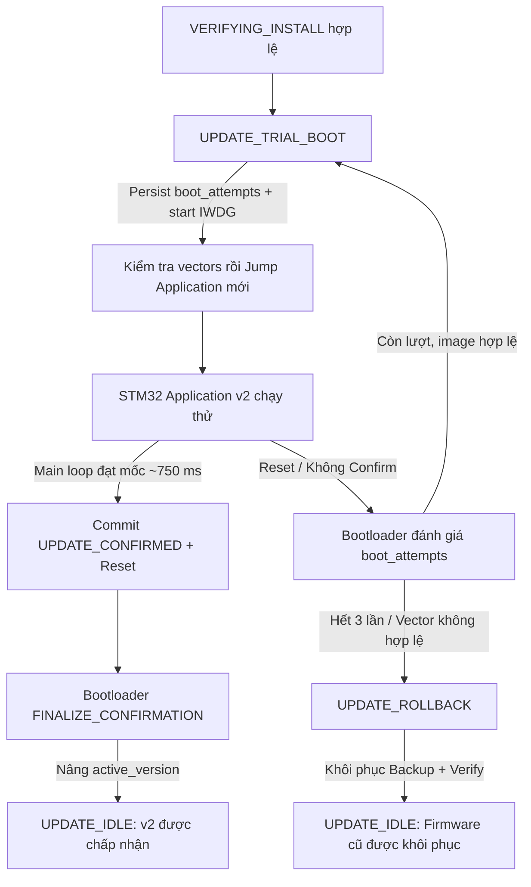

#### Bước 1. Vào `UPDATE_TRIAL_BOOT` sau khi Verify Installed Image

Bootloader chuyển sang **Trial Boot** khi firmware v2 đã cài và kiểm tra hợp lệ. Đây mới là **firmware ứng viên đang chạy thử**; phiên bản mới chưa được ghi nhận là firmware đã xác nhận chính thức.

**Quy tắc quan trọng:** `active_version` vẫn là phiên bản **đã được xác nhận trước đó** cho đến khi quá trình Confirm hoàn tất. Không nâng `active_version` ngay sau khi `INSTALLING` thành công.

#### Bước 2. Persist `boot_attempts`, bật IWDG rồi Jump

Trước mỗi lần cho firmware mới chạy thử, Bootloader:

1. Cập nhật và **lưu bền vững** số lần thử `boot_attempts`.
2. Khởi động **IWDG** theo chính sách Trial Boot.
3. Kiểm tra tính hợp lệ của Application vector trước khi Jump.
4. Bàn giao quyền điều khiển cho STM32 Application mới nếu hợp lệ.

Lưu bộ đếm **trước khi Jump** giúp reset do Watchdog hoặc lỗi Application vẫn bị tính là một lần thử, thay vì mất thông tin vì bộ đếm chỉ nằm trong RAM.

#### Bước 3. Application v2 thực hiện xác nhận hoạt động

Trong bản demo hiện tại, Application dùng `TrialConfirmation_Init()` và `TrialConfirmation_Process(now_ms)`. Sau khoảng **750 ms** của main loop đã khởi tạo, Application có thể gọi cơ chế Confirm, ghi `UPDATE_CONFIRMED` rồi **reset về Bootloader**.

Đây là kiểm tra **main-loop liveness cơ bản** (khởi tạo clock/SysTick, GPIO, UART/OTA agent và chạy vòng lặp), **không tương đương** một bộ health check hoàn chỉnh ở mức sản phẩm.

Repository cũng mô tả lệnh UART `CONFIRM` tùy chọn gọi cùng cơ chế xác nhận; khi trình bày, không nên khẳng định mọi hệ thống thực tế chỉ xác nhận theo đúng 750 ms.

#### Bước 4. `UPDATE_CONFIRMED` — Hoàn tất chấp nhận firmware mới

Sau khi Application commit Confirm và reset, Bootloader đọc Metadata rồi chọn `BOOT_ACTION_FINALIZE_CONFIRMATION`. Ở bước này, Bootloader cập nhật `active_version` theo bản đã xác nhận, hoàn tất chính sách với Backup, sau đó chuyển về `UPDATE_IDLE`.

```text
Application v2 Trial Boot
         |
         | Confirm hoạt động
         v
Commit UPDATE_CONFIRMED → Reset
         |
         v
Bootloader FINALIZE_CONFIRMATION
         |
         v
Nâng active_version → UPDATE_IDLE
```

**Điểm cần nhớ:** Có hai mốc khác nhau:

- **Install + Verify thành công:** Firmware mới *đã được ghi đúng*.
- **Confirm + Finalize thành công:** Firmware mới *được chấp nhận làm phiên bản hoạt động*.

#### Bước 5. Không Confirm sau số lần thử cho phép → `UPDATE_ROLLBACK`

Nếu Application mới bị reset lặp lại, không Confirm hoặc vector không hợp lệ, Bootloader xem `boot_attempts` và chính sách Trial Boot. Giới hạn hiện tại là **3 lần thử chưa xác nhận**.

Khi hết lượt hoặc gặp điều kiện cần phục hồi, Bootloader chuyển sang `UPDATE_ROLLBACK` và đọc **Backup Image** từ W25Q để khôi phục firmware cũ vào Internal Flash. Rollback có **Checkpoint theo trang 1 KB** và kiểm tra lại dữ liệu đã phục hồi.

#### Bước 6. Mất nguồn khi đang `ROLLBACK`

Bootloader không coi vùng Application đang khôi phục dở là ứng dụng hợp lệ. Sau reset, nó đọc Metadata `UPDATE_ROLLBACK` và tiếp tục từ **trang chưa được xác nhận an toàn**. Khi phục hồi/Verify thành công, hệ thống có thể quay về `UPDATE_IDLE` với firmware cũ.

**Giới hạn thực tế:** Rollback đòi hỏi bản Backup hợp lệ và Flash hoạt động được. Nếu dữ liệu nguồn hoặc trạng thái không thể phục hồi, cần xử lý lỗi/recovery; không nên hứa rằng Rollback luôn thành công trong mọi trường hợp hỏng bộ nhớ.

#### Bài nói khi phỏng vấn: Trial Boot, Confirm và Rollback

> **TRIAL_BOOT → CONFIRMED/ROLLBACK:** Sau khi firmware mới được cài và Verify, Bootloader chưa chấp nhận ngay mà cho chạy Trial Boot. Trước khi Jump, Bootloader lưu số lần thử `boot_attempts` và bật IWDG.
>
> Trong bản demo, Application xác nhận sau khoảng 750 ms main loop hoạt động, ghi `UPDATE_CONFIRMED` rồi reset về Bootloader. Bootloader mới cập nhật `active_version` và chuyển về `IDLE`. Nếu Application không Confirm sau tối đa 3 lần thử hoặc vector không hợp lệ, Bootloader Rollback từ Backup trên W25Q. Việc Rollback cũng có Checkpoint để tiếp tục nếu mất nguồn.

#### Câu hỏi ôn tập: Trial Boot và Rollback

| Câu hỏi | Ý chính cần trả lời |
|---|---|
| Vì sao không Confirm ngay sau Install? | Ghi image đúng chưa chứng minh Application mới chạy được. |
| `active_version` đổi khi nào? | Khi Bootloader hoàn tất bước Confirm, không phải khi Install xong. |
| Vì sao lưu `boot_attempts` trước Jump? | Đếm được cả lần chạy thử kết thúc bằng reset/Watchdog. |
| IWDG có vai trò gì? | Giúp xử lý Application không xác nhận/không tiếp tục chạy như mong đợi. |
| Giới hạn Trial Boot trong repo? | 3 lần thử chưa Confirm. |
| 750 ms là health check đầy đủ chưa? | Chưa; là liveness check cơ bản của demo. |
| Rollback khác Anti-rollback ở đâu? | Rollback phục hồi Backup; Anti-rollback/Anti-downgrade là chính sách giới hạn version được phép cài. |
| Nếu mất nguồn giữa Rollback? | Tiếp tục từ Checkpoint trang 1 KB. |

#### Điểm cần ghi nhớ

- **Install thành công ≠ Confirm thành công.**
- `active_version` chỉ được nâng sau khi bước **Finalize Confirmation** hoàn tất.
- **3 trial attempts + IWDG + Backup** hỗ trợ phát hiện/khôi phục khi Application mới không được xác nhận.
- **750 ms** là cơ chế demo, không phải kết quả kiểm thử toàn bộ chức năng sản phẩm.

**Tài liệu/code đối chiếu:** `docs/boot-state-machine.md`, `docs/metadata-and-boot-decision.md`, `node-stm32f103/bootloader/src/boot_manager.c`, `node-stm32f103/bootloader/src/image_installer.c`.

---

<a id="chuong-5-6"></a>
### 5.6. Power-loss Recovery, trạng thái `FAILED` và các chuyển trạng thái không hợp lệ

> **Mục tiêu:** Tổng hợp hành vi phục hồi theo **từng state**, chỉ rõ trường hợp nào **Resume**, trường hợp nào **Restart**, trường hợp nào **Rollback** và khi nào phải **STAY_RECOVERY**.

#### Sơ đồ quyết định sau reset bất ngờ

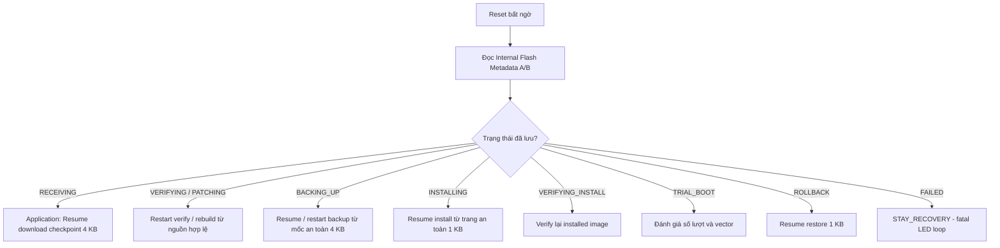

#### Bước 1. Phân loại giai đoạn bị gián đoạn

| State / Giai đoạn | Hành vi khi khởi động lại | Đơn vị tiến độ chính |
|---|---|---|
| `RECEIVING` | Application khôi phục Download Checkpoint; ESP32 Resume từ offset an toàn. | Sector W25Q **4 KB**. |
| `VERIFYING_CONTAINER` | Kiểm tra lại gói SDOT. | Restart bước xác thực. |
| `VERIFYING_BASE` | Kiểm tra lại Base Image. | Restart bước xác thực. |
| `PATCHING` | Xóa Reconstructed Image và chuẩn bị lại Full/Delta image. | Restart chuẩn bị image. |
| `BACKING_UP` | Khôi phục/tiếp tục Backup đã xác minh. | Sector W25Q **4 KB**. |
| `INSTALLING` | Resume từ trang Internal Flash chưa xác minh. | Trang Internal Flash **1 KB**. |
| `VERIFYING_INSTALL` | Kiểm tra lại toàn bộ installed image. | Restart Verify. |
| `TRIAL_BOOT` | Quyết định thử lại hoặc Rollback theo attempts/vector. | `boot_attempts` đã persist. |
| `ROLLBACK` | Tiếp tục khôi phục từ Backup. | Trang Internal Flash **1 KB**. |
| `FAILED` | `BOOT_ACTION_STAY_RECOVERY`. | Không tự thực hiện UART START để phục hồi từ xa. |

#### Bước 2. Phân biệt Restart, Resume và Rollback

| Khái niệm | Ý nghĩa | Ví dụ trong project |
|---|---|---|
| **Restart step** | Làm lại một bước an toàn từ đầu. | Kiểm tra lại SDOT; xóa Reconstructed và Apply Patch lại. |
| **Resume** | Tiếp tục từ mốc tiến độ bền vững đã xác minh. | Resume Download 4 KB; Install/Rollback theo trang 1 KB. |
| **Rollback** | Thay firmware mới không được chấp nhận bằng bản Backup hợp lệ. | Trial Boot vượt số lần thử, khôi phục Application v1. |
| **STAY_RECOVERY** | Không Jump Application và ở lại nhánh xử lý lỗi nghiêm trọng. | `UPDATE_FAILED` trong triển khai hiện tại. |

**Ví dụ để phân biệt:** Mất nguồn trong `PATCHING` không nhất thiết phải Rollback, vì Application cũ vẫn chưa bị ghi đè; Bootloader có thể **Restart Patch**. Ngược lại, sau khi v2 đã cài nhưng Trial Boot thất bại, Bootloader cần **Rollback** từ Backup v1.

#### Bước 3. `UPDATE_FAILED` không phải UART Recovery mode hoàn chỉnh

Trong repository, `UPDATE_FAILED` ánh xạ tới `BOOT_ACTION_STAY_RECOVERY`. Bootloader ở nhánh báo lỗi/LED fatal và **không chạy Application UART receiver để tự nhận `START`** trong trạng thái này.

Vì vậy, khi phỏng vấn, nên trình bày đúng giới hạn: project **có phát hiện và giữ thiết bị ở trạng thái Recovery đối với lỗi nghiêm trọng**, nhưng không nên nói rằng thiết bị có thể tự nhận firmware mới từ ESP32 ở mọi tình huống `FAILED`.

**Phân biệt thêm:** Một gói SDOT bị từ chối có kiểm soát trong khi Application cũ vẫn hợp lệ **có thể được dọn pending update và trở lại `UPDATE_IDLE`**. Không phải cứ sai chữ ký hoặc sai base là hệ thống luôn đi tới `UPDATE_FAILED`.

#### Bước 4. Các chuyển trạng thái phải từ chối

Theo tài liệu thiết kế, những tình huống sau là **illegal transitions**:

1. Nhận `DATA` khi receiver không ở `RECEIVING`.
2. Gửi `INSTALL` khi vẫn đang `RECEIVING` và chưa `FINISH` hợp lệ.
3. Đi vào `PATCHING` khi chưa vượt qua kiểm tra chữ ký và base cần thiết.
4. Đi vào `INSTALLING` khi Backup chưa được xác minh.
5. Nhận `CONFIRMED` khi chưa từng ở `TRIAL_BOOT`.
6. Xóa Backup trước khi firmware mới được Confirm.
7. Chấp nhận `update_id` khác khi đang nhận dở mà không thực hiện luồng ABORT/new START cleanup phù hợp.

Những ràng buộc này bảo vệ tính nhất quán của State Machine: **mỗi bước chỉ được bắt đầu khi những điều kiện an toàn ở bước trước đã hoàn tất**.

#### Bước 5. Tình huống phỏng vấn: thiết bị mất nguồn ở nhiều vị trí

**Tình huống A — Mất nguồn sau khi đã ACK 10 KB nhưng Checkpoint mới đến 8 KB:**

- Không tin offset ACK trong phiên UART trước đó là tiến độ bền vững.
- Application khôi phục Checkpoint W25Q và ESP32 Resume từ khoảng 8 KB.

**Tình huống B — Mất nguồn giữa Apply Patch:**

- Bootloader thấy `UPDATE_PATCHING`.
- Xóa vùng Reconstructed Image và tạo lại firmware mới từ gói SDOT/base hợp lệ.
- Chưa cần Rollback vì Application cũ chưa bị ghi đè.

**Tình huống C — Mất nguồn giữa Install trang thứ 9:**

- Bootloader thấy `UPDATE_INSTALLING`.
- Resume từ **trang chưa được Verify/Checkpoint**.
- Không Jump vào Application đang ghi dở.

**Tình huống D — Firmware mới reset liên tục trong Trial Boot:**

- `boot_attempts` đã được lưu bền vững trước mỗi lần thử.
- Khi hết **3 lần thử** hoặc có vector không hợp lệ, Bootloader đi vào Rollback từ Backup.

#### Bài nói khi phỏng vấn: Power-loss Recovery và xử lý lỗi

> **Power-loss Recovery:** Sau reset, Bootloader đọc Metadata A/B để biết công việc đang dở. Nếu đang Verify hoặc Patch, nó Restart bước tương ứng từ nguồn tin cậy; nếu đang Backup, Install hoặc Rollback, nó tiếp tục từ Checkpoint đã xác minh. Nhờ vậy không đánh dấu dữ liệu ghi dở là hợp lệ.
>
> Em phân biệt Power-loss Recovery với Rollback: Recovery là tiếp tục/restart công việc an toàn sau mất nguồn; Rollback là phục hồi firmware đã sao lưu khi phiên bản mới không được chấp nhận. Với lỗi không thể phục hồi, `UPDATE_FAILED` sẽ khiến Bootloader ở `STAY_RECOVERY`; bản hiện tại không có UART OTA receiver tự chạy ở nhánh này.

#### Câu hỏi ôn tập: Recovery và illegal transitions

| Câu hỏi | Ý chính cần trả lời |
|---|---|
| Reset ở `PATCHING` phải làm gì? | Xóa Reconstructed Image và chuẩn bị lại. |
| Reset ở `INSTALLING` phải làm gì? | Resume từ trang 1 KB chưa được xác nhận. |
| Reset ở `ROLLBACK` phải làm gì? | Tiếp tục Restore theo Checkpoint 1 KB. |
| Vì sao không Save Checkpoint trước Verify? | Có thể đánh dấu nhầm dữ liệu đang ghi dở là hợp lệ. |
| Mất nguồn có luôn dẫn đến Rollback không? | Không; nhiều state chỉ cần Restart/Resume. |
| `UPDATE_FAILED` có nhận `START` từ UART không? | Không trong triển khai hiện tại. |
| Có thể Install khi chưa Backup thành công không? | Không; đây là chuyển trạng thái không hợp lệ. |
| Gói SDOT bị từ chối có nhất thiết vào FAILED không? | Không; có nhánh từ chối sạch và quay lại IDLE khi firmware cũ hợp lệ. |

#### Điểm cần ghi nhớ

- **State/Metadata quyết định cách khôi phục; Checkpoint quyết định mốc tiến độ đã an toàn.**
- **Restart / Resume / Rollback / STAY_RECOVERY là bốn kết quả khác nhau**, không nên dùng lẫn.
- Bản triển khai hiện tại hỗ trợ Power-loss Recovery và Rollback, nhưng **`FAILED` không tương đương OTA recovery từ xa**.

**Tài liệu/code đối chiếu:** `docs/boot-state-machine.md`, `docs/metadata-and-boot-decision.md`, `docs/uart-ota-protocol.md`, `node-stm32f103/bootloader/src/boot_decision.c`, `node-stm32f103/bootloader/src/boot_manager.c`.

---

<a id="chuong-5-7"></a>
### 5.7. Tổng hợp các trạng thái và file mã nguồn nên đọc

#### Bảng ghi nhớ nhanh

| Nhóm | Trạng thái liên quan | Câu hỏi cốt lõi |
|---|---|---|
| **Tiếp nhận** | `IDLE`, `RECEIVING`, `ARTIFACT_READY` | Gói SDOT đã nhận đủ chưa, đã bàn giao bằng INSTALL chưa? |
| **Xác thực/chuẩn bị** | `VERIFYING_CONTAINER`, `VERIFYING_BASE`, `PATCHING`, `IMAGE_READY` | SDOT có được tin cậy không, firmware gốc và Target Image có đúng không? |
| **Thay firmware** | `BACKING_UP`, `INSTALLING`, `VERIFYING_INSTALL` | Đã có Backup hợp lệ chưa, các trang Flash đã được Verify chưa? |
| **Chấp nhận/khôi phục** | `TRIAL_BOOT`, `CONFIRMED`, `ROLLBACK` | Application mới có Confirm được không, có cần phục hồi bản cũ không? |
| **Lỗi nghiêm trọng** | `FAILED` | Có thể Boot an toàn không, hay phải `STAY_RECOVERY`? |

#### Các file mã nguồn quan trọng

| File | Nội dung cần đọc |
|---|---|
| `shared/include/boot_metadata.h` | Enum `UPDATE_*`, cấu trúc `BootMetadata_t` và thông tin trạng thái bền vững. |
| `node-stm32f103/bootloader/src/boot_decision.c` | `BootDecision_Evaluate()` và ánh xạ Update State → Boot Action. |
| `node-stm32f103/bootloader/src/boot_manager.c` | Điều phối Verify, Prepare, Backup, Install, Trial, Confirm, Rollback. |
| `node-stm32f103/bootloader/storage/metadata_storage.c` | Metadata A/B, generation, CRC32, commit và read-back verification. |
| `node-stm32f103/bootloader/src/secure_container.c` | Xác thực SDOT, xử lý Full/Delta và Reconstructed Image. |
| `node-stm32f103/bootloader/src/image_installer.c` | Backup, Install, Verify và Rollback theo tiến độ an toàn. |
| `node-stm32f103/application/src/ota_receiver.c` | Trạng thái receiver, FINISH/INSTALL và bàn giao OTA. |

> **Cách học đề xuất:** Đọc **Phần 3** để nói luồng tổng quan, sau đó lần lượt học **5.1 → 5.6** để giải thích vì sao từng chuyển trạng thái an toàn. Khi được hỏi chi tiết code, đối chiếu bảng file ở 5.7 và tài liệu của repo.

**Nguồn đối chiếu:** [Boot State Machine](https://github.com/haikevins/secure-delta-ota-bootloader/blob/main/docs/boot-state-machine.md), [Metadata & Boot Decision](https://github.com/haikevins/secure-delta-ota-bootloader/blob/main/docs/metadata-and-boot-decision.md), [UART OTA Protocol](https://github.com/haikevins/secure-delta-ota-bootloader/blob/main/docs/uart-ota-protocol.md), [System Architecture](https://github.com/haikevins/secure-delta-ota-bootloader/blob/main/docs/architecture.md).

---

<a id="phan-6"></a>
## Phần 6. Ôn tập kiến thức kỹ thuật

> **Tiến độ:** **Chương 6.1–6.10 đã được phát triển thành bài học chi tiết** theo trình tự **nguyên lý → liên hệ project → mã nguồn → tình huống lỗi → câu hỏi phỏng vấn**. **Cả 10 chương đã có nội dung ôn tập chi tiết**. Nội dung được tách rõ giữa hành vi hiện có trong repository, ví dụ minh họa và hướng cải tiến production.

**Kiến thức Embedded tổng quát cần ôn song song:** C (pointer, `volatile`, `const`, `static`, bitwise), ngắt, Timer, I2C, debugging, build/link và Git. Đây là nội dung mở rộng phục vụ phỏng vấn; không phải tất cả đều là tính năng đã triển khai trong project.

---

<a id="chuong-6-1"></a>
### 6.1. STM32F103 & ARM Cortex-M3

> **Mục tiêu:** Hiểu bộ xử lý Cortex-M3 và các tài nguyên STM32F103C8T6 mà **Bootloader** và **Application** cùng sử dụng; biết cách liên hệ **Memory Map, MSP/PSP, NVIC, Clock và Reset** với một lần khởi động, chuyển quyền điều khiển và phục hồi OTA. Chương này ôn nền tảng phần cứng; chi tiết startup/linker được đào sâu tiếp ở **6.2**.
>
> **Phân biệt nguồn thông tin:** Các **địa chỉ phân vùng và thứ tự handoff** dưới đây được đối chiếu với repository. Các giải thích như **Thread/Handler mode**, **MSP/PSP**, **NVIC**, **RCC/PLL** là kiến thức nền Cortex-M3/STM32F1 và được chỉ rõ khi liên hệ vào project.

#### Sơ đồ tổng quan: Cortex-M3 trong project

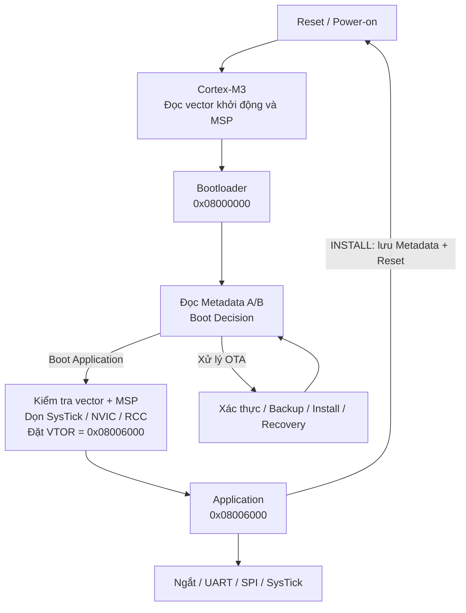

> **Ý nghĩa:** Trên **một MCU**, Bootloader và Application **không chạy như hai bộ xử lý độc lập**. Chúng dùng chung CPU, SRAM và ngoại vi, nhưng chiếm **hai vùng chương trình** khác nhau. Khi Application bắt đầu, ngữ cảnh CPU và ngắt phải phù hợp với **vector table của Application**.

#### Bước 1. Nắm phần cứng STM32F103C8T6 và vai trò Cortex-M3

**STM32F103C8T6** là vi điều khiển 32-bit dùng nhân **Arm Cortex-M3**, với cấu hình danh định mà project xây dựng trên đó:

| Thành phần | Thông tin | Liên hệ Secure Delta OTA |
|---|---|---|
| CPU | Cortex-M3, thực thi Thumb/Thumb-2; tần số tối đa theo dòng chip là **72 MHz** | Chạy thuật toán Boot Decision, hash, kiểm tra chữ ký, sao chép và ghi Flash. |
| Internal Flash | **64 KiB** | Chứa Bootloader, Application và Metadata A/B. |
| SRAM | **20 KiB** | Stack, biến runtime và bộ đệm khi xử lý UART/SPI/Flash. |
| NVIC + SysTick | Bộ điều khiển ngắt và bộ đếm thời gian thuộc phần lõi | Ngắt giao tiếp và tick của Application; cần dọn trạng thái khi jump. |
| RCC | Điều khiển clock hệ thống và clock ngoại vi | Ảnh hưởng baudrate UART, tốc độ SPI, delay và SysTick. |
| Reset / Watchdog | Cơ chế khởi động lại MCU | Bàn giao từ Application sang Bootloader và phục hồi OTA. |

**Cần nhớ về CPU:** Cortex-M3 có các thanh ghi **R0–R12**, **SP (R13)**, **LR (R14)**, **PC (R15)** và các thanh ghi trạng thái/điều khiển như **xPSR**, **CONTROL**, **PRIMASK**, **BASEPRI**. Phần lớn code C không thao tác trực tiếp những thanh ghi này, nhưng thao tác **Jump Application** cần đặc biệt quan tâm **SP, PC, CONTROL và trạng thái ngắt**.

**Phân biệt tần số tối đa và tần số đang chạy:** **72 MHz là khả năng tối đa của dòng MCU, không phải khẳng định firmware hiện tại luôn chạy ở 72 MHz**. Tần số thực tế phụ thuộc cấu hình RCC/SystemInit của image đang chạy.

#### Bước 2. Hiểu Memory Map và các vùng thật sự được project sử dụng

**Memory Map** là cách CPU gán các dải địa chỉ cho Flash, SRAM, ngoại vi và thanh ghi hệ thống. Địa chỉ không đồng nghĩa với việc mọi vùng đều là RAM có thể đọc/ghi tùy ý.

**Các vùng địa chỉ quan trọng trên Cortex-M3/STM32F1:**

| Dải / địa chỉ tiêu biểu | Ý nghĩa | Ví dụ trong project |
|---|---|---|
| `0x00000000` | Vùng **alias** được ánh xạ theo lựa chọn khởi động của STM32 | Sau boot thông thường từ User Flash, vector đầu được truy cập qua alias khởi động. |
| `0x08000000` | Điểm bắt đầu **Internal Flash** vật lý | Vector table Bootloader. |
| `0x20000000` | Điểm bắt đầu **SRAM** | Stack và biến runtime. |
| `0x40000000` trở lên | Vùng ngoại vi **memory-mapped I/O** | UART, SPI, GPIO, RCC, FLASH controller. |
| `0xE000E000` trở lên | Thanh ghi hệ thống **Cortex-M** | NVIC, SysTick, SCB/VTOR. |

**Phân vùng Internal Flash chính xác theo repository:**

| Vùng | Địa chỉ bắt đầu | Địa chỉ kết thúc (inclusive) | Dung lượng |
|---|---|---|---:|
| Bootloader | `0x08000000` | `0x08005FFF` | **24 KiB** |
| Application | `0x08006000` | `0x0800F7FF` | **38 KiB** |
| Metadata A | `0x0800F800` | `0x0800FBFF` | **1 KiB** |
| Metadata B | `0x0800FC00` | `0x0800FFFF` | **1 KiB** |
| SRAM | `0x20000000` | `0x20004FFF` | **20 KiB** |

```text
Internal Flash — 64 KiB (địa chỉ tăng dần)
0x08000000  +----------------------------------+
            | BOOTLOADER          24 KiB       |
0x08006000  +----------------------------------+
            | APPLICATION         38 KiB       |
            | Vector table + code + constants |
0x0800F800  +----------------------------------+
            | Metadata A           1 KiB       |
0x0800FC00  +----------------------------------+
            | Metadata B           1 KiB       |
0x08010000  +----------------------------------+ (địa chỉ kết thúc exclusive)

SRAM — 20 KiB
0x20000000  +----------------------------------+
            | .data / .bss / Heap / Stack      |
0x20005000  +----------------------------------+ (top-of-stack; exclusive end)
```

**Điểm cần hiểu sâu:**

1. **Bootloader** phải nằm trong vùng riêng để quá trình **Install** không xóa chính chương trình đang ghi Flash.
2. **Application** có vector table riêng tại `0x08006000`, không nằm ở `0x08000000`.
3. Hai trang **Metadata A/B** lưu trạng thái boot/update bền vững, phục vụ phục hồi khi reset/mất nguồn.
4. **SRAM không phải nơi lưu Checkpoint sau mất nguồn**. Thông tin sống còn phải được ghi vào Flash thích hợp.
5. **W25Q SPI NOR không nằm trong dải Internal Flash/SRAM nêu trên**: CPU truy cập nó qua **SPI driver**, không được mặc định dereference một địa chỉ memory-mapped như Internal Flash.

**Ví dụ ôn tập:** Application bắt đầu tại `0x08006000` và giới hạn **38 KiB**. Vì vậy, khi Install, Bootloader phải bảo đảm phạm vi erase/program kết thúc **trước `0x0800F800`**, không chạm vào Metadata A/B. Quy tắc này được thể hiện trong `shared/include/memory_map.h` và `docs/memory-map.md`.

#### Bước 3. Hiểu Reset, Boot Vector và trạng thái CPU ngay sau khởi động

Khi MCU **reset**, phần cứng lựa chọn vùng boot theo cấu hình chân/option tương ứng. Với chế độ **boot từ User Flash** được thiết kế cho project, CPU lấy **word đầu** làm **giá trị MSP ban đầu** và **word thứ hai** làm **địa chỉ Reset Handler**; nó bắt đầu thực thi Bootloader trước. Việc chọn boot từ User Flash/System Memory/SRAM là chức năng boot của STM32F1, **không phải** lựa chọn Full OTA hay Delta OTA của ứng dụng.

```text
Vector table đầu Bootloader (User Flash)
0x08000000 : Initial MSP          -> ví dụ top-of-SRAM 0x20005000
0x08000004 : Reset_Handler        -> địa chỉ mã Bootloader (Thumb bit = 1)
...

Vector table đầu Application
0x08006000 : Initial MSP          -> nằm trong SRAM, align 8 bytes
0x08006004 : Reset_Handler        -> nằm trong vùng Application, Thumb bit = 1
...
```

**Luồng điển hình của project:**

1. Reset đưa CPU vào ngữ cảnh khởi động; **Bootloader Reset Handler** được chạy trước.
2. Startup khởi tạo môi trường C; Bootloader đọc **Metadata A/B** để đưa ra **Boot Decision**.
3. Nếu cần cập nhật hoặc khôi phục, Bootloader xử lý trong vùng riêng của nó.
4. Nếu Application được phép chạy, Bootloader **kiểm tra vector, dọn ngắt/clock và handoff** sang Application.

> **Giới hạn của ví dụ:** Hai word vector được đưa ra để học địa chỉ; không mặc định `Reset_Handler` có giá trị số cố định. Giá trị thật phụ thuộc bản firmware đã link. Thứ tự khởi tạo `.data`, `.bss`, gọi `SystemInit()` và `main()` sẽ được phân tích riêng trong **Chương 6.2**.

#### Bước 4. Phân biệt MSP, PSP, Thread Mode và Handler Mode

**Stack** trên Cortex-M3 là vùng SRAM dùng lưu địa chỉ trả về, biến cục bộ, ngữ cảnh gọi hàm và ngữ cảnh ngắt. Stack thường phát triển **từ địa chỉ cao xuống thấp**.

| Khái niệm | Vai trò | Cần nhớ khi phỏng vấn |
|---|---|---|
| **MSP** (Main Stack Pointer) | Stack pointer chính, được nạp từ vector[0] lúc reset | **Handler Mode luôn sử dụng MSP**. |
| **PSP** (Process Stack Pointer) | Stack pointer có thể dùng cho Thread Mode | Thường gặp trong RTOS; bare-metal có thể chỉ dùng MSP. |
| **Thread Mode** | Thực thi chương trình bình thường | Có thể dùng MSP hoặc PSP tùy `CONTROL.SPSEL`. |
| **Handler Mode** | Thực thi exception/interrupt | Dùng MSP. |
| `CONTROL` | Chọn stack trong Thread Mode và đặc quyền thực thi | Handoff cần đưa về ngữ cảnh phù hợp với reset/startup. |
| `PRIMASK` | Có thể chặn các exception có mức ưu tiên cấu hình được | Nếu không trả về trạng thái phù hợp, Application có thể không nhận ngắt. |

**Ví dụ áp dụng từ repository:**

- Trước khi Jump, `ApplicationJump_Validate()` đọc `vector[0]` và kiểm tra **MSP trong SRAM**, **canh hàng 8 bytes**.
- `vector[1]` phải có **Thumb bit** và trỏ đến vùng Application.
- Handoff sử dụng **assembly helper** để đặt MSP rồi nhảy tới Reset Handler **mà không dùng epilogue của hàm C trên stack cũ**.
- Helper cũng trả các thanh ghi như `CONTROL`, `PRIMASK` về trạng thái phù hợp với khởi động lại; không chỉ đổi PC.

**Vì sao không được Jump kiểu `((void (*)(void))app_reset)();`?** Một lời gọi C thông thường không bảo đảm đổi **MSP**, **VTOR**, ngắt pending và clock về đúng ngữ cảnh. Kết quả có thể là HardFault, dùng nhầm stack hoặc nhảy được nhưng ngắt chạy sai handler.

#### Bước 5. NVIC, Exception và SysTick có ảnh hưởng gì đến Bootloader → Application?

**NVIC** (Nested Vectored Interrupt Controller) quản lý việc enable, pending và mức ưu tiên của nhiều interrupt. **Exception** còn bao gồm các sự kiện cấp lõi như Reset, NMI, HardFault, SysTick; chúng không hoàn toàn giống các IRQ ngoại vi.

- **Enable**: ngắt ngoại vi có được phép đi vào CPU hay không.
- **Pending**: có yêu cầu ngắt đang chờ phục vụ hay không.
- **Priority**: ngắt nào được ưu tiên; trên Cortex-M, **số ưu tiên nhỏ hơn thường mang ưu tiên cao hơn**.
- **Vector Table**: bảng địa chỉ handler tương ứng cho từng exception/IRQ.
- **SysTick**: timer 24-bit của core; có thể tạo tick định kỳ phục vụ scheduling/delay.

**Một lỗi rất thực tế:** Bootloader bật UART/SysTick rồi Jump thẳng sang Application mà **không dọn pending IRQ và không đổi VTOR**. Khi IRQ xảy ra, CPU có thể lấy địa chỉ handler từ vector table Bootloader thay vì Application. Vì vậy chỉ đổi PC là chưa đủ.

**Luồng cleanup đã được mô tả trong `docs/boot-jump.md`:**

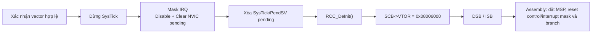

**Liên hệ test:** Tài liệu `docs/boot-jump.md` ghi nhận Application kiểm tra `SCB->VTOR == 0x08006000`, cấu hình **SysTick 1 ms** và phát nhịp **PC13**. Đây là bằng chứng về việc Application đã vào Reset Handler và ngắt được định tuyến qua vector table của Application; **không phải bằng chứng về bảo mật chữ ký SDOT**.

#### Bước 6. Clock Tree và RCC — vì sao phải quan tâm khi chuyển image?

**Clock Tree** cung cấp xung cho CPU và các ngoại vi. Trên STM32F103, các thành phần nền tảng cần phân biệt gồm **HSI** (oscillator nội **8 MHz**), **HSE** (oscillator ngoài, tùy phần cứng), **PLL**, **SYSCLK**, **AHB/HCLK**, **APB1/PCLK1**, **APB2/PCLK2**.

```text
HSI (nội 8 MHz) -------+
                       +--> [Clock select / PLL / prescaler] --> SYSCLK
HSE (ngoài) -----------+                                  |
                                                          +--> HCLK (CPU / AHB)
                                                          +--> PCLK1 (APB1)
                                                          +--> PCLK2 (APB2)
```

**Vì sao clock quan trọng trong OTA?**

| Nếu clock cấu hình không phù hợp | Biểu hiện có thể gặp |
|---|---|
| Baudrate UART lệch so với tính toán | Sai packet, CRC32 lỗi, timeout và Retry liên tục. |
| SPI clock khác dự kiến | Giao tiếp W25Q lỗi hoặc tốc độ thấp. |
| SysTick reload tính theo `SystemCoreClock` sai | Tick 1 ms và delay thực tế không chính xác. |
| Bootloader để lại PLL/prescaler và Application giả định trạng thái reset | Startup và timing không ổn định. |

**Theo code của project:** Trước khi bàn giao, `application_jump.c` gọi **`RCC_DeInit()`** để đưa clock tree về trạng thái gần reset dựa trên **HSI**; **Application `SystemInit()`** chịu trách nhiệm cấu hình lại clock cho chính image của nó. Không nên suy ra Bootloader và Application luôn dùng cùng một tần số hệ thống từ cấu hình tối đa 72 MHz của MCU.

> **Câu hỏi thường gặp:** “Đặt lại RCC có đồng nghĩa reset toàn bộ chip không?” **Không.** `RCC_DeInit()` xử lý trạng thái cấu hình clock/RCC liên quan, không thay thế **system reset** và cũng không tự xóa toàn bộ trạng thái NVIC, SysTick hay SRAM. Vì vậy handoff còn nhiều bước cleanup khác.

#### Bước 7. Các loại Reset và vì sao OTA cần trạng thái bền vững

**Reset** khiến mã boot được thực thi lại, nhưng **không phải mọi loại reset đều có nguyên nhân giống nhau**. Ở mức ôn tập STM32F1, cần phân biệt:

| Tình huống | Ví dụ kích hoạt | Quan hệ với project |
|---|---|---|
| **Power-on / Power-down reset** | Cấp nguồn, sụt nguồn vượt ngưỡng | Có thể xảy ra trong Receive/Backup/Install; cần **Power-loss Recovery**. |
| **External reset** | Tác động chân NRST | Bootloader chạy lại và đọc Metadata để biết trạng thái. |
| **Software system reset** | Application chủ động yêu cầu reset sau `INSTALL` | Bàn giao OTA cho Bootloader khi Metadata đã commit. |
| **Watchdog reset** | Application trial không đáp ứng đúng hạn | Bootloader quản lý số lần Trial Boot và có thể Rollback. |

**Điểm mấu chốt:** RAM không phải cơ chế lưu trạng thái cập nhật có thể tin cậy qua mất nguồn. Để biết đang **`UPDATE_INSTALLING`**, đã ghi an toàn đến đâu hay đã **`UPDATE_TRIAL_BOOT`** bao nhiêu lần, hệ thống cần **Metadata/Checkpoint** trong Flash. Sau reset, Bootloader **đọc lại** trạng thái này để quyết định **resume, xử lý lại một bước an toàn hoặc Rollback**, tùy thời điểm lỗi.

**Reset không đồng nghĩa Rollback:** Nếu mất nguồn lúc Install, Bootloader có thể **tiếp tục Install từ Checkpoint**; Rollback là cơ chế riêng dùng **Backup Image** khi cần khôi phục firmware đã được chấp nhận.

#### Bước 8. Tự đọc mã nguồn: nối kiến thức phần cứng với project

**Ví dụ đọc Vector Table (để học, chưa phải hàm Jump hoàn chỉnh):**

```c
#include <stdint.h>

#define APP_BASE 0x08006000UL

void example_read_application_vectors(uint32_t *initial_msp,
                                      uint32_t *reset_entry)
{
    *initial_msp = *(volatile const uint32_t *)(APP_BASE + 0UL);
    *reset_entry = *(volatile const uint32_t *)(APP_BASE + 4UL);
}

/* Ví dụ chỉ để đọc vector: chưa kiểm tra range/alignment/Thumb bit.
   Handoff thật cần dọn NVIC/SysTick/RCC, đặt VTOR và chuyển MSP
   trong assembly như implementation của repository. */
```

**Cách kiểm tra khi đọc code:**

1. `memory_map.h`: tìm `APPLICATION_START_ADDRESS`, `INTERNAL_SRAM_BASE`, `INTERNAL_SRAM_END`, `BOOT_METADATA_A_ADDRESS`.
2. `application_jump.c`: tìm kiểm tra vector table, **MSP range + 8-byte alignment**, **Thumb bit** và **Reset Handler range**.
3. Trong chính file đó, theo dõi `SysTick->CTRL`, `NVIC->ICER`, `NVIC->ICPR`, `RCC_DeInit()` và `SCB->VTOR`.
4. `application_handoff.s`: xem cách restore ngữ cảnh và thực hiện branch mà không chạy epilogue C sau khi đổi MSP.
5. `application.ld` / `bootloader.ld`: kiểm tra vùng `FLASH`, `RAM` và vị trí `.isr_vector`.

> **Chưa kết luận từ chương này:** Khả năng Jump an toàn chỉ chứng minh firmware có cấu trúc vector hợp lệ và ngữ cảnh phù hợp; **không thay thế xác thực ECDSA P-256**. Quy trình tin cậy cập nhật nằm ở **Phần 4, 5** và sẽ được ôn kỹ trong **6.8**.

#### Tình huống lỗi thực tế và hướng suy luận

| Tình huống | Nguyên nhân cần kiểm tra trước | Cách khoanh vùng |
|---|---|---|
| MCU reset xong không vào Application | Sai Boot Decision, vector không hợp lệ, MSP ngoài SRAM hoặc Reset Handler ngoài partition | Đọc Metadata, vector[0]/vector[1], PC và fault status bằng GDB/SWD. |
| Jump xong vào `HardFault_Handler` | MSP sai/alignment sai, Reset Handler không hợp lệ hoặc ngắt dùng sai vector | Kiểm tra `SCB->VTOR`, MSP/PSP, PC/LR và SCB fault registers. |
| Application chạy được nhưng UART/SysTick ngừng hoạt động | PRIMASK còn chặn IRQ, NVIC chưa dọn, vector table/clock chưa cấu hình đúng | Kiểm tra `PRIMASK`, `CONTROL`, `NVIC->ISER/ISPR`, `SCB->VTOR`, clock. |
| Bất thường sau khi đổi clock | HSI/HSE/PLL/prescaler không khớp giả định timing | Đọc trạng thái RCC, đối chiếu clock của USART/SPI/SysTick. |
| Mất điện giữa Install rồi boot lại | Internal Flash có thể chứa image chưa hoàn chỉnh | Đọc Metadata/Checkpoint; **không Jump** vào firmware chưa Verify thành công. |

#### Bài nói khi phỏng vấn: STM32F103 & Cortex-M3 (khoảng 90 giây)

> Dạ, trong project Secure Delta OTA Bootloader, em sử dụng **STM32F103C8T6** với nhân **Arm Cortex-M3**, **64 KiB Internal Flash** và **20 KiB SRAM**.
>
> Em chia Internal Flash thành **24 KiB Bootloader**, **38 KiB Application** và **hai trang Metadata A/B, mỗi trang 1 KiB**. Bootloader bắt đầu tại `0x08000000`, còn Application bắt đầu tại `0x08006000`.
>
> Khi reset, MCU chạy Bootloader trước. Bootloader đọc Metadata để quyết định xử lý cập nhật hay chạy Application. Trước khi nhảy vào Application, hệ thống kiểm tra **MSP** và **Reset Handler** từ vector table, dừng **SysTick**, dọn ngắt **NVIC**, đưa **RCC** về trạng thái phù hợp, đặt lại **VTOR** rồi chuyển quyền điều khiển bằng assembly.
>
> Trên Cortex-M3, **MSP** được dùng khi reset và trong Handler Mode, còn **PSP** có thể được chọn trong Thread Mode. Em cần hiểu sự khác biệt này để tránh lỗi stack hoặc HardFault khi bàn giao từ Bootloader sang Application.
>
> Ngoài ra, các trạng thái OTA quan trọng được lưu trong Flash thay vì SRAM, để sau reset hoặc mất nguồn Bootloader có thể đọc lại Metadata/Checkpoint và tiếp tục hoặc khôi phục theo trạng thái an toàn.

#### Câu hỏi ôn tập: STM32F103 & ARM Cortex-M3

| Câu hỏi | Ý chính cần trả lời |
|---|---|
| STM32F103 khác Cortex-M3 ở đâu? | STM32F103 là **MCU hoàn chỉnh**; Cortex-M3 là **nhân xử lý** bên trong. |
| Project sử dụng bao nhiêu Internal Flash và SRAM? | **64 KiB Internal Flash**, **20 KiB SRAM** trên STM32F103C8T6. |
| Vì sao Bootloader và Application có địa chỉ Flash riêng? | Tránh tự ghi đè Bootloader; boot/jump và giới hạn ghi Flash rõ ràng. |
| Application bắt đầu ở đâu? | `0x08006000`; Bootloader bắt đầu ở `0x08000000`. |
| Tại sao Metadata A/B không đặt trong RAM? | Cần trạng thái bền vững qua reset và mất nguồn. |
| MSP khác PSP như thế nào? | MSP dùng lúc reset và Handler Mode; PSP có thể dùng trong Thread Mode. |
| Vector[0] và vector[1] chứa gì? | MSP ban đầu và địa chỉ Reset Handler (Thumb bit phải hợp lệ). |
| VTOR dùng để làm gì? | Chỉ vị trí vector table mà CPU dùng để định tuyến exception/interrupt. |
| Vì sao phải dọn NVIC/SysTick trước khi Jump? | Không để lại pending/enable/tick của Bootloader gây ngắt sai trong Application. |
| Vì sao phải dùng assembly khi đổi MSP? | Không để epilogue C dùng stack của Bootloader sau khi chuyển MSP. |
| Số priority NVIC càng lớn có ưu tiên càng cao không? | **Không**; giá trị priority số nhỏ hơn thường ưu tiên cao hơn. |
| Clock 72 MHz có chắc là tần số hiện tại không? | **Không**; đây là giới hạn tối đa của dòng MCU, tần số thực do RCC chọn. |
| HSI trên STM32F103 là bao nhiêu? | Oscillator nội HSI **8 MHz**. |
| `RCC_DeInit()` có reset toàn bộ MCU không? | Không; nó dọn cấu hình clock, không thay thế system reset. |
| Mất nguồn khi đang Install có phải luôn Rollback? | Không; Bootloader đánh giá Metadata/Checkpoint để Resume hoặc Rollback đúng tình huống. |
| Kiểm tra vector có đủ chứng minh firmware được ký tin cậy không? | Không; vector validation khác **xác thực SDOT/ECDSA**. |

#### Điểm cần ghi nhớ

- **STM32F103 là MCU**, **Cortex-M3 là CPU core** bên trong; hiểu core phải đi cùng hiểu Flash/SRAM/NVIC/RCC của chip.
- **Địa chỉ và dung lượng cụ thể:** Bootloader `0x08000000` (24 KiB), Application `0x08006000` (38 KiB), Metadata A/B (1 KiB mỗi vùng), SRAM `0x20000000`–`0x20004FFF` (20 KiB).
- **MSP ≠ PSP:** Reset dùng MSP; Handler Mode dùng MSP; Thread Mode có thể chọn PSP.
- **Jump Application ≠ gọi hàm C thông thường:** Phải kiểm tra vector, dọn SysTick/NVIC, xử lý RCC, đặt VTOR và khôi phục ngữ cảnh CPU.
- **72 MHz là giới hạn, không phải mặc định chạy 72 MHz**; dựa vào cấu hình clock thật để tính UART, SPI và SysTick.
- **Reset ≠ xóa trạng thái OTA trong Flash**; Metadata/Checkpoint là căn cứ phục hồi, còn Rollback chỉ là một nhánh xử lý.
- **Vector validation ≠ firmware authentication**; chữ ký ECDSA được kiểm tra trong luồng cập nhật khác.

#### Các file mã nguồn và tài liệu nên đọc

| Tài liệu / File | Tại sao cần đọc |
|---|---|
| [`docs/memory-map.md`](https://github.com/haikevins/secure-delta-ota-bootloader/blob/main/docs/memory-map.md) | Phân vùng Internal Flash, SRAM, W25Q và giới hạn erase/write. |
| [`shared/include/memory_map.h`](https://github.com/haikevins/secure-delta-ota-bootloader/blob/main/shared/include/memory_map.h) | Các hằng địa chỉ thực sự dùng trong code. |
| [`docs/boot-jump.md`](https://github.com/haikevins/secure-delta-ota-bootloader/blob/main/docs/boot-jump.md) | Trình tự kiểm tra vector, dọn NVIC/SysTick, RCC, VTOR và assembly handoff. |
| [`node-stm32f103/bootloader/src/application_jump.c`](https://github.com/haikevins/secure-delta-ota-bootloader/blob/main/node-stm32f103/bootloader/src/application_jump.c) | Kiểm tra MSP/Reset Handler và C-side cleanup trước khi Jump. |
| [`node-stm32f103/bootloader/startup/application_handoff.s`](https://github.com/haikevins/secure-delta-ota-bootloader/blob/main/node-stm32f103/bootloader/startup/application_handoff.s) | Cách chuyển stack, control và branch trong assembly. |
| [`node-stm32f103/application/linker/application.ld`](https://github.com/haikevins/secure-delta-ota-bootloader/blob/main/node-stm32f103/application/linker/application.ld) | Vùng đặt Application và địa chỉ vector table trong linker script. |
| [`node-stm32f103/bootloader/linker/bootloader.ld`](https://github.com/haikevins/secure-delta-ota-bootloader/blob/main/node-stm32f103/bootloader/linker/bootloader.ld) | Vùng đặt Bootloader và SRAM. |
| [ST STM32F103C8 Product Overview](https://www.st.com/en/microcontrollers-microprocessors/stm32f103c8.html) | Thông số chip: Cortex-M3, 64 KiB Flash, 20 KiB SRAM, tốc độ tối đa, HSI. |
| [ST PM0056 — Cortex-M3 Programming Manual](https://www.st.com/resource/en/programming_manual/pm0056-stm32f10xxx20xxx21xxxl1xxxx-cortexm3-programming-manual-stmicroelectronics.pdf) | Kiến thức nền MSP/PSP, NVIC, exception, thanh ghi core. |

> **Gợi ý tự kiểm tra:** Giải thích bằng lời vì sao chỉ `SCB->VTOR = 0x08006000` chưa đủ để chuyển an toàn từ Bootloader sang Application. Nếu trả lời được cả **MSP, ngắt pending, SysTick, RCC và Reset Handler**, bạn đã nắm cốt lõi Chương 6.1.

---

<a id="chuong-6-2"></a>
### 6.2. Boot Process, Vector Table & Linker Script

> **Mục tiêu:** Hiểu trọn chuỗi **reset phần cứng → vector table → `Reset_Handler` → C runtime → `main()`**, đồng thời giải thích được cách **Bootloader chuyển quyền điều khiển sang Application** mà không reset MCU. Đọc được hai linker script, phát hiện lỗi vị trí image/vector và trả lời các câu hỏi phỏng vấn thường gặp về **MSP, VTOR, `.data`, `.bss` và `Application Jump`**.
>
> **Phạm vi và nguồn:** Các địa chỉ, tên file, kiểm tra vector, trình tự cleanup và các ký hiệu linker dưới đây được đối chiếu với repository của project. Các đoạn C hoặc assembly ghi rõ **"mã minh họa"** chỉ để giải thích nguyên lý; **không** thay thế nguyên văn source code trong repository. Đây là chương nối tiếp **6.1** (kiến trúc MCU), **Phần 3/5** (Boot State Machine), và **4.4–4.5** (cập nhật rồi chạy Application).

#### Sơ đồ tổng quan: Reset, Startup và Application Handoff

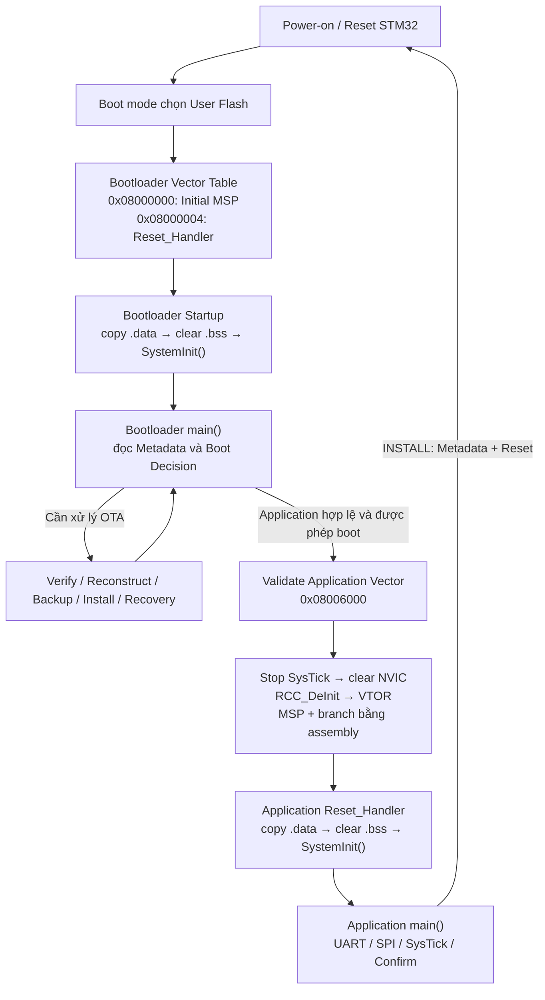

> **Phân biệt quan trọng:** **Power-on/reset** là sự kiện phần cứng khiến CPU nạp vector khởi động. **Application Jump** là chuyển quyền điều khiển bằng phần mềm tới `Reset_Handler` của image thứ hai; thao tác jump **không tự tạo ra một lần reset phần cứng** và không tự reset mọi ngoại vi. Đó là lý do project có quy trình cleanup trước khi jump.

#### Bước 1. CPU làm gì ngay sau Reset?

Ở chế độ boot từ **User Flash** của STM32F103, CPU truy cập hai word đầu của vùng vector được ánh xạ tại địa chỉ boot:

1. **Word 0:** giá trị **MSP ban đầu** (Main Stack Pointer).
2. **Word 1:** địa chỉ **Reset Handler** (địa chỉ lệnh Thumb, bit 0 bằng 1).
3. CPU nạp stack/điểm thực thi và chạy `Reset_Handler` của **Bootloader**.
4. Startup Bootloader chuẩn bị môi trường C, sau đó vào `main()` để đọc Metadata và đưa ra Boot Decision.

**Trong project:** Bootloader đặt tại `0x08000000`; Application đặt tại `0x08006000`. Vì vậy, với boot từ User Flash, **Bootloader luôn chạy trước**; trạng thái `UPDATE_IDLE`, `UPDATE_INSTALLING` hay `UPDATE_TRIAL_BOOT` chỉ được xét **sau khi Bootloader đã khởi động**.

```text
0x08000000 ┌────────────────────────────────────┐
           │ Bootloader initial MSP             │  word[0]
0x08000004 │ Bootloader Reset_Handler (+Thumb)  │  word[1]
           │ ... exception/IRQ vectors          │
           └────────────────────────────────────┘

0x08006000 ┌────────────────────────────────────┐
           │ Application initial MSP            │  word[0]
0x08006004 │ Application Reset_Handler (+Thumb) │  word[1]
           │ ... exception/IRQ vectors          │
           └────────────────────────────────────┘
```

**Lỗi thường gặp:** Đặt một Application build cho `0x08000000` vào vùng `0x08006000` rồi mong nó chạy như image đã relink. Mã chứa địa chỉ tuyệt đối/relocation và vector không tương ứng với vùng flash mới; chỉ **copy file `.bin` sang offset khác** không làm Application tự trở thành relocatable.

#### Bước 2. Hiểu Vector Table, MSP, Reset Handler và VTOR

**Vector Table** là bảng các địa chỉ ngoại lệ/ngắt mà Cortex-M3 sử dụng để tìm handler. Hai entry đầu mang ý nghĩa đặc biệt; các entry sau ánh xạ đến NMI, HardFault, SysTick và ngắt ngoại vi.

| Offset tính từ đầu vector | Nội dung | Ý nghĩa khi boot |
|---|---|---|
| `+0x00` | Initial MSP | Stack ban đầu phải nằm trong SRAM hợp lệ. |
| `+0x04` | Reset Handler | Địa chỉ entry point của image; bit 0 biểu thị Thumb state. |
| `+0x08` | NMI Handler | Handler cho ngoại lệ NMI. |
| `+0x0C` | HardFault Handler | Handler lỗi nghiêm trọng. |
| `+0x3C` | SysTick Handler | Handler SysTick (exception số 15). |
| `+0x40` trở đi | External IRQ handlers | ISR cho các ngắt ngoại vi STM32. |

**Các địa chỉ cần ghi nhớ:**

| Đại lượng | Giá trị project | Lưu ý |
|---|---|---|
| Bootloader vector base | `0x08000000` | Lúc khởi động từ User Flash. |
| Application vector base | `0x08006000` | Linker đặt `.isr_vector` đúng tại đây. |
| SRAM usable | `0x20000000`–`0x20004FFF` | 20 KiB SRAM. |
| SRAM top / initial MSP điển hình | `0x20005000` | Địa chỉ **ngay sau** byte cuối SRAM, vẫn là MSP hợp lệ. |
| Metadata bắt đầu | `0x0800F800` | Không được nhảy vào vùng Metadata. |
| Vector table alignment | `0x200` bytes | Mức căn chỉnh được áp dụng và kiểm tra trong repo. |

**VTOR (Vector Table Offset Register)** là thanh ghi `SCB->VTOR` xác định base của bảng vector đang được dùng để phân phối ngắt. Trong handoff, Bootloader đặt **`SCB->VTOR = 0x08006000`** để những IRQ phát sinh khi Application chạy được chuyển tới **ISR của Application**, thay vì handler của Bootloader.

**Phân biệt ba khái niệm dễ nhầm:**

- **MSP:** nơi CPU dùng stack; không nói CPU sẽ lấy IRQ handler từ đâu.
- **PC / Reset Handler:** nơi CPU bắt đầu thực thi mã; chỉ nhảy tới handler **không tự chuyển vector table**.
- **VTOR:** địa chỉ vector table của ngắt; chỉ đổi VTOR **không tự đổi stack và không tự gọi Reset Handler**.

**Kiểm tra trước khi nhảy** trong `ApplicationJump_Validate()` gồm: base vector căn `0x200`, nằm trong vùng Application, initial MSP nằm trong SRAM và căn 8 byte, Reset Handler có bit Thumb và địa chỉ code (bỏ bit Thumb) nằm trong phân vùng Application. Đây là các **kiểm tra cấu trúc để có thể jump**, **không phải kiểm tra chữ ký/nguồn gốc firmware**.

**Ví dụ đọc hai word đầu (chỉ để học):**

```c
#include <stdint.h>
#define APP_BASE  (0x08006000UL)

uint32_t app_msp   = *(volatile const uint32_t *)(APP_BASE + 0x00UL);
uint32_t app_reset = *(volatile const uint32_t *)(APP_BASE + 0x04UL);
/* app_msp: đầu vùng stack; app_reset: địa chỉ code có Thumb bit = 1.
 * Chưa được phép branch khi chưa validate và cleanup như code project. */
```

**Tình huống phỏng vấn:** `app_reset = 0x08006121` là giá trị có bit 0 = 1; địa chỉ instruction thực tế để kiểm tra dải là `app_reset & ~1`, tức `0x08006120`. Ngược lại `0x08006120` với bit 0 = 0 **không phải** entry hợp lệ cho một hàm Thumb trong vector.

#### Bước 3. `Reset_Handler` chuẩn bị môi trường C như thế nào?

Trong repository, cả Bootloader và Application dùng startup assembly `startup_stm32f10x_md.s`, nhưng chúng được **link thành hai image riêng**. Phần `Reset_Handler` trong file Application thực hiện theo thứ tự:

1. Dùng các ký hiệu linker `_sidata`, `_sdata`, `_edata` để **copy giá trị khởi tạo của `.data` từ Flash vào SRAM**.
2. Dùng `_sbss`, `_ebss` để **ghi 0 vào vùng `.bss`**.
3. Gọi **`SystemInit()`** để khởi tạo cấu hình hệ thống theo startup code.
4. Gọi **`main()`** của Application.

**Mã giả C tương đương (minh họa nguyên lý, không phải source nguyên văn):**

```c
extern uint32_t _sidata, _sdata, _edata, _sbss, _ebss;

void example_reset_runtime(void) {
    uint32_t *dst = &_sdata;
    const uint32_t *src = &_sidata;
    while (dst < &_edata) { *dst++ = *src++; }  /* Flash → RAM */

    for (dst = &_sbss; dst < &_ebss; ++dst) { *dst = 0; }

    SystemInit();
    main();
    for (;;) {}  /* main() không nên return trong firmware bình thường */
}
```

**Tại sao phải copy/zero?** Xem ví dụ:

```c
uint32_t retries = 3;      /* .data: chạy ở RAM, giá trị đầu nằm trong Flash */
uint32_t rx_count;         /* .bss: startup đưa về 0 */
const char tag[] = "OTA";  /* dữ liệu const thông thường được linker đặt ở Flash */
```

Nếu bỏ qua `.data` copy, `retries` có thể không bằng 3; nếu bỏ `.bss` clear, `rx_count` có thể mang giá trị rác. Đặc biệt, **Jump Application không thay thế startup của Application**: sau khi Bootloader giao quyền, Application vẫn phải đi qua `Reset_Handler` của chính mình để tái tạo các biến C của image mới.

> **Chi tiết được xác nhận ở repo:** `Reset_Handler` của `node-stm32f103/application/startup/startup_stm32f10x_md.s` thực hiện **copy `.data` → zero `.bss` → `SystemInit()` → `main()`**. Đừng tự áp một thứ tự chung khác lên source thực tế.

#### Bước 4. Linker Script là gì? Tại sao Bootloader và Application phải có script riêng?

**Compiler** dịch từng file nguồn; **linker** ghép object file, định vị các section, giải quyết symbol và tạo image cuối. **Linker script (`.ld`)** mô tả image được phép sử dụng **địa chỉ nào và bao nhiêu bộ nhớ**. Nếu sai script, code C có thể biên dịch bình thường nhưng image không boot được, hoặc Install ghi đè vùng của image khác.

**So sánh chính xác theo hai linker script trong repo:**

| Thuộc tính | Bootloader | Application |
|---|---|---|
| File | `bootloader/linker/bootloader.ld` | `application/linker/application.ld` |
| `FLASH ORIGIN` | `0x08000000` | `0x08006000` |
| `FLASH LENGTH` | `24K` | `38K` |
| `RAM ORIGIN` | `0x20000000` | `0x20000000` |
| `RAM LENGTH` | `20K` | `20K` |
| `_estack` | `ORIGIN(RAM) + LENGTH(RAM)` | Tương tự (`0x20005000`) |
| `ENTRY` | `Reset_Handler` | `Reset_Handler` |
| `.isr_vector` | Đúng Flash origin của Bootloader | Đúng `0x08006000` |

**Trích cấu hình quan trọng của Application (`application.ld`):**

```ld
ENTRY(Reset_Handler)
MEMORY {
    FLASH (rx)  : ORIGIN = 0x08006000, LENGTH = 38K
    RAM   (xrw) : ORIGIN = 0x20000000, LENGTH = 20K
}
_estack = ORIGIN(RAM) + LENGTH(RAM);

SECTIONS {
    .isr_vector : {
        . = ALIGN(0x200);
        __vector_table_start__ = .;
        KEEP(*(.isr_vector))
        . = ALIGN(4);
    } > FLASH
    /* Các section .text/.rodata/.data/.bss ở dưới được rút gọn tại đây. */
}
```

**Ý nghĩa từng cú pháp:**

| Ký hiệu / cú pháp | Giải thích ngắn | Lỗi nếu dùng sai |
|---|---|---|
| `ENTRY(Reset_Handler)` | Đặt **entry symbol cho ELF/linker**; **không** thay thế hai word của vector table mà phần cứng đọc. | Hiểu sai rằng CPU lấy `ENTRY` từ linker khi reset. |
| `MEMORY`, `ORIGIN`, `LENGTH` | Giới hạn địa chỉ Flash/RAM của image. | Overlap Bootloader/Metadata hoặc link sai base. |
| `.isr_vector` + `KEEP` | Đặt/giữ bảng vector ở đầu Flash region, kể cả khi GC sections. | Vector bị thiếu hoặc dịch sang offset khác. |
| `. = ALIGN(0x200)` | Căn vector theo ràng buộc của thiết kế. | VTOR base không đáp ứng căn chỉnh đã kiểm tra. |
| `.text`, `.rodata` | Code và dữ liệu chỉ đọc trong Flash. | Image quá giới hạn phân vùng. |
| `.data > RAM AT > FLASH` | Địa chỉ chạy trong RAM, **load image/giá trị ban đầu** được lưu ở Flash. | Biến có khởi tạo không mang giá trị mong muốn. |
| `_sidata = LOADADDR(.data)` | Chỉ vùng nguồn trong Flash để startup copy `.data`. | Copy sai nguồn. |
| `.bss (NOLOAD) > RAM` | Vùng RAM cần zero, không cần bytes khởi tạo trong file firmware. | Dữ liệu runtime bị rác. |
| `_Min_Stack_Size`, `._user_heap_stack` | Dành mức ngân sách bộ nhớ cho stack/heap trong kiểm tra link. | Link thành công nhưng khó kiểm soát SRAM còn lại. |
| `ASSERT(...)` | Bắt lỗi tại **link time** khi ranh giới/địa chỉ sai. | Lỗi layout có thể chỉ lộ trên thiết bị. |

**Địa chỉ kết thúc Application cần nhớ:** `0x08006000 + 38 KiB = 0x0800F800` (**exclusive**). Byte cuối hợp lệ là `0x0800F7FF`; ngay sau đó là **Metadata A**. Hai trang Metadata A/B nằm ở `0x0800F800–0x0800FFFF` và **không thuộc vùng Application**.

**Repository còn có `ASSERT`** để giữ đúng vector origin, Flash budget, ranh giới Metadata và giới hạn RAM. Đây là bảo vệ **trong quá trình build**, khác với kiểm tra vùng nhớ/CRC/Signature **khi thiết bị cập nhật firmware**.

#### Bước 5. Bootloader quyết định có được Jump Application hay không?

Startup vào `main()` **không đồng nghĩa lúc nào cũng jump**. Sau reset, Bootloader đọc **Metadata A/B** và trạng thái OTA; `BootDecision_Evaluate()` chọn hành động phù hợp. Chỉ khi nhánh boot cho phép và image có vector hợp lệ, mã mới đi tới **`ApplicationJump_Validate()`** và **`ApplicationJump_Execute()`**.

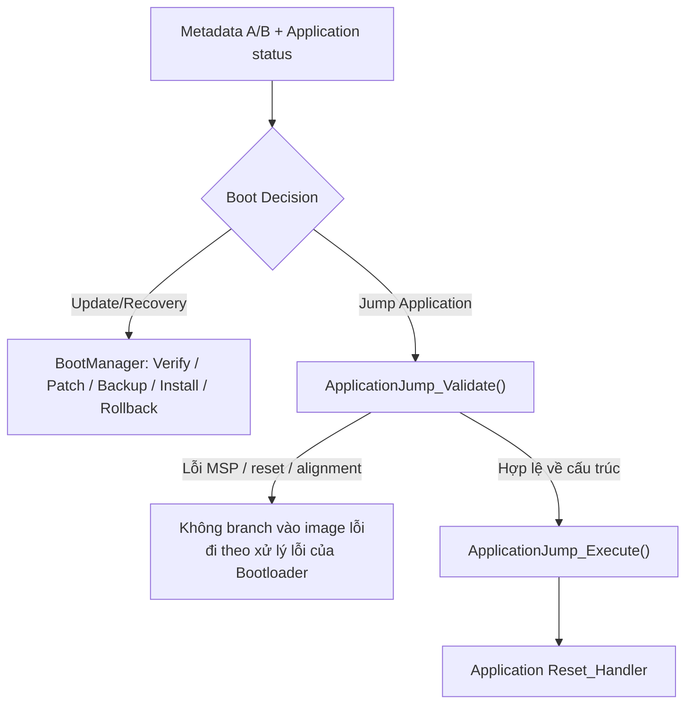

**Hai tầng kiểm tra khác nhau:**

- **Cấu trúc image có thể boot (`ApplicationJump_Validate`):** vector alignment, MSP, Thumb reset address, phạm vi code. Đây là điều kiện cần để CPU không nhảy mù vào địa chỉ sai.
- **Tính tin cậy của firmware cập nhật:** Bootloader xác thực gói **SDOT bằng ECDSA P-256/SHA-256**, kiểm tra chính sách sản phẩm/phiên bản và kiểm tra image ở các bước OTA. **Đừng nói vector hợp lệ đồng nghĩa firmware đã được ký số hợp lệ.**

**Ví dụ:** Sau khi OTA cài v2 vào Internal Flash, `UPDATE_TRIAL_BOOT` yêu cầu chạy thử v2. Boot Decision chỉ định thử boot, `ApplicationJump` kiểm tra vector v2, thực hiện handoff, rồi Application v2 bắt đầu tại **Reset Handler của nó**. Chỉ sau **Confirm**, v2 mới được chấp nhận chính thức; chi tiết trạng thái xem **5.5**.

#### Bước 6. Quy trình Jump thực tế: tại sao cần C cleanup và Assembly handoff?

Theo `docs/boot-jump.md` và code `application_jump.c` + `application_handoff.s`, việc chuyển quyền gồm **hai tầng**:

**A. C-side cleanup trong `ApplicationJump_Execute()`:**

1. Lấy và giữ các giá trị MSP, Reset Handler, vector base đã được xác thực.
2. **Dừng SysTick** và xóa counter.
3. **Mask interrupt**, disable/clear các bank **NVIC**.
4. Xóa pending **SysTick** và **PendSV**.
5. Gọi **`RCC_DeInit()`** để đưa clock về trạng thái HSI gần như sau reset.
6. Gán **`SCB->VTOR = 0x08006000`**, thực hiện **`__DSB()`** và **`__ISB()`**.
7. Gọi helper assembly `ApplicationJump_SetStackAndBranch(initial_msp, reset_handler)`.

**B. Assembly handoff (`bootloader/startup/application_handoff.s`):**

```asm
/* Trích ý chính từ helper assembly; r0 = initial MSP, r1 = reset handler */
msr msp, r0
movs r2, #0
msr psp, r2
msr control, r2
msr basepri, r2
msr faultmask, r2
msr primask, r2
dsb
isb
bx r1
```

**Tại sao bước đổi MSP phải bằng assembly?** Nếu trong hàm C bình thường ta đổi MSP rồi `return` hoặc để compiler sinh prologue/epilogue, lệnh của compiler có thể **truy cập stack frame cũ bằng MSP mới**. Helper assembly tối giản thực hiện **đổi MSP rồi branch** mà không quay lại stack của Bootloader.

**Tại sao `PRIMASK` lại được đưa về 0 trước branch?** Khi cleanup, interrupt được tạm mask để tránh ISR của Bootloader xen vào. Nhưng Application startup mong trạng thái ngắt gần với reset (PRIMASK = 0). Do **SysTick/NVIC pending đã được dọn**, helper có thể trả PRIMASK về 0 và branch mà không chạy nhầm ISR còn sót.

**Tại sao dùng `RCC_DeInit()`?** Khác với reset toàn MCU, jump không reset clock/peripheral. Application cần được nhận một trạng thái clock sạch hơn để `SystemInit()` và driver UART/SPI cấu hình đúng, tránh phụ thuộc vào clock mà Bootloader đã đặt.

> **Điểm cực kỳ dễ nhầm:** Cấp lại MSP rồi gọi `main()` của Application **không** đúng hợp đồng startup. Repo **branch đến `Reset_Handler`**, để Application copy `.data`, clear `.bss` và tự `SystemInit()` trước khi vào `main()`.

#### Bước 7. Sau khi Jump, Application làm gì?

Sau lệnh `BX` đến Reset Handler của Application:

1. CPU thực thi **Application startup**, không còn chạy hàm C của Bootloader.
2. Application tự khởi tạo `.data`/`.bss` theo các symbol trong **`application.ld`**.
3. `SystemInit()` và `main()` cấu hình clock, GPIO, UART, SPI, SysTick theo nhu cầu của Application.
4. Vì **VTOR đã trỏ đến vector table Application**, handler của ngắt Application mới được dùng.
5. Trong **Trial Boot**, Application cần thực hiện logic Confirm phù hợp; nếu lỗi liên tục không Confirm, Bootloader sẽ đánh giá và Rollback khi các lần boot sau xảy ra.

**Bằng chứng runtime được mô tả trong repo:** Application kiểm tra **`SCB->VTOR == 0x08006000`**, cấu hình **SysTick 1 ms** và phát nhịp LED **PC13 active-low 100 ms mỗi giây**. Việc heartbeat hoạt động sau handoff cho thấy mã startup đã chạy và ngắt SysTick đang lấy handler qua vector Application.

**Phân biệt quy trình:**

```text
A. Reset MCU thật (sau INSTALL hoặc power-on):
   Reset → Bootloader Reset_Handler → Boot Decision → [OTA hoặc App Jump]

B. Bootloader Jump Application (không reset phần cứng):
   Validate → cleanup → set VTOR/MSP → Branch App Reset_Handler → App main()

C. Application muốn cài OTA mới:
   INSTALL → commit Metadata → ACK → reset thật → Bootloader xử lý gói SDOT
```

#### Bước 8. Tự đọc source và kiểm tra một firmware image

**Quy trình đọc repo có mục đích:**

| Thứ tự | File cần mở | Câu hỏi cần tự trả lời |
|---|---|---|
| 1 | `docs/memory-map.md` và `shared/include/memory_map.h` | APP_START, APP_END (exclusive), vùng Metadata là gì? |
| 2 | `bootloader/linker/bootloader.ld` | Vì sao Bootloader chỉ được dùng 24 KiB? |
| 3 | `application/linker/application.ld` | Vì sao Application phải link từ `0x08006000`? `.data AT > FLASH` nghĩa là gì? |
| 4 | `application/startup/startup_stm32f10x_md.s` | Thứ tự `_sidata → .data`, `.bss`, `SystemInit`, `main` là gì? |
| 5 | `bootloader/startup/startup_stm32f10x_md.s` | Bootloader nhận MSP và vào `main` thế nào? |
| 6 | `bootloader/src/boot_decision.c` và `boot_manager.c` | Khi nào được cho Application chạy? Khi nào cần Recovery? |
| 7 | `bootloader/src/application_jump.c` | Những check và cleanup nào chạy trước branch? |
| 8 | `bootloader/startup/application_handoff.s` | Vì sao không dùng hàm C thông thường để đổi MSP + branch? |
| 9 | `docs/boot-jump.md` | Ranh giới giữa **boot hợp lệ** và **firmware đã xác thực** là gì? |

**Lệnh kiểm tra sau khi build (ví dụ công cụ GNU Arm; tên file `.elf` thay bằng output thực tế):**

```bash
# Build theo Make target được repo hỗ trợ.
make firmware TOOLCHAIN=gcc

# Liệt kê section; xác minh .isr_vector nằm đúng Application Flash base.
arm-none-eabi-objdump -h path/to/application.elf

# Xem giá trị word đầu của section vector.
arm-none-eabi-objdump -s -j .isr_vector path/to/application.elf

# Xem các symbol liên quan đến startup và layout.
arm-none-eabi-nm -n path/to/application.elf | grep -E '(_estack|Reset_Handler|_sidata|_sdata|_edata|_sbss|_ebss)'
```

**Khi debug qua GDB/SWD** (lệnh chỉ chạy được nếu đã kết nối target thích hợp):

```gdb
x/2wx 0x08000000   # MSP/Reset của Bootloader
x/2wx 0x08006000   # MSP/Reset của Application
p/x $msp            # MSP hiện tại (theo GDB/target support)
p/x $pc             # PC hiện tại
```

**Ba kiểm tra quan trọng nhất trước khi kết luận lỗi ở Bootloader:**

1. `0x08006000` có giá trị **Initial MSP** thuộc `0x20000000–0x20005000` và căn 8 byte không?
2. `0x08006004` có giá trị **Reset Handler** với bit Thumb = 1, trỏ vào `0x08006000–0x0800F7FF` không?
3. `.isr_vector` trong ELF nằm ở `0x08006000` và code/sections không vượt `0x0800F800` không?

#### Tình huống lỗi thực tế và hướng suy luận

| Hiện tượng | Khả năng nguyên nhân | Hướng kiểm tra |
|---|---|---|
| Application chạy khi flash riêng nhưng lỗi khi Bootloader jump | VTOR chưa chuyển, SysTick/NVIC pending, clock khác giả định, MSP sai. | Kiểm tra thứ tự cleanup/branch trong `application_jump.c` và `application_handoff.s`. |
| Ngay sau `BX` vào HardFault | Reset Handler trỏ sai vùng, bit Thumb = 0, stack không hợp lệ hoặc Application image hỏng. | Đọc hai word đầu vector, kiểm tra `ApplicationJump_Validate()` và linker. |
| SysTick/IRQ vào handler của Bootloader | VTOR vẫn ở boot vector hoặc còn pending IRQ từ Bootloader. | Đọc `SCB->VTOR`, NVIC, SysTick và bước handoff. |
| Biến `static`/global khởi tạo sai | `.data` chưa copy, `.bss` chưa clear hoặc linker symbols sai. | Đọc `Reset_Handler`, `_sidata/_sdata/_edata/_sbss/_ebss`. |
| Flash mới ghi chạm Metadata | Application linker/installer không tôn trọng end-exclusive `0x0800F800`. | Kiểm tra `.ld`, `ASSERT`, `memory_map.h`, phạm vi erase/program. |
| Application boot nhưng UART/SPI sai tốc độ | Clock/RCC của hai image khác nhau hoặc handoff chưa deinit. | Kiểm tra `RCC_DeInit()`, `SystemInit()`, baudrate/clock prescaler. |
| Jump được nhưng firmware không hợp lệ về bảo mật | Chỉ kiểm vector, không xác thực nguồn cập nhật. | Tách kiểm tra jump khỏi Verify SDOT ECDSA/SHA-256 và Boot Decision. |

#### Bài nói khi phỏng vấn: Boot Process, Vector Table & Linker Script (khoảng 90 giây)

> **Boot Process, Vector Table và Linker Script:** Trên STM32F103, khi reset và boot từ User Flash, CPU nạp hai word đầu của vector table: giá trị MSP và địa chỉ Reset Handler. Trong project của em, vector Bootloader ở `0x08000000`, nên Bootloader chạy trước.
>
> Startup của mỗi image sẽ copy `.data` từ Flash sang RAM, xóa `.bss`, gọi `SystemInit()` rồi mới vào `main()`. Linker script đảm bảo Bootloader nằm trong 24 KiB đầu Flash, còn Application được link riêng từ `0x08006000` với dung lượng 38 KiB, không ghi đè hai trang Metadata cuối.
>
> Sau khi đọc Metadata và đưa ra Boot Decision, nếu cần chạy Application, Bootloader kiểm tra vector table của Application: MSP nằm trong SRAM, Reset Handler có Thumb bit và trỏ vào vùng Application. Sau đó Bootloader dừng SysTick, dọn NVIC, khôi phục RCC, chuyển VTOR sang `0x08006000`.
>
> Cuối cùng, assembly handoff đặt lại MSP và các thanh ghi điều khiển rồi branch thẳng tới Reset Handler của Application. Đây là software jump, không phải hardware reset. Application sẽ chạy startup của chính nó trước khi vào `main()`. Cách tách image, linker và cleanup như vậy giúp handoff ổn định, nhất là sau quá trình OTA và Trial Boot.

#### Câu hỏi ôn tập: Boot Process, Vector Table & Linker Script

| Câu hỏi | Ý chính cần trả lời |
|---|---|
| 1. Cortex-M3 đọc gì khi reset? | Initial MSP ở word 0, Reset Handler ở word 1 của vector table được chọn theo boot mode. |
| 2. Vì sao Bootloader chạy trước Application? | User Flash boot tại vector `0x08000000`, trong khi Application nằm ở `0x08006000`. |
| 3. Vector Table khác VTOR thế nào? | Vector Table là dữ liệu handler; VTOR là thanh ghi chỉ base table dùng để phân phối ngắt. |
| 4. Vì sao `0x20005000` có thể là MSP hợp lệ? | Đây là địa chỉ top-of-SRAM (ngay sau byte cuối), stack tăng về phía địa chỉ thấp. |
| 5. Bit 0 của Reset Handler dùng để làm gì? | Biểu thị Thumb state khi branch; khi kiểm tra dải địa chỉ code phải mask bit 0. |
| 6. Tại sao không jump trực tiếp vào `main()`? | Bỏ qua startup: `.data`, `.bss`, `SystemInit()` và hợp đồng entry của Application. |
| 7. `.data` khác `.bss` thế nào? | `.data` có giá trị init lưu trong Flash và được copy vào RAM; `.bss` được zero trước `main()`. |
| 8. `> RAM AT > FLASH` trong linker nghĩa là gì? | VMA chạy ở RAM, còn LMA chứa dữ liệu init nằm trong Flash. |
| 9. `ENTRY(Reset_Handler)` có khiến hardware đọc symbol này? | Không. Hardware đọc word thứ hai của vector table; `ENTRY` là chỉ thị của linker/ELF. |
| 10. Tại sao cần hai linker script? | Mỗi image có Flash origin/budget riêng; tránh overlap và bảo đảm vector đúng địa chỉ. |
| 11. Tại sao cần `KEEP(*(.isr_vector))`? | Không để linker garbage-collect mất bảng vector. |
| 12. Vì sao phải dọn SysTick/NVIC trước jump? | Tránh pending IRQ của Bootloader chạy trong ngữ cảnh Application. |
| 13. Vì sao phải đặt `SCB->VTOR = 0x08006000`? | ISR của Application phải dùng vector table Application. |
| 14. Vì sao `RCC_DeInit()` quan trọng? | Hạn chế kế thừa clock của Bootloader, tạo trạng thái sạch hơn cho SystemInit của Application. |
| 15. Vì sao cuối handoff được viết bằng assembly? | Đổi MSP rồi branch không được để compiler truy cập stack cũ bằng MSP mới. |
| 16. Vì sao `PRIMASK` được clear trước branch? | Khôi phục trạng thái ngắt gần với reset sau khi đã dọn pending interrupt. |
| 17. Kiểm tra MSP/Reset Handler có chứng minh firmware an toàn không? | Không; đó chỉ là validation cấu trúc, chữ ký SDOT được kiểm bởi đường OTA riêng. |
| 18. `0x0800F800` là địa chỉ gì? | **End-exclusive** của Application và start của Metadata A; firmware không được ghi qua đó. |
| 19. Jump Application có reset chip không? | Không, là software branch; vì thế cần cleanup ngữ cảnh. |
| 20. Nếu Application chạy nhưng UART sai baud, kiểm gì trước? | RCC/PLL, SystemInit và clock assumptions giữa hai image. |

#### Điểm cần ghi nhớ

1. **Reset → đọc 2 vector words → Bootloader startup → Boot Decision** là đường khởi động thông thường của project.
2. **Application có vector table và startup riêng tại `0x08006000`**, dù Bootloader và Application dùng chung SRAM/ngoại vi vật lý.
3. **Linker script quyết định image đặt ở đâu**; `ENTRY()` không thay hai vector word mà CPU dùng khi reset.
4. **`.data` = Flash initializer → RAM; `.bss` = zero-initialized RAM** trước `main()`.
5. **MSP ≠ PC ≠ VTOR:** ba phần đóng vai trò khác nhau trong handoff.
6. **Validate vector chỉ kiểm tra khả năng jump**, không chứng minh firmware được ký hợp lệ.
7. **Cleanup + assembly handoff** cần thiết vì software jump không reset toàn bộ CPU/peripheral như power-on/reset.
8. **End-exclusive `0x0800F800`** tách Application khỏi Metadata, và linker có `ASSERT` để hỗ trợ bảo vệ layout.

#### Các file mã nguồn và tài liệu nên đọc

| File / tài liệu | Vai trò |
|---|---|
| [`docs/boot-jump.md`](https://github.com/haikevins/secure-delta-ota-bootloader/blob/main/docs/boot-jump.md) | Điều kiện vector, cleanup, PRIMASK, assembly handoff và bài kiểm tra VTOR. |
| [`docs/memory-map.md`](https://github.com/haikevins/secure-delta-ota-bootloader/blob/main/docs/memory-map.md) | Ranh giới Flash/SRAM/Metadata, end-exclusive. |
| [`shared/include/memory_map.h`](https://github.com/haikevins/secure-delta-ota-bootloader/blob/main/shared/include/memory_map.h) | Hằng số địa chỉ được dùng trong firmware. |
| [`node-stm32f103/bootloader/linker/bootloader.ld`](https://github.com/haikevins/secure-delta-ota-bootloader/blob/main/node-stm32f103/bootloader/linker/bootloader.ld) | ORIGIN/LENGTH, section và assertion của Bootloader. |
| [`node-stm32f103/application/linker/application.ld`](https://github.com/haikevins/secure-delta-ota-bootloader/blob/main/node-stm32f103/application/linker/application.ld) | `.isr_vector`, `.data`, `.bss` và assertion của Application. |
| [`node-stm32f103/application/startup/startup_stm32f10x_md.s`](https://github.com/haikevins/secure-delta-ota-bootloader/blob/main/node-stm32f103/application/startup/startup_stm32f10x_md.s) | Copy `.data`, zero `.bss`, `SystemInit()` và `main()`. |
| [`node-stm32f103/bootloader/startup/startup_stm32f10x_md.s`](https://github.com/haikevins/secure-delta-ota-bootloader/blob/main/node-stm32f103/bootloader/startup/startup_stm32f10x_md.s) | Vector và startup của Bootloader. |
| [`node-stm32f103/bootloader/src/application_jump.c`](https://github.com/haikevins/secure-delta-ota-bootloader/blob/main/node-stm32f103/bootloader/src/application_jump.c) | Kiểm tra vector, dọn trạng thái trước handoff. |
| [`node-stm32f103/bootloader/startup/application_handoff.s`](https://github.com/haikevins/secure-delta-ota-bootloader/blob/main/node-stm32f103/bootloader/startup/application_handoff.s) | Đổi MSP/CONTROL/PRIMASK và BX không dùng C stack frame. |
| [`node-stm32f103/bootloader/src/boot_decision.c`](https://github.com/haikevins/secure-delta-ota-bootloader/blob/main/node-stm32f103/bootloader/src/boot_decision.c) | Quyết định nhánh boot hoặc phục hồi theo Metadata. |

> **Tự kiểm tra cuối chương:** Hãy giải thích bằng lời **vì sao một image được link tại `0x08000000` không thể chỉ chép sang `0x08006000` rồi jump**, và **vì sao `SCB->VTOR` + MSP vẫn chưa đủ nếu SysTick/NVIC chưa được dọn**. Hai câu này nối trực tiếp kiến thức startup, linker và bảo đảm an toàn khi Bootloader chạy Application.

---

<a id="chuong-6-3"></a>
### 6.3. STM32 Internal Flash Programming

> **Mục tiêu:** Giải thích được **vì sao phải Erase trước khi Program**, tại sao STM32F103 dùng **trang xóa 1 KiB** và **đơn vị ghi half-word 16-bit**, cách Bootloader ghi firmware mới từ **W25Q Reconstructed Image** vào **Internal Flash Application** và xác minh kết quả. Quan trọng nhất: giải thích được cơ chế **Checkpoint theo trang** để phục hồi an toàn khi mất nguồn giữa quá trình ghi.
>
> **Phạm vi và nguồn:** Các địa chỉ, hàm `FLASH_ErasePage()`, `FLASH_ProgramHalfWord()`, luồng `ProgramBufferedApplicationPage()`, `ResumePageCheckpointedCopy()` và hành vi kiểm tra/commit dưới đây được đối chiếu với **repository**. Những phần diễn giải cơ chế Flash, ví dụ byte/half-word và đoạn *pseudocode* được đánh dấu là **kiến thức giải thích hoặc mô phỏng**, không phải đoạn code sao chép nguyên văn. Chương này nối tiếp **6.1** (Memory Map), **6.2** (Boot Process) và **5.4** (Backup → Install → Verify).

#### Sơ đồ tổng quan: Ghi Application vào Internal Flash

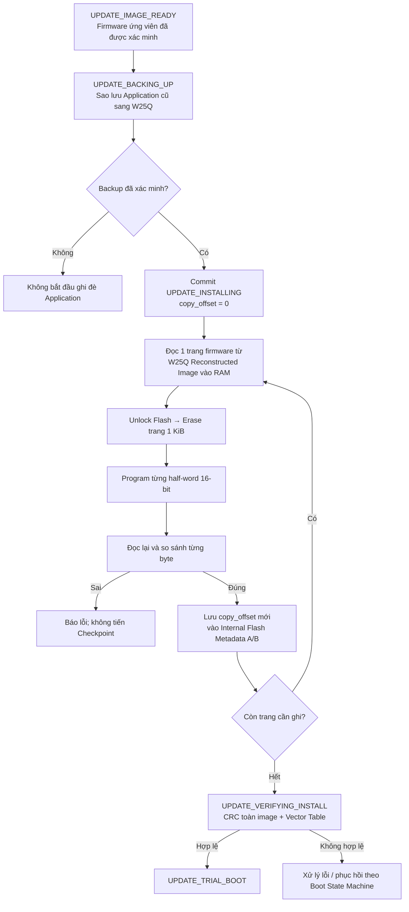

**Bốn ý cần nắm trước khi đọc chi tiết:**

1. **Erase** tác động lên **cả trang 1 KiB**; không thể an toàn coi thao tác này là xóa một byte đơn lẻ.
2. **Program** trong luồng hiện tại thực hiện theo **half-word 16-bit** (2 byte/lần).
3. **Verify** diễn ra **trước** khi tiến độ được lưu bền vững; `copy_offset` chỉ đại diện cho trang đã ghi thành công và được kiểm tra.
4. **CRC32 toàn image và kiểm tra vector** diễn ra sau bước ghi các trang; đây là bước riêng với kiểm tra từng trang.

#### Bước 1. Hiểu nguyên lý Internal Flash và Erase/Program

**Kiến thức nền về NOR Flash:** Sau khi xóa, các bit của vùng được xóa ở trạng thái logic `1` (đọc thường thấy `0xFF`). Quá trình lập trình chuyển các bit được chọn từ `1` sang `0`; để trở về `1`, cần **Erase** đúng đơn vị xóa. Vì vậy không nên giả định có thể ghi tùy ý một firmware mới đè lên dữ liệu cũ mà bỏ qua Erase.

Ví dụ đơn giản **mang tính minh họa**, không phải một thao tác thực thi trên chip:

```text
Sau Erase:             1111 1111   (0xFF)
Program dữ liệu:       1010 0101   (0xA5)
Kết quả:               1010 0101
Muốn trở lại 0xFF:     Phải Erase đơn vị xóa liên quan
```

Với **STM32F103C8T6 medium-density** mà repository nhắm đến:

| Thuộc tính | Giá trị / ý nghĩa | Liên hệ project |
|---|---|---|
| Internal Flash | **64 KiB** | Chứa Bootloader, Application, Metadata A/B. |
| Đơn vị xóa | **1 KiB / page** | `FLASH_ErasePage()` xóa một trang theo địa chỉ trang. |
| Đơn vị lập trình | **16 bit / half-word** | `FLASH_ProgramHalfWord()` ghi 2 byte tại địa chỉ phù hợp. |
| RAM | **20 KiB SRAM** | Dùng bộ đệm trang, stack và dữ liệu vận hành; không lưu tiến độ sau mất nguồn. |
| Dữ liệu sau khi xóa | **`0xFF`** | Hữu ích khi xử lý byte đệm và kiểm tra vùng chưa ghi. |

> **Phân biệt:** **1 KiB** là kích thước trang xóa **Internal Flash của STM32F103**. **4 KiB** ở Chương 6.4/5.4 là kích thước sector xóa **External Flash W25Q** dùng trong sao lưu/nhận OTA. Đừng nhầm đơn vị Checkpoint của hai thao tác này.

**Câu hỏi “Vì sao không ghi trực tiếp từng byte?”** Phần cứng dòng STM32F103 được dùng ở đây có thao tác program half-word; do đó firmware ghép mỗi cặp byte thành một `uint16_t`. Cần địa chỉ **căn chỉnh 2 byte** và kiểm tra trạng thái hoàn thành do flash controller trả về.

#### Bước 2. Đọc Memory Map để không xóa nhầm Bootloader hoặc Metadata

Internal Flash của project có bốn vùng quan trọng, theo `shared/include/memory_map.h` và `docs/memory-map.md`:

```text
STM32F103 Internal Flash (64 KiB)

0x08000000  +------------------------------+
            | Bootloader       24 KiB     |
0x08006000  +------------------------------+
            | Application      38 KiB     |  <-- Chỉ vùng này được Install/Rollback
            | 38 trang xóa x 1 KiB       |
0x0800F800  +------------------------------+  <-- End-exclusive của Application
            | Metadata A        1 KiB     |
0x0800FC00  +------------------------------+
            | Metadata B        1 KiB     |
0x08010000  +------------------------------+  <-- End-exclusive của toàn Flash
```

| Vùng | Địa chỉ bắt đầu | Địa chỉ cuối (inclusive) | Dung lượng |
|---|---|---|---:|
| Bootloader | `0x08000000` | `0x08005FFF` | 24 KiB |
| Application | `0x08006000` | `0x0800F7FF` | **38 KiB** |
| Metadata A | `0x0800F800` | `0x0800FBFF` | 1 KiB |
| Metadata B | `0x0800FC00` | `0x0800FFFF` | 1 KiB |

**Cách tính quan trọng khi phỏng vấn:**

- Địa chỉ bắt đầu Application: **`0x08006000`**.
- Dung lượng tối đa Application: **`38 × 1024 = 38.912 bytes`**.
- End-exclusive: **`0x08006000 + 0x9800 = 0x0800F800`**.
- Nếu `page_offset = 0x800`, trang tương ứng bắt đầu tại **`0x08006800`**.
- Với firmware có kích thước không chia hết 1 KiB, trang cuối vẫn là một **trang xóa 1 KiB**, nhưng chỉ lập trình/kiểm tra số byte có dữ liệu thuộc image.

**Quy tắc an toàn:** Kiểm tra `image_size <= APPLICATION_MAX_SIZE`; địa chỉ/offset hợp lệ; không xóa chạm vùng Metadata hoặc Bootloader. Trong code, phải đọc cả `memory_map.h` và nơi **gọi** Flash API, vì chỉ ghi đúng `APPLICATION_START_ADDRESS` chưa đủ nếu kích thước hoặc offset sai.

#### Bước 3. Tại sao phải xác minh firmware và Backup trước khi Erase?

Khi chuẩn bị OTA, Bootloader đã đọc gói **SDOT** ở vùng **Incoming W25Q**, xác thực chữ ký/phần thông tin cần thiết và, nếu là Delta OTA, tái tạo firmware vào **Reconstructed Image**. Chỉ khi image ứng viên được đánh giá hợp lệ mới chuyển sang giai đoạn Backup/Install.

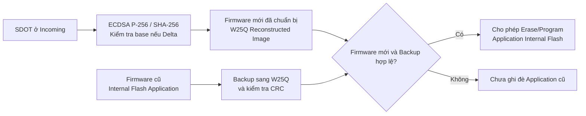

**Tại sao cần thứ tự này?** Khi Erase trang đầu của vùng Application, bản firmware đang chạy cũ **không còn nguyên vẹn**. Do đó phải có bản Backup đủ tin cậy **trước** khi ghi đè. `image_installer.c` xác minh bản Backup rồi mới chuyển Metadata sang `UPDATE_INSTALLING`.

| Điều kiện | Nếu thiếu thì có rủi ro gì? |
|---|---|
| Gói SDOT được xác thực | Có thể cài dữ liệu không được tin cậy / không đúng sản phẩm. |
| Target Image đã được chuẩn bị và kiểm tra | Cài image lỗi, sai base hoặc không tái tạo đầy đủ. |
| Backup hợp lệ | Khi Trial Boot thất bại không có bản firmware cũ đáng tin cậy để Rollback. |
| Metadata tiến độ hợp lệ | Không biết sau Reset phải làm lại trang nào. |

> **Phân biệt:** CRC32 dùng trong Backup/Install giúp phát hiện **sai khác dữ liệu**. Nó **không tự xác thực nguồn phát hành** như chữ ký ECDSA. Không nên dùng “CRC thành công” để thay cho “firmware đã được xác thực”.

#### Bước 4. Erase → Program half-word → Read-back Verify của một trang

Trong repository, `ProgramAndVerifyCandidatePage()` nạp một trang từ nguồn firmware vào **`g_install_page_buffer`**, sau đó gọi `ProgramBufferedApplicationPage()`. Hàm sau thực hiện chuỗi **lưu PRIMASK → tạm vô hiệu hóa IRQ → Unlock → ClearFlag → Erase → Program half-word → Lock → khôi phục PRIMASK → so sánh byte**.

**Các thao tác thực tế có trong source:**

| Thao tác | API / cơ chế | Ý nghĩa |
|---|---|---|
| Giữ trạng thái ngắt | `GetPrimask()` | Sau thao tác có thể trả về đúng trạng thái trước đó. |
| Vô hiệu hóa IRQ trong đoạn Flash | `__disable_irq()` | Tránh xử lý interrupt maskable trong lúc thao tác có tác động lớn đến Flash. |
| Mở Flash controller | `FLASH_Unlock()` | Cho phép Erase/Program. |
| Xóa cờ trạng thái | `FLASH_ClearFlag(...)` | Làm sạch các cờ lỗi/hoàn thành được quản lý. |
| Xóa trang đích | `FLASH_ErasePage(APPLICATION_START_ADDRESS + page_offset)` | Erase đúng trang Application. |
| Ghi dữ liệu | `FLASH_ProgramHalfWord(address, halfword)` | Ghi lần lượt 2 byte. |
| Khóa lại Flash | `FLASH_Lock()` | Tránh giữ bộ điều khiển ở trạng thái mở ghi. |
| Khôi phục trạng thái ngắt | `RestorePrimask(primask)` | Không bật ngắt vô điều kiện nếu trước đó đã bị khóa. |
| Đọc và so sánh | So sánh từng byte với buffer | Xác nhận trang đã lập trình khớp nguồn. |

**Pseudocode để hiểu luồng (không phải source nguyên văn):**

```c
// MÔ PHỎNG KHÁI NIỆM — không dùng thay cho driver của repository.
status_t install_one_page(uint32_t offset, const uint8_t *src,
                          uint32_t actual_length)
{
    // Trước đó: đã kiểm tra bounds/alignment và nạp đúng dữ liệu trang.
    uint32_t addr = APPLICATION_START_ADDRESS + offset;
    uint32_t saved_primask = read_primask();
    disable_maskable_interrupts();
    flash_unlock();

    if (flash_erase_page(addr) != OK) goto flash_error;
    for (uint32_t i = 0; i < actual_length; i += 2U) {
        uint8_t hi = (i + 1U < actual_length) ? src[i + 1U] : 0xFFU;
        uint16_t hw = (uint16_t)src[i] | ((uint16_t)hi << 8U);
        if (flash_program_halfword(addr + i, hw) != OK) goto flash_error;
    }
    flash_lock();
    restore_primask(saved_primask);

    for (uint32_t i = 0; i < actual_length; ++i)
        if (*(volatile const uint8_t *)(addr + i) != src[i]) return VERIFY_FAIL;
    return OK;

flash_error:
    flash_lock();
    restore_primask(saved_primask);
    return FLASH_FAIL;
}
```

**Lưu ý về đoạn minh họa:** Các hàm `flash_erase_page`, `flash_program_halfword`, `read_primask` trong *pseudocode* **không phải tên API thực tế** của STM32 trong repository. Hãy xem `FLASH_ErasePage()` và `FLASH_ProgramHalfWord()` trong `image_installer.c` để biết lệnh thực tế và nhánh lỗi cụ thể.

**Tại sao ghép 2 byte theo thứ tự thấp trước?** Với STM32F103 (little-endian), hai byte trong ảnh firmware được đóng gói vào half-word: byte ở offset `i` là 8 bit thấp, byte ở `i+1` là 8 bit cao. Ví dụ `[0x34, 0x12]` trở thành **`0x1234`**.

**Trang cuối có số byte lẻ thì sao?** Nếu `page_length` lẻ, code lấy **`0xFF` làm byte cao đệm** cho half-word cuối. Vòng so sánh sau khi ghi chỉ so sánh **số byte thực tế của image**. Không được đọc vượt nguồn để lấy byte thứ hai không tồn tại.

> **Phỏng vấn hay hỏi:** Tại sao phải dùng `FLASH_Lock()` và khôi phục PRIMASK cả khi lỗi? Vì lỗi ghi Flash không được để bộ điều khiển ở trạng thái mở và không được vô tình thay đổi chính sách ngắt của Bootloader sau khi trở về.

#### Bước 5. Checkpoint theo trang: cập nhật `copy_offset` lúc nào?

Trong `ResumePageCheckpointedCopy()`, Bootloader dùng `InstallProgress_Validate()`, `InstallProgress_PageLength()` và `InstallProgress_NextCheckpoint()` để chia image thành các trang; **chỉ sau khi** `ProgramAndVerifyCandidatePage()` thành công, nó mới cập nhật `metadata->copy_offset` và gọi `CommitMetadata()`.

Ví dụ một image **2.501 byte** (3 trang xóa, nhưng trang cuối chỉ có 453 byte dữ liệu):

| Bước | `page_offset` trước khi ghi | Dữ liệu ghi thực | `copy_offset` sau Verify + Commit |
|---|---:|---:|---:|
| Trang 1 | 0 | 1.024 byte | 1.024 |
| Trang 2 | 1.024 | 1.024 byte | 2.048 |
| Trang 3 | 2.048 | 453 byte (+ 1 byte đệm khi Program half-word cuối) | **2.501** |

Đây là hai quy tắc về `copy_offset` được mã `install_progress.c` sử dụng:

- **Checkpoint trung gian:** phải nằm đúng **ranh giới trang 1 KiB**.
- **Checkpoint cuối cùng:** có thể bằng **kích thước image thực** và **không cần chia hết 1 KiB**.

```mermaid
sequenceDiagram
    participant BL as STM32 Bootloader
    participant W as W25Q Reconstructed Image
    participant IF as STM32 Internal Flash
    participant M as Internal Flash Metadata A/B
    BL->>M: Đọc UPDATE_INSTALLING + copy_offset = 1024
    BL->>W: Đọc trang tại offset 1024
    W-->>BL: Buffer 1024 byte
    BL->>IF: Erase page + Program half-word
    BL->>IF: Read-back Verify
    IF-->>BL: Nội dung khớp
    BL->>M: Commit copy_offset = 2048
    M-->>BL: Metadata mới hợp lệ
    Note over BL,M: Chỉ sau commit, trang này mới là tiến độ bền vững
```

**Phân biệt ba cấp độ xác minh:**

| Cấp | Thời điểm | Cơ chế/ý nghĩa |
|---|---|---|
| **Verify trang** | Sau khi Erase/Program mỗi trang | So sánh byte trong Internal Flash với page buffer. |
| **Verify toàn image đã cài** | Sau khi hoàn tất copy | Kiểm tra CRC của image và hai word vector (MSP/Reset_Handler), kèm kiểm tra Application Jump. |
| **Xác thực an ninh firmware** | Trước Install, ở bước xác thực SDOT | Chữ ký ECDSA P-256 / SHA-256 và kiểm tra điều kiện firmware. |

#### Bước 6. Nếu mất nguồn giữa một trang Flash thì điều gì xảy ra?

Đây là tình huống **quan trọng nhất** khi giải thích Power-loss Recovery trong project.

Ví dụ Bootloader đã hoàn thành **hai trang** và `copy_offset = 2048`. Khi đang Erase hoặc mới Program một phần **trang thứ ba**, thiết bị mất nguồn:

```text
Metadata: UPDATE_INSTALLING, copy_offset = 2048

Trang 1:    [Verified + committed]
Trang 2:    [Verified + committed]
Trang 3:    [Erase/Program dở] <-- MẤT NGUỒN
Trang 4...: [Chưa xử lý]

Sau Reset:
  Bootloader đọc Metadata hợp lệ
     → Boot Decision chọn RESUME_INSTALL
     → Tiếp tục tại offset 2048
     → Erase lại TOÀN BỘ trang 3
     → Program lại trang 3 từ W25Q
     → Verify rồi mới commit offset tiếp theo
```

**Tại sao không Resume đúng byte vừa ghi dở?** Vì tiến độ byte/half-word chưa commit có thể không đáng tin cậy sau mất nguồn. Lặp lại từ **ranh giới trang chưa được xác minh** cho phép xóa sạch phần bị ghi dở và lập trình lại từ bản nguồn đã lưu.

**Tại sao không xóa và ghi lại từ trang 1?** Các trang đã được Verify và được ghi nhận bằng Metadata có thể giữ lại. Cách này tiết kiệm thao tác Flash và thời gian cập nhật, miễn các điều kiện khôi phục và nguồn firmware vẫn hợp lệ.

**Source tương ứng:** `image_installer.c` giữ `copy_offset` ở trang đã xác minh trước đó khi mô phỏng reset trong trang; có các nhánh fault injection như `INSTALL_FAULT_INJECT_OFFSET`/`HIL_FAULT_INSTALL_OFFSET` hỗ trợ kiểm tra trên phần cứng. `BootDecision_Evaluate()` ánh xạ `UPDATE_INSTALLING` sang `BOOT_ACTION_RESUME_INSTALL`.

**Điểm dễ nhầm:** *Power-loss Recovery* không tự động có nghĩa *Rollback*. Nếu vẫn có nguồn candidate hợp lệ và trạng thái cho phép Resume, Bootloader tiếp tục ghi trang chưa hoàn chỉnh. **Rollback** là con đường phục hồi Application cũ khi cần, sử dụng **Backup Image đã xác minh**.

#### Bước 7. Verify toàn image, kiểm tra vector và chuyển sang Trial Boot

Sau khi đã ghi đủ `image_size`, Bootloader chuyển tới `UPDATE_VERIFYING_INSTALL` và chạy xác minh **trên dữ liệu thực tế trong Internal Flash**. Trong hàm `VerifyInstalledApplication()`, code thực hiện các bước:

1. Tính **CRC32** trên số byte của image đã cài, so sánh với `source->image_crc32`.
2. Đọc hai word đầu tại **`APPLICATION_START_ADDRESS`** (Initial MSP và Reset Handler).
3. Kiểm tra vector với `FullImage_ValidateVector()` và `ApplicationJump_Validate()`.
4. Nếu hợp lệ, cho phép tiến tới **`UPDATE_TRIAL_BOOT`**; nếu không, trả trạng thái lỗi tương ứng.

**Tại sao cần cả Verify từng trang lẫn Verify toàn image?** So sánh từng trang phát hiện lỗi cục bộ ngay lúc Program; Verify toàn image kiểm tra kết quả cuối cùng ở mức gói firmware cài đặt và tính khả dụng của vector khởi động. Hai bước bảo vệ hai thời điểm khác nhau.

**Tại sao kiểm tra vector?** Dù byte đã ghi khớp, một image không có MSP/Reset_Handler hợp lệ vẫn không thể Jump an toàn. Xem Chương 6.2 về địa chỉ `0x08006000`, Thumb bit và điều kiện SRAM.

**Cập nhật thành công chưa kết thúc tại đây:** `UPDATE_TRIAL_BOOT` mới là trạng thái **chạy thử**. Application phải **Confirm** để chấp nhận phiên bản mới; nếu thất bại sau các lần thử cho phép thì Bootloader xử lý **Rollback** (Phần 5.5).

#### Bước 8. Metadata A/B cũng phải Erase/Program: khác với ghi Application ở đâu?

Metadata nằm trong **Internal Flash** nhưng có nhiệm vụ khác với firmware image:

| Đặc điểm | Application Image | Metadata A/B |
|---|---|---|
| Vùng | `0x08006000` – `0x0800F7FF` | A: `0x0800F800`; B: `0x0800FC00` |
| Mục đích | Chứa code Application | Lưu state, `copy_offset`, version, generation, CRC32... |
| Đơn vị Erase | 1 KiB/page | Mỗi slot A và B là **một trang 1 KiB** |
| Khi cập nhật | Ghi các trang image ứng viên | Commit bản ghi Metadata mới vào **slot không được chọn** |
| An toàn mất nguồn | Verify trang rồi tiến Checkpoint | Giữ bản Metadata hợp lệ hiện tại cho đến khi bản mới được ghi và kiểm tra |

**Commit Metadata A/B** theo mô tả của repo: đọc hai bản, chọn generation hợp lệ mới nhất, ghi bản mới vào trang cũ/không được chọn, read-back và verify CRC/bytes. Nếu mất nguồn giữa commit, bản được chọn trước đó vẫn có cơ hội tồn tại nguyên vẹn; bản mới ghi dở bị loại do không hợp lệ.

**Giải thích cần phân biệt:** Dù cả hai thao tác đều dùng Internal Flash, việc ghi **Application** thay đổi firmware thực thi, còn việc ghi **Metadata** thay đổi **quyết định boot và tiến độ phục hồi**. Xóa nhầm một trang Metadata có thể làm mất lịch sử cập nhật; xóa nhầm trang Bootloader có thể làm mất đường khởi động. Vì vậy địa chỉ và giới hạn vùng phải là các hằng số/điều kiện rõ ràng.

#### Bước 9. Đọc mã nguồn thật trong repository theo thứ tự nào?

| Thứ tự | File / hàm | Câu hỏi nên tự trả lời |
|---|---|---|
| 1 | `shared/include/memory_map.h` | `APPLICATION_START_ADDRESS`/`APPLICATION_MAX_SIZE` là bao nhiêu? Metadata ở đâu? |
| 2 | `docs/memory-map.md` | Vì sao Application còn 38 KiB, không phải 40 KiB? |
| 3 | `shared/src/install_progress.c` | Offset trung gian được phép có giá trị nào? Trang cuối xử lý thế nào? |
| 4 | `image_installer.c` → `LoadCandidatePage()` | Trang mới lấy từ phân vùng W25Q nào và nạp vào đâu? |
| 5 | `image_installer.c` → `ProgramBufferedApplicationPage()` | Có đúng Unlock → Erase → Program → Lock → Verify không? |
| 6 | `image_installer.c` → `ResumePageCheckpointedCopy()` | `copy_offset` được commit **trước hay sau** khi Verify trang? |
| 7 | `image_installer.c` → `VerifyInstalledApplication()` | Verify CRC và vector ở thời điểm nào? |
| 8 | `docs/metadata-and-boot-decision.md` | Khi reset ở `UPDATE_INSTALLING`, ai chọn `RESUME_INSTALL`? |
| 9 | `node-stm32f103/bootloader/src/boot_manager.c` | Trạng thái đó được điều phối đến nhánh xử lý nào? |

**Đoạn cần tự lần theo khi đọc code:** `ProgramAndVerifyCandidatePage()` → `ProgramBufferedApplicationPage()` → `ResumePageCheckpointedCopy()` → `VerifyInstalledApplication()`; sau đó nối với **Boot State Machine** ở Chương 5.4.

#### Tình huống lỗi thực tế và hướng suy luận

| Hiện tượng | Khả năng cần kiểm tra đầu tiên | Liên hệ source |
|---|---|---|
| `FLASH_ErasePage()` không hoàn tất | Địa chỉ page, lỗi controller, trạng thái khóa/flag | `IMAGE_INSTALLER_FLASH_ERASE_FAILED` |
| `FLASH_ProgramHalfWord()` thất bại | Căn chỉnh, dữ liệu và trạng thái Flash | `IMAGE_INSTALLER_FLASH_PROGRAM_FAILED` |
| Verify một trang sai | Flash vừa ghi không khớp buffer nguồn | `IMAGE_INSTALLER_PAGE_VERIFY_FAILED` |
| CRC toàn image sai | Nội dung ghi cuối cùng khác image nguồn đã chuẩn bị | `IMAGE_INSTALLER_VERIFY_CRC_FAILED` |
| CRC đúng nhưng không Jump | MSP/Reset Handler hoặc điều kiện vector/handoff không hợp lệ | `IMAGE_INSTALLER_VERIFY_VECTOR_FAILED` và Chương 6.2 |
| Reset giữa trang 3 | Trang 3 đang dở, Checkpoint vẫn ở đầu trang 3 | Re-erase/re-program từ `copy_offset` |
| Offset không căn chỉnh ở trang trung gian | Metadata tiến độ không hợp lệ | `InstallProgress_Validate()` |
| Install đủ byte nhưng Application chưa được chấp nhận | Đang ở Trial Boot, chưa Confirm | `UPDATE_TRIAL_BOOT` |
| Nguồn candidate/backup không còn hợp lệ | Không thể Resume/Restore một cách mù quáng | Boot Manager/Installer báo lỗi theo state và chính sách recovery |

> **Lưu ý an toàn khi debug:** Không thử Erase trực tiếp địa chỉ `0x08000000` hoặc các trang `0x0800F800`/`0x0800FC00` trên thiết bị đang chứa firmware quan trọng. Các lệnh thử nghiệm Flash cần dùng vùng thử nghiệm được bảo vệ/ràng buộc đúng địa chỉ và có phương án nạp lại qua SWD.

#### Bài nói khi phỏng vấn: STM32 Internal Flash Programming (khoảng 90 giây)

> Dạ, khi cài firmware mới, STM32 Bootloader của em không ghi thẳng gói SDOT vừa nhận vào Internal Flash. Firmware mới đã được xác thực và chuẩn bị trong vùng Reconstructed Image của External Flash W25Q. Bootloader sao lưu và xác minh Application cũ trước, rồi mới chuyển sang `UPDATE_INSTALLING`.
>
> STM32F103 dùng đơn vị xóa là một trang Internal Flash 1 KiB và đơn vị lập trình là half-word 16-bit. Vì vậy Bootloader đọc dữ liệu firmware mới theo từng trang vào RAM, Unlock Flash, Erase đúng trang Application, Program từng half-word, sau đó Lock và đọc lại để so sánh từng byte.
>
> Khi một trang được ghi và Verify thành công, Bootloader mới lưu `copy_offset` vào Metadata A/B. Nếu thiết bị mất nguồn giữa một trang, sau reset Bootloader đọc Checkpoint và xóa/ghi lại trang chưa hoàn chỉnh thay vì coi nó đã hợp lệ.
>
> Sau khi ghi toàn image, Bootloader kiểm tra CRC32 và vector của Application trong Internal Flash rồi mới cho chạy Trial Boot. Nếu Application xác nhận thành công thì bản cập nhật được chấp nhận; nếu thất bại, hệ thống xử lý Rollback từ Backup đã lưu.

#### Câu hỏi ôn tập: STM32 Internal Flash Programming

| STT | Câu hỏi | Ý chính cần trả lời |
|---:|---|---|
| 1 | Internal Flash khác RAM ở điểm nào? | Flash không mất dữ liệu khi tắt nguồn; ghi/xóa có đơn vị và giới hạn riêng, RAM mất trạng thái sau reset/power-off. |
| 2 | Tại sao Erase trước Program? | NOR Flash không cho phép tùy ý biến bit `0` về `1` bằng Program thông thường. |
| 3 | Đơn vị Erase trên STM32F103 trong project là bao nhiêu? | **1 KiB mỗi trang**. |
| 4 | Đơn vị Program là bao nhiêu? | **Half-word 16-bit**, tương đương 2 byte. |
| 5 | Vì sao không ghi từng byte? | Phải phù hợp đơn vị Program được driver/phần cứng hỗ trợ. |
| 6 | `APPLICATION_START_ADDRESS` là gì? | `0x08006000`. |
| 7 | Application chiếm tối đa bao nhiêu? | **38 KiB**, kết thúc trước `0x0800F800`. |
| 8 | Tại sao phải bảo vệ `0x0800F800`? | Bắt đầu Metadata A; Erase qua ranh giới có thể làm mất trạng thái OTA. |
| 9 | Dữ liệu mới được đọc từ đâu? | **W25Q Reconstructed Image** vào page buffer, trước khi ghi Internal Flash. |
| 10 | Tại sao cần Backup trước Install? | Vì Install ghi đè App cũ; cần bản hợp lệ để Rollback. |
| 11 | `FLASH_Unlock()` và `FLASH_Lock()` có vai trò gì? | Cho phép thao tác ghi rồi khóa lại Flash controller. |
| 12 | Tại sao phải khôi phục PRIMASK? | Giữ nguyên trạng thái maskable interrupt trước thao tác Flash. |
| 13 | Chuyển hai byte thành half-word như thế nào? | Byte thấp ở `i`, byte cao ở `i+1` theo little-endian. |
| 14 | Byte cuối lẻ được xử lý ra sao? | Ghép với byte đệm `0xFF` trước khi Program half-word cuối. |
| 15 | Vì sao Verify ngay sau ghi trang? | Phát hiện lỗi cục bộ trước khi commit Checkpoint. |
| 16 | `copy_offset` được lưu lúc nào? | Chỉ sau khi trang đã ghi và Verify thành công, rồi Metadata commit. |
| 17 | Checkpoint cuối có bắt buộc là bội 1 KiB không? | **Không**; được bằng chính `image_size`. |
| 18 | Mất nguồn giữa trang thì tiếp tục từ đâu? | Từ ranh giới trang chưa được Checkpoint; Erase/Program lại trang đó. |
| 19 | Vì sao Verify toàn image sau khi hoàn tất? | Kiểm tra CRC32 và vector cuối cùng trong Internal Flash. |
| 20 | CRC32 có thay cho chữ ký ECDSA không? | **Không**; CRC phát hiện lỗi dữ liệu, ECDSA xác thực chữ ký. |
| 21 | Verify Installed Image thành công có nghĩa OTA xong chưa? | **Chưa**; cần Trial Boot và Confirm. |
| 22 | Metadata A/B giúp gì nếu mất nguồn trong commit? | Giữ một bản Metadata hợp lệ khác để Bootloader lựa chọn sau reset. |

#### Điểm cần ghi nhớ

1. **Không nhầm Erase 1 KiB của Internal Flash với sector 4 KiB của External Flash W25Q.**
2. **Application chỉ nằm trong `0x08006000`–`0x0800F7FF`**, tuyệt đối không để thao tác cài đặt lấn sang Bootloader/Metadata.
3. **Firmware mới đã được xác thực và chuẩn bị trước khi Install; Backup cũ phải đáng tin cậy trước khi ghi đè.**
4. **Một trang = Erase → Program half-word → read-back Verify**; nếu lỗi, **không tiến `copy_offset`**.
5. **Checkpoint là mốc bền vững**, không phải số byte vừa Program gần nhất trong RAM.
6. **Mất nguồn giữa trang → xóa lại và ghi lại trang đó** theo `copy_offset` đã được lưu; không mặc định Rollback.
7. **Trang cuối có thể ngắn hơn 1 KiB**, và số byte lẻ được đệm bằng `0xFF` khi ghi half-word cuối.
8. **Verify trang ≠ Verify toàn image ≠ xác thực chữ ký SDOT.** Mỗi cấp kiểm tra giải quyết một vấn đề khác nhau.
9. **Install thành công ≠ OTA được Confirm**; còn cần Trial Boot và khả năng Rollback.
10. **Muốn giải thích đúng project, hãy trích dẫn đường đi của hàm trong `image_installer.c`**, không chỉ mô tả các thao tác Flash theo lý thuyết.

#### Các file mã nguồn và tài liệu nên đọc

| File / tài liệu | Vai trò |
|---|---|
| [`docs/memory-map.md`](https://github.com/haikevins/secure-delta-ota-bootloader/blob/main/docs/memory-map.md) | Vùng 24 KiB Bootloader, 38 KiB Application, hai Metadata page 1 KiB. |
| [`shared/include/memory_map.h`](https://github.com/haikevins/secure-delta-ota-bootloader/blob/main/shared/include/memory_map.h) | Hằng số địa chỉ và `INTERNAL_FLASH_PAGE_SIZE`. |
| [`shared/src/install_progress.c`](https://github.com/haikevins/secure-delta-ota-bootloader/blob/main/shared/src/install_progress.c) | Kiểm tra `copy_offset`, tính `PageLength` và `NextCheckpoint`. |
| [`node-stm32f103/bootloader/src/image_installer.c`](https://github.com/haikevins/secure-delta-ota-bootloader/blob/main/node-stm32f103/bootloader/src/image_installer.c) | Nạp page buffer, Erase/Program/Verify, Resume và kiểm tra image sau khi cài. |
| [`docs/metadata-and-boot-decision.md`](https://github.com/haikevins/secure-delta-ota-bootloader/blob/main/docs/metadata-and-boot-decision.md) | Metadata A/B và cách `UPDATE_INSTALLING` chọn `RESUME_INSTALL`. |
| [`docs/boot-state-machine.md`](https://github.com/haikevins/secure-delta-ota-bootloader/blob/main/docs/boot-state-machine.md) | Các state `BACKING_UP`, `INSTALLING`, `VERIFYING_INSTALL`, `TRIAL_BOOT`. |
| [`node-stm32f103/bootloader/src/boot_manager.c`](https://github.com/haikevins/secure-delta-ota-bootloader/blob/main/node-stm32f103/bootloader/src/boot_manager.c) | Điều phối Boot Decision và Image Installer sau reset. |
| [STM32F1 Reference Manual RM0008](https://www.st.com/resource/en/reference_manual/cd00171190-stm32f101xx-stm32f102xx-stm32f103xx-stm32f105xx-and-stm32f107xx-advanced-arm-based-32-bit-mcus-stmicroelectronics.pdf) | Kiến thức nền Flash controller, Page Erase và Half-word Programming của STM32F1. |

> **Tự kiểm tra cuối chương:** Giả sử firmware mới có `image_size = 2501`, thiết bị mất nguồn sau khi ghi **150 byte vào trang thứ ba**, trong khi Metadata vẫn lưu `copy_offset = 2048`. Hãy giải thích: (1) sau reset Bootloader chọn hành động nào, (2) trang nào được Erase lại, (3) vì sao không bắt đầu từ byte thứ 150, (4) lúc nào `copy_offset` trở thành `2501`, và (5) tại sao **Verify Installed Image** vẫn cần thiết sau khi đã Verify từng trang.

---

<a id="chuong-6-4"></a>
### 6.4. External SPI Flash W25Q

> **Mục tiêu:** Giải thích được cơ chế hoạt động của **SPI NOR Flash W25Q**, sự khác nhau giữa **Read**, **Page Program (256 byte)** và **Sector Erase (4 KiB)**, ý nghĩa **WIP/BUSY** và **WEL**, giới hạn địa chỉ/phân vùng, cách **STM32 Application** lưu gói SDOT và cách **STM32 Bootloader** dùng các vùng **Reconstructed Image** và **Backup Image**. Quan trọng nhất: phân tích được **Resume sau mất nguồn** mà không phá hỏng các phân vùng khác.
>
> **Phạm vi đối chiếu:** Thông số về W25Q32/W25Q64, wiring, lệnh SPI, bảng phân vùng, các tên hàm và quy tắc bảo vệ lấy từ [`docs/external-spi-flash.md`](https://github.com/haikevins/secure-delta-ota-bootloader/blob/main/docs/external-spi-flash.md), [`docs/memory-map.md`](https://github.com/haikevins/secure-delta-ota-bootloader/blob/main/docs/memory-map.md), `spi_flash.c`, `external_flash_storage.c` và các storage/receiver tương ứng. Các sơ đồ, ví dụ hex và **pseudocode** dưới đây dùng để giảng giải, không phải code sao chép nguyên văn.
>
> **Liên hệ:** Chương 6.3 giải thích **Internal Flash STM32** (Erase 1 KiB, Program 16-bit). Chương này giải thích **External Flash W25Q** (Erase sector 4 KiB, Program theo page tối đa 256 byte). Phần 6.6 sẽ đi sâu hơn về tầng tín hiệu **SPI**.

#### Sơ đồ tổng quan: Dữ liệu OTA đi qua W25Q như thế nào?

```mermaid
flowchart TD
    ESP["ESP32 Gateway<br/>Gói SDOT đã tải qua HTTPS"] -->|"UART + COBS + CRC32"| APP["STM32 Application<br/>OTA Receiver"]
    APP -->|"SPI: ghi + Verify"| IN["W25Q: Vùng Incoming (gói SDOT)<br/>0x002000 - 0x021FFF"]
    APP -->|"Download Checkpoint A/B<br/>sau mốc sector an toàn"| META["W25Q: External Flash Metadata A/B<br/>0x000000 - 0x001FFF"]
    APP -->|"FINISH; INSTALL + Internal Metadata + Reset"| BOOT["STM32 Bootloader"]
    IN -->|"Đọc, xác thực SDOT"| BOOT
    BOOT -->|"Full: copy / Delta: apply patch"| RECON["W25Q: Reconstructed Image<br/>0x022000 - 0x041FFF"]
    OLD["STM32 Internal Flash<br/>Application hiện tại"] -->|"Backup qua SPI"| BACK["W25Q: Backup Image<br/>0x042000 - 0x061FFF"]
    RECON -->|"Đọc ứng viên đã kiểm tra"| BOOT
    BACK -->|"Nguồn Rollback nếu cần"| BOOT
    BOOT -->|"Erase/Program/Verify theo trang 1 KiB"| NEW["STM32 Internal Flash<br/>Application mới / phục hồi"]
```

**Bốn nguyên tắc trước khi đọc sâu:**

1. **W25Q là bộ nhớ ngoài, không phải vùng Internal Flash memory-mapped của STM32**: giao tiếp bằng lệnh SPI và địa chỉ W25Q riêng.
2. **Đọc được trực tiếp nhưng không ghi đè tùy ý**: trước khi đổi bit từ `0` thành `1` phải Erase; Page Program chỉ đưa các bit từ `1` thành `0`.
3. **4 KiB ≠ 256 byte**: sector 4 KiB là đơn vị Erase; page 256 byte là ranh giới Program. `ACK` một gói UART không đồng nghĩa với Checkpoint đã lưu bền vững.
4. **Phải chọn đúng phân vùng trước khi thao tác**: driver SPI kiểm tra phạm vi toàn chip; lớp `ExternalFlashStorage_*` còn kiểm tra offset trong **phân vùng**.

#### Bước 1. Xác định đúng chip W25Q, dung lượng, chân nối và chế độ SPI

Trong project, layout logic dành cho **W25Q32 (4 MiB, 32 Mbit, JEDEC `EF 40 16`)**. Driver cũng chấp nhận **W25Q64 (8 MiB, JEDEC `EF 40 17`)** để phát triển trên phần cứng tương thích, nhưng layout OTA vẫn chỉ cho phép sử dụng **4 MiB đầu tiên**. Điều này không có nghĩa các phân vùng tự mở rộng khi cắm W25Q64.

| Thành phần | Giá trị trong repository | Ý nghĩa |
|---|---|---|
| STM32 peripheral | `SPI1` | Master điều khiển W25Q. |
| `SCK` | `PA5` | Xung SPI. |
| `MISO` | `PA6` | W25Q trả dữ liệu về STM32. |
| `MOSI` | `PA7` | STM32 gửi opcode, địa chỉ, dữ liệu. |
| `/CS` | `PB0` | GPIO active-low chọn chip. |
| Chế độ | **SPI Mode 0**, 8-bit, MSB-first | CPOL=0, CPHA=0; software NSS. |
| SPI prescaler | `/4` | Giá trị chia clock trong cấu hình driver, không phải tốc độ MHz cố định. |
| Nguồn | **3.3 V**, GND chung | Không nối tín hiệu 5 V trực tiếp vào thiết bị 3.3 V. |
| `/WP`, `/HOLD` | Giữ HIGH khi dùng chip rời | Tránh vô ý khóa ghi hoặc tạm dừng giao tiếp. |

**Tại sao phải đọc JEDEC ID?** `SpiFlash_Init()` cấu hình GPIO/SPI, dùng lệnh `0x9F` đọc 3 byte ID, chỉ chấp nhận chip tương thích; nếu không nhận dạng được thì trả lỗi và không xem storage là sẵn sàng. Đây là cách tránh tiếp tục Erase/Program khi chip bị thiếu, đứt dây hoặc sai loại. **Không** nên tự kết luận mọi lỗi JEDEC đều do chip hỏng: cần kiểm tra nguồn, `/CS`, SPI mode, wiring và thời điểm clock trước.

**Ví dụ phân biệt:** `EF 40 16` là ba byte ID W25Q32 trong luồng SPI; khi driver ghép thành `uint32_t`, giá trị đọc có dạng `0x00EF4016`. Không được đảo thứ tự byte khi đối chiếu log.

**File cần đọc:** [`spi_flash.c` → `SpiFlash_Init()`, `ReadJedecIdRaw()`, `SpiFlash_IsSupportedJedecId()`](https://github.com/haikevins/secure-delta-ota-bootloader/blob/main/node-stm32f103/common/drivers/spi_flash.c).

#### Bước 2. Hiểu nguyên lý NOR Flash: Erase, Program, Read và giới hạn đơn vị

| Thao tác | Đơn vị/ràng buộc trong thiết kế | Kết quả cần hiểu |
|---|---|---|
| `Read Data` | Có thể đọc nhiều byte trong phạm vi hợp lệ. | Không yêu cầu Erase trước khi đọc. |
| `Page Program` | Tối đa đến **ranh giới 256 byte** của page hiện tại. | Chỉ lập trình bit **`1 → 0`**; không tự xóa dữ liệu cũ. |
| `4 KiB Sector Erase` | Địa chỉ phải chia hết cho **4096**. | Toàn bộ sector được đưa về trạng thái xóa (`0xFF`). |
| `Read Status Register-1` | Đọc thanh ghi trạng thái. | Quan sát `WIP/BUSY`, `WEL`. |
| `Write Enable` | Cần trước từng thao tác Program/Erase. | Đặt latch cho phép ghi; phải kiểm tra WEL thay vì chỉ gửi opcode rồi giả định thành công. |

**Ví dụ về bit:** dữ liệu hiện tại `1111 0000` (`0xF0`) có thể Program thành `1100 0000` (`0xC0`), nhưng không thể chỉ Program để trở thành `1111 1111` (`0xFF`). Muốn đưa các bit `0` lên `1`, cần Erase sector chứa byte đó.

**Ví dụ phân biệt 256 B và 4 KiB:** Một sector chứa **16 page 256 byte** (`4096 / 256 = 16`). Khi xóa sector, **cả 16 page** bị ảnh hưởng. Khi Program, không được để một lệnh Page Program vượt qua ranh giới page (vì có thể ghi vòng trong page hoặc cho kết quả không như dự định tùy thiết bị).

> **Điểm dễ bị hỏi:** `SpiFlash_Write()` trong repository **không tự Erase**. Hàm kiểm tra trước `PreflightProgrammable()`; nếu byte mới yêu cầu chuyển bit `0 → 1`, driver trả `SPI_FLASH_STATUS_NEEDS_ERASE`. Tầng OTA/storage phải tổ chức Erase đúng sector trước khi ghi mới. Không nên mô tả driver “ghi đè byte bất kỳ”.

#### Bước 3. Hiểu chuỗi lệnh SPI và vai trò WIP/WEL

Các opcode thực sự được driver sử dụng:

| Opcode | Tên | Vai trò |
|---|---|---|
| `0x9F` | Read JEDEC ID | Nhận diện chip. |
| `0x05` | Read Status Register-1 | Đọc bit trạng thái. |
| `0x06` | Write Enable | Yêu cầu đặt WEL trước ghi/xóa. |
| `0x03` | Read Data | Đọc dữ liệu từ địa chỉ 24-bit. |
| `0x02` | Page Program | Ghi các byte trong **một page**. |
| `0x20` | 4 KiB Sector Erase | Xóa sector được chỉ định. |

**WIP/BUSY** là bit 0 của Status Register-1: `1` nghĩa là chip vẫn bận với thao tác nội bộ; `0` nghĩa là đã sẵn sàng cho bước tiếp. **WEL** là bit 1: `1` nghĩa là latch đã được kích hoạt để cho phép Program/Erase. **WEL không chứng minh rằng dữ liệu đã ghi thành công**; cần đợi WIP hết bận và Verify.

```mermaid
sequenceDiagram
    participant MCU as STM32 SPI driver
    participant NOR as W25Q SPI NOR
    MCU->>NOR: /CS LOW, 0x06 (Write Enable), /CS HIGH
    MCU->>NOR: 0x05 (Read Status-1)
    NOR-->>MCU: WEL = 1?
    alt WEL không được đặt
        MCU-->>MCU: Báo WRITE_ENABLE_FAILED
    else WEL hợp lệ
        MCU->>NOR: /CS LOW, 0x02 + 24-bit addr + dữ liệu, /CS HIGH
        loop Chờ thao tác hoàn tất (có timeout)
            MCU->>NOR: 0x05 (Read Status-1)
            NOR-->>MCU: WIP/BUSY
        end
        MCU->>NOR: 0x03 + địa chỉ (Read-back)
        NOR-->>MCU: Dữ liệu vừa ghi
        MCU-->>MCU: So sánh với buffer nguồn
    end
```

**Lưu ý về `/CS`:** Khi gửi opcode và địa chỉ/dữ liệu của *một transaction*, `/CS` phải ở mức LOW; đưa HIGH để kết thúc transaction. Với Write Enable, driver thực hiện transaction riêng trước lệnh Program/Erase. `/CS` không thể luôn LOW cho mọi lệnh liên tiếp.

**Timeout trong code** là giới hạn số vòng polling (`*_TIMEOUT_LOOPS`), **không được diễn giải thành chính xác số mili giây** vì phụ thuộc CPU/clock/tối ưu hóa. Nếu WIP không trở về 0 trong giới hạn, `WaitReady()` báo `SPI_FLASH_STATUS_BUSY_TIMEOUT`.

#### Bước 4. Phân tích Page Program: chia đúng ranh giới 256 byte và Verify

`SpiFlash_Write(address, data, length)` xử lý theo thứ tự:

1. Kiểm tra đã `Init`, con trỏ, chiều dài và **phạm vi địa chỉ tuyệt đối**.
2. Đọc trước vùng đích bằng `PreflightProgrammable()` để chặn mọi byte cần `0 → 1`.
3. Dùng `ExtFlash_PageChunkLength()` xác định kích thước đoạn **không vượt ranh giới 256 byte**.
4. Gọi `ProgramPageChunk()` cho từng đoạn: `WriteEnable()` → `0x02 + địa chỉ 24-bit + bytes` → `WaitReady()` → `SpiFlash_Verify()`.
5. Chỉ trả thành công khi tất cả các đoạn đều Program và Verify được.

**Ví dụ chạm ranh giới page (mô phỏng đúng quy tắc chia):** bắt đầu tại địa chỉ `0x0000F0`, ghi **40 byte**. Offset trong page là `0xF0 = 240` nên page đầu còn **16 byte**; driver thực hiện 2 đoạn:

```text
Đoạn 1: địa chỉ 0x0000F0, 16 byte → đến 0x0000FF
Đoạn 2: địa chỉ 0x000100, 24 byte → đến 0x000117
```

**Pseudocode (minh họa, không phải mã nguồn chép từ repo):**

```c
bool WriteAcrossPages(uint32_t address, const uint8_t *buffer, uint32_t length)
{
    uint32_t done = 0U;
    while (done < length) {
        uint32_t page_remaining = 256U - ((address + done) & 0xFFU);
        uint32_t chunk = length - done;
        if (chunk > page_remaining) chunk = page_remaining;

        /* Trong code thật: kiểm tra preflight, WEL, status, timeout và verify. */
        if (!ProgramOnePageChunk(address + done, buffer + done, chunk)) return false;
        done += chunk;
    }
    return true;
}
```

`ProgramOnePageChunk()` trong ví dụ là **tên minh họa**; tên hàm thực tế của repo là `ProgramPageChunk()`, còn API gọi từ tầng trên là `SpiFlash_Write()`.

**Vì sao read-back Verify sau mỗi đoạn vẫn chưa đủ để tin tưởng firmware?** Nó chỉ chứng minh dữ liệu lưu khớp dữ liệu đang gửi; **CRC32 toàn SDOT** và **ECDSA P-256/SHA-256** thực hiện ở các bước khác. W25Q không xác thực chữ ký số firmware cho Bootloader.

#### Bước 5. Sector Erase 4 KiB, căn chỉnh địa chỉ và phân biệt Erase Range

`SpiFlash_EraseSector(address)` yêu cầu địa chỉ **được căn chỉnh 4 KiB** (`address % 4096 == 0`) và sector vẫn nằm trong phạm vi chip. Nếu gọi `SpiFlash_EraseSector(0x002100)`, hàm **từ chối**; nó **không lén làm tròn xuống** `0x002000` rồi xóa.

Luồng xóa của driver: validate → `WriteEnable()` và kiểm WEL → gửi `0x20 + 24-bit address` → chờ `WIP=0` có timeout → trả trạng thái. Khác với Page Program, `SpiFlash_EraseSector()` **không tự thực hiện blank-check toàn sector**. Có API riêng `SpiFlash_IsErased()` để đọc và xác nhận các byte đều `0xFF` khi cần.

Ở tầng phân vùng:

- `ExternalFlashStorage_EraseRange(partition, offset, length)` yêu cầu **offset và length là bội số 4 KiB**, đồng thời toàn bộ vùng nằm trong partition; hàm lặp từng sector.
- `ExternalFlashStorage_ErasePartition(partition)` duyệt toàn bộ sector của partition hợp lệ.
- `ExternalFlashStorage_IsErased(partition, offset, length)` gọi xuống driver để kiểm tra vùng trống.

**Ví dụ:** Incoming bắt đầu `0x002000`; xóa một sector đầu bằng `ExternalFlashStorage_EraseRange(INCOMING, 0, 4096)` → xóa địa chỉ `0x002000–0x002FFF`. Nếu yêu cầu xóa từ offset `256`, lớp storage từ chối thay vì tự xóa cả sector.

> **Cảnh báo:** Xóa nhầm sector Metadata hoặc Backup có thể khiến Recovery/Rollback mất dữ liệu. Đừng dùng `ErasePartition()` lên Metadata/Backup như một thao tác “reset” chung khi chưa hiểu trạng thái cập nhật.

#### Bước 6. Đọc bảng phân vùng W25Q: dùng offset tương đối, không nhầm địa chỉ tuyệt đối

**Memory Map triển khai cho không gian `0x000000`–`0x3FFFFF` (4 MiB)**:

| Phân vùng W25Q | Địa chỉ bắt đầu | Địa chỉ kết thúc | Dung lượng | Dữ liệu/ứng dụng |
|---|---:|---:|---:|---|
| External Metadata A | `0x000000` | `0x000FFF` | 4 KiB | Handoff cũ + Download Checkpoint A. |
| External Metadata B | `0x001000` | `0x001FFF` | 4 KiB | Handoff cũ + Download Checkpoint B. |
| Incoming (gói SDOT) | `0x002000` | `0x021FFF` | 128 KiB | Gói Full/Delta SDOT được nhận từ ESP32. |
| Reconstructed Image | `0x022000` | `0x041FFF` | 128 KiB | Firmware **hoàn chỉnh** chuẩn bị trước Install. |
| Backup Image | `0x042000` | `0x061FFF` | 128 KiB | Bản sao Application đã xác minh + backup header. |
| Update Logs | `0x062000` | `0x071FFF` | 64 KiB | Diagnostics có giới hạn. |
| Reserved | `0x072000` | `0x3FEFFF` | 3636 KiB | Dự trữ, không mặc nhiên dùng OTA. |
| External Flash Self-test | `0x3FF000` | `0x3FFFFF` | 4 KiB | Sector **kiểm thử có xóa phá hủy dữ liệu**. |

**Đặc biệt:** 128 KiB của Backup Image **không có nghĩa** có một image 128 KiB hợp lệ. Layout bên trong phân vùng Backup là:

```text
0x042000 – 0x042FFF : Backup header sector 4 KiB (CRC-protected)
0x043000 – 0x04C7FF : Copy vùng Application 38 KiB
0x04C800 – 0x061FFF : Dự trữ trong Backup partition
```

Tách **header** sang sector riêng giúp nếu mất nguồn giữa commit header, có thể xóa/ghi lại sector `0x042000` mà **không xóa vùng dữ liệu Backup bắt đầu `0x043000`**.

**Khác biệt External Metadata và Internal Metadata:**

| Nhóm | Vị trí | Mục đích |
|---|---|---|
| **External Flash Metadata A/B** | W25Q `0x000000`, `0x001000`, mỗi vùng 4 KiB | Checkpoint nhận UART và bản ghi *legacy handoff*. |
| **Internal Flash Metadata A/B** | STM32 `0x0800F800`, `0x0800FC00`, mỗi vùng 1 KiB | Trạng thái **Boot Decision** quan trọng sau reset, như `UPDATE_ARTIFACT_READY`, `UPDATE_INSTALLING`, `UPDATE_TRIAL_BOOT`. |

Trong **đường cập nhật SDOT ký số mặc định**, lệnh `INSTALL` ghi `UPDATE_ARTIFACT_READY` vào **Internal** Boot Metadata; không được nói rằng chỉ ghi External Metadata là Bootloader tự nhận được yêu cầu cài.

**Trường hợp record cùng sector:** mỗi sector External Metadata dành offset `0x000` cho legacy handoff 36 byte và offset `0x100` cho download Checkpoint 40 byte. Vì **Erase là 4 KiB**, lúc commit một loại record, storage layer đọc và giữ lại record còn hợp lệ của loại kia trước khi xóa sector đích. Khi đọc thông tin này hãy nhớ A/B trong External Flash **khác** A/B trong Internal Flash.

#### Bước 7. Tầng lưu trữ bảo vệ phân vùng: `ExternalFlashStorage_*`

Driver `SpiFlash_*` chịu trách nhiệm giao tiếp chip, còn lớp `ExternalFlashStorage_*` nhận `partition + relative offset`. Lớp này tra `g_partitions[]`, kiểm tra offset/length trong phạm vi, tính địa chỉ tuyệt đối và mới gọi SPI driver.

**Ví dụ đúng – ghi 256 byte vào đầu Incoming (minh họa lời gọi API thật, cần dữ liệu đã chuẩn bị và sector đã xóa):**

```c
/* Lời gọi minh họa cách dùng API, không phải trích code của OTA receiver. */
uint8_t packet[256];
/* packet đã được nạp từ dữ liệu nhận và kiểm tra. */
bool ok = ExternalFlashStorage_Write(
    EXTERNAL_FLASH_PARTITION_INCOMING,  /* phân vùng */
    0U,                                /* offset trong phân vùng */
    packet,
    sizeof(packet));
/* Địa chỉ tuyệt đối tương ứng: 0x002000, không phải 0x000000. */
```

**Ví dụ bảo vệ:** vùng Incoming có kích thước `0x20000` (131072 byte). Một yêu cầu `offset=0x1FFF0, length=32` vượt giới hạn thêm 16 byte nên bị `ResolveRange()` từ chối, **không ghi lan sang Reconstructed Image**. Ngay cả khi địa chỉ tuyệt đối vẫn nằm trong chip, nó vẫn **không hợp lệ ở phân vùng Incoming**.

**Các hàm quan trọng:**

| Hàm | Giải thích |
|---|---|
| `ExternalFlashStorage_GetPartition()` | Lấy địa chỉ bắt đầu, dung lượng của partition. |
| `ExternalFlashStorage_Read()` | Đọc dữ liệu trong phạm vi partition. |
| `ExternalFlashStorage_Write()` | Ghi qua driver; **không ngầm Erase**. |
| `ExternalFlashStorage_Verify()` | So sánh với dữ liệu đọc lại. |
| `ExternalFlashStorage_EraseRange()` | Xóa một dải sector đã căn chỉnh 4 KiB. |
| `ExternalFlashStorage_ErasePartition()` | Xóa toàn partition, cần dùng đúng mục đích. |
| `ExternalFlashStorage_IsErased()` | Kiểm tra `0xFF` trên vùng chọn. |

**File cần đọc:** [`external_flash_storage.c`](https://github.com/haikevins/secure-delta-ota-bootloader/blob/main/node-stm32f103/common/storage/external_flash_storage.c), [`ext_flash_layout.c`](https://github.com/haikevins/secure-delta-ota-bootloader/blob/main/shared/src/ext_flash_layout.c) và [`memory_map.h`](https://github.com/haikevins/secure-delta-ota-bootloader/blob/main/shared/include/memory_map.h).

#### Bước 8. STM32 Application nhận SDOT và lưu Checkpoint ở ranh giới sector 4 KiB

Nhận OTA qua UART khác với ghi Flash ngẫu nhiên. Luồng thực tế trong [`ota_receiver.c`](https://github.com/haikevins/secure-delta-ota-bootloader/blob/main/node-stm32f103/application/src/ota_receiver.c) cần xử lý **thứ tự**, **ACK/NACK**, **erase-on-demand** và **resume**:

1. `START` xác nhận thông tin bản cập nhật, kiểm tra giới hạn Incoming, khởi tạo phiên nhận và commit Download Checkpoint.
2. Với `DATA`, Application kiểm tra frame/CRC, `update_id`, `Sequence`, `Offset`.
3. `EnsureIncomingSectorsErased()` xác định sector 4 KiB bị tác động và chỉ xóa sector chưa đánh dấu là đã xóa trong phiên.
4. `ExternalFlashStorage_Write(INCOMING, offset, ...)` ghi vào W25Q; driver chia page và Verify dữ liệu.
5. Sau dữ liệu được xử lý hợp lệ, Application có thể trả `ACK`; khi `next_offset` **đúng ranh giới 4 KiB**, `PersistReceiveBoundaryIfNeeded()` mới commit Checkpoint.
6. Khi reset, Application đọc Download Checkpoint bền vững để biết **offset an toàn**, tái tạo bitmap các sector đã hoàn thành và cho ESP32 `RESUME` từ vị trí đó.
7. `FINISH` tính CRC32 của **toàn bộ Incoming SDOT** và xác nhận đã nhận đủ; `INSTALL` là lệnh riêng để ghi **Internal Boot Metadata** rồi reset.

```mermaid
flowchart TD
    DATA["DATA: offset + payload"] --> CHECK["Kiểm tra ID / Sequence / Offset / CRC"]
    CHECK -->|"Sai"| NACK["NACK / Retry"]
    CHECK -->|"Đúng"| ERASE["Xác định sector 4 KiB<br/>Erase nếu cần"]
    ERASE --> WRITE["Write page chunks 256 B<br/>Read-back Verify"]
    WRITE -->|"Lỗi"| NACK
    WRITE -->|"OK"| BOUND{"next_offset là ranh giới 4 KiB?"}
    BOUND -->|"Có"| PERSIST["Commit Download Checkpoint A/B"]
    BOUND -->|"Không"| ACK["ACK packet"]
    PERSIST --> ACK
    ACK --> NEXT["Tiếp tục DATA / FINISH"]
```

**Ví dụ Resume:** SDOT dài 20 KiB; STM32 đã ACK các packet đến khoảng 10 KiB, nhưng **Checkpoint bền vững gần nhất là 8 KiB**. Mất nguồn khiến byte mới nhận sau Checkpoint không được bảo đảm, dù trước đó có ACK. Khi reset, receiver yêu cầu truyền lại từ **8192**. Sector đang dở cần được xử lý lại đúng chính sách Erase/Write, không được chỉ nối thêm theo offset RAM cũ.

**Phân biệt rõ:** `erased_sector_bitmap` nằm trong **RAM phiên nhận**, còn `DownloadCheckpointRecord` nằm trong **External Flash Metadata A/B**. Khi reset, bitmap có thể được **tái tạo từ số sector hoàn thành** của Checkpoint, không phải do RAM tự giữ được dữ liệu sau mất nguồn.

#### Bước 9. Bootloader sử dụng Reconstructed, Backup và Metadata như thế nào?

| Pha Boot State Machine | Nguồn/đích W25Q | Điều kiện an toàn |
|---|---|---|
| `VERIFYING_CONTAINER` | Đọc **Incoming (gói SDOT)**. | Kiểm tra cấu trúc, chính sách, chữ ký ECDSA và hash liên quan. |
| `VERIFYING_BASE` (Delta) | Đọc firmware gốc từ Internal Application. | Base version/SHA-256 phải đúng trước patch. |
| `PATCHING` | Ghi **Reconstructed Image**. | Full copy payload hoặc Delta tái tạo image; Verify target. |
| `BACKING_UP` | Ghi **Backup Image** từ Internal Application. | Backup theo sector 4 KiB; header/CRC và dữ liệu phải hợp lệ trước khi Install. |
| `INSTALLING` | **Đọc** Reconstructed; ghi **Internal Flash**. | Checkpoint Install **1 KiB**, không dùng nhầm Checkpoint Receive 4 KiB. |
| `ROLLBACK` | **Đọc** Backup; khôi phục **Internal Flash**. | Chỉ phục hồi khi Backup đáng tin cậy; theo tiến độ an toàn. |

**Vì sao phải có ba vùng Incoming/Reconstructed/Backup?** Incoming giữ **gói SDOT chưa được dùng để cài firmware** (đối với Delta đó là *patch*, không phải image hoàn chỉnh). Reconstructed giữ **firmware đích đầy đủ** sau xác minh/tái tạo. Backup giữ **firmware trước đó** để khôi phục nếu Trial Boot thất bại. Gộp cả ba vào một vùng có thể khiến mất nguồn hoặc thao tác Erase làm hỏng nguồn đang cần dùng để phục hồi.

**Cấu trúc Backup:** `BackupImageStorage_CommitHeader()` chỉ Erase header sector, viết record/CRC và đọc lại. Phần Application backup nằm sau offset `0x1000`, nên reset khi commit header có thể xử lý riêng mà không phá bản sao image. Đây là lý do layout dự phòng theo **sector**, không phải chỉ “dành chỗ trống”.

**Đường dữ liệu cần nhớ:** **UART SDOT → W25Q Incoming → Bootloader Verify → W25Q Reconstructed → Backup Internal App vào W25Q → Internal Flash Install → Trial Boot/Confirm hoặc Rollback**.

#### Bước 10. Mất nguồn, xử lý lỗi, self-test và giới hạn kiểm thử

**Mất nguồn khi đang Page Program:** dữ liệu trang hiện tại có thể chưa hoàn chỉnh. Đọc lại/CRC chỉ ra bất nhất; **không được coi page này đã an toàn** nếu Checkpoint chưa commit. Khi Resume, quay về sector an toàn gần nhất theo hợp đồng của receiver.

**Mất nguồn khi Erase sector:** sector đang xóa có thể không còn dữ liệu hợp lệ. Nếu là Incoming chưa Checkpoint, có thể tải và ghi lại; nếu là Backup hoặc Metadata, phải đi qua chính sách recovery của state machine / storage redundant, không tùy tiện coi là `0xFF` toàn sector.

**Mất nguồn khi ghi External Flash Metadata A/B:** code commit vào slot đích và giữ một bản hợp lệ trước đó; hai loại record chia sẻ cùng sector, nên lưu lại record kia khi sector đích bị xóa. Record mới chỉ hợp lệ sau bước đọc lại và kiểm tra CRC/validation. Điều này khác với chỉ ghi một biến trong RAM.

| Hiện tượng | Kiểm tra đầu tiên | Mã/khái niệm liên quan |
|---|---|---|
| `SpiFlash_Init()` thất bại | Nguồn, `/CS`, SPI mode, JEDEC ID | `UNSUPPORTED_DEVICE`, `TRANSFER_TIMEOUT` |
| Erase bị từ chối | Địa chỉ có căn chỉnh 4 KiB? Có nằm trong chip/partition? | `ALIGNMENT_ERROR`, `RANGE_ERROR` |
| Ghi dữ liệu cũ bị từ chối | Có đang yêu cầu đổi `0 → 1` mà chưa Erase? | `SPI_FLASH_STATUS_NEEDS_ERASE` |
| Ghi quá page | Driver có chia page 256 byte? | `ExtFlash_PageChunkLength()` |
| W25Q không hết bận | Trạng thái BUSY/WIP và ngưỡng polling | `SPI_FLASH_STATUS_BUSY_TIMEOUT` |
| Read-back không khớp | Dữ liệu đích, nhiễu tín hiệu, chip/nguồn | `SPI_FLASH_STATUS_VERIFY_FAILED` |
| Ghi Incoming tràn sang Reconstructed | Offset/length vượt giới hạn phân vùng? | `ResolveRange()` phải từ chối |
| ACK đến 10 KiB nhưng Resume 8 KiB | Checkpoint mới chỉ bền vững ở 8 KiB | Receiver `persisted_offset` |
| Backup header lỗi | Chỉ header sector hay dữ liệu Backup cũng lỗi? | `BackupImageStorage_*` |
| Full/Delta xác thực thất bại | Không phải lỗi SPI tất yếu | SDOT Verify (SHA-256/ECDSA) |

**Kiểm thử phần cứng có sẵn trong repo:** tài liệu `docs/external-spi-flash.md` mô tả bài self-test ở sector cuối **`0x3FF000`**: kiểm JEDEC ID → Erase/blank-check → ghi 40 byte từ offset `0xF0` để **cắt qua ranh giới page 256 byte** → Read/Verify → kiểm tra ranh giới partition → Erase/blank-check trở lại. Khi thành công, log có thể chứa `FLASH_SELFTEST_STATUS=0x50415353` và `SPI Flash hardware test: PASS`.

> **Cảnh báo đặc biệt:** Self-test này là **destructive** trong sector `0x3FF000`–`0x3FFFFF`. Chỉ dùng sector đã dành riêng cho test, và khi chạy image self-test cần nạp lại firmware thường theo hướng dẫn repo. Không thử Erase toàn chip hoặc toàn Backup/Metadata chỉ để kiểm tra kết nối.

#### Bài nói khi phỏng vấn: External SPI Flash W25Q (khoảng 90 giây)

> Dạ, trong project Secure Delta OTA Bootloader, em dùng **External SPI NOR Flash W25Q32 4 MiB** làm vùng staging, tái tạo firmware và sao lưu Application. STM32F103 giao tiếp với W25Q bằng **SPI1** trên PA5, PA6, PA7 và dùng PB0 làm chip select. Driver đọc JEDEC ID để xác định chip hợp lệ trước khi cho phép ghi/xóa.
>
> Về nguyên lý, W25Q xóa theo **sector 4 KiB** và lập trình dữ liệu theo các đoạn nằm trong **page 256 byte**. Trước khi Program hoặc Erase, driver gửi Write Enable rồi kiểm tra WEL; sau thao tác, driver polling WIP/BUSY đến khi hoàn thành, có timeout. Khi ghi, driver kiểm tra trước các bit có thể lập trình, chia đúng ranh giới page và đọc lại để Verify; nếu cần chuyển bit từ 0 về 1 thì phải Erase sector trước.
>
> Về phần mềm, em chia W25Q thành các phân vùng **Incoming, Reconstructed, Backup và External Flash Metadata A/B**. STM32 Application nhận gói SDOT từ ESP32 qua UART rồi lưu vào Incoming, có Download Checkpoint theo ranh giới sector 4 KiB để Resume khi reset. Bootloader xác thực SDOT, chuẩn bị image trong Reconstructed, sao lưu firmware cũ vào Backup rồi mới ghi Internal Flash. Như vậy W25Q giúp tách khâu nhận firmware khỏi khâu cài đặt, hỗ trợ Power-loss Recovery và Rollback mà không xóa sớm Application đang chạy.

#### Câu hỏi ôn tập: External SPI Flash W25Q

| STT | Câu hỏi | Ý chính cần trả lời |
|---:|---|---|
| 1 | W25Q trong project là Flash loại gì? | **External SPI NOR Flash**, không phải Internal Flash của STM32. |
| 2 | Dung lượng layout W25Q32 là bao nhiêu? | **4 MiB (32 Mbit)**, địa chỉ `0x000000`–`0x3FFFFF`. |
| 3 | W25Q64 có chạy được không? | Driver chấp nhận JEDEC W25Q64 cho phát triển; layout OTA vẫn chỉ dùng **4 MiB đầu**. |
| 4 | STM32 kết nối W25Q bằng chân nào? | SPI1: **PA5 SCK, PA6 MISO, PA7 MOSI, PB0 /CS**. |
| 5 | SPI Mode của driver là gì? | Mode 0, 8-bit, MSB-first, software NSS, prescaler `/4`. |
| 6 | `0x9F` dùng để làm gì? | Read JEDEC ID để xác định chip. |
| 7 | `0x06` dùng để làm gì? | Write Enable; sau đó kiểm tra WEL. |
| 8 | `0x05` dùng để làm gì? | Đọc Status Register-1 để kiểm WIP và WEL. |
| 9 | WIP/BUSY khác WEL thế nào? | WIP = chip đang bận; WEL = latch cho phép write/erase. |
| 10 | Vì sao Erase trước khi ghi lại? | Program NOR không biến bit `0` thành `1`. |
| 11 | Đơn vị Erase nhỏ dùng trong repo là bao nhiêu? | Sector **4 KiB**, opcode `0x20`. |
| 12 | Đơn vị/ràng buộc Program? | Page **256 byte**; mỗi lệnh không vượt ranh giới page. |
| 13 | Ghi 40 byte từ `0xF0` chia thế nào? | **16 byte** ở page đầu + **24 byte** ở page sau. |
| 14 | `SpiFlash_Write()` có tự Erase không? | **Không**; preflight từ chối nếu cần `0 → 1`. |
| 15 | Vì sao cần `PreflightProgrammable()`? | Phát hiện byte không thể lập trình trước khi bắt đầu ghi dữ liệu. |
| 16 | Sau Program driver làm gì? | Chờ WIP hết bận rồi **read-back Verify**. |
| 17 | `SpiFlash_EraseSector(0x002100)` sẽ thế nào? | Bị từ chối vì không căn chỉnh 4 KiB; không âm thầm làm tròn. |
| 18 | Tại sao cần `ExternalFlashStorage_*`? | Giới hạn thao tác trong partition, tránh ghi tràn vùng khác. |
| 19 | Incoming khác Reconstructed thế nào? | Incoming chứa **SDOT**, Reconstructed chứa **Target Image hoàn chỉnh**. |
| 20 | Backup lưu những gì? | Header riêng và bản copy vùng Application đã xác minh. |
| 21 | Vì sao header Backup nằm sector riêng? | Có thể Erase/commit lại header mà không xóa dữ liệu Backup. |
| 22 | Checkpoint nhận OTA lưu ở đâu? | **External Flash Metadata A/B W25Q**, offset `0x100` trong mỗi sector Metadata. |
| 23 | Internal Flash Metadata A/B khác External Flash Metadata A/B ra sao? | Internal quyết định Boot State Machine; External phục vụ download Checkpoint và legacy handoff. |
| 24 | Vì sao ACK 10 KiB vẫn Resume từ 8 KiB? | ACK phiên truyền ≠ Checkpoint bền vững; receiver lưu mốc mỗi sector 4 KiB. |
| 25 | Mất nguồn giữa Page Program cần làm gì? | Không tin dữ liệu dở; phục hồi từ Checkpoint và re-erase/rewrite vùng chưa hoàn tất khi phù hợp. |
| 26 | Check Verify của W25Q có thay ECDSA không? | **Không**; Read-back/CRC là kiểm tra lỗi, ECDSA là xác thực chữ ký SDOT. |
| 27 | Sector cuối được dùng làm gì? | **Self-test destructive** ở `0x3FF000`–`0x3FFFFF`. |
| 28 | WIP timeout có đảm bảo biết Flash hỏng hay không? | Không; báo thao tác chưa hoàn tất theo ngưỡng polling, cần kiểm tra nguồn, clock, chip và tình trạng giao tiếp. |

#### Điểm cần ghi nhớ

1. **W25Q32 4 MiB** là layout chuẩn; **W25Q64** được chấp nhận nhưng không tăng dung lượng layout OTA.
2. **SPI1 PA5/PA6/PA7, PB0 /CS, Mode 0** là cấu hình của project.
3. **Page 256 byte để Program; sector 4 KiB để Erase; Internal STM32 lại xóa trang 1 KiB và Program half-word 16-bit.**
4. **WEL cho phép ghi, WIP/BUSY cho biết đang bận**; cần timeout và Verify trước khi tin dữ liệu.
5. **`SpiFlash_Write()` không tự Erase, không tùy ý chuyển `0 → 1`**; preflight bảo vệ trước khi Program.
6. **Không bao giờ để một Page Program vượt ranh giới 256 byte**; dùng `ExtFlash_PageChunkLength()`.
7. **Các thao tác storage dùng partition + relative offset**; kiểm tra toàn chip chưa đủ để ngăn ghi lan giữa Incoming/Reconstructed/Backup.
8. **External Flash Metadata A/B ≠ Internal Flash Metadata A/B**. SDOT ký số dùng Internal Metadata để bàn giao `INSTALL`.
9. **ACK packet ≠ Checkpoint bền vững**. Download Resume theo mốc sector 4 KiB đã lưu và được xác thực.
10. **Incoming (SDOT) ≠ Reconstructed (firmware mới) ≠ Backup (firmware cũ)**: chia vùng để có nguồn phục hồi độc lập.
11. **Backup header nằm sector riêng** để một lần commit lỗi không xóa nội dung image backup.
12. **Không dùng sector self-test hoặc ErasePartition bừa bãi trên dữ liệu quan trọng**; toàn bộ quy trình phải tôn trọng Boot State Machine.

#### Các file mã nguồn và tài liệu nên đọc

| File / tài liệu | Vai trò và câu hỏi nên tự trả lời |
|---|---|
| [`docs/external-spi-flash.md`](https://github.com/haikevins/secure-delta-ota-bootloader/blob/main/docs/external-spi-flash.md) | Cấu hình SPI, opcode, tính năng bảo vệ và bài self-test. |
| [`docs/memory-map.md`](https://github.com/haikevins/secure-delta-ota-bootloader/blob/main/docs/memory-map.md) | Địa chỉ, kích thước của từng vùng W25Q; Backup header và image copy. |
| [`shared/include/memory_map.h`](https://github.com/haikevins/secure-delta-ota-bootloader/blob/main/shared/include/memory_map.h) | `EXT_FLASH_SIZE`, `EXT_FLASH_PAGE_SIZE`, `EXT_FLASH_SECTOR_SIZE` và các base address. |
| [`shared/src/ext_flash_layout.c`](https://github.com/haikevins/secure-delta-ota-bootloader/blob/main/shared/src/ext_flash_layout.c) | Kiểm tra range, alignment và chia Page Chunk. |
| [`node-stm32f103/common/drivers/spi_flash.c`](https://github.com/haikevins/secure-delta-ota-bootloader/blob/main/node-stm32f103/common/drivers/spi_flash.c) | `SpiFlash_Init/Read/Write/EraseSector/Verify/IsErased`; WEL/WIP, preflight và timeout. |
| [`node-stm32f103/common/storage/external_flash_storage.c`](https://github.com/haikevins/secure-delta-ota-bootloader/blob/main/node-stm32f103/common/storage/external_flash_storage.c) | Partition wrapper, `ResolveRange()`, Erase Range và ngăn truy cập chéo partition. |
| [`node-stm32f103/application/src/ota_receiver.c`](https://github.com/haikevins/secure-delta-ota-bootloader/blob/main/node-stm32f103/application/src/ota_receiver.c) | `EnsureIncomingSectorsErased()`, `PersistReceiveBoundaryIfNeeded()` và Resume. |
| [`node-stm32f103/common/storage/download_checkpoint_storage.c`](https://github.com/haikevins/secure-delta-ota-bootloader/blob/main/node-stm32f103/common/storage/download_checkpoint_storage.c) | Commit Checkpoint A/B, CRC và giữ legacy handoff khi xóa sector. |
| [`node-stm32f103/common/storage/update_handoff_storage.c`](https://github.com/haikevins/secure-delta-ota-bootloader/blob/main/node-stm32f103/common/storage/update_handoff_storage.c) | Bản ghi legacy handoff, bảo toàn Checkpoint đang chia sẻ sector. |
| [`node-stm32f103/common/storage/backup_image_storage.c`](https://github.com/haikevins/secure-delta-ota-bootloader/blob/main/node-stm32f103/common/storage/backup_image_storage.c) | Backup header/data riêng sector; Validate và Verify khi commit. |
| [`docs/boot-state-machine.md`](https://github.com/haikevins/secure-delta-ota-bootloader/blob/main/docs/boot-state-machine.md) | Liên hệ Incoming → Reconstructed → Backup → Install → Rollback. |
| [Winbond W25Q32JV Datasheet – trang sản phẩm](https://www.winbond.com/hq/product/code-storage-flash-memory/serial-nor-flash/?__locale=en&partNo=W25Q32JV) | Nguồn tham khảo kiến thức phần cứng, timings, status register và opcode (ngoài repository). |

> **Tự kiểm tra cuối chương:** Giả sử STM32 đang nhận SDOT 20 KiB. Sau khi ACK đến **10 KiB**, mất nguồn; Checkpoint bền vững vẫn ở **8 KiB**. Hãy giải thích (1) W25Q đã lưu những gì và dữ liệu nào được tin, (2) vì sao phải Resume từ 8192 thay vì 10240, (3) sector Incoming nào có thể phải Erase lại, (4) vì sao driver `SpiFlash_Write()` không thể tự ghi đè sector đó nếu đang chứa byte `0`, (5) External Flash Metadata A/B khác Internal Flash Metadata A/B ra sao, và (6) lúc nào Bootloader mới được phép cài image mới vào STM32 Internal Flash.

---

<a id="chuong-6-5"></a>
### 6.5. UART Communication & OTA Protocol

> **Mục tiêu:** Giải thích được **UART 115200 8-N-1**, cách phân tách packet bằng **COBS + `0x00`**, cấu trúc packet OTA v1, **CRC32**, quy tắc `Sequence`/`Offset`/`Update ID`, phản hồi **ACK/NACK**, cơ chế **Retry/Resume**, và điểm bàn giao **`FINISH` → `INSTALL` → Bootloader**. Sau chương này, em cần phân tích được vì sao hệ thống có thể nhận một gói SDOT qua UART và tiếp tục sau mất nguồn mà không tin nhầm vào dữ liệu chưa được lưu an toàn.
>
> **Phạm vi đối chiếu repository:** Giao thức và các giá trị cụ thể lấy từ [`docs/uart-ota-protocol.md`](https://github.com/haikevins/secure-delta-ota-bootloader/blob/main/docs/uart-ota-protocol.md), [`shared/include/ota_protocol.h`](https://github.com/haikevins/secure-delta-ota-bootloader/blob/main/shared/include/ota_protocol.h), [`gateway-esp32/README.md`](https://github.com/haikevins/secure-delta-ota-bootloader/blob/main/gateway-esp32/README.md) và code STM32/Gateway liên quan. Những đoạn code ghi **“pseudocode minh họa”** chỉ giúp học nguyên lý, không phải hàm được sao chép nguyên văn từ repository.
>
> **Liên hệ với các phần đã học:** Phần **4.3** giới thiệu đường truyền ESP32 → STM32 Application; **5.2** nói về các trạng thái nhận OTA; **6.4** phân tích W25Q và Checkpoint. **6.5** đi sâu vào lớp truyền thông: làm thế nào từng byte UART trở thành một packet hợp lệ và một gói SDOT đã nhận đầy đủ.

#### Sơ đồ tổng quan: Từ gói SDOT trong ESP32 đến bàn giao Bootloader

```mermaid
sequenceDiagram
    autonumber
    participant G as ESP32 Gateway
    participant A as STM32 Application
    participant W as External Flash W25Q
    participant M as Internal Flash Metadata A/B
    participant B as STM32 Bootloader
    G->>A: HELLO / QUERY
    A-->>G: Phiên bản, capability, state, offset
    alt Bắt đầu bản cập nhật mới
        G->>A: START(update_id, size, crc32, version...)
        A-->>G: ACK(next_expected_offset = 0)
    else Tiếp tục bản cập nhật phù hợp
        G->>A: RESUME(update_id, identity)
        A-->>G: ACK(offset bền vững)
    end
    loop Từng DATA packet tối đa 256 B
        G->>A: COBS(DATA + CRC32) + 0x00
        A->>A: Decode, CRC32, sequence, offset
        A->>W: SPI write + read-back verify
        A-->>G: ACK(next_expected_offset) / NACK
    end
    opt Qua mốc sector 4 KiB an toàn
        A->>W: Lưu Download Checkpoint A/B
    end
    G->>A: FINISH
    A->>W: Kiểm tra size và CRC32 toàn SDOT
    A-->>G: ACK(ARTIFACT_READY)
    G->>A: INSTALL
    A->>M: Commit UPDATE_ARTIFACT_READY
    A-->>G: ACK
    A->>B: Reset MCU
    B->>W: Đọc SDOT, xác thực ECDSA/SHA-256
    B->>B: Full/Delta, Backup, Install, Trial Boot
```

**Bốn nguyên tắc quan trọng:**

1. **UART chỉ mang luồng byte**; ranh giới packet và ý nghĩa lệnh do **COBS + protocol** xác định.
2. **CRC32 có hai mức khác nhau**: CRC của **mỗi packet** để phát hiện lỗi truyền và CRC của **toàn bộ gói SDOT** trước `FINISH`. Cả hai **không thay thế ECDSA**.
3. **ACK không đồng nghĩa với Checkpoint bền vững**. Một packet có thể đã ACK, nhưng sau mất nguồn STM32 vẫn yêu cầu truyền lại từ mốc sector 4 KiB trước đó.
4. **`FINISH` khác `INSTALL`**: nhận đủ gói SDOT mới chỉ đạt `ARTIFACT_READY` ở runtime; `INSTALL` mới lưu trạng thái bàn giao vào **Internal Flash Metadata A/B** và reset để Bootloader xác thực/cài đặt.

#### Bước 1. Hiểu UART: dây nối, khung byte và thông số 115200 8-N-1

**UART (Universal Asynchronous Receiver/Transmitter)** là giao tiếp nối tiếp **bất đồng bộ**. Hai phía không chia sẻ chân clock; bên nhận dựa trên tốc độ baud đã cấu hình và các bit bắt đầu/kết thúc để lấy mẫu byte.

| Thành phần | Cấu hình trong project | Vai trò |
|---|---|---|
| STM32 peripheral | **USART1** | Nhận/gửi OTA packet ở phía Application. |
| STM32 TX / RX | **PA9 / PA10** | TX sang ESP32 RX, RX từ ESP32 TX. |
| ESP32 peripheral mặc định | **UART2** | Gateway gửi SDOT xuống STM32. |
| ESP32 TX / RX mặc định | **GPIO17 / GPIO16** | TX sang STM32 PA10, RX từ STM32 PA9. |
| Baud rate ban đầu | **115200** | Hai đầu phải cấu hình tương thích. |
| Data / Parity / Stop | **8 / None / 1** (`8-N-1`) | 8 bit dữ liệu, không parity, 1 stop bit. |
| Flow control | **None** | Không dùng RTS/CTS trong cấu hình v1. |
| Duplex | **Full duplex** | TX và RX độc lập. |

```text
ESP32 GPIO17 (UART2 TX) -------> STM32 PA10 (USART1 RX)
ESP32 GPIO16 (UART2 RX) <------- STM32 PA9  (USART1 TX)
ESP32 GND              -------- STM32 GND
```

> **Kiến thức nền phần cứng:** Kết nối UART giữa hai MCU cần **chung GND** và **mức điện áp logic tương thích** (hai phía dùng logic 3,3 V trong cấu hình điển hình). Không nối trực tiếp chân UART TTL 3,3 V với cổng RS-232 có mức điện áp khác nếu không có bộ chuyển mức thích hợp. Đây là quy tắc thiết kế phần cứng tổng quát, không phải tính năng riêng của protocol OTA.

**Khung 8-N-1 cho một byte:**

```text
IDLE(1) | START(0) | D0 D1 D2 D3 D4 D5 D6 D7 | STOP(1) | IDLE(1)
```

- Mỗi byte dữ liệu chiếm **10 bit trên đường truyền**: 1 start + 8 data + 1 stop.
- 115200 baud cho mức trần lý thuyết khoảng **11.520 byte dữ liệu UART/giây**, **chưa trừ** header OTA, COBS, ACK, thời gian chờ Flash và Retry.
- Protocol v1 **luôn bắt đầu ở 115200 8-N-1**; thay đổi baud là khả năng có thể bổ sung trong tương lai, không nên trình bày như đã được tự động thương lượng.

**Tại sao chọn UART giữa ESP32 và STM32?** ESP32 xử lý kết nối mạng và tải gói; STM32 không cần TCP/IP stack để nhận SDOT. UART đơn giản về dây nối, nhưng ứng dụng phải bổ sung framing, kiểm tra lỗi và cơ chế phục hồi.

**Các lỗi vật lý thường gặp:** đảo TX/RX sai, quên nối GND, baud không khớp, chân GPIO chưa cấu hình đúng Alternate Function, UART receive bị nghẽn khi xử lý Flash hoặc reset ngay trước khi truyền ACK xong.

#### Bước 2. Đóng khung UART bằng COBS + ký tự phân tách `0x00`

UART tạo ra **chuỗi byte liên tục**, không tự cung cấp ranh giới giữa `HELLO`, `DATA` hay `ACK`. Nếu chỉ chờ timeout giữa các byte để đoán khung, việc chia packet sẽ phụ thuộc tốc độ và độ trễ xử lý.

**Thiết kế repo:** Mỗi raw packet được **COBS encode**, sau đó thêm **một byte `0x00`**:

```text
Raw packet (header | payload | CRC32)
            |
            v
      COBS encode
            |
            v
Các byte đã mã hóa (không có 0x00 bên trong) + byte phân tách 0x00
            |
            v
         UART TX
```

**COBS (Consistent Overhead Byte Stuffing)** biểu diễn dữ liệu để **byte `0x00` không xuất hiện bên trong encoded frame**. Vì vậy, bên nhận gặp `0x00` sẽ biết frame hiện tại kết thúc; sau đó mới decode COBS thành raw packet.

```text
UART RX stream:
[COBS(packet A)][00][COBS(packet B)][00][COBS(packet C)][00]
                 ^                    ^                    ^
          ranh giới frame       ranh giới frame       ranh giới frame
```

| Trường hợp | Hành động phù hợp |
|---|---|
| Nhận byte khác `0x00` | Gom vào frame buffer, kiểm tra giới hạn bộ đệm. |
| Nhận `0x00` | Kết thúc frame, COBS decode, rồi parse/verify packet. |
| COBS decode lỗi | Bỏ frame hiện tại; tiếp tục chờ byte phân tách `0x00` tiếp theo. |
| Buffer vượt giới hạn | Từ chối/bỏ frame, tránh tràn bộ nhớ. |
| Mất vài byte giữa frame | Thường khiến CRC hoặc COBS lỗi; phân tách lại tại `0x00`. |
| Inter-byte timeout | Có thể xóa frame đang dở; **không phải cơ chế framing chính**. |

**Giới hạn có trong protocol:** `OTA_MAX_ENCODED_FRAME = 320` byte, được chọn cho packet có **payload tối đa 256 byte**. Buffer này chứa frame ở tầng UART; nó **không đồng nghĩa** gói SDOT tối đa 320 byte.

**Pseudocode minh họa – bộ gom frame phía nhận** (không sao chép code repo):

```c
/* Pseudocode: phải có kiểm tra giới hạn, timeout và trạng thái đồng bộ. */
void on_uart_byte(uint8_t byte)
{
    if (byte != 0x00) {
        if (frame_length >= OTA_MAX_ENCODED_FRAME) {
            discard_partial_frame();
            return;
        }
        frame_buffer[frame_length++] = byte;
        return;
    }

    if (frame_length == 0) {  /* frame rỗng: bỏ qua */
        return;
    }
    if (cobs_decode(frame_buffer, frame_length, raw_buffer, &raw_length)) {
        process_raw_ota_packet(raw_buffer, raw_length);
    }
    frame_length = 0;
}
```

> **Phân biệt:** **COBS đóng khung**, **CRC32 phát hiện lỗi dữ liệu**, **`Sequence`/`Offset` kiểm soát thứ tự và vị trí**, **ECDSA xác thực gói firmware**. Không cơ chế nào tự thay thế toàn bộ các cơ chế khác.

#### Bước 3. Phân tích cấu trúc packet OTA v1: Header, Payload, CRC32

Một raw packet bao gồm **header cố định 16 byte**, **payload 0–256 byte**, và **packet CRC32 4 byte**. Vì vậy raw packet dài **20–276 byte** (trước khi mã hóa COBS và thêm byte phân tách `0x00`).

```text
+------------------------------+
| Magic            2 byte      | Offset 0   : 0xA55A
+------------------------------+
| Protocol Version 1 byte      | Offset 2   : 1
+------------------------------+
| Command          1 byte      | Offset 3
+------------------------------+
| Update ID        4 byte      | Offset 4
+------------------------------+
| Offset           4 byte      | Offset 8
+------------------------------+
| Sequence         2 byte      | Offset 12
+------------------------------+
| Payload Length   2 byte      | Offset 14  : 0..256
+------------------------------+
| Payload          N byte      | Offset 16  : 0..256 byte
+------------------------------+
| Packet CRC32     4 byte      | Offset 16+N
+------------------------------+
```

| Trường | Mục đích | Nếu không kiểm tra sẽ xảy ra gì? |
|---|---|---|
| `magic = 0xA55A` | Nhận diện loại khung OTA | Có thể parse nhầm byte rác thành packet. |
| `protocol_version = 1` | Kiểm soát tính tương thích | Hai đầu có thể hiểu sai format. |
| `command` | Chọn hành động `DATA`, `START`, `ACK`... | Gọi nhầm thao tác ở sai trạng thái. |
| `update_id` | Gắn packet với đúng phiên cập nhật | Trộn dữ liệu hai release khác nhau. |
| `offset` | Vị trí byte trong toàn bộ gói SDOT | Ghi sai địa chỉ Incoming hoặc thiếu/đè dữ liệu. |
| `sequence` | Theo dõi thứ tự packet | Không phát hiện packet ngoài thứ tự phù hợp. |
| `payload_length` | Số byte payload theo packet | Đọc tràn bộ đệm hoặc tính CRC sai. |
| `payload` | Nội dung lệnh hoặc bytes của SDOT | Nguồn dữ liệu chính của OTA. |
| `packet_crc32` | Phát hiện lỗi raw packet | Có thể chấp nhận packet bị biến dạng. |

**Byte order và serialization:**

- Các số nhiều byte trên dây theo **little-endian**, kể cả CRC32.
- Các trường được **serialize tuần tự từng trường**, **không** gửi thẳng `sizeof(struct)` của C: compiler có thể thêm padding và layout trên hai nền tảng không bắt buộc giống nhau.
- CRC32 tính trên raw bytes từ **`magic` đến byte cuối payload**; **không** tính lên chính trường CRC hoặc encoded COBS.
- Các packet `ACK`, `NACK`, `START`... vẫn dùng cùng **header + CRC32**; chỉ **ý nghĩa payload** thay đổi.

**Ví dụ giải mã một packet có `N = 3`:**

```text
Raw length = 16 + 3 + 4 = 23 byte

magic                 = 0xA55A
protocol_version      = 1
command               = DATA (0x11)
update_id             = 123
sequence              = 0
offset                = 0
payload_length        = 3
payload               = AA BB CC   (dữ liệu minh họa, không phải SDOT hoàn chỉnh)
packet_crc32          = CRC32(raw byte từ magic đến CC)

Wire = COBS(raw packet) + 0x00
```

**Pseudocode minh họa – thứ tự kiểm tra** (không phải API thực tế):

```c
if (raw_size < OTA_PACKET_HEADER_SIZE + OTA_PACKET_CRC_SIZE) reject();
if (read_le16(raw + 0) != 0xA55A) reject();
if (raw[2] != 1) reject();
uint16_t length = read_le16(raw + 14);
if (length > 256) reject();
if (raw_size != 16U + length + 4U) reject();
uint32_t crc_rx = read_le32(raw + 16U + length);
if (crc32(raw, 16U + length) != crc_rx) nack(PACKET_CRC_ERROR);
/* Chỉ sau đó mới kiểm tra command, state, update_id, sequence, offset. */
```

**Câu hỏi thường gặp:** Có COBS rồi thì tại sao vẫn cần CRC32? Vì **COBS không chứng minh nội dung không bị hỏng**; nó chỉ giúp khôi phục ranh giới frame và giải mã. Ngược lại CRC32 không cho biết **packet kết thúc ở đâu** nếu không có framing.

#### Bước 4. Hiểu các lệnh HELLO, QUERY, START, DATA, FINISH và INSTALL

Protocol có **các lệnh điều khiển** và **lệnh dữ liệu**. Khi giải thích trong phỏng vấn, nên đi theo **trình tự thực thi**, không chỉ đọc danh sách command.

| Code | Lệnh | Hướng chính | Chức năng |
|---|---|---|---|
| `0x01` | `HELLO` | Gateway → STM32 | Kiểm tra phiên bản protocol và capabilities. |
| `0x02` | `QUERY` | Gateway → STM32 | Lấy trạng thái, firmware version, tiến độ. |
| `0x10` | `START` | Gateway → STM32 | Bắt đầu phiên nhận gói SDOT. |
| `0x11` | `DATA` | Gateway → STM32 | Chuyển các đoạn SDOT. |
| `0x12` | `FINISH` | Gateway → STM32 | Yêu cầu kiểm tra toàn bộ gói SDOT đã nhận. |
| `0x13` | `ABORT` | Gateway → STM32 | Hủy phiên nhận OTA theo trạng thái cho phép. |
| `0x14` | `RESUME` | Gateway → STM32 | Tiếp tục phiên phù hợp sau gián đoạn. |
| `0x20` | `INSTALL` | Gateway → STM32 | Lưu handoff bền vững rồi reset vào Bootloader. |
| `0x21` | `STATUS` | Hai chiều | Hỏi/công bố trạng thái chi tiết. |
| `0x22` | `CONFIRM` | Gateway → STM32 (tùy chọn) | Xác nhận trial image qua Application đang chạy; có cả nhánh tự xác nhận cục bộ. |
| `0x70` | `ACK` | STM32 → Gateway | Lệnh được xử lý/chấp nhận. |
| `0x71` | `NACK` | STM32 → Gateway | Lệnh bị từ chối, có status code. |

**HELLO / QUERY trả về thông tin gì?**

| Trường | Ý nghĩa |
|---|---|
| `protocol_version`, `bootloader_version`, `application_version` | Tương thích protocol và phiên bản đang chạy. |
| `product_id`, `hardware_revision` | Nhận diện sản phẩm/phần cứng. |
| `capability_flags` | Hỗ trợ Full OTA, Delta OTA, Resume, Signature Verify, Rollback. |
| `update_state`, `last_status` | Trạng thái nhận hoặc lỗi gần nhất. |
| `active_update_id` | Định danh phiên đang nhận. |
| `next_expected_offset` | Byte offset cần gửi tiếp. |
| `expected_artifact_size` | Kích thước SDOT mà STM32 đang chờ. |

Protocol quy định kích thước **HELLO/QUERY response payload là 37 byte**. Những thông tin này giúp Gateway quyết định có cần **START_NEW**, **RESUME**, **INSTALL_READY**, **WAIT_TARGET**, hoặc xử lý phiên không tương thích, thay vì gửi DATA ngay khi kết nối.

**START yêu cầu thông tin nào?** Payload dài **24 byte**, bao gồm: `artifact_type` (1 = Full, 2 = Delta), `container_format_version`, `base_version`, `target_version`, `artifact_size`, `artifact_crc32`, `container_header_size` và trường reserved. Gateway còn gắn `update_id` ở **header chung**.

```mermaid
flowchart TD
    Q["HELLO / QUERY"] --> CHECK{"STM32 đang ở trạng thái nào?"}
    CHECK -->|"IDLE, chưa có phiên phù hợp"| START["START phiên mới"]
    CHECK -->|"RECEIVING, identity phù hợp"| RESUME["RESUME tại offset bền vững"]
    CHECK -->|"ARTIFACT_READY đúng gói"| INSTALL["INSTALL, không truyền lại DATA"]
    CHECK -->|"Đang Bootloader xử lý"| WAIT["Chờ / theo dõi kết quả"]
    CHECK -->|"Phiên khác"| POLICY["Xử lý mismatch / abort theo policy"]
    START --> DATA["DATA → ACK/NACK"]
    RESUME --> DATA
    DATA --> FINISH["FINISH: kích thước + CRC gói SDOT"]
    FINISH --> INSTALL
```

> **Không nhầm trạng thái:** `ARTIFACT_READY` sau `FINISH` là trạng thái **runtime của STM32 Application**. `UPDATE_ARTIFACT_READY` là trạng thái **Internal Metadata** được ghi khi `INSTALL`. Trong các trạng thái Bootloader đang xử lý firmware, **không có Application UART receiver chạy để nhận lệnh OTA bình thường**.

#### Bước 5. Xử lý DATA: Sequence, Offset, Update ID và ghi W25Q trước khi ACK

Sau `START`, ESP32 chia **SDOT đã lưu trong Flash cache** thành các DATA packet **1–256 byte** (gói cuối có thể ngắn hơn). Với mỗi packet, STM32 Application phải kiểm tra đầy đủ trước khi ghi vào vùng **Incoming** của W25Q.

**Quy tắc receiver từ protocol:**

1. **Decode COBS** và kiểm tra packet format/CRC32.
2. So `update_id` với phiên nhận hiện hành.
3. `offset` phải bằng `next_expected_offset` (ngoại lệ có quy tắc duplicate hợp lệ).
4. `sequence` bắt đầu từ `0`, tăng từng packet và quay vòng theo **modulo 65536**.
5. Kiểm tra `payload_length` và phạm vi ghi **Incoming Partition**; không ghi qua partition khác.
6. Ghi dữ liệu vào W25Q bằng SPI rồi **đọc lại/kiểm chứng** dữ liệu đã lưu.
7. Chỉ sau khi ghi/verify thành công mới trả **ACK** kèm offset tiếp theo; nếu thất bại trả **NACK** với mã lỗi phù hợp.

```mermaid
flowchart TD
    RX["Nhận DATA frame"] --> FRAME["COBS decode + raw length"]
    FRAME --> CRC{"Packet CRC32 hợp lệ?"}
    CRC -->|Không| NCRC["NACK: PACKET_CRC_ERROR"]
    CRC -->|Có| ID{"update_id, sequence, offset đúng?"}
    ID -->|Không, không phải duplicate| NSEQ["NACK: WRONG_SEQUENCE / WRONG_OFFSET / UPDATE_ID_MISMATCH"]
    ID -->|Duplicate hợp lệ| DUP["ACK offset cũ, không ghi lặp"]
    ID -->|Đúng| SIZE{"Có nằm trong Incoming?"}
    SIZE -->|Không| NSIZE["NACK: IMAGE_TOO_LARGE"]
    SIZE -->|Có| WRITE["SPI write W25Q + read-back verify"]
    WRITE --> VERIFY{"Ghi thành công?"}
    VERIFY -->|Không| NSTORAGE["NACK: STORAGE_ERROR"]
    VERIFY -->|Có| OFFSET["next_expected_offset += payload_length"]
    OFFSET --> CKPT{"Qua mốc sector 4 KiB an toàn?"}
    CKPT -->|Có| PERSIST["Commit Download Checkpoint A/B"]
    CKPT -->|Chưa| ACK["ACK(sequence, next_expected_offset)"]
    PERSIST --> ACK
```

**Ví dụ truyền 3 packet DATA 256 byte:**

```text
ESP32 Gateway                          STM32 Application
DATA seq=0, offset=0,    len=256 ----> Verify + Write W25Q
                                     <---- ACK seq=0, next_offset=256
DATA seq=1, offset=256,  len=256 ----> Verify + Write W25Q
                                     <---- ACK seq=1, next_offset=512
DATA seq=2, offset=512,  len=256 ----> Verify + Write W25Q
                                     <---- ACK seq=2, next_offset=768
```

**Tại sao cần cả `sequence` và `offset`?**

- `sequence` nhận diện **thứ tự packet** trong luồng giao thức (giá trị 16-bit có thể quay vòng).
- `offset` xác định **địa chỉ byte logic** trong toàn bộ SDOT (giá trị 32-bit).
- Không thể chỉ dựa vào `sequence` để xác định nơi ghi khi có gián đoạn hoặc kích thước payload cuối ngắn hơn bình thường.
- `update_id` bảo đảm không vô tình trộn packet của **hai đợt OTA khác nhau**.

**Xử lý DATA trùng:** Nếu ACK bị mất, Gateway có thể gửi lại packet đã được STM32 ghi thành công. Receiver kiểm tra **packet trùng tại offset vừa được xác nhận** và so sánh **bytes với dữ liệu đã lưu**. Nếu đúng, trả lại ACK mà **không ghi lặp**; nếu dữ liệu trùng offset nhưng nội dung khác, trả NACK. Đây là ví dụ **idempotency** ở tầng protocol.

> **Điểm kỹ thuật:** `ACK` có nghĩa bytes DATA đã được ghi và verify theo phiên hiện tại. Nó **không hứa rằng mọi byte trước offset ACK đã được commit vào download Checkpoint** để sống sót qua mất nguồn.

#### Bước 6. ACK/NACK, status code, timeout và Retry

**ACK/NACK payload dài 20 byte** và mang các trường:

```text
status                    u8
update_state              u8
acknowledged_sequence     u16
next_expected_offset      u32
received_size             u32
expected_size             u32
last_error_detail         u32
```

Điều quan trọng là Gateway **không chỉ xem ACK/NACK như đúng/sai**, mà cần kiểm tra `acknowledged_sequence` và **`next_expected_offset`** để biết packet cụ thể nào đã được nhận và dữ liệu tiếp theo phải bắt đầu từ đâu.

**Các mã status quan trọng trong protocol v1:**

| Mã | Tên | Tình huống |
|---|---|---|
| `0x00` | `OK` | Lệnh được chấp nhận. |
| `0x01` | `INVALID_PACKET` | Format hoặc payload length không hợp lệ. |
| `0x02` | `INVALID_STATE` | Gửi lệnh trong trạng thái không cho phép. |
| `0x03` | `WRONG_SEQUENCE` | Sai thứ tự packet. |
| `0x04` | `WRONG_OFFSET` | Sai vị trí cần gửi tiếp. |
| `0x05` | `PACKET_CRC_ERROR` | CRC32 của packet không khớp. |
| `0x06` | `STORAGE_ERROR` | Lỗi Erase/Write/Read W25Q. |
| `0x07` | `IMAGE_TOO_LARGE` | Gói SDOT vượt giới hạn partition. |
| `0x08` | `UPDATE_ID_MISMATCH` | Packet thuộc update khác. |
| `0x09` | `BASE_MISMATCH` | Base của Delta không phù hợp. |
| `0x0A` | `CONTAINER_ERROR` | Container/header validation thất bại. |
| `0x0B` | `SIGNATURE_ERROR` | Xác thực chữ ký thất bại ở công đoạn liên quan. |
| `0x0C` | `VERSION_REJECTED` | Phiên bản đích bị từ chối. |
| `0x0D` | `BUSY` | Đang xử lý công việc khác. |
| `0x0E` | `RETRY_LATER` | Điều kiện tạm thời, có thể thử lại. |
| `0x0F` | `INTERNAL_ERROR` | Lỗi nội bộ không phục hồi theo luồng hiện tại. |

> **Phạm vi:** Đây là **bảng mã status trong đặc tả protocol**; **không có nghĩa mọi mã đều được trả trực tiếp bởi mọi lệnh**. Ví dụ `SIGNATURE_ERROR` gắn với xác thực chữ ký, còn việc xác thực SDOT quyết định Install thuộc **Bootloader**, không phải công việc của receiver với mỗi DATA packet.

**Cấu hình truyền lại trong repository:**

| Tham số | Giá trị |
|---|---|
| `OTA_RESPONSE_TIMEOUT_MS` | **1500 ms** |
| `OTA_MAX_RETRY_COUNT` | **5 lần** |
| DATA payload tối đa | **256 byte** |
| Cách Retry theo protocol | **Gửi lại chính packet đó** trước khi query trạng thái. |
| Sau khi Retry hết | Gửi `QUERY`/`STATUS` để xác định trạng thái thực. |
| Quy tắc tiến độ | **Không tăng offset khi chưa có ACK chứa offset tiếp theo đúng.** |

```text
Gateway gửi DATA seq=8, offset=2048
               |
               v
      Chờ ACK tối đa 1500 ms
        /                  \
    Nhận ACK          Timeout / NACK phù hợp
       |                        |
Kiểm tra seq/offset        Retry cùng packet
       |                        |
Tăng offset               <= 5 lần, rồi QUERY/STATUS
```

**Pseudocode minh họa – stop-and-wait logic:**

```c
for (unsigned retry = 0; retry < OTA_MAX_RETRY_COUNT; ++retry) {
    uart_send_exact_encoded_frame(packet);
    Response r = uart_wait_response(OTA_RESPONSE_TIMEOUT_MS);
    if (r.is_ack && r.sequence == expected_sequence &&
        r.next_expected_offset == expected_next_offset) {
        return TRANSFER_OK;
    }
    if (r.is_fatal_nack) {
        return TRANSFER_REJECTED;  /* không phải mọi NACK đều nên retry */
    }
}
return QUERY_REMOTE_STATE_AND_RECONCILE;
```

**Phân biệt:** Gửi lại **cùng packet** có thể an toàn do phía STM32 có xử lý duplicate. Tự ý sửa `sequence` hoặc chuyển `offset` khi chưa thấy ACK hợp lệ có thể tạo **lỗ hổng dữ liệu** trong SDOT.

#### Bước 7. Download Checkpoint và RESUME khi mất nguồn

**Retry** thường giải quyết lỗi hoặc timeout của **một packet trong phiên đang chạy**. **RESUME** giải quyết trường hợp **phiên nhận bị gián đoạn/reset**, đòi hỏi thông tin tiến độ **được lưu bền vững trên W25Q**.

Repository sử dụng **Download Checkpoint A/B trong External Flash W25Q**, được commit tại các **ranh giới sector 4 KiB** đã nhận và kiểm tra đầy đủ. Sau reset, STM32 đọc Checkpoint hợp lệ mới nhất để báo `next_expected_offset` có thể tin cậy.

**Ví dụ SDOT 20 KiB, đã ACK đến 10 KiB:**

```text
Incoming SDOT trên W25Q
0 KiB       4 KiB       8 KiB      12 KiB      ... 20 KiB
|-----------|-----------|-----------|-----------|---------|
    SEC 0        SEC 1      SEC 2
              checkpoint=8 KiB       ^ ACK đã tới 10 KiB
                                      (chưa checkpoint SEC 2)

Mất nguồn / Reset
     |
     v
STM32 đọc Download Checkpoint hợp lệ: 8192 byte
     |
     v
QUERY / RESUME trả về next_expected_offset = 8192
     |
     v
Gateway truyền lại DATA từ offset 8192
     |
     v
STM32 chuẩn bị lại sector chưa commit rồi Write/Verify
```

| Khái niệm | Phạm vi | Khi reset/mất nguồn |
|---|---|---|
| `ACK` | Packet cụ thể (ví dụ offset 9984 → 10240) | Có thể đã được gửi nhưng **không** phải mốc phục hồi cuối cùng. |
| `next_expected_offset` runtime | Byte đang chờ trong phiên nhận | RAM có thể mất. |
| Download Checkpoint | Sector 4 KiB đã commit trên W25Q | Là mốc Resume bền vững. |
| `update_id` + định danh gói SDOT | Ràng buộc Checkpoint với đúng gói SDOT | Không cho phép lấy Checkpoint của bản cập nhật khác. |
| Internal Flash Metadata A/B | Boot Decision sau `INSTALL` | Không phải nơi ghi ACK cho từng DATA packet. |

**Trình tự RESUME:**

1. Gateway reconnect sau reset, gửi `HELLO/QUERY` để lấy state và `next_expected_offset`.
2. Đối chiếu **`update_id` + thông tin gói SDOT** với bản SDOT đang cache.
3. Nếu trùng phiên và trạng thái phù hợp: gửi `RESUME`.
4. STM32 báo offset **đã Checkpoint**; Gateway truyền từ offset đó, **không giả định ACK gần nhất trước reset vẫn còn hiệu lực**.
5. Receiver đảm bảo sector đang nhận dở được chuẩn bị hợp lệ (Erase/Write lại khi cần), kiểm tra CRC/Offset bình thường.
6. Nếu identity không khớp: trả `UPDATE_ID_MISMATCH`; cần quy trình `START` mới theo policy, **không** dùng lẫn hai gói SDOT.

**Cách giải thích chính xác:** Không phải mỗi mất nguồn đều truyền lại từ đầu. Nhưng cũng **không được tự tiếp tục từ byte 10240 chỉ vì trước đó đã ACK đến 10240**, khi Checkpoint ổn định mới ở byte 8192.

```mermaid
flowchart TD
    REBOOT["STM32 reset giữa RECEIVING"] --> READ["Đọc Download Checkpoint A/B"]
    READ --> VALID{"Checkpoint hợp lệ, identity khớp?"}
    VALID -->|Có| OFFSET["Khôi phục offset sector 4 KiB"]
    VALID -->|Không| NEW["Không nhận offset cũ; cần START/policy mới"]
    OFFSET --> QUERY["Gateway HELLO / QUERY / RESUME"]
    QUERY --> RETX["Truyền lại từ offset persisted"]
    RETX --> WIP["Chuẩn bị sector dở + write/verify"]
    WIP --> RX["Tiếp tục DATA/ACK/FINISH"]
```

> **Phân biệt với Chương 6.3:** Download Checkpoint **4 KiB trong W25Q** phục vụ **nhận SDOT**; Install Checkpoint **1 KiB trên STM32 Internal Flash** phục vụ **ghi firmware mới**. Đây là hai giai đoạn và hai đơn vị lưu tiến độ khác nhau.

#### Bước 8. `FINISH` và `INSTALL`: từ UART receiver đến Bootloader

Sau khi gửi đủ các packet, **ESP32 Gateway không được hiểu rằng SDOT đã sẵn sàng cài đặt chỉ vì DATA cuối cùng được ACK**. Vẫn cần xác minh **toàn bộ gói SDOT**.

**`FINISH (0x12)` thực hiện:**

1. Kiểm tra `received_size == expected_artifact_size`.
2. Tính/đối chiếu **CRC32 của toàn SDOT trong Incoming**.
3. Nếu đúng, chuyển receiver runtime sang **`ARTIFACT_READY`**.
4. **Chưa** ghi `UPDATE_ARTIFACT_READY` vào Internal Boot Metadata, **chưa** reset, **chưa** install.

**`INSTALL (0x20)` thực hiện trên luồng SDOT ký số mặc định:**

1. Yêu cầu payload rỗng, receiver đang `ARTIFACT_READY`, `update_id` khớp và `target_version` hợp lệ/nonzero.
2. Kiểm tra dấu hiệu định dạng **SDOT magic** đủ để bàn giao; **Application chưa xác thực chữ ký ECDSA hoặc kiểm tra target vector để tin cậy cài đặt**.
3. Commit **Internal Flash Metadata A/B** thành **`UPDATE_ARTIFACT_READY`**, kèm `pending_version`, `active_update_id`, kích thước gói SDOT tương ứng.
4. Gửi ACK hoàn chỉnh cho Gateway rồi **reset MCU**.
5. Bootloader đọc Metadata, đọc Incoming SDOT từ W25Q và **xác thực ECDSA P-256/SHA-256**, kiểm tra Full/Delta/versions, Backup, Install, Trial Boot.

```text
ESP32                         STM32 Application               STM32 Bootloader
  |                                  |                               |
  |------ DATA cuối ---------------> | Write + Verify W25Q           |
  |<----- ACK ---------------------- |                               |
  |------ FINISH ------------------> | Size + CRC32 gói SDOT         |
  |<----- ACK (ARTIFACT_READY) ----- |                               |
  |------ INSTALL -----------------> | Commit Internal Flash Metadata A/B  |
  |<----- ACK ---------------------- | Reset MCU ------------------> |
  |                                  |               Verify SDOT, Install, Trial
```

**Một ngoại lệ cần nhận diện:** Repository có đường xử lý **unsigned legacy** chỉ khi chủ động bật `SECURE_CONTAINER_ALLOW_UNSIGNED_LEGACY`; đường này **tắt trong secure build mặc định**. Vì vậy khi phỏng vấn phải ưu tiên mô tả **signed SDOT → Internal Flash Metadata A/B → Bootloader Verify**, không trình bày legacy như đường chạy mặc định.

**Về `CONFIRM`:** Protocol định nghĩa lệnh `CONFIRM (0x22)` tùy chọn khi **Trial Application đang chạy**, nhưng thiết kế cũng có **local automatic confirmation**. Đừng nói Gateway luôn phải gửi CONFIRM thì firmware mới mới được chấp nhận.

**Về `UPDATE_FAILED`:** Nếu Bootloader đã persist `UPDATE_FAILED`, luồng Boot Decision chọn **STAY_RECOVERY**; **không có UART OTA receiver tự động khởi chạy trong Bootloader để nhận START từ xa**. Khả năng receiver Application chấp nhận local FAILED không đồng nghĩa với Bootloader recovery service.

#### Bước 9. Vai trò của Gateway: Flash cache, transfer plan và phân ranh giới tin cậy

Ở phía ESP32, gói SDOT được **tải qua HTTPS vào persistent Flash cache**, kiểm tra kích thước/CRC, rồi mới phát sang STM32. Điều này tránh vừa nhận dữ liệu Internet vừa giả định có thể stream thẳng xuống thiết bị với tốc độ và độ ổn định tùy ý.

**Luồng cấp hệ thống của Gateway:**

```mermaid
flowchart TD
    M["MQTTS: lệnh update"] --> HTTPS["HTTPS GET gói SDOT"]
    HTTPS --> CACHE["Flash cache ESP32<br/>đọc lại + CRC32"]
    CACHE --> UART["UART OTA transfer manager"]
    UART --> QUERY["QUERY trạng thái STM32"]
    QUERY --> PLAN{"Transfer plan"}
    PLAN -->|START_NEW| SEND["START + DATA"]
    PLAN -->|RESUME| SEND
    PLAN -->|INSTALL_READY| INSTALL["INSTALL"]
    PLAN -->|ALREADY_TARGET| DONE["Không tải lại xuống STM32"]
    PLAN -->|WAIT_TARGET| WAIT["Chờ kết quả Bootloader/Trial"]
    PLAN -->|ABORT_FOREIGN / ERROR| ERROR["Xử lý phiên khác / lỗi"]
    SEND --> FINISH["FINISH"]
    FINISH --> INSTALL
    INSTALL --> WAIT
    WAIT --> STATUS["Báo status / progress qua MQTTS"]
```

Theo `gateway-esp32/README.md`, bộ chọn transfer plan có các kết quả: `ALREADY_TARGET`, `START_NEW`, `RESUME`, `INSTALL_READY`, `WAIT_TARGET`, `ABORT_FOREIGN`, `ERROR`. Hàm `UartOta_TransferInstallAndWait()` điều phối truyền, cài đặt và chờ mục tiêu **Confirmed** hoặc kết quả thất bại/Rollback.

| Tầng | Đảm bảo chính | **Không** thay thế điều gì? |
|---|---|---|
| MQTTS | Nhận lệnh cập nhật, tiến độ, trạng thái qua TLS | Không mang dữ liệu SDOT dưới dạng lệnh MQTT. |
| HTTPS + ESP32 cache | Tải đúng byte và lưu gói SDOT hoàn chỉnh | Không quyết định cuối cùng firmware có đáng tin để cài hay không. |
| UART + COBS | Truyền/framing giữa hai MCU | Không tự đảm bảo byte không hỏng. |
| UART packet CRC32 | Phát hiện lỗi từng packet | Không xác thực nguồn phát hành. |
| FINISH: CRC32 gói SDOT | Phát hiện lỗi toàn SDOT đã nhận | Không xác thực chữ ký số. |
| STM32 Bootloader ECDSA + SHA-256 | Xác thực SDOT và kiểm tra tính toàn vẹn có ràng buộc khóa | Không tự sửa được lỗi vật lý UART hoặc nguồn điện. |

> **Điểm bảo mật quan trọng:** Không được gọi `CRC32` là “chữ ký” hay “xác thực firmware”. Nếu kẻ tấn công thay dữ liệu và tính lại CRC, CRC vẫn có thể khớp; chữ ký ECDSA dựa trên **Public Key tin cậy** ở Bootloader mới giúp kiểm tra nguồn phát hành của gói SDOT.

#### Bước 10. Debugging, fault injection và checklist kiểm thử UART OTA

Để debug đúng, nên quan sát **cả hai phía** và phân biệt lỗi ở **UART physical**, **framing/CRC**, **protocol state**, **W25Q storage**, **Bootloader verification**.

| Triệu chứng | Tầng cần kiểm tra trước | Cách kiểm tra |
|---|---|---|
| Không có HELLO/QUERY reply | Dây/chân/baud/USART | Kiểm tra TX↔RX, GND, 115200 8-N-1, cấu hình PA9/PA10/GPIO17/GPIO16. |
| Dữ liệu byte lộn xộn | Clock/baud, mức điện áp, framing | Logic analyzer UART, stop bit, lỗi ORE/FE nếu có logging. |
| COBS decode lỗi | Frame bị hỏng/tràn/ghép sai | Xem `0x00`, chiều dài frame, buffer 320 B. |
| Packet CRC lỗi lặp lại | Lỗi truyền/serialize/CRC scope | So raw byte trước COBS, endian CRC, phạm vi `magic..payload`. |
| `WRONG_SEQUENCE` | Sai sequence khi Retry/Resume | Log sequence sent/ACK và kế hoạch chuyển phiên. |
| `WRONG_OFFSET` | Gateway nhảy offset hoặc stale ACK | So `next_expected_offset` nhận từ STM32 và offset thực gửi. |
| `UPDATE_ID_MISMATCH` | Hai đầu không cùng gói SDOT | Kiểm tra update_id và identity từ START/RESUME. |
| `STORAGE_ERROR` | W25Q Erase/Write/Verify | Kiểm tra sector chưa erased, phân vùng Incoming, WIP/WEL và SPI. |
| ACK bị mất | Timeout/ACK framing | Retry **cùng packet**; STM32 xử lý duplicate hợp lệ. |
| Reset rồi phải gửi lại dữ liệu | Checkpoint chưa tới ranh giới 4 KiB | So ACK runtime với offset persisted sau QUERY. |
| `FINISH` không qua | Thiếu byte hoặc CRC toàn bộ gói SDOT sai | Đọc lại SDOT Incoming, kiểm tra size/CRC cache. |
| `INSTALL` bị NACK | Sai state/update_id/payload/target_version | Phân biệt `ARTIFACT_READY` runtime với `UPDATE_ARTIFACT_READY` Metadata. |
| Install xong nhưng Trial thất bại | Không còn lỗi UART đơn thuần | Kiểm tra Bootloader state, image verify, vector/trial/rollback. |

**Kịch bản kiểm thử đề xuất** (đây là **checklist bổ sung để luyện tập**, không khẳng định toàn bộ đã có test riêng trong repository):

1. **Happy path:** SDOT hợp lệ → START → nhiều DATA → FINISH → INSTALL → Bootloader Trial/Confirm.
2. **Packet CRC sai:** đảo 1 bit trong DATA, giữ CRC cũ → receiver từ chối, không tăng offset.
3. **COBS hỏng:** gửi frame thiếu byte phân tách `0x00` hoặc mã COBS lỗi → bỏ frame, đồng bộ lại ở `0x00`.
4. **Duplicate DATA:** làm mất ACK sau khi Write/Verify rồi gửi lại cùng packet → ACK idempotent, không ghi lặp mù quáng.
5. **Sequence/Offset sai:** gửi `seq` hoặc `offset` nhảy cóc → NACK, không làm hỏng Incoming.
6. **Update ID khác:** RESUME bằng id của gói SDOT khác → `UPDATE_ID_MISMATCH`.
7. **Mất nguồn ở 10 KiB:** Checkpoint 8 KiB → QUERY/RESUME từ 8192; truyền lại phần chưa Checkpoint.
8. **FINISH thiếu dữ liệu:** số byte nhận nhỏ hơn expected size → không được ARTIFACT_READY.
9. **FINISH CRC sai:** đủ size nhưng CRC gói SDOT không khớp → không được INSTALL.
10. **INSTALL quá sớm:** chỉ mới RECEIVING → từ chối `INVALID_STATE`.
11. **Reset khi Install handoff:** kiểm tra Metadata A/B còn có bản hợp lệ và Boot Decision không nhầm firmware chưa xác thực thành firmware đã Confirm.
12. **Không đánh đồng security:** gói bị sửa và CRC được tính lại vẫn phải bị Bootloader từ chối nếu chữ ký SDOT không hợp lệ.

**Quan sát tối thiểu nên ghi log trong test:** `update_id`, command, `sequence`, `offset`, `payload_length`, `status`, `next_expected_offset`, runtime state, Checkpoint offset, kết quả `FINISH`, trạng thái Bootloader sau `INSTALL`. Tránh log nguyên private key, credentials hoặc dump firmware nhạy cảm trong môi trường production.

**Pseudocode minh họa – phép tính throughput:**

```text
115200 bps với UART 8-N-1 => tối đa ~11520 byte UART/s (trần vật lý)
DATA 256 B: raw = 16 B header + 256 B payload + 4 B CRC = 276 B
COBS + 0x00 tăng một lượng nhỏ so với raw.
Thời gian wire riêng một DATA frame xấp xỉ 24 ms, chưa tính ACK,
Flash write/verify, sector erase, xử lý MCU, Wi-Fi hoặc các lần Retry.
```

> **Không suy ra benchmark thực tế từ phép tính trên.** Thông lượng đo được phải dùng test/hardware log và bao gồm chi phí theo từng packet, thao tác W25Q và thời gian chờ phản hồi.

#### Bài nói khi phỏng vấn (khoảng 90 giây)

> **UART Communication & OTA Protocol:** Trong project của em, ESP32 Gateway truyền gói cập nhật SDOT xuống STM32F103 qua UART 115200 8-N-1. Ở STM32 dùng USART1 PA9/PA10, phía ESP32 mặc định dùng UART2 GPIO17/GPIO16.
>
> Vì UART chỉ truyền một luồng byte, em dùng **COBS kết hợp byte `0x00`** để đóng khung packet. Mỗi packet có header 16 byte, payload tối đa 256 byte và CRC32 4 byte. STM32 kiểm tra định dạng, CRC, Update ID, Sequence và Offset trước khi ghi dữ liệu vào vùng Incoming của External Flash W25Q.
>
> Khi ghi và kiểm tra dữ liệu thành công, STM32 mới trả **ACK**; nếu có lỗi thì trả **NACK**, và Gateway có cơ chế Retry với timeout 1500 ms và giới hạn 5 lần. Đặc biệt, em phân biệt ACK theo packet với **Download Checkpoint** được lưu sau các mốc sector 4 KiB. Vì vậy nếu mất nguồn, Gateway có thể dùng `QUERY/RESUME` để tiếp tục từ offset bền vững thay vì truyền lại toàn bộ hoặc tin nhầm ACK cũ.
>
> Sau khi gửi đủ dữ liệu, Gateway gửi `FINISH` để kiểm tra kích thước và CRC32 của toàn bộ SDOT, đưa receiver vào `ARTIFACT_READY`. Tiếp theo, `INSTALL` mới commit Internal Flash Metadata A/B rồi reset để Bootloader xác thực chữ ký ECDSA P-256 và cài firmware. Như vậy, UART bảo đảm quá trình vận chuyển có kiểm tra lỗi, còn **Bootloader là nơi quyết định tính tin cậy của firmware**.

#### Câu hỏi ôn tập (30 câu kèm ý chính)

| # | Câu hỏi | Ý chính cần trả lời |
|---:|---|---|
| 1 | UART bất đồng bộ nghĩa là gì? | Không có clock chung; hai đầu thống nhất baud/format để lấy mẫu byte. |
| 2 | `115200 8-N-1` có nghĩa gì? | 115200 baud; 8 data bit, no parity, 1 stop bit. |
| 3 | STM32 và ESP32 dùng UART nào, chân nào? | STM32 USART1 PA9/PA10; ESP32 mặc định UART2 GPIO17/GPIO16. |
| 4 | Vì sao phải nối TX ↔ RX chéo và chung GND? | TX bên này đi vào RX bên kia; GND làm tham chiếu điện áp logic chung. |
| 5 | Vì sao không truyền SDOT trực tiếp bằng “raw UART stream” không framing? | Không biết ranh giới command/packet; dễ mất đồng bộ khi lỗi byte. |
| 6 | COBS giải quyết vấn đề gì? | Loại `0x00` trong encoded frame để dùng `0x00` làm byte phân tách frame. |
| 7 | Có COBS rồi còn cần CRC32 không? | Có; COBS chỉ framing, không bảo đảm nội dung packet đúng. |
| 8 | Raw packet lớn nhất bao nhiêu byte? | 16 header + 256 payload + 4 CRC = **276 B**. |
| 9 | Vì sao encoded frame buffer là 320 byte? | Dự phòng kích thước sau COBS và framing cho packet max payload 256 B. |
| 10 | Vì sao không gửi thẳng `sizeof(OtaPacket_t)`? | Struct padding/ABI; wire phải serialize theo quy ước byte và length. |
| 11 | CRC32 tính trên phần nào? | Từ magic đến cuối payload raw; bỏ trường CRC và lớp COBS. |
| 12 | `magic`, `protocol_version` dùng để làm gì? | Nhận diện protocol và kiểm tra tương thích. |
| 13 | `update_id` khác `sequence` như thế nào? | Update ID nhận diện phiên OTA; sequence theo dõi thứ tự packet trong phiên. |
| 14 | `offset` khác `sequence` thế nào? | Offset là vị trí byte trong gói SDOT; sequence là thứ tự packet 16-bit. |
| 15 | Trước khi gửi DATA cần HELLO/QUERY để làm gì? | Lấy phiên bản, capability, state và offset, chọn START/RESUME/INSTALL. |
| 16 | START payload chứa thông tin quan trọng nào? | Loại gói SDOT, base/target version, size, CRC32 gói SDOT, container format/header size. |
| 17 | Nếu dữ liệu DATA có CRC sai, STM32 làm gì? | Không commit packet; trả status `PACKET_CRC_ERROR`/NACK. |
| 18 | Vì sao ACK sau khi ghi và verify W25Q? | Không xác nhận trước khi bytes đã được lưu và kiểm tra. |
| 19 | Nếu ACK của DATA bị mất nhưng STM32 đã ghi? | Gateway retry cùng packet; STM32 nhận diện duplicate hợp lệ và ACK lại. |
| 20 | Retry có được tự tăng `offset` không? | Không; chỉ tăng khi ACK đúng sequence/next expected offset. |
| 21 | Timeout và số retry mặc định? | **1500 ms**, **5 lần**. |
| 22 | Retry khác Resume? | Retry xử lý packet/timeout; Resume phục hồi phiên sau reset từ Checkpoint bền vững. |
| 23 | Đã ACK 10 KiB, Checkpoint 8 KiB, reset thì gửi từ đâu? | Từ **8192 byte**, không phải offset ACK cuối. |
| 24 | Download Checkpoint nằm đâu? | External W25Q Metadata A/B; commit sau mốc sector 4 KiB an toàn. |
| 25 | Download Checkpoint khác Install Checkpoint? | Download ở W25Q, mốc 4 KiB; Install Internal Flash mốc trang 1 KiB. |
| 26 | `FINISH` kiểm tra gì? | Received size và CRC32 toàn SDOT. |
| 27 | `FINISH` thành công đã khiến Bootloader install chưa? | Chưa; mới `ARTIFACT_READY` runtime, chờ `INSTALL`. |
| 28 | `INSTALL` làm gì và ai verify chữ ký SDOT? | Application commit Internal Metadata + ACK + reset; Bootloader xác thực ECDSA/SHA-256. |
| 29 | `CONFIRM` có bắt buộc do ESP32 gửi qua UART không? | Không; là optional wire path, có local automatic confirmation. |
| 30 | Bootloader ở `UPDATE_FAILED` có tiếp nhận START qua UART tự động không? | Không; persisted FAILED dẫn tới `STAY_RECOVERY`, không có UART recovery service trong boot path hiện tại. |

#### Điểm cần ghi nhớ

1. **STM32 USART1 PA9/PA10 ↔ ESP32 UART2 GPIO17/GPIO16**, mặc định **115200 8-N-1**, chung GND và TX/RX nối chéo.
2. **UART là byte stream**: `COBS(raw_packet) + 0x00` tạo ranh giới frame. COBS decode lỗi thì bỏ frame và đồng bộ tại byte phân tách `0x00` tiếp theo.
3. **Raw packet = 16-byte header + 0–256-byte payload + 4-byte CRC32**; maximum raw 276 B, maximum encoded frame buffer 320 B.
4. **Các trường nhiều byte là little-endian**; serialize theo wire format, không gửi trực tiếp C `struct` có padding.
5. **CRC32 tính trên raw magic→payload**; không tính chính CRC hay byte COBS; CRC phát hiện lỗi, **không xác thực nguồn phát hành**.
6. **Update ID, Sequence, Offset** có ba vai trò khác nhau; receiver phải kiểm tra cả ba trước khi Write W25Q.
7. **Chỉ ACK sau Write/Verify**; xử lý duplicate DATA theo dữ liệu đã lưu để Retry không gây ghi lặp sai.
8. **Timeout 1500 ms, tối đa 5 retry**, gửi lại cùng packet; không tăng offset khi chưa có ACK hợp lệ.
9. **ACK ≠ Download Checkpoint**; Checkpoint receiver lưu tại **ranh giới sector 4 KiB**; mất nguồn có thể phải truyền lại phần đã từng ACK.
10. **`FINISH` xác minh toàn SDOT bằng size/CRC và đưa runtime lên ARTIFACT_READY**, nhưng **không** reset và không tự install.
11. **`INSTALL` commit Internal Flash Metadata A/B rồi reset**; chỉ **Bootloader** mới xác thực SDOT ký số trước khi cài đặt.
12. **Signed SDOT mặc định**, unsigned legacy chỉ khi bật compile-time opt-in; `UPDATE_FAILED` phía Bootloader không tự có dịch vụ UART recovery.
13. **ESP32 không phải trust anchor cuối cùng**; TLS, cache, UART CRC và ECDSA giải quyết các lớp vấn đề khác nhau.
14. **Mức trần 115200 bps không phải throughput OTA thực tế**; phải tính packet overhead, ACK, Flash time, Retry và đo trên phần cứng.

#### Các file mã nguồn và tài liệu nên đọc

| File / tài liệu | Vai trò và câu hỏi nên tự trả lời |
|---|---|
| [`docs/uart-ota-protocol.md`](https://github.com/haikevins/secure-delta-ota-bootloader/blob/main/docs/uart-ota-protocol.md) | Đặc tả UART v1: framing, wire format, command, retry, state, security. |
| [`shared/include/ota_protocol.h`](https://github.com/haikevins/secure-delta-ota-bootloader/blob/main/shared/include/ota_protocol.h) | Magic, version, header/payload/CRC size, maximum encoded frame, enum command. |
| [`node-stm32f103/application/src/ota_receiver.c`](https://github.com/haikevins/secure-delta-ota-bootloader/blob/main/node-stm32f103/application/src/ota_receiver.c) | Luồng STM32 Application: command handling, DATA → W25Q, Checkpoint, FINISH, INSTALL. |
| [`gateway-esp32/README.md`](https://github.com/haikevins/secure-delta-ota-bootloader/blob/main/gateway-esp32/README.md) | Cache, transfer-plan selector, MQTTS/HTTPS/UART pipeline, timeout và cấu hình chân. |
| [`gateway-esp32/components/uart_ota/include/uart_ota_protocol.h`](https://github.com/haikevins/secure-delta-ota-bootloader/blob/main/gateway-esp32/components/uart_ota/include/uart_ota_protocol.h) | Header giao thức phía ESP32; đối chiếu field/command/constants với STM32. |
| [`node-stm32f103/common/storage/download_checkpoint_storage.c`](https://github.com/haikevins/secure-delta-ota-bootloader/blob/main/node-stm32f103/common/storage/download_checkpoint_storage.c) | Lưu Checkpoint receiver bền vững và bảo vệ thông tin phiên nhận sau mất nguồn. |
| [`docs/external-spi-flash.md`](https://github.com/haikevins/secure-delta-ota-bootloader/blob/main/docs/external-spi-flash.md) | Giới hạn W25Q, sector 4 KiB, quy tắc Write/Erase/Verify và phân vùng Incoming. |
| [`docs/boot-state-machine.md`](https://github.com/haikevins/secure-delta-ota-bootloader/blob/main/docs/boot-state-machine.md) | Nối từ ARTIFACT_READY đến VERIFYING_CONTAINER, INSTALLING, TRIAL_BOOT, Rollback. |

> **Tự kiểm tra cuối chương:** ESP32 có gói SDOT 20 KiB. STM32 ACK toàn bộ DATA đến offset **10240**, nhưng Checkpoint mới chỉ lưu **8192**. Mất nguồn, sau đó ESP32 gửi `QUERY` và nhận lại offset **8192**. Hãy giải thích (1) vì sao ACK 10240 trước reset không được dùng làm mốc Resume, (2) các packet nào phải truyền lại, (3) receiver xử lý sector W25Q chưa commit như thế nào, (4) nếu ACK của một packet được ghi thành công lại bị mất thì cơ chế duplicate hoạt động ra sao, (5) `FINISH` khác `INSTALL` ở chỗ nào, và (6) khi nào ECDSA P-256 mới quyết định firmware có được phép cài đặt.

---

<a id="chuong-6-6"></a>
### 6.6. SPI Communication

> **Mục tiêu:** Hiểu từ nguyên lý **SPI Master/Slave, SCK/MOSI/MISO/CS, CPOL/CPHA** đến cấu hình **SPI1 trên STM32F103** và cách chương trình thực sự trao đổi opcode, địa chỉ, dữ liệu với **W25Q**. Có thể lần theo `SpiFlash_Init()`, `Transfer()`, `SpiFlash_Read()`, `SpiFlash_Write()` và `SpiFlash_EraseSector()`; giải thích lỗi truyền và tác động tới OTA khi phỏng vấn.
>
> **Phạm vi đối chiếu:** Các chân, chế độ, prescaler, opcode và hành vi driver lấy từ [`docs/external-spi-flash.md`](https://github.com/haikevins/secure-delta-ota-bootloader/blob/main/docs/external-spi-flash.md), [`spi_flash.c`](https://github.com/haikevins/secure-delta-ota-bootloader/blob/main/node-stm32f103/common/drivers/spi_flash.c), [`external_flash_storage.c`](https://github.com/haikevins/secure-delta-ota-bootloader/blob/main/node-stm32f103/common/storage/external_flash_storage.c) và [`docs/memory-map.md`](https://github.com/haikevins/secure-delta-ota-bootloader/blob/main/docs/memory-map.md). Kiến thức chung về timing, CPOL/CPHA, logic analyzer được ghi rõ là **giải thích nền tảng**, không phải một tính năng phần mềm riêng của repository.
>
> **Liên hệ các chương:** **6.4** tập trung vào đặc tính và phân vùng W25Q; **6.5** tập trung vào UART truyền SDOT giữa ESP32 và STM32; còn **6.6** tập trung vào **đường truyền SPI bên trong STM32 ↔ W25Q**. Vì vậy, SPI không trực tiếp nối ESP32 với STM32 trong cấu hình của project.

#### Sơ đồ tổng quan: SPI nằm ở đâu trong hệ thống OTA?

```mermaid
flowchart TD
    GW["ESP32 Gateway<br/>SDOT đã tải về"] -->|"UART + COBS + CRC32"| APP["STM32 Application"]
    APP -->|"ExternalFlashStorage_Write"| STORAGE["External Flash Storage<br/>Kiểm tra partition / offset"]
    STORAGE -->|"SpiFlash_Write"| DRIVER["SPI Flash Driver<br/>SPI1 Master + PB0 /CS"]
    DRIVER <-->|"SCK / MOSI / MISO / CS"| W25Q["W25Q SPI NOR Flash"]
    W25Q -->|"Incoming SDOT"| BOOT["STM32 Bootloader"]
    BOOT -->|"SPI Read / Write / Erase"| DRIVER
    BOOT -->|"Verify → Backup → Install"| INTERNAL["STM32 Internal Flash"]
    classDef logic fill:#eef6ff,stroke:#446b9b,color:#111;
    class APP,STORAGE,DRIVER,BOOT logic;
```

| Lớp | Nhiệm vụ | Không nên nhầm với |
|---|---|---|
| **UART OTA** | Chuyển packet SDOT giữa ESP32 và STM32 Application | SPI nối STM32 với W25Q |
| **SPI peripheral + SPI Flash driver** | Truyền byte, điều khiển CS, opcode, WIP/WEL và truy cập Flash | Boot State Machine |
| **External Flash Storage** | Chặn truy cập vượt phân vùng, dùng partition + relative offset | Driver tự quyết vùng OTA nào được phép ghi |
| **OTA Receiver / Bootloader** | Quyết định lúc nào lưu Incoming, tạo Reconstructed, Backup, Rollback | SPI tự xác thực chữ ký firmware |

---

#### Bước 1. Hiểu SPI: Master, Slave, Full-duplex và bốn đường tín hiệu

**SPI (Serial Peripheral Interface)** là giao tiếp nối tiếp đồng bộ. Trong project, **STM32F103 là Master**, tự phát xung **SCK**; **W25Q là Slave**, nhận lệnh và trả dữ liệu theo xung do STM32 cung cấp.

```text
            STM32F103 (SPI1 Master)           W25Q32/W25Q64 (Slave)

      PA5  / SPI1_SCK  ----------------------> CLK    (SCK)
      PA7  / SPI1_MOSI ----------------------> DI     (MOSI)
      PA6  / SPI1_MISO <---------------------- DO     (MISO)
      PB0  / GPIO CS   ----------------------> /CS    (active low)

      GND              ----------------------  GND
      3.3 V            ----------------------  VCC
```

| Tín hiệu | Hướng trong cấu hình này | Vai trò |
|---|---|---|
| **SCK / CLK** | STM32 → W25Q | Xung đồng hồ; mỗi chu kỳ tạo nhịp dịch bit. |
| **MOSI / DI** | STM32 → W25Q | Opcode, địa chỉ 24-bit, dữ liệu khi Program. |
| **MISO / DO** | W25Q → STM32 | JEDEC ID, Status Register, dữ liệu khi Read. |
| **CS / /CS** | STM32 PB0 → W25Q | **Mức thấp** chọn chip/bắt đầu giao dịch; **mức cao** kết thúc giao dịch. |

**Khác UART:** UART truyền bất đồng bộ, không có clock chung, thường dùng start/stop bit. SPI dùng xung chung, thường không có start/stop bit trên từng byte; ranh giới **giao dịch Flash** được xác định bởi **CS** và cấu trúc opcode/địa chỉ/dữ liệu.

**Full-duplex ở mức phần cứng:** Mỗi byte STM32 clock ra trên MOSI đồng thời có một byte được clock vào từ MISO. Tuy nhiên, giao thức lệnh W25Q dùng các **pha theo chức năng**: pha gửi opcode/địa chỉ thường bỏ qua byte đọc vào; pha đọc dữ liệu gửi dummy byte để lấy dữ liệu từ MISO. Vì vậy không nên kết luận rằng thiết bị đang gửi hai luồng dữ liệu ứng dụng độc lập cùng lúc.

**Lỗi phỏng vấn thường gặp:** Nói MISO là chân STM32 truyền sang Flash, hoặc nói CS có mức kích hoạt cao. Với W25Q trong project, cả hai đều sai.

#### Bước 2. CPOL, CPHA và vì sao project chọn SPI Mode 0

**CPOL (Clock Polarity)** xác định mức SCK khi idle; **CPHA (Clock Phase)** xác định cạnh nào được dùng để lấy mẫu dữ liệu. Master và Slave phải tương thích để cùng hiểu vị trí bit.

| SPI mode | CPOL | CPHA | SCK idle | Cạnh lấy mẫu theo quy ước SPI thông dụng |
|---|---:|---:|---|---|
| **Mode 0** | 0 | 0 | Low | Cạnh đầu tiên (rising). |
| Mode 1 | 0 | 1 | Low | Cạnh thứ hai (falling). |
| Mode 2 | 1 | 0 | High | Cạnh đầu tiên (falling). |
| Mode 3 | 1 | 1 | High | Cạnh thứ hai (rising). |

**Trong repository:**

```c
// Trích lược các trường cấu hình thật trong SpiFlash_Init().
spi.SPI_Mode = SPI_Mode_Master;
spi.SPI_Direction = SPI_Direction_2Lines_FullDuplex;
spi.SPI_DataSize = SPI_DataSize_8b;
spi.SPI_CPOL = SPI_CPOL_Low;
spi.SPI_CPHA = SPI_CPHA_1Edge;
spi.SPI_FirstBit = SPI_FirstBit_MSB;
```

Các trường này tương ứng **SPI Mode 0, 8-bit, MSB-first**. Dữ liệu được đặt ổn định quanh cạnh lấy mẫu theo timing yêu cầu của chip; không nên diễn giải rằng phần mềm phải tự điều khiển từng cạnh SCK, vì **SPI peripheral** thực hiện việc dịch bit.

**Ví dụ lỗi:** Nếu STM32 dùng Mode 1 còn W25Q yêu cầu Mode 0 trong kết nối hiện tại, thời điểm lấy mẫu có thể lệch, dẫn đến đọc JEDEC ID sai hoặc ghi/đọc dữ liệu không nhất quán. Đây là **lý giải phần cứng**; driver không có cơ chế tự nhận diện và tự đổi Mode nếu cấu hình sai.

> **Ghi nhớ:** `CPOL=0, CPHA=0` không mô tả tốc độ SPI. Tốc độ do clock nguồn của SPI và prescaler quyết định.

#### Bước 3. Clock, prescaler, thứ tự bit và thông số cấu hình thực tế

`SPI1` thuộc bus **APB2** của STM32F103. Driver bật clock cho **GPIOA, GPIOB và SPI1**, sau đó đặt prescaler chia 4:

```c
RCC_APB2PeriphClockCmd(RCC_APB2Periph_GPIOA |
                       RCC_APB2Periph_GPIOB |
                       RCC_APB2Periph_SPI1, ENABLE);

spi.SPI_BaudRatePrescaler = SPI_BaudRatePrescaler_4;
spi.SPI_NSS = SPI_NSS_Soft;
spi.SPI_FirstBit = SPI_FirstBit_MSB;
```

Ở mức nguyên lý:

```text
f_SPI_SCK = f_PCLK2 / 4
```

**Ví dụ tính toán có điều kiện:** Nếu cấu hình clock chạy thực tế là `PCLK2 = 72 MHz` thì SCK xấp xỉ **18 MHz**. Đây chỉ là ví dụ công thức; muốn biết tốc độ SPI thật của board tại từng thời điểm phải kiểm tra **RCC clock tree** và/hoặc đo SCK bằng oscilloscope/logic analyzer. Không mặc định mọi chương trình STM32F103 đều dùng PCLK2 72 MHz.

| Thuộc tính | Giá trị trong `SpiFlash_Init()` | Ý nghĩa |
|---|---|---|
| Peripheral | `SPI1` | Controller SPI trên STM32. |
| Vai trò | `Master` | STM32 phát SCK và chọn W25Q. |
| Dây dữ liệu | `2Lines_FullDuplex` | MOSI/MISO riêng. |
| Khung SPI | `8b` | Gửi từng byte opcode, address, payload. |
| Clock | `CPOL_Low` / `CPHA_1Edge` | Mode 0. |
| Bit order | `MSB` | Bit có trọng số cao trước. |
| Prescaler | `/4` | Chia nguồn clock peripheral. |
| NSS | `NSS_Soft` | Phần mềm quản lý chọn chip. |
| `SPI_CRCPolynomial = 7` | Trường được gán trong cấu hình | **Không** có nghĩa driver đã bật kiểm tra CRC phần cứng SPI. |

**Vì sao không suy ra có SPI CRC?** Đoạn mã của project truyền lệnh W25Q bằng `Transfer()` và kiểm tra kết quả bằng **read-back Verify**; không có bằng chứng driver đang sử dụng tính năng phát CRC SPI phần cứng để bảo vệ toàn bộ gói SDOT. **CRC32 ở chương 6.5** là tầng UART OTA, không phải `SPI_CRCPolynomial`.

**Ba yếu tố dễ làm giảm tốc độ hữu hiệu:** overhead CS/opcode/address, polling `TXE/RXNE/BSY`, và thời gian Flash nội bộ **Program/Erase** (có WIP), nên tốc độ SCK cao không đồng nghĩa tốc độ cập nhật OTA tương ứng.

#### Bước 4. Phân tích `SpiFlash_Init()`: GPIO, NSS mềm và kiểm tra JEDEC ID

Mở file [`node-stm32f103/common/drivers/spi_flash.c`](https://github.com/haikevins/secure-delta-ota-bootloader/blob/main/node-stm32f103/common/drivers/spi_flash.c), tìm hàm **`SpiFlash_Init()`**.

Trình tự rút gọn **đúng theo mã nguồn hiện tại**:

1. Đặt trạng thái driver về chưa khởi tạo và xóa JEDEC ID đã lưu.
2. Bật clock **GPIOA, GPIOB, SPI1**.
3. Đặt **PB0 CS lên mức cao** trước khi sử dụng SPI, tránh chọn chip ngoài ý muốn.
4. Cấu hình **PA5 SCK, PA7 MOSI** là `GPIO_Mode_AF_PP` (alternate-function push-pull), **PA6 MISO** là `GPIO_Mode_IN_FLOATING`.
5. Cấu hình **PB0** là `GPIO_Mode_Out_PP` và tiếp tục bảo đảm CS đang inactive.
6. De-init rồi cấu hình SPI1: Master, 2-line Full Duplex, 8-bit, Mode 0, software NSS, /4, MSB-first.
7. Bật SPI peripheral, gửi `0x9F` đọc **JEDEC ID**.
8. Chỉ chấp nhận W25Q32 **`EF 40 16`** hoặc W25Q64 **`EF 40 17`**, sau đó đợi chip hết BUSY; thành công mới đặt `g_initialized=1`.

```mermaid
flowchart TD
    A["SpiFlash_Init()"] --> B["Enable RCC: GPIOA / GPIOB / SPI1"]
    B --> C["Set PB0 /CS HIGH<br/>Configure PA5 PA7 AF_PP, PA6 INPUT"]
    C --> D["SPI1 Master / Mode 0 / 8-bit / MSB /4"]
    D --> E["Read JEDEC ID: 0x9F"]
    E --> F{"W25Q32/W25Q64<br/>supported?"}
    F -->|"Không"| ERR["UNSUPPORTED_DEVICE / fail init"]
    F -->|"Có"| G["WaitReady: WIP = 0"]
    G --> H{"Đọc status OK?"}
    H -->|"Không"| ERR2["Timeout / SPI error"]
    H -->|"Có"| I["g_initialized = 1"]
```

**Đặc điểm NSS mềm:** `SPI_NSS_Soft` cùng `SPI_NSSInternalSoftwareConfig(..., SPI_NSSInternalSoft_Set)` cấu hình NSS bên trong SPI peripheral. **PB0 không phải phần cứng NSS tự động**, mà được điều khiển bằng `GPIO_ResetBits()` và `GPIO_SetBits()` trong `Select()` / `Deselect()`.

**Vì sao init phải kiểm tra JEDEC?** Cắm sai chip, dây MISO lỗi hoặc SPI chưa hoạt động có thể làm mọi thao tác sau không đáng tin. Kiểm tra JEDEC giúp từ chối sớm thiết bị không thuộc loại hỗ trợ. Tuy vậy, một JEDEC ID hợp lệ **không đủ để kết luận** toàn bộ chip đã hoạt động hoàn hảo hoặc các vùng Flash đã ghi đúng.

> **Phân biệt:** W25Q64 8 MiB được chấp nhận trên phần cứng thử nghiệm, nhưng **Memory Map OTA của repo vẫn chỉ sử dụng 4 MiB đầu tiên**. Đây là chính sách software, không phải giới hạn vật lý của W25Q64.

#### Bước 5. `Transfer()` truyền một byte như thế nào? TXE, RXNE và BSY

Trong driver, các thao tác đọc/ghi lệnh đều gọi hàm nội bộ **`Transfer(uint8_t tx, uint8_t *rx)`**.

| Flag | Câu hỏi nó trả lời | Điều không nên suy diễn |
|---|---|---|
| `TXE` | Có thể ghi tiếp dữ liệu vào thanh ghi truyền? | **Không đồng nghĩa** bit cuối cùng đã ra hết trên dây. |
| `RXNE` | Đã có dữ liệu nhận được để đọc? | Không tự bảo đảm byte đúng với opcode/địa chỉ mong muốn. |
| `BSY` | Controller SPI còn đang bận truyền/nhận? | Không phải bit **WIP** báo W25Q đang Program/Erase. |
| W25Q `WIP` | Chip Flash còn xử lý Program/Erase? | Không phải cờ trạng thái SPI peripheral của STM32. |

**Trình tự thực tế của `Transfer()`:**

```text
Transfer(tx, &rx)
    |
    v
Poll SPI_I2S_FLAG_TXE (có timeout theo vòng lặp)
    |
    v
SPI_I2S_SendData(SPI1, tx)
    |
    v
Poll SPI_I2S_FLAG_RXNE (có timeout theo vòng lặp)
    |
    v
SPI_I2S_ReceiveData(SPI1)
    |
    +---- rx != NULL ? Lưu byte nhận : Bỏ byte nhận
    v
Trả về true; lỗi/timeout thì trả về false
```

**Mã minh họa bám sát nguyên tắc trong driver (đã rút gọn):**

```c
// Pseudocode để học: bỏ phần status enum và timeout-loop chi tiết.
bool spi_transfer_byte(uint8_t tx, uint8_t *rx)
{
    if (!wait_flag_with_timeout(SPI_I2S_FLAG_TXE)) return false;
    SPI_I2S_SendData(SPI1, tx);

    if (!wait_flag_with_timeout(SPI_I2S_FLAG_RXNE)) return false;
    uint8_t value = (uint8_t)SPI_I2S_ReceiveData(SPI1);
    if (rx != NULL) *rx = value;
    return true;
}
```

Khi **kết thúc giao dịch**, `Deselect()` chờ `SPI_I2S_FLAG_BSY` hạ (có timeout vòng lặp) rồi mới đưa CS lên HIGH. Điều này tránh ngắt CS khi bộ điều khiển SPI vẫn chưa hoàn tất dịch byte cuối.

**Lưu ý về timeout:** Các giá trị `200000`, `3000000`, `30000000` trong driver là **ngân sách số vòng lặp polling**, không phải số mili-giây đã hiệu chuẩn. Không diễn giải `SPI_FLASH_TRANSFER_TIMEOUT_LOOPS` thành `200000 ms`.

**Một chi tiết cần nhận ra khi review code:** `Deselect()` có chờ BSY với timeout, nhưng hàm này không trả về `bool` để báo trực tiếp timeout BSY. Vì vậy không được khẳng định mọi tình huống CS/BSY đều có cùng cơ chế báo lỗi như `Transfer()`; cần phân tích riêng đường lỗi nếu muốn tăng độ chắc chắn cho driver.

#### Bước 6. Phân tích một SPI transaction: CS + opcode + address + dummy/data

SPI **không tự định nghĩa** opcode đọc Flash. W25Q dùng giao thức lệnh đặt trên SPI. Master phải giữ CS ở mức LOW xuyên suốt một command rồi thả HIGH khi kết thúc.

**6.1. Đọc JEDEC ID bằng lệnh `0x9F`**

```text
/CS:  ________LOW________________________ HIGH
MOSI: [0x9F] [0xFF] [0xFF] [0xFF]
MISO: [ -- ] [0xEF] [0x40] [0x16]   (W25Q32)
           hoặc 0xEF  0x40  0x17    (W25Q64)
```

**Giải thích:** STM32 phải gửi ba byte **dummy `0xFF`** để tạo thêm 24 xung clock và đọc ba byte ID trả về. Byte MISO đồng thời với opcode không được dùng làm manufacturer ID.

**6.2. Đọc dữ liệu bằng lệnh `0x03` và địa chỉ 24-bit**

```text
/CS:  LOW ------------------------------------------------ HIGH
MOSI: [0x03] [A23:A16] [A15:A8] [A7:A0] [0xFF] [0xFF] ...
MISO: [ -- ] [  --   ] [  --  ] [ -- ] [DATA0] [DATA1] ...
```

Hàm `SendAddress24()` gửi byte **cao trước → giữa → thấp**; còn `SpiFlash_Read()` gửi dummy để clock ra từng byte Flash. Ví dụ, địa chỉ `0x0020F0` được đưa lên MOSI dưới dạng ba byte `0x00, 0x20, 0xF0`. Không nên nhầm đây với cách serialize các trường little-endian của **UART OTA** ở Chương 6.5.

**6.3. Đọc Status Register-1 bằng `0x05`**

```text
MOSI: [0x05] [0xFF]
MISO: [ -- ] [STATUS1]

STATUS1 bit 0 (WIP/BUSY): 1 = W25Q đang bận
STATUS1 bit 1 (WEL):      1 = Write Enable Latch đang được bật
```

**6.4. Page Program và Sector Erase** có dạng:

```text
Page Program:  /CS LOW → 0x02 → Address24 → DATA bytes → /CS HIGH
Sector Erase: /CS LOW → 0x20 → Address24              → /CS HIGH
```

Trước hai lệnh làm thay đổi Flash phải có **Write Enable `0x06`** trong một transaction riêng; sau khi nhả CS, chip tiến hành hoạt động nội bộ và driver **poll WIP** đến khi hết BUSY.

> **Ghi nhớ:** CS phải được thả giữa transaction `Write Enable` và transaction `Page Program`. Không ghép opcode `0x06` và `0x02` thành một dòng byte dưới cùng một CS rồi kỳ vọng Flash hiểu thành hai lệnh độc lập.

---
#### Bước 7. Từ giao dịch SPI đến `Write Enable` → Erase / Program → Verify

Đây là chỗ giao tiếp SPI trực tiếp ảnh hưởng tính an toàn của dữ liệu OTA. SPI chỉ đưa lệnh và byte đến chip; muốn ghi dữ liệu tin cậy phải tôn trọng quy tắc vật lý của **NOR Flash** và kiểm tra kết quả.

**Trình tự ghi trong repository:**

```mermaid
flowchart TD
    START["SpiFlash_Write(address, buffer, length)"] --> RANGE["Kiểm tra initialized / range / buffer"]
    RANGE --> PF["PreflightProgrammable()<br/>Đọc cũ và kiểm tra 0→1"]
    PF --> OK{"Có cần Erase?"}
    OK -->|"Có"| FAIL["NEEDS_ERASE: từ chối ghi"]
    OK -->|"Không"| CHUNK["Chia theo page 256-byte<br/>ExtFlash_PageChunkLength()"]
    CHUNK --> WREN["CS LOW → 0x06 → CS HIGH<br/>Kiểm tra WEL"]
    WREN --> PG["CS LOW → 0x02 → addr24 → data → CS HIGH"]
    PG --> BUSY["Poll WIP qua 0x05 cho đến khi 0"]
    BUSY --> VERIFY["Read-back Verify từng byte"]
    VERIFY --> MORE{"Còn chunk?"}
    MORE -->|"Có"| CHUNK
    MORE -->|"Không"| DONE["Success"]
```

**7.1. Preflight: vì sao không phải lúc nào gửi `0x02` cũng ghi được?**

NOR Flash sau Erase có các bit bằng `1`. Page Program chỉ có thể biến bit từ `1` sang `0`, không thể tự biến `0` thành `1`. Trước khi ghi, driver đọc dữ liệu cũ theo các đoạn tối đa **32 byte** và kiểm tra điều kiện:

```c
// Điều kiện thực sự có trong PreflightProgrammable():
if ((existing_byte & new_byte) != new_byte) {
    // SPI_FLASH_STATUS_NEEDS_ERASE
    return false;
}
```

| Byte hiện có | Muốn ghi | Có thể Program trực tiếp? | Lý do |
|---|---|---|---|
| `0xFF` | `0x3C` | Có | Chỉ chuyển `1 → 0`. |
| `0xFE` | `0xFC` | Có | Hạ thêm một bit xuống 0. |
| `0x00` | `0x01` | Không | Cần `0 → 1`, phải Erase trước. |
| `0xA0` | `0xA0` | Có theo kiểm tra bit | Không có bit `0 → 1`; vẫn phải theo luồng kiểm soát của driver. |

**7.2. Chia Page Program theo ranh giới 256 byte**

Một lệnh Page Program **không vượt quá page vật lý**. Driver dùng hàm `ExtFlash_PageChunkLength()` để tính số byte còn lại đến cuối page.

Ví dụ **40 byte bắt đầu từ địa chỉ `0x0000F0`**:

```text
Page #0: 0x000000 ... 0x0000FF
                          |
                 0xF0 ... 0xFF = 16 bytes

Page #1: 0x000100 ... 0x0001FF
          0x100 ... 0x117 = 24 bytes

Tổng: 16 + 24 = 40 bytes → 2 lệnh Page Program.
```

**Ví dụ này cũng là cách bài self-test trong repo kiểm tra lỗi crossing page.**

**7.3. `WriteEnable()` kiểm tra WEL trước mỗi thao tác thay đổi Flash**

```text
CS LOW → 0x06 → CS HIGH
CS LOW → 0x05 → dummy 0xFF → đọc Status-1 → CS HIGH
Kiểm tra bit WEL = 1
```

Nếu WEL không được bật, driver từ chối với trạng thái **`WRITE_ENABLE_FAILED`**. Sau một lần Page Program hoặc Erase, không giả định WEL vẫn bằng 1 cho lệnh kế tiếp: driver thực hiện lại Write Enable khi cần.

**7.4. WIP/BUSY: Program và Erase có thời gian nội bộ**

Sau khi command đã được nhận và CS lên HIGH, W25Q có thể cần thời gian để hoàn tất. Hàm `WaitReady()` liên tục đọc Status Register-1 bằng `0x05`, kiểm tra **bit 0** cho tới khi `WIP == 0` hoặc hết số vòng polling.

Phải phân biệt:

- **SPI peripheral BSY:** Chuỗi clock và shift dữ liệu trên SCK/MOSI/MISO còn diễn ra.
- **W25Q WIP:** Chip Flash đang thực hiện thao tác nội bộ sau lệnh.
- **ACK của UART OTA:** Application đã xử lý một DATA packet ở tầng giao thức cập nhật; không phải một flag SPI.

**7.5. Read-back Verify**

Sau khi Page Program thành công và WIP hết BUSY, `ProgramPageChunk()` gọi `SpiFlash_Verify()` để đọc lại bằng opcode `0x03` và so byte với buffer dự kiến. Thao tác này phát hiện lỗi lưu/truyền ở mức byte, nhưng **không thay thế** chữ ký ECDSA P-256 trên SDOT.

**7.6. Erase theo sector 4 KiB**

```text
SpiFlash_EraseSector(address)
    → Check initialized + 4 KiB alignment + range
    → WriteEnable(), kiểm tra WEL
    → CS LOW → 0x20 → Address24 → CS HIGH
    → WaitReady() đọc WIP
    → Return status
```

`SpiFlash_EraseSector()` **từ chối địa chỉ không căn chỉnh**, không âm thầm làm tròn xuống sector. Hàm này không tự gọi `SpiFlash_IsErased()` để blank-check sau khi Erase; các luồng kiểm thử/đọc cao hơn có thể chủ động gọi `SpiFlash_IsErased()` khi cần. Nêu đúng như vậy khi giải thích source code, không tự khẳng định driver luôn blank-check mọi sector sau Erase.

> **Lưu ý:** Mặc dù preflight toàn vùng xảy ra trước khi bắt đầu lập trình, `SpiFlash_Write()` vẫn ghi **lần lượt từng page**. Nếu mất nguồn hoặc lỗi ở page sau, các page trước có thể đã được thay đổi. **Đây không phải một transaction nguyên tử cho toàn buffer**; tính an toàn OTA đến từ phân vùng, Metadata, Checkpoint và logic Recovery ở tầng trên.

#### Bước 8. Phân tích ba tầng API: SPI peripheral → `SpiFlash_*` → `ExternalFlashStorage_*`

Đọc mã nguồn theo thứ tự từ thấp đến cao:

```text
1. STM32 SPI1 peripheral + GPIO PB0 CS
        |
        v
2. spi_flash.c (driver truy cập chip)
   SpiFlash_Init()
   SpiFlash_Read()
   SpiFlash_Write()
   SpiFlash_EraseSector()
   SpiFlash_Verify()
   SpiFlash_IsErased()
        |
        v
3. external_flash_storage.c (ràng buộc partition)
   ExternalFlashStorage_Read(partition, offset, ...)
   ExternalFlashStorage_Write(partition, offset, ...)
   ExternalFlashStorage_EraseRange(partition, offset, length)
   ExternalFlashStorage_ErasePartition(partition)
        |
        v
4. OTA Receiver / Bootloader
   Incoming SDOT / Reconstructed / Backup / Logs
```

| Tầng | Biết điều gì? | Không tự biết điều gì? |
|---|---|---|
| SPI1 + GPIO | Clock, bit, dữ liệu byte, mức CS | Nội dung là SDOT hay Backup. |
| `spi_flash.c` | Opcode, JEDEC, WIP/WEL, page/sector, absolute range | Partition nào tương ứng giai đoạn OTA. |
| `external_flash_storage.c` | Partition ID, base address, relative offset, size | Firmware hợp lệ về chữ ký/phiên bản hay không. |
| OTA / Bootloader | Trạng thái cập nhật, kiểm tra chữ ký, Checkpoint, Rollback | Không nên điều khiển từng bit clock bằng tay. |

**Ví dụ về `ResolveRange()` và địa chỉ tương đối:**

```c
// Pseudocode phản ánh cách lớp storage tính địa chỉ.
// Ví dụ: EXT_INCOMING_ADDRESS = 0x002000.
if (!ExtFlash_IsRangeValid(partition_size, offset, length)) {
    return false;
}
absolute_address = partition_base + offset;
return SpiFlash_Write(absolute_address, data, length);
```

Giả sử Application muốn ghi 256 byte tại **offset `0x0100`** của phân vùng **Incoming**:

```text
Incoming base        = 0x002000
Relative offset      = 0x000100
Absolute W25Q addr   = 0x002100
Write length         = 256 B
```

Nếu một đoạn ghi vượt **128 KiB** của Incoming, `ExternalFlashStorage_Write()` từ chối thông qua kiểm tra phạm vi; không để dữ liệu tràn sang Reconstructed Image. Đối với Erase, `ExternalFlashStorage_EraseRange()` còn yêu cầu cả **offset và length căn chỉnh theo 4 KiB sector**.

**Vì sao cả Application và Bootloader cùng dùng driver?** Repo biên dịch lớp `spi_flash.c` dùng chung cho cả hai image. Application cần ghi gói SDOT vào W25Q; Bootloader cần đọc SDOT, ghi Reconstructed Image, Backup và đọc lại để Install/Rollback. Tách các lớp giúp tránh hai phiên bản code điều khiển chip có cách hiểu lệnh/giới hạn khác nhau.

**Phân biệt Metadata:** `External Flash Metadata A/B` nằm trên W25Q có sector **4 KiB** phục vụ download Checkpoint và legacy handoff; **Internal Flash Metadata A/B** nằm trong STM32 Internal Flash có hai trang **1 KiB** và quyết định state của Bootloader. Lệnh `INSTALL` của đường signed SDOT mặc định dùng **Internal Flash Metadata A/B**; không được gọi hai loại này là một.

#### Bước 9. Đặt SPI vào luồng cập nhật OTA và Power-loss Recovery

**Khi STM32 Application đang chạy:**

1. Nhận DATA packet từ ESP32 qua UART, giải COBS và kiểm tra CRC32/sequence/offset.
2. Xác định vị trí tương ứng trong **phân vùng Incoming (gói SDOT)** của W25Q.
3. Khi cần, xóa sector 4 KiB ở ranh giới an toàn trước khi ghi dữ liệu mới.
4. Gọi `ExternalFlashStorage_Write()` → `SpiFlash_Write()` → SPI transaction.
5. Read-back Verify thành công thì mới phản hồi ACK hợp lệ cho packet.
6. Theo các mốc an toàn 4 KiB, lưu Download Checkpoint vào **External Flash Metadata A/B** để Resume sau reset.

**Khi Bootloader xử lý UPDATE_ARTIFACT_READY:**

```mermaid
flowchart TD
    I["W25Q Incoming: signed SDOT"] --> V["Bootloader đọc qua SPI<br/>Verify ECDSA/SHA-256"]
    V --> P["Full: chuẩn bị image<br/>Delta: Verify Base + Apply Patch"]
    P --> R["W25Q Reconstructed Image"]
    R --> B["Backup Internal Application<br/>sang W25Q Backup"]
    B --> F["Install firmware mới<br/>vào STM32 Internal Flash"]
    F --> T["Trial Boot"]
    T -->|"Confirm"| OK["IDLE / Active version mới"]
    T -->|"Lỗi sau ngưỡng"| RB["W25Q Backup → Rollback"]
```

Trong sơ đồ, **SPI là đường dữ liệu đến/đi khỏi W25Q**, không trực tiếp quyết định image có được cài hay không. Chữ ký ECDSA/SHA-256, quyết định Boot State Machine và bảo vệ Internal Flash là logic riêng của Bootloader.

**Mất nguồn trong lúc SPI Page Program:** Không thể mặc định byte/page vừa ghi hoàn toàn đúng; khi reset, kiểm tra Metadata/Checkpoint và chuẩn bị lại vùng chưa được commit an toàn. Với OTA receiver, mốc Download Checkpoint có thể thấp hơn offset đã từng ACK; tại Resume, có thể phải Erase rồi nhận lại sector chưa commit.

**Mất nguồn trong lúc SPI Sector Erase:** Sector có thể ở trạng thái không bảo đảm; không đánh dấu quá trình đã hoàn tất chỉ vì đã gửi opcode `0x20`. Sau reset, kiểm tra trạng thái/cơ chế recovery và xử lý lại theo mốc an toàn.

**Mất nguồn khi Bootloader đang Backup hoặc Rollback:** Các mốc có thể khác Download Checkpoint vì đó là những trạng thái Bootloader riêng. SPI driver chỉ báo thành công/thất bại từng thao tác; **Metadata + Checkpoint** ở tầng trên quyết định cần tiếp tục ở đâu.

> **Điểm quan trọng:** **Read-back Verify ≠ CRC32 ≠ SHA-256 ≠ ECDSA.** Read-back so byte tại chip; CRC32 phát hiện lỗi truyền/lưu; SHA-256 tính hash nội dung; ECDSA xác thực chữ ký của bên phát hành. Mỗi cơ chế giải quyết vấn đề khác nhau.

#### Bước 10. Debugging, logic analyzer, failure injection và kiểm thử thực tế

**10.1. Đọc tín hiệu bằng logic analyzer**

Đo đồng thời **SCK, MOSI, MISO, /CS**, cài decoder **SPI Mode 0, MSB-first, 8-bit**. Kiểm tra giao dịch đầu tiên của init:

```text
CS LOW
  MOSI: 9F FF FF FF
  MISO: ?? EF 40 16      (W25Q32)
CS HIGH
```

Dấu `??` là byte MISO trong pha opcode, không yêu cầu khớp một giá trị cố định. Nếu decoder hiển thị toàn `FF` hoặc `00` bất thường, trước hết kiểm tra dây nguồn, GND, chân MISO, CS và Mode; chưa kết luận ngay là chip hỏng.

**10.2. Bảng triệu chứng và hướng kiểm tra**

| Triệu chứng | Nguyên nhân có thể | Hướng kiểm tra |
|---|---|---|
| `SpiFlash_Init()` báo `UNSUPPORTED_DEVICE` | ID sai do MISO/CS/mode, chip khác loại hỗ trợ | Đo JEDEC `0x9F`, chân PA5/PA6/PA7/PB0, VCC 3.3 V, /WP và /HOLD. |
| Read toàn `0xFF` | MISO thả nổi/pull-up, CS không chọn chip, vùng đã Erase | Kiểm tra CS có LOW thật, ID và địa chỉ Read. |
| Read sai lặp lại một bit | Sai Mode, tốc độ cao so với tín hiệu, nhiễu dây | Xác minh Mode 0, thử clock thấp hơn để chẩn đoán, kiểm signal integrity. |
| `TRANSFER_TIMEOUT` | TXE/RXNE không tiến triển, SPI chưa chạy/clock sai | Kiểm tra RCC, SPI enable, vòng polling và trạng thái peripheral. |
| `WRITE_ENABLE_FAILED` | Không đọc được WEL, protection/nguồn/wiring | Xem chuỗi `0x06` → `0x05`, kiểm bit WEL. |
| `BUSY_TIMEOUT` | WIP không hạ, chip đang bận hoặc đọc status lỗi | Kiểm tra `0x05`, điều kiện nguồn và thao tác trước đó; không coi timeout là phép đo ms. |
| `NEEDS_ERASE` | Ghi mới yêu cầu bit `0 → 1` | Erase đúng sector qua tầng storage an toàn, sau đó mới Program. |
| `ALIGNMENT_ERROR` | Sector Erase không bắt đầu ở ranh 4 KiB | Căn chỉnh địa chỉ hoặc dùng API EraseRange đúng partition. |
| `VERIFY_FAILED` | Byte Flash đọc lại khác dữ liệu muốn ghi | Kiểm tra dữ liệu, nguồn, page boundary, address và chip. |
| W25Q đúng nhưng OTA thất bại | Có thể lỗi state, CRC, chữ ký, patch, Metadata hoặc Internal Flash | Debug theo tầng; không quy mọi lỗi OTA về SPI. |

**10.3. Kiểm thử SPI Flash trong repository**

Tài liệu `docs/external-spi-flash.md` mô tả bài **hardware self-test** dùng **sector cuối `0x3FF000`–`0x3FFFFF`**; đây là vùng riêng cho kiểm thử có xóa dữ liệu, không phải Incoming/Backup.

Các bước chính:

1. Đọc và xác minh JEDEC ID.
2. Erase sector self-test và blank-check.
3. Ghi **40 byte từ offset `0xF0`** để kiểm tra khi dữ liệu **vượt ranh page 256 byte**.
4. Đọc/Verify dữ liệu vừa ghi.
5. Kiểm tra giới hạn partition.
6. Erase lại và blank-check cuối.

Ví dụ đầu ra được mô tả trong tài liệu:

```text
FLASH_SELFTEST_STATUS=0x50415353
FLASH_SELFTEST_JEDEC=0x00EF4016  # hoặc 0x00EF4017
FLASH_SELFTEST_DRIVER_STATUS=0x00000000
SPI Flash hardware test: PASS
```

**Lưu ý:** Đây là kết quả kỳ vọng của quy trình kiểm thử, **không phải kết quả đo tôi vừa thực hiện trên phần cứng của bạn**. Sau self-test cần nạp lại firmware thường theo hướng dẫn repository. Không áp dụng Erase thử nghiệm lên các phân vùng Incoming, Reconstructed, Backup hoặc Metadata đang có dữ liệu quan trọng.

**10.4. Những phép đo hữu ích khi tối ưu:** đo SCK, thời gian CS LOW mỗi transaction, thời gian chờ WIP sau `0x02`/`0x20`, lỗi timeout/verify theo địa chỉ, thời gian lưu một DATA packet vào W25Q, throughput OTA end-to-end. Chỉ thay đổi prescaler khi đã kiểm datasheet, điện áp, chất lượng dây và timing thực tế; tránh tối ưu tốc độ bằng cách bỏ Verify hoặc Checkpoint.

---

#### Bài nói khi phỏng vấn: SPI Communication (khoảng 90 giây)

> Dạ, trong project **Secure Delta OTA Bootloader**, em sử dụng **SPI1 của STM32F103 ở Master Mode** để giao tiếp với **External Flash W25Q**. Kết nối gồm PA5 SCK, PA6 MISO, PA7 MOSI và PB0 làm Chip Select. Driver cấu hình **SPI Mode 0, 8-bit, MSB-first, prescaler chia 4**.
>
> Khi STM32 muốn đọc hoặc ghi Flash, nó kéo CS xuống LOW, gửi opcode và địa chỉ 24-bit qua MOSI; khi đọc, STM32 gửi thêm byte dummy để nhận dữ liệu từ MISO. Hàm `Transfer()` dùng các cờ TXE và RXNE để truyền từng byte, còn lúc kết thúc transaction phải bảo đảm SPI không còn BUSY trước khi thả CS.
>
> Với ghi Flash, driver thực hiện **Write Enable**, kiểm tra WEL, chia dữ liệu theo ranh giới Page 256 byte, chờ WIP hết bận rồi đọc lại Verify. Khi Erase, địa chỉ phải đúng ranh giới Sector 4 KiB.
>
> Em tách driver SPI và tầng lưu trữ phân vùng. STM32 Application dùng SPI để ghi SDOT vào Incoming; Bootloader dùng SPI để đọc, tái tạo, sao lưu và phục hồi firmware. Nếu mất nguồn, hệ thống dựa vào Metadata và Checkpoint để phục hồi ở mốc an toàn, chứ không giả định thao tác SPI dở dang đã hoàn tất.

#### Câu hỏi ôn tập: SPI Communication (30 câu kèm ý chính)

| STT | Câu hỏi phỏng vấn | Ý chính cần trả lời |
|---:|---|---|
| 1 | SPI là đồng bộ hay bất đồng bộ? | **Đồng bộ**; STM32 Master cấp clock SCK. |
| 2 | Master và Slave trong project là ai? | STM32F103 **Master**, W25Q **Slave**. |
| 3 | Bốn đường SPI dùng trong project? | **PA5 SCK**, **PA6 MISO**, **PA7 MOSI**, **PB0 /CS**. |
| 4 | MOSI/MISO có hướng như thế nào? | MOSI Master → Slave; MISO Slave → Master. |
| 5 | Vì sao cần chung GND và nguồn 3.3 V? | Chung mốc mức logic và cấp nguồn đúng đặc tính thiết bị. |
| 6 | Full-duplex nghĩa là gì? | Khi tạo clock, MCU đồng thời shift byte ra MOSI và nhận vào MISO. |
| 7 | SPI khác UART cơ bản ở đâu? | SPI có clock chung và CS/command; UART không có SCK, khung byte start/stop. |
| 8 | CPOL và CPHA là gì? | CPOL: mức idle SCK; CPHA: pha/cạnh lấy mẫu. |
| 9 | Project dùng SPI Mode mấy? | **Mode 0: CPOL=0, CPHA=0** (`Low`, `1Edge`). |
| 10 | Project dùng MSB-first hay LSB-first? | **MSB-first**, frame **8-bit**. |
| 11 | SPI1 clock đến từ bus nào? | **APB2**, SCK do peripheral chia với prescaler `/4`. |
| 12 | Nếu PCLK2 = 72 MHz thì SCK là bao nhiêu? | Theo giả định đó: **18 MHz**; không mặc định PCLK2 luôn 72 MHz. |
| 13 | PB0 có phải SPI NSS phần cứng tự động không? | Không; **GPIO CS**, còn SPI dùng `NSS_Soft`. |
| 14 | Khi nào CS active? | **LOW**, giữ LOW trong toàn bộ một command; HIGH để kết thúc. |
| 15 | TXE khác RXNE và BSY thế nào? | TXE có chỗ để ghi data; RXNE có data nhận; BSY báo peripheral đang bận. |
| 16 | SPI peripheral BSY khác W25Q WIP thế nào? | BSY: clock/transfer SPI; WIP: chip đang Program/Erase. |
| 17 | Vì sao phải gửi dummy `0xFF` lúc Read? | Tạo xung SCK để W25Q đưa byte dữ liệu ra MISO. |
| 18 | Lệnh đọc JEDEC ID là gì? | `0x9F`; W25Q32 `EF 40 16`, W25Q64 `EF 40 17`. |
| 19 | `SendAddress24()` gửi byte theo thứ tự nào? | Address **MSB byte → middle → LSB byte**. |
| 20 | Lệnh đọc Data và Read Status-1? | **`0x03`** (Read), **`0x05`** (Read Status-1). |
| 21 | Trình tự gửi Write Enable? | CS LOW → `0x06` → CS HIGH; sau đó đọc `0x05` xác minh WEL. |
| 22 | WEL và WIP là gì? | WEL cho phép ghi; WIP cho biết Flash đang bận nội bộ. |
| 23 | Page Program và Sector Erase dùng opcode nào? | `0x02` và `0x20`. |
| 24 | Page Program được vượt ranh giới 256 byte không? | **Không**; driver chia thành page chunks. |
| 25 | Ghi 40 byte từ `0xF0` cần mấy page program? | **2** lần: 16 byte + 24 byte. |
| 26 | `SpiFlash_Write()` có tự Erase không? | **Không**; preflight từ chối nếu muốn chuyển `0 → 1`. |
| 27 | Erase cần căn chỉnh ra sao? | Địa chỉ **4 KiB-aligned**; `SpiFlash_EraseSector()` không làm tròn. |
| 28 | Vì sao cần `ExternalFlashStorage_*`? | Ràng buộc `partition + relative offset` để không ghi tràn giữa các vùng OTA. |
| 29 | `SPI_CRCPolynomial=7` có nghĩa SPI CRC đang bảo vệ SDOT? | **Không**; không được suy ra SPI CRC đã bật; SDOT được bảo vệ ở các tầng khác. |
| 30 | Nếu mất nguồn giữa SPI Page Program thì điều gì quyết định Resume? | **Metadata/Checkpoint và recovery ở tầng trên**, không phải tự động bởi SPI peripheral. |

#### Điểm cần ghi nhớ

1. **SPI1 STM32 là Master, W25Q là Slave**; nối **PA5 SCK / PA6 MISO / PA7 MOSI / PB0 CS**, 3.3 V và chung GND.
2. **SPI Mode 0, 8-bit, MSB-first, prescaler /4, NSS mềm** là cấu hình cụ thể trong repository; không trộn với UART 115200 8-N-1.
3. **CS LOW** chọn W25Q và xác định ranh giới một transaction; `Write Enable` và `Page Program` là **hai transaction khác nhau**.
4. **TXE/RXNE/BSY là flag SPI peripheral; WIP/WEL là bit trạng thái W25Q**; chúng không thay thế nhau.
5. **Khi SPI Read cần tạo clock bằng dummy byte**, không phải W25Q tự phát byte mà không có SCK.
6. **Opcode + 24-bit address** là giao thức chip Flash: `0x9F`, `0x05`, `0x03`, `0x06`, `0x02`, `0x20`.
7. **Không suy ra SPI CRC phần cứng đang bật** chỉ vì `SPI_CRCPolynomial=7`; chữ ký SDOT do Bootloader xác thực ở tầng khác.
8. **`SpiFlash_Write()` preflight trước, Program theo từng page 256 byte và Verify sau Program; không tự Erase**, không bảo đảm nguyên tử cả buffer.
9. **Sector Erase theo 4 KiB, kiểm tra alignment/range**, còn việc blank-check sau Erase được thực hiện ở nơi chủ động gọi `SpiFlash_IsErased()`.
10. **ExternalFlashStorage_* bảo vệ partition**; nó không quyết định phiên bản firmware hay trạng thái Boot State Machine.
11. **Trong OTA, Application nhận qua UART rồi lưu SDOT qua SPI; Bootloader đọc W25Q qua SPI và cài firmware vào Internal Flash**.
12. **Mất nguồn giữa giao dịch SPI không có nghĩa byte đã an toàn**; phải dựa vào Verify, Metadata, Checkpoint và Recovery.
13. **Clock SPI hiệu dụng phụ thuộc PCLK2 thực**, không được khẳng định chắc chắn là 18 MHz nếu chưa biết clock tree đang chạy.
14. **Timeout polling loops không phải mili-giây**, và JEDEC ID hợp lệ chỉ là bước kiểm tra thiết bị ban đầu, không phải bằng chứng data OTA hợp lệ.

#### Các file mã nguồn và tài liệu nên đọc

| File / tài liệu | Vai trò và câu hỏi nên tự trả lời |
|---|---|
| [`docs/external-spi-flash.md`](https://github.com/haikevins/secure-delta-ota-bootloader/blob/main/docs/external-spi-flash.md) | Sơ đồ chân, Mode 0, lệnh SPI, self-test và ranh giới W25Q. |
| [`node-stm32f103/common/drivers/spi_flash.c`](https://github.com/haikevins/secure-delta-ota-bootloader/blob/main/node-stm32f103/common/drivers/spi_flash.c) | **Đọc đầu tiên:** `SpiFlash_Init`, `Select/Deselect`, `Transfer`, `ReadStatus1`, `WaitReady`, `WriteEnable`, `ReadJedecIdRaw`. |
| [`node-stm32f103/common/include/spi_flash.h`](https://github.com/haikevins/secure-delta-ota-bootloader/blob/main/node-stm32f103/common/include/spi_flash.h) | Public API và status code của SPI Flash driver. |
| [`shared/src/ext_flash_layout.c`](https://github.com/haikevins/secure-delta-ota-bootloader/blob/main/shared/src/ext_flash_layout.c) | `ExtFlash_IsRangeValid`, `ExtFlash_IsSectorAligned`, `ExtFlash_PageChunkLength`. |
| [`shared/include/memory_map.h`](https://github.com/haikevins/secure-delta-ota-bootloader/blob/main/shared/include/memory_map.h) | Kích thước sector/page, base address và giới hạn Flash. |
| [`node-stm32f103/common/storage/external_flash_storage.c`](https://github.com/haikevins/secure-delta-ota-bootloader/blob/main/node-stm32f103/common/storage/external_flash_storage.c) | `ResolveRange`, `ExternalFlashStorage_Read/Write/EraseRange` theo partition. |
| [`node-stm32f103/application/src/ota_receiver.c`](https://github.com/haikevins/secure-delta-ota-bootloader/blob/main/node-stm32f103/application/src/ota_receiver.c) | Ứng dụng nhận DATA UART rồi gọi storage/Flash để lưu SDOT trước khi ACK. |
| [`node-stm32f103/bootloader/src/boot_manager.c`](https://github.com/haikevins/secure-delta-ota-bootloader/blob/main/node-stm32f103/bootloader/src/boot_manager.c) | Boot State Machine sử dụng dữ liệu bên W25Q để verify, backup, install/rollback. |
| [`docs/memory-map.md`](https://github.com/haikevins/secure-delta-ota-bootloader/blob/main/docs/memory-map.md) | Phân biệt External W25Q với Internal Flash, Incoming/Reconstructed/Backup/Metadata. |
| [`docs/uart-ota-protocol.md`](https://github.com/haikevins/secure-delta-ota-bootloader/blob/main/docs/uart-ota-protocol.md) | Hiểu vị trí UART ở trước SPI trong đường dữ liệu OTA. |
| ST **RM0008** và datasheet **Winbond W25Q32JV/W25Q64JV** | Kiến thức nền về SPI flags/timing, Flash command, WIP/WEL, điều kiện tín hiệu; đối chiếu datasheet theo chip thực tế. |

> **Tự kiểm tra cuối chương:** STM32 Application nhận DATA qua UART để ghi **40 byte** vào W25Q tại offset tương đối `0x0000F0` của Incoming. Hãy giải thích (1) chân SCK/MOSI/MISO/CS sử dụng, (2) tính địa chỉ tuyệt đối từ Incoming base `0x002000`, (3) vì sao cần **hai** lần Page Program, (4) mỗi lần CS được kéo LOW/HIGH khi nào, (5) tại sao phải Write Enable và đọc WEL, (6) tại sao phải chờ WIP rồi Verify mới ACK UART, (7) nếu mất nguồn trước mốc Checkpoint thì Resume thế nào và (8) việc SPI ghi đúng có chứng minh chữ ký SDOT hợp lệ chưa. Sau đó mở `spi_flash.c` và tự chỉ ra từng hàm thực hiện các bước vừa nói.

---


<a id="chuong-6-7"></a>
### 6.7. Full OTA, Delta OTA & JojoDiff

> **Mục tiêu:** Hiểu vì sao project hỗ trợ đồng thời **Full OTA** và **Delta OTA**, cách tạo **JojoDiff-compatible Delta Patch** ở máy phát hành, cách gói patch vào **SDOT v1 + SCX1**, quy trình xác minh **exact-base** và tái tạo **Target Image** trong STM32 Bootloader. Sau chương này, bạn cần giải thích được **vì sao patch nhỏ hơn nhưng không mặc nhiên an toàn**, điều kiện dùng Delta và cách khôi phục nếu mất nguồn trong `UPDATE_PATCHING`.
>
> **Phạm vi đối chiếu repository:** Các quy tắc release, định dạng SDOT, các hàm tạo/áp dụng patch và trạng thái Bootloader được đối chiếu từ [`tools/jojodiff_patch.py`](https://github.com/haikevins/secure-delta-ota-bootloader/blob/main/tools/jojodiff_patch.py), [`tools/release.py`](https://github.com/haikevins/secure-delta-ota-bootloader/blob/main/tools/release.py), [`tools/secure_container.py`](https://github.com/haikevins/secure-delta-ota-bootloader/blob/main/tools/secure_container.py), [`docs/firmware-container.md`](https://github.com/haikevins/secure-delta-ota-bootloader/blob/main/docs/firmware-container.md), [`docs/release-process.md`](https://github.com/haikevins/secure-delta-ota-bootloader/blob/main/docs/release-process.md) và [`node-stm32f103/bootloader/src/secure_container.c`](https://github.com/haikevins/secure-delta-ota-bootloader/blob/main/node-stm32f103/bootloader/src/secure_container.c). Các ví dụ byte và mã giả dưới đây được ghi rõ là **minh họa**; không phải bản chép nguyên văn source code.
>
> **Liên hệ các chương:** **4.1** trình bày quy trình Developer/CI tạo release; **5.3** trình bày các trạng thái `VERIFYING_BASE` và `PATCHING`; **6.4** trình bày phân vùng W25Q; **6.5** trình bày đường truyền UART. **6.7** kết nối các kiến thức đó, tập trung vào **dữ liệu Full/Delta**, quá trình tạo patch ở host và quá trình tái tạo image ở STM32.

#### Sơ đồ tổng quan: Một firmware đích, hai cách cập nhật

```mermaid
flowchart TD
    BASE["Application v1<br/>base.bin"] --> DIFF["JojoDiff-compatible generator<br/>tools/jojodiff_patch.py"]
    TARGET["Application v2<br/>target.bin"] --> DIFF
    TARGET --> FULL["Full OTA payload<br/>toàn bộ v2"]
    DIFF --> PATCH["Delta OTA payload<br/>patch v1 → v2"]
    PATCH --> CHECK["Host round-trip<br/>apply_patch(v1, patch) == v2"]
    CHECK --> DELTA_SDOT["Ký Delta SDOT"]
    FULL --> FULL_SDOT["Ký Full SDOT"]
    DELTA_SDOT --> POLICY["Chỉ phát hành Delta nếu<br/>tiết kiệm SDOT đạt ngưỡng"]
    FULL_SDOT --> RELEASE["Immutable Release + Manifest ký số"]
    POLICY --> RELEASE
    RELEASE --> SERVER["Release Server<br/>chọn gói cập nhật phù hợp"]
    SERVER --> ESP["ESP32: HTTPS tải SDOT<br/>UART truyền tới STM32"]
    ESP --> INCOMING["W25Q Incoming SDOT"]
    INCOMING --> VERIFY["STM32 Bootloader<br/>Verify chữ ký + policy"]
    VERIFY --> TYPE{"Full hay Delta?"}
    TYPE -->|"Full"| COPY["Copy payload đầy đủ"]
    TYPE -->|"Delta"| BASE_CHECK["Verify active base<br/>version + SHA-256"]
    BASE_CHECK --> APPLY["Apply patch<br/>JANPatch-compatible"]
    COPY --> RECON["W25Q Reconstructed Image"]
    APPLY --> RECON
    RECON --> HASH["Target SHA-256 + CRC32<br/>+ vector validation"]
    HASH --> READY["UPDATE_IMAGE_READY"]
    READY --> BACKUP["Backup → Install → Trial Boot"]
```

| Thành phần | Dữ liệu nhận/xử lý | Trách nhiệm chính |
|---|---|---|
| **Developer/CI** | `base.bin`, `target.bin` | Build firmware, tạo Full/Delta, kiểm tra round-trip, ký SDOT. |
| **Release tooling** | `*.full.sdot`, `*.delta.sdot`, Manifest | Quyết định có phát hành Delta theo tỷ lệ tiết kiệm; tạo release bất biến. |
| **Release Server** | Thông tin release và phiên bản thiết bị | Phân phối gói cập nhật phù hợp; Full là phương án thay thế khi không có Delta phù hợp. |
| **ESP32 Gateway** | **SDOT** (không phải target firmware raw) | HTTPS tải/caching, truyền qua UART; không tự cài hay quyết định tin cậy cuối cùng. |
| **STM32 Application** | SDOT nhận từ UART | Lưu vào **Incoming** W25Q, xác minh nhận đủ và bàn giao bằng `INSTALL`. |
| **STM32 Bootloader** | Signed SDOT, base firmware, Target Image | Verify SDOT; với Delta kiểm tra exact-base; tạo **Reconstructed** và Verify trước Install. |

---

#### Bước 1. Phân biệt Full OTA, Delta OTA, Base Image và Target Image

**Full OTA** có payload là **toàn bộ firmware mới**. **Delta OTA** có payload là **Delta Patch**, mô tả cách biến đổi một firmware cũ xác định thành firmware mới. Cả hai đều được gửi trong container **SDOT đã ký**.

```text
Thiết bị đang chạy Application v1

Full OTA:
    SDOT chứa toàn bộ application-v2.bin
      → Verify SDOT
      → Copy v2 vào Reconstructed Image
      → Verify target → Backup → Install

Delta OTA:
    SDOT chứa patch tạo từ application-v1.bin và application-v2.bin
      → Verify SDOT
      → Verify đúng base v1 (version + SHA-256)
      → Apply patch(v1, patch) → Reconstructed v2
      → Verify target → Backup → Install
```

| Tiêu chí | Full OTA | Delta OTA |
|---|---|---|
| Payload SDOT | Target Image hoàn chỉnh | Patch JojoDiff-compatible |
| Có cần firmware gốc giống bản build? | Không | **Có, khớp chính xác** |
| Kiểm tra `base_version`/`base_image_sha256` | Quy tắc Full: `base_version = 0`, base hash = 0 | Bắt buộc version và SHA-256 đúng |
| Dung lượng truyền | Gần kích thước target + overhead SDOT | Patch + overhead SDOT; có thể nhỏ hơn, nhưng **không được bảo đảm** |
| Tái tạo firmware mới | Copy payload vào Reconstructed | Apply patch rồi ghi ra Reconstructed |
| Chế độ persisted chuẩn bị image | `UPDATE_PATCHING` | `UPDATE_PATCHING` |
| Sau tái tạo | Kiểm tra Target SHA-256/CRC/vector | Kiểm tra Target SHA-256/CRC/vector |
| Khi không đủ điều kiện | Không cài bản cập nhật có chữ ký/chính sách không hợp lệ | Không áp dụng patch trên base sai; yêu cầu một Full OTA phù hợp từ quy trình phát hành |

**Ví dụ thực tế:** `application-v1.bin` và `application-v2.bin` chỉ khác một ít logic, nên bản patch **có thể** nhỏ hơn đáng kể. Nhưng nếu firmware mới thay đổi bố cục nhiều, patch cũng có thể lớn, khi đó Full OTA thích hợp hơn.

> **Phân biệt quan trọng:** **Delta Patch không phải firmware chạy được.** File patch **không có ý nghĩa độc lập** nếu thiếu đúng Base Image và bộ giải mã tương thích. Chỉ **Reconstructed Image** sau khi áp dụng và xác minh mới là firmware đích có thể cài đặt.

---

#### Bước 2. Binary Diff hoạt động như thế nào? Vì sao phải dùng đúng Base Image?

**Binary Diff** là quá trình so sánh hai chuỗi byte (firmware v1 và v2), từ đó tạo chuỗi chỉ dẫn để dựng lại v2. Khác với Git diff ở mức dòng text, patch của project làm việc ở **byte-level**.

**Ví dụ minh họa đơn giản** (không phải kết quả byte thực từ công cụ):

```text
Base  v1:  A B C D E F G H
Target v2: A B X Y E F G H Z

Ý tưởng patch:
  EQL 2      → Sao chép A B từ Base
  MOD X Y    → Thay C D bằng X Y
  EQL 4      → Sao chép E F G H từ Base
  INS Z      → Chèn Z vào Target

Kết quả reconstructed: A B X Y E F G H Z
```

| Thuật ngữ | Ý nghĩa |
|---|---|
| **Base Image** | Firmware đúng phiên bản, đúng byte được sử dụng khi tạo patch ở host. |
| **Target Image** | Firmware sau khi tái tạo, phải **đúng từng byte** với file target đã phát hành. |
| **Base Version** | Số phiên bản làm điều kiện lọc nhanh trước khi apply. |
| **Base SHA-256** | Dấu vân tay của **nội dung Base Image**; khắc phục trường hợp cùng số version nhưng binary khác. |
| **Target SHA-256** | Dấu vân tay của firmware sau khi tái tạo/copy; phải khớp trước Install. |
| **Round-trip** | Thử lại `apply_patch(base, generated_patch)` ngay ở host và so với `target`. |

**Tình huống sai base:** Hai thiết bị cùng báo `v1`, nhưng một thiết bị dùng firmware build từ mã nguồn cũ với flag compiler khác. Nội dung `.bin` có thể khác, nên **Base SHA-256 khác**. Nếu chỉ kiểm tra `base_version`, một patch áp dụng lên sai byte có thể tạo firmware lỗi. Vì vậy Bootloader kiểm tra **cả version và SHA-256** trước khi patch.

**Tại sao không chỉ dựa vào Target SHA-256 sau patch?** Vì kiểm tra Base sớm giúp từ chối một đầu vào không tương thích trước khi tốn thời gian erase/reconstruct; Target SHA-256 là **hàng rào cuối** để khẳng định image mới chính xác.

---

#### Bước 3. Cấu trúc JojoDiff-compatible Patch: EQL, MOD, INS, DEL và BKT

Trong repository, file [`tools/jojodiff_patch.py`](https://github.com/haikevins/secure-delta-ota-bootloader/blob/main/tools/jojodiff_patch.py) tạo/đọc một **subset tương thích JojoDiff/JANPatch**. Đây là **tool Python tích hợp sẵn**, không nhất thiết gọi executable `jdiff` bên ngoài.

| Operation | Byte opcode | Tác dụng lên con trỏ Base | Tác dụng lên Target | Có dùng khi tạo patch hiện tại? |
|---|---:|---|---|---|
| `EQL` | `0xA3` | Tiến `n` byte | Copy `n` byte sang target | **Có** |
| `MOD` | `0xA6` | Tiến theo số byte được thay | Ghi literal mới | **Có** |
| `INS` | `0xA5` | Không tăng vì đây là chèn mới | Ghi literal mới | **Có** |
| `DEL` | `0xA4` | Bỏ qua `n` byte Base | Không ghi vào target | **Có** |
| `BKT` | `0xA2` | Lùi `n` byte | Không ghi vào target | **Không phát sinh trong generator hiện tại**; parser/applicator vẫn hỗ trợ |

`0xA7` là byte **ESC** giới thiệu opcode; khi literal data thực sự chứa `0xA7`, công cụ escape thành `0xA7 0xA7` để không bị hiểu là opcode.

```text
Các phần tử trong patch stream (sơ lược):
  ESC(0xA7) + OP(0xA3 EQL) + encoded_length
  ESC(0xA7) + OP(0xA6 MOD) + literal_bytes
  ESC(0xA7) + OP(0xA5 INS) + literal_bytes
  ESC(0xA7) + OP(0xA4 DEL) + encoded_length

Lưu ý: Đây là mô tả ý nghĩa, không phải hexdump chuẩn của một patch cụ thể.
```

**Chú ý phần Length:** `EQL`/`DEL` mang độ dài được encode theo biến thể của format. Không được mặc định mỗi operation luôn chiếm 2 byte hoặc length được lưu little-endian. Repository có hai hàm **`encode_length()`** và **`decode_length()`** để xử lý đúng theo format.

**Vì sao generator hiện tại không cần BKT?** Thuật toán lấy các **matching blocks theo thứ tự tăng** từ `difflib.SequenceMatcher(autojunk=False)`; các vị trí Base đi theo thứ tự nên không cần lùi con trỏ. `apply_patch()` vẫn có nhánh nhận `BKT` để tương thích các patch hợp lệ từ nguồn khác.

> **Phân biệt thuật toán và format:** **JojoDiff-compatible** mô tả **định dạng patch mà bộ apply hiểu**; đoạn Python trong repo dùng `SequenceMatcher` để **chọn khối khớp**, chứ không khẳng định nó đang chạy nguyên thuật toán tìm kiếm của binary JojoDiff gốc. Khả năng tương thích khi apply phải được kiểm tra bằng round-trip/tests.

---

#### Bước 4. Release tooling tạo Delta Patch và kiểm tra Round-trip

Luồng host trong [`tools/release.py`](https://github.com/haikevins/secure-delta-ota-bootloader/blob/main/tools/release.py) có bước quan trọng:

```python
# Trích ý tưởng từ release.py: cấu trúc cô đọng, không phải bản chép nguyên văn.
patch, stats = generate_patch(base, target, autojunk=False)

if apply_patch(base, patch) != target:
    raise ReleaseError("delta generator round-trip failed")
```

Các bước xử lý:

1. Developer/CI build ra **target `.bin`** đúng vùng Application, bao gồm vector table hợp lệ.
2. Tool nhận **base `.bin` chính xác** của release trước (nếu tạo Delta).
3. `generate_patch(base, target, autojunk=False)` tạo patch và thống kê EQL/MOD/INS/DEL.
4. `apply_patch(base, patch)` tái tạo thử target ở host.
5. So sánh **toàn bộ bytes** với `target` trước khi cho phép đóng gói Delta SDOT.
6. Nếu round-trip thất bại: release **dừng** thay vì phát hành patch có vấn đề.

**Có thể luyện tập độc lập với hai file nhị phân bất kỳ** bằng giao diện CLI của tool:

```bash
# Bài luyện tập host: không tạo SDOT ký số, chỉ tạo và thử patch.
python3 tools/jojodiff_patch.py generate base.bin target.bin update.patch
python3 tools/jojodiff_patch.py inspect update.patch --source-size 1000
python3 tools/jojodiff_patch.py apply base.bin update.patch rebuilt.bin

# So sánh nội dung (Linux)
cmp target.bin rebuilt.bin
sha256sum target.bin rebuilt.bin
```

> **Lưu ý:** `--source-size 1000` **chỉ là số minh họa**. Khi chạy thật, phải thay bằng **kích thước byte của `base.bin`**. Để tạo SDOT release hợp lệ, file target/base còn phải thỏa điều kiện Application STM32 (MSP, Reset Handler, giới hạn vùng nhớ), và phải dùng quy trình ký release riêng.

**Câu hỏi hay gặp:** Nếu host đã round-trip thành công, tại sao STM32 vẫn cần Target SHA-256? Vì **môi trường khác nhau**: transport, W25Q, base thực tế, thuật toán apply nhúng và mất nguồn có thể làm target trên thiết bị khác kết quả host. Round-trip không thay thế xác minh tại thiết bị.

---

#### Bước 5. Chọn phát hành Full/Delta theo Signed-SDOT Savings

Repository **luôn tạo Full SDOT**. Khi có Base Image hợp lệ, tool **có thể tạo Delta SDOT**, nhưng chỉ đưa Delta vào release nếu vượt **ngưỡng tiết kiệm mặc định 20%**.

```text
              target v2 (.bin)
                    |
              Build Full SDOT  -----------------+
                    |                           |
               Bắt buộc                        |
                                                |
        base v1 + target v2                     |
                    |                           |
            Generate Delta Patch                |
                    |                           |
               Round-trip OK?                   |
                    |                           |
              Build Delta SDOT                  |
                    |                           |
      savings = 1 - len(delta_sdot)/len(full_sdot)
                    |                           |
             +------+-------+                   |
             |              |                   |
          ≥ 20%           < 20%                 |
             |              |                   |
     Publish Delta      Không đưa Delta          |
             |         vào release              |
             +---------------+-------------------+
                             |
                 Signed Manifest + Release
```

**Công thức lựa chọn mà repo áp dụng**:

```text
signed_savings_percent = (1 - delta_sdot_size / full_sdot_size) × 100%
```

Đây là **savings của cả SDOT đã ký** (Header + Payload + Signature), không chỉ là `1 - raw_patch_size/target_size`.

**Ví dụ minh họa:** Nếu Full SDOT = 20.0 KiB, Delta SDOT = 18.0 KiB thì tiết kiệm 10%; dù patch hoạt động chính xác, chính sách mặc định **không phát hành Delta** vì chưa đạt 20%. Full SDOT vẫn có mặt.

**Quy tắc khác được thực thi:** Nếu cung cấp Base, `base_version > 0` và `target_version > base_version`. Tất cả gói SDOT bị giới hạn bởi phân vùng **Incoming 128 KiB** và Application target trong vùng **38 KiB**. Thư mục release sau khi tạo là **immutable**, công cụ không overwrite release đã tồn tại.

**Phân biệt ba cấp quyết định:**

- **Release tooling:** Có xuất bản Delta hay không dựa trên **dung lượng** và các điều kiện build/round-trip.
- **Release Server:** Có cung cấp Delta cho thiết bị nào hay không dựa trên thông tin phiên bản và các gói cập nhật hiện có.
- **STM32 Bootloader:** Có **chấp nhận và cài** SDOT hay không dựa trên **xác thực, policy, exact-base và target validation**; đây mới là trust boundary cuối.

---

#### Bước 6. SDOT v1 + SCX1: Gói Full/Delta đều được ký số

Cả Full và Delta đều dùng **Secure Delta OTA Container (SDOT) v1 + SCX1**:

```text
+----------------------------------------------+
| SDOT fixed header: 120 bytes                 |
| - magic / version / product / hw revision     |
| - image_type: FULL hoặc DELTA                 |
| - base_version / target_version              |
| - payload_size / target_image_size           |
| - target_load_address                        |
| - base_image_sha256 / target_image_sha256     |
| - payload_crc32 / signature algorithm        |
+----------------------------------------------+
| SCX1 extension: 20 bytes                     |
| - key_id / base_image_size                   |
| - target_image_crc32                         |
+----------------------------------------------+
| Payload:                                     |
|   Full = target Application bytes            |
|   Delta = JojoDiff-compatible patch bytes    |
+----------------------------------------------+
| ECDSA P-256 signature: 64 bytes              |
|   raw r[32] || s[32]                         |
+----------------------------------------------+
```

| Trường | Full SDOT | Delta SDOT |
|---|---|---|
| `image_type` | `FW_IMAGE_FULL` (`1`) | `FW_IMAGE_DELTA` (`2`) |
| `base_version` | `0` | Version của base, phải khớp active version |
| `base_image_sha256` | 32 byte 0 | SHA-256 trên **Base Image bytes** |
| `base_image_size` (SCX1) | `0` | Size của Base Image dùng khi tính hash |
| `payload_size` | Số byte firmware target | Số byte patch |
| `target_image_size` | Size của target | **Vẫn là size target hoàn chỉnh**, không phải size patch |
| `target_image_sha256` | SHA-256 của target | SHA-256 của **target sau tái tạo** |
| `target_image_crc32` (SCX1) | CRC32 target | CRC32 target |
| `signature` | ECDSA trên canonical header + full payload | ECDSA trên canonical header + patch payload |

**Tổng kích thước SDOT profile hiện hành**:

```text
SDOT_size = 120-byte fixed header + 20-byte SCX1
          + payload_size + 64-byte raw ECDSA signature
          = payload_size + 204 bytes
```

**SHA-256 của Base/Target không đồng nghĩa đã ký file `.bin` riêng.** Chữ ký SDOT bao phủ canonical header (có Base SHA-256 và Target SHA-256) **và payload**. STM32 Bootloader dùng Public Key tin cậy để xác minh đúng nội dung do bên phát hành ký. **Private Key không nằm trên ESP32 hoặc STM32**.

**Quan trọng:** `payload_crc32` phát hiện hỏng dữ liệu payload nhưng **không chứng minh ai phát hành**. `target_image_sha256` đảm bảo ảnh tái tạo đúng byte mong đợi **khi** giá trị hash trong header được bảo vệ bởi chữ ký đã xác minh. Để học chuyên sâu về ECDSA, tiếp tục ở **Chương 6.8**.

> **Cảnh báo về format cũ:** Tài liệu repo còn nhắc tới engineering envelope `D13P` và đường Full raw không ký ở các giai đoạn thử nghiệm. **Đó không phải đường cập nhật bảo mật mặc định.** Signed SDOT v1 + SCX1 là format sử dụng trong secure build; nhánh legacy bị tắt mặc định (`SECURE_CONTAINER_ALLOW_UNSIGNED_LEGACY=0`). Không được nhầm `D13P` là header bắt buộc bên trong Delta SDOT hiện tại.

---

#### Bước 7. Từ Release Server qua ESP32 đến Incoming W25Q: Truyền cái gì?

Luồng phát hành và truyền xuống thiết bị:

```mermaid
sequenceDiagram
    participant CI as Developer / CI
    participant SRV as Release Server
    participant ESP as ESP32 Gateway
    participant APP as STM32 Application
    participant NOR as External W25Q
    participant BL as STM32 Bootloader
    CI->>SRV: Deploy signed Full/Delta SDOT + signed Manifest
    SRV-->>ESP: MQTTS update command (URL/kích thước/CRC gói SDOT)
    ESP->>SRV: HTTPS GET gói SDOT đã chọn
    SRV-->>ESP: SDOT binary
    Note over ESP: Cache complete SDOT; verify size/CRC
    ESP->>APP: UART START / DATA / FINISH / INSTALL
    APP->>NOR: Write SDOT into Incoming + checkpoint
    APP-->>ESP: ACK / NACK / resume offset
    APP->>BL: Persist UPDATE_ARTIFACT_READY + reset
    BL->>NOR: Read signed SDOT, reconstruct target
    Note over BL: Verify signature, exact base (Delta), target hash
```

- **MQTTS** gửi lệnh cập nhật/trạng thái; **không** mang toàn bộ patch hay firmware image.
- **HTTPS** chuyển **gói SDOT**, không nhất thiết là `application-v2.bin` raw.
- **UART** chuyển **byte của SDOT** dưới dạng DATA packets với COBS/CRC/ACK/Retry; không giải mã JojoDiff tại Gateway.
- **Incoming W25Q** lưu **SDOT**. **Reconstructed W25Q** lưu **Target Image hoàn chỉnh** sau khi Bootloader xử lý.
- **STM32 Application** không tự xác thực chữ ký ECDSA để cấp quyền cài; **STM32 Bootloader** làm bước đó sau `INSTALL + reset`.

**Tại sao lựa chọn Full/Delta ở Server không đủ an toàn?** Vì dữ liệu thực ở thiết bị có thể khác dự kiến, và trung gian mạng không được là người có quyền quyết định cuối. Bởi vậy, dù Server báo một gói Delta hợp lệ, Bootloader vẫn phải kiểm tra exact-base và chữ ký.

**Full fallback:** Có Full SDOT trong release giúp hệ thống **có lựa chọn cập nhật** khi không có Delta cho phiên bản gốc. Nếu STM32 từ chối Delta vì **base hash sai**, bản Bootloader hiện tại **không tự động tải Full qua mạng**; cần luồng điều phối/phát hành một yêu cầu cập nhật Full SDOT hợp lệ để thử lại. Đừng nói “cứ Delta fail là MCU tự chuyển Full” khi source không có hành vi đó.

---

#### Bước 8. STM32 Bootloader tái tạo Target Image: Full và Delta cùng đi qua `UPDATE_PATCHING`

Trong [`secure_container.c`](https://github.com/haikevins/secure-delta-ota-bootloader/blob/main/node-stm32f103/bootloader/src/secure_container.c), quy trình kiểm tra/chuẩn bị image thực tế gồm các hàm đáng chú ý:

| Hàm | Vai trò |
|---|---|
| `SecureContainer_LoadVerifiedInfo()` | Đọc SDOT, kiểm tra định dạng/key ID, CRC payload và ECDSA; với Full còn đối chiếu payload SHA-256 ngay. |
| `ValidateMetadataPolicy()` | Kiểm tra `active_update_id`, số byte nhận, version mới phải lớn hơn active và Delta `base_version` phải khớp. |
| `ValidateBase()` | Với Delta, tính SHA-256 trên **active Application** trong Internal Flash theo `base_image_size` rồi so với Base SHA-256. |
| `EraseReconstructed()` | Xóa vùng Reconstructed theo ranh giới sector W25Q trước khi tạo target mới. |
| `CopyFullPayload()` | Với Full, đọc payload từ Incoming và ghi sang Reconstructed bằng buffer 256 byte. |
| `ApplyDeltaPayload()` | Với Delta, dựng `JanpatchPortStream_t` và gọi `JanpatchPort_ApplyStream()` để tái tạo target. |
| `VerifyReconstructed()` | Kiểm tra Target SHA-256, Target CRC32 và vector table của image vừa tạo. |
| `SecureContainer_Process()` | Điều phối state transitions; chỉ commit `UPDATE_IMAGE_READY` sau tất cả các kiểm tra trên thành công. |

```mermaid
flowchart TD
    READY["UPDATE_ARTIFACT_READY"] --> CONTAINER["VERIFYING_CONTAINER<br/>SDOT signature + policy"]
    CONTAINER --> Q{"image_type?"}
    Q -->|"Delta"| BASE["UPDATE_VERIFYING_BASE<br/>base_version + Base SHA-256"]
    Q -->|"Full"| PATCH["UPDATE_PATCHING"]
    BASE -->|"Base khớp"| PATCH
    PATCH --> ERASE["Erase Reconstructed<br/>theo sector W25Q"]
    ERASE --> KIND{"Full hay Delta?"}
    KIND -->|"Full"| COPY["CopyFullPayload()"]
    KIND -->|"Delta"| APPLY["JanpatchPort_ApplyStream()"]
    COPY --> VERIFY["VerifyReconstructed()<br/>SHA-256 + CRC32 + vectors"]
    APPLY --> VERIFY
    VERIFY -->|"PASS"| IMG["UPDATE_IMAGE_READY"]
    IMG --> BK["Backup active Application"]
    CONTAINER -.->|"Từ chối gói SDOT"| IDLE["UPDATE_IDLE<br/>App cũ được giữ nguyên"]
    VERIFY -.->|"Mismatch / failure"| ERR["Reject / Recovery theo trạng thái lỗi"]
```

**Mã giả để nhớ logic** (không phải đoạn C copy từ repository):

```c
/* PSEUDOCODE: diễn giải hành vi được đối chiếu từ secure_container.c */
verify_signed_sdot_and_policy(incoming);

if (sdot.type == DELTA) {
    verify_base_version(active_version);
    verify_sha256(internal_active_image, sdot.base_sha256);
}

persist_state(UPDATE_PATCHING);
erase_reconstructed_partition(target_size);

if (sdot.type == FULL) {
    copy_full_payload_to_reconstructed();
} else {
    apply_jojodiff_patch_to_reconstructed();
}

verify_target_sha256_crc_and_vectors();
persist_state(UPDATE_IMAGE_READY);
/* Chỉ sau đó mới Backup → Install → Trial Boot. */
```

**Chi tiết quan trọng về không gian bộ nhớ:** Patch có thể rất nhỏ, nhưng đầu ra là **Target Image đầy đủ**. `UPDATE_PATCHING` tạo target vào vùng **Reconstructed** của W25Q, **không** ghi đè trực tiếp Application đang chạy ở Internal Flash. Sau `UPDATE_IMAGE_READY`, Bootloader còn **Backup** firmware cũ trước khi Install vào Internal Flash.

**Đừng nhầm `UPDATE_PATCHING` chỉ dành cho Delta.** Trong code bảo mật hiện tại, đây là trạng thái **chuẩn bị target** của **cả hai** đường Full và Delta. Full vẫn cần Copy và Verify để áp dụng cùng cơ chế an toàn.

---

#### Bước 9. Mất nguồn, sai Base, patch hỏng: Recovery và kiểm thử

| Tình huống | Điều hệ thống cần kiểm tra | Hành vi trong luồng hiện tại |
|---|---|---|
| Delta được tạo cho `v1-A`, thiết bị có `v1-B` cùng version | Base SHA-256 | **Reject**, không apply patch sai Base. |
| `target_version <= active_version` | Anti-downgrade policy | Không chấp nhận cập nhật đó. |
| Patch bị lỗi/truncated nhưng UART frame CRC vẫn hợp lệ | Signed SDOT CRC/signature và giới hạn Patch | Không coi là firmware có thể cài; reject ở verify/patch. |
| Signature ECDSA bị sửa | ECDSA verify tại STM32 | Reject; giữ firmware đang chạy. |
| Power-loss trong `UPDATE_PATCHING` | Persisted state và dữ liệu Reconstructed | Sau reset, re-verify, **erase Reconstructed và tái tạo lại**, không giả định patch dở là hợp lệ. |
| Target Image hash không đúng sau apply | Target SHA-256/CRC/vector | Reject; không chuyển `UPDATE_IMAGE_READY`. |
| Patch rất lớn / không đạt ngưỡng tiết kiệm | Chính sách release 20% | Không xuất bản Delta; dùng Full SDOT nếu đủ điều kiện. |
| Đã `UPDATE_IMAGE_READY`, mất nguồn trong Install | Metadata + Checkpoint | Đây là cơ chế phục hồi **Install** ở Chương 6.3/6.9, không phải chạy lại Delta tùy tiện nếu đã bước sang giai đoạn khác. |
| Firmware đã install nhưng Trial không xác nhận | Trial Boot / backup | Rollback từ Backup theo chính sách, không phải “Undo patch” byte-level. |

**Phân biệt ba tình huống thường bị gộp sai:**

1. **Retry/Resume UART**: xử lý sự cố khi đang **truyền SDOT** (`6.5`), có download Checkpoint.
2. **Restart `UPDATE_PATCHING`**: xử lý sự cố khi đang **tái tạo Target Image**; Bootloader dựng lại đầu ra từ nguồn đã xác thực.
3. **Rollback**: khi firmware đã cài không hoạt động đúng, **khôi phục Backup Image**; không phải chạy thuật toán patch ngược.

**Minh họa mất nguồn trong `PATCHING`:** Device đang chạy v1, patch từ v1 → v2 đã được kiểm tra, Bootloader đang ghi target v2 vào Reconstructed W25Q thì reset. Lúc đó firmware v1 ở Internal Flash chưa bị xóa. Lần khởi động sau, state persisted là `UPDATE_PATCHING`: Bootloader kiểm tra lại SDOT và Base, xóa đầu ra dang dở rồi tái tạo; chỉ chuyển sang Backup khi Target SHA-256 hợp lệ.

> **Giới hạn cần nói đúng:** HIL của repo xác nhận các kịch bản đã ghi nhận, nhưng không có nghĩa mọi lỗi Flash, mọi tổ hợp mất nguồn hoặc mọi thiết bị đều được bảo đảm tuyệt đối. Bản phát hành mặc định **không có production trust anchor đã provision**; khi thử trên phần cứng cần có quy trình provision khóa tin cậy phù hợp.

---

#### Bước 10. Đọc benchmark đúng cách và đánh giá lợi ích Delta OTA

Repository có **hai bộ số liệu khác nhau theo compiler/build**. Không nên lấy kích thước bên Clang rồi ghép tỷ lệ bên GCC.

| Metric | **Clang reference** đã lưu | **GCC run** ghi nhận trong Results Report |
|---|---:|---:|
| Base Image | **11,264 B** | Không nêu size Base trong bảng tóm tắt GCC |
| Target Image | **11,276 B** | Ghi nhận Application v2 Flash **9,648 B** |
| Raw Delta Patch | **970 B** | **1,242 B** |
| Signed Delta SDOT | **1,174 B** | **1,446 B** |
| Signed Full SDOT | **11,480 B** | **9,852 B** |
| Raw savings | **91.40%** | **87.13%** |
| Signed savings | **89.77%** | **85.32%** |
| Hardware HIL | **9/9 PASS** | **9/9 PASS** trong report |

**Cách kiểm tra số liệu Clang**:

```text
Target image v2           = 11,276 bytes
Signed Full SDOT          = 11,276 + 204 = 11,480 bytes
Raw JojoDiff Patch        =    970 bytes
Signed Delta SDOT         =    970 + 204 =  1,174 bytes

Signed savings            = (1 - 1,174 / 11,480) × 100%
                          ≈ 89.77%
Raw savings               = (1 - 970 / 11,276) × 100%
                          ≈ 91.40%
```

**Cách kiểm tra số liệu GCC**:

```text
Signed Full SDOT          = 9,852 bytes
Signed Delta SDOT         = 1,446 bytes
Signed savings            = (1 - 1,446 / 9,852) × 100%
                          ≈ 85.32%
```

| Phép đo | Dùng để trả lời điều gì? |
|---|---|
| **Raw patch savings** | Thuật toán diff tạo patch ngắn hơn target bao nhiêu? |
| **Signed SDOT savings** | Gói SDOT đã ký thực sự được phân phối tiết kiệm bao nhiêu? |
| **Firmware footprint** | Bootloader/Application còn vừa Internal Flash và SRAM không? |
| **Giới hạn dung lượng vùng Incoming** | Gói SDOT đã ký có nằm trong giới hạn Incoming W25Q không? |
| **HIL/fault injection** | Trong các kịch bản đã kiểm thử, trạng thái và firmware cuối có phục hồi đúng không? |

**Thử nghiệm nên làm khi học tiếp:** Thay đổi ít source code rồi build firmware mới, tạo patch và đo savings; tiếp tục thay đổi lớn (hoặc thay toolchain/optimization) rồi đo lại. So sánh **Signed savings**, không chỉ raw patch. Luôn kiểm tra `cmp`/hash của output sau round-trip và xem trạng thái target trên thiết bị.

**Lệnh đối chiếu project:**

```bash
# Cần toolchain/phụ thuộc đúng với repo; kết quả tùy môi trường.
make benchmark TOOLCHAIN=gcc

# Chạy kiểm tra tổng hợp trước khi tin vào release pipeline.
make check TOOLCHAIN=gcc

# Lệnh release mẫu khi có đúng 2 file Application, signing key bảo mật
# và URL HTTPS hợp lệ; ví dụ này không tự gửi lên server.
python3 tools/release.py \
  --target /path/to/application-v2.bin \
  --target-version 2 \
  --base /path/to/application-v1.bin \
  --base-version 1 \
  --key /secure/location/firmware-signing.pem \
  --key-id 0x14000001 \
  --base-url https://firmware.example \
  --channel stable
```

**Không nhầm “Release thành công” với “OTA thành công”:** Host tạo và ký release chỉ mới chứng minh công cụ tạo các tệp phát hành; còn phải phân phối, nhận, xác thực, tái tạo, Backup, Install, Verify và Trial/Confirm trên thiết bị.

---

#### Bài nói khi phỏng vấn (khoảng 90 giây)

> Dạ, trong project **Secure Delta OTA Bootloader**, em triển khai đồng thời Full OTA và Delta OTA. Full OTA mang toàn bộ firmware mới, còn Delta OTA chỉ mang một patch mô tả thay đổi từ đúng firmware gốc sang firmware mới, vì vậy có thể giảm dữ liệu cần truyền qua mạng và UART.
>
> Ở phía Developer/CI, hệ thống sử dụng công cụ tạo patch tương thích JojoDiff từ hai file firmware base và target, sau đó thử áp dụng lại patch để đảm bảo kết quả khớp chính xác target. Release luôn có Full SDOT; Delta SDOT chỉ được đưa vào nếu mức tiết kiệm trên **gói đã ký** đạt ngưỡng cấu hình, mặc định 20%. Cả hai loại gói cập nhật đều được đóng gói SDOT và ký ECDSA P-256.
>
> Khi ESP32 truyền SDOT xuống STM32, Application lưu gói vào W25Q. Sau reset, Bootloader xác thực chữ ký và policy. Với Delta, Bootloader còn kiểm tra base version và **Base SHA-256** trước khi apply patch. Cả Full và Delta đều đi qua trạng thái `UPDATE_PATCHING` để chuẩn bị Target Image trong phân vùng Reconstructed. Sau khi kiểm tra **Target SHA-256**, Bootloader mới Backup firmware cũ và Install bản mới.
>
> Điểm em chú ý nhất là **không ghi đè Application đang chạy khi đang patch**. Nếu mất nguồn trong lúc tái tạo, Bootloader có thể làm lại bước chuẩn bị image; nếu firmware mới không Confirm sau Trial Boot thì dùng Backup để Rollback. Với bản build GCC đã ghi nhận, Signed Delta tiết kiệm khoảng **85,32%** so với Signed Full.

---

#### Câu hỏi ôn tập Chương 6.7 (30 câu, kèm ý chính)

| # | Câu hỏi | Ý chính cần trả lời |
|---:|---|---|
| 1 | Full OTA và Delta OTA khác nhau ở đâu? | Full gửi target hoàn chỉnh; Delta gửi patch cần đúng base. |
| 2 | Delta Patch có chạy trực tiếp trên STM32 được không? | Không; phải dựng lại Target Image hoàn chỉnh. |
| 3 | Vì sao firmware chỉ thay vài dòng code nhưng patch có thể không nhỏ? | Binary phụ thuộc linker, compiler, layout, optimization; byte thay đổi có thể lan rộng. |
| 4 | Base Image là gì? | Binary gốc chính xác đã được dùng khi tạo patch. |
| 5 | Tại sao cùng `base_version` chưa đủ? | Có thể có binary khác nhau cùng số version; phải kiểm tra SHA-256. |
| 6 | Base SHA-256 được kiểm tra trên dữ liệu nào? | Active Application trong Internal Flash, đúng `base_image_size`. |
| 7 | Target SHA-256 được kiểm tra khi nào? | Sau copy/apply vào Reconstructed, trước Backup/Install. |
| 8 | JojoDiff-compatible ở đây nghĩa là gì? | Format patch tương thích bộ apply; generator Python dùng SequenceMatcher. |
| 9 | `EQL` làm gì? | Copy một dải byte từ Base sang Target. |
| 10 | `MOD` khác `INS` thế nào? | MOD ghi literal và tiến Base; INS ghi literal nhưng không tiến Base. |
| 11 | `DEL` và `BKT` khác nhau thế nào? | DEL bỏ qua Base theo chiều tiến; BKT lùi con trỏ Base. |
| 12 | Vì sao generator không cần `BKT`? | Matching blocks được xử lý theo thứ tự tăng, không tạo lệnh lùi. |
| 13 | Byte ESC có tác dụng gì? | Phân biệt operation với literal data; literal ESC được escape. |
| 14 | Round-trip là gì? | `apply_patch(base, patch) == target` kiểm tra tính đúng đắn trước release. |
| 15 | Round-trip PASS đã thay thế Verify ở STM32 chưa? | Chưa; phải Verify trên dữ liệu truyền/lưu/base/đầu ra thực ở MCU. |
| 16 | Full OTA có bắt buộc một Base Image không? | Không; Full SDOT dùng `base_version=0` và base hash bằng 0. |
| 17 | Khi nào release tạo Delta OTA? | Có base đúng và signed savings đạt ngưỡng (mặc định 20%). |
| 18 | Ngưỡng 20% được tính trên raw patch hay signed SDOT? | **Signed Delta SDOT so với Signed Full SDOT**. |
| 19 | Vì sao Signed savings nhỏ hơn Raw savings? | Cả hai container mang thêm header SCX1 và chữ ký; overhead chiếm tỷ lệ lớn hơn với patch nhỏ. |
| 20 | Kích thước overhead SDOT profile hiện hành? | 120 + 20 + 64 = **204 byte**. |
| 21 | Ai tạo và giữ Private Key ký firmware? | Phía phát hành an toàn; không có trên ESP32/STM32. |
| 22 | ESP32 có áp dụng JojoDiff patch không? | Không trong luồng hiện tại; Gateway vận chuyển gói SDOT. |
| 23 | Firmware target được tái tạo ở đâu? | Phân vùng Reconstructed Image trên W25Q. |
| 24 | Full OTA có đi qua `UPDATE_PATCHING` không? | Có; Full copy, Delta apply patch. |
| 25 | Vai trò của `JanpatchPort_ApplyStream()` là gì? | Áp dụng Delta Patch thành Target Image, kiểm tra tiến độ input/output. |
| 26 | Mất nguồn giữa `PATCHING` xử lý sao? | Re-verify, erase Reconstructed và tái tạo lại từ nguồn hợp lệ. |
| 27 | Delta bị reject vì base hash sai, Bootloader có tự tải Full không? | Không; cần release/orchestration phát yêu cầu Full SDOT mới phù hợp. |
| 28 | Anti-rollback khác Rollback thế nào? | Anti-downgrade chặn version cũ; Rollback khôi phục bản đã Backup. |
| 29 | Mốc benchmark GCC và Clang signed savings? | GCC **85,32%**; Clang tham chiếu **89,77%**; không trộn hai run. |
| 30 | Sau `UPDATE_IMAGE_READY` đã coi OTA thành công chưa? | Chưa; còn Backup, Install, Verify, Trial Boot và Confirm. |

---

#### Điểm cần ghi nhớ

1. **Full OTA = target firmware đầy đủ; Delta OTA = patch từ đúng base sang target.**
2. **Delta không phải firmware chạy được**; kết quả apply mới tạo thành Target Image.
3. **Base version + Base SHA-256** là điều kiện exact-base; trùng version **không đồng nghĩa** trùng binary.
4. **`tools/jojodiff_patch.py` dùng `SequenceMatcher(autojunk=False)`** và tạo lệnh EQL/MOD/INS/DEL. Generator không phát sinh BKT, nhưng applicator có hỗ trợ.
5. **Host phải round-trip** patch (`apply_patch(base, patch) == target`) trước khi ký/phát hành.
6. **Release luôn tạo Full SDOT**; Delta được thêm khi signed savings vượt ngưỡng cấu hình, mặc định **20%**.
7. **Signed savings khác Raw savings**. Với SDOT v1 + SCX1 hiện hành, overhead là **204 byte** ngoài payload.
8. **SDOT chứa Header + SCX1 + Payload + ECDSA signature**; Full payload là firmware, Delta payload là patch.
9. **Không truyền private signing key** cho ESP32 hoặc STM32; STM32 Bootloader xác thực bằng Public Key tin cậy đã provision.
10. **MQTTS chỉ gửi lệnh**, **HTTPS tải SDOT**, **UART vận chuyển SDOT**, **SPI lưu/đọc SDOT trên W25Q**.
11. **`UPDATE_PATCHING` áp dụng cho cả Full và Delta** trong secure path; Full `CopyFullPayload()`, Delta `ApplyDeltaPayload()`.
12. **Trước khi xóa Internal Flash**, cần có Target Image được Verify và Backup firmware cũ hợp lệ.
13. **Mất nguồn trong `PATCHING` thì tái tạo lại an toàn**, không dùng Reconstructed dở dang; đây là Recovery, **không phải Rollback**.
14. **Full fallback là cơ chế có gói Full OTA thay thế**; không được khẳng định Bootloader tự tải lại Full khi Delta bị reject.
15. **Số liệu phải gắn nguồn/toolchain:** GCC signed savings **85,32%**, Clang reference **89,77%**; trong dữ liệu repo có **9/9 HIL PASS** cho các kịch bản đã ghi nhận.
16. **Patch nhỏ không đồng nghĩa patch an toàn**: phải xác thực chữ ký, chính sách phiên bản, Base SHA-256, Target SHA-256 và kiểm tra quá trình cài đặt.

#### Các file mã nguồn và tài liệu nên đọc

| File / tài liệu | Vai trò và câu hỏi nên tự trả lời |
|---|---|
| [`tools/jojodiff_patch.py`](https://github.com/haikevins/secure-delta-ota-bootloader/blob/main/tools/jojodiff_patch.py) | **Đọc đầu tiên:** `generate_patch`, `_emit_gap`, `encode_length`, `apply_patch`, `inspect_patch`. Vì sao không phát sinh BKT? |
| [`tools/release.py`](https://github.com/haikevins/secure-delta-ota-bootloader/blob/main/tools/release.py) | `generate_patch` → round-trip → `build_sdot` → tính **signed savings** và áp ngưỡng 20%. Vì sao Full luôn có? |
| [`tools/secure_container.py`](https://github.com/haikevins/secure-delta-ota-bootloader/blob/main/tools/secure_container.py) | `pack_header`, `build_container`: base/target hash, version và signature raw `r||s`. |
| [`docs/firmware-container.md`](https://github.com/haikevins/secure-delta-ota-bootloader/blob/main/docs/firmware-container.md) | SDOT fixed 120 B + SCX1 20 B + payload + ECDSA 64 B; Full/Delta rules; legacy `D13P` không phải secure path. |
| [`docs/release-process.md`](https://github.com/haikevins/secure-delta-ota-bootloader/blob/main/docs/release-process.md) | Bước tạo release, ký Manifest, verify và public; signing-key policy. |
| [`node-stm32f103/bootloader/src/secure_container.c`](https://github.com/haikevins/secure-delta-ota-bootloader/blob/main/node-stm32f103/bootloader/src/secure_container.c) | **Đọc trọng tâm MCU:** `SecureContainer_Process`, `ValidateBase`, `CopyFullPayload`, `ApplyDeltaPayload`, `VerifyReconstructed`. |
| [`node-stm32f103/bootloader/src/boot_manager.c`](https://github.com/haikevins/secure-delta-ota-bootloader/blob/main/node-stm32f103/bootloader/src/boot_manager.c) | Vì sao xử lý signed SDOT là nhánh ưu tiên và legacy bị khóa mặc định. |
| [`docs/boot-state-machine.md`](https://github.com/haikevins/secure-delta-ota-bootloader/blob/main/docs/boot-state-machine.md) | State transitions: `VERIFYING_CONTAINER`/`VERIFYING_BASE`/`PATCHING`/`IMAGE_READY`; reset-safe restart. |
| [`docs/architecture.md`](https://github.com/haikevins/secure-delta-ota-bootloader/blob/main/docs/architecture.md) | Phân định Developer/CI, Release Server, ESP32, STM32 App, Bootloader, W25Q. |
| [`benchmarks/reference.md`](https://github.com/haikevins/secure-delta-ota-bootloader/blob/main/benchmarks/reference.md) | Số liệu Clang tham chiếu: raw/signed sizes và signed savings 89,77%. |
| [`docs/results-report.md`](https://github.com/haikevins/secure-delta-ota-bootloader/blob/main/docs/results-report.md) | Số liệu GCC 85,32%, chứng cứ HIL 9/9 và cách diễn giải kết quả. |
| [`scripts/benchmark.py`](https://github.com/haikevins/secure-delta-ota-bootloader/blob/main/scripts/benchmark.py) | Cách tái lập footprint, kích thước gói cập nhật, savings theo toolchain. |
| [`docs/hil-results.md`](https://github.com/haikevins/secure-delta-ota-bootloader/blob/main/docs/hil-results.md) | Kiểm thử reset trong reconstruction, backup/install/rollback và security-negative. |

> **Tự kiểm tra cuối chương:** Thiết bị A và B đều đang báo **v1**. Release chứa **Delta SDOT v1→v2** được tạo từ firmware gốc của thiết bị A, cùng **Full SDOT v2**. Thiết bị B có firmware v1 được build khác nên Base SHA-256 không khớp. Hãy giải thích: (1) vì sao Server có thể chọn Delta nhưng Bootloader B vẫn từ chối, (2) cần kiểm tra trường nào của SDOT, (3) vì sao không được apply patch chỉ theo version, (4) tại sao **không** được tự cài Full không có chữ ký/chính sách phù hợp, (5) ai có thể điều phối yêu cầu Full mới, (6) Full có đi qua `UPDATE_PATCHING` không, (7) Target Image được đặt ở đâu, (8) mất nguồn khi đang tạo Reconstructed xử lý thế nào, (9) phân biệt Recovery với Rollback, và (10) tính signed savings nếu Full SDOT 11,480 B còn Delta SDOT 1,174 B. Cuối cùng, mở `tools/release.py` và `secure_container.c` để chỉ ra các hàm tương ứng với câu trả lời.

---


<a id="chuong-6-8"></a>
### 6.8. Cryptography & Firmware Security

> **Mục tiêu:** Nắm được **SHA-256, CRC32, ECDSA P-256, Public/Private Key, Trust Anchor, Signed SDOT, Anti-rollback** và cách STM32 Bootloader đưa ra quyết định **chấp nhận hoặc từ chối một bản cập nhật**. Sau chương này, bạn cần giải thích được đường đi từ **ký firmware tại Developer/CI** đến **xác thực tại STM32F103**, vì sao **HTTPS và CRC32 không thay thế chữ ký số**, và điều kiện nào phải hoàn thành trước khi ghi đè Internal Flash.
>
> **Phạm vi đối chiếu repository:** Các quy tắc SDOT được đối chiếu từ [`docs/firmware-container.md`](https://github.com/haikevins/secure-delta-ota-bootloader/blob/main/docs/firmware-container.md); luồng xác thực thực tế từ [`secure_container.c`](https://github.com/haikevins/secure-delta-ota-bootloader/blob/main/node-stm32f103/bootloader/src/secure_container.c), [`firmware_container.c`](https://github.com/haikevins/secure-delta-ota-bootloader/blob/main/shared/src/firmware_container.c); ký gói từ [`tools/secure_container.py`](https://github.com/haikevins/secure-delta-ota-bootloader/blob/main/tools/secure_container.py); provision khóa từ [`tools/keytool.py`](https://github.com/haikevins/secure-delta-ota-bootloader/blob/main/tools/keytool.py) và [`trusted_key.h`](https://github.com/haikevins/secure-delta-ota-bootloader/blob/main/node-stm32f103/bootloader/include/trusted_key.h). Mô hình đe dọa và giới hạn được ghi tại [`docs/threat-model.md`](https://github.com/haikevins/secure-delta-ota-bootloader/blob/main/docs/threat-model.md). **Mã C/Python bên dưới là minh họa hoặc giản lược có ghi chú, không phải bản sao nguyên văn source.**
>
> **Liên hệ các phần:** **4.1** giải thích khâu tạo release; **4.4–4.5** giải thích bàn giao và cài đặt; **5.3** giải thích `VERIFYING_CONTAINER`/`VERIFYING_BASE`; **6.5** phân biệt CRC ở tầng giao tiếp; **6.7** phân biệt Full/Delta và Target Image. **6.8** tập trung vào **ranh giới tin cậy và điều kiện bảo mật** xuyên suốt các luồng đó.

#### Sơ đồ tổng quan: Chuỗi tin cậy của một bản OTA

```mermaid
flowchart TD
    CI["Developer/CI<br/>Firmware v2 / Delta Patch"] --> PACK["Đóng gói SDOT<br/>Fixed Header 120 B + SCX1 20 B + Payload"]
    PRIVATE["Private Key P-256<br/>CHỈ ở môi trường ký"] --> SIGN["SHA-256 + ECDSA ký<br/>Header 140 B + Payload"]
    PACK --> SIGN
    SIGN --> RELEASE["SDOT + Signature 64 B<br/>Manifest ký số"]
    RELEASE --> SERVER["Release Server<br/>HTTPS + MQTTS"]
    SERVER --> ESP["ESP32 Gateway<br/>cache + UART"]
    ESP --> APP["STM32 Application<br/>nhận SDOT vào W25Q Incoming"]
    APP --> BOOT["STM32 Bootloader<br/>đọc Metadata + SDOT"]
    PUBLIC["Trust Anchor: Public Key 64 B<br/>key_id provisioned trong Bootloader"] --> VERIFY["Verify SDOT<br/>CRC32 + SHA-256 + ECDSA"]
    BOOT --> VERIFY
    VERIFY --> POLICY["Kiểm tra target_version > active_version<br/>Product ID + HW Revision + địa chỉ"]
    POLICY --> TYPE{"Full / Delta?"}
    TYPE -->|Full| FULL["Copy Payload → Reconstructed"]
    TYPE -->|Delta| BASE["Kiểm tra Base Version + Base SHA-256<br/>Apply Patch → Reconstructed"]
    FULL --> TARGET["Verify Target SHA-256 + CRC32 + Vector"]
    BASE --> TARGET
    TARGET --> SAFE["Backup hợp lệ → Install → Trial Boot"]
    VERIFY -.->|Sai chữ ký / thiếu Trust Anchor| REJECT["Reject, không Install"]
    POLICY -.->|Sai chính sách| REJECT
    BASE -.->|Sai Base| REJECT
```

**Ghi nhớ ranh giới tin cậy:** **Developer/CI** nắm private key để **phát hành**; **STM32 Bootloader** nắm public key đáng tin để **xác minh**. ESP32, UART, HTTPS và Release Server giúp vận chuyển/phân phối; **không phải thành phần quyết định cuối cùng gói firmware nào được phép cài**.

| Cơ chế | Bảo vệ điều gì? | Có xác thực người phát hành không? | Vai trò trong project |
|---|---|---|---|
| **COBS** | Đóng khung packet trên UART | Không | Giúp tách khung dữ liệu. |
| **CRC32** | Phát hiện lỗi dữ liệu do truyền/lưu trữ | **Không** | Kiểm tra packet, SDOT payload, Metadata/target CRC. |
| **SHA-256** | Tạo hash 256 bit của bytes | **Không, nếu hash không được xác thực** | Hash vùng dữ liệu được ký; Base/Target Image. |
| **ECDSA P-256** | Kiểm tra tính xác thực và toàn vẹn dữ liệu đã ký | **Có, khi public key được tin cậy** | Xác thực SDOT trước Install. |
| **HTTPS/TLS** | Bảo vệ kênh truyền ESP32 ↔ Server | Có ở mức xác thực server/TLS phù hợp | Bảo vệ khi tải gói; không thay chữ ký Bootloader. |
| **Anti-rollback policy** | Chặn cài bản có version không tăng | Không tự xác thực gói SDOT | Kiểm tra `target_version` so với `active_version`. |
| **Trial Boot / Rollback** | Giảm rủi ro firmware mới không chạy | Không phải chữ ký số | Chấp nhận hoặc khôi phục bản backup. |

---

#### Bước 1. Xác định Threat Model và Trust Boundary của project

Khi nói "firmware security", trước hết phải biết **ai có thể bị giả mạo, loại dữ liệu nào có thể bị thay đổi và thành phần nào được quyền quyết định**.

**Tài sản cần bảo vệ** theo `docs/threat-model.md`:

1. **Bootloader code và embedded public key**: nếu Bootloader hoặc Trust Anchor bị thay đổi, đường kiểm tra chữ ký không còn đáng tin.
2. **Active Application**: phải là firmware tương thích và được chấp nhận qua quy trình xác thực.
3. **Update Metadata và Backup**: giúp phục hồi khi lỗi, nhưng bản thân chúng không thay thế xác thực chữ ký.
4. **Signing Private Key tại môi trường phát hành**: bị lộ khóa là sự cố nghiêm trọng vì kẻ tấn công có thể tạo chữ ký được Bootloader chấp nhận.
5. **Version policy và khả năng cập nhật**: cần ngăn downgrade không được phép và tránh làm thiết bị không thể phục hồi.

**Sơ đồ phân chia quyền tin cậy**:

```text
Trusted release environment
    Private Signing Key ── Sign SDOT / Manifest
                           |
                           v
Untrusted or semi-trusted distribution path
    Release Server ── HTTPS/MQTTS ── ESP32 ── UART ── W25Q Incoming
                                                     |
                                                     v
Final installation trust boundary
    STM32 Bootloader + provisioned Public Key
        ├── Validate SDOT format / product / version
        ├── Verify signed digest (ECDSA P-256)
        ├── Verify exact base + reconstructed target
        └── Only then proceed toward Backup / Install
```

**Tình huống phỏng vấn:** Nếu ESP32 bị sửa phần mềm và truyền một gói SDOT giả đến STM32, điều gì xảy ra? ESP32 có thể gửi bytes sai, nhưng **nếu Bootloader có Trust Anchor hợp lệ và đường verify không bị bypass**, chữ ký không hợp lệ sẽ bị từ chối; CRC đúng vẫn không đủ để cài đặt.

> **Giới hạn đã ghi trong repo:** Không khẳng định project chống được **physical invasive attacks, debug-port/RDP policy attacks, key leak ở môi trường ký, network DoS** hoặc đảm bảo **firmware confidentiality**. Những phạm vi này được đặt *out of scope* trong Threat Model. Một thiết bị có signed OTA **không tự động đồng nghĩa** có immutable hardware Root of Trust hoặc Secure Boot phần cứng.

---

#### Bước 2. CRC32 khác SHA-256 ở đâu? Vì sao Hash một mình chưa đủ?

**CRC32** là kiểm tra lỗi nhanh, phù hợp cho UART/W25Q. **SHA-256** là hàm hash mật mã: nhận dữ liệu bất kỳ và tạo **digest 32 byte (256 bit)**. Digest giúp phát hiện nội dung khác nhau với xác suất va chạm cực thấp trong giả định an toàn của SHA-256.

```text
Dữ liệu Payload A  ── CRC32 ──> 4 bytes     (phát hiện lỗi dữ liệu)
Dữ liệu Payload A  ── SHA256 ──> 32 bytes   (fingerprint mật mã)

Attacker sửa Payload A thành Payload B:
    • Có thể tính lại CRC32(B) để CRC vẫn khớp.
    • Có thể tính lại SHA256(B) nếu hash được gửi kèm mà không có bảo vệ.
    • Không thể tạo ECDSA signature hợp lệ cho B nếu không có signing key,
      giả định ECDSA và thiết bị xác thực được triển khai an toàn.
```

**Trong repository**, Bootloader sử dụng streaming hash qua dữ liệu trong Incoming W25Q. Trong `secure_container.c`, `HashAndCrcPayload()`:

- Khởi tạo một SHA-256 context cho **signed region** và một context cho **payload**.
- Đưa **140 byte SDOT header** vào context của signed region.
- Đọc payload từng chunk **256 byte**; cập nhật cả SHA-256 và CRC32.
- Tạo `signed_digest = SHA256(header || payload)`, đồng thời tính payload hash và `payload_crc32`.
- So sánh payload CRC trước, rồi dùng `signed_digest` để xác minh ECDSA.

**Mã giả minh họa**:

```c
// Pseudocode khái niệm, không chép nguyên văn repository.
Sha256_Init(&signed_ctx);
Sha256_Update(&signed_ctx, header140, 140);

while (offset < payload_size) {
    size_t n = read_incoming_chunk(offset, buffer, 256);
    Sha256_Update(&signed_ctx, buffer, n);
    crc = CRC32_Update(crc, buffer, n);
    offset += n;
}
Sha256_Final(&signed_ctx, signed_digest);

if (crc != signed_header.payload_crc32) reject();
if (!ECDSA_Verify(trusted_public_key, signed_digest, signature)) reject();
```

**Vì sao SHA-256 dạng streaming?** STM32F103 chỉ có SRAM hạn chế; không cần nạp toàn bộ firmware lên RAM để hash. Hash được tính theo các chunk, kết quả cuối vẫn là hash của chuỗi byte liên tục theo đúng thứ tự.

**Phân biệt ba hash quan trọng:**

| Tên trong luồng | Tính trên bytes nào? | Thời điểm kiểm tra |
|---|---|---|
| **Signed region digest** | **140-byte header + Payload SDOT** | Trước khi xác thực ECDSA. |
| **Base SHA-256** | Firmware gốc thật đang nằm ở Internal Flash | **Chỉ Delta**, trước khi Apply Patch. |
| **Target SHA-256** | Firmware mới hoàn chỉnh trong Reconstructed | Sau Copy Full hoặc Apply Delta, trước Backup/Install. |

> **Điểm dễ nhầm:** `target_image_sha256` là một **trường nằm trong header đã ký**. Nó trở thành giá trị mong đợi đáng tin **sau khi** chữ ký hợp lệ. Không dùng `SHA256(image) == SHA256_field` làm bằng chứng về người phát hành nếu `SHA256_field` có thể bị thay bởi kẻ tấn công.

---

#### Bước 3. ECDSA P-256: Private Key ký, Public Key xác minh

**ECDSA** là thuật toán chữ ký số bất đối xứng. **P-256** là elliptic curve sử dụng cặp khóa liên quan với nhau về toán học. Trong project:

| Thành phần | Nơi nên tồn tại | Mục đích |
|---|---|---|
| **Private Key** | Host ký firmware / môi trường CI được bảo vệ | Tạo signature cho SDOT/Manifest. |
| **Public Key** | STM32 Bootloader (`trusted_key.h`) và hệ thống xác minh release | Xác minh signature. |
| **Key ID** | Header extension và cấu hình Bootloader | Định danh khóa được phép sử dụng; **không** chứng minh tính xác thực riêng lẻ. |
| **SHA-256 digest** | Tính trên vùng signed bytes | Đầu vào được ECDSA ký/xác minh. |
| **Signature** | Cuối file SDOT | `r[32] || s[32]`, tổng **64 byte**. |

**Sơ đồ ký/xác thực**:

```mermaid
sequenceDiagram
    participant CI as Developer/CI
    participant Key as Signing Private Key
    participant Server as Release/ESP32/UART
    participant BL as STM32 Bootloader
    participant Pub as Trusted Public Key
    CI->>CI: Serialize canonical Header 140 B + Payload
    CI->>CI: Digest = SHA-256(Signed Bytes)
    CI->>Key: ECDSA P-256 Sign(Digest)
    Key-->>CI: Signature raw r||s (64 B)
    CI->>Server: Header + Payload + Signature
    Server->>BL: SDOT (có thể đã đi qua W25Q Incoming)
    BL->>BL: SHA-256(Header 140 B + Payload)
    BL->>Pub: ECDSA Verify(Digest, Signature)
    Pub-->>BL: Valid / Invalid
    alt Valid + policy + target checks PASS
       BL->>BL: Prepare Image / Backup / Install
    else Invalid
       BL->>BL: Từ chối gói SDOT
    end
```

**Tại phía host**, `tools/secure_container.py` dùng OpenSSL `dgst -sha256 -sign` để tạo chữ ký dạng **DER**, sau đó chuyển thành **raw 64-byte `r||s`**. Khi tự kiểm tra release, công cụ chuyển raw về DER rồi gọi OpenSSL verify. **Chữ ký trên file SDOT không phải chữ ký DER variable length**.

**Ví dụ kiểm tra bằng OpenSSL ở host (minh họa độc lập, không phải lệnh release bắt buộc):**

```bash
# Ký một tệp đã chuẩn bị ở host; lệnh này xuất DER, không phải SDOT raw r||s.
openssl dgst -sha256 -sign signing-private.pem -out signature.der signed-region.bin
openssl dgst -sha256 -verify signing-public.pem \
  -signature signature.der signed-region.bin
```

**Lưu ý:** `signed-region.bin` là **header + payload**, không chứa 64-byte chữ ký cuối. Dùng trực tiếp `signature.der` làm trailer SDOT sẽ không đúng định dạng của repo; `tools/secure_container.py` thực hiện bước chuyển DER ↔ raw.

**Câu hỏi phỏng vấn:** Public key bị lộ có sao không? **Không cần giữ bí mật public key**. Tuy nhiên, **tính toàn vẹn của khóa được tin cậy** phải được bảo vệ. Ngược lại, **lộ private key** cho phép tạo chữ ký giả được chấp nhận nếu không có cơ chế thu hồi/thay khóa phù hợp.

---

#### Bước 4. Signed SDOT v1 + SCX1: Chính xác dữ liệu nào được ký?

Repository dùng định dạng **SDOT v1**, kèm extension bắt buộc **SCX1**. Tất cả trường số nguyên trong header được serialize theo **little-endian** theo đặc tả. Không được hash nguyên `struct` C tùy padding/alignment; cần dùng **canonical bytes**.

```text
+-----------------------------------------------------+
| Fixed SDOT Header: 120 bytes                        |
| magic, format_version, product_id, hardware_rev,     |
| image_type, flags, base_version, target_version,     |
| size, address, Base SHA-256, Target SHA-256, CRC32,  |
| hash/signature algorithm, signature size ...        |
+-----------------------------------------------------+
| SCX1 Extension: 20 bytes                            |
| extension magic/version/size, key_id, base_size,     |
| target_image_crc32                                  |
+-----------------------------------------------------+
| Payload: Full Firmware hoặc JojoDiff Delta Patch    |
|             kích thước thay đổi                     |
+-----------------------------------------------------+
| ECDSA P-256 Signature: 64 bytes                     |
| big-endian r[32] || big-endian s[32]                |
+-----------------------------------------------------+

SIGNED BYTES = Fixed 120 + SCX1 20 + Payload
SIGNATURE   = ECDSA_SIGN(SHA256(SIGNED BYTES))
TOTAL SIZE  = 140 + payload_size + 64
```

**Các trường ảnh hưởng bảo mật:**

- `product_id`, `hardware_revision`: chặn firmware dành cho board khác.
- `target_load_address`, `target_image_size`: chặn image nằm ngoài vùng Application và lỗi giới hạn bộ nhớ.
- `base_version`, `base_image_sha256`, `base_image_size`: điều kiện exact-base cho Delta.
- `target_version`, `target_image_sha256`, `target_image_crc32`: điều kiện phiên bản và xác minh Target Image.
- `key_id`: đối chiếu với khóa công khai đã provision.
- `payload_crc32`: phát hiện lỗi payload, **không phải chữ ký**.
- `signature_algorithm = ECDSA P-256`, `hash_algorithm = SHA-256`, `signature_size = 64`: định dạng bảo mật được hỗ trợ.

**Các trạng thái cần phân biệt**:

| Trường hợp | Hậu quả đúng |
|---|---|
| Thay 1 byte payload nhưng giữ signature | Hash signed region thay đổi → signature invalid (và CRC có thể sai). |
| Thay `target_version` trong header nhưng giữ signature | Signed bytes thay đổi → signature invalid. |
| Tự sửa `payload_crc32` cho khớp payload đã sửa | CRC pass được nhưng signature vẫn invalid. |
| Thay `key_id` trong SCX1 | `key_id` không khớp hoặc chữ ký bị phá. |
| Nối thêm bytes sau signature | Container parser kiểm tra `total_size` và từ chối nếu không đúng. |
| Dùng `FW_SIGNATURE_ED25519` | Đây là enum dành chỗ; **verifier Ed25519 không được triển khai** trong signed profile hiện tại. |
| Cố dùng unsigned `D13P` cũ | Legacy scaffolding **không phải secure release mặc định**. |

**Nguồn:** `docs/firmware-container.md`, `tools/secure_container.py`, `shared/src/firmware_container.c`. Định dạng có `header_size = 140`, signature 64 byte; `FW_SIGNATURE_ED25519` không chứng minh firmware hỗ trợ Ed25519. Các flag nén/mã hóa/bootloader self-update **không được bật** trong format v1 hiện tại.

---

#### Bước 5. Trust Anchor & Key Provisioning: Vì sao bản clone mới không cài Secure OTA ngay?

**Trust Anchor** là khóa công khai mà thiết bị được cấu hình để tin tưởng **trước khi** nhận firmware cập nhật. Không thể chỉ gửi một public key mới kèm SDOT rồi yêu cầu Bootloader tin key đó, vì kẻ tấn công cũng có thể làm vậy.

Trong file `node-stm32f103/bootloader/include/trusted_key.h` của repository mặc định:

```c
// Trích các tên/giá trị chính có trong repository (bỏ phần định nghĩa mảng dài).
#define TRUSTED_KEY_PROVISIONED 0U
#define TRUSTED_KEY_ID 0UL
static const uint8_t g_trusted_public_key[64] = { /* toàn 0 */ };
```

**Đây là trạng thái CHƯA provision**, không phải một khóa ký production. `SecureContainer_LoadVerifiedInfo()` từ chối với `SECURE_CONTAINER_UNPROVISIONED_KEY` nếu `TRUSTED_KEY_PROVISIONED == 0`. Vì vậy:

1. Có triển khai chức năng xác thực ECDSA **không đồng nghĩa bản build mặc định đã sẵn sàng nhận update ký số**.
2. Muốn thử nghiệm cần **provision test public key** phù hợp; HIL có thể tạo/provision test key tạm thời.
3. Muốn triển khai production phải **provision khóa được ủy quyền** trước, bảo vệ Bootloader và private key theo quy trình vận hành phù hợp.

**Công cụ `tools/keytool.py`** hỗ trợ đọc public point của P-256 và sinh `trusted_key.h` với:

- `TRUSTED_KEY_PROVISIONED = 1U`.
- `TRUSTED_KEY_ID` là một `uint32_t` khác 0.
- `g_trusted_public_key[64]` chứa **X[32] || Y[32]**, **không chứa byte `0x04` prefix** của uncompressed EC point.

**Ví dụ phát hành key trong môi trường kiểm thử (đường dẫn là minh họa, không lưu private key vào repo):**

```bash
# Dùng private/public key P-256 được quản lý ngoài repository.
python3 tools/keytool.py /secure/test-signing.pem \
  --key-id 0x14000001 \
  --output node-stm32f103/bootloader/include/trusted_key.h

# Sau đó build và flash BOOTLOADER đã nhúng trust anchor tương ứng.
# Không đưa test private key vào bản phát hành production.
```

**Quá trình kiểm tra Trust Anchor trên STM32**:

```text
Bootloader có TRUSTED_KEY_PROVISIONED = 1?
    | No  → Reject UNPROVISIONED_KEY
    | Yes
    v
SCX1.key_id == TRUSTED_KEY_ID?
    | No  → Reject KEY_ID_MISMATCH
    | Yes
    v
Verify ECDSA with g_trusted_public_key[64]
    | Fail → Reject SIGNATURE_INVALID
    | Pass → Continue version/base/target validation
```

> **Không suy diễn tính năng chưa có:** `key_id` hỗ trợ nhận dạng khóa, **không tự động là hệ thống key rotation**, thu hồi khóa, multiple trusted keys hay secure element. Repo chỉ thể hiện cấu hình Trust Anchor và kiểm tra matching key ID cho signed SDOT hiện tại. **Secure Bootloader tự nâng cấp** nằm ngoài phạm vi.

---

#### Bước 6. Phân tích STM32 Bootloader: Thứ tự kiểm tra trước khi Install

**Luồng cụ thể trong `SecureContainer_LoadVerifiedInfo()` + `SecureContainer_Process()`**:

```mermaid
flowchart TD
    A["INSTALL → Metadata ARTIFACT_READY<br/>Reset vào Bootloader"] --> B["W25Q Incoming + đọc SDOT header"]
    B --> C{"Trusted key provisioned?"}
    C -->|Không| REJECT["Từ chối gói SDOT<br/>không ghi đè Application"]
    C -->|Có| D["Parse Header + SCX1<br/>bounds, product, hardware, algorithms"]
    D --> E{"SCX1.key_id == Trusted key ID?"}
    E -->|Không| REJECT
    E -->|Có| F["Hash Header + Payload<br/>CRC32 Payload"]
    F --> G{"CRC32 hợp lệ?"}
    G -->|Không| REJECT
    G -->|Có| H["ECDSA P-256 VerifyDigest<br/>Trusted Public Key"]
    H -->|Sai chữ ký| REJECT
    H -->|Đúng| I["Metadata + Anti-rollback policy<br/>target_version > active_version"]
    I --> J{"Full hay Delta?"}
    J -->|Delta| K["base_version khớp active<br/>Base SHA-256 khớp Internal Flash"]
    J -->|Full| L["Copy Payload vào Reconstructed"]
    K --> M["Apply patch → Reconstructed"]
    L --> N["Target SHA-256 + CRC32 + Vector"]
    M --> N
    N --> O["IMAGE_READY → Backup → Install"]
    I -.->|Sai policy| REJECT
    K -.->|Sai base| REJECT
    N -.->|Sai target| REJECT
```

**Một số hàm/cấu trúc quan trọng**:

| Thành phần trong code | Ý nghĩa |
|---|---|
| `FirmwareContainer_Parse()` | Parse field little-endian, kiểm tra magic, version, kích thước, loại firmware, product/hardware, thuật toán và tổng chiều dài. |
| `HashAndCrcPayload()` | Tính SHA-256 của **header + payload**, payload hash và payload CRC32 bằng streaming đọc W25Q. |
| `EcdsaP256_VerifyDigest()` | Xác minh chữ ký raw `r||s` trên signed digest bằng trusted public key. |
| `ValidateMetadataPolicy()` | Khớp Metadata transfer, chặn `target_version <= active_version`, kiểm tra base version theo loại OTA. |
| `ValidateBase()` | Delta: tính hash firmware gốc ở `APPLICATION_START_ADDRESS` và so sánh với header đã ký. |
| `CopyFullPayload()` / `ApplyDeltaPayload()` | Chuẩn bị Target Image tại W25Q Reconstructed, không cài trực tiếp từ SDOT vào Internal Flash. |
| `VerifyReconstructed()` | So sánh Target SHA-256 + CRC32 + kiểm tra Vector Table sau khi tái tạo. |

**Điểm cần nhớ khi mô tả thứ tự:** `FirmwareContainer_Parse()` kiểm tra nhiều giới hạn định dạng trước verify; `SecureContainer_LoadVerifiedInfo()` kiểm tra Trust Anchor, `key_id`, CRC rồi ECDSA. **Quy tắc `target_version <= active_version` được thực thi bởi `ValidateMetadataPolicy()` trong `SecureContainer_Process()` sau bước LoadVerifiedInfo**. Không nhầm đặc tả thứ tự khái quát trong tài liệu với call order cụ thể của mã nguồn.

**Ví dụ gọi hàm dạng giản lược**:

```c
// Minh họa logic ở mức điều phối, không phải source nguyên văn.
if (SecureContainer_LoadVerifiedInfo(received_size, &info) != OK)
    return REJECT;
if (ValidateMetadataPolicy(&info, &metadata) != OK)
    return REJECT;
if (info.header.image_type == DELTA && ValidateBase(&info) != OK)
    return REJECT;

// Build reconstructed target, verify target image then backup/install.
if (PrepareTargetImage(&info) != OK || VerifyReconstructed(&info) != OK)
    return REJECT;
return READY_FOR_BACKUP;
```

> **Vì sao CRC trước ECDSA?** CRC có thể sàng lọc dữ liệu bị hỏng nhanh, giảm công việc cryptography cho dữ liệu nhận lỗi. Nhưng **chỉ signature hợp lệ cùng policy và target verification** mới dẫn đến quyết định cho phép cài đặt.

---

#### Bước 7. Anti-rollback vs Rollback vs Anti-downgrade

Đây là ba khái niệm dễ nhầm trong phỏng vấn:

| Thuật ngữ | Ý nghĩa | Ví dụ |
|---|---|---|
| **Anti-rollback / Anti-downgrade (update policy)** | Từ chối **cài đặt** release không mới hơn phiên bản đang được chấp nhận. | `active_version = 5`, SDOT target = 4 → Reject. |
| **Rollback (recovery)** | Khi firmware mới không hoạt động, khôi phục **bản Backup hợp lệ** đã có trước cập nhật. | Cài v6, Trial Boot thất bại → khôi phục v5. |
| **Power-loss Recovery** | Tiếp tục hoặc làm lại bước cập nhật từ Metadata/Checkpoint an toàn sau mất nguồn. | Đang cài v6 mất điện → tiếp tục từ page an toàn. |

**Điều kiện thật trong `ValidateMetadataPolicy()`**:

```c
// Dòng điều kiện có trong repository; diễn giải một phần chức năng.
if (info->header.target_version <= metadata->active_version) {
    return SECURE_CONTAINER_VERSION_REJECTED;
}
```

Ngoài ra:

- **Full OTA**: `base_version = 0` (và header có base hash/size bằng 0).
- **Delta OTA**: `base_version == active_version`, và kiểm tra thêm **Base SHA-256** trên đúng bytes gốc.
- Khi firmware mới còn ở **Trial Boot**, `active_version` vẫn là **firmware đã xác nhận trước đó**, không nhảy thành target chỉ vì Install hoàn tất.
- Khi **CONFIRMED**, hệ thống mới cập nhật `active_version` để ghi nhận phiên bản được chấp nhận.

**Bảng ví dụ**:

| `active_version` | `target_version` trong SDOT | Dự kiến theo policy |
|---:|---:|---|
| 3 | 4 | Có thể tiếp tục nếu chữ ký, product, base và target hợp lệ. |
| 3 | 3 | **Reject** vì target không tăng. |
| 3 | 2 | **Reject** downgrade. |
| 3 | 5 | Full có thể hợp lệ; Delta còn cần exact-base tương ứng. |

**Giới hạn cần nói rõ:** Cơ chế đang mô tả so sánh với `active_version` trong **Metadata**; repository không chứng minh có **fuse monotonic counter**, immutable hardware security state hoặc khả năng chống mọi hình thức chỉnh sửa phần cứng/metadata. Đừng mô tả policy này như Anti-rollback cấp phần cứng.

---

#### Bước 8. Manifest Signature, HTTPS và SDOT Signature: Có phải cùng một lớp bảo vệ?

**Không.** Chúng bảo vệ các điểm khác nhau trong chuỗi phát hành:

```text
Developer/CI
  ├── Build Full/Delta SDOT đã ký
  └── Build Manifest + manifest.json.sig
          |
          v
Release Server
  ├── Xác minh/phát hành gói SDOT/Manifest
  └── MQTTS gửi lệnh có URL, size, CRC32
          |
          v
ESP32 Gateway
  ├── HTTPS GET SDOT
  ├── TLS + size + CRC32 + cache
  └── UART (COBS + CRC32)
          |
          v
STM32 Application
  └── SDOT vào Incoming W25Q + FINISH / INSTALL
          |
          v
STM32 Bootloader
  ├── Verify SDOT signature bằng Trust Anchor
  └── Policy + Reconstruct + Verify Target → Install
```

| Cơ chế | Chủ thể sử dụng | Ý nghĩa | **Không nên kết luận** |
|---|---|---|---|
| **Manifest signature** | Release pipeline/server | Bảo vệ thông tin bản phát hành và file được phân phối. | STM32 bắt buộc tải/parse Manifest. |
| **HTTPS/TLS** | ESP32 ↔ HTTPS Server | Bảo vệ quá trình tải SDOT và xác thực server trong luồng cấu hình. | Firmware chắc chắn được phép cài nếu HTTPS thành công. |
| **MQTTS** | Server ↔ ESP32 | Kênh lệnh và trạng thái cập nhật. | Chữ ký firmware nằm trong MQTT command. |
| **UART CRC32** | ESP32 ↔ STM32 | Phát hiện lỗi truyền gói. | Chứng minh firmware do nhà phát hành hợp lệ ký. |
| **Signed SDOT** | STM32 Bootloader | **Bằng chứng mật mã trực tiếp** để quyết định tin cậy của gói SDOT. | Firmware được mã hóa, không thể bị đọc trộm. |

**Mốc rất hay bị nhầm:** Trong luồng hiện tại, ESP32 nhận **URL SDOT từ lệnh MQTTS**; không cần tự phân tích Manifest để chọn Full/Delta. **Release Server** lựa chọn theo thông tin release và phiên bản hiện tại, nhưng **Bootloader kiểm tra độc lập** trước khi install.

**Tình huống:** Có MITM khiến ESP32 tải nhầm một SDOT hợp lệ của sản phẩm khác. Kênh mạng có thể lỗi cấu hình, nhưng SDOT có `product_id`/`hardware_revision` đã ký và parser Bootloader từ chối nếu không trùng thiết bị mục tiêu. Nếu SDOT cùng sản phẩm nhưng cũ, `target_version <= active_version` phải bị từ chối.

---

#### Bước 9. Threats, Negative Testing và phản ứng khi xác thực thất bại

**Tập tình huống kiểm thử bảo mật cần nắm** (các ca minh họa để học; không khẳng định mọi ca đã có HIL riêng):

| Ca thử | Thao tác | Kỳ vọng an toàn |
|---|---|---|
| S1. Payload corruption | Lật 1 bit trong payload SDOT | CRC32 sai hoặc signature/hash sai → Reject. |
| S2. Forged payload CRC | Sửa payload và tính lại CRC32 | CRC pass không cứu được signature → Reject. |
| S3. Modified signed version | Sửa `target_version` sau khi ký | Signature invalid hoặc policy reject → không install. |
| S4. Wrong key ID | Dùng SCX1 `key_id` khác `TRUSTED_KEY_ID` | `KEY_ID_MISMATCH`. |
| S5. Wrong signing key | Chữ ký của khóa không được trust | `SIGNATURE_INVALID`. |
| S6. Unprovisioned device | Bootloader stock `TRUSTED_KEY_PROVISIONED=0` | `UNPROVISIONED_KEY` → không install. |
| S7. Wrong Product/HW | `product_id` hoặc `hardware_revision` khác | Header/parser reject. |
| S8. Downgrade | `target_version <= active_version` | `VERSION_REJECTED`. |
| S9. Wrong Delta base | Version khớp nhưng Base SHA-256 khác | `BASE_HASH_MISMATCH` → không apply patch. |
| S10. Correctly signed but broken Target | Gói có target không đạt Target SHA/vector | Reject trước backup/install. |
| S11. Truncated/extra SDOT bytes | `artifact_size` sai | Parser reject total-length. |
| S12. Power loss during reconstruction | Reset giữa `UPDATE_PATCHING` | Khởi động lại từ state bền vững, replay preparation và verify trước Image Ready. |

**Quy tắc phản ứng trên thiết bị:**

- Reject ở giai đoạn incoming validation/prepare khi firmware cũ còn hợp lệ thường đưa Metadata về `UPDATE_IDLE`, ghi `last_error` và giữ Application cũ.
- Không suy ra rằng mọi lỗi đều dẫn đến `ROLLBACK`. **Rollback** chủ yếu có ý nghĩa sau khi đã cài và cần khôi phục bản backup.
- Nếu lỗi nghiêm trọng ở giai đoạn khác đưa vào `UPDATE_FAILED`, logic boot hiện tại có thể ở `BOOT_ACTION_STAY_RECOVERY`; **không mặc nhiên có UART recovery handler** để cập nhật từ xa.
- Với gói SDOT có chữ ký sai, **không được bypass verification để “cho dễ demo”**, không tự bật unsigned legacy branch làm đường production.

**Source cần theo khi debug:** `SECURE_CONTAINER_*` error code trong `secure_container.h`, nhánh `Reject()` và `SecureContainer_Process()` trong `secure_container.c`, `BootDecision_Evaluate()`/`BootManager_Run()` cho policy sau reset. Khi thử nghiệm, ghi lại case, SHA-256 của gói SDOT, vị trí lỗi và `active_version` trước/sau để chứng minh **Application đã được bảo vệ**.

**Lưu ý an toàn về demo:** Bản repo checkout mặc định **không provision production key**. Muốn đo end-to-end secure OTA cần thiết bị đã nhúng public key thử nghiệm hoặc public key có thẩm quyền; không được tuyên bố **SDOT đã cài được trên stock image chưa provision**.

---

#### Bước 10. Source Code Walkthrough, bảo vệ Private Key và giới hạn của giải pháp

**Đọc mã theo luồng để giải thích được trong phỏng vấn**:

```text
tools/release.py
  └── tools/secure_container.py
          ├── pack_header()       → 120 B fixed + 20 B SCX1
          ├── sign_ecdsa_p256()   → SHA-256 + ECDSA P-256
          ├── der_to_raw_ecdsa()  → Signature raw r||s 64 B
          └── build_container()   → Signed SDOT

node-stm32f103/bootloader/include/trusted_key.h
  └── provisioned flag + key_id + public key X||Y

shared/src/firmware_container.c
  └── FirmwareContainer_Parse() → validate header + extension

node-stm32f103/bootloader/src/secure_container.c
  ├── SecureContainer_LoadVerifiedInfo()
  │     ├── key provisioned?
  │     ├── parse Header / compare key_id
  │     ├── HashAndCrcPayload()
  │     └── EcdsaP256_VerifyDigest()
  └── SecureContainer_Process()
        ├── ValidateMetadataPolicy() → anti-downgrade
        ├── ValidateBase() (Delta)
        ├── CopyFullPayload() / ApplyDeltaPayload()
        └── VerifyReconstructed() → IMAGE_READY
```

**Bảo vệ Signing Private Key tại release pipeline theo `docs/release-process.md`:**

- Không commit private key vào Git; không đưa private key vào ESP32/STM32.
- `tools/release.py` từ chối private key nằm bên trong repository; trên POSIX yêu cầu quyền file key tối thiểu tương ứng **`0600` hoặc chặt hơn**.
- CI production signing giới hạn trong environment bảo vệ **`firmware-production`**; khóa CI tạm thời trong thư mục runner và được xóa sau job.
- Publisher/CI production kiểm tra fingerprint SHA-256 của public key được ủy quyền (SPKI) để tránh phát hành bằng nhầm khóa.
- Build release phải có **Manifest ký số** và file output bất biến trước khi publish; **đừng xem HTTP upload là công đoạn tạo signature**.

**Ranh giới triển khai thật (phải nói trung thực):**

| Đã được mô tả/triển khai trong repo | Không được khẳng định từ repo |
|---|---|
| SDOT v1 + SCX1 có ECDSA P-256/SHA-256 và Anti-downgrade policy. | Payload đã được **mã hóa** hoặc không thể đọc trộm. |
| Bootloader xác thực SDOT trước chuẩn bị/install; target hash được verify. | Hardware Secure Boot/immutable ROM Root of Trust hoàn chỉnh. |
| `trusted_key.h` và `keytool.py` hỗ trợ key provisioning qua build. | Stock checkout đã có **production key hợp lệ**. |
| Có firmware Backup, Trial Boot, Rollback cho failure recovery. | Chống mọi tấn công xâm nhập vật lý, debug port, key compromise. |
| Có `key_id` và kiểm tra matching key. | Đã hỗ trợ key rotation/revocation/multi-key lifecycle hoàn chỉnh. |
| Format mặc định yêu cầu signed SDOT; unsigned legacy disabled. | Có encrypted/compressed firmware/secure Bootloader self-update. |

**Kiến thức mở rộng (không tự nhận là tính năng repo):** Nếu muốn tiến tới production hardening, có thể cân nhắc **bảo vệ flash/option bytes, RDP & debug lifecycle, quản trị khóa trong HSM, key rotation/revocation, secure element, hardware Root of Trust, audit CI**. Đây là **hướng mở rộng**; không gộp vào danh sách tính năng đã có.

---

#### Bài nói khi phỏng vấn (khoảng 90 giây)

> Dạ, ở project Secure Delta OTA Bootloader, em dùng **SHA-256 kết hợp ECDSA P-256** để kiểm tra tính toàn vẹn và nguồn phát hành firmware. Phía Developer/CI dùng **Private Key** để ký dữ liệu gồm **SDOT header và payload**; chữ ký được lưu dạng **64 byte r||s** ở cuối container.
>
> Khi ESP32 tải SDOT qua HTTPS và truyền xuống STM32 qua UART, **CRC32** giúp phát hiện lỗi truyền/lưu trữ, nhưng **CRC không chứng minh được firmware hợp lệ**. STM32 Application chỉ tiếp nhận và lưu SDOT vào W25Q; quyết định bảo mật cuối cùng thuộc về STM32 Bootloader.
>
> Sau khi reset, Bootloader kiểm tra cấu trúc SDOT, product/hardware, đối chiếu **Trust Anchor** và `key_id`, tính SHA-256 trên **header và payload** rồi xác thực chữ ký ECDSA P-256 bằng **Public Key** được provision. Sau đó Bootloader áp chính sách chống downgrade, yêu cầu `target_version` phải lớn hơn `active_version`.
>
> Nếu là Delta OTA, Bootloader kiểm tra thêm **Base Version và Base SHA-256** trước khi apply patch. Firmware mới sau tái tạo phải vượt qua **Target SHA-256, CRC32 và Vector validation**. Chỉ khi hợp lệ hệ thống mới Backup rồi Install và đưa Application vào Trial Boot.
>
> Em cũng phân biệt rõ **Anti-rollback** là từ chối bản cập nhật cũ không được phép, còn **Rollback** là phục hồi Backup nếu firmware mới lỗi. Một giới hạn quan trọng của repository là **public key production chưa được provision mặc định**; vì vậy cần cấu hình Trust Anchor phù hợp trước khi demo secure installation thật.

#### Câu hỏi ôn tập Chương 6.8 (30 câu, kèm ý chính)

| # | Câu hỏi | Ý chính cần trả lời |
|---:|---|---|
| 1 | Cryptography được dùng để đạt mục tiêu gì trong OTA? | Xác thực nguồn phát hành và tính toàn vẹn của dữ liệu đã ký trước khi cài. |
| 2 | CRC32 khác SHA-256 thế nào? | CRC phát hiện lỗi không có bảo mật mật mã; SHA-256 là hash 256-bit. |
| 3 | Chỉ SHA-256 có đủ xác thực firmware không? | Không, attacker có thể thay cả image và hash nếu hash không được ký/bảo vệ. |
| 4 | ECDSA P-256 là gì? | Thuật toán chữ ký số bất đối xứng dùng đường cong P-256. |
| 5 | Private Key dùng để làm gì và đặt ở đâu? | Ký gói SDOT ở môi trường phát hành; không đưa xuống MCU/ESP32. |
| 6 | Public Key dùng để làm gì? | Bootloader dùng làm Trust Anchor để verify signature. |
| 7 | Public Key cần được giữ bí mật không? | Không; nhưng phải bảo vệ tính toàn vẹn và nguồn cấp khóa đáng tin. |
| 8 | Trust Anchor là gì? | Khóa công khai được thiết bị tin cậy từ trước qua provisioning. |
| 9 | `TRUSTED_KEY_PROVISIONED = 0` có nghĩa gì? | Bản mặc định chưa provision, từ chối cài SDOT bảo mật. |
| 10 | `key_id` có thay được Public Key không? | Không; chỉ định danh để chọn/kiểm tra khóa, không tự xác thực. |
| 11 | Public Key được lưu trong định dạng nào? | Raw 64 B `X[32] || Y[32]` của P-256 trong `trusted_key.h`. |
| 12 | Signature SDOT có định dạng gì? | 64 B `r[32] || s[32]` big-endian, không phải DER. |
| 13 | Vì sao Python phải chuyển DER sang raw? | OpenSSL ký ra DER; SDOT yêu cầu raw 64 byte cố định. |
| 14 | Những bytes nào được ký? | Fixed 120 B + SCX1 20 B + Payload; không tính signature trailer. |
| 15 | Vì sao không hash một C struct tùy tiện? | Padding/alignment có thể khác canonical serialized bytes. |
| 16 | SHA-256 signed region có bao gồm `target_version` không? | Có vì `target_version` thuộc Header đã ký. |
| 17 | SHA-256 signed region khác Target SHA-256 thế nào? | Header+payload để verify signature; target hash kiểm tra image đầy đủ đã dựng. |
| 18 | `payload_crc32` khớp có đủ cài không? | Không; còn chữ ký, policy, base/target và backup/install checks. |
| 19 | Vì sao dùng streaming SHA-256? | Đọc W25Q theo chunk nhỏ; không cần RAM giữ cả firmware. |
| 20 | STM32 Application có quyết định chữ ký không? | Không; Bootloader thực hiện authenticated install decision. |
| 21 | MQTTS/HTTPS có thay chữ ký ECDSA không? | Không; transport security khác xác thực nguồn phát hành của gói cập nhật. |
| 22 | Manifest signature khác SDOT signature thế nào? | Manifest mô tả release; SDOT signature bảo vệ gói SDOT mà Bootloader xác thực trước khi cài firmware. |
| 23 | Anti-rollback policy của repo dùng điều kiện nào? | `target_version > active_version`. |
| 24 | Anti-rollback khác Rollback thế nào? | Policy ngăn downgrade; Rollback khôi phục Backup khi Trial Boot lỗi. |
| 25 | Tại sao Delta cần Base SHA-256? | Xác nhận exact bytes gốc, không chỉ cùng số version. |
| 26 | Vì sao Target SHA-256 được verify sau apply patch? | Chứng minh Reconstructed Image đúng với hash đã ký. |
| 27 | Ký bằng sai key nhưng CRC đúng sẽ ra sao? | ECDSA verify fail → reject. |
| 28 | Sửa product ID hoặc target version có thể “qua mặt” không? | Không nếu signature/policy được enforce; signed region bị thay đổi. |
| 29 | Repo đã chống mọi hardware attack và mã hóa payload chưa? | Chưa; các phạm vi đó được ghi rõ là ngoài phạm vi. |
| 30 | Thiết bị cần gì trước khi chạy secure OTA thực tế? | Provision Public Key/Key ID tin cậy, ký bằng Private Key tương ứng, đảm bảo policy và quy trình release. |

#### Điểm cần ghi nhớ

1. **CRC32 không phải xác thực mật mã.** CRC kiểm tra lỗi UART/Flash; attacker có thể tính CRC mới.
2. **SHA-256 là hash, không phải chữ ký.** Giá trị hash chỉ đáng tin khi được bảo vệ bằng signature hoặc kênh tin cậy khác.
3. **ECDSA P-256 ký bằng Private Key và verify bằng Public Key.** Private key không bao giờ cần nằm trên ESP32/STM32.
4. **Trust Anchor phải được provision trước.** `TRUSTED_KEY_PROVISIONED = 0` mặc định làm secure installation bị từ chối.
5. **Key ID không thay thế chữ ký.** `key_id` xác định khóa dự kiến; ECDSA mới xác thực tính hợp lệ.
6. **Signed bytes = 140-byte canonical header + payload.** Signature 64-byte raw `r||s` nằm cuối và không tự được đưa vào signed bytes.
7. **Header cũng được ký.** `product_id`, `hardware_revision`, `target_version`, các hash/size và `key_id` không thể bị đổi mà giữ signature hợp lệ.
8. **Streaming SHA-256 theo 256-byte chunk** phù hợp giới hạn SRAM của STM32F103.
9. **CRC pass chưa đủ.** Phải vượt qua ECDSA Verify và tất cả policy, base/target checks.
10. **Anti-rollback policy của repo**: không chấp nhận `target_version <= active_version`.
11. **Rollback không mâu thuẫn Anti-rollback.** Phục hồi backup sau Trial Boot lỗi là một quy trình khác với cài SDOT downgrade.
12. **Delta cần exact-base:** đúng version **và** Base SHA-256 trước khi apply patch.
13. **Target Image chỉ hợp lệ** sau Target SHA-256 + CRC32 + Vector validation.
14. **Firmware cũ chưa bị ghi đè ở giai đoạn xác thực SDOT**; chuẩn bị Reconstructed và Backup trước Install.
15. **HTTPS/TLS, MQTTS và UART** là tầng phân phối; **STM32 Bootloader** là ranh giới tin cậy cuối cùng.
16. **SDOT ký số không đồng nghĩa firmware được mã hóa** hoặc có hardware Secure Boot bất khả xâm phạm.
17. **Không tự khẳng định production key đã cấu hình.** File `trusted_key.h` mặc định trong repo vẫn unprovisioned.
18. **Repo có Threat Model chỉ rõ out-of-scope**: physical invasive attacks, RDP policy, key compromise, confidentiality, secure Bootloader self-update, hardware secure element, DoS.
19. **Không bật unsigned legacy path** để thay thế secure release mặc định.
20. **Kiểm tra code thật** bằng `SecureContainer_LoadVerifiedInfo()`, `SecureContainer_Process()`, `ValidateMetadataPolicy()` và `VerifyReconstructed()`.

#### Các file mã nguồn và tài liệu nên đọc

| File / tài liệu | Vai trò và câu hỏi cần tự trả lời |
|---|---|
| [`docs/threat-model.md`](https://github.com/haikevins/secure-delta-ota-bootloader/blob/main/docs/threat-model.md) | Tài sản, ranh giới tin cậy, tấn công được xử lý và các phạm vi ngoài thiết kế. |
| [`docs/firmware-container.md`](https://github.com/haikevins/secure-delta-ota-bootloader/blob/main/docs/firmware-container.md) | Cấu trúc SDOT v1 + SCX1, signed region, thuật toán được hỗ trợ, trust anchor. |
| [`tools/secure_container.py`](https://github.com/haikevins/secure-delta-ota-bootloader/blob/main/tools/secure_container.py) | `pack_header`, `sign_ecdsa_p256`, `der_to_raw_ecdsa`, `build_container`: Host ký bytes nào? |
| [`tools/keytool.py`](https://github.com/haikevins/secure-delta-ota-bootloader/blob/main/tools/keytool.py) | Tạo `trusted_key.h`, định dạng public point 64 byte, `TRUSTED_KEY_ID`. |
| [`node-stm32f103/bootloader/include/trusted_key.h`](https://github.com/haikevins/secure-delta-ota-bootloader/blob/main/node-stm32f103/bootloader/include/trusted_key.h) | Vì sao stock clone chưa thể secure-install? |
| [`shared/src/firmware_container.c`](https://github.com/haikevins/secure-delta-ota-bootloader/blob/main/shared/src/firmware_container.c) | Little-endian parser, product/HW, overflow/length checks. |
| [`node-stm32f103/bootloader/src/secure_container.c`](https://github.com/haikevins/secure-delta-ota-bootloader/blob/main/node-stm32f103/bootloader/src/secure_container.c) | `HashAndCrcPayload`, `SecureContainer_LoadVerifiedInfo`, `ValidateMetadataPolicy`, `ValidateBase`, `VerifyReconstructed`. |
| [`docs/release-process.md`](https://github.com/haikevins/secure-delta-ota-bootloader/blob/main/docs/release-process.md) | Chính sách private key, CI signing, Manifest signature và bước publish. |
| [`docs/metadata-and-boot-decision.md`](https://github.com/haikevins/secure-delta-ota-bootloader/blob/main/docs/metadata-and-boot-decision.md) | `active_version`/boot policy, recovery khi lỗi, `UPDATE_FAILED`. |
| [`docs/boot-state-machine.md`](https://github.com/haikevins/secure-delta-ota-bootloader/blob/main/docs/boot-state-machine.md) | Các trạng thái verifying, patching, image ready, Trial Boot, Rollback. |
| [`server/app/services/firmware_service.py`](https://github.com/haikevins/secure-delta-ota-bootloader/blob/main/server/app/services/firmware_service.py) | Server chọn Full/Delta theo version; tại sao Bootloader phải kiểm tra lại? |

> **Tự kiểm tra cuối chương:** Thiết bị có `active_version = 5`, Bootloader chưa provision public key. Server gửi Signed Delta SDOT từ v5 → v6, Payload và CRC đều đúng. (1) Thiết bị có được phép cài ngay không? (2) Nếu provision khóa đúng nhưng chữ ký sai, điều gì xảy ra? (3) Nếu chữ ký hợp lệ mà Base SHA-256 sai, đến giai đoạn nào bị từ chối? (4) Nếu Target Image tái tạo sai 1 byte, phép kiểm tra nào chặn Install? (5) Nếu update lên v6 thành công nhưng Trial Boot thất bại, việc Rollback về v5 có phải lỗ hổng của Anti-rollback không? (6) Có thể thay `key_id` ở SCX1 để tin một khóa bất kỳ không? (7) Vì sao không thể nói `HTTPS + CRC32` tương đương firmware signing? (8) Repo đã chứng minh hardware root of trust chưa? Hãy mở `trusted_key.h`, `secure_container.c` và `docs/threat-model.md` để đối chiếu từng câu trả lời.

---


<a id="chuong-6-9"></a>
### 6.9. Metadata, Checkpoint & Fault Tolerance

> **Mục tiêu:** Hiểu vì sao một OTA Bootloader cần **trạng thái bền vững**, cách **Metadata A/B + generation + CRC32** bảo vệ lần ghi trạng thái, sự khác nhau giữa **Metadata và Checkpoint**, và cách từng thao tác **Download / Patch / Backup / Install / Rollback** được phục hồi sau reset. Sau chương này, bạn cần giải thích được: *"Nếu mất nguồn đúng lúc đang ghi Flash hoặc Metadata thì thiết bị dựa vào đâu để quyết định tiếp tục?"*
>
> **Nguồn triển khai:** [`docs/metadata-and-boot-decision.md`](https://github.com/haikevins/secure-delta-ota-bootloader/blob/main/docs/metadata-and-boot-decision.md), [`docs/boot-state-machine.md`](https://github.com/haikevins/secure-delta-ota-bootloader/blob/main/docs/boot-state-machine.md), [`shared/include/boot_metadata.h`](https://github.com/haikevins/secure-delta-ota-bootloader/blob/main/shared/include/boot_metadata.h), [`node-stm32f103/bootloader/storage/metadata_storage.c`](https://github.com/haikevins/secure-delta-ota-bootloader/blob/main/node-stm32f103/bootloader/storage/metadata_storage.c), [`node-stm32f103/bootloader/src/boot_manager.c`](https://github.com/haikevins/secure-delta-ota-bootloader/blob/main/node-stm32f103/bootloader/src/boot_manager.c), [`VALIDATION.md`](https://github.com/haikevins/secure-delta-ota-bootloader/blob/main/VALIDATION.md). Đoạn mã có nhãn *pseudocode* chỉ diễn giải nguyên lý, **không phải bản sao source**.
>
> **Liên hệ chương trước:** 6.3 nói về ghi **Internal Flash**, 6.4 nói về **W25Q**, 6.5 nói về **Receive/Resume**; Chương 5 mô tả **State Machine**. Chương 6.9 giải thích *cách các trạng thái và tiến độ sống sót qua một lần reset*.

#### Sơ đồ tổng quan: Ba lớp trạng thái trong Secure Delta OTA

```mermaid
flowchart TD
    RX["STM32 Application<br/>Nhận UART DATA"] --> EXT["External W25Q Metadata A/B<br/>Download checkpoint + handoff legacy"]
    RX -->|"INSTALL: commit trạng thái + reset"| INT["Internal Flash Metadata A/B<br/>BootMetadata_t + CRC32 + generation"]
    INT --> BOOT["STM32 Bootloader<br/>BootDecision_Evaluate"]
    BOOT -->|"ARTIFACT_READY"| VERIFY["Xác thực SDOT + tái tạo ảnh mới"]
    VERIFY -->|"IMAGE_READY"| BACK["BACKING_UP<br/>Checkpoint 4 KiB"]
    BACK --> INSTALL["INSTALLING<br/>Checkpoint 1 KiB"]
    INSTALL --> TRIAL["TRIAL_BOOT"]
    TRIAL -->|"CONFIRMED"| IDLE["IDLE: chấp nhận bản mới"]
    TRIAL -->|"hết lượt thử"| ROLL["ROLLBACK<br/>Checkpoint 1 KiB"]
    ROLL --> IDLE
    BOOT -.->|"Mất nguồn / reset"| INT
```

**Điểm cốt lõi:** Trạng thái `ARTIFACT_READY` đầu tiên thuộc **runtime receiver** sau `FINISH`; khi `INSTALL`, Application mới commit `UPDATE_ARTIFACT_READY` vào **Internal Flash Metadata A/B** và reset. External W25Q Metadata A/B **không được đánh đồng** với hai trang boot-critical trong Internal Flash.

#### Bước 1. Phân biệt Metadata, Checkpoint và giao dịch bền vững

| Thuật ngữ | Nội dung | Câu hỏi nó trả lời |
|---|---|---|
| **Metadata** | Bản ghi điều khiển trạng thái cập nhật, version, update ID, offset, số lần trial, lỗi | "Hệ thống đang ở bước nào và được phép làm gì tiếp?" |
| **Checkpoint** | Mốc tiến độ đã **hoàn thành, kiểm tra và lưu bền vững** | "Sau reset được phép bắt đầu lại từ đâu?" |
| **Generation** | Bộ đếm phiên bản của record Metadata | "Trong hai bản A/B hợp lệ, bản nào mới hơn?" |
| **CRC32 record** | Phát hiện record bị hỏng/ghi dở | "Có thể tin cấu trúc record này không?" |
| **Boot Decision** | Hàm đánh giá state + tính hợp lệ của Application để chọn action | "Nên jump, resume, Rollback hay stay recovery?" |
| **Idempotency** | Làm lại từ mốc an toàn mà không gây hậu quả sai | "Nếu thao tác đã thực hiện một phần, lặp lại có an toàn không?" |

**Ví dụ ngắn:** STM32 đang Install image mới và vừa Verify xong trang thứ 5. Nếu mất điện khi ghi trang thứ 6, **Metadata state** vẫn là `UPDATE_INSTALLING`; **Checkpoint** chỉ cho biết 5 trang đã hoàn thành. Bootloader không được tin nội dung trang thứ 6, phải **Erase + Program + Verify lại** trang chưa Checkpoint.

**Tính bền vững không đồng nghĩa atomic cho cả OTA:** Mỗi lần commit Metadata chỉ bảo vệ bước ghi *record*; cả OTA kéo dài qua nhiều state và nhiều Flash operation. Thiết kế an toàn dùng **giao dịch nhỏ, có thứ tự, có thể tiếp tục** thay vì hứa rằng toàn bộ OTA được cập nhật một cách nguyên tử.

#### Bước 2. Xác định vị trí hai nhóm Metadata A/B

**A. Internal Flash: boot-critical Metadata A/B**

| Trang | Địa chỉ | Dung lượng | Vai trò |
|---|---|---:|---|
| Metadata A | `0x0800F800` | 1 KiB | Bản ghi `BootMetadata_t` độc lập |
| Metadata B | `0x0800FC00` | 1 KiB | Bản ghi dự phòng, được ghi xen kẽ |

Hai trang là hai **đơn vị Erase riêng biệt**. Nếu cùng nằm trong một trang 1 KiB, xóa trang sẽ hủy cả hai bản — mất ý nghĩa dự phòng. Phân vùng Application vì vậy chỉ còn **38 KiB** bên cạnh Bootloader 24 KiB.

**B. External W25Q: hai sector Metadata A/B khác**

| Sector | Địa chỉ gốc | Dung lượng | Các loại record được tài liệu nêu |
|---|---|---:|---|
| External Metadata A | `0x000000` | 4 KiB | Install handoff cũ + download Checkpoint |
| External Metadata B | `0x001000` | 4 KiB | Bản dự phòng các record tương ứng |

Theo tài liệu State Machine, mỗi sector External Metadata có **handoff record 36 byte tại offset `0x000`** và **download Checkpoint record 40 byte tại offset `0x100`**. Lớp storage giữ record còn lại khi cần Erase sector 4 KiB. Trong **signed-SDOT `INSTALL` hiện tại**, yêu cầu cài đặt được persist vào **Internal Metadata**; external handoff là đường cũ/tùy chọn, không được nói rằng mọi lần Install bắt buộc dùng external handoff.

```text
Internal Flash (STM32)               External W25Q (SPI NOR)
0x0800F800 Metadata A 1 KiB           0x000000 External Metadata A 4 KiB
0x0800FC00 Metadata B 1 KiB           0x001000 External Metadata B 4 KiB
    State + policy + generation           Download checkpoint + legacy handoff
```

**Câu hỏi phỏng vấn:** *"Tại sao Metadata nội dùng page 1 KiB mà external dùng sector 4 KiB?"* — Vì hai chip có **đơn vị erase khác nhau**; bố trí dự phòng phải phù hợp đặc tính Flash vật lý.

#### Bước 3. Đọc cấu trúc `BootMetadata_t`: trạng thái, version và tiến độ

Theo [`docs/boot-state-machine.md`](https://github.com/haikevins/secure-delta-ota-bootloader/blob/main/docs/boot-state-machine.md), record boot-critical có các trường sau (thứ tự giản lược giữ theo tài liệu):

```c
typedef struct {
    uint32_t magic;
    uint32_t generation;
    uint32_t metadata_version;
    uint32_t state;
    uint32_t active_version;
    uint32_t pending_version;
    uint32_t active_update_id;
    uint32_t received_size;
    uint32_t expected_size;
    uint32_t copy_offset;
    uint32_t boot_attempts;
    uint32_t last_error;
    uint32_t crc32;
} BootMetadata_t;
```

| Trường | Ý nghĩa cần giải thích | Lỗi nếu dùng sai |
|---|---|---|
| `magic`, `metadata_version` | Nhận diện format đã biết | Đọc rác Flash thành record hợp lệ |
| `generation` | Thứ tự commit A/B | Chọn bản cũ sau mất nguồn |
| `state` | Điều kiện Boot Decision | Jump khi đang Install dở |
| `active_version` | **Phiên bản đã Confirm**, không nhất thiết là image đang chạy Trial | Promoted version trước thời điểm được xác nhận |
| `pending_version` | Phiên bản đang chờ Confirm | Không biết version đích |
| `active_update_id` | Gắn tiến trình vào một lần cập nhật | Trộn các bản OTA |
| `received_size`/`expected_size` | Kiểm soát tiến độ/kích thước | Tin gói SDOT chưa nhận đủ dữ liệu |
| `copy_offset` | Checkpoint theo giai đoạn sao chép/ghi | Bỏ qua vùng chưa được Verify |
| `boot_attempts` | Số lần đã thử jump Trial Boot | Reset loop vô hạn |
| `last_error` | Chẩn đoán lỗi | Mất dấu nguyên nhân phục hồi |
| `crc32` | Phát hiện hỏng Metadata | Nhận record ghi dở |

**Quan trọng:** CRC32 bảo vệ *tính nguyên vẹn do lỗi* của record, không là MAC/chữ ký bảo mật. Đây là lý do signed SDOT vẫn cần **SHA-256 + ECDSA P-256** riêng biệt (6.8).

#### Bước 4. Thuật toán đọc A/B và chọn `generation` mới nhất

```mermaid
flowchart TD
    START["Reset → Load Metadata"] --> A["Đọc Slot A, kiểm tra magic/version/state/progress/CRC"]
    A --> B["Đọc Slot B, kiểm tra tương tự"]
    B --> BOTH{"Có bản hợp lệ?"}
    BOTH -->|"Không"| DEF["Khởi tạo mặc định UPDATE_IDLE<br/>APPLICATION_VERSION"]
    BOTH -->|"Có"| NEW["Chọn newest valid generation<br/>có quy tắc wrap-around"]
    DEF --> FIRST["First boot: cố gắng commit bản đầu vào A"]
    NEW --> DEC["BootDecision_Evaluate"]
    FIRST --> DEC
```

**Quy tắc cụ thể trong repository:** `generation = 0` là không hợp lệ. Bình thường tăng thêm 1; khi từ `0xFFFFFFFF` sẽ quay về `1`, **không dùng 0**. Việc so sánh sử dụng **signed modular subtraction** để có thể nhận ra `1` mới hơn `0xFFFFFFFF` khi wrap-around; không đơn thuần so sánh `>` trên `uint32_t`.

**Ví dụ:** A hợp lệ `generation = 41`; B hợp lệ `generation = 42` → chọn **B**. A có CRC sai, B hợp lệ 42 → chọn **B**. Cả hai sai → tạo record mặc định; ở lần boot đầu, Bootloader tìm cách commit nó sang A. Tài liệu còn mô tả **fallback RAM-default cho boot hiện tại** nếu lưu Metadata lỗi nhưng vector Application đang có hợp lệ; không nên suy diễn rằng việc này bỏ qua mọi kiểm tra an toàn khác.

```c
/* Pseudocode: không phải tên hàm API được bảo đảm nguyên văn */
Metadata a = read_slot(A);
Metadata b = read_slot(B);
if (valid(a) && valid(b)) selected = newer_modulo(a, b);
else if (valid(a))          selected = a;
else if (valid(b))          selected = b;
else                        selected = make_first_boot_defaults();
```

**Không chọn newest bằng generation đơn độc:** `magic`, `version`, `CRC`, `state/progress invariants` phải hợp lệ **trước khi** đem hai record so sánh.

#### Bước 5. Quy trình Commit: ghi slot còn lại, CRC cuối, Verify rồi mới công nhận

Quy tắc **A/B Copy-on-Write** của hệ thống:

```mermaid
flowchart TD
    CUR["Đọc A/B → chọn slot đang hợp lệ và mới nhất"] --> OTHER["Chọn slot đối diện / slot lỗi"]
    OTHER --> NEXT["Tạo record với generation mới<br/>Finalize CRC"]
    NEXT --> ER["Erase trang đích 1 KiB"]
    ER --> PROG["Program half-word 16 bit<br/>CRC32 là field cuối"]
    PROG --> READ["Readback toàn bộ record"]
    READ --> CHECK{"CRC + Validate + byte compare?"}
    CHECK -->|"Đúng"| COMMIT["Bản mới trở thành record được chọn khi load lại"]
    CHECK -->|"Lỗi"| RETAIN["Bản cũ không bị xóa<br/>Báo commit/verify failure"]
```

**Tại sao chương trình đặt `crc32` ở cuối struct?** Trong `MetadataStorage_ProgramSlot()`, driver ghi **half-word** theo thứ tự từ đầu record đến cuối. Mất nguồn giữa trang thường để lại record mới có CRC chưa được ghi hoàn chỉnh hoặc không khớp. Lần boot sau bỏ qua record đó; slot trước vẫn còn nguyên.

**Pseudocode trình bày khi phỏng vấn:**

```c
/* Minh họa logic, không sao chép chính xác code repository */
int commit_metadata(const BootMetadata_t *request) {
    BootMetadata_t old = load_newest_valid();
    BootMetadata_t next = *request;
    next.generation = next_generation(old.generation);
    next.crc32 = crc32_of_fields_before_crc(next);
    int target = inactive_or_invalid_slot();
    if (!erase_page(target)) return FAIL;
    if (!write_halfwords_including_crc_last(target, next)) return FAIL;
    BootMetadata_t readback = read_record(target);
    if (!validate(readback) || memcmp(&next, &readback, sizeof(next))) return FAIL;
    return SUCCESS;
}
```

**Không đồng nhất CRC cuối với atomic hardware write:** Việc ghi vẫn có thể bị gián đoạn. Độ an toàn đến từ **đủ 3 điều kiện**: slot cũ không bị đụng tới, record mới phải hoàn chỉnh và hợp lệ, readback được kiểm tra trước khi sử dụng.

#### Bước 6. Boot Decision sau reset: state quyết định action, không phải đoán từ Reset Cause

`BootDecision_Evaluate()` là hàm **host-testable**, tách logic policy khỏi thao tác ngoại vi. `BootManager_Run()` thực thi action, commit state sau mỗi chuyển trạng thái hoàn tất và **đánh giá lại**. Những ánh xạ quan trọng:

| Persistent state | Boot Action chính | Lý do |
|---|---|---|
| `UPDATE_IDLE` | `BOOT_ACTION_JUMP_ACTIVE` nếu vector hợp lệ | Không có update đang chờ |
| `UPDATE_RECEIVING` | `BOOT_ACTION_RESUME_DOWNLOAD` | Application tiếp tục nhận UART |
| `UPDATE_ARTIFACT_READY` | `BOOT_ACTION_PROCESS_ARTIFACT` | Bắt đầu xác thực SDOT |
| `UPDATE_VERIFYING_CONTAINER`, `UPDATE_VERIFYING_BASE` | Restart validation | Không dùng dữ liệu đã verify nửa chừng |
| `UPDATE_PATCHING` | Restart patch | Reconstructed có thể dở dang |
| `UPDATE_IMAGE_READY`, `UPDATE_BACKING_UP` | Continue Backup | Source target đã chuẩn bị |
| `UPDATE_INSTALLING` | Resume Install | Không nhảy vào Application ghi dở |
| `UPDATE_VERIFYING_INSTALL` | Re-run Verify | Không tin kết quả verify chưa commit |
| `UPDATE_TRIAL_BOOT` | Boot Trial / Resume Rollback theo giới hạn | Bảo vệ khỏi reset loop |
| `UPDATE_CONFIRMED` | Finalize Confirmation | Chấp nhận `pending_version` |
| `UPDATE_ROLLBACK` | Resume Rollback | Khôi phục Backup |
| `UPDATE_FAILED` | `BOOT_ACTION_STAY_RECOVERY` | Không tự jump hoặc nhận UART START từ Application |

> **Giới hạn cần nói đúng:** `UPDATE_FAILED` trong bản hiện tại **không có UART recovery service** để chờ `START` từ ESP32; Bootloader vào vòng chẩn đoán/LED. Không dùng lời hứa *"server sẽ tự push lại firmware"* cho trạng thái này.

#### Bước 7. Download Checkpoint trên W25Q: ACK khác mốc Resume

**Giả sử SDOT dài 20 KiB:**

```text
ESP32 đã gửi DATA tới offset 10 KiB
STM32 đã ACK một số packet sau offset 8 KiB
External Download Checkpoint cuối hợp lệ: 8 KiB
             ↓ reset bất ngờ
Boot lại → chọn checkpoint bền vững 8 KiB
→ chuẩn bị/xóa lại sector Incoming chưa được checkpoint
→ QUERY/RESUME từ offset 8192; gửi lại phần cần thiết
```

| Cơ chế | Khi nào cập nhật | Khả năng tồn tại sau reset |
|---|---|---|
| **ACK** | Khi một packet đã được xử lý trong phiên truyền hiện tại | Không đảm bảo record ACK gần nhất còn bền vững |
| **Download Checkpoint** | Theo ranh giới **sector W25Q 4 KiB** đã hoàn tất | Có; lưu redundant record trên external Metadata |
| **`next_expected_offset`** | Trả cho Gateway khi QUERY/RESUME | Sau reset phải tính từ Checkpoint đã phục hồi |

**Lưu ý thiết kế:** Resume theo Checkpoint là **bảo thủ**: có thể truyền lại vài KiB từng được ACK, nhưng không bỏ qua dữ liệu chưa chắc chắn. Trong cơ chế nhận DATA, cần kiểm tra `update_id`, offset, sequence và CRC để tránh xử lý packet cũ/nhầm phiên.

#### Bước 8. Power-loss Recovery ở từng giai đoạn và Checkpoint an toàn

| Giai đoạn | Vùng có thể đang thay đổi | Mốc khôi phục / hành vi |
|---|---|---|
| **RECEIVING** | W25Q Incoming | Checkpoint **4 KiB**; phục hồi offset và nhận tiếp |
| **VERIFYING_CONTAINER / VERIFYING_BASE** | Thông tin kiểm tra runtime | Làm lại việc xác thực, không tin tiến trình RAM |
| **PATCHING** | W25Q Reconstructed | Erase vùng Reconstructed và **tái tạo lại từ đầu**, Verify Target SHA-256 |
| **BACKING_UP** | W25Q Backup | Tiếp tục từ mốc **sector 4 KiB** an toàn; Verify Backup |
| **INSTALLING** | Internal Application | Mốc **trang 1 KiB** đã Verify; xóa/ghi lại trang chưa hoàn thành |
| **VERIFYING_INSTALL** | Chỉ đọc image đã Install | Chạy lại Verify đầy đủ |
| **TRIAL_BOOT** | Application candidate | Attempt đã persist trước jump; Confirm hoặc Rollback |
| **Rollback** | Internal Application | Khôi phục từng **trang 1 KiB**, Checkpoint sau Verify |

**Phân biệt:** Mất nguồn ở `PATCHING` khi Internal Application còn nguyên thường là **restart patch**, không phải `ROLLBACK`. Mất nguồn giữa `INSTALLING` cần **resume Install**; chỉ phục hồi Backup khi điều kiện lỗi/chính sách yêu cầu. `ROLLBACK` là cơ chế khôi phục firmware đã được Backup, không phải tên chung cho mọi lần reset.

#### Bước 9. Idempotency: làm lại trang chưa xác nhận vẫn cho kết quả đúng

Một Flash page đang ghi có thể chứa **một phần bytes mới**, phần còn lại cũ hoặc vừa bị xóa. Bootloader không thể coi nó là trang hoàn chỉnh chỉ vì đã gọi hàm Program.

```text
Trang Internal 1 KiB
    Erase → Program từng half-word → Readback/Verify → Commit checkpoint
                                 ↑ mất điện ngay đây?
Sau reset:
    Checkpoint vẫn ở trang trước
    → Erase lại chính trang chưa checkpoint
    → Program từ Reconstructed Image đã xác minh
    → Verify → Commit checkpoint tiếp theo
```

**Bất biến (invariant) quan trọng:** `checkpoint = X` phải ngụ ý **mọi đơn vị trước X đã được xử lý và Verify**. Nếu commit trước Verify, một lần reset có thể khiến hệ thống **bỏ qua dữ liệu hỏng vĩnh viễn**.

**Ví dụ Install:** Application bắt đầu `0x08006000`; mỗi trang 1 KiB. Nếu đã ghi và commit 3 trang, địa chỉ tiếp tục tương ứng `0x08006C00`; đây là **ví dụ tính toán**, không phải dump thực tế. Trang kế tiếp phải được erase/program/verify nguyên vẹn.

**Ví dụ Backup:** W25Q sector 4 KiB là đơn vị recovery của Backup; không lấy Checkpoint Install 1 KiB áp vào logic W25Q một cách máy móc.

#### Bước 10. Fault Tolerance, illegal transitions và giới hạn bảo đảm

**Ba cấp độ lỗi cần phân biệt:**

1. **Transport error:** UART packet CRC/offset sai, MQTT gián đoạn, HTTPS thiếu bytes → retry/resume hoặc từ chối update mà **chưa ghi đè active image**.
2. **Storage/power interruption:** mất nguồn giữa record, Patch, Backup, Install, Rollback → A/B Metadata + Checkpoint + replay từ nguồn còn hợp lệ.
3. **Semantic/security failure:** chữ ký sai, Base SHA-256 sai, Target Image sai, state illegal → từ chối/đi nhánh recovery thích hợp; **không vì retry mà bỏ qua verify**.

**Một số chuyển trạng thái bị cấm (theo state machine):**

| Trường hợp | Vì sao phải chặn? |
|---|---|
| DATA khi không `RECEIVING` | Không có phiên nhận hợp lệ |
| INSTALL khi vẫn `RECEIVING` | SDOT chưa được FINISH và kiểm tra |
| PATCHING trước signature/base checks | Dùng nguồn không đáng tin |
| INSTALLING khi Backup chưa Verify | Mất đường Rollback |
| CONFIRMED khi chưa Trial Boot | Chấp nhận image chưa được thử |
| Xóa Backup trước Confirm | Không còn image khôi phục |
| Nhận `update_id` khác khi đang nhận mà không cleanup/ABORT | Trộn gói/Metadata |

**Lưu ý security:** Bản ghi có CRC hợp lệ không chứng minh không bị **sửa có chủ ý** bởi tác nhân kiểm soát Flash. Repo không tuyên bố chống được mọi can thiệp vật lý hay có hardware Root of Trust.

#### Bài nói khi phỏng vấn (khoảng 90 giây)

> **Metadata, Checkpoint & Fault Tolerance:** Trong project Secure Delta OTA, em sử dụng Metadata để Bootloader xác định trạng thái cập nhật sau mỗi lần reset, còn Checkpoint để lưu tiến độ đã thực hiện và kiểm tra thành công.
>
> Trên STM32, Metadata được lưu thành hai bản A/B ở hai trang Internal Flash 1 KiB riêng biệt. Mỗi lần cập nhật, hệ thống chọn bản hợp lệ mới nhất bằng magic, version, CRC32 và generation, sau đó ghi record mới vào trang còn lại, đọc lại để Verify. Nếu mất nguồn khi ghi record mới, bản cũ vẫn được giữ.
>
> Tiến độ OTA được phục hồi theo đơn vị phù hợp: nhận SDOT và Backup dùng Checkpoint 4 KiB trên W25Q; Install và Rollback dùng Checkpoint 1 KiB theo trang Internal Flash. Với trang ghi dở, Bootloader xóa và ghi lại từ nguồn đã được xác minh, thay vì giả định trang đó hợp lệ.
>
> Khi boot lại, Bootloader đọc Metadata, gọi Boot Decision để quyết định tiếp tục nhận, xác thực, patch, backup, install, trial hay Rollback. Nhờ vậy, mất điện không đồng nghĩa lập tức Rollback, mà hệ thống thực hiện đúng hành động phục hồi tương ứng trạng thái.

#### Tình huống debug nên tự giải thích

| Tình huống | Điều cần kiểm tra đầu tiên | Kết quả hợp lý |
|---|---|---|
| Cắt điện giữa commit Metadata B | CRC/generation bản A và B | Chọn record cũ hợp lệ, không tin B chưa Verify |
| Reset lúc Gateway đã ACK 10 KiB | Checkpoint download an toàn | Có thể Resume từ 8 KiB và gửi lại đoạn đã ACK |
| Reset giữa Apply Delta | State `PATCHING`, nguồn SDOT hợp lệ | Erase/replay Reconstructed; Verify Target |
| Reset giữa Backup | Checkpoint sector 4 KiB, active image | Không ghi đè active trước Backup Verify |
| Reset giữa Program trang 1 KiB | Checkpoint page, Reconstructed Image | Re-erase/re-program page chưa hoàn thành |
| Reset giữa Restore v1 | State `ROLLBACK`, Backup + offset | Resume restore idempotent |
| 2 bản Internal Metadata đều lỗi | Default/First-boot policy, vector app | Không diễn giải thành tự động cho phép firmware bất kỳ |
| `UPDATE_FAILED` | `BootDecision_Evaluate`, LED diagnostics | `STAY_RECOVERY`, không có UART START recovery mặc định |

#### Câu hỏi ôn tập Chương 6.9 (30 câu, kèm ý chính)

| # | Câu hỏi | Ý chính cần trả lời |
|---:|---|---|
| 1 | Metadata khác Checkpoint thế nào? | Trạng thái/điều khiển vs tiến độ durable đã Verify. |
| 2 | Vì sao cần Metadata A/B? | Bảo toàn một bản nếu mất nguồn trong lúc cập nhật bản kia. |
| 3 | Metadata A/B nằm ở đâu? | Internal `0x0800F800` và `0x0800FC00`, mỗi trang 1 KiB. |
| 4 | External Flash Metadata A/B có giống Internal Flash Metadata A/B không? | Không; hai sector W25Q chứa download Checkpoint/handoff riêng. |
| 5 | Vì sao dùng hai trang Erase tách biệt? | Xóa bản đích không làm mất bản đang hợp lệ. |
| 6 | Metadata record gồm những nhóm trường nào? | Nhận dạng, generation, state, version, update ID, progress, boot attempts, lỗi, CRC. |
| 7 | `active_version` cập nhật sau Install hay sau Confirm? | Sau `CONFIRMED` được Bootloader finalize. |
| 8 | `pending_version` dùng để làm gì? | Lưu version ứng viên trong quá trình cập nhật/trial. |
| 9 | `boot_attempts` phải lưu ở đâu? | Persistent Metadata, trước mỗi trial jump. |
| 10 | Vì sao không dùng RAM để lưu state OTA? | RAM không được bảo đảm còn sau reset/mất nguồn. |
| 11 | `generation = 0` có hợp lệ không? | Không theo chính sách trong repo. |
| 12 | Wrap generation xử lý thế nào? | `0xFFFFFFFF` → `1`, thứ tự dùng modular comparison. |
| 13 | CRC32 của Metadata chứng minh gì? | Phát hiện corrupt/torn record; không xác thực chữ ký. |
| 14 | Thứ tự commit A/B quan trọng nhất? | Ghi slot còn lại → readback/validate/compare → mới chọn. |
| 15 | Vì sao CRC là field cuối struct? | Ghi dở có xu hướng làm record mới không vượt validate. |
| 16 | Nếu cả A/B hỏng? | Tạo defaults/first-boot theo chính sách; cần check vector/app. |
| 17 | `BootDecision_Evaluate()` làm gì? | Map state + app validity → action, tách khỏi peripheral. |
| 18 | Ai dispatch action Boot Decision? | `BootManager_Run()`. |
| 19 | `UPDATE_RECEIVING` boot làm gì? | Resume download bằng active Application nếu hợp lệ. |
| 20 | `UPDATE_PATCHING` sau reset làm gì? | Restart preparation/reconstruction và target verify. |
| 21 | Vì sao Checkpoint download 4 KiB? | Phù hợp sector erase của W25Q. |
| 22 | Vì sao Checkpoint install 1 KiB? | Phù hợp trang Internal Flash STM32F103. |
| 23 | ACK packet có bằng Checkpoint không? | Không; ACK là session-level, Checkpoint là persistent. |
| 24 | Vì sao phải Verify rồi commit Checkpoint? | Không bỏ qua trang/sector chưa thực sự hoàn chỉnh. |
| 25 | Idempotency nghĩa là gì trong Install? | Lặp lại erase/program trang chưa Checkpoint vẫn an toàn. |
| 26 | Mất nguồn lúc Patch có phải Rollback? | Không mặc định; thường restart Patch khi active còn nguyên. |
| 27 | Mất nguồn giữa Rollback xử lý sao? | Resume restore theo Checkpoint 1 KiB. |
| 28 | Tại sao không Confirm trực tiếp từ `INSTALLING`? | Chưa Verify Install và Trial Boot. |
| 29 | `UPDATE_FAILED` có UART recovery sẵn không? | Không; `STAY_RECOVERY`, LED loop. |
| 30 | 9/9 HIL PASS chứng minh gì với fault tolerance? | Những 9 kịch bản được ghi nhận, không phải mọi kiểu fault. |

#### Điểm cần ghi nhớ

1. **Metadata quyết định state/action; Checkpoint quyết định vị trí tiếp tục.**
2. **Internal Flash Metadata A/B** là hai trang Erase **1 KiB** tại `0x0800F800`/`0x0800FC00`; **External Flash Metadata A/B** là hai sector **4 KiB** trên W25Q.
3. **Commit luôn ghi vào slot không được chọn**, Program record có CRC ở cuối, Readback + Validate + byte-compare trước khi công nhận.
4. **`generation` không phải chỉ là số lớn hơn:** wrap-around `0xFFFFFFFF → 1`, so sánh modular, `0` invalid.
5. **CRC32 không phải chữ ký số** và không thay thế Secure Container.
6. **Download/Backup 4 KiB; Install/Rollback 1 KiB** là các đơn vị khôi phục theo Flash vật lý.
7. **ACK ≠ Checkpoint:** reboot có thể cần gửi lại bytes đã từng ACK.
8. **Mốc Checkpoint chỉ tiến sau khi dữ liệu được Verify.**
9. **Idempotency** bảo đảm thao tác lặp từ Checkpoint không biến image chưa hoàn chỉnh thành hợp lệ.
10. **Power-loss Recovery ≠ Rollback:** mỗi state có hành động phục hồi khác nhau.
11. **Trial Boot chỉ chính thức thành active sau Confirm**; đếm lần thử được persist trước Jump.
12. **`UPDATE_FAILED` → `STAY_RECOVERY`**, không có remote UART `START` sẵn trong Bootloader hiện tại.

#### Các file mã nguồn và tài liệu nên đọc

| File / tài liệu | Mục đích đối chiếu |
|---|---|
| [`docs/metadata-and-boot-decision.md`](https://github.com/haikevins/secure-delta-ota-bootloader/blob/main/docs/metadata-and-boot-decision.md) | Record commit A/B, generation, first boot, mapping state/action. |
| [`shared/include/boot_metadata.h`](https://github.com/haikevins/secure-delta-ota-bootloader/blob/main/shared/include/boot_metadata.h) | Struct và quy tắc Metadata. |
| [`node-stm32f103/bootloader/storage/metadata_storage.c`](https://github.com/haikevins/secure-delta-ota-bootloader/blob/main/node-stm32f103/bootloader/storage/metadata_storage.c) | `MetadataStorage_Load()`, `MetadataStorage_Commit()`, Program/Readback/Verify. |
| [`node-stm32f103/bootloader/src/boot_decision.c`](https://github.com/haikevins/secure-delta-ota-bootloader/blob/main/node-stm32f103/bootloader/src/boot_decision.c) | Pure Boot Decision, map state → action. |
| [`node-stm32f103/bootloader/src/boot_manager.c`](https://github.com/haikevins/secure-delta-ota-bootloader/blob/main/node-stm32f103/bootloader/src/boot_manager.c) | Dispatch action + re-evaluate committed state. |
| [`node-stm32f103/application/src/ota_receiver.c`](https://github.com/haikevins/secure-delta-ota-bootloader/blob/main/node-stm32f103/application/src/ota_receiver.c) | UART Receive, FINISH/INSTALL và Resume. |
| [`node-stm32f103/bootloader/src/secure_container.c`](https://github.com/haikevins/secure-delta-ota-bootloader/blob/main/node-stm32f103/bootloader/src/secure_container.c) | Restart Patch, Verify Target Image. |
| [`node-stm32f103/bootloader/src/image_installer.c`](https://github.com/haikevins/secure-delta-ota-bootloader/blob/main/node-stm32f103/bootloader/src/image_installer.c) | Backup, Install, Rollback theo Checkpoint. |
| [`shared/src/install_progress.c`](https://github.com/haikevins/secure-delta-ota-bootloader/blob/main/shared/src/install_progress.c) | Theo dõi/check progress cho Install. |
| [`docs/boot-state-machine.md`](https://github.com/haikevins/secure-delta-ota-bootloader/blob/main/docs/boot-state-machine.md) | Bất biến state, power-loss guarantees và illegal transitions. |
| [`VALIDATION.md`](https://github.com/haikevins/secure-delta-ota-bootloader/blob/main/VALIDATION.md) | Bằng chứng kiểm tra Checkpoint, Metadata, HIL, các giới hạn tuyên bố. |

> **Tự kiểm tra cuối chương:** Metadata A đang hợp lệ với `generation=22`, state `UPDATE_INSTALLING`, Checkpoint ba trang; Bootloader bắt đầu ghi trang thứ tư rồi mất nguồn khi mới Program 600 byte. Trong lúc reset, một lần ghi Metadata B mới cũng bị ngắt. Hãy giải thích: (1) chọn record A hay B, (2) có được nhảy vào firmware mới không, (3) trang thứ tư xử lý thế nào, (4) nguồn Image mới lấy từ đâu, (5) Checkpoint tiến lên khi nào, (6) nếu nguồn Reconstructed không còn hợp lệ thì điều kiện nào cho phép Rollback, và (7) vì sao CRC32 của Metadata không thay thế SHA-256 + ECDSA của firmware.

---

<a id="chuong-6-10"></a>
### 6.10. Watchdog, Debugging & Testing

> **Mục tiêu:** Nắm **IWDG**, giới hạn của **Trial Boot health check**, cách sử dụng **SWD/GDB/OpenOCD**, quy trình **fault injection**, **HIL (Hardware-in-the-Loop)**, kiểm thử tự động/CI và cách đọc **benchmark** đúng ngữ cảnh. Sau chương này, bạn cần trả lời: *"Làm sao chứng minh Bootloader thực sự sống sót qua mất nguồn, và bằng chứng kiểm thử nói được đến đâu?"*
>
> **Nguồn đối chiếu:** [`docs/boot-state-machine.md`](https://github.com/haikevins/secure-delta-ota-bootloader/blob/main/docs/boot-state-machine.md), [`node-stm32f103/bootloader/src/trial_boot.c`](https://github.com/haikevins/secure-delta-ota-bootloader/blob/main/node-stm32f103/bootloader/src/trial_boot.c), [`node-stm32f103/bootloader/src/boot_manager.c`](https://github.com/haikevins/secure-delta-ota-bootloader/blob/main/node-stm32f103/bootloader/src/boot_manager.c), [`docs/hil-results.md`](https://github.com/haikevins/secure-delta-ota-bootloader/blob/main/docs/hil-results.md), [`VALIDATION.md`](https://github.com/haikevins/secure-delta-ota-bootloader/blob/main/VALIDATION.md), [`REPORT.md`](https://github.com/haikevins/secure-delta-ota-bootloader/blob/main/REPORT.md). **Ví dụ lệnh Debug GDB có đánh dấu minh họa** phải điều chỉnh theo ELF/board/adapter thật; chỉ các `make` target được nêu trong repo mới được coi là lệnh tái lập đã công bố.
>
> **Liên hệ:** Chương 5 mô tả Trial Boot/Rollback, 6.2 nói về Reset/Jump, 6.3 và 6.9 giải thích Install/Checkpoint. **6.10** tập trung vào *phát hiện firmware không xác nhận, quan sát trạng thái và kiểm chứng các bất biến trên phần cứng*.

#### Sơ đồ tổng quan: Từ Trial Boot đến bằng chứng kiểm thử

```mermaid
flowchart TD
    INSTALL["Verify Install PASS"] --> STATE["Commit UPDATE_TRIAL_BOOT"]
    STATE --> ATTEMPT["TrialBoot_PrepareAttempt<br/>Persist boot_attempts trước Jump"]
    ATTEMPT --> IWDG["TrialBoot_StartWatchdog<br/>IWDG chạy"]
    IWDG --> JUMP["ApplicationJump_Execute"]
    JUMP --> HEALTH{"Application đạt health criterion?"}
    HEALTH -->|"Có"| CONF["UPDATE_CONFIRMED + Reset"]
    CONF --> FINAL["Bootloader finalize → IDLE / version mới"]
    HEALTH -->|"Không / watchdog reset"| RESET["Reset → Boot Decision"]
    RESET --> LIMIT{"Đã đủ số lần Trial?"}
    LIMIT -->|"Chưa"| ATTEMPT
    LIMIT -->|"Đủ"| ROLL["UPDATE_ROLLBACK → restore Backup"]
    ROLL --> IDLE["IDLE: firmware trước đó"]
    TEST["Fault Injection / HIL / Debugger"] -.-> STATE
    TEST -.-> RESET
    TEST -.-> ROLL
```

**Điểm cốt lõi:** **Watchdog không quyết định phiên bản nào được cài**, cũng không tự thực hiện Rollback. Watchdog tạo reset nếu chương trình không đáp ứng; **Metadata + Boot Decision + ImageInstaller** mới quyết định Trial lại hay phục hồi image cũ.

#### Bước 1. Hiểu Watchdog và vì sao OTA cần giới hạn thời gian

**Watchdog timer** là phần cứng giám sát tính sống của phần mềm. Firmware phải tạo tiến triển hợp lệ trong một khoảng thời gian; nếu không, MCU có thể reset. Với **Independent Watchdog (IWDG)** trên STM32F1, bộ đếm dùng clock LSI nên khác SysTick/timer dựa trên clock ứng dụng.

| Cơ chế | Ý nghĩa | Rủi ro nếu dùng sai |
|---|---|---|
| **IWDG** | Reset khi quá thời hạn không được reload hợp lệ | Firmware treo vĩnh viễn hoặc reset quá sớm |
| **SysTick** | Thường tạo tick cho main loop/timekeeping | Không thay thế watchdog độc lập |
| **Health Check** | Điều kiện Application cần đạt trước khi Confirm | Confirm quá sớm khi ứng dụng chưa sẵn sàng |
| **Boot Attempts** | Bộ đếm số lần thử khởi động ứng viên | Trial reset loop không có điểm kết thúc |
| **Backup Image** | Ảnh firmware cũ để khôi phục khi thử thất bại | Rollback vô dụng nếu backup không tồn tại/hỏng |

**Tình huống:** Application mới khởi động được Reset Handler nhưng kẹt ngay trong khởi tạo UART. Nếu không có watchdog và giới hạn Trial, thiết bị có thể treo ở image mới. Có IWDG, reset đưa quyền điều khiển về Bootloader; với số lần thử đã persist, Bootloader có cơ sở tránh vòng lặp vô hạn.

**Cảnh báo quan trọng:** Một watchdog reset **không chứng minh nguyên nhân root cause** là UART; nguyên nhân có thể là HardFault, deadlock, clock, chương trình quá chậm hoặc mất nguồn. Cần dùng log, debugger và trạng thái boot để chẩn đoán.

#### Bước 2. Phân tích `TrialBoot_StartWatchdog()` theo source thực tế

Source repository trong `trial_boot.c` cấu hình:

| Cấu hình | Giá trị trong source | Ý nghĩa |
|---|---|---|
| Watchdog | **IWDG** | Independent Watchdog |
| Prescaler | **64** | Chia tần số LSI |
| Reload | **3000** | Giá trị nạp bộ đếm |
| Khởi động | `IWDG_Enable()` | Watchdog chạy cho **Trial Boot** |

**Ví dụ từ source (rút gọn ý chính):**

```c
/* Minh họa trích ý; xem trial_boot.c để đọc nguyên văn */
IWDG_WriteAccessCmd(IWDG_WriteAccess_Enable);
IWDG_SetPrescaler(IWDG_Prescaler_64);
IWDG_SetReload(3000U);
IWDG_ReloadCounter();
IWDG_Enable();
```

**Tính thời gian xấp xỉ:** Nếu lấy LSI danh định khoảng **40 kHz**, cửa sổ watchdog xấp xỉ `(3000 + 1) × 64 / 40000 ≈ 4,8 s`. Đây **không phải lời cam kết deadline chính xác**: LSI có sai số, và thời gian thực phụ thuộc clock/reload behavior; cần đo/kiểm chứng trên board.

**Trình tự thực tế theo `boot_manager.c`:**

```text
BootDecision = BOOT_ACTION_BOOT_TRIAL
        ↓
TrialBoot_PrepareAttempt()       [commit boot_attempts trước jump]
        ↓
BootManager_ShowStartupWindow()
        ↓
TrialBoot_StartWatchdog()       [IWDG được bật]
        ↓
ApplicationJump_Execute()       [chạy image ứng viên]
```

**Tại sao Commit Attempts trước Jump?** Nếu MCU reset ngay sau Jump, số lần thử vẫn đã được lưu, cho phép Bootloader chặn boot loop. Nếu đợi Application Confirm mới tăng thì firmware hỏng có thể reset mãi mà không bị tính lượt.

#### Bước 3. Trial Boot, Confirm và Rollback: ai chịu trách nhiệm?

| Giai đoạn | Thành phần thực hiện | Điều kiện / kết quả |
|---|---|---|
| Verify Install PASS | Bootloader | Candidate image đã ghi và kiểm tra hợp lệ |
| `UPDATE_TRIAL_BOOT` | Bootloader | Backup cũ vẫn cần được giữ |
| Tăng `boot_attempts` | `TrialBoot_PrepareAttempt()` | Persist trước mỗi Trial Jump |
| Bật IWDG, Jump | Bootloader | Application phải đạt health criterion và Confirm |
| Health check | STM32 Application | Chạy các bước khởi tạo và main loop |
| `UPDATE_CONFIRMED` | Application | Commit state, reset quay lại Bootloader |
| Finalize | `TrialBoot_FinalizeConfirmation()` | `active_version = pending_version`, reset thông tin pending, về `UPDATE_IDLE` |
| Hết lần Trial | Boot Decision + Installer | Rollback từ Backup Image đã kiểm tra |

**Thông số của repository:** giới hạn **3 lần Trial Boot chưa xác nhận**. Automatic confirmation sau khoảng **750 ms main-loop liveness** (qua `TrialConfirmation_Init()`, `TrialConfirmation_Process(now_ms)`, rồi Confirm/Reset). Đây là **kiểm tra khởi động cơ bản**, không phải self-test đầy đủ của mọi chức năng phần cứng/sản phẩm.

**Câu hỏi phỏng vấn hay:** *"750 ms có đảm bảo Application khỏe không?"* — Không. Nó cho thấy một số đường khởi tạo và main loop đã chạy. Một thiết kế production có thể yêu cầu cảm biến, network, task quan trọng, NVM, self-test hoặc heartbeat đạt các điều kiện mạnh hơn **trước khi Confirm**, nhưng không được nói repo hiện tại đã làm toàn bộ việc đó.

**Cũng cần phân biệt:** `Rollback` có nghĩa trở lại firmware Backup đã được chấp nhận, còn `anti-rollback` là chính sách hạn chế **cài đặt bản cũ không được phép**; Rollback có kiểm soát sau Trial thất bại **không tự động** là lỗ hổng downgrade.

#### Bước 4. SWD, OpenOCD và GDB: quan sát CPU mà không đoán

**SWD (Serial Wire Debug)** là giao diện debug phần cứng của ARM Cortex-M. Kết hợp **debug probe + OpenOCD/GDB** có thể tạm dừng CPU, đọc register, kiểm tra PC/MSP/VTOR, memory và đặt breakpoint.

| Công cụ | Dùng để làm gì | Lưu ý |
|---|---|---|
| **SWD probe** | Kết nối debug từ PC tới STM32 | Cần dây SWDIO, SWCLK, GND, tham chiếu điện áp/nguồn phù hợp |
| **OpenOCD** | Trung gian giao tiếp board/debug server | Tùy interface và target config |
| **arm-none-eabi-gdb** | Breakpoint, backtrace, register, memory | Tải symbol từ đúng ELF đang chạy |
| **Serial log** | Quan sát ESP32/UART/OTA status | Phân biệt log Gateway với hành vi Bootloader |
| **LED diagnostic** | Kiểm tra đường lỗi khi không còn UART App | Chỉ là tín hiệu gợi ý; nên đối chiếu Metadata |
| **`make dump-metadata`** | Đọc persistent Metadata trên board | Mục tiêu chẩn đoán được mô tả trong repo |

**Ví dụ thao tác GDB mang tính hướng dẫn chung** (phụ thuộc script OpenOCD, ELF và board thực tế; **không phải lệnh sẵn của repo**):

```gdb
# Chỉ dùng sau khi đã chạy GDB server/OpenOCD phù hợp
target remote :3333
monitor reset halt
info registers
x/2wx 0x08006000
x/13wx 0x0800F800
x/13wx 0x0800FC00
p/x $pc
continue
```

**Cách đọc nhanh:**

- `x/2wx 0x08006000`: hai word đầu của Application Vector Table gồm initial MSP và Reset Handler; cần kiểm tra range/Thumb bit trước Jump.
- `x/13wx ...`: xem sơ bộ 13 word của `BootMetadata_t` theo struct trong tài liệu; **không thay thế parser và CRC validation**.
- Nếu PC ở HardFault Handler, cần phân tích stack frame, CFSR/HFSR và `SCB->VTOR` theo tình huống; đừng chỉ sửa bằng tăng timeout.
- Breakpoint trong Flash driver hoặc Metadata commit có thể thay đổi timing; một fault tái hiện dưới debugger **chưa chắc** giống khi chạy tự do.

**Không nên tuyên bố repo đã khóa SWD/RDP cho production:** `VALIDATION.md` liệt kê debug-port security/production RDP là phạm vi chưa được xác nhận.

#### Bước 5. Debugging theo hướng state-first, data-first

Khi OTA thất bại, nên thu thập bằng chứng theo thứ tự:

```mermaid
flowchart TD
    FAIL["Thiết bị reset / OTA thất bại"] --> INFO["Lấy logs, update_id, thời điểm reset"]
    INFO --> META["Dump Metadata A/B<br/>state, generation, boot_attempts, last_error"]
    META --> IMAGE["Kiểm tra version, vector, CRC/hash của image"]
    IMAGE --> PATH{"Lỗi thuộc nhánh nào?"}
    PATH -->|"Receive"| RX["UART packet, ACK/NACK, W25Q checkpoint"]
    PATH -->|"Validation/Patch"| SIGN["SDOT signature, base/target hash"]
    PATH -->|"Install/Rollback"| FLASH["page/sector checkpoint, readback"]
    PATH -->|"Trial"| TRIAL["IWDG, attempts, confirm, PC/HardFault"]
    RX --> WITNESS["Tái lập + kiểm tra bất biến"]
    SIGN --> WITNESS
    FLASH --> WITNESS
    TRIAL --> WITNESS
```

**Bốn giá trị thường cần trước tiên:** `state`, `generation`, `boot_attempts`, `last_error`. Đặt cạnh `active_version`, `pending_version` và `copy_offset` để xác định chuyện gì xảy ra **trước** và **sau** lần reset.

**LED diagnostics trong tài liệu:** 1–6 nhịp cho lý do vector ứng dụng không hợp lệ; 8 nhịp cho lỗi load/storage Metadata nghiêm trọng; 9 nhịp cho BootManager không hoàn thành/dispatch action và ở vòng Recovery; năm nhịp nhanh rồi heartbeat ứng dụng là boot thành công. Không phải **mọi** trạng thái khác `IDLE` đều hiển thị chín nhịp.

**Ví dụ chẩn đoán:** `state=UPDATE_TRIAL_BOOT`, `boot_attempts=2`, `pending_version=2`, active vẫn là 1 → không được kết luận v2 đã Confirm. Nếu tiếp tục không Confirm và đạt giới hạn, phải quan sát state chuyển `ROLLBACK`, Backup còn nguyên và kết quả khôi phục đúng.

#### Bước 6. Fault Injection: có điều kiện, có witness, có bất biến

**Fault Injection** trong repository được mô tả là **deterministic reset hooks** và lỗi mạng/bảo mật có chủ đích, không chỉ là ngắt nguồn tùy ý rồi nhìn LED. Kiểm thử cần chứng minh **fault đã thực sự xảy ra tại điểm mong muốn**.

| Điểm inject | Hỏng hóc mô phỏng/điều khiển | Bất biến phải giữ |
|---|---|---|
| Trong `PATCHING` | Reset giữa reconstruction | Active image không bị ghi đè; patch replay + hash valid |
| Sau Backup Checkpoint | Reset giữa backup | Resume đúng mốc, Verify Backup trước Install |
| Giữa Internal Flash page | Reset/torn page trong install | Erase/Program lại trang chưa Checkpoint; image cuối đúng |
| Trong Restore | Reset giữa Rollback | Tiếp tục khôi phục đúng ảnh cũ |
| MQTT sau khi nhận lệnh | Mất kết nối broker | Reconnect, không nhận trùng OTA đã accepted |
| HTTPS tải dở | Gói SDOT bị tải thiếu | Không gửi `INSTALL` cho image thiếu bytes |
| SDOT sai chữ ký | Thay đổi signature nhưng transport CRC hợp lệ | Bootloader từ chối, v1 còn nguyên |
| Candidate không Confirm | Ứng dụng thử không khỏe | 3 lần thất bại → Rollback về v1 |

**Phân biệt kiểm thử fault và kiểm thử chức năng thông thường:** Một ca `install-midpage-reset` chỉ có ý nghĩa nếu script/log cho thấy reset xảy ra **giữa trang**, không phải vì code test không đi vào nhánh inject mà cuối cùng tình cờ cũng boot được.

**Witness được `VALIDATION.md` ghi:** ví dụ generation ở `patch-reset`, `backup-reset`, `install-midpage-reset` lớn hơn control một đơn vị; `mqtt-drop-after-accepted` có generation bằng control; `rollback-reset` cao hơn `rollback-control` một đơn vị. Đây là **bằng chứng đường fault đã được thực thi** trong bộ kiểm thử hiện có, không phải quy luật chung cho mọi lần reset.

#### Bước 7. Phân tích chính xác ma trận HIL 9/9 của repo

`VALIDATION.md` ghi **9/9 kịch bản physical HIL PASS**. Bảng dưới giữ **đúng tên scenario** và diễn giải kết quả mà báo cáo đã công bố:

| # | Scenario | Đầu vào / điều kiện | Bất biến / kết quả PASS |
|---:|---|---|---|
| 1 | `control-secure-delta` | Signed v1 → v2 Delta bình thường | v2 được Confirm |
| 2 | `patch-reset` | Reset lúc dựng Reconstructed | Replay an toàn; active không hỏng |
| 3 | `backup-reset` | Reset sau mốc backup Checkpoint | Backup tiếp tục và OTA hoàn thành |
| 4 | `install-midpage-reset` | Reset giữa trang Internal Flash | Ghi dở được Erase/Replay an toàn |
| 5 | `mqtt-drop-after-accepted` | Ngắt MQTT sau accepted command | Kết nối lại, không nhận trùng OTA |
| 6 | `https-truncate` | Gói SDOT tải qua HTTPS bị cắt ngắn | Không Install; image cũ nguyên |
| 7 | `tampered-signature` | Sửa ECDSA signature, CRC vận chuyển hợp lệ | Bootloader reject; giữ v1 |
| 8 | `rollback-control` | Candidate ký hợp lệ nhưng unhealthy | 3 trial thất bại → khôi phục đúng v1 |
| 9 | `rollback-reset` | Reset giữa restore Backup | Resume Rollback; khôi phục v1 chính xác |

**Bằng chứng cuối chuỗi test:** sau `rollback-reset`, tài liệu ghi `generation=74`, `state=0 (IDLE)`, `active_version=1`, `pending_version=0`, `boot_attempts=0`, `last_error=0x0008B003` và **Application v1 byte-for-byte = PASS**. `last_error` được cố ý giữ để phục vụ chẩn đoán kể cả khi đã hồi phục.

**Cách nói đúng khi phỏng vấn:** *"Repo có 9/9 kịch bản HIL xác định trước đạt PASS, bao gồm reset giữa Patch/Backup/Install/Rollback, lỗi kết nối, chữ ký bị sửa và Trial Boot thất bại."* Không nên nói *"đã chứng minh an toàn với mọi kiểu mất điện/thiết bị"* hoặc *"đã kiểm chứng sản xuất hàng loạt"*.

#### Bước 8. Tầng kiểm thử: Static, Host, Firmware Build, HIL và Security

| Tầng | Kiểm tra cái gì? | Điều chưa chứng minh được |
|---|---|---|
| **Static/source contracts** | File/cấu hình, test fixtures, syntax, trạng thái repo | MCU thật không treo khi cấp nguồn nhiễu |
| **Host/tooling** | JojoDiff round-trip, release, Metadata logic độc lập, protocol | Timing/erase behavior của hardware |
| **Cross-compile STM32** | Code build, cảnh báo compiler, memory footprint | Firmware tự chạy ổn trên board |
| **Benchmark** | Size, signed savings, budget Flash/RAM | OTA chắc chắn không lỗi ở thực địa |
| **HIL** | Các flow thiết bị/ESP32/W25Q có fault có kiểm soát | Tất cả corner case chưa thử |
| **Negative security** | Tamper chữ ký, key/policy sai | Bảo vệ trước phá chip, lấy key, DoS |

**Pipeline kiểm thử tái lập được ghi ở `VALIDATION.md`:**

```bash
# Static checks
python3 scripts/project_check.py --static-only

# Build warning-clean (GNU Arm GCC)
make warning-check TOOLCHAIN=gcc

# Kiểm tra tích hợp
make check TOOLCHAIN=gcc

# Đo benchmark mới
make benchmark TOOLCHAIN=gcc

# Dump trạng thái Metadata trên board (cần môi trường phần cứng)
make dump-metadata
```

**Chạy physical HIL** trong repo yêu cầu chuẩn bị ESP-IDF, OpenOCD, Wi-Fi và thông số board, ví dụ:

```bash
source ~/esp/esp-idf/export.sh
export STM32_OPENOCD=/usr/bin/openocd
export STM32_OPENOCD_SCRIPTS=/usr/share/openocd/scripts

make hil-test \
  TOOLCHAIN=gcc \
  ESP32_PORT=/dev/ttyUSB0 \
  WIFI_SSID="your-ssid" \
  WIFI_PASSWORD="your-password" \
  SDOTA_HOST_IP=<PC_LAN_IP>
```

**Lưu ý:** Đây là hướng dẫn từ tài liệu, không phải khẳng định lệnh sẽ chạy được trên mọi PC. Cần board/probe/ESP32, cài toolchain, môi trường broker/server và cấu hình đúng. Không nên chạy destructive Flash test trên thiết bị chứa dữ liệu cần giữ mà chưa xem phạm vi xóa. Repo có sector cuối W25Q dành riêng cho self-test destructive.

#### Bước 9. Đọc benchmark chính xác: GCC khác Clang và raw khác signed

**Hiệu quả Delta OTA nên đo theo số byte của gói SDOT thực tế, không chỉ patch raw:**

```text
Savings (%) = (Signed Full Size - Signed Delta Size)
              / Signed Full Size × 100
```

Dữ liệu từ [`VALIDATION.md`](https://github.com/haikevins/secure-delta-ota-bootloader/blob/main/VALIDATION.md):

| Môi trường đã ghi nhận | Signed Full SDOT | Signed Delta SDOT | Signed savings |
|---|---:|---:|---:|
| **GCC – user-verified local run** | 9.852 B | 1.446 B | **85,32%** |
| **Clang – checked-in reference** | 11.480 B | 1.174 B | **89,77%** |

**Vì sao GCC và Clang khác nhau?** Binary layout/optimization và byte pattern ảnh hưởng trực tiếp đến sự khác biệt giữa hai firmware; patch size có thể thay đổi theo toolchain. Kết quả không được gộp thành một tỷ lệ "cố định của thuật toán".

**Các giới hạn benchmark quan trọng:**

- Bootloader Flash budget: **24.576 B**; Application Flash budget: **38.912 B**; SRAM tổng: **20.480 B**.
- `make benchmark` kiểm tra cả `ELF sections`, raw patch round-trip, kích thước gói SDOT đã ký và giới hạn dung lượng.
- Ngưỡng lựa chọn Delta trong release là **signed savings tối thiểu 20%**; không phải 20% của mạng thực tế trong mọi tình huống.
- Thời gian thực thi trong báo cáo tham chiếu chỉ để tham khảo, không được dùng làm deadline sản phẩm nếu chưa có acceptance criterion riêng.
- **Không được dùng 9/9 HIL để khẳng định benchmark đạt trên mọi thiết bị hoặc mọi firmware.**

#### Bước 10. Testing Strategy, giới hạn và đề xuất hardening production

**Khi cần tự lên kế hoạch test cho một phiên bản mới**, chia thành các trục độc lập:

1. **Trục state:** `RECEIVING`, `PATCHING`, `BACKING_UP`, `INSTALLING`, `VERIFYING_INSTALL`, `TRIAL_BOOT`, `ROLLBACK`, `FAILED`.
2. **Trục vị trí fault:** trước Erase, giữa Erase, giữa Program, sau Verify nhưng trước Commit, giữa Metadata A/B commit.
3. **Trục dữ liệu:** Full vs Delta, Base SHA mismatch, target mismatch, wrong Product/HW, wrong signing key, CRC lỗi.
4. **Trục thời gian/điều kiện:** watchdog expires, UART retry timeout, MQTT reconnect, HTTPS truncated, điện áp yếu, reset lặp.
5. **Trục kết quả:** `state` hợp lệ, version đúng, copy_offset không nhảy quá dữ liệu Verify, active/backup được bảo toàn, không boot unsigned.

**Đây là đề xuất mở rộng kiểm thử, không phải danh sách ca tất cả đã chạy trong repo.** Không nên trình bày các đề xuất như thành tựu đã đo.

**Những giới hạn được báo cáo rõ trong `VALIDATION.md`:** chưa tuyên bố chống tấn công vật lý xâm lấn, compromise signing environment, network DoS, firmware confidentiality, **production RDP/debug lock**, secure Bootloader self-update hoặc hardware secure-element key storage. Việc thử thêm brownout/EMI, endurance, stress nhiều thiết bị, health check chuyên sâu là hướng cải thiện hợp lý nhưng không được tự nhận đã thực hiện.

**Bài học khi debug:** Mỗi fault test phải có **kết quả cuối + witness chứng minh fault xảy ra + bất biến đã kiểm tra**. Một PASS chỉ vì thiết bị boot được là **chưa đủ** để chứng minh đúng đường recovery.

#### Bài nói khi phỏng vấn (khoảng 90 giây)

> **Watchdog, Debugging & Testing:** Trong project Secure Delta OTA, sau khi cài firmware mới và Verify thành công, Bootloader chưa chấp nhận ngay mà chạy Application ở chế độ Trial Boot.
>
> Trước khi Jump, Bootloader lưu số lần thử vào Metadata, sau đó bật Independent Watchdog. Nếu Application chạy đến điều kiện xác nhận, nó commit trạng thái CONFIRMED rồi reset để Bootloader finalize phiên bản mới. Nếu Application treo hoặc reset liên tục, số lần thử được tính qua các lần khởi động; vượt giới hạn ba lần thì Bootloader dùng bản Backup để Rollback.
>
> Để kiểm tra độ tin cậy, repository có pipeline static check, warning-clean build, benchmark và thử nghiệm HIL có fault injection. Báo cáo phần cứng ghi 9 trên 9 kịch bản PASS, gồm reset khi Patch, Backup, Install và Rollback, lỗi MQTT/HTTPS, chữ ký bị sửa và Application mới không xác nhận.
>
> Em phân biệt rõ kết quả đo: GCC giảm 85,32% dung lượng signed SDOT, còn báo cáo Clang tham chiếu giảm 89,77%. Những kết quả này chứng minh các kịch bản đã kiểm tra chứ không thay thế kiểm thử độ bền và hardening cho production.

#### Tình huống debug và câu hỏi nhà tuyển dụng có thể hỏi sâu

| Hiện tượng | Cách khoanh vùng | Chứng cứ cần có |
|---|---|---|
| Trial v2 lặp reset | `boot_attempts`, Confirm path, IWDG, HardFault registers | Lượt thử tăng và Rollback sau ngưỡng |
| `install-midpage-reset` PASS nhưng page sai | Kiểm tra readback/Checkpoint & image hash | So sánh byte và Checkpoint trước/sau fault |
| Metadata generation tăng bất ngờ | Dump A/B, đối chiếu fault witness | Xác định commit nào xảy ra |
| MQTT lỗi nhưng OTA lặp lại | `update_id`, broker reconnect, ESP32 dedup | Không có lần accepted update thứ hai |
| Signature tampered vẫn cài được | Kiểm tra Trust Anchor và secure path | Lỗi bảo mật nghiêm trọng; test phải FAIL |
| Watchdog quá nhanh | LSI sai số, prescaler/reload, thời gian startup | Đo deadline thực trên hardware |
| PC ở HardFault | Stack frame, CFSR/HFSR, MSP, VTOR | Root cause cụ thể thay vì chỉ tăng timeout |
| Benchmark khác báo cáo | Toolchain/version/build flags/tệp ELF | Không so 2 con số khác điều kiện như một phép đo |

#### Câu hỏi ôn tập Chương 6.10 (30 câu, kèm ý chính)

| # | Câu hỏi | Ý chính cần trả lời |
|---:|---|---|
| 1 | IWDG là gì? | Watchdog dùng LSI; có thể reset khi không được phục vụ đúng thời hạn. |
| 2 | IWDG khác SysTick ở đâu? | Independent clock + reset protection vs tick/timekeeping. |
| 3 | Source cấu hình IWDG thế nào? | Prescaler 64, Reload 3000, enable trước Trial Jump. |
| 4 | Timeout IWDG có đúng 4,8 s luôn không? | Không; tính xấp xỉ theo LSI 40 kHz, thực tế có sai số. |
| 5 | Ai bật IWDG? | Bootloader qua `TrialBoot_StartWatchdog()` trước Trial Jump. |
| 6 | Vì sao persist attempts trước Jump? | Reset bất ngờ vẫn bị đếm, tránh infinite trial loop. |
| 7 | Max Trial Boot của repo là bao nhiêu? | 3 lần chưa Confirm. |
| 8 | 750 ms xác nhận điều gì? | Main-loop liveness tối thiểu, không phải self-test đầy đủ. |
| 9 | Khi Application Confirm thì ai đổi active version? | Bootloader finalize `UPDATE_CONFIRMED`. |
| 10 | Watchdog tự Rollback được không? | Không; reset + Boot Decision + Installer mới Rollback. |
| 11 | `active_version` trong Trial là gì? | Version đã Confirm trước đó, chưa promote candidate. |
| 12 | Candidate crash cả 3 lượt dẫn đến gì? | Rollback từ Backup đã xác minh. |
| 13 | SWD dùng để làm gì? | Debug core: registers, memory, halt, breakpoint. |
| 14 | OpenOCD và GDB khác vai trò thế nào? | GDB client, OpenOCD debug server/adapter interface. |
| 15 | Vì sao dùng đúng ELF khi debug? | Symbol và địa chỉ phải khớp binary đang chạy. |
| 16 | Kiểm tra 2 word đầu Application vector để làm gì? | MSP và Reset Handler. |
| 17 | Khi HardFault nên đọc gì? | PC/LR/stack frame, CFSR/HFSR, MSP, VTOR. |
| 18 | `make dump-metadata` giúp gì? | Xem state/generation/attempt/error persistent. |
| 19 | Fault injection khác reset ngẫu nhiên thế nào? | Chọn điểm lỗi + witness + invariant có thể lặp lại. |
| 20 | `patch-reset` phải chứng minh điều gì? | Patch replay an toàn và active không hỏng. |
| 21 | `install-midpage-reset` kiểm tra gì? | Torn page được erase/program lại đúng. |
| 22 | `rollback-reset` kiểm tra gì? | Resume restore và v1 byte-for-byte đúng. |
| 23 | `https-truncate` phải chặn gì? | Không cài gói SDOT thiếu byte. |
| 24 | `tampered-signature` có ý nghĩa gì? | Transport CRC có thể đúng nhưng ECDSA vẫn phải từ chối. |
| 25 | Vì sao cần fault witness? | Chứng minh hook thực sự xảy ra, không PASS giả. |
| 26 | Repo ghi nhận bao nhiêu HIL PASS? | 9/9 kịch bản xác định trước. |
| 27 | 9/9 PASS có nghĩa production-ready? | Không; chỉ chứng minh phạm vi test đã ghi nhận. |
| 28 | Signed Delta savings GCC là bao nhiêu? | 85,32% (các gói SDOT đã ký trong run đã ghi). |
| 29 | Clang reference signed savings là bao nhiêu? | 89,77%; không trộn với GCC. |
| 30 | Một hạn chế production còn thiếu? | RDP/debug hardening, physical attack, secure element, health check sâu... |

#### Điểm cần ghi nhớ

1. **Watchdog chỉ tạo điều kiện reset**; chính **Metadata + Boot Decision** quyết định Trial/Confirm/Rollback.
2. IWDG trong source dùng **prescaler 64, reload 3000**; thời hạn 4,8 s chỉ là **ước lượng** theo LSI danh định.
3. **`boot_attempts` phải commit trước Jump**, tối đa **3 lượt Trial chưa Confirm**.
4. Automatic Confirm sau **~750 ms main loop** là health gate tối thiểu, không phải full functional test.
5. **Install thành công ≠ Confirm**; `active_version` chỉ được đổi khi Bootloader finalize Confirm.
6. **SWD/GDB/OpenOCD** dùng để đọc ngữ cảnh CPU và state, không thay cho kiểm thử chạy tự do trên hardware.
7. **Fault Injection phải có witness**, không chỉ kết quả cuối tình cờ đúng.
8. **HIL 9/9 PASS** là số liệu của **9 kịch bản có tên trong VALIDATION**, không phải độ tin cậy 100%.
9. **GCC signed savings 85,32%**; **Clang reference 89,77%**, đo trên signed SDOT ở điều kiện build khác nhau.
10. `make check`, `make warning-check`, `make benchmark`, `make hil-test` kiểm tra **các tầng khác nhau** của chất lượng.
11. Những giới hạn production như **RDP/SWD protection, secure element và physical tamper resistance** không được coi là đã kiểm chứng.
12. **Debug phải bám state, offset, generation, update ID, error code và bằng chứng readback**, thay vì chỉ nhìn watchdog reset rồi đoán lỗi.

#### Các file mã nguồn và tài liệu nên đọc

| File / tài liệu | Mục tiêu và câu hỏi khi mở source |
|---|---|
| [`node-stm32f103/bootloader/src/trial_boot.c`](https://github.com/haikevins/secure-delta-ota-bootloader/blob/main/node-stm32f103/bootloader/src/trial_boot.c) | `TrialBoot_PrepareAttempt()`, `TrialBoot_FinalizeConfirmation()`, `TrialBoot_StartWatchdog()`. |
| [`node-stm32f103/bootloader/src/boot_manager.c`](https://github.com/haikevins/secure-delta-ota-bootloader/blob/main/node-stm32f103/bootloader/src/boot_manager.c) | Khi nào bật IWDG, Jump Trial, xử lý lỗi; LED diagnostics. |
| [`docs/boot-state-machine.md`](https://github.com/haikevins/secure-delta-ota-bootloader/blob/main/docs/boot-state-machine.md) | Attempt policy, health gate 750 ms, state transitions. |
| [`docs/metadata-and-boot-decision.md`](https://github.com/haikevins/secure-delta-ota-bootloader/blob/main/docs/metadata-and-boot-decision.md) | Kiểm tra A/B, Boot Decision, LED pulse reasons. |
| [`docs/hil-results.md`](https://github.com/haikevins/secure-delta-ota-bootloader/blob/main/docs/hil-results.md) | 9 scenario PASS và dữ liệu công bố từng tình huống. |
| [`VALIDATION.md`](https://github.com/haikevins/secure-delta-ota-bootloader/blob/main/VALIDATION.md) | Main commands, fault witnesses, benchmark GCC/Clang, evidence limits. |
| [`REPORT.md`](https://github.com/haikevins/secure-delta-ota-bootloader/blob/main/REPORT.md) | Tóm tắt kỹ thuật và các giả định/giới hạn triển khai. |
| [`docs/results-report.md`](https://github.com/haikevins/secure-delta-ota-bootloader/blob/main/docs/results-report.md) | Tổng hợp benchmark/hardware result. |
| [`benchmarks/reference.json`](https://github.com/haikevins/secure-delta-ota-bootloader/blob/main/benchmarks/reference.json) | Các số tham chiếu Clang và điều kiện phép đo. |
| [`scripts/benchmark.py`](https://github.com/haikevins/secure-delta-ota-bootloader/blob/main/scripts/benchmark.py) | Cách tính footprint/savings, check limits và round-trip. |
| [`scripts/project_check.py`](https://github.com/haikevins/secure-delta-ota-bootloader/blob/main/scripts/project_check.py) | Static/project closure checks. |
| [`.github/workflows/build.yml`](https://github.com/haikevins/secure-delta-ota-bootloader/blob/main/.github/workflows/build.yml) | `warning-check`, `check`, `benchmark` trong CI. |
| [`docs/external-spi-flash.md`](https://github.com/haikevins/secure-delta-ota-bootloader/blob/main/docs/external-spi-flash.md) | Sector self-test và lưu ý vùng Flash kiểm thử phá hủy. |

> **Tự kiểm tra cuối chương:** Một firmware v2 đã được Install và Verify, Bootloader chuyển `UPDATE_TRIAL_BOOT`. Ứng dụng v2 treo trước khi xác nhận và IWDG reset. Hãy mô tả: (1) `boot_attempts` được commit ở đâu và lúc nào, (2) vì sao `active_version` chưa đổi, (3) các lần reset tiếp theo dẫn đến Rollback ra sao, (4) dữ liệu nào trên Backup phải còn hợp lệ, (5) cách dùng `make dump-metadata`, SWD/GDB để kiểm chứng, (6) cần witness gì nếu mô phỏng fault, và (7) vì sao **9/9 HIL PASS** không đồng nghĩa firmware production đã chống được mọi lỗi phần cứng/tấn công vật lý.

---

<a id="phan-7"></a>
## Phần 7. Câu hỏi phỏng vấn trọng tâm

> **Cách sử dụng:** Trả lời bằng lời của mình trước, sau đó đối chiếu với Phần 4–6. Các bảng hỏi đáp theo từng luồng vẫn được giữ nguyên ở **Phần 4**.

| Nhóm | Câu hỏi trọng tâm | Hướng trả lời cần nắm |
|---|---|---|
| Tổng quan | Vì sao tách ESP32 Gateway và STM32? | Kết nối mạng và vận chuyển tách khỏi xác thực/cài đặt firmware. |
| Kiến trúc | Vì sao gói SDOT phải lưu vào External Flash W25Q? | Tách giai đoạn tải khỏi ghi Internal Flash; cần vùng Incoming, Reconstructed, Backup. |
| Release | Vì sao có cả Full OTA và Delta OTA? | Full không cần đúng base; Delta tiết kiệm dữ liệu nhưng cần kiểm tra base. |
| Release | Manifest khác SDOT thế nào? | Manifest mô tả release; SDOT chứa payload và chữ ký cập nhật. |
| Network | Tại sao dùng cả MQTTS và HTTPS? | MQTTS điều khiển/thông báo; HTTPS truyền gói SDOT. |
| UART | COBS và CRC32 giải quyết hai vấn đề nào? | Đóng khung và phát hiện lỗi dữ liệu. |
| UART | Nếu mất ACK sau khi STM32 đã ghi một DATA packet? | ESP32 Retry; STM32 xử lý dữ liệu trùng/offset theo protocol. |
| Recovery | Resume khác Retry ở điểm nào? | Retry xử lý packet; Resume phục hồi từ Checkpoint sau gián đoạn. |
| Boot | STM32 biết phải Boot App hay xử lý cập nhật bằng cách nào? | Metadata A/B + `BootDecision_Evaluate()`. |
| Boot | Vì sao phải cập nhật Metadata rồi mới reset? | Truyền trạng thái bền vững từ Application sang Bootloader. |
| Bảo mật | Vì sao chỉ dùng SHA-256 là chưa đủ? | Hash tự nó không chứng minh được ai phát hành; cần chữ ký số tin cậy. |
| Bảo mật | Anti-rollback khác Rollback thế nào? | Ngăn downgrade không được phép vs khôi phục Backup đã chấp nhận. |
| Delta | Vì sao phải kiểm tra Base SHA-256? | Patch chỉ hợp lệ trên đúng firmware gốc. |
| Flash | Vì sao phải Erase trước Program và Verify sau Program? | Đặc tính NOR Flash và kiểm tra dữ liệu đã ghi. |
| Recovery | Mất nguồn khi Install giữa một trang thì sao? | Dùng Checkpoint 1 KB; xóa và ghi lại trang chưa Verify. |
| Metadata | Mất nguồn khi ghi Metadata mới thì sao? | Chọn bản A/B hợp lệ, generation mới nhất và CRC32 đúng. |
| Trial | Install thành công đã đồng nghĩa Confirm chưa? | Chưa; phải chạy Trial Boot và Application xác nhận. |
| Trial | Application mới reset liên tục sẽ ra sao? | Tiêu thụ lần Trial Boot; tối đa 3 lần chưa Confirm thì Rollback. |
| Giới hạn | `UPDATE_FAILED` có nhận OTA mới qua UART ngay không? | Không; bản hiện tại ở `STAY_RECOVERY`, không phải UART recovery service. |
| Kiểm thử | 9/9 HIL chứng minh được điều gì, chưa chứng minh được điều gì? | 9 kịch bản đã ghi nhận thành công; không suy ra mọi tình huống hay độ bền vô hạn. |

**Ba câu hỏi về kinh nghiệm cá nhân cần chuẩn bị riêng:** (1) Em trực tiếp triển khai phần nào? (2) Lỗi khó nhất em đã debug và cách xác minh bản sửa? (3) Nếu triển khai production, em sẽ cải thiện điều gì? Hãy trả lời theo **trải nghiệm thực tế**, không suy diễn từ tài liệu.

---

---

> **Tài liệu repository:** [README](https://github.com/haikevins/secure-delta-ota-bootloader) · [Boot State Machine](https://github.com/haikevins/secure-delta-ota-bootloader/blob/main/docs/boot-state-machine.md) · [Metadata & Boot Decision](https://github.com/haikevins/secure-delta-ota-bootloader/blob/main/docs/metadata-and-boot-decision.md)
