# Secure Delta OTA Bootloader

## Mục lục

1. [Trình bày Project](#phan-1)
2. [Trình bày System Architecture](#phan-2)
3. [Trình bày Boot State Machine](#phan-3)
4. [Phân tích chi tiết System Architecture](#phan-4)
   - [4.1. Developer/CI → Release Server](#luong-1)
   - [4.2. Release Server → ESP32 Gateway](#luong-2)
   - [4.3. ESP32 Gateway → STM32 Application](#luong-3)
   - [4.4. STM32 Application → STM32 Bootloader](#luong-4)
   - [4.5. STM32 Bootloader → STM32 Internal Flash](#luong-5)
5. [Phân tích chi tiết Boot State Machine](#phan-5)
   - [5.1. Khởi động STM32 Bootloader → Đọc Metadata → Boot Decision](#chuong-5-1)
   - [5.2. `IDLE` → `RECEIVING` → `ARTIFACT_READY` → Bàn giao cho Bootloader](#chuong-5-2)
   - [5.3. `VERIFYING_CONTAINER` → `VERIFYING_BASE` → `PATCHING` → `IMAGE_READY`](#chuong-5-3)
   - [5.4. `IMAGE_READY` → `BACKING_UP` → `INSTALLING` → `VERIFYING_INSTALL`](#chuong-5-4)
   - [5.5. `TRIAL_BOOT` → `CONFIRMED` / `ROLLBACK` → `IDLE`](#chuong-5-5)
   - [5.6. Power-loss Recovery, trạng thái `FAILED` và các chuyển trạng thái không hợp lệ](#chuong-5-6)
6. [Ôn tập kiến thức kỹ thuật](#phan-6)
   - [6.1. Các ràng buộc STM32 trực tiếp trong project](#chuong-6-1)
   - [6.2. Startup, Linker và chuyển quyền điều khiển sang Application trong project](#chuong-6-2)
   - [6.3. Cài firmware vào STM32 Internal Flash](#chuong-6-3)
   - [6.4. W25Q và tầng lưu trữ OTA](#chuong-6-4)
   - [6.5. Giao thức truyền OTA qua UART](#chuong-6-5)
   - [6.6. Driver truy cập W25Q trong source code](#chuong-6-6)
   - [6.7. Full OTA, Delta OTA & JojoDiff](#chuong-6-7)
   - [6.8. Cryptography & Firmware Security](#chuong-6-8)
   - [6.9. Metadata, Checkpoint & Fault Tolerance](#chuong-6-9)
   - [6.10. Trial Boot, Debugging & Testing](#chuong-6-10)
7. [Câu hỏi phỏng vấn trọng tâm](#phan-7)

**Phụ lục tra cứu nhanh:** [Phụ lục A – Các khái niệm và nguyên lý hoạt động về công nghệ và thuật toán cốt lõi](#phu-luc-a)

**Mục lục chi tiết Phụ lục A:**

- [A.1. Bootloader và bộ nhớ](#phu-luc-a-1)
  - [A.1.1. Firmware, Application và Bootloader](#phu-luc-a-1-1)
  - [A.1.2. Internal Flash và External Flash W25Q](#phu-luc-a-1-2)
  - [A.1.3. Flash Programming — Erase, Program và Read-back Verify](#phu-luc-a-1-3)
  - [A.1.4. Application Jump — Vector Table, MSP, Reset Handler và VTOR](#phu-luc-a-1-4)
- [A.2. Công nghệ OTA và thuật toán Delta](#phu-luc-a-2)
  - [A.2.1. OTA, Full OTA và Delta OTA](#phu-luc-a-2-1)
  - [A.2.2. Base Image, Target Image và Delta Patch](#phu-luc-a-2-2)
  - [A.2.3. JojoDiff và JANPatch — tạo và áp dụng Delta Patch](#phu-luc-a-2-3)
  - [A.2.4. SDOT Container và Manifest](#phu-luc-a-2-4)
- [A.3. Đóng khung, kiểm tra dữ liệu và truyền tiếp sau gián đoạn](#phu-luc-a-3)
  - [A.3.1. Packet, Framing và COBS](#phu-luc-a-3-1)
  - [A.3.2. CRC32 — phép chia đa thức nhị phân và XOR](#phu-luc-a-3-2)
  - [A.3.3. ACK/NACK, Retry, Resume, Sequence, Offset và Checkpoint nhận](#phu-luc-a-3-3)
- [A.4. Bảo mật firmware](#phu-luc-a-4)
  - [A.4.1. SHA-256 — hàm băm mật mã](#phu-luc-a-4-1)
  - [A.4.2. Public Key và Private Key — cơ sở mật mã bất đối xứng](#phu-luc-a-4-2)
  - [A.4.3. Digital Signature và ECDSA P-256 — ký và xác minh](#phu-luc-a-4-3)
  - [A.4.4. Trust Anchor, Key Provisioning và Anti-rollback](#phu-luc-a-4-4)
- [A.5. Trạng thái, lưu tiến độ và phục hồi sau lỗi](#phu-luc-a-5)
  - [A.5.1. Boot State Machine](#phu-luc-a-5-1)
  - [A.5.2. Metadata và Metadata A/B](#phu-luc-a-5-2)
  - [A.5.3. Checkpoint — mốc tiến độ đã được xác minh](#phu-luc-a-5-3)
  - [A.5.4. Power-loss Recovery — tiếp tục hoặc làm lại một bước an toàn](#phu-luc-a-5-4)
  - [A.5.5. Rollback — khôi phục firmware đã sao lưu](#phu-luc-a-5-5)
- [A.6. Khởi động thử, xác nhận và Watchdog](#phu-luc-a-6)
  - [A.6.1. Trial Boot và Confirm](#phu-luc-a-6-1)
  - [A.6.2. Watchdog và IWDG trong Trial Boot](#phu-luc-a-6-2)


<a id="phu-luc-a"></a>
## Phụ lục A. Các khái niệm và nguyên lý hoạt động về công nghệ và thuật toán cốt lõi

<a id="phu-luc-a-1"></a>
### A.1. Bootloader và bộ nhớ

<a id="phu-luc-a-1-1"></a>
#### A.1.1. Firmware, Application và Bootloader

**Khái niệm**

- **Firmware** là chương trình đã biên dịch để thực thi trên vi điều khiển; thường là tệp nhị phân `.bin`.
- **STM32 Application** là firmware đảm nhiệm chức năng hoạt động bình thường của thiết bị, bao gồm tiếp nhận gói cập nhật trong hệ thống này.
- **STM32 Bootloader** là chương trình chạy khi MCU khởi động, đọc trạng thái bền vững để quyết định chạy Application hay thực hiện bước xác thực, cài đặt hoặc phục hồi.

**Nguyên lý hoạt động:** Sau reset, MCU bắt đầu tại vector khởi động của Bootloader. Bootloader đọc **Metadata**, đánh giá **Boot Decision**, rồi hoặc xử lý cập nhật, hoặc chuyển quyền sang Application. Hai chương trình dùng chung CPU nhưng nằm ở hai vùng Internal Flash khác nhau.

**Trong project:** Bootloader bắt đầu tại `0x08000000`; Application bắt đầu tại `0x08006000`. Application **nhận và lưu gói SDOT**; Bootloader **xác thực chữ ký và quyết định cài đặt**.

**Câu hỏi phỏng vấn:** Vì sao không để Application tự ghi đè chính nó? Bootloader và Application có chạy đồng thời không?

<a id="phu-luc-a-1-2"></a>
#### A.1.2. Internal Flash và External Flash W25Q

**Khái niệm:** **Internal Flash** là bộ nhớ không mất dữ liệu nằm trong STM32; **External Flash W25Q** là bộ nhớ NOR Flash bên ngoài, được truy cập qua driver giao tiếp; **SRAM** là bộ nhớ làm việc và mất dữ liệu khi mất nguồn.

**Nguyên lý hoạt động:** Internal Flash chứa mã máy được CPU thực thi; External Flash đóng vai trò vùng lưu tạm và sao lưu, không được dùng như địa chỉ RAM/Flash nội có thể tùy ý giải tham chiếu. Dữ liệu bền vững nằm trong Flash, trong khi stack và buffer nằm trong SRAM.

**Ví dụ / tình huống:** Nếu đang nhận gói SDOT mà mất nguồn, dữ liệu đã lưu bền vững trên W25Q có thể được sử dụng để tiếp tục; dữ liệu mới chỉ nằm trong buffer SRAM thì không thể tin là còn nguyên.

**Trong project:** Internal Flash **64 KiB** gồm Bootloader **24 KiB**, Application **38 KiB**, hai trang **Internal Flash Metadata A/B** mỗi trang **1 KiB**. W25Q chứa các vùng logic **Incoming** (gói SDOT), **Reconstructed Image** (firmware đích đã chuẩn bị), **Backup Image** (firmware cũ) và vùng Metadata/Checkpoint bên ngoài.

**Câu hỏi phỏng vấn:** Vì sao phải có W25Q? Tại sao không dùng SRAM để lưu toàn bộ gói OTA hoặc Checkpoint?

<a id="phu-luc-a-1-3"></a>
#### A.1.3. Flash Programming — Erase, Program và Read-back Verify

**Trong project:** Cài đặt Application sử dụng trang **Internal Flash 1 KiB**, lập trình **half-word 16 bit**; W25Q dùng sector **4 KiB** và Page Program tối đa **256 byte**. Những ràng buộc này quyết định kích thước buffer, phạm vi Erase và Checkpoint.

**Trình tự cần đối chiếu mã nguồn:** Bootloader kiểm tra firmware đích và Backup hợp lệ → đọc một trang từ Reconstructed Image → Erase/Program vùng Application → Read-back Verify → chỉ sau khi kiểm tra thành công mới commit `copy_offset` vào Metadata A/B.

**Nếu mất nguồn:** Trang chưa được xác nhận phải được xử lý lại từ mốc Checkpoint an toàn; tuyệt đối không coi dữ liệu ghi dở là firmware đã cài thành công.

**Câu hỏi phỏng vấn gắn với project:** Làm thế nào bảo vệ Bootloader và Metadata khi Erase?

<a id="phu-luc-a-1-4"></a>
#### A.1.4. Application Jump — Vector Table, MSP, Reset Handler và VTOR

**Trong project:** Bootloader và Application nằm ở hai vùng chương trình khác nhau; **Application Vector Table bắt đầu tại `0x08006000`**. Bootloader chỉ bàn giao khi trạng thái OTA cho phép và vector của Application hợp lệ.

**Luồng mã nguồn cần hiểu:** `ApplicationJump_Validate()` kiểm tra MSP, Reset Handler và giới hạn vùng Application. `ApplicationJump_Execute()` dọn SysTick/NVIC, chuẩn bị RCC, đặt `SCB->VTOR`, rồi dùng `application_handoff.s` để đặt MSP và chuyển tới Reset Handler. Đây là **chuyển quyền điều khiển bằng phần mềm**, không phải reset MCU.

**Lỗi cần phân tích:** Nếu MSP/vector không hợp lệ hoặc còn ngắt từ Bootloader, Application có thể không khởi động đúng; kiểm tra `VTOR`, MSP, Reset Handler, và trạng thái ngắt trong debugger.

**Câu hỏi phỏng vấn gắn với project:** Tại sao phải kiểm tra vector trước Jump? Vì sao bước chuyển quyền điều khiển dùng assembly? Vì sao không Jump khi đang `UPDATE_INSTALLING`?

**Học sâu:** [6.1 – Các ràng buộc STM32 trong project](#chuong-6-1) · [6.2 – Startup, Vector Table và Linker](#chuong-6-2) · [6.3 – Internal Flash](#chuong-6-3) · [6.4 – External Flash W25Q](#chuong-6-4).

<a id="phu-luc-a-2"></a>
### A.2. Công nghệ OTA và thuật toán Delta

<a id="phu-luc-a-2-1"></a>
#### A.2.1. OTA, Full OTA và Delta OTA

**Khái niệm:** **OTA (Over-the-Air Update)** là cập nhật firmware từ xa. **Full OTA** mang toàn bộ firmware đích; **Delta OTA** mang **Delta Patch** dùng để dựng firmware đích từ một firmware gốc xác định.

**Nguyên lý hoạt động:** Bên phát hành build firmware mới, chuẩn bị gói SDOT Full hoặc Delta, ký số và phân phối. Thiết bị nhận đủ gói, Bootloader xác thực rồi chuẩn bị **Target Image**. Full OTA sao chép firmware từ payload; Delta OTA phải kiểm tra Base Image và áp dụng patch. Sau khi có Target Image hoàn chỉnh mới được Backup/Install/Trial Boot.

**Ví dụ / tình huống:** Giữa v1 và v2 chỉ có một số vùng byte thay đổi. Delta Patch có thể nhỏ hơn nhiều so với file v2 đầy đủ; nhưng nếu hai image khác nhau quá nhiều, chi phí patch có thể không đáng để sử dụng.

**Trong project:** Bên phát hành **luôn chuẩn bị Full OTA** và chỉ chọn phát hành Delta OTA khi vượt ngưỡng tiết kiệm đã cấu hình (mặc định **20%**). **Full và Delta đều đi qua trạng thái bền vững `UPDATE_PATCHING`**: Full copy payload, Delta áp dụng patch.

**Câu hỏi phỏng vấn:** Delta OTA giảm dung lượng bằng cách nào? Khi nào nên dùng Full OTA? Tại sao Full OTA vẫn có `UPDATE_PATCHING`?

<a id="phu-luc-a-2-2"></a>
#### A.2.2. Base Image, Target Image và Delta Patch

**Khái niệm**

- **Base Image (firmware gốc):** Image **đúng từng byte** đã dùng khi tạo patch.
- **Target Image (firmware đích):** Image hoàn chỉnh cần tạo và cài đặt.
- **Delta Patch:** Dữ liệu mô tả cách tái tạo Target Image dựa trên Base Image.

**Nguyên lý hoạt động:** Patch thường mô tả các đoạn được lấy lại từ Base Image và các byte mới; bộ áp dụng patch phối hợp chúng theo thứ tự để sinh Target Image. Vì vị trí và nội dung trong Base Image có thể được tham chiếu, **cùng số phiên bản nhưng khác byte chưa chắc dùng được cùng patch**.

**Ví dụ / tình huống:** Base Image v1-A và v1-B đều báo version `1`, nhưng SHA-256 khác nhau. Patch được tạo từ v1-A **không được** áp dụng lên v1-B chỉ dựa trên số version.

**Trong project:** Bootloader đối chiếu **Base SHA-256** trước khi xử lý Delta; sau khi tạo image ở phân vùng **Reconstructed Image** của W25Q, đối chiếu **Target SHA-256** trước khi Backup và Install. **Target Image** là nội dung firmware; **Reconstructed Image** là tên phân vùng chứa nội dung đó.

**Câu hỏi phỏng vấn:** Tại sao kiểm tra cả Base SHA-256 lẫn Target SHA-256? Tại sao chỉ kiểm tra `base_version` là chưa đủ?

<a id="phu-luc-a-2-3"></a>
#### A.2.3. JojoDiff và JANPatch — tạo và áp dụng Delta Patch

**Khái niệm:** **JojoDiff** là công cụ tạo bản vá nhị phân phía host. **JANPatch** là thành phần áp dụng bản vá trên thiết bị. Hai thành phần thực hiện **hai chiều công việc khác nhau**.

**Nguyên lý hoạt động**

1. **Tạo patch:** Cung cấp Base Image và Target Image cho JojoDiff. Công cụ tìm những phần có thể tái sử dụng từ Base Image và phần dữ liệu cần bổ sung để tạo patch.
2. **Kiểm tra phía phát hành:** Áp dụng thử patch lên đúng Base Image và so sánh kết quả **từng byte** với Target Image — gọi là **round-trip validation**.
3. **Áp dụng trên thiết bị:** JANPatch đọc Base Image và các chỉ thị/dữ liệu trong Delta Patch để tạo đầu ra tuần tự. Bootloader kiểm tra SHA-256 của image đã dựng.

**Ví dụ khái niệm (không phải cú pháp lệnh thật của định dạng JojoDiff):**

```text
Base Image:    A B C D E F
Target Image:  A B X Y E F

Patch (minh họa):
  - Lấy lại 2 byte đầu từ Base Image
  - Ghi mới X Y
  - Lấy lại 2 byte cuối từ Base Image

Base Image + Patch → A B X Y E F (= Target Image)
```

**Trong project:** JojoDiff chạy ở **Developer/CI**, còn JANPatch chạy ở **STM32 Bootloader**. STM32 có SRAM hạn chế nên quá trình xử lý cần dùng buffer và lưu đầu ra sang W25Q thay vì giữ toàn bộ image trong RAM. **Không suy diễn lệnh byte-level của JojoDiff từ ví dụ minh họa trên**; định dạng thực tế phải đối chiếu implementation.

**Câu hỏi phỏng vấn:** JojoDiff và JANPatch khác nhau thế nào? Nếu dùng sai Base Image thì điều gì xảy ra? Vì sao phải round-trip trên host và kiểm tra lại Target SHA-256 trên STM32?

<a id="phu-luc-a-2-4"></a>
#### A.2.4. SDOT Container và Manifest

**Khái niệm:** **SDOT (Secure Delta OTA Container)** là gói cập nhật chứa thông tin điều khiển, payload Full/Delta và chữ ký số. **Manifest** (`manifest.json`) là tệp mô tả bản phát hành và các gói có thể phân phối; Manifest không chứa thay cho payload SDOT.

**Nguyên lý hoạt động:** **Header cố định (120 byte)** là phần thông tin chính của gói SDOT, chứa loại cập nhật (Full/Delta), phiên bản gốc và đích, thông tin thiết bị (Product ID), kích thước và các giá trị SHA-256 để Bootloader kiểm tra điều kiện cập nhật. **SCX1 Extension (20 byte)** là phần mở rộng của Header, bổ sung **Key ID**, **Base Image Size** và **Target Image CRC32**. **Payload** mang toàn bộ firmware mới hoặc Delta Patch. **Chữ ký ECDSA P-256 (64 byte)** bảo vệ **Header cố định + SCX1 + Payload**; Bootloader xác minh chữ ký **trước khi cài đặt**.

```text
Gói SDOT đã ký trong project:
┌─────────────────────────────────────────┐
│ Header cố định 120 B + SCX1 20 B        │ ← 140 B thuộc vùng được ký
├─────────────────────────────────────────┤
│ Payload: Full firmware hoặc Delta Patch │ ← thuộc vùng được ký
├─────────────────────────────────────────┤
│ ECDSA P-256 Signature: r[32] || s[32]   │ ← 64 B
└─────────────────────────────────────────┘
```

**Trong project:** Release Server có thể dùng Manifest để mô tả/chọn gói, còn ESP32 nhận **URL gói SDOT trực tiếp từ lệnh MQTTS** rồi tải bằng HTTPS. ESP32 không phải nơi quyết định chữ ký SDOT có đủ tin cậy để Install.

**Câu hỏi phỏng vấn:** Vì sao phải ký cả Header và Payload? Manifest khác gói SDOT thế nào? Tại sao kiểm tra CRC32 khi tải về chưa đủ để tin cậy firmware?

**Học sâu:** [4.1 – Tạo bản phát hành](#luong-1) · [4.2 – Phân phối bản cập nhật](#luong-2) · [6.7 – Full OTA, Delta OTA và JojoDiff](#chuong-6-7) · [6.8 – Bảo mật SDOT](#chuong-6-8).

<a id="phu-luc-a-3"></a>
### A.3. Đóng khung, kiểm tra dữ liệu và truyền tiếp sau gián đoạn

<a id="phu-luc-a-3-1"></a>
#### A.3.1. Packet, Framing và COBS

**Khái niệm:** **Packet** là đơn vị dữ liệu của giao thức OTA, có các trường điều khiển, Payload và CRC32. **Framing** xác định ranh giới packet trên dòng byte liên tục. **COBS (Consistent Overhead Byte Stuffing)** là cơ chế mã hóa để byte `0x00` không xuất hiện bên trong dữ liệu đã mã hóa và có thể dùng `0x00` làm **byte phân tách** giữa các frame.

**Nguyên lý hoạt động**

1. Tạo packet gốc gồm các trường và CRC32.
2. COBS thay những vị trí byte `0x00` bằng cơ chế mã hóa độ dài nhóm byte khác 0, để đầu ra mã hóa không chứa `0x00`.
3. Nối thêm **byte phân tách `0x00`** sau frame đã mã hóa.
4. Bộ nhận tìm `0x00`, tách frame, **giải mã COBS**, sau đó mới kiểm tra cấu trúc và CRC32 của packet gốc.

**Ví dụ COBS đúng ở mức byte:**

```text
Dữ liệu gốc (hex):   11 22 00 33
COBS encoded (hex):  03 11 22 02 33
Dữ liệu trên dây:    03 11 22 02 33 00
                                             ↑ byte phân tách
```

Byte `03` biểu thị nhóm có hai byte khác 0 (`11 22`), byte `02` biểu thị nhóm một byte (`33`). Đây là ví dụ nhỏ; frame thực tế còn header/payload/CRC32. COBS **không** bảo đảm packet không bị lỗi hoặc bị giả mạo.

**Trong project:** ESP32 đóng khung packet truyền tới STM32 Application bằng COBS. STM32 giải mã rồi kiểm tra CRC32, `update_id`, **Sequence** và **Offset** trước khi ghi dữ liệu vào vùng Incoming của W25Q.

**Câu hỏi phỏng vấn:** Tại sao không tìm trực tiếp byte `0x00` trong dữ liệu gốc để cắt packet? COBS và CRC32 giải quyết hai vấn đề khác nhau như thế nào?

<a id="phu-luc-a-3-2"></a>
#### A.3.2. CRC32 — phép chia đa thức nhị phân và XOR

**Khái niệm:** **CRC32 (Cyclic Redundancy Check 32-bit)** tạo mã kiểm tra lỗi **32 bit (4 byte)** từ dữ liệu. Đây là cơ chế phát hiện lỗi, **không phải chữ ký số và không phải hàm băm mật mã**.

**Nguyên lý hoạt động**

1. Xem dãy bit dữ liệu như các hệ số của đa thức trên **GF(2)**. Phép cộng/trừ trong GF(2) là **XOR**, không có nhớ.
2. Sử dụng một **đa thức sinh** cố định để xử lý dãy bit. Quá trình tương tự phép chia đa thức, với các bước dịch bit và XOR, tạo phần dư nằm trong thanh ghi 32 bit.
3. CRC nhận được còn phụ thuộc **bộ tham số cụ thể**: đa thức, giá trị khởi tạo, phản xạ bit đầu vào/đầu ra và XOR cuối.
4. Bên nhận tính CRC với cùng tham số và so sánh. **CRC trùng** chỉ có nghĩa là *chưa phát hiện lỗi bằng phép kiểm tra này*, không chứng minh ai đã tạo dữ liệu.

**Ví dụ kiểm tra chuẩn:** Với **CRC-32/ISO-HDLC** (thường gọi CRC-32/IEEE), chuỗi ASCII `123456789` cho kết quả **`0xCBF43926`**. Không mặc định mọi hàm tên `CRC32` đều dùng đúng biến thể này.

```text
Sender:   bytes ──CRC32──> crc   ──> gửi bytes + crc
Receiver: bytes ──CRC32──> crc2  ──> so sánh crc2 với crc
                                  ├─ khác: phát hiện lỗi
                                  └─ trùng: không phát hiện lỗi
```

**Trong project:** CRC32 được dùng ở nhiều cấp độ **khác nhau**: packet OTA, kiểm tra toàn bộ gói SDOT đã nhận và kiểm tra bản ghi Metadata. Bootloader vẫn cần SHA-256 và ECDSA P-256 để xác thực gói cập nhật; kẻ tấn công có thể thay dữ liệu rồi tính lại CRC32.

**Câu hỏi phỏng vấn:** Tại sao CRC dùng XOR? Vì sao CRC32 trùng vẫn có thể là dữ liệu bị sửa? CRC32 có thay thế SHA-256 hoặc ECDSA được không?

<a id="phu-luc-a-3-3"></a>
#### A.3.3. ACK/NACK, Retry, Resume, Sequence, Offset và Checkpoint nhận

**Khái niệm:** **ACK** báo packet được chấp nhận; **NACK** báo từ chối; **Retry** là gửi lại packet/lệnh; **Resume** là tiếp tục một phiên cập nhật bị gián đoạn dựa trên trạng thái bền vững. **Sequence** là thứ tự packet, còn **Offset** là vị trí byte trong toàn bộ gói SDOT.

**Nguyên lý hoạt động:** Bên gửi truyền DATA và chờ phản hồi. Với NACK hoặc timeout, bên gửi có thể Retry. Nếu ACK bị mất, packet trùng phải được nhận diện/xử lý phù hợp; không thể mù quáng ghi tăng offset. Khi thiết bị reset, bộ nhận nạp **Download Checkpoint** đã lưu bền vững và thông báo offset an toàn để bên gửi Resume.

**Ví dụ / tình huống:** Packet đã ACK đến **10 KiB**, nhưng Checkpoint mới được lưu đến **8 KiB**. Sau khi mất nguồn, hệ thống **Resume từ offset 8192**, không mặc định tiếp tục từ 10 KiB.

**Trong project:** DATA Payload tối đa **256 byte**, timeout phản hồi **1500 ms**, tối đa **5 Retry**, Checkpoint nhận theo ranh giới sector W25Q **4 KiB**. `FINISH` xác nhận nhận đủ/kích thước/CRC32; `INSTALL` mới commit `UPDATE_ARTIFACT_READY` vào **Internal Flash Metadata A/B** và reset.

**Câu hỏi phỏng vấn:** Nếu mất ACK phải làm gì? ACK và Checkpoint khác nhau ra sao? Retry khác Resume ở đâu? Tại sao `FINISH` không đồng nghĩa `INSTALL`?

**Học sâu:** [4.3 – Nhận và lưu SDOT](#luong-3) · [5.2 – Nhận OTA và bàn giao](#chuong-5-2) · [6.5 – OTA Protocol và COBS](#chuong-6-5) · [6.9 – Checkpoint](#chuong-6-9).

<a id="phu-luc-a-4"></a>
### A.4. Bảo mật firmware

<a id="phu-luc-a-4-1"></a>
#### A.4.1. SHA-256 — hàm băm mật mã

**Khái niệm:** **SHA-256** là hàm băm mật mã nhận đầu vào có độ dài thay đổi và tạo **giá trị băm 256 bit = 32 byte**. Cùng một dãy byte luôn cho cùng kết quả; thay đổi nhỏ ở đầu vào thường làm nhiều bit đầu ra thay đổi (**avalanche effect**).

**Nguyên lý hoạt động**

1. **Padding:** thêm bit `1`, các bit `0` phù hợp, rồi ghi độ dài thông điệp theo quy tắc SHA-256 để tổng dữ liệu chia thành các khối **512 bit**.
2. **Message schedule:** mở rộng mỗi khối thành các từ dữ liệu dùng trong các vòng xử lý.
3. **Compression:** mỗi khối trải qua **64 vòng** phép toán trên các thanh ghi 32 bit (xoay/dịch bit, XOR, cộng modulo `2^32`, các hàm chọn và đa số).
4. **Cập nhật trạng thái băm:** kết quả mỗi khối được kết hợp với trạng thái trước. Sau khối cuối, ghép **8 word 32 bit** thành giá trị băm **256 bit**.

**Ví dụ đã biết:**

```text
SHA-256("abc") =
ba7816bf8f01cfea414140de5dae2223b00361a396177a9cb410ff61f20015ad
```

**Giới hạn:** SHA-256 có các tính chất chống tìm tiền ảnh/chống va chạm ở mức tính toán, nhưng **bản thân giá trị băm không xác nhận nguồn phát hành**: người sửa firmware có thể tự tính lại hash nếu giá trị mong đợi không được bảo vệ.

**Trong project:** SHA-256 được tính theo từng chunk để tiết kiệm SRAM: băm **vùng SDOT được ký**, đối chiếu **Base SHA-256** trước Delta và **Target SHA-256** sau tái tạo. Chữ ký ECDSA mới gắn nội dung đó với một khóa tin cậy.

**Câu hỏi phỏng vấn:** Vì sao SHA-256 cho ra đúng 32 byte? Padding dùng để làm gì? Vì sao cần streaming? Vì sao một trường SHA-256 đứng riêng không chứng minh firmware đáng tin?

<a id="phu-luc-a-4-2"></a>
#### A.4.2. Public Key và Private Key — cơ sở mật mã bất đối xứng

**Khái niệm:** **Private Key (khóa bí mật)** chỉ bên phát hành giữ để ký; **Public Key (khóa công khai)** được Bootloader dùng để xác minh. Khóa công khai có thể được chia sẻ, nhưng thiết bị phải biết **khóa công khai nào là đáng tin cậy**.

**Nguyên lý hoạt động:** Trong ECDSA trên đường cong P-256, một giá trị bí mật `d` tạo ra điểm công khai **`Q = d × G`**, với `G` là điểm sinh của đường cong. Phép nhân điểm theo chiều tạo khóa thực hiện được, còn suy ra `d` từ `Q` được thiết kế là khó về mặt tính toán.

**Trong project:** Private Key ở Developer/CI; Bootloader giữ **Trusted Public Key**. Không lấy một public key bất kỳ gửi kèm SDOT làm căn cứ tin cậy.

**Câu hỏi phỏng vấn:** Tại sao Bootloader không cần Private Key? Public Key không bí mật thì vì sao vẫn phải provision khóa tin cậy?

<a id="phu-luc-a-4-3"></a>
#### A.4.3. Digital Signature và ECDSA P-256 — ký và xác minh

**Khái niệm:** **Digital Signature (chữ ký số)** chứng minh dữ liệu đã ký khớp với một khóa bí mật tương ứng với khóa công khai tin cậy. **ECDSA P-256** là thuật toán chữ ký số trên đường cong elliptic P-256. **Chữ ký không mã hóa và không che giấu nội dung firmware.**

**Nguyên lý hoạt động**

1. **Phía phát hành:** tạo giá trị băm SHA-256 của **đúng vùng byte cần ký**, dùng Private Key và một nonce `k` hợp lệ để tạo cặp chữ ký **`(r, s)`**.
2. **Phía thiết bị:** tính lại SHA-256 trên **cùng vùng byte**, dùng Trusted Public Key và `(r, s)` để thực hiện phép xác minh ECDSA.
3. **Kết quả:** nếu dữ liệu bị sửa, chọn sai khóa, chữ ký sai hoặc chính sách cập nhật không hợp lệ, Bootloader **từ chối trước Install**. Cần lưu ý bảo vệ Private Key và **không sử dụng lại nonce `k`** khi ký ECDSA.

**Vì sao có thể xác minh không cần khóa bí mật?** Trong nguyên lý ECDSA, chữ ký được ràng buộc với phép toán sử dụng Private Key; phép xác minh tận dụng quan hệ giữa **Public Key `Q`** và điểm sinh `G` để kiểm tra tính nhất quán của `(r, s)` với giá trị băm. Người xác minh không cần biết `d`.

```text
Developer/CI:
  Header 140 B + SDOT Payload
           ↓ SHA-256
       giá trị băm
           ↓ ECDSA Sign (Private Key)
     chữ ký (r, s) 64 B

STM32 Bootloader:
  Header 140 B + SDOT Payload
           ↓ SHA-256
       giá trị băm
           ↓ ECDSA Verify (Trusted Public Key, r, s)
       hợp lệ / từ chối
```

**Trong project:** SDOT dùng chữ ký **raw `r[32] || s[32]` = 64 byte**, không nhầm với định dạng DER có độ dài biến thiên. **120 byte Header cố định + 20 byte SCX1 + Payload** là vùng dữ liệu được ký. CRC32 được dùng để phát hiện dữ liệu hỏng; **ECDSA mới cung cấp bước xác minh nguồn ký**.

**Câu hỏi phỏng vấn:** Vì sao không chỉ gửi SHA-256? ECDSA khác mã hóa dữ liệu thế nào? Tại sao `r||s` khác DER? Điều gì có thể xảy ra nếu nonce `k` lặp lại?

<a id="phu-luc-a-4-4"></a>
#### A.4.4. Trust Anchor, Key Provisioning và Anti-rollback

**Khái niệm:** **Trust Anchor (mốc tin cậy)** là khóa/căn cứ tin cậy ban đầu để xác minh chữ ký. **Key Provisioning** là bước nạp/cấu hình khóa đó vào hệ thống. **Anti-rollback** là chính sách không cho cài một phiên bản thấp hơn mức được phép.

**Nguyên lý hoạt động:** Bootloader chỉ chấp nhận chữ ký tương ứng **Trusted Public Key** đã cấu hình và chỉ cho phép cập nhật nếu các điều kiện sản phẩm, phần cứng, phiên bản được đáp ứng. Anti-rollback là **bộ lọc chính sách cài đặt**, khác **Rollback**, hành động khôi phục Backup khi bản mới chạy thử thất bại.

**Trong project:** Repository mặc định có **`TRUSTED_KEY_PROVISIONED = 0`**; muốn kiểm tra firmware ký số trên thiết bị cần provision khóa phù hợp. Có cơ chế xác thực gói OTA **không đồng nghĩa** có hardware Root of Trust bất biến hoặc mã hóa firmware.

**Câu hỏi phỏng vấn:** Vì sao không được nhận khóa công khai bất kỳ từ mạng? Anti-rollback có mâu thuẫn với việc Rollback về firmware cũ không? Điều gì còn thiếu để tuyên bố Secure Boot ở cấp phần cứng?

**Học sâu:** [5.3 – Xác thực SDOT và chuẩn bị firmware](#chuong-5-3) · [6.8 – Cryptography & Firmware Security](#chuong-6-8).

<a id="phu-luc-a-5"></a>
### A.5. Trạng thái, lưu tiến độ và phục hồi sau lỗi

<a id="phu-luc-a-5-1"></a>
#### A.5.1. Boot State Machine

**Khái niệm:** **Finite State Machine (FSM)** là mô hình gồm tập trạng thái hữu hạn và quy tắc chuyển trạng thái. **Boot State Machine** trong project điều phối quá trình OTA theo các mốc đã ghi bền vững.

**Nguyên lý hoạt động:** Bootloader đọc `state` trong Metadata, kiểm tra điều kiện hiện tại và đưa ra **Boot Decision / Boot Action**. Các state như `UPDATE_VERIFYING_CONTAINER`, `UPDATE_PATCHING`, `UPDATE_INSTALLING`, `UPDATE_TRIAL_BOOT`, `UPDATE_ROLLBACK` quyết định bước nào an toàn để chạy tiếp. Không phải mọi bước đều tiếp tục từ offset; một số phải làm lại từ đầu.

**Ví dụ / tình huống:** Sau reset, state `UPDATE_INSTALLING` dẫn đến **Resume Install**; `UPDATE_PATCHING` dẫn đến **Restart Patch**; `UPDATE_TRIAL_BOOT` phải kiểm tra số lần thử trước khi Jump hoặc Rollback.

**Trong project:** `BootDecision_Evaluate()` chọn hành động từ Metadata; `BootManager_Run()` thực hiện các công việc xác thực, sao lưu, cài và phục hồi. **State không đồng nghĩa Action**.

**Câu hỏi phỏng vấn:** Vì sao phải lưu trạng thái trong Flash? Vì sao tách Boot Decision khỏi Boot Manager? Điều gì xảy ra với chuyển trạng thái không hợp lệ?

<a id="phu-luc-a-5-2"></a>
#### A.5.2. Metadata và Metadata A/B

**Khái niệm:** **Metadata** là dữ liệu điều khiển cập nhật, không phải bytes firmware. Các trường tiêu biểu gồm `state`, `active_version`, `pending_version`, `active_update_id`, `copy_offset`, `boot_attempts`, `generation` và `crc32`. **Metadata A/B** là hai bản lưu luân phiên để tránh mất toàn bộ trạng thái khi đang ghi một bản.

**Nguyên lý hoạt động**

1. Đọc cả bản **A** và **B**, kiểm tra format, giá trị trường và **CRC32** của mỗi bản.
2. Chọn bản hợp lệ mới nhất bằng **`generation`**.
3. Khi commit trạng thái mới, ghi vào **vùng không được chọn**, đọc lại để Verify; chỉ sau khi ghi hợp lệ mới chọn generation mới.
4. Nếu mất nguồn giữa Erase/Program một bản, bản cũ **có thể vẫn hợp lệ** để tiếp tục Boot Decision; không coi bản ghi dở là bản đã commit.

**Ví dụ / tình huống:** A có `generation = 10` hợp lệ, B đang ghi `generation = 11` thì mất nguồn. Nếu B có CRC sai, Bootloader tiếp tục chọn A. Nếu B được ghi và xác minh hoàn chỉnh, B trở thành bản mới nhất.

**Trong project:** **Internal Flash Metadata A** tại `0x0800F800`, **B** tại `0x0800FC00`, mỗi bản một trang **1 KiB**. W25Q còn có cơ chế **External Flash Metadata/Checkpoint** riêng; không đồng nhất hai cặp A/B thuộc hai loại Flash. CRC32 kiểm tra lỗi bản ghi, **không xác thực nguồn ký**.

**Câu hỏi phỏng vấn:** Nếu mất nguồn ngay khi ghi Metadata B thì sao? `generation` khác `copy_offset` thế nào? Vì sao không cập nhật một bản Metadata duy nhất?

<a id="phu-luc-a-5-3"></a>
#### A.5.3. Checkpoint — mốc tiến độ đã được xác minh

**Khái niệm:** **Checkpoint** là mốc xác nhận một phần công việc đã **hoàn tất, kiểm tra và lưu bền vững**. Nó không đồng nghĩa với vị trí byte đã thử ghi hay ACK gần nhất.

**Nguyên lý hoạt động:** Xử lý dữ liệu theo đơn vị an toàn; sau khi **Erase/Program hoặc Copy + Verify** thành công, mới commit Checkpoint. Khi reset, khôi phục từ mốc này và **làm lại đơn vị chưa được xác nhận**. Cách thiết kế thao tác có thể thực hiện lại an toàn gần với nguyên tắc **idempotency**.

**Ví dụ / tình huống:** Install đã Verify 4 trang Internal Flash (4 KiB), đang ghi trang thứ 5 thì mất nguồn. Checkpoint còn **`copy_offset = 4096`**; Bootloader xóa/ghi lại trang thứ 5, không tiếp tục giữa những half-word bị ghi dở.

**Trong project:** Download/Backup Checkpoint gắn với sector W25Q **4 KiB**; Install/Rollback Checkpoint gắn với trang Internal Flash **1 KiB**. Metadata và Checkpoint hỗ trợ phục hồi ở các lớp khác nhau.

**Câu hỏi phỏng vấn:** Tại sao Checkpoint phải đặt sau Verify? Vì sao cần hai kích thước Checkpoint 4 KiB và 1 KiB? Tại sao ACK không được coi là Checkpoint?

<a id="phu-luc-a-5-4"></a>
#### A.5.4. Power-loss Recovery — tiếp tục hoặc làm lại một bước an toàn

**Khái niệm:** **Power-loss Recovery** là khả năng khôi phục tiến trình OTA sau mất nguồn/reset bất ngờ bằng trạng thái và tiến độ đã lưu bền vững.

**Nguyên lý hoạt động:** Sau reset, Bootloader đọc Metadata A/B, đánh giá state và chọn hành động **Resume**, **Restart** hoặc **Rollback** tùy giai đoạn. Không Jump vào Application đang được ghi dở.

| Trạng thái khi gián đoạn | Cách xử lý an toàn |
|---|---|
| Nhận gói SDOT (`RECEIVING`) | Application/ESP32 **Resume** từ Download Checkpoint W25Q. |
| `UPDATE_VERIFYING_CONTAINER`, `UPDATE_VERIFYING_BASE` | **Kiểm tra lại** nguồn SDOT/Base Image. |
| `UPDATE_PATCHING` | **Chuẩn bị lại** Reconstructed Image từ đầu. |
| `UPDATE_BACKING_UP` | **Tiếp tục/ghi lại** từ Backup Checkpoint an toàn. |
| `UPDATE_INSTALLING`, `UPDATE_ROLLBACK` | **Resume** từ trang Internal Flash chưa Verify. |
| `UPDATE_VERIFYING_INSTALL` | **Verify lại** firmware đã cài. |
| `UPDATE_TRIAL_BOOT` | Đánh giá `boot_attempts`, chọn thử lại hoặc Rollback. |

**Trong project:** `UPDATE_FAILED` dẫn đến `BOOT_ACTION_STAY_RECOVERY`; bản triển khai đang được mô tả **không có dịch vụ Bootloader tự nhận UART `START` để cứu hộ từ xa ở trạng thái này**. Không khẳng định mọi lỗi đều tự sửa được.

**Câu hỏi phỏng vấn:** Mất nguồn khi Patch khác mất nguồn khi Install ở đâu? Khi nào Restart, khi nào Resume? Tại sao Power-loss Recovery không phải Rollback?

<a id="phu-luc-a-5-5"></a>
#### A.5.5. Rollback — khôi phục firmware đã sao lưu

**Khái niệm:** **Rollback** là quá trình khôi phục Application đã được chấp nhận trước đó từ **Backup Image**, khi firmware mới không đủ điều kiện trở thành phiên bản chính thức.

**Nguyên lý hoạt động:** Bootloader phải **sao lưu và Verify Backup trước khi Install**. Khi cần Rollback, Bootloader đọc Backup từ W25Q, Erase/Program lại từng trang Application của Internal Flash, đọc lại Verify và commit Checkpoint. Sau khôi phục thành công mới cho chạy firmware cũ.

**Ví dụ / tình huống:** Firmware v2 Install đúng dữ liệu nhưng reset liên tục trong Trial Boot. Sau khi hết số lần thử, Bootloader khôi phục v1 từ Backup Image thay vì tiếp tục chạy v2.

**Trong project:** Rollback dùng Backup trên W25Q, Checkpoint theo trang Internal Flash **1 KiB**. **Rollback ≠ Anti-rollback**: một cơ chế khôi phục bản đã được chấp nhận, một cơ chế ngăn *cài đặt* bản bị cấm theo chính sách phiên bản.

**Câu hỏi phỏng vấn:** Tại sao Backup phải được Verify trước Install? Nếu mất nguồn khi đang Rollback thì sao? Nếu Backup bị hỏng thì có thể bảo đảm phục hồi không?

**Học sâu:** [3 – Boot State Machine](#phan-3) · [5 – Phân tích trạng thái](#phan-5) · [6.9 – Metadata, Checkpoint và Fault Tolerance](#chuong-6-9).

<a id="phu-luc-a-6"></a>
### A.6. Khởi động thử, xác nhận và Watchdog

<a id="phu-luc-a-6-1"></a>
#### A.6.1. Trial Boot và Confirm

**Khái niệm:** **Trial Boot** là lần chạy thử Application mới sau khi cài đặt và Verify. **Confirm** là hành động xác nhận firmware thử nghiệm đã đáp ứng điều kiện để được chấp nhận chính thức.

**Nguyên lý hoạt động:** Bootloader chuyển `UPDATE_TRIAL_BOOT`, lưu `boot_attempts` **trước khi Jump**, sau đó chạy Application mới. Nếu Application xác nhận thành công, nó commit `UPDATE_CONFIRMED` và reset để Bootloader **Finalize Confirmation**, cập nhật `active_version` và trở về `UPDATE_IDLE`. Nếu liên tục không Confirm, Bootloader có thể Rollback.

**Ví dụ / tình huống:** Image mới có CRC32 đúng và vector hợp lệ nhưng treo trong main loop. **Install thành công không đồng nghĩa firmware hoạt động ổn định**, nên vẫn cần giai đoạn Trial Boot và giới hạn số lượt thử.

**Trong project:** Giới hạn **3 lần Trial Boot**. Bản demo tự Confirm sau khoảng **750 ms main loop** hoạt động; đó chỉ là **liveness check cơ bản**, **không phải full health check** cho mọi chức năng của thiết bị.

**Câu hỏi phỏng vấn:** Vì sao không cập nhật `active_version` ngay sau Install? Vì sao phải lưu `boot_attempts` trước Jump? 750 ms có đủ chứng minh firmware ổn định không?

<a id="phu-luc-a-6-2"></a>
#### A.6.2. Watchdog và IWDG trong Trial Boot

**Trong project:** `TrialBoot_PrepareAttempt()` ghi bền vững `boot_attempts`, rồi Bootloader dùng `TrialBoot_StartWatchdog()` bật **IWDG** trước khi `ApplicationJump_Execute()` chạy firmware ứng viên.

**Điểm cần hiểu trong source:** IWDG được cấu hình với prescaler **64**, reload **3000**; thời gian reset danh định khoảng **4,8 giây** tùy clock LSI thực tế. IWDG **chỉ gây reset** khi không được làm mới; Bootloader dựa vào Metadata/Boot Decision để quyết định thử lại hoặc Rollback (giới hạn **3 lần**).

**Giới hạn cơ chế Confirm:** Bản demo có thể xác nhận sau khoảng **750 ms** chạy main loop. Đây không phải kiểm tra toàn bộ chức năng của firmware.

**Câu hỏi phỏng vấn gắn với project:** Vì sao `boot_attempts` phải lưu trước Jump? IWDG có tự Rollback không? Nếu firmware Confirm quá sớm thì cơ chế này chưa kiểm tra được lỗi gì?

**Học sâu:** [5.5 – Trial Boot và Rollback](#chuong-5-5) · [6.10 – Trial Boot, Debugging và Testing](#chuong-6-10).

---

<a id="phan-1"></a>
## Phần 1. Trình bày Project

### 1.1. Giới thiệu tổng quan

Dạ, project đầu tiên của em là **Secure Delta OTA Bootloader**, được phát triển trên **STM32F103** kết hợp với **ESP32 Gateway**.

Mục tiêu của project là cho phép cập nhật firmware từ xa một cách an toàn, đồng thời giảm dung lượng dữ liệu truyền khi cập nhật bằng cơ chế **Delta OTA**.

### 1.2. Kiến trúc và cách hoạt động

Về kiến trúc, **ESP32** đóng vai trò Gateway, kết nối với server để tải firmware, sau đó truyền xuống STM32 thông qua **UART**.

Trên STM32, **Application** tiếp nhận dữ liệu cập nhật và lưu vào **External Flash W25Q** thông qua **SPI**.

Sau đó, **Bootloader** sẽ xác thực firmware, xử lý bản cập nhật, sao lưu firmware cũ và cài đặt firmware mới vào **Internal Flash**.

### 1.3. Công việc thực hiện

Trong project này, em triển khai hai cơ chế là **Full OTA** và **Delta OTA**.

Với Delta OTA, hệ thống chỉ truyền phần thay đổi giữa hai phiên bản firmware, sau đó tái tạo firmware mới từ bản cũ.

Em sử dụng **ECDSA P-256** kết hợp **SHA-256** để xác thực và kiểm tra tính toàn vẹn của firmware, đồng thời triển khai cơ chế chống cập nhật xuống phiên bản cũ không được phép.

### 1.4. Khó khăn và cách giải quyết

Một khó khăn lớn trong project là xử lý trường hợp thiết bị mất nguồn khi đang cập nhật, khiến firmware có thể bị ghi chưa hoàn chỉnh.

Để giải quyết, em sử dụng **State Machine** kết hợp **Metadata** và **Checkpoint**, giúp Bootloader khôi phục quá trình cập nhật sau khi khởi động lại.

Ngoài ra, em triển khai cơ chế **Rollback** để khôi phục firmware đã sao lưu nếu phiên bản mới không hoạt động đúng.

### 1.5. Kết quả đạt được

Kết quả thử nghiệm với **GCC** cho thấy Delta OTA giảm khoảng **85,3%** dung lượng dữ liệu cập nhật so với Full OTA.

Hệ thống cũng ghi nhận **9/9 kịch bản kiểm thử trên phần cứng thành công**, bao gồm các tình huống mất nguồn và cập nhật thất bại.

Qua project này, em hiểu rõ hơn về Bootloader, quản lý bộ nhớ Flash, giao tiếp UART, SPI và cách xây dựng hệ thống cập nhật firmware an toàn.

---

<a id="phan-2"></a>
## Phần 2. Trình bày System Architecture

### 2.1. Bài nói khi phỏng vấn

Dạ, về **System Architecture**, hệ thống của em gồm **Developer/CI**, **Release Server**, **ESP32 Gateway**, **STM32 Application** và **STM32 Bootloader**. Em tách luồng **phát hành và truyền dữ liệu** khỏi luồng **xác thực và cài đặt firmware**.

- **Developer/CI** build firmware, tạo gói **Full OTA** hoặc **Delta OTA**, đóng gói theo định dạng **SDOT**, ký bằng **ECDSA P-256** và tạo **Manifest**. Các gói cập nhật được triển khai lên **Release Server**.

- **Release Server** sử dụng **MQTTS** để gửi lệnh cập nhật và **HTTPS** để cung cấp gói SDOT. **ESP32 Gateway** nhận lệnh, tải gói qua HTTPS, kiểm tra kích thước và CRC32 rồi lưu vào Flash cache.

- ESP32 truyền SDOT đến **STM32 Application** qua **UART**, sử dụng **COBS** để đóng khung và **CRC32** để phát hiện lỗi. Application lưu gói vào **External Flash W25Q** thông qua **SPI**. Sau khi `FINISH` xác nhận nhận đủ dữ liệu, lệnh `INSTALL` mới khiến Application ghi **Metadata** và reset để bàn giao cho Bootloader.

- **STM32 Bootloader** đọc Metadata, xác thực chữ ký **ECDSA P-256** và hash **SHA-256**. Nếu là **Delta OTA**, Bootloader kiểm tra firmware gốc rồi tái tạo firmware mới. Sau đó, Bootloader sao lưu firmware hiện tại, cài bản mới vào **Internal Flash** và kiểm tra lại.

- Bootloader cho Application mới chạy ở chế độ **Trial Boot**. Nếu Application xác nhận thành công thì chấp nhận bản cập nhật; nếu không, Bootloader có thể **Rollback** từ bản sao lưu. **Metadata và Checkpoint** hỗ trợ tiếp tục các bước cập nhật an toàn sau mất nguồn hoặc reset bất ngờ.

### 2.2. System Architecture Diagram

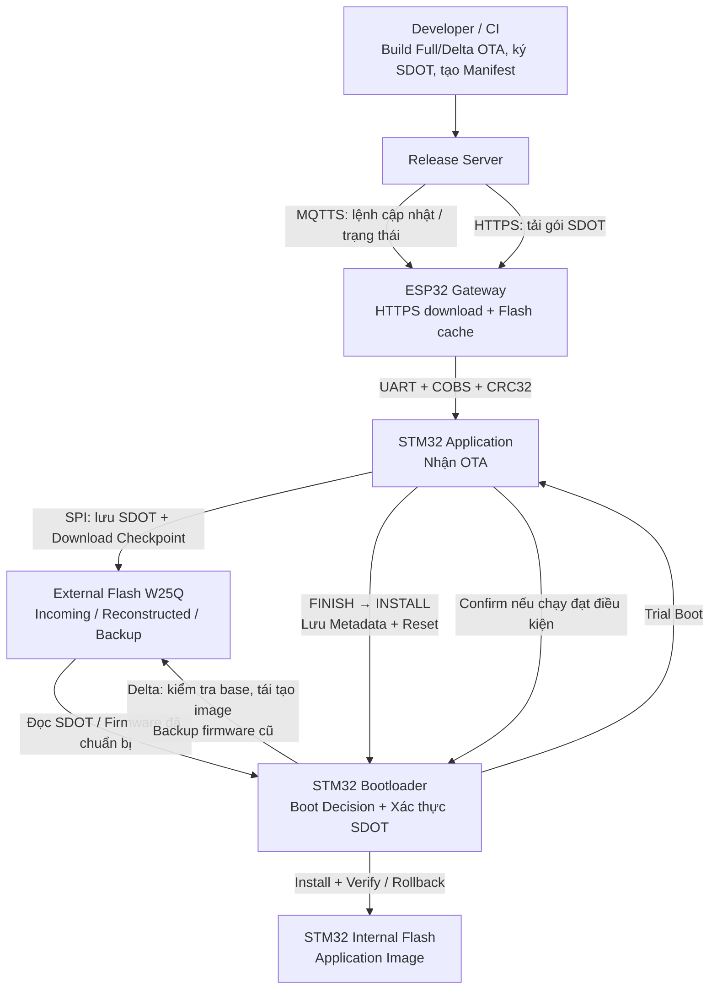

---

<a id="phan-3"></a>
## Phần 3. Trình bày Boot State Machine

### 3.1. Bài nói khi phỏng vấn

Dạ, về **Boot State Machine**, em sử dụng các trạng thái được lưu trong **Metadata** để STM32 Bootloader quyết định hành động sau mỗi lần khởi động, kể cả khi mất nguồn hoặc reset bất ngờ.

- Ban đầu hệ thống ở `IDLE`. Khi ESP32 Gateway bắt đầu truyền, STM32 Application chuyển sang `RECEIVING`. Nhận đủ gói SDOT và kiểm tra CRC32 thành công thì bộ nhận đạt `ARTIFACT_READY`. Sau lệnh `INSTALL`, Application lưu trạng thái vào Metadata rồi reset.

- STM32 Bootloader đọc Metadata, chuyển sang `VERIFYING_CONTAINER` để xác thực gói SDOT bằng ECDSA P-256 và SHA-256. Với Delta OTA, Bootloader kiểm tra firmware gốc ở `VERIFYING_BASE` trước khi tái tạo firmware trong `PATCHING`. Với Full OTA, Bootloader bỏ qua `VERIFYING_BASE` nhưng vẫn đi qua `PATCHING` để chuẩn bị firmware mới. Khi hợp lệ, hệ thống chuyển sang `IMAGE_READY`.

- Bootloader chuyển qua `BACKING_UP` để sao lưu firmware hiện tại, rồi `INSTALLING` để ghi firmware mới vào Internal Flash. Sau đó, `VERIFYING_INSTALL` kiểm tra lại dữ liệu đã cài đặt.

- Bootloader chuyển sang `TRIAL_BOOT` để chạy STM32 Application mới. Nếu Application xác nhận thành công, hệ thống qua `CONFIRMED` rồi về `IDLE`. Nếu không xác nhận sau số lần thử cho phép, Bootloader chuyển sang `ROLLBACK` để khôi phục firmware đã sao lưu.

Ngoài ra, **Metadata và Checkpoint** giúp hệ thống tiếp tục Backup, Install hoặc Rollback từ tiến độ an toàn sau khi mất nguồn.

### 3.2. Boot Diagram

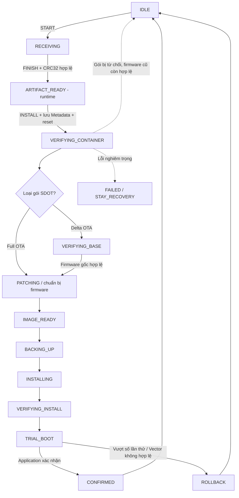

---

<a id="phan-4"></a>
## Phần 4. Phân tích chi tiết System Architecture

<a id="luong-1"></a>
### 4.1. Developer/CI → Release Server

> **Tình huống minh họa:** STM32 đang chạy firmware **v1** và Developer muốn cập nhật lên **v2**.

#### Sơ đồ luồng hoạt động

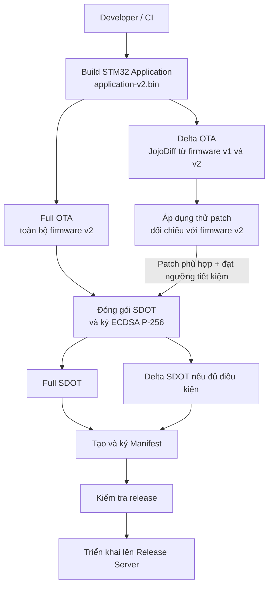

#### Bước 1. Developer/CI build firmware

Developer chỉnh sửa mã nguồn **STM32 Application** rồi build để tạo file binary firmware mới, ví dụ **`application-v2.bin`**. Đây là firmware dự kiến được cài đặt vào vùng Application của **STM32 Internal Flash**.

**CI (Continuous Integration)** có thể tự động hóa các công việc **build, kiểm tra và chuẩn bị bản phát hành**. Trong luồng này, Developer/CI là phía **tạo firmware**, chưa phải phía phân phối firmware đến thiết bị.

#### Bước 2. Tạo Full OTA và Delta OTA

Từ firmware mới, release tooling chuẩn bị các gói cập nhật tương ứng:

| Tiêu chí | Full OTA | Delta OTA |
|---|---|---|
| Nội dung | Toàn bộ firmware **v2** | Delta Patch từ **v1 → v2** |
| Dữ liệu cần để tạo | Firmware **v2** | Firmware **v1** và **v2** chính xác |
| Dung lượng | Thường lớn hơn | Có thể nhỏ hơn đáng kể |

Đối với **Delta OTA**, công cụ dùng **JojoDiff** để tạo Delta Patch, sau đó **áp dụng thử patch lên firmware v1** và so sánh kết quả với firmware v2 để kiểm tra tính đúng đắn.

Repository luôn tạo **Full OTA**, nhưng chỉ đưa **Delta OTA** vào phát hành khi mức tiết kiệm đạt ngưỡng cấu hình, mặc định **20%**.

**Ví dụ minh họa cách tính ngưỡng tiết kiệm 20%**

Giả sử STM32 đang sử dụng firmware **v1** và cần cập nhật lên **v2**. Sau khi đóng gói và ký số, hệ thống có:

- **Full SDOT:** 20 KB (chứa toàn bộ firmware v2).
- **Delta SDOT:** 12 KB (chứa bản vá từ v1 sang v2).

Mức tiết kiệm được tính dựa trên **kích thước toàn bộ hai gói SDOT đã ký**, không chỉ riêng Delta Patch:

$$
\text{Tiết kiệm} = \frac{\text{Full SDOT} - \text{Delta SDOT}}{\text{Full SDOT}} \times 100\%
$$

Thay số:

$$
\frac{20 - 12}{20} \times 100\% = 40\%
$$

**Kết quả:** Delta SDOT tiết kiệm **40%**, lớn hơn ngưỡng **20%** nên **được đưa vào bản phát hành**.

**Nếu Delta SDOT chỉ tiết kiệm 10% thì sao?** Giả sử Full SDOT vẫn là **20 KB**, nhưng Delta SDOT là **18 KB**:

$$
\frac{20 - 18}{20} \times 100\% = 10\%
$$

**Kết quả:** Chỉ tiết kiệm **10%**, không đạt ngưỡng **20%**, nên **không phát hành gói Delta SDOT**; gói **Full SDOT** vẫn được phát hành.


> **Ghi nhớ:** Delta Patch phụ thuộc vào **firmware gốc**. Khi cài đặt, STM32 Bootloader vẫn phải kiểm tra firmware gốc có đúng với bản được dùng để tạo patch hay không.

#### Bước 3. Đóng gói và ký số SDOT

Cả hai loại dữ liệu cập nhật được đóng gói theo định dạng **SDOT (Secure Delta OTA Container)**.

**Cấu trúc cơ bản của SDOT Container:**

```text
+----------------------------------+
| Header cố định (120 bytes)       |
| - Firmware type                  |
| - Base version                   |
| - Target version                 |
| - Base SHA-256                   |
| - Target SHA-256                 |
| - Product ID                     |
+----------------------------------+
| SCX1 Extension (20 bytes)        |
| - Key ID                         |
| - Base Image Size                |
| - Target Image CRC32             |
+----------------------------------+
| Payload                          |
| Full firmware / Delta Patch      |
+----------------------------------+
| ECDSA P-256 Signature (64 bytes) |
+----------------------------------+
```

Hệ thống dùng **SHA-256** để tạo các giá trị hash phục vụ kiểm tra tính toàn vẹn và **ECDSA P-256** để ký số SDOT bằng **private key**.

**Ví dụ minh họa: cập nhật firmware v1 lên v2**

Giả sử thiết bị có `Product ID = 0x00001001`, firmware đang chạy là **v1** và firmware mới là **v2**. 

Các trường chính trong Header cố định (120 byte):

| Trường trong Header | Full OTA (v2) | Delta OTA (v1 → v2) |
|---|---|---|
| `Firmware Type` | `1` (FULL) | `2` (DELTA) |
| `Base Version` | `0` (không yêu cầu firmware gốc) | `1` |
| `Target Version` | `2` | `2` |
| `Base SHA-256` | 32 byte `0x00` | `SHA-256(v1.bin)` |
| `Target SHA-256` | `SHA-256(v2.bin)` | `SHA-256(v2.bin)` |
| `Product ID` | `0x00001001` | `0x00001001` |

Các trường chính trong SCX1 Extension (20 byte):

| Trường trong SCX1 | Full OTA (v2) | Delta OTA (v1 → v2) |
|---|---|---|
| `Key ID` | `0x00000001` | `0x00000001` |
| `Base Image Size` | `0` (không dùng firmware gốc) | Kích thước thực tế của `v1.bin` |
| `Target Image CRC32` | `CRC32(v2.bin)` | `CRC32(v2.bin)` |

Trong ví dụ, **`Key ID = 1`** là mã khóa ký giả định và phải khớp với khóa công khai tin cậy được cấu hình ở Bootloader. **`Base Image Size`** bằng `0` với Full OTA, còn Delta OTA sử dụng kích thước firmware v1; **`Target Image CRC32`** được tính trên toàn bộ firmware v2, không phải riêng Delta Patch.

**Payload tương ứng:** Full OTA chứa toàn bộ firmware v2; Delta OTA chứa Delta Patch từ v1 sang v2.

**Cách Bootloader sử dụng:** Với **Full OTA**, Bootloader không cần kiểm tra firmware gốc mà chuẩn bị image từ payload rồi đối chiếu `Target SHA-256`. Với **Delta OTA**, Bootloader phải kiểm tra `Base Version` và `Base SHA-256` của firmware hiện tại trước khi áp dụng patch; sau khi tái tạo v2, nó tiếp tục kiểm tra `Target SHA-256`.

> **Lưu ý:** `0x00001001` và tên file là giá trị minh họa cho ví dụ; các giá trị SHA-256 thực tế là **32 byte hash được tính từ nội dung nhị phân**, không phải chuỗi chữ `SHA-256(v1.bin)` hay `SHA-256(v2.bin)` được ghi nguyên vào gói.

> **Ghi nhớ:** **Private key** được sử dụng ở phía phát hành firmware, **không truyền xuống ESP32 Gateway hoặc STM32**. Chữ ký SDOT sẽ được STM32 Bootloader xác thực trước khi cài đặt.

#### Bước 4. Tạo và ký số Manifest

Sau khi chuẩn bị các gói **SDOT**, release tooling tạo **`manifest.json`** để mô tả bản phát hành.

Manifest chứa các thông tin như:

- Phiên bản firmware mới.
- **Product ID** và **hardware revision**.
- Thông tin các gói **Full OTA / Delta OTA**.
- Kích thước và **SHA-256** của từng gói cập nhật.
- Đường dẫn tải gói cập nhật (**URL**).
- Thông tin khóa ký.

Manifest cũng được ký bằng **ECDSA**; chữ ký được lưu trong **`manifest.json.sig`**.

> **Phân biệt SDOT và Manifest:** **SDOT** chứa firmware hoặc Delta Patch đã ký số; **Manifest** mô tả thông tin bản phát hành và các gói cập nhật để hệ thống biết gói nào đang được cung cấp.

#### Bước 5. Kiểm tra và chuyển bản phát hành sang Release Server

Thư mục release có cấu trúc minh họa như sau:

```text
dist/releases/fw-v2/
│
├── application-v2.bin
├── application-v2.full.sdot
├── application-v1-to-v2.delta.sdot
│
├── manifest.json
├── manifest.json.sig
├── signing-public.pem
├── checksums.txt
└── release-notes.md
```

Sau khi tạo release, công cụ **kiểm tra tính hợp lệ của các file**. Bộ release được **triển khai lên Release Server** để sử dụng cho bước phân phối tiếp theo.

Release Server sử dụng bộ release đã triển khai để:

- Xác minh **Manifest** và các gói cập nhật theo thông tin bảo mật tương ứng.
- Cung cấp các gói SDOT qua **HTTPS**.
- Chuẩn bị thông báo cập nhật qua **MQTTS**.

> **Lưu ý:** Việc **tạo và xác minh thư mục release** không đồng nghĩa với việc công cụ release tự động upload dữ liệu lên máy chủ từ xa. Triển khai release lên server là một bước riêng.

#### Bài nói khi phỏng vấn: Developer/CI và Release Server

> **Developer/CI → Release Server:** Đầu tiên, Developer/CI sẽ build STM32 Application để tạo file firmware mới dạng binary.
>
> Tiếp theo, công cụ release chuẩn bị gói cập nhật Full OTA từ toàn bộ firmware mới. Với Delta OTA, hệ thống sử dụng JojoDiff để tạo Delta Patch từ firmware cũ sang firmware mới, sau đó áp dụng thử Patch để kiểm tra khả năng tái tạo chính xác.
>
> Sau đó, các gói cập nhật được đóng gói theo định dạng SDOT và ký số bằng ECDSA P-256. Hệ thống cũng tạo và ký Manifest chứa thông tin phiên bản, kích thước, hash và đường dẫn đến các gói SDOT.
>
> Cuối cùng, công cụ release kiểm tra các file đã tạo. Bộ release hợp lệ được triển khai lên Release Server để xác minh và phân phối cho thiết bị. Như vậy, Developer/CI chịu trách nhiệm tạo và ký gói cập nhật, còn Release Server chịu trách nhiệm phân phối.

#### Câu hỏi ôn tập: Developer/CI → Release Server

| Câu hỏi | Ý chính cần trả lời |
|---|---|
| CI là gì? | Hệ thống tự động hóa build, kiểm thử và chuẩn bị release. |
| Tại sao cần firmware v1 khi tạo Delta OTA? | Vì JojoDiff tạo patch từ sự khác biệt giữa firmware v1 và v2. |
| Tại sao phải áp dụng thử Delta Patch? | Để kiểm tra patch có tái tạo đúng firmware v2 từ firmware v1 hay không. |
| Tại sao vẫn tạo Full OTA? | Để có gói cập nhật đầy đủ khi Delta OTA không phù hợp hoặc không đạt ngưỡng tiết kiệm. |
| SDOT Container dùng để làm gì? | Đóng gói dữ liệu cập nhật cùng thông tin xác thực và chữ ký số. |
| ECDSA P-256 dùng để làm gì? | Ký và xác thực dữ liệu cập nhật bằng cặp private key/public key phù hợp. |
| SHA-256 dùng để làm gì? | Tạo và kiểm tra hash để xác minh tính toàn vẹn của dữ liệu. |
| Manifest khác SDOT ở điểm nào? | Manifest mô tả bản phát hành; SDOT chứa Full Firmware hoặc Delta Patch đã ký số. |
| Release Server có tạo firmware không? | Không. Developer/CI và release tooling tạo các tệp cập nhật; server xác minh và phân phối. |
| Release Server có cần private key ký firmware không? | Không cần private key ký firmware để xác minh và phân phối release. |

#### Điểm cần ghi nhớ

- **Developer/CI tạo các tệp cập nhật; Release Server phân phối**. Kiểm tra release tại máy build không đồng nghĩa đã tự động upload lên server.
- **Full OTA** có firmware đích hoàn chỉnh; **Delta OTA** dùng patch từ đúng firmware gốc và phải được kiểm tra khả năng tái tạo.
- **SDOT khác Manifest:** SDOT chứa dữ liệu cập nhật đã ký số; Manifest mô tả release và các gói cập nhật.
- **Private key** ở phía phát hành; STM32 Bootloader dùng public key tin cậy để kiểm tra chữ ký trước cài đặt.

**Tài liệu/code đối chiếu:** `docs/release-process.md`, `tools/release.py`, `tools/secure_container.py`.

---

<a id="luong-2"></a>
### 4.2. Release Server → ESP32 Gateway

#### Sơ đồ luồng hoạt động

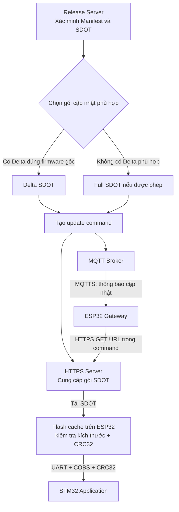

#### Bước 1. Release Server xác minh bản phát hành

Sau khi Developer/CI tạo các gói cập nhật **SDOT** và **Manifest**, Release Server sử dụng bộ release đã được triển khai để kiểm tra dữ liệu trước khi phân phối.

Các kiểm tra được mô tả trong hệ thống gồm tính hợp lệ của **chữ ký Manifest**, chữ ký và Metadata của gói SDOT, cùng các thông tin về **kích thước**, **CRC32** và **SHA-256** theo định dạng tương ứng.

> **Ghi nhớ:** Việc Release Server xác minh bản phát hành **không thay thế** việc STM32 Bootloader xác thực chữ ký SDOT trước khi cài đặt.

#### Bước 2. Release Server chọn Full OTA hoặc Delta OTA

Release Server dựa trên **phiên bản firmware hiện tại** được cung cấp khi yêu cầu phát hành lệnh cập nhật để lựa chọn gói phù hợp:

| Điều kiện | Quyết định |
|---|---|
| Có Delta OTA được tạo cho đúng firmware gốc | Ưu tiên Delta OTA. |
| Không có Delta OTA phù hợp | Dùng Full OTA nếu bản phát hành cho phép. |
| Thiết bị không cần cập nhật | Không phát hành lệnh cập nhật. |

**Ví dụ:** STM32 đang chạy **v1**, Release Server có **v2**; nếu bản phát hành chứa Delta Patch từ **v1 → v2**, Server có thể chọn gói Delta OTA thay vì Full OTA.

> **Lưu ý:** Lựa chọn của Server là bước phân phối. STM32 Bootloader vẫn phải kiểm tra điều kiện phiên bản và **firmware gốc (exact-base validation)** trước khi áp dụng Delta Patch.

#### Bước 3. Release Server gửi lệnh cập nhật qua MQTTS

Sau khi chọn gói cập nhật, Release Server tạo thông báo cập nhật để gửi qua **MQTT Broker** bằng kết nối **MQTTS**. ESP32 Gateway subscribe topic tương ứng để nhận lệnh.

**Ví dụ JSON minh họa các trường chính** (giá trị minh họa, không phải payload thực tế của một bản phát hành):

```json
{
  "schema": 1,
  "cmd": "update",
  "update_id": 12345,
  "target_version": 2,
  "size": 1174,
  "crc32": 123456789,
  "url": "https://firmware.example/releases/fw-v2/update.sdot"
}
```

| Trường | Ý nghĩa |
|---|---|
| `cmd` | Loại lệnh, ví dụ lệnh cập nhật. |
| `update_id` | Định danh của quá trình cập nhật. |
| `target_version` | Phiên bản firmware đích. |
| `size` | Kích thước gói SDOT cần tải. |
| `crc32` | CRC32 của gói SDOT, dùng phát hiện lỗi dữ liệu. |
| `url` | Đường dẫn HTTPS để ESP32 tải gói SDOT. |

Lệnh cập nhật trong repository sử dụng **MQTT QoS 1**. QoS 1 có thể dẫn đến gửi lại thông điệp, vì vậy các thành phần nhận lệnh cần xử lý trường hợp trùng lặp phù hợp.

#### Bước 4. ESP32 Gateway tải gói SDOT qua HTTPS

Khi nhận được lệnh cập nhật, ESP32 Gateway kiểm tra thông tin lệnh rồi thực hiện **HTTPS GET** tới địa chỉ trong trường `url`.

Trong quá trình tải, ESP32 kiểm tra kết nối **TLS**, phản hồi **HTTP**, kích thước nội dung và giới hạn bộ nhớ lưu trữ. Nội dung nhận về là **gói cập nhật SDOT**, không phải lệnh MQTTS.

#### Bước 5. ESP32 kiểm tra, lưu gói và chuẩn bị truyền qua UART

ESP32 lưu dữ liệu tải được vào vùng **Flash cache** của Gateway. Sau khi hoàn tất, ESP32 kiểm tra **kích thước** và **CRC32** của gói SDOT; chỉ khi cache hợp lệ mới tiếp tục giai đoạn truyền sang STM32 Application qua **UART**.

ESP32 có thể gửi thông tin **tiến độ/trạng thái** về hệ thống qua MQTT. Trong khi đó, bước **xác thực chữ ký ECDSA P-256 và SHA-256 để quyết định cài đặt** vẫn thuộc về STM32 Bootloader.

> **Phân biệt Manifest và gói SDOT:** Release Server dùng **Manifest** để biết thông tin bản phát hành, còn ESP32 Gateway nhận **URL trực tiếp đến gói SDOT** trong lệnh MQTTS. Luồng OTA hiện tại không yêu cầu ESP32 tải và tự phân tích Manifest để chọn gói cập nhật.

#### Bài nói khi phỏng vấn: Release Server và ESP32 Gateway

> **Release Server → ESP32 Gateway:** Sau khi bộ release được triển khai, Release Server xác minh Manifest và các gói cập nhật SDOT trước khi phân phối.
>
> Đầu tiên, dựa trên thông tin phiên bản firmware hiện tại, Server sẽ ưu tiên lựa chọn Delta OTA nếu có gói phù hợp; nếu không, Server sử dụng Full OTA.
>
> Tiếp theo, Server gửi lệnh cập nhật đến ESP32 Gateway qua MQTTS. Lệnh này chứa các thông tin như phiên bản đích, kích thước, CRC32 và đường dẫn HTTPS của gói SDOT.
>
> Khi nhận được lệnh, ESP32 Gateway sử dụng HTTPS để tải gói SDOT và lưu dữ liệu vào Flash cache. Sau khi tải xong, ESP32 kiểm tra kích thước và CRC32 để đảm bảo dữ liệu đã nhận đầy đủ trước khi truyền xuống STM32 Application.
>
> Như vậy, **MQTTS** được sử dụng để gửi lệnh cập nhật, còn **HTTPS** được sử dụng để tải dữ liệu. Việc xác thực chữ ký firmware trước khi cài đặt vẫn do STM32 Bootloader thực hiện.

#### Câu hỏi ôn tập: Release Server → ESP32 Gateway

| Câu hỏi | Ý chính cần trả lời |
|---|---|
| Vì sao sử dụng cả MQTTS và HTTPS? | MQTTS dùng để gửi lệnh/trạng thái; HTTPS dùng để tải dữ liệu firmware. |
| Ai quyết định chọn Full OTA hay Delta OTA? | Release Server chọn gói cập nhật phù hợp theo thông tin phiên bản và release. |
| ESP32 có cần tải Manifest không? | Không bắt buộc trong luồng hiện tại; URL gói SDOT được gửi trong lệnh MQTTS. |
| ESP32 kiểm tra gói SDOT bằng gì? | Kiểm tra kích thước và CRC32 sau khi tải. |
| ESP32 có xác thực chữ ký ECDSA thay STM32 không? | Không; STM32 Bootloader là thành phần xác thực và quyết định cài đặt. |
| Tại sao phải lưu vào Flash cache? | Để có gói SDOT hoàn chỉnh, đã kiểm tra, trước khi truyền xuống STM32 qua UART. |
| MQTT QoS 1 nghĩa là gì? | Đảm bảo gửi ít nhất một lần; có thể có thông điệp trùng. |

#### Điểm cần ghi nhớ

- **MQTTS dùng cho lệnh/trạng thái; HTTPS dùng để tải SDOT**. Không truyền toàn bộ firmware trong lệnh MQTT.
- **Release Server** chọn gói phù hợp với phiên bản được cung cấp; **STM32 Bootloader** vẫn phải tự kiểm tra phiên bản và firmware gốc khi cài đặt.
- **ESP32 Gateway** tải và lưu SDOT vào Flash cache, kiểm tra kích thước và CRC32 trước khi truyền xuống STM32.
- **CRC32 không phải chữ ký số**; việc xác thực ECDSA P-256 và hash bảo mật khi quyết định cài đặt thuộc STM32 Bootloader.

**Tài liệu/code đối chiếu:** `server/README.md`, `gateway-esp32/README.md`, `server/app/services/firmware_service.py`.

---

<a id="luong-3"></a>
### 4.3. ESP32 Gateway → STM32 Application

#### Sơ đồ luồng hoạt động

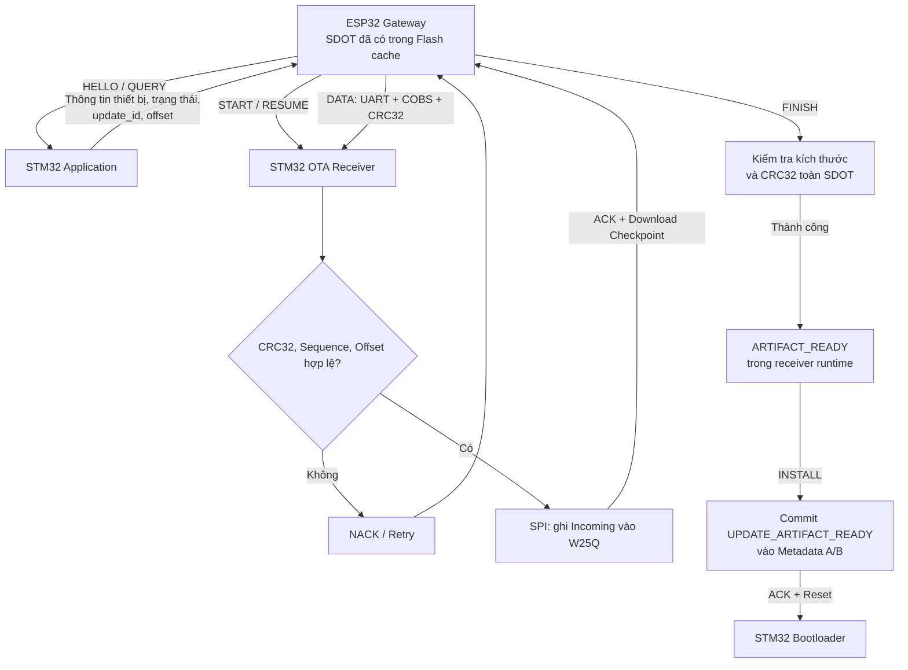

#### Bước 1. ESP32 Gateway chuẩn bị truyền gói cập nhật SDOT

Sau khi tải gói **SDOT** qua HTTPS và kiểm tra **kích thước/CRC32**, ESP32 Gateway đã lưu gói vào vùng **Flash cache** nội bộ. Gateway đọc dữ liệu từ cache để truyền qua UART, thay vì yêu cầu STM32 tự tải firmware qua mạng.

**Cấu hình UART trong repository:**

| Thông số | Giá trị |
|---|---|
| Giao thức | UART, **115200 8-N-1** |
| Data bits / Parity / Stop bits | 8 / None / 1 |
| Flow control | None |
| STM32 USART | USART1 |
| STM32 TX / RX | PA9 / PA10 |
| ESP32 UART mặc định | UART2 |
| ESP32 TX / RX mặc định | GPIO17 / GPIO16 |

Trước khi gửi DATA, Gateway cần kiểm tra trạng thái hiện tại của STM32 để quyết định **START** hay **RESUME**.

#### Bước 2. ESP32 Gateway gửi HELLO và QUERY

ESP32 trao đổi các lệnh **`HELLO`** và **`QUERY`** với STM32 Application. Phản hồi cung cấp các thông tin phục vụ nhận diện thiết bị và đồng bộ tiến độ, ví dụ:

| Thông tin | Ý nghĩa |
|---|---|
| `application_version` | Phiên bản firmware đang chạy |
| `bootloader_version` | Phiên bản STM32 Bootloader |
| `product_id` | Mã sản phẩm |
| `hardware_revision` | Phiên bản phần cứng |
| `capability_flags` | Các tính năng OTA được hỗ trợ |
| `update_state` | Trạng thái cập nhật hiện tại |
| `active_update_id` | Định danh bản cập nhật đang xử lý |
| `next_expected_offset` | Vị trí dữ liệu STM32 chờ nhận tiếp |

**Tại sao cần QUERY?** Vì STM32 có thể chưa nhận dữ liệu, đang nhận dở hoặc đã nhận hoàn tất gói SDOT. Thông tin trả về giúp ESP32 tránh bắt đầu lại không cần thiết và chọn đúng bước tiếp theo.

#### Bước 3. ESP32 Gateway gửi START hoặc RESUME

**`START`** được dùng khi bắt đầu nhận gói cập nhật mới. Các thông tin quan trọng bao gồm:

- `update_id`: Định danh bản cập nhật.
- `artifact_type`: Full OTA hoặc Delta OTA.
- `base_version`: Phiên bản firmware gốc.
- `target_version`: Phiên bản firmware đích.
- `artifact_size`: Kích thước toàn bộ gói SDOT.
- `artifact_crc32`: CRC32 của toàn bộ gói SDOT.

STM32 Application kiểm tra thông tin yêu cầu, trạng thái hiện tại và giới hạn dung lượng vùng **Incoming** của External Flash W25Q. Nếu chấp nhận, STM32 phản hồi **ACK** cùng offset bắt đầu (thông thường là `0`).

**`RESUME`** được dùng khi quá trình nhận trước đó bị gián đoạn. STM32 kiểm tra tính phù hợp của **`update_id`** và thông tin gói SDOT, sau đó cung cấp offset có thể tiếp tục an toàn để ESP32 truyền tiếp.

#### Bước 4. ESP32 Gateway truyền DATA qua UART

ESP32 chia SDOT thành các **DATA packet**, mỗi packet mang tối đa **256 bytes payload**. Cấu trúc packet ở mức khái quát:

```text
+---------------------------+
| Magic                     | 2 bytes
+---------------------------+
| Protocol Version          | 1 byte
+---------------------------+
| Command                   | 1 byte
+---------------------------+
| Update ID                 | 4 bytes
+---------------------------+
| Offset                    | 4 bytes
+---------------------------+
| Sequence                  | 2 bytes
+---------------------------+
| Payload Length            | 2 bytes
+---------------------------+
| Payload                   | 0–256 bytes
+---------------------------+
| Packet CRC32              | 4 bytes
+---------------------------+
```

Packet được **mã hóa COBS** và phân tách trên luồng UART bằng byte kết thúc **`0x00`**.

| Cơ chế | Vai trò |
|---|---|
| **COBS** | Đóng khung và phân tách các packet trên luồng byte UART |
| **CRC32** | Phát hiện lỗi dữ liệu packet |
| **Sequence** | Theo dõi thứ tự packet |
| **Offset** | Chỉ vị trí ghi dữ liệu trong toàn bộ gói SDOT |
| **Update ID** | Gắn packet với đúng quá trình cập nhật |

**Ví dụ** với payload 256 bytes/packet:

```text
ESP32 Gateway                      STM32 Application

DATA (offset = 0)   -------------> Kiểm tra, ghi W25Q
                   <------------- ACK (offset = 256)
DATA (offset = 256) -------------> Kiểm tra, ghi W25Q
                   <------------- ACK (offset = 512)
DATA (offset = 512) -------------> Kiểm tra, ghi W25Q
                   <------------- ACK (offset = 768)
```

> **Ghi nhớ:** CRC32 phát hiện lỗi truyền/lưu dữ liệu, **không** xác thực nguồn phát hành firmware; xác thực bảo mật do STM32 Bootloader thực hiện sau đó.

#### Bước 5. STM32 Application kiểm tra và lưu vào External Flash W25Q

Khi nhận DATA packet, STM32 Application thực hiện theo thứ tự:

1. Giải mã **COBS** để lấy packet gốc.
2. Kiểm tra **CRC32** của packet.
3. Kiểm tra `update_id`, **Sequence** và **Offset**.
4. Xác định địa chỉ thuộc phân vùng **Incoming** trên External Flash W25Q.
5. Xóa sector khi cần và ghi dữ liệu qua **SPI**.
6. Kiểm tra dữ liệu đã ghi và phản hồi kết quả.

```text
Receive DATA → Decode COBS → Verify CRC32
             → Check Update ID / Sequence / Offset
             → Write W25Q via SPI → Verify → ACK / NACK
```

**Vì sao lưu vào External Flash W25Q thay vì ghi thẳng Internal Flash?** Internal Flash chứa STM32 Application đang hoạt động. Việc nhận đầy đủ SDOT vào vùng lưu trữ riêng trước khi cài đặt giảm rủi ro ghi đè ứng dụng đang chạy nếu mất nguồn hoặc truyền bị gián đoạn.

#### Bước 6. STM32 Application phản hồi ACK/NACK và ESP32 Retry

| Phản hồi | Ý nghĩa |
|---|---|
| **ACK** | DATA packet đã được chấp nhận và xử lý thành công |
| **NACK** | DATA packet bị từ chối do lỗi dữ liệu, trạng thái, thứ tự, offset hoặc ghi Flash |

ESP32 chỉ chuyển sang packet tiếp theo khi đã nhận phản hồi phù hợp. Nếu nhận **NACK** hoặc quá thời gian chờ (**timeout**), Gateway có thể **Retry** theo giới hạn cấu hình.

| Thông số | Giá trị mô tả trong giao thức |
|---|---|
| Response timeout | **1500 ms** |
| Maximum retries | **5** |
| DATA payload | Tối đa **256 bytes** |

Nếu ACK bị mất và ESP32 gửi lại packet cũ, STM32 có thể nhận diện **DATA trùng hợp lệ** và trả ACK tương ứng; không được ghi lại một cách mù quáng làm sai tiến độ.

#### Bước 7. Resume khi truyền bị gián đoạn

STM32 Application sử dụng **Download Checkpoint** trong External Flash W25Q để lưu tiến độ nhận OTA. Checkpoint được ghi theo ranh giới sector **4 KB**.

**Ví dụ minh họa:**

```text
Gói SDOT 20 KB
    |
    | Đã nhận khoảng 10 KB
    v
Checkpoint an toàn gần nhất: 8 KB
    |
    | Reset bất ngờ
    v
STM32 khởi động lại, đọc Checkpoint
    |
    v
ESP32 gửi RESUME và truyền lại từ offset 8192
```

**Phân biệt:** **ACK** xác nhận một packet đã được xử lý trong phiên truyền hiện tại; **Checkpoint** là mốc tiến độ đã lưu bền vững để phục hồi sau reset. Offset được ACK gần nhất **không nhất thiết** là offset có thể Resume sau khi mất nguồn.

#### Bước 8. ESP32 Gateway gửi FINISH

Sau khi truyền đủ toàn bộ SDOT, ESP32 gửi **`FINISH`**. STM32 Application kiểm tra:

1. **Kích thước** dữ liệu nhận được có đúng với `artifact_size` không.
2. **CRC32 toàn bộ gói SDOT** có khớp với giá trị dự kiến không.

Nếu hợp lệ, STM32 chuyển sang trạng thái **`ARTIFACT_READY`** của phiên nhận OTA.

> **Phân biệt quan trọng:** `FINISH` xác nhận rằng SDOT đã được **nhận đầy đủ**. Nó **chưa** yêu cầu cài đặt, chưa ghi trạng thái bàn giao `UPDATE_ARTIFACT_READY` vào Internal Flash Metadata và chưa reset STM32.

#### Bước 9. ESP32 Gateway gửi INSTALL, STM32 bàn giao cho Bootloader

Khi `FINISH` thành công, ESP32 gửi **`INSTALL`**. STM32 Application:

1. Kiểm tra trạng thái **`ARTIFACT_READY`** và `update_id`.
2. Kiểm tra thông tin định dạng container SDOT ở mức cần thiết để bàn giao.
3. Ghi trạng thái **`UPDATE_ARTIFACT_READY`** vào **Internal Flash Metadata A/B**.
4. Gửi **ACK** cho ESP32 Gateway.
5. **Reset** để STM32 Bootloader xử lý bản cập nhật.

```text
ESP32 Gateway
      |
      | INSTALL
      v
STM32 Application
      |
      | Kiểm tra ARTIFACT_READY / Update ID / SDOT
      v
Internal Flash Metadata A/B
      |
      | Commit UPDATE_ARTIFACT_READY
      v
Send ACK → Reset STM32 → STM32 Bootloader
```

**Đây là điểm bàn giao giữa Application và Bootloader.** STM32 Application không xác thực chữ ký ECDSA P-256 để quyết định cài đặt ở bước này; đó là nhiệm vụ của STM32 Bootloader sau reset.

#### Bài nói khi phỏng vấn: ESP32 Gateway → STM32 Application

> **ESP32 Gateway → STM32 Application:** Sau khi tải và kiểm tra gói SDOT thành công, ESP32 Gateway bắt đầu truyền dữ liệu xuống STM32 Application thông qua UART.
>
> Đầu tiên, ESP32 sử dụng lệnh HELLO và QUERY để lấy thông tin thiết bị, trạng thái cập nhật và Offset hiện tại. Từ đó, ESP32 quyết định gửi START để bắt đầu nhận mới hoặc RESUME nếu quá trình truyền trước đó bị gián đoạn.
>
> Tiếp theo, ESP32 chia gói SDOT thành các DATA packet, mỗi packet có tối đa 256 bytes Payload, sử dụng COBS để đóng khung và CRC32 để phát hiện lỗi truyền.
>
> Ở phía STM32, Application kiểm tra CRC32, Sequence và Offset, sau đó ghi dữ liệu vào External Flash W25Q qua SPI. Nếu xử lý thành công, STM32 trả về ACK; nếu có lỗi, STM32 trả về NACK để ESP32 Retry.
>
> Ngoài ra, STM32 lưu Checkpoint theo ranh giới sector 4 KB để có thể Resume từ vị trí an toàn sau reset, thay vì phải truyền lại toàn bộ gói SDOT.
>
> Cuối cùng, ESP32 gửi FINISH để STM32 kiểm tra toàn bộ dữ liệu đã nhận, sau đó gửi INSTALL. STM32 Application cập nhật Metadata và reset để bàn giao quá trình cập nhật cho STM32 Bootloader.

#### Câu hỏi ôn tập: ESP32 Gateway → STM32 Application

| Câu hỏi | Ý chính cần trả lời |
|---|---|
| Tại sao ESP32 và STM32 giao tiếp qua UART? | Kết nối đơn giản giữa hai vi điều khiển, không yêu cầu STM32 tự xử lý kết nối mạng. |
| Tại sao cần COBS? | Để đóng khung packet UART và dùng `0x00` làm byte phân tách. |
| CRC32 dùng để làm gì? | Phát hiện lỗi dữ liệu trong truyền và lưu trữ, không dùng để xác thực chữ ký. |
| Sequence khác Offset thế nào? | Sequence theo dõi thứ tự packet; Offset xác định vị trí byte trong SDOT. |
| Tại sao cần ACK/NACK? | Xác nhận dữ liệu đã xử lý thành công hoặc báo lỗi để Retry. |
| Nếu ACK bị mất thì sao? | ESP32 có thể gửi lại; STM32 có cơ chế nhận diện packet trùng hợp lệ. |
| Retry giải quyết vấn đề gì? | Khắc phục lỗi truyền và timeout tạm thời. |
| Resume hoạt động như thế nào? | STM32 đọc Checkpoint và thông báo offset an toàn để ESP32 truyền tiếp. |
| Tại sao Checkpoint theo sector 4 KB? | Phù hợp với đơn vị sector của W25Q, hỗ trợ phục hồi tiến độ nhận. |
| Tại sao dùng External Flash W25Q? | Lưu trữ trọn SDOT mà không ghi đè Application đang chạy. |
| FINISH khác INSTALL thế nào? | FINISH xác nhận nhận đủ SDOT; INSTALL ghi Metadata bàn giao và reset. |
| Ai xác thực chữ ký ECDSA P-256? | STM32 Bootloader, sau khi nhận gói SDOT và bàn giao. |

#### Điểm cần ghi nhớ

- **UART + COBS + CRC32 + ACK/NACK + Retry:** Hỗ trợ truyền packet có kiểm tra lỗi; UART cơ bản không tự bảo đảm toàn bộ gói firmware ở tầng ứng dụng.
- **ACK khác Checkpoint:** ACK theo packet; Checkpoint lưu mốc phục hồi bền vững, vì vậy Resume có thể phải truyền lại dữ liệu đã từng ACK.
- **FINISH khác INSTALL:** FINISH xác minh gói SDOT đã nhận đầy đủ; INSTALL bàn giao cho STM32 Bootloader bằng **Metadata + Reset**.

**Tóm tắt thứ tự lệnh:**

```text
HELLO / QUERY
      |
START / RESUME
      |
     DATA
      |
CRC32 / Sequence / Offset
      |
Write External Flash W25Q
      |
ACK / NACK + Retry
      |
    FINISH
      |
   INSTALL
      |
Metadata + Reset
      |
STM32 Bootloader
```

**Tài liệu/code đối chiếu:** `docs/uart-ota-protocol.md`, `docs/architecture.md`, `node-stm32f103/application/src/ota_receiver.c`.

---

<a id="luong-4"></a>
### 4.4. STM32 Application → STM32 Bootloader

> **Trọng tâm của luồng 4.4 là điểm bàn giao trách nhiệm:** STM32 Application xác nhận **đã nhận đủ gói SDOT**; STM32 Bootloader mới xác thực chữ ký và quyết định xử lý bản cập nhật. Quy trình tiếp nhận DATA đã có ở [4.3](#luong-3), còn các trạng thái sau bàn giao được giải thích ở [5.3–5.5](#chuong-5-3).

#### Sơ đồ bàn giao

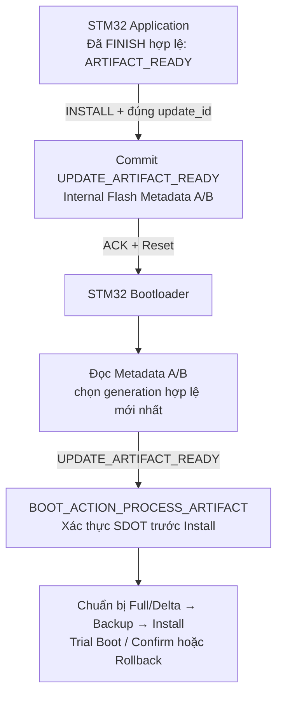

#### Bước 1. Kiểm tra điều kiện `INSTALL`

`FINISH` kiểm tra **kích thước và CRC32 toàn bộ gói SDOT** rồi chuyển bộ nhận OTA sang trạng thái runtime **`ARTIFACT_READY`**. Khi ESP32 gửi `INSTALL`, Application chỉ bàn giao nếu trạng thái nhận phù hợp, **`update_id` khớp** và thông tin SDOT cần thiết hợp lệ.

Đây **chưa phải bước xác minh chữ ký ECDSA P-256**. CRC32 của phiên nhận chỉ phục vụ phát hiện lỗi dữ liệu; Bootloader sẽ xác thực nguồn phát hành sau reset.

#### Bước 2. Commit Metadata bền vững rồi reset

Application ghi **`UPDATE_ARTIFACT_READY`** vào **Internal Flash Metadata A/B** trước khi gửi ACK và reset STM32. Hai trang Metadata nằm tại **`0x0800F800`** và **`0x0800FC00`**, mỗi trang **1 KiB**. Nhờ lưu vào Flash, yêu cầu xử lý SDOT không bị mất chỉ vì reset hoặc mất nguồn.

Các trường liên quan trực tiếp đến bàn giao gồm `state`, `active_update_id`, `pending_version`, `generation` và `crc32`. Các trường còn lại và quy trình commit luân phiên A/B được phân tích trong [5.1](#chuong-5-1) và [6.9](#chuong-6-9), không lặp lại bảng Metadata tại đây.

```text
FINISH hợp lệ → ARTIFACT_READY (runtime)
       ↓ INSTALL + kiểm tra update_id
Commit UPDATE_ARTIFACT_READY (Internal Flash Metadata)
       ↓ ACK + Reset
STM32 Bootloader → Đọc Metadata → Boot Decision
```

#### Bước 3. Bootloader tiếp nhận quyền xử lý

Sau reset, Bootloader đọc **hai bản Metadata**, chọn bản hợp lệ mới nhất theo `generation` và kiểm tra trạng thái. Với **`UPDATE_ARTIFACT_READY`**, `BootDecision_Evaluate()` chọn **`BOOT_ACTION_PROCESS_ARTIFACT`**; `BootManager_Run()` điều phối việc xác thực SDOT.

Từ đây, Bootloader đọc gói SDOT trong vùng **Incoming** của W25Q, kiểm tra Header/thiết bị/phiên bản và chữ ký **ECDSA P-256**; sau đó mới chuẩn bị Full hoặc Delta Image. Các bước **Verify SDOT → Prepare Image → Backup → Install → Trial Boot** được phân tích ở [5.3](#chuong-5-3), [5.4](#chuong-5-4), [5.5](#chuong-5-5). Việc ghi Internal Flash được tập trung tại [4.5](#luong-5).

> **Giới hạn triển khai:** Repository chưa provision Trusted Public Key production theo mặc định. Có mã xác thực ECDSA không đồng nghĩa mọi thiết bị đã được cấu hình khóa để xác thực gói cập nhật thật.

#### Bài nói khi phỏng vấn: Điểm bàn giao Application → Bootloader

> Sau khi ESP32 truyền đủ gói SDOT và `FINISH` thành công, STM32 Application chuyển sang `ARTIFACT_READY`. Khi nhận `INSTALL`, Application kiểm tra `update_id`, commit `UPDATE_ARTIFACT_READY` vào Metadata A/B, gửi ACK rồi reset. Bootloader khởi động lại, đọc Metadata, chọn `BOOT_ACTION_PROCESS_ARTIFACT` và **tự xác thực SDOT** trước khi cài đặt. Cách chia trách nhiệm này giúp Application không tự ghi đè mã đang chạy và giữ được yêu cầu cập nhật qua reset.

#### Câu hỏi ôn tập: Bàn giao giữa hai chương trình

| Câu hỏi | Ý chính cần trả lời |
|---|---|
| `FINISH` khác `INSTALL` ở đâu? | FINISH xác nhận nhận đủ gói; INSTALL commit trạng thái bàn giao và reset. |
| Vì sao không chỉ lưu yêu cầu `INSTALL` trong RAM? | Bootloader cần đọc lại trạng thái bền vững sau reset/mất nguồn. |
| `ARTIFACT_READY` khác `UPDATE_ARTIFACT_READY` thế nào? | Một trạng thái runtime của receiver, một trạng thái đã lưu trong Metadata. |
| Ai xác thực chữ ký số SDOT? | STM32 Bootloader; Application chỉ nhận, lưu và bàn giao. |
| Nếu Metadata A/B không hợp lệ thì sao? | Bootloader phải xử lý theo Boot Decision/chính sách phục hồi; không tự coi update là hợp lệ. |

**Code cần đối chiếu:** `node-stm32f103/application/src/ota_receiver.c`, `node-stm32f103/bootloader/src/boot_decision.c`, `node-stm32f103/bootloader/src/boot_manager.c`, `node-stm32f103/bootloader/storage/metadata_storage.c`.

---

<a id="luong-5"></a>
### 4.5. STM32 Bootloader → STM32 Internal Flash

> **Trọng tâm:** Cách Bootloader **ghi firmware đã chuẩn bị** từ W25Q vào vùng Application của STM32 Internal Flash. Quy trình xác thực Full/Delta trước khi ghi đã nêu ở [5.3](#chuong-5-3); cách hoạt động của Flash ở mức phần cứng nằm ở [6.3](#chuong-6-3).

#### Sơ đồ cài đặt theo từng trang

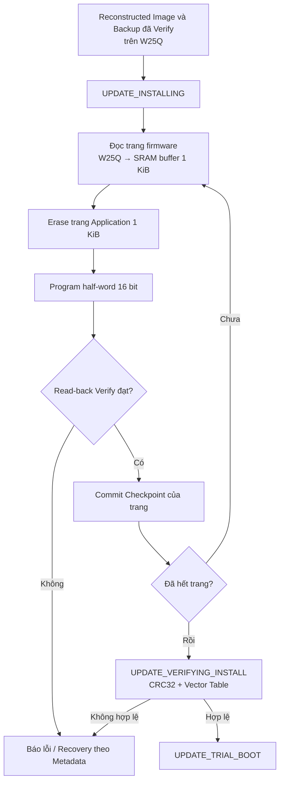

#### Vùng Flash được phép ghi

| Phân vùng | Bắt đầu | Dung lượng | Quy tắc |
|---|---|---:|---|
| **Bootloader** | `0x08000000` | 24 KiB | Không ghi đè khi cập nhật Application. |
| **Application** | `0x08006000` | 38 KiB | **Vùng duy nhất được Erase/Program trong Install.** |
| **Metadata A** | `0x0800F800` | 1 KiB | Ghi trạng thái/Checkpoint qua cơ chế riêng. |
| **Metadata B** | `0x0800FC00` | 1 KiB | Bản Metadata dự phòng. |

Các vùng này nằm trong **64 KiB STM32 Internal Flash**. Memory Map đầy đủ, SRAM và các ràng buộc địa chỉ được trình bày tại [6.1](#chuong-6-1). Khi tính `APPLICATION_START_ADDRESS + page_offset`, Bootloader phải bảo đảm trang nằm **trước `0x0800F800`**.

#### Bước 1. Kiểm tra điều kiện trước khi ghi đè

Bootloader chỉ bắt đầu `UPDATE_INSTALLING` khi **Target Image** đã được tái tạo/chuẩn bị và kiểm tra trong **Reconstructed Image** của W25Q, đồng thời **Backup Image** của Application hiện tại đã được sao lưu và Verify thành công. Không ghi trực tiếp packet UART hoặc Delta Patch vào vùng Application.

#### Bước 2. Đọc, xóa, lập trình và đối chiếu một trang

Bootloader đọc tối đa **1 KiB** từ Reconstructed Image qua SPI vào **SRAM Page Buffer**, sau đó xử lý theo chuỗi **Erase → Program → Read-back Verify**:

1. Erase trang Internal Flash **1 KiB** thuộc vùng Application; trang đã xóa có các bit ở trạng thái `1`.
2. Program dữ liệu thành các **half-word 16 bit (2 byte)**; byte lẻ cuối có thể được đệm `0xFF` nếu cần.
3. Đọc lại Flash để so sánh với buffer nguồn. Nếu sai, không xác nhận trang hoàn tất; ví dụ lỗi `IMAGE_INSTALLER_PAGE_VERIFY_FAILED`.
4. **Chỉ khi Verify đạt**, commit Checkpoint `copy_offset` để ghi nhận trang đã hoàn tất.

Bộ đệm trong source code được khai báo theo `INTERNAL_FLASH_PAGE_SIZE`; các thao tác tương ứng có trong `ProgramBufferedApplicationPage()` và `ResumePageCheckpointedCopy()`. Nguyên lý bit `1 → 0`, cách mở khóa/xóa Flash và mã C minh họa được tập trung ở [6.3](#chuong-6-3), tránh lặp lại trong phần kiến trúc.

**Ví dụ mất nguồn:** Nếu bốn trang đầu đã Verify (`copy_offset = 4096`) mà reset xảy ra khi ghi trang thứ năm, Bootloader **Erase và Program lại trang chưa được Checkpoint**. Nó không coi phần dữ liệu còn dang dở là đã cài thành công.

#### Bước 3. Verify toàn bộ rồi mới Trial Boot

Sau khi cài hết các trang, Bootloader chuyển sang `UPDATE_VERIFYING_INSTALL` để kiểm tra **CRC32 của Application trong Internal Flash** và **Vector Table** (MSP tại `0x08006000`, Reset Handler tại `0x08006004`). Đây là bước kiểm tra dữ liệu đã **thực sự ghi**, khác với xác minh **Target SHA-256** của Reconstructed Image trước Install.

Nếu hợp lệ, Bootloader chuyển sang `UPDATE_TRIAL_BOOT` và bàn giao cho Application; **Confirm** hoặc **Rollback** thuộc [5.5](#chuong-5-5). Trình tự dọn SysTick/NVIC, cấu hình VTOR, MSP và nhảy Reset Handler thuộc [6.2](#chuong-6-2), không lặp lại tại bước Install.

#### Bài nói khi phỏng vấn: Cài đặt Application

> Sau khi firmware mới và bản Backup đều hợp lệ trên W25Q, Bootloader bắt đầu `UPDATE_INSTALLING`. Nó đọc từng trang **1 KiB** vào SRAM, Erase trang Application tương ứng, Program theo half-word **16 bit**, đọc lại để Verify rồi mới commit Checkpoint. Nếu mất nguồn, Bootloader bắt đầu lại từ trang chưa được xác nhận. Khi ghi hết firmware, Bootloader Verify toàn bộ Internal Flash và kiểm tra Vector Table trước khi cho Application mới chạy Trial Boot.

#### Câu hỏi ôn tập: Thao tác ghi firmware

| Câu hỏi | Ý chính cần trả lời |
|---|---|
| Vì sao cần Backup hợp lệ trước khi Install? | Install sẽ ghi đè Application; Backup là nguồn Rollback. |
| Vì sao dùng SRAM Page Buffer 1 KiB? | Phù hợp đơn vị trang xóa và giới hạn RAM của STM32F103. |
| Vì sao Program theo half-word? | STM32F103 hỗ trợ lập trình Internal Flash theo đơn vị 16 bit. |
| Vì sao chỉ commit Checkpoint sau Read-back Verify? | Không được đánh dấu một trang ghi dở hoặc sai dữ liệu là hoàn tất. |
| Reset giữa trang đang Program xử lý thế nào? | Erase/Program lại từ trang chưa Checkpoint, rồi Verify. |
| Verify Installed Image khác Verify Target Image thế nào? | Một bên kiểm tra Flash thật đã ghi; bên kia kiểm tra nguồn firmware đã chuẩn bị trên W25Q. |

#### File và hàm mã nguồn cần đọc

| File / hàm | Vai trò |
|---|---|
| `node-stm32f103/bootloader/src/image_installer.c` | `ProgramBufferedApplicationPage()`, `ResumePageCheckpointedCopy()`, `VerifyInstalledApplication()`. |
| `node-stm32f103/bootloader/src/boot_manager.c` | Điều phối Install và cập nhật trạng thái. |
| `node-stm32f103/bootloader/src/application_jump.c` | Validate vector, chuyển quyền điều khiển sau khi Install/Verify. |
| `node-stm32f103/bootloader/storage/metadata_storage.c` | Commit Checkpoint vào Metadata A/B. |
| `shared/include/memory_map.h` | Giới hạn vùng Bootloader/Application/Metadata. |

**Học sâu:** [5.4 – Trạng thái Backup/Install](#chuong-5-4) · [6.3 – Flash Programming](#chuong-6-3) · [6.9 – Checkpoint và Fault Tolerance](#chuong-6-9).

---

<a id="phan-5"></a>
## Phần 5. Phân tích chi tiết Boot State Machine

<a id="chuong-5-1"></a>
### 5.1. Khởi động STM32 Bootloader → Đọc Metadata → Boot Decision

#### Sơ đồ luồng hoạt động

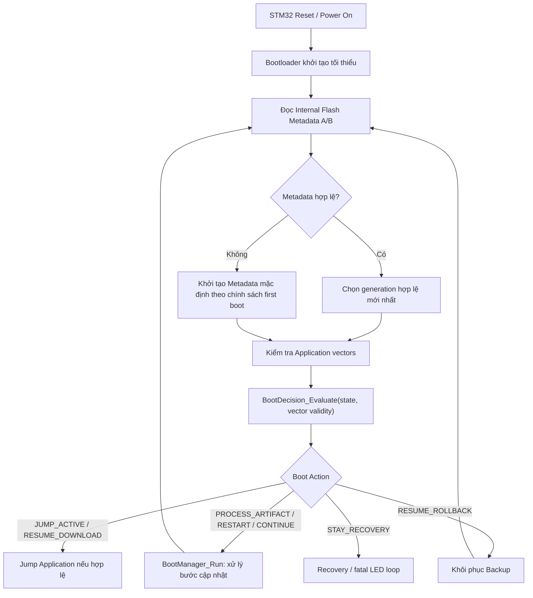

#### Bước 1. Bootloader chạy trước STM32 Application

Sau khi thiết bị khởi động hoặc reset, mã **Bootloader** tại vùng Internal Flash đầu tiên được thực thi. Theo memory map của project:

| Vùng Internal Flash | Địa chỉ bắt đầu | Kích thước |
|---|---|---:|
| Bootloader | `0x08000000` | 24 KB |
| Application | `0x08006000` | 38 KB |
| Metadata A | `0x0800F800` | 1 KB |
| Metadata B | `0x0800FC00` | 1 KB |

Bootloader khởi tạo các thành phần tối thiểu để đọc trạng thái, truy cập bộ nhớ và đưa ra quyết định. Nó **không mặc định nhảy ngay vào Application**; phải xem trạng thái cập nhật có yêu cầu công việc khác hay không.

#### Bước 2. Đọc và lựa chọn bản Metadata A/B

`BootMetadata_t` lưu các thông tin như `state`, `active_version`, `pending_version`, `active_update_id`, `copy_offset`, `boot_attempts`, `generation`, `last_error` và `crc32`.

Quá trình chọn bản Metadata được mô tả như sau:

```text
Đọc Metadata A và Metadata B
           |
           v
Kiểm tra magic / version / state / progress / CRC32
           |
           v
Chọn bản hợp lệ có generation mới nhất
           |
           +-- Có bản hợp lệ --> Dùng trạng thái đã lưu
           |
           +-- Không có bản hợp lệ --> Xử lý first-boot/default theo chính sách
```

Để ghi trạng thái mới, hệ thống **ghi vào trang không được chọn**, kiểm tra lại dữ liệu và chỉ sau đó sử dụng `generation` mới. Nhờ vậy, mất nguồn giữa lúc Erase/Program Metadata thường không phá hủy bản Metadata hợp lệ trước đó.

**Ví dụ:** Metadata A đang hợp lệ với `generation = 10`. Lần cập nhật mới ghi vào Metadata B với `generation = 11`. Nếu ghi B bị gián đoạn và CRC32 sai, Bootloader vẫn có thể chọn A. Nếu B ghi và xác minh thành công, B trở thành bản mới nhất.

> **Lưu ý:** CRC32 ở đây giúp **phát hiện bản ghi Metadata bị hỏng**, không phải xác thực chữ ký firmware. Metadata A/B trong **Internal Flash** cũng khác với **Download Checkpoint** lưu ở External Flash W25Q.

#### Bước 3. Kiểm tra điều kiện cho phép Jump Application

Trước khi chuyển quyền điều khiển, Bootloader kiểm tra **Application vector table** và điều kiện chính sách. Những kiểm tra được mô tả trong repository gồm:

- Giá trị **MSP** ban đầu nằm trong vùng SRAM hợp lệ và đúng alignment.
- **Reset Handler** nằm trong vùng Application Flash và có **Thumb bit** hợp lệ.
- Kích thước Application nằm trong giới hạn được cho phép.
- Kiểm tra image hash khi trạng thái và Metadata tin cậy yêu cầu.

Do đó, `UPDATE_IDLE` **không đồng nghĩa** với việc nhảy vào bất kỳ dữ liệu nào trong vùng Application: image vẫn phải hợp lệ.

#### Bước 4. `BootDecision_Evaluate()` ánh xạ trạng thái thành Boot Action

| Trạng thái Metadata | Boot Action chính / cách xử lý |
|---|---|
| `UPDATE_IDLE` | `BOOT_ACTION_JUMP_ACTIVE` nếu Application hợp lệ. |
| `UPDATE_RECEIVING` | `BOOT_ACTION_RESUME_DOWNLOAD`, thường nhảy vào Application hợp lệ để tiếp tục nhận OTA. |
| `UPDATE_ARTIFACT_READY` | `BOOT_ACTION_PROCESS_ARTIFACT`. |
| `UPDATE_VERIFYING_CONTAINER`, `UPDATE_VERIFYING_BASE` | `BOOT_ACTION_RESTART_VALIDATION`. |
| `UPDATE_PATCHING` | `BOOT_ACTION_RESTART_PATCH`. |
| `UPDATE_IMAGE_READY`, `UPDATE_BACKING_UP` | `BOOT_ACTION_CONTINUE_BACKUP`. |
| `UPDATE_INSTALLING` | `BOOT_ACTION_RESUME_INSTALL`. |
| `UPDATE_VERIFYING_INSTALL` | `BOOT_ACTION_VERIFY_INSTALL`. |
| `UPDATE_TRIAL_BOOT` | `BOOT_ACTION_BOOT_TRIAL` hoặc `BOOT_ACTION_RESUME_ROLLBACK` khi hết lượt/không hợp lệ. |
| `UPDATE_CONFIRMED` | `BOOT_ACTION_FINALIZE_CONFIRMATION`. |
| `UPDATE_ROLLBACK` | `BOOT_ACTION_RESUME_ROLLBACK`. |
| `UPDATE_FAILED` | `BOOT_ACTION_STAY_RECOVERY`. |

**Vì sao tách Boot Decision khỏi Boot Manager?** Decision có thể kiểm thử logic trạng thái mà không cần truy cập trực tiếp phần cứng; Manager chịu trách nhiệm thực thi các công việc Flash, xác thực, Jump hoặc Rollback thực tế.

#### Bước 5. Boot Manager thực thi, commit rồi đánh giá lại

Ví dụ khi Metadata lưu `UPDATE_IMAGE_READY`, Boot Decision yêu cầu tiếp tục Backup. Manager thực hiện giai đoạn phù hợp, **commit trạng thái/tiến độ** sau khi hoàn thành an toàn rồi đánh giá lại để chuyển sang Install. Cơ chế này cho phép sau reset, Bootloader **không phải suy đoán bằng RAM** đã đi đến đâu.

#### Bài nói khi phỏng vấn: Boot Decision và Metadata A/B

> **Boot Decision:** Khi STM32 reset, Bootloader đọc hai bản Metadata A/B trong Internal Flash, kiểm tra CRC32 và `generation` để chọn bản hợp lệ mới nhất. Sau đó Bootloader kiểm tra Application vector và gọi `BootDecision_Evaluate()` để quyết định nhảy vào Application, xử lý OTA, tiếp tục Install hay Rollback.
>
> Phần quyết định được tách khỏi phần thực thi: `BootDecision_Evaluate()` ánh xạ state sang action, còn `BootManager_Run()` thực hiện thao tác tương ứng và lưu tiến độ an toàn. Hai bản Metadata độc lập giúp hệ thống vẫn đọc được trạng thái trước đó nếu mất nguồn trong lúc ghi một bản mới.

#### Câu hỏi ôn tập: Boot Decision và Metadata A/B

| Câu hỏi | Ý chính cần trả lời |
|---|---|
| Vì sao Bootloader cần Metadata? | Để biết trạng thái OTA sau reset và chọn hành động tương ứng. |
| `state` khác `Boot Action` thế nào? | State là trạng thái bền vững; action là hành động Boot Decision suy ra từ state và điều kiện khác. |
| Vì sao dùng Metadata A/B? | Cho phép ghi bản mới mà không xóa bản hợp lệ đang được chọn. |
| `generation` để làm gì? | Chọn bản Metadata hợp lệ mới nhất. |
| CRC32 Metadata có chống giả mạo firmware không? | Không; nó chỉ phát hiện dữ liệu Metadata hỏng. |
| Vì sao phải kiểm tra vector trước khi Jump? | Tránh chuyển quyền điều khiển tới image/stack/reset handler không hợp lệ. |
| `BootDecision_Evaluate()` khác `BootManager_Run()` thế nào? | Một bên chọn hành động; một bên điều phối các thao tác thực tế. |

#### Điểm cần ghi nhớ

- **Reset → Metadata A/B → Application validity → Boot Decision → Boot Action.**
- Không dựa vào RAM để xác định tiến độ OTA sau mất nguồn.
- Một state có thể dẫn tới hành động khác nhau tùy điều kiện, đặc biệt là `UPDATE_TRIAL_BOOT`.

**Tài liệu/code đối chiếu:** `docs/metadata-and-boot-decision.md`, `docs/boot-state-machine.md`, `node-stm32f103/bootloader/src/boot_decision.c`, `node-stm32f103/bootloader/src/boot_manager.c`, `node-stm32f103/bootloader/storage/metadata_storage.c`.

---

<a id="chuong-5-2"></a>
### 5.2. `IDLE` → `RECEIVING` → `ARTIFACT_READY` → Bàn giao cho Bootloader

> **Trọng tâm trạng thái:** Phân biệt **receiver runtime** của STM32 Application với **trạng thái bền vững của Bootloader**. Cấu trúc packet, truyền DATA/ACK và thao tác lưu W25Q đã được giải thích theo đường đi dữ liệu ở [4.3](#luong-3); chương này không mô tả lại các bước giao thức.

#### Sơ đồ chuyển trạng thái

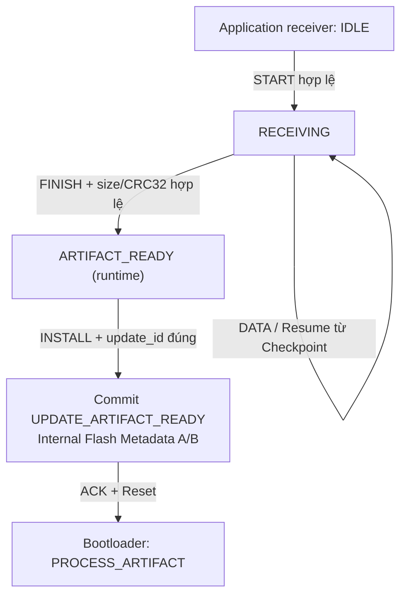

#### Bước 1. `IDLE` và `RECEIVING` thuộc phiên nhận

Ở trạng thái `IDLE`, Application hiện tại vẫn chạy và Gateway có thể `HELLO`/`QUERY` để đồng bộ thông tin. `START` hợp lệ đưa receiver sang `RECEIVING`, nơi dữ liệu được nhận/lưu vào **Incoming** của W25Q. Trong giai đoạn này, **Application hiện tại trên Internal Flash chưa bị ghi đè**.

Nếu reset khi `RECEIVING`, bên nhận dùng **Download Checkpoint đã lưu bền vững theo sector W25Q 4 KiB** để chọn vị trí `RESUME`. Offset từng được ACK gần nhất không nhất thiết là mốc phục hồi an toàn; điều kiện Retry/Resume ở [4.3](#luong-3).

#### Bước 2. `ARTIFACT_READY` không phải đã cài firmware

`FINISH` thành công nghĩa là gói SDOT **đã nhận đủ, đúng kích thước và CRC32**. Receiver chuyển sang `ARTIFACT_READY` **trong runtime**, nhưng chưa có nghĩa chữ ký SDOT đã được Bootloader xác thực hoặc firmware mới đã được Install.

`INSTALL` hợp lệ mới khiến Application **commit `UPDATE_ARTIFACT_READY`** trong Internal Flash Metadata A/B và reset. Đây là **hai trạng thái khác nhau, thuộc hai ngữ cảnh khác nhau**; không được dùng thay cho nhau. Trình tự commit/bàn giao có trong [4.4](#luong-4).

#### Bước 3. Bootloader tiếp nhận trạng thái bền vững

Sau reset, `BootDecision_Evaluate()` đọc `UPDATE_ARTIFACT_READY` và chọn `BOOT_ACTION_PROCESS_ARTIFACT`; bước sau là `UPDATE_VERIFYING_CONTAINER`. Nếu thiết bị reset trước khi lệnh INSTALL được commit thành công, không thể suy ra rằng Bootloader đã nhận yêu cầu cài đặt chỉ từ trạng thái runtime cũ.

#### Bài nói khi phỏng vấn: Runtime và Metadata

> `START` đưa STM32 Application sang `RECEIVING`; `FINISH` chỉ làm receiver đạt `ARTIFACT_READY` sau khi kiểm tra kích thước và CRC32. Chỉ `INSTALL` mới commit `UPDATE_ARTIFACT_READY` vào Metadata bền vững và reset. Bootloader vì thế phân biệt được **đã nhận đủ gói** với **đã được yêu cầu xử lý gói**. Nếu mất nguồn lúc nhận, Application Resume từ Download Checkpoint chứ không dùng offset ACK cuối trong RAM.

#### Câu hỏi ôn tập: Phân biệt các trạng thái

| Câu hỏi | Ý chính cần trả lời |
|---|---|
| `ARTIFACT_READY` và `UPDATE_ARTIFACT_READY` khác nhau thế nào? | Runtime của receiver sau FINISH so với Metadata bền vững sau INSTALL. |
| Reset trong `RECEIVING` khác reset sau `INSTALL` thế nào? | Trước INSTALL cần Resume nhận; sau INSTALL Bootloader xử lý SDOT. |
| FINISH có xác thực chữ ký ECDSA không? | Không. FINISH kiểm tra kích thước/CRC32, Bootloader xác thực chữ ký sau bàn giao. |
| Vì sao ACK không thay thế Checkpoint? | ACK không bảo đảm tiến độ đó được lưu bền vững qua mất nguồn. |

**Code cần đối chiếu:** `node-stm32f103/application/src/ota_receiver.c`, `node-stm32f103/bootloader/src/boot_decision.c`.

---

<a id="chuong-5-3"></a>
### 5.3. `VERIFYING_CONTAINER` → `VERIFYING_BASE` → `PATCHING` → `IMAGE_READY`

#### Sơ đồ luồng hoạt động

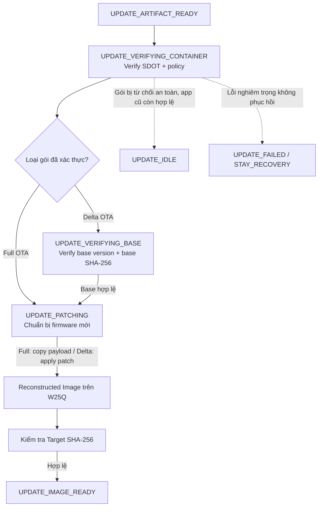

#### Bước 1. `UPDATE_ARTIFACT_READY` yêu cầu xử lý SDOT

Sau `INSTALL + Reset`, Bootloader đọc Metadata và chọn `BOOT_ACTION_PROCESS_ARTIFACT`. Gói SDOT đã lưu trong phân vùng **Incoming** của W25Q được đưa vào quy trình xác thực/cài đặt.

Tại thời điểm này, Bootloader chưa xóa Application hiện tại. Nếu nguồn cập nhật không đáp ứng chính sách bảo mật, hệ thống phải **từ chối trước giai đoạn Backup/Install**.

#### Bước 2. `UPDATE_VERIFYING_CONTAINER` — Kiểm tra gói SDOT

Bootloader phân tích và xác minh thông tin trong SDOT, bao gồm:

1. Định dạng/Header và kích thước gói.
2. **Product ID**, **Hardware Revision** và chính sách phiên bản/Anti-downgrade.
3. Các giá trị **CRC32** phục vụ phát hiện lỗi dữ liệu ở lớp tương ứng.
4. Giá trị **SHA-256** và **chữ ký ECDSA P-256** với **Public Key tin cậy**.

| Cơ chế | Vai trò trong luồng |
|---|---|
| **CRC32** | Phát hiện dữ liệu hỏng trong truyền/lưu trữ. |
| **SHA-256** | Tính/đối chiếu hash của dữ liệu được quy định. |
| **ECDSA P-256** | Xác thực chữ ký số của gói cập nhật bằng Public Key tin cậy. |
| **Product/Version policy** | Ngăn cài nhầm thiết bị hoặc phiên bản không được phép. |

**Tình huống minh họa:** Một gói SDOT có CRC32 đúng nhưng chữ ký ECDSA sai **không được coi là bản cập nhật tin cậy**. CRC32 không thể thay thế bước xác thực chữ ký.

> **Lưu ý triển khai:** Tài liệu của project ghi rõ repository **chưa provision Public Key production mặc định**. Khi giải thích ở phỏng vấn, cần phân biệt **code có cơ chế xác thực** với việc thiết bị thực tế **đã được provision khóa tin cậy để xác thực firmware ký số**.

#### Bước 3. `UPDATE_VERIFYING_BASE` — Chỉ dành cho Delta OTA

Với **Delta OTA**, Bootloader phải kiểm tra firmware gốc mà patch yêu cầu, gồm **base version** và **Base SHA-256**. Patch chỉ hợp lệ khi firmware gốc đang có **khớp chính xác** với firmware dùng để tạo patch bên phát hành.

Ví dụ: Delta Patch được tạo từ **v1-A → v2**. Nếu thiết bị đang có firmware **v1-B** dù cùng số version v1 nhưng hash khác, Bootloader phải **từ chối áp dụng patch**. Vì thuật toán patch đọc các byte/offset của Base Image, dùng sai base sẽ không đảm bảo tạo được Target Image mong muốn.

**Full OTA** không cần `VERIFYING_BASE` nhưng vẫn cần xác thực SDOT và Target Image.

#### Bước 4. `UPDATE_PATCHING` — Chuẩn bị Full/Delta image

Trong repository, **cả hai loại signed SDOT** đều đi qua trạng thái persisted **`UPDATE_PATCHING`**:

| Full OTA | Delta OTA |
|---|---|
| Copy payload firmware đầy đủ vào vùng **Reconstructed Image** của W25Q. | Áp dụng Delta Patch lên firmware gốc đã kiểm tra để tạo image mới ở **Reconstructed Image**. |
| Không cần Base Image. | Bắt buộc xác minh base version và Base SHA-256. |
| Vẫn phải xác minh Target Image sau chuẩn bị. | Vẫn phải xác minh Target Image sau tái tạo. |

```text
                Signed SDOT hợp lệ
                        |
             +----------+----------+
             |                     |
          Full OTA               Delta OTA
             |                     |
       Copy Full Payload      Verify Base Image
             |                     |
             |               Apply Delta Patch
             +----------+----------+
                        |
                        v
             Reconstructed Image (W25Q)
                        |
                 Verify Target SHA-256
                        |
                        v
                 UPDATE_IMAGE_READY
```

**Vì sao vẫn dùng W25Q?** Vì cần tạo và xác minh **firmware hoàn chỉnh** trước khi xóa/ghi Application ở Internal Flash. Điều này giảm rủi ro cài một image không hợp lệ.

#### Bước 5. `UPDATE_IMAGE_READY` — Ứng viên mới đã được kiểm tra

Bootloader kiểm tra **Target SHA-256** và các điều kiện hợp lệ của image đã chuẩn bị. Sau khi thành công, trạng thái chuyển sang `UPDATE_IMAGE_READY`, từ đó cho phép bắt đầu **Backup** firmware cũ.

`IMAGE_READY` **không phải** trạng thái cập nhật đã hoàn tất: Application cũ vẫn đang ở Internal Flash và firmware mới chưa được cài đặt.

#### Bước 6. Mất nguồn trong xác thực hoặc `PATCHING`

- `UPDATE_VERIFYING_CONTAINER`: Sau reset, Bootloader **bắt đầu lại** việc kiểm tra SDOT.
- `UPDATE_VERIFYING_BASE`: Sau reset, Bootloader **kiểm tra lại** Base Image.
- `UPDATE_PATCHING`: Bootloader **xóa vùng Reconstructed Image rồi chuẩn bị lại** từ đầu, tránh tái sử dụng dữ liệu tái tạo dở.

Đây là **Power-loss Recovery bằng restart bước an toàn**, không phải Rollback: firmware cũ trong Internal Flash chưa bị ghi đè.

#### Bài nói khi phỏng vấn: Xác thực và chuẩn bị firmware

> **VERIFYING_CONTAINER → IMAGE_READY:** Khi Bootloader thấy `UPDATE_ARTIFACT_READY`, nó đọc gói SDOT ở W25Q và xác thực chữ ký ECDSA P-256, hash SHA-256, Product ID và chính sách phiên bản. Với Delta OTA, nó còn kiểm tra version và hash của firmware gốc trước khi áp dụng patch.
>
> Cả Full OTA và Delta OTA đều đi qua `UPDATE_PATCHING`: Full OTA copy payload vào vùng Reconstructed Image, còn Delta OTA tái tạo image từ firmware gốc và patch. Sau đó Bootloader kiểm tra Target SHA-256, chỉ khi image hợp lệ mới chuyển sang `UPDATE_IMAGE_READY`. Nếu mất nguồn trong lúc patch, hệ thống chuẩn bị lại image từ đầu; Application hiện tại chưa bị ghi đè.

#### Câu hỏi ôn tập: Xác thực và tái tạo image

| Câu hỏi | Ý chính cần trả lời |
|---|---|
| Vì sao CRC32 đúng vẫn phải kiểm tra ECDSA? | CRC32 không xác thực nguồn phát hành firmware. |
| ECDSA Public Key nằm ở đâu? | Bootloader dùng khóa tin cậy đã được provision; private key thuộc phía phát hành. |
| Vì sao Delta cần Base SHA-256? | Để chắc chắn patch được áp dụng đúng firmware gốc. |
| Full OTA có đi qua `UPDATE_PATCHING` không? | Có. Full copy payload; Delta áp dụng patch. |
| Vì sao dùng vùng Reconstructed Image? | Có thể kiểm tra firmware hoàn chỉnh trước khi xóa Application. |
| Reset khi `PATCHING` thì sao? | Xóa vùng Reconstructed và chuẩn bị lại từ đầu. |
| `IMAGE_READY` nghĩa là đã cài firmware chưa? | Chưa; chỉ xác nhận candidate image đã chuẩn bị và kiểm tra hợp lệ. |

#### Điểm cần ghi nhớ

- **Verify SDOT → (Delta: Verify Base) → Prepare Image → Verify Target Hash → IMAGE_READY.**
- **Full và Delta đều dùng `UPDATE_PATCHING`**, nhưng cách chuẩn bị image khác nhau.
- Có trường hợp **từ chối gói SDOT rồi trở về IDLE an toàn**; không phải mọi lỗi xác thực đều làm mất firmware cũ hay buộc Rollback.

**Tài liệu/code đối chiếu:** `docs/boot-state-machine.md`, `docs/firmware-container.md`, `node-stm32f103/bootloader/src/secure_container.c`, `node-stm32f103/bootloader/include/trusted_key.h`.

---

<a id="chuong-5-4"></a>
### 5.4. `IMAGE_READY` → `BACKING_UP` → `INSTALLING` → `VERIFYING_INSTALL`

> **Trọng tâm trạng thái:** Điều kiện được phép chuyển từ Backup sang Install, tiến độ bền vững và hành vi sau reset. Trình tự **Erase/Program/Verify ở mức Flash** đã được giải thích ở [4.5](#luong-5) và [6.3](#chuong-6-3), nên không lặp lại ở đây.

#### Sơ đồ trạng thái và phục hồi

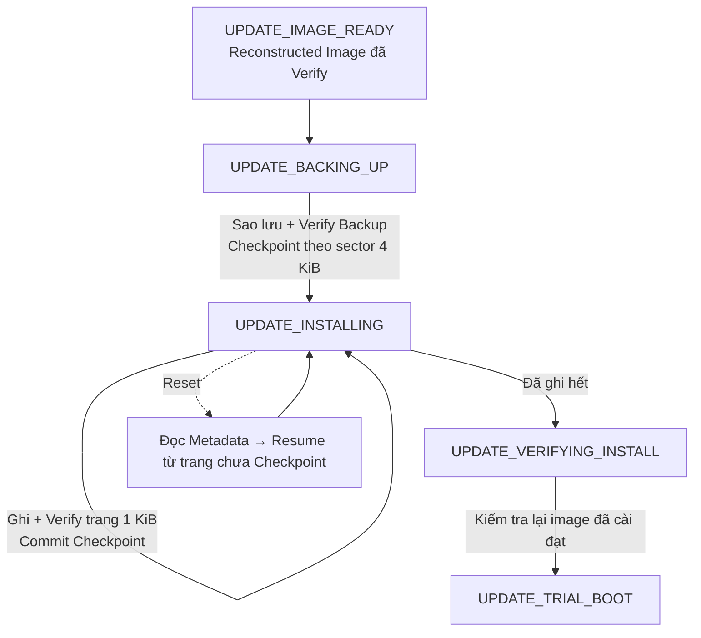

#### Bước 1. `UPDATE_IMAGE_READY` → `UPDATE_BACKING_UP`

`UPDATE_IMAGE_READY` xác nhận firmware đích đã được chuẩn bị và kiểm tra ở vùng **Reconstructed Image** trên W25Q; **Application cũ trong Internal Flash vẫn còn nguyên**. Bootloader bắt đầu `UPDATE_BACKING_UP` để sao lưu Application đang chạy sang **Backup Image** trên W25Q.

Backup dùng Checkpoint theo ranh giới sector **4 KiB** và phải được **Verify hợp lệ trước Install**. Đây là điều kiện an toàn bắt buộc vì Install sẽ ghi đè Application cũ. Nếu reset trong `BACKING_UP`, Bootloader tiếp tục hoặc làm lại phần Backup từ mốc đã lưu an toàn.

#### Bước 2. `UPDATE_INSTALLING` — chỉ công nhận trang đã Verify

Sau khi Backup hợp lệ, Bootloader bắt đầu `UPDATE_INSTALLING`. Mỗi trang **1 KiB** của Internal Flash được Erase/Program, **Read-back Verify**, rồi mới commit `copy_offset` vào Metadata A/B. Chi tiết buffer, half-word và hàm nguồn ở [4.5](#luong-5).

**Ví dụ phục hồi:** Đã commit 8 trang (8192 byte), reset xảy ra khi đang Program trang thứ 9. Metadata vẫn chỉ công nhận 8 KiB; Bootloader **Erase và Program lại trang thứ 9**. Nó không nhảy vào Application mới đang ghi dở.

Nếu nguồn **Reconstructed Image** không còn hợp lệ khiến Install không thể tiếp tục, Bootloader có thể **thử Rollback từ Backup đã kiểm tra**, nhưng không được mặc định mọi lỗi Flash đều phục hồi được.

#### Bước 3. `UPDATE_VERIFYING_INSTALL` — kiểm tra dữ liệu đã ghi

Sau khi Install hết các trang, `UPDATE_VERIFYING_INSTALL` kiểm tra lại **Installed Image** trong Internal Flash. Việc này tách biệt với bước kiểm tra **Target SHA-256** của nguồn Reconstructed Image: nguồn đúng nhưng thao tác ghi có thể sai. Nếu reset ngay lúc Verify, Bootloader **chạy lại bước Verify**; chỉ image hợp lệ mới chuyển sang `UPDATE_TRIAL_BOOT`.

#### Bài nói khi phỏng vấn: Chuyển trạng thái an toàn

> Firmware mới ở Reconstructed Image phải hợp lệ rồi mới sang `BACKING_UP`. Sau khi Backup đã Verify, Bootloader mới vào `INSTALLING`, ghi từng trang Internal Flash và commit Checkpoint **sau** khi Verify. Reset trong Install dẫn đến Resume từ trang chưa được xác nhận, còn reset khi `VERIFYING_INSTALL` khiến hệ thống kiểm tra lại image đã cài. Chỉ khi Verify thành công mới được Trial Boot.

#### Câu hỏi ôn tập: Điều kiện chuyển trạng thái

| Câu hỏi | Ý chính cần trả lời |
|---|---|
| Vì sao không bắt đầu Install ngay tại `IMAGE_READY`? | Cần tạo và Verify Backup trước khi ghi đè Application. |
| Backup và Install dùng cùng đơn vị Checkpoint không? | Không; Backup W25Q 4 KiB, Install Internal Flash 1 KiB. |
| Mất nguồn giữa trang Install xử lý thế nào? | Resume từ trang chưa Checkpoint, Erase/Program và Verify lại. |
| Reset khi `UPDATE_VERIFYING_INSTALL` xử lý thế nào? | Kiểm tra lại image đã cài đặt. |
| Nếu nguồn Reconstructed Image bị hỏng khi Install? | Có thể thử Rollback từ Backup hợp lệ; nếu không phục hồi được thì Recovery/lỗi. |

**Code đối chiếu:** `node-stm32f103/bootloader/src/boot_manager.c`, `node-stm32f103/bootloader/src/image_installer.c`, `node-stm32f103/bootloader/storage/metadata_storage.c`.

---

<a id="chuong-5-5"></a>
### 5.5. `TRIAL_BOOT` → `CONFIRMED` / `ROLLBACK` → `IDLE`

#### Sơ đồ luồng hoạt động

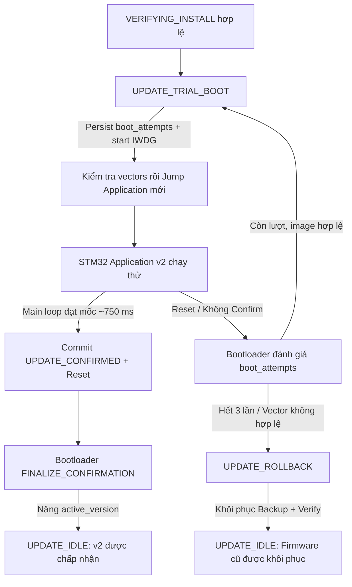

#### Bước 1. Vào `UPDATE_TRIAL_BOOT` sau khi Verify Installed Image

Bootloader chuyển sang **Trial Boot** khi firmware v2 đã cài và kiểm tra hợp lệ. Đây mới là **firmware ứng viên đang chạy thử**; phiên bản mới chưa được ghi nhận là firmware đã xác nhận chính thức.

**Quy tắc quan trọng:** `active_version` vẫn là phiên bản **đã được xác nhận trước đó** cho đến khi quá trình Confirm hoàn tất. Không nâng `active_version` ngay sau khi `INSTALLING` thành công.

#### Bước 2. Persist `boot_attempts`, bật IWDG rồi Jump

Trước mỗi lần cho firmware mới chạy thử, Bootloader:

1. Cập nhật và **lưu bền vững** số lần thử `boot_attempts`.
2. Khởi động **IWDG** theo chính sách Trial Boot.
3. Kiểm tra tính hợp lệ của Application vector trước khi Jump.
4. Bàn giao quyền điều khiển cho STM32 Application mới nếu hợp lệ.

Lưu bộ đếm **trước khi Jump** giúp reset do Watchdog hoặc lỗi Application vẫn bị tính là một lần thử, thay vì mất thông tin vì bộ đếm chỉ nằm trong RAM.

#### Bước 3. Application v2 thực hiện xác nhận hoạt động

Trong bản demo hiện tại, Application dùng `TrialConfirmation_Init()` và `TrialConfirmation_Process(now_ms)`. Sau khoảng **750 ms** của main loop đã khởi tạo, Application có thể gọi cơ chế Confirm, ghi `UPDATE_CONFIRMED` rồi **reset về Bootloader**.

Đây là kiểm tra **main-loop liveness cơ bản** (khởi tạo clock/SysTick, GPIO, UART/OTA agent và chạy vòng lặp), **không tương đương** một bộ health check hoàn chỉnh ở mức sản phẩm.

Repository cũng mô tả lệnh UART `CONFIRM` tùy chọn gọi cùng cơ chế xác nhận; khi trình bày, không nên khẳng định mọi hệ thống thực tế chỉ xác nhận theo đúng 750 ms.

#### Bước 4. `UPDATE_CONFIRMED` — Hoàn tất chấp nhận firmware mới

Sau khi Application commit Confirm và reset, Bootloader đọc Metadata rồi chọn `BOOT_ACTION_FINALIZE_CONFIRMATION`. Ở bước này, Bootloader cập nhật `active_version` theo bản đã xác nhận, hoàn tất chính sách với Backup, sau đó chuyển về `UPDATE_IDLE`.

```text
Application v2 Trial Boot
         |
         | Confirm hoạt động
         v
Commit UPDATE_CONFIRMED → Reset
         |
         v
Bootloader FINALIZE_CONFIRMATION
         |
         v
Nâng active_version → UPDATE_IDLE
```

**Điểm cần nhớ:** Có hai mốc khác nhau:

- **Install + Verify thành công:** Firmware mới *đã được ghi đúng*.
- **Confirm + Finalize thành công:** Firmware mới *được chấp nhận làm phiên bản hoạt động*.

#### Bước 5. Không Confirm sau số lần thử cho phép → `UPDATE_ROLLBACK`

Nếu Application mới bị reset lặp lại, không Confirm hoặc vector không hợp lệ, Bootloader xem `boot_attempts` và chính sách Trial Boot. Giới hạn hiện tại là **3 lần thử chưa xác nhận**.

Khi hết lượt hoặc gặp điều kiện cần phục hồi, Bootloader chuyển sang `UPDATE_ROLLBACK` và đọc **Backup Image** từ W25Q để khôi phục firmware cũ vào Internal Flash. Rollback có **Checkpoint theo trang 1 KB** và kiểm tra lại dữ liệu đã phục hồi.

#### Bước 6. Mất nguồn khi đang `ROLLBACK`

Bootloader không coi vùng Application đang khôi phục dở là ứng dụng hợp lệ. Sau reset, nó đọc Metadata `UPDATE_ROLLBACK` và tiếp tục từ **trang chưa được xác nhận an toàn**. Khi phục hồi/Verify thành công, hệ thống có thể quay về `UPDATE_IDLE` với firmware cũ.

**Giới hạn thực tế:** Rollback đòi hỏi bản Backup hợp lệ và Flash hoạt động được. Nếu dữ liệu nguồn hoặc trạng thái không thể phục hồi, cần xử lý lỗi/recovery; không nên hứa rằng Rollback luôn thành công trong mọi trường hợp hỏng bộ nhớ.

#### Bài nói khi phỏng vấn: Trial Boot, Confirm và Rollback

> **TRIAL_BOOT → CONFIRMED/ROLLBACK:** Sau khi firmware mới được cài và Verify, Bootloader chưa chấp nhận ngay mà cho chạy Trial Boot. Trước khi Jump, Bootloader lưu số lần thử `boot_attempts` và bật IWDG.
>
> Trong bản demo, Application xác nhận sau khoảng 750 ms main loop hoạt động, ghi `UPDATE_CONFIRMED` rồi reset về Bootloader. Bootloader mới cập nhật `active_version` và chuyển về `IDLE`. Nếu Application không Confirm sau tối đa 3 lần thử hoặc vector không hợp lệ, Bootloader Rollback từ Backup trên W25Q. Việc Rollback cũng có Checkpoint để tiếp tục nếu mất nguồn.

#### Câu hỏi ôn tập: Trial Boot và Rollback

| Câu hỏi | Ý chính cần trả lời |
|---|---|
| Vì sao không Confirm ngay sau Install? | Ghi image đúng chưa chứng minh Application mới chạy được. |
| `active_version` đổi khi nào? | Khi Bootloader hoàn tất bước Confirm, không phải khi Install xong. |
| Vì sao lưu `boot_attempts` trước Jump? | Đếm được cả lần chạy thử kết thúc bằng reset/Watchdog. |
| IWDG có vai trò gì? | Giúp xử lý Application không xác nhận/không tiếp tục chạy như mong đợi. |
| Giới hạn Trial Boot trong repo? | 3 lần thử chưa Confirm. |
| 750 ms là health check đầy đủ chưa? | Chưa; là liveness check cơ bản của demo. |
| Rollback khác Anti-rollback ở đâu? | Rollback phục hồi Backup; Anti-rollback/Anti-downgrade là chính sách giới hạn version được phép cài. |
| Nếu mất nguồn giữa Rollback? | Tiếp tục từ Checkpoint trang 1 KB. |

#### Điểm cần ghi nhớ

- **Install thành công ≠ Confirm thành công.**
- `active_version` chỉ được nâng sau khi bước **Finalize Confirmation** hoàn tất.
- **3 trial attempts + IWDG + Backup** hỗ trợ phát hiện/khôi phục khi Application mới không được xác nhận.
- **750 ms** là cơ chế demo, không phải kết quả kiểm thử toàn bộ chức năng sản phẩm.

**Tài liệu/code đối chiếu:** `docs/boot-state-machine.md`, `docs/metadata-and-boot-decision.md`, `node-stm32f103/bootloader/src/boot_manager.c`, `node-stm32f103/bootloader/src/image_installer.c`.

---

<a id="chuong-5-6"></a>
### 5.6. Power-loss Recovery, trạng thái `FAILED` và các chuyển trạng thái không hợp lệ

#### Sơ đồ quyết định sau reset bất ngờ

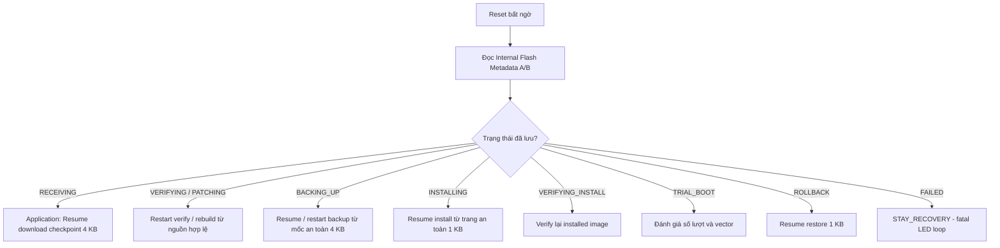

#### Bước 1. Phân loại giai đoạn bị gián đoạn

| State / Giai đoạn | Hành vi khi khởi động lại | Đơn vị tiến độ chính |
|---|---|---|
| `RECEIVING` | Application khôi phục Download Checkpoint; ESP32 Resume từ offset an toàn. | Sector W25Q **4 KB**. |
| `VERIFYING_CONTAINER` | Kiểm tra lại gói SDOT. | Restart bước xác thực. |
| `VERIFYING_BASE` | Kiểm tra lại Base Image. | Restart bước xác thực. |
| `PATCHING` | Xóa Reconstructed Image và chuẩn bị lại Full/Delta image. | Restart chuẩn bị image. |
| `BACKING_UP` | Khôi phục/tiếp tục Backup đã xác minh. | Sector W25Q **4 KB**. |
| `INSTALLING` | Resume từ trang Internal Flash chưa xác minh. | Trang Internal Flash **1 KB**. |
| `VERIFYING_INSTALL` | Kiểm tra lại toàn bộ installed image. | Restart Verify. |
| `TRIAL_BOOT` | Quyết định thử lại hoặc Rollback theo attempts/vector. | `boot_attempts` đã persist. |
| `ROLLBACK` | Tiếp tục khôi phục từ Backup. | Trang Internal Flash **1 KB**. |
| `FAILED` | `BOOT_ACTION_STAY_RECOVERY`. | Không tự thực hiện UART START để phục hồi từ xa. |

#### Bước 2. Phân biệt Restart, Resume và Rollback

| Khái niệm | Ý nghĩa | Ví dụ trong project |
|---|---|---|
| **Restart step** | Làm lại một bước an toàn từ đầu. | Kiểm tra lại SDOT; xóa Reconstructed và Apply Patch lại. |
| **Resume** | Tiếp tục từ mốc tiến độ bền vững đã xác minh. | Resume Download 4 KB; Install/Rollback theo trang 1 KB. |
| **Rollback** | Thay firmware mới không được chấp nhận bằng bản Backup hợp lệ. | Trial Boot vượt số lần thử, khôi phục Application v1. |
| **STAY_RECOVERY** | Không Jump Application và ở lại nhánh xử lý lỗi nghiêm trọng. | `UPDATE_FAILED` trong triển khai hiện tại. |

**Ví dụ để phân biệt:** Mất nguồn trong `PATCHING` không nhất thiết phải Rollback, vì Application cũ vẫn chưa bị ghi đè; Bootloader có thể **Restart Patch**. Ngược lại, sau khi v2 đã cài nhưng Trial Boot thất bại, Bootloader cần **Rollback** từ Backup v1.

#### Bước 3. `UPDATE_FAILED` không phải UART Recovery mode hoàn chỉnh

Trong repository, `UPDATE_FAILED` ánh xạ tới `BOOT_ACTION_STAY_RECOVERY`. Bootloader ở nhánh báo lỗi/LED fatal và **không chạy Application UART receiver để tự nhận `START`** trong trạng thái này.

Vì vậy, khi phỏng vấn, nên trình bày đúng giới hạn: project **có phát hiện và giữ thiết bị ở trạng thái Recovery đối với lỗi nghiêm trọng**, nhưng không nên nói rằng thiết bị có thể tự nhận firmware mới từ ESP32 ở mọi tình huống `FAILED`.

**Phân biệt thêm:** Một gói SDOT bị từ chối có kiểm soát trong khi Application cũ vẫn hợp lệ **có thể được dọn pending update và trở lại `UPDATE_IDLE`**. Không phải cứ sai chữ ký hoặc sai base là hệ thống luôn đi tới `UPDATE_FAILED`.

#### Bước 4. Các chuyển trạng thái phải từ chối

Theo tài liệu thiết kế, những tình huống sau là **illegal transitions**:

1. Nhận `DATA` khi receiver không ở `RECEIVING`.
2. Gửi `INSTALL` khi vẫn đang `RECEIVING` và chưa `FINISH` hợp lệ.
3. Đi vào `PATCHING` khi chưa vượt qua kiểm tra chữ ký và base cần thiết.
4. Đi vào `INSTALLING` khi Backup chưa được xác minh.
5. Nhận `CONFIRMED` khi chưa từng ở `TRIAL_BOOT`.
6. Xóa Backup trước khi firmware mới được Confirm.
7. Chấp nhận `update_id` khác khi đang nhận dở mà không thực hiện luồng ABORT/new START cleanup phù hợp.

Những ràng buộc này bảo vệ tính nhất quán của State Machine: **mỗi bước chỉ được bắt đầu khi những điều kiện an toàn ở bước trước đã hoàn tất**.

#### Bước 5. Tình huống phỏng vấn: thiết bị mất nguồn ở nhiều vị trí

**Tình huống A — Mất nguồn sau khi đã ACK 10 KB nhưng Checkpoint mới đến 8 KB:**

- Không tin offset ACK trong phiên UART trước đó là tiến độ bền vững.
- Application khôi phục Checkpoint W25Q và ESP32 Resume từ khoảng 8 KB.

**Tình huống B — Mất nguồn giữa Apply Patch:**

- Bootloader thấy `UPDATE_PATCHING`.
- Xóa vùng Reconstructed Image và tạo lại firmware mới từ gói SDOT/base hợp lệ.
- Chưa cần Rollback vì Application cũ chưa bị ghi đè.

**Tình huống C — Mất nguồn giữa Install trang thứ 9:**

- Bootloader thấy `UPDATE_INSTALLING`.
- Resume từ **trang chưa được Verify/Checkpoint**.
- Không Jump vào Application đang ghi dở.

**Tình huống D — Firmware mới reset liên tục trong Trial Boot:**

- `boot_attempts` đã được lưu bền vững trước mỗi lần thử.
- Khi hết **3 lần thử** hoặc có vector không hợp lệ, Bootloader đi vào Rollback từ Backup.

#### Bài nói khi phỏng vấn: Power-loss Recovery và xử lý lỗi

> **Power-loss Recovery:** Sau reset, Bootloader đọc Metadata A/B để biết công việc đang dở. Nếu đang Verify hoặc Patch, nó Restart bước tương ứng từ nguồn tin cậy; nếu đang Backup, Install hoặc Rollback, nó tiếp tục từ Checkpoint đã xác minh. Nhờ vậy không đánh dấu dữ liệu ghi dở là hợp lệ.
>
> Em phân biệt Power-loss Recovery với Rollback: Recovery là tiếp tục/restart công việc an toàn sau mất nguồn; Rollback là phục hồi firmware đã sao lưu khi phiên bản mới không được chấp nhận. Với lỗi không thể phục hồi, `UPDATE_FAILED` sẽ khiến Bootloader ở `STAY_RECOVERY`; bản hiện tại không có UART OTA receiver tự chạy ở nhánh này.

#### Câu hỏi ôn tập: Recovery và illegal transitions

| Câu hỏi | Ý chính cần trả lời |
|---|---|
| Reset ở `PATCHING` phải làm gì? | Xóa Reconstructed Image và chuẩn bị lại. |
| Reset ở `INSTALLING` phải làm gì? | Resume từ trang 1 KB chưa được xác nhận. |
| Reset ở `ROLLBACK` phải làm gì? | Tiếp tục Restore theo Checkpoint 1 KB. |
| Vì sao không Save Checkpoint trước Verify? | Có thể đánh dấu nhầm dữ liệu đang ghi dở là hợp lệ. |
| Mất nguồn có luôn dẫn đến Rollback không? | Không; nhiều state chỉ cần Restart/Resume. |
| `UPDATE_FAILED` có nhận `START` từ UART không? | Không trong triển khai hiện tại. |
| Có thể Install khi chưa Backup thành công không? | Không; đây là chuyển trạng thái không hợp lệ. |
| Gói SDOT bị từ chối có nhất thiết vào FAILED không? | Không; có nhánh từ chối sạch và quay lại IDLE khi firmware cũ hợp lệ. |

#### Điểm cần ghi nhớ

- **State/Metadata quyết định cách khôi phục; Checkpoint quyết định mốc tiến độ đã an toàn.**
- **Restart / Resume / Rollback / STAY_RECOVERY là bốn kết quả khác nhau**, không nên dùng lẫn.
- Bản triển khai hiện tại hỗ trợ Power-loss Recovery và Rollback, nhưng **`FAILED` không tương đương OTA recovery từ xa**.

**Tài liệu/code đối chiếu:** `docs/boot-state-machine.md`, `docs/metadata-and-boot-decision.md`, `docs/uart-ota-protocol.md`, `node-stm32f103/bootloader/src/boot_decision.c`, `node-stm32f103/bootloader/src/boot_manager.c`.

---

<a id="phan-6"></a>
## Phần 6. Ôn tập kiến thức kỹ thuật

---

<a id="chuong-6-1"></a>
### 6.1. Các ràng buộc STM32 trực tiếp trong project

> **Phạm vi:** Chỉ tra cứu cấu hình và mã nguồn của Secure Delta OTA Bootloader. Không ôn lại CPU Cortex-M3, thanh ghi lõi, NVIC, RCC, Clock Tree, các chế độ thực thi hay lý thuyết reset.

#### Bản đồ các vùng bộ nhớ đã cấu hình

| Phân vùng | Địa chỉ | Dung lượng | Phần mã phụ thuộc |
|---|---|---:|---|
| STM32 Bootloader | `0x08000000` | 24 KiB | Startup, Boot Decision, xác thực, Recovery |
| STM32 Application | `0x08006000` | 38 KiB | Linker, Application Jump, firmware installer |
| Internal Flash Metadata A | `0x0800F800` | 1 KiB | `MetadataStorage_*` |
| Internal Flash Metadata B | `0x0800FC00` | 1 KiB | `MetadataStorage_*` |
| SRAM | `0x20000000–0x20004FFF` | 20 KiB | Buffer trang, stack, dữ liệu tạm |

**Ràng buộc triển khai:** Không Erase/Program ra ngoài phân vùng Application khi cài OTA. Linker của Application đặt vector ở `0x08006000`, hai trang Metadata nằm ở cuối vùng Internal Flash.

#### Những đường xử lý STM32 cần lần theo trong repository

| Tình huống | Đường xử lý và điểm cần kiểm tra |
|---|---|
| Reset bình thường | `BootMetadata_t` → `MetadataStorage_Load()` → `BootDecision_Evaluate()` → `BootManager_Run()` |
| Bàn giao Application | `ApplicationJump_Validate()` → `ApplicationJump_Execute()` → `application_handoff.s` |
| Nhận `INSTALL` | STM32 Application commit `UPDATE_ARTIFACT_READY` rồi reset để Bootloader xử lý SDOT |
| Ghi firmware mới | `ProgramBufferedApplicationPage()` → Read-back Verify → `ResumePageCheckpointedCopy()` ghi Checkpoint |
| Reset giữa cập nhật | Đọc lại state/`copy_offset`; Resume, Restart hoặc Rollback theo Boot Decision |

**Cần đọc:** `shared/include/memory_map.h`, `shared/include/boot_metadata.h`, `node-stm32f103/bootloader/src/application_jump.c`, `node-stm32f103/bootloader/startup/application_handoff.s`, `node-stm32f103/bootloader/src/boot_decision.c`.

**Đọc tiếp:** [6.2 – Startup, linker và chuyển quyền điều khiển sang Application](#chuong-6-2), [6.3 – Cài firmware vào Internal Flash](#chuong-6-3), [6.9 – Metadata/Checkpoint](#chuong-6-9).

---

<a id="chuong-6-2"></a>
### 6.2. Startup, Linker và chuyển quyền điều khiển sang Application trong project

#### Sơ đồ tổng quan: Reset, Startup và chuyển quyền điều khiển sang Application

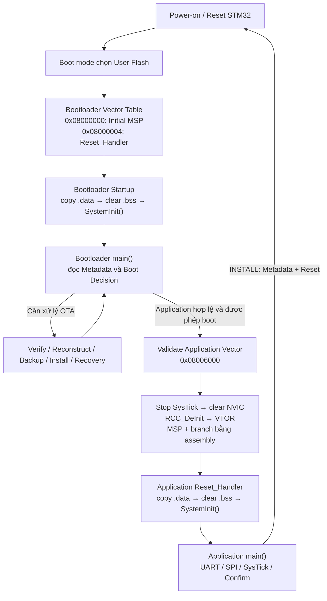

> **Phân biệt quan trọng:** **Power-on/reset** là sự kiện phần cứng khiến CPU nạp vector khởi động. **Application Jump** là chuyển quyền điều khiển bằng phần mềm tới `Reset_Handler` của image thứ hai; thao tác jump **không tự tạo ra một lần reset phần cứng** và không tự reset mọi ngoại vi. Đó là lý do project có quy trình cleanup trước khi jump.

#### Bước 1. Theo dấu đường khởi động của hai image

Trong project, Bootloader được link tại `0x08000000`, Application tại `0x08006000`; chúng có **startup và linker riêng**. Sau reset vào Bootloader, `main()` đọc Metadata để chọn Boot Action. Nếu được phép chạy Application, Bootloader chuyển qua hàm kiểm tra vector và chuyển quyền điều khiển; nếu còn cập nhật dở, nó xử lý state tương ứng trước.

**Đối chiếu:** `bootloader.ld`, `application.ld`, `startup_stm32f10x_md.s` và `BootDecision_Evaluate()`. Không cần ôn lại trình tự nạp thanh ghi của Cortex-M3; điều cần kiểm tra là **hai image được link đúng địa chỉ** và không chồng lên Metadata.

#### Bước 2. Kiểm tra Vector Table của Application theo code

| Kiểm tra trong `ApplicationJump_Validate()` | Giá trị/ràng buộc của project |
|---|---|
| Địa chỉ vector Application | `0x08006000`, căn theo ràng buộc **0x200 byte** |
| Initial MSP | Trong phạm vi SRAM `0x20000000–0x20005000`, căn hàng hợp lệ |
| Reset Handler | Thuộc phân vùng Application và có **Thumb bit** phù hợp |
| VTOR khi chuyển quyền điều khiển | `SCB->VTOR = 0x08006000` |

**Phân biệt:** Kiểm tra vector chỉ quyết định Application **có thể được chuyển quyền thực thi hay không**. Xác minh nguồn phát hành firmware được thực hiện riêng bằng SHA-256/ECDSA khi xử lý gói SDOT.

**Mã cần đọc:** `application_jump.c`, `application_handoff.s`; đối chiếu hai word đầu file `.bin` và địa chỉ trong `application.ld` nếu Jump lỗi.

#### Bước 3. Kiểm tra Startup riêng của Bootloader và Application

Trong repository, hai image dùng startup assembly `startup_stm32f10x_md.s`, được **link độc lập**. Startup Application khởi tạo `.data`, `.bss`, gọi `SystemInit()` rồi vào `main()`; việc chuyển quyền điều khiển phải đến đúng **Application Reset Handler**, không nhảy trực tiếp vào `main()`.

**Trường hợp cần debug:** Khi Application không chạy sau Jump, so sánh các ký hiệu linker `_sidata`, `_sdata`, `_edata`, `_sbss`, `_ebss` và entry symbol giữa ELF và startup của image đang cài. Điều cần giữ ở đây là **quan hệ giữa linker file và startup thực tế**, không phải học lại cách khởi tạo biến C.

#### Bước 4. Linker Script là gì? Tại sao Bootloader và Application phải có script riêng?

**Compiler** dịch từng file nguồn; **linker** ghép object file, định vị các section, giải quyết symbol và tạo image cuối. **Linker script (`.ld`)** mô tả image được phép sử dụng **địa chỉ nào và bao nhiêu bộ nhớ**. Nếu sai script, code C có thể biên dịch bình thường nhưng image không boot được, hoặc Install ghi đè vùng của image khác.

**So sánh chính xác theo hai linker script trong repo:**

| Thuộc tính | Bootloader | Application |
|---|---|---|
| File | `bootloader/linker/bootloader.ld` | `application/linker/application.ld` |
| `FLASH ORIGIN` | `0x08000000` | `0x08006000` |
| `FLASH LENGTH` | `24K` | `38K` |
| `RAM ORIGIN` | `0x20000000` | `0x20000000` |
| `RAM LENGTH` | `20K` | `20K` |
| `_estack` | `ORIGIN(RAM) + LENGTH(RAM)` | Tương tự (`0x20005000`) |
| `ENTRY` | `Reset_Handler` | `Reset_Handler` |
| `.isr_vector` | Đúng Flash origin của Bootloader | Đúng `0x08006000` |

**Trích cấu hình quan trọng của Application (`application.ld`):**

```ld
ENTRY(Reset_Handler)
MEMORY {
    FLASH (rx)  : ORIGIN = 0x08006000, LENGTH = 38K
    RAM   (xrw) : ORIGIN = 0x20000000, LENGTH = 20K
}
_estack = ORIGIN(RAM) + LENGTH(RAM);

SECTIONS {
    .isr_vector : {
        . = ALIGN(0x200);
        __vector_table_start__ = .;
        KEEP(*(.isr_vector))
        . = ALIGN(4);
    } > FLASH
    /* Các section .text/.rodata/.data/.bss ở dưới được rút gọn tại đây. */
}
```

**Ý nghĩa từng cú pháp:**

| Ký hiệu / cú pháp | Giải thích ngắn | Lỗi nếu dùng sai |
|---|---|---|
| `ENTRY(Reset_Handler)` | Đặt **entry symbol cho ELF/linker**; **không** thay thế hai word của vector table mà phần cứng đọc. | Hiểu sai rằng CPU lấy `ENTRY` từ linker khi reset. |
| `MEMORY`, `ORIGIN`, `LENGTH` | Giới hạn địa chỉ Flash/RAM của image. | Overlap Bootloader/Metadata hoặc link sai base. |
| `.isr_vector` + `KEEP` | Đặt/giữ bảng vector ở đầu Flash region, kể cả khi GC sections. | Vector bị thiếu hoặc dịch sang offset khác. |
| `. = ALIGN(0x200)` | Căn vector theo ràng buộc của thiết kế. | VTOR base không đáp ứng căn chỉnh đã kiểm tra. |
| `.text`, `.rodata` | Code và dữ liệu chỉ đọc trong Flash. | Image quá giới hạn phân vùng. |
| `.data > RAM AT > FLASH` | Địa chỉ chạy trong RAM, **load image/giá trị ban đầu** được lưu ở Flash. | Biến có khởi tạo không mang giá trị mong muốn. |
| `_sidata = LOADADDR(.data)` | Chỉ vùng nguồn trong Flash để startup copy `.data`. | Copy sai nguồn. |
| `.bss (NOLOAD) > RAM` | Vùng RAM cần zero, không cần bytes khởi tạo trong file firmware. | Dữ liệu runtime bị rác. |
| `_Min_Stack_Size`, `._user_heap_stack` | Dành mức ngân sách bộ nhớ cho stack/heap trong kiểm tra link. | Link thành công nhưng khó kiểm soát SRAM còn lại. |
| `ASSERT(...)` | Bắt lỗi tại **link time** khi ranh giới/địa chỉ sai. | Lỗi layout có thể chỉ lộ trên thiết bị. |

**Địa chỉ kết thúc Application cần nhớ:** `0x08006000 + 38 KiB = 0x0800F800` (**exclusive**). Byte cuối hợp lệ là `0x0800F7FF`; ngay sau đó là **Metadata A**. Hai trang Metadata A/B nằm ở `0x0800F800–0x0800FFFF` và **không thuộc vùng Application**.

**Repository còn có `ASSERT`** để giữ đúng vector origin, Flash budget, ranh giới Metadata và giới hạn RAM. Đây là bảo vệ **trong quá trình build**, khác với kiểm tra vùng nhớ/CRC/Signature **khi thiết bị cập nhật firmware**.

#### Bước 5. Bootloader quyết định có được Jump Application hay không?

Startup vào `main()` **không đồng nghĩa lúc nào cũng jump**. Sau reset, Bootloader đọc **Metadata A/B** và trạng thái OTA; `BootDecision_Evaluate()` chọn hành động phù hợp. Chỉ khi nhánh boot cho phép và image có vector hợp lệ, mã mới đi tới **`ApplicationJump_Validate()`** và **`ApplicationJump_Execute()`**.

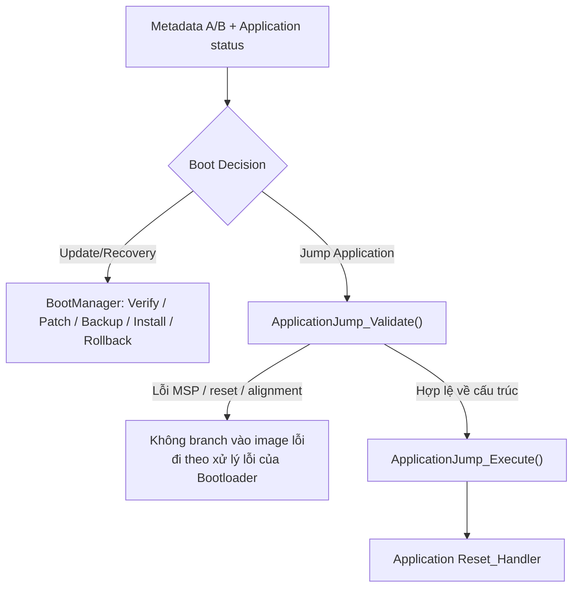

**Hai tầng kiểm tra khác nhau:**

- **Cấu trúc image có thể boot (`ApplicationJump_Validate`):** vector alignment, MSP, Thumb reset address, phạm vi code. Đây là điều kiện cần để CPU không nhảy mù vào địa chỉ sai.
- **Tính tin cậy của firmware cập nhật:** Bootloader xác thực gói **SDOT bằng ECDSA P-256/SHA-256**, kiểm tra chính sách sản phẩm/phiên bản và kiểm tra image ở các bước OTA. **Đừng nói vector hợp lệ đồng nghĩa firmware đã được ký số hợp lệ.**

**Ví dụ:** Sau khi OTA cài v2 vào Internal Flash, `UPDATE_TRIAL_BOOT` yêu cầu chạy thử v2. Boot Decision chỉ định thử boot, `ApplicationJump` kiểm tra vector v2, thực hiện chuyển quyền điều khiển, rồi Application v2 bắt đầu tại **Reset Handler của nó**. Chỉ sau **Confirm**, v2 mới được chấp nhận chính thức; chi tiết trạng thái xem **5.5**.

#### Bước 6. Quy trình Jump thực tế: tại sao cần C cleanup và chuyển quyền điều khiển bằng assembly?

Theo `docs/boot-jump.md` và code `application_jump.c` + `application_handoff.s`, việc chuyển quyền gồm **hai tầng**:

**A. C-side cleanup trong `ApplicationJump_Execute()`:**

1. Lấy và giữ các giá trị MSP, Reset Handler, vector base đã được xác thực.
2. **Dừng SysTick** và xóa counter.
3. **Mask interrupt**, disable/clear các bank **NVIC**.
4. Xóa pending **SysTick** và **PendSV**.
5. Gọi **`RCC_DeInit()`** để đưa clock về trạng thái HSI gần như sau reset.
6. Gán **`SCB->VTOR = 0x08006000`**, thực hiện **`__DSB()`** và **`__ISB()`**.
7. Gọi helper assembly `ApplicationJump_SetStackAndBranch(initial_msp, reset_handler)`.

**B. Chuyển quyền điều khiển bằng assembly (`bootloader/startup/application_handoff.s`):**

```asm
/* Trích ý chính từ helper assembly; r0 = initial MSP, r1 = reset handler */
msr msp, r0
movs r2, #0
msr psp, r2
msr control, r2
msr basepri, r2
msr faultmask, r2
msr primask, r2
dsb
isb
bx r1
```

**Tại sao bước đổi MSP phải bằng assembly?** Nếu trong hàm C bình thường ta đổi MSP rồi `return` hoặc để compiler sinh prologue/epilogue, lệnh của compiler có thể **truy cập stack frame cũ bằng MSP mới**. Helper assembly tối giản thực hiện **đổi MSP rồi branch** mà không quay lại stack của Bootloader.

**Tại sao `PRIMASK` lại được đưa về 0 trước branch?** Khi cleanup, interrupt được tạm mask để tránh ISR của Bootloader xen vào. Nhưng Application startup mong trạng thái ngắt gần với reset (PRIMASK = 0). Do **SysTick/NVIC pending đã được dọn**, helper có thể trả PRIMASK về 0 và branch mà không chạy nhầm ISR còn sót.

**Tại sao dùng `RCC_DeInit()`?** Khác với reset toàn MCU, jump không reset clock/peripheral. Application cần được nhận một trạng thái clock sạch hơn để `SystemInit()` và driver UART/SPI cấu hình đúng, tránh phụ thuộc vào clock mà Bootloader đã đặt.

> **Điểm cực kỳ dễ nhầm:** Cấp lại MSP rồi gọi `main()` của Application **không** đúng hợp đồng startup. Repo **branch đến `Reset_Handler`**, để Application copy `.data`, clear `.bss` và tự `SystemInit()` trước khi vào `main()`.

#### Bước 7. Sau khi Jump, Application làm gì?

Sau lệnh `BX` đến Reset Handler của Application:

1. CPU thực thi **Application startup**, không còn chạy hàm C của Bootloader.
2. Application tự khởi tạo `.data`/`.bss` theo các symbol trong **`application.ld`**.
3. `SystemInit()` và `main()` cấu hình clock, GPIO, UART, SPI, SysTick theo nhu cầu của Application.
4. Vì **VTOR đã trỏ đến vector table Application**, handler của ngắt Application mới được dùng.
5. Trong **Trial Boot**, Application cần thực hiện logic Confirm phù hợp; nếu lỗi liên tục không Confirm, Bootloader sẽ đánh giá và Rollback khi các lần boot sau xảy ra.

**Bằng chứng runtime được mô tả trong repo:** Application kiểm tra **`SCB->VTOR == 0x08006000`**, cấu hình **SysTick 1 ms** và phát nhịp LED **PC13 active-low 100 ms mỗi giây**. Việc heartbeat hoạt động sau khi chuyển quyền điều khiển cho thấy mã startup đã chạy và ngắt SysTick đang lấy handler qua vector Application.

**Phân biệt quy trình:**

```text
A. Reset MCU thật (sau INSTALL hoặc power-on):
   Reset → Bootloader Reset_Handler → Boot Decision → [OTA hoặc App Jump]

B. Bootloader Jump Application (không reset phần cứng):
   Validate → cleanup → set VTOR/MSP → Branch App Reset_Handler → App main()

C. Application muốn cài OTA mới:
   INSTALL → commit Metadata → ACK → reset thật → Bootloader xử lý gói SDOT
```

#### Bước 8. Tự đọc source và kiểm tra một firmware image

**Quy trình đọc repo có mục đích:**

| Thứ tự | File cần mở | Câu hỏi cần tự trả lời |
|---|---|---|
| 1 | `docs/memory-map.md` và `shared/include/memory_map.h` | APP_START, APP_END (exclusive), vùng Metadata là gì? |
| 2 | `bootloader/linker/bootloader.ld` | Vì sao Bootloader chỉ được dùng 24 KiB? |
| 3 | `application/linker/application.ld` | Vì sao Application phải link từ `0x08006000`? `.data AT > FLASH` nghĩa là gì? |
| 4 | `application/startup/startup_stm32f10x_md.s` | Thứ tự `_sidata → .data`, `.bss`, `SystemInit`, `main` là gì? |
| 5 | `bootloader/startup/startup_stm32f10x_md.s` | Bootloader nhận MSP và vào `main` thế nào? |
| 6 | `bootloader/src/boot_decision.c` và `boot_manager.c` | Khi nào được cho Application chạy? Khi nào cần Recovery? |
| 7 | `bootloader/src/application_jump.c` | Những check và cleanup nào chạy trước branch? |
| 8 | `bootloader/startup/application_handoff.s` | Vì sao không dùng hàm C thông thường để đổi MSP + branch? |
| 9 | `docs/boot-jump.md` | Ranh giới giữa **boot hợp lệ** và **firmware đã xác thực** là gì? |

**Lệnh kiểm tra sau khi build (ví dụ công cụ GNU Arm; tên file `.elf` thay bằng output thực tế):**

```bash
# Build theo Make target được repo hỗ trợ.
make firmware TOOLCHAIN=gcc

# Liệt kê section; xác minh .isr_vector nằm đúng Application Flash base.
arm-none-eabi-objdump -h path/to/application.elf

# Xem giá trị word đầu của section vector.
arm-none-eabi-objdump -s -j .isr_vector path/to/application.elf

# Xem các symbol liên quan đến startup và layout.
arm-none-eabi-nm -n path/to/application.elf | grep -E '(_estack|Reset_Handler|_sidata|_sdata|_edata|_sbss|_ebss)'
```

**Khi debug qua GDB/SWD** (lệnh chỉ chạy được nếu đã kết nối target thích hợp):

```gdb
x/2wx 0x08000000   # MSP/Reset của Bootloader
x/2wx 0x08006000   # MSP/Reset của Application
p/x $msp            # MSP hiện tại (theo GDB/target support)
p/x $pc             # PC hiện tại
```

**Ba kiểm tra quan trọng nhất trước khi kết luận lỗi ở Bootloader:**

1. `0x08006000` có giá trị **Initial MSP** thuộc `0x20000000–0x20005000` và căn 8 byte không?
2. `0x08006004` có giá trị **Reset Handler** với bit Thumb = 1, trỏ vào `0x08006000–0x0800F7FF` không?
3. `.isr_vector` trong ELF nằm ở `0x08006000` và code/sections không vượt `0x0800F800` không?

#### Tình huống lỗi thực tế và hướng suy luận

| Hiện tượng | Khả năng nguyên nhân | Hướng kiểm tra |
|---|---|---|
| Application chạy khi flash riêng nhưng lỗi khi Bootloader jump | VTOR chưa chuyển, SysTick/NVIC pending, clock khác giả định, MSP sai. | Kiểm tra thứ tự cleanup/branch trong `application_jump.c` và `application_handoff.s`. |
| Ngay sau `BX` vào HardFault | Reset Handler trỏ sai vùng, bit Thumb = 0, stack không hợp lệ hoặc Application image hỏng. | Đọc hai word đầu vector, kiểm tra `ApplicationJump_Validate()` và linker. |
| SysTick/IRQ vào handler của Bootloader | VTOR vẫn ở boot vector hoặc còn pending IRQ từ Bootloader. | Đọc `SCB->VTOR`, NVIC, SysTick và bước chuyển quyền điều khiển. |
| Biến `static`/global khởi tạo sai | `.data` chưa copy, `.bss` chưa clear hoặc linker symbols sai. | Đọc `Reset_Handler`, `_sidata/_sdata/_edata/_sbss/_ebss`. |
| Flash mới ghi chạm Metadata | Application linker/installer không tôn trọng end-exclusive `0x0800F800`. | Kiểm tra `.ld`, `ASSERT`, `memory_map.h`, phạm vi erase/program. |
| Application boot nhưng UART/SPI sai tốc độ | Clock/RCC của hai image khác nhau hoặc quá trình chuyển quyền điều khiển chưa khôi phục RCC. | Kiểm tra `RCC_DeInit()`, `SystemInit()`, baudrate/clock prescaler. |
| Jump được nhưng firmware không hợp lệ về bảo mật | Chỉ kiểm vector, không xác thực nguồn cập nhật. | Tách kiểm tra jump khỏi Verify SDOT ECDSA/SHA-256 và Boot Decision. |

#### Bài nói khi phỏng vấn: Boot Process, Vector Table & Linker Script (khoảng 90 giây)

> **Boot Process, Vector Table và Linker Script:** Trên STM32F103, khi reset và boot từ User Flash, CPU nạp hai word đầu của vector table: giá trị MSP và địa chỉ Reset Handler. Trong project của em, vector Bootloader ở `0x08000000`, nên Bootloader chạy trước.
>
> Startup của mỗi image sẽ copy `.data` từ Flash sang RAM, xóa `.bss`, gọi `SystemInit()` rồi mới vào `main()`. Linker script đảm bảo Bootloader nằm trong 24 KiB đầu Flash, còn Application được link riêng từ `0x08006000` với dung lượng 38 KiB, không ghi đè hai trang Metadata cuối.
>
> Sau khi đọc Metadata và đưa ra Boot Decision, nếu cần chạy Application, Bootloader kiểm tra vector table của Application: MSP nằm trong SRAM, Reset Handler có Thumb bit và trỏ vào vùng Application. Sau đó Bootloader dừng SysTick, dọn NVIC, khôi phục RCC, chuyển VTOR sang `0x08006000`.
>
> Cuối cùng, đoạn assembly chuyển quyền điều khiển đặt lại MSP và các thanh ghi điều khiển rồi branch thẳng tới Reset Handler của Application. Đây là software jump, không phải hardware reset. Application sẽ chạy startup của chính nó trước khi vào `main()`. Cách tách image, linker và cleanup như vậy giúp việc chuyển quyền điều khiển ổn định, nhất là sau quá trình OTA và Trial Boot.

#### Câu hỏi ôn tập: Boot Process, Vector Table & Linker Script

| Câu hỏi | Ý chính cần trả lời |
|---|---|
| 1. Cortex-M3 đọc gì khi reset? | Initial MSP ở word 0, Reset Handler ở word 1 của vector table được chọn theo boot mode. |
| 2. Vì sao Bootloader chạy trước Application? | User Flash boot tại vector `0x08000000`, trong khi Application nằm ở `0x08006000`. |
| 3. Vector Table khác VTOR thế nào? | Vector Table là dữ liệu handler; VTOR là thanh ghi chỉ base table dùng để phân phối ngắt. |
| 4. Vì sao `0x20005000` có thể là MSP hợp lệ? | Đây là địa chỉ top-of-SRAM (ngay sau byte cuối), stack tăng về phía địa chỉ thấp. |
| 5. Bit 0 của Reset Handler dùng để làm gì? | Biểu thị Thumb state khi branch; khi kiểm tra dải địa chỉ code phải mask bit 0. |
| 6. Tại sao không jump trực tiếp vào `main()`? | Bỏ qua startup: `.data`, `.bss`, `SystemInit()` và hợp đồng entry của Application. |
| 7. `.data` khác `.bss` thế nào? | `.data` có giá trị init lưu trong Flash và được copy vào RAM; `.bss` được zero trước `main()`. |
| 8. `> RAM AT > FLASH` trong linker nghĩa là gì? | VMA chạy ở RAM, còn LMA chứa dữ liệu init nằm trong Flash. |
| 9. `ENTRY(Reset_Handler)` có khiến hardware đọc symbol này? | Không. Hardware đọc word thứ hai của vector table; `ENTRY` là chỉ thị của linker/ELF. |
| 10. Tại sao cần hai linker script? | Mỗi image có Flash origin/budget riêng; tránh overlap và bảo đảm vector đúng địa chỉ. |
| 11. Tại sao cần `KEEP(*(.isr_vector))`? | Không để linker garbage-collect mất bảng vector. |
| 12. Vì sao phải dọn SysTick/NVIC trước jump? | Tránh pending IRQ của Bootloader chạy trong ngữ cảnh Application. |
| 13. Vì sao phải đặt `SCB->VTOR = 0x08006000`? | ISR của Application phải dùng vector table Application. |
| 14. Vì sao `RCC_DeInit()` quan trọng? | Hạn chế kế thừa clock của Bootloader, tạo trạng thái sạch hơn cho SystemInit của Application. |
| 15. Vì sao cuối quá trình chuyển quyền điều khiển được viết bằng assembly? | Đổi MSP rồi branch không được để compiler truy cập stack cũ bằng MSP mới. |
| 16. Vì sao `PRIMASK` được clear trước branch? | Khôi phục trạng thái ngắt gần với reset sau khi đã dọn pending interrupt. |
| 17. Kiểm tra MSP/Reset Handler có chứng minh firmware an toàn không? | Không; đó chỉ là validation cấu trúc, chữ ký SDOT được kiểm bởi đường OTA riêng. |
| 18. `0x0800F800` là địa chỉ gì? | **End-exclusive** của Application và start của Metadata A; firmware không được ghi qua đó. |
| 19. Jump Application có reset chip không? | Không, là software branch; vì thế cần cleanup ngữ cảnh. |
| 20. Nếu Application chạy nhưng UART sai baud, kiểm gì trước? | RCC/PLL, SystemInit và clock assumptions giữa hai image. |

#### Điểm cần ghi nhớ

1. **Reset → đọc 2 vector words → Bootloader startup → Boot Decision** là đường khởi động thông thường của project.
2. **Application có vector table và startup riêng tại `0x08006000`**, dù Bootloader và Application dùng chung SRAM/ngoại vi vật lý.
3. **Linker script quyết định image đặt ở đâu**; `ENTRY()` không thay hai vector word mà CPU dùng khi reset.
4. **`.data` = Flash initializer → RAM; `.bss` = zero-initialized RAM** trước `main()`.
5. **MSP ≠ PC ≠ VTOR:** ba phần đóng vai trò khác nhau khi chuyển quyền điều khiển.
6. **Validate vector chỉ kiểm tra khả năng jump**, không chứng minh firmware được ký hợp lệ.
7. **Cleanup + chuyển quyền điều khiển bằng assembly** cần thiết vì software jump không reset toàn bộ CPU/peripheral như power-on/reset.
8. **End-exclusive `0x0800F800`** tách Application khỏi Metadata, và linker có `ASSERT` để hỗ trợ bảo vệ layout.

#### Các file mã nguồn và tài liệu nên đọc

| File / tài liệu | Vai trò |
|---|---|
| [`docs/boot-jump.md`](https://github.com/haikevins/secure-delta-ota-bootloader/blob/main/docs/boot-jump.md) | Điều kiện vector, cleanup, PRIMASK, chuyển quyền điều khiển bằng assembly và bài kiểm tra VTOR. |
| [`docs/memory-map.md`](https://github.com/haikevins/secure-delta-ota-bootloader/blob/main/docs/memory-map.md) | Ranh giới Flash/SRAM/Metadata, end-exclusive. |
| [`shared/include/memory_map.h`](https://github.com/haikevins/secure-delta-ota-bootloader/blob/main/shared/include/memory_map.h) | Hằng số địa chỉ được dùng trong firmware. |
| [`node-stm32f103/bootloader/linker/bootloader.ld`](https://github.com/haikevins/secure-delta-ota-bootloader/blob/main/node-stm32f103/bootloader/linker/bootloader.ld) | ORIGIN/LENGTH, section và assertion của Bootloader. |
| [`node-stm32f103/application/linker/application.ld`](https://github.com/haikevins/secure-delta-ota-bootloader/blob/main/node-stm32f103/application/linker/application.ld) | `.isr_vector`, `.data`, `.bss` và assertion của Application. |
| [`node-stm32f103/application/startup/startup_stm32f10x_md.s`](https://github.com/haikevins/secure-delta-ota-bootloader/blob/main/node-stm32f103/application/startup/startup_stm32f10x_md.s) | Copy `.data`, zero `.bss`, `SystemInit()` và `main()`. |
| [`node-stm32f103/bootloader/startup/startup_stm32f10x_md.s`](https://github.com/haikevins/secure-delta-ota-bootloader/blob/main/node-stm32f103/bootloader/startup/startup_stm32f10x_md.s) | Vector và startup của Bootloader. |
| [`node-stm32f103/bootloader/src/application_jump.c`](https://github.com/haikevins/secure-delta-ota-bootloader/blob/main/node-stm32f103/bootloader/src/application_jump.c) | Kiểm tra vector, dọn trạng thái trước khi chuyển quyền điều khiển. |
| [`node-stm32f103/bootloader/startup/application_handoff.s`](https://github.com/haikevins/secure-delta-ota-bootloader/blob/main/node-stm32f103/bootloader/startup/application_handoff.s) | Đổi MSP/CONTROL/PRIMASK và BX không dùng C stack frame. |
| [`node-stm32f103/bootloader/src/boot_decision.c`](https://github.com/haikevins/secure-delta-ota-bootloader/blob/main/node-stm32f103/bootloader/src/boot_decision.c) | Quyết định nhánh boot hoặc phục hồi theo Metadata. |

> **Tự kiểm tra cuối chương:** Hãy giải thích bằng lời **vì sao một image được link tại `0x08000000` không thể chỉ chép sang `0x08006000` rồi jump**, và **vì sao `SCB->VTOR` + MSP vẫn chưa đủ nếu SysTick/NVIC chưa được dọn**. Hai câu này nối trực tiếp kiến thức startup, linker và bảo đảm an toàn khi Bootloader chạy Application.

---

<a id="chuong-6-3"></a>
### 6.3. Cài firmware vào STM32 Internal Flash

#### Sơ đồ tổng quan: Ghi Application vào Internal Flash

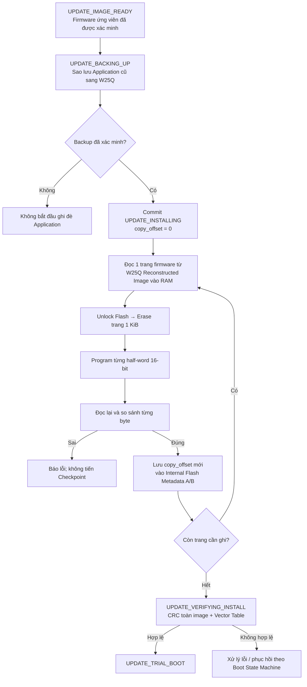

**Bốn ý cần nắm trước khi đọc chi tiết:**

1. **Erase** tác động lên **cả trang 1 KiB**; không thể an toàn coi thao tác này là xóa một byte đơn lẻ.
2. **Program** trong luồng hiện tại thực hiện theo **half-word 16-bit** (2 byte/lần).
3. **Verify** diễn ra **trước** khi tiến độ được lưu bền vững; `copy_offset` chỉ đại diện cho trang đã ghi thành công và được kiểm tra.
4. **CRC32 toàn image và kiểm tra vector** diễn ra sau bước ghi các trang; đây là bước riêng với kiểm tra từng trang.

#### Bước 1. Ràng buộc thao tác ghi Internal Flash trong firmware installer

| Quy tắc của project | Nơi kiểm tra |
|---|---|
| Chỉ ghi trong Application **38 KiB**, bắt đầu `0x08006000` | `shared/include/memory_map.h`, `image_installer.c` |
| Erase theo trang **1 KiB** | `FLASH_ErasePage()` |
| Program theo **half-word 16 bit** | `FLASH_ProgramHalfWord()` |
| Đọc lại và đối chiếu trang trước khi cập nhật tiến độ | `ProgramBufferedApplicationPage()` |
| Không ghi đè Bootloader và Metadata A/B | Kiểm tra phạm vi và các ràng buộc linker |

**Không lặp lại nguyên lý vật lý của Flash tại đây:** Các phần tiếp theo tập trung vào **thứ tự thao tác của installer, cơ chế Verify, Checkpoint và khôi phục sau mất nguồn**.

#### Bước 2. Đọc Memory Map để không xóa nhầm Bootloader hoặc Metadata

Internal Flash của project có bốn vùng quan trọng, theo `shared/include/memory_map.h` và `docs/memory-map.md`:

```text
STM32F103 Internal Flash (64 KiB)

0x08000000  +------------------------------+
            | Bootloader       24 KiB     |
0x08006000  +------------------------------+
            | Application      38 KiB     |  <-- Chỉ vùng này được Install/Rollback
            | 38 trang xóa x 1 KiB       |
0x0800F800  +------------------------------+  <-- End-exclusive của Application
            | Metadata A        1 KiB     |
0x0800FC00  +------------------------------+
            | Metadata B        1 KiB     |
0x08010000  +------------------------------+  <-- End-exclusive của toàn Flash
```

| Vùng | Địa chỉ bắt đầu | Địa chỉ cuối (inclusive) | Dung lượng |
|---|---|---|---:|
| Bootloader | `0x08000000` | `0x08005FFF` | 24 KiB |
| Application | `0x08006000` | `0x0800F7FF` | **38 KiB** |
| Metadata A | `0x0800F800` | `0x0800FBFF` | 1 KiB |
| Metadata B | `0x0800FC00` | `0x0800FFFF` | 1 KiB |

**Cách tính quan trọng khi phỏng vấn:**

- Địa chỉ bắt đầu Application: **`0x08006000`**.
- Dung lượng tối đa Application: **`38 × 1024 = 38.912 bytes`**.
- End-exclusive: **`0x08006000 + 0x9800 = 0x0800F800`**.
- Nếu `page_offset = 0x800`, trang tương ứng bắt đầu tại **`0x08006800`**.
- Với firmware có kích thước không chia hết 1 KiB, trang cuối vẫn là một **trang xóa 1 KiB**, nhưng chỉ lập trình/kiểm tra số byte có dữ liệu thuộc image.

**Quy tắc an toàn:** Kiểm tra `image_size <= APPLICATION_MAX_SIZE`; địa chỉ/offset hợp lệ; không xóa chạm vùng Metadata hoặc Bootloader. Trong code, phải đọc cả `memory_map.h` và nơi **gọi** Flash API, vì chỉ ghi đúng `APPLICATION_START_ADDRESS` chưa đủ nếu kích thước hoặc offset sai.

#### Bước 3. Tại sao phải xác minh firmware và Backup trước khi Erase?

Khi chuẩn bị OTA, Bootloader đã đọc gói **SDOT** ở vùng **Incoming W25Q**, xác thực chữ ký/phần thông tin cần thiết và, nếu là Delta OTA, tái tạo firmware vào **Reconstructed Image**. Chỉ khi image ứng viên được đánh giá hợp lệ mới chuyển sang giai đoạn Backup/Install.

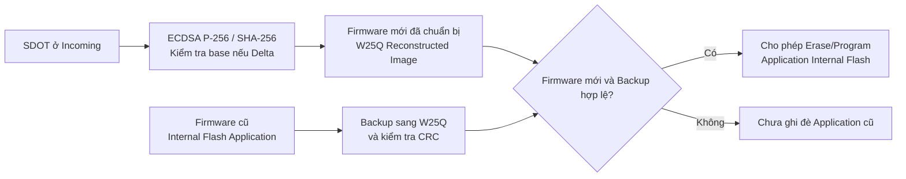

**Tại sao cần thứ tự này?** Khi Erase trang đầu của vùng Application, bản firmware đang chạy cũ **không còn nguyên vẹn**. Do đó phải có bản Backup đủ tin cậy **trước** khi ghi đè. `image_installer.c` xác minh bản Backup rồi mới chuyển Metadata sang `UPDATE_INSTALLING`.

| Điều kiện | Nếu thiếu thì có rủi ro gì? |
|---|---|
| Gói SDOT được xác thực | Có thể cài dữ liệu không được tin cậy / không đúng sản phẩm. |
| Target Image đã được chuẩn bị và kiểm tra | Cài image lỗi, sai base hoặc không tái tạo đầy đủ. |
| Backup hợp lệ | Khi Trial Boot thất bại không có bản firmware cũ đáng tin cậy để Rollback. |
| Metadata tiến độ hợp lệ | Không biết sau Reset phải làm lại trang nào. |

> **Phân biệt:** CRC32 dùng trong Backup/Install giúp phát hiện **sai khác dữ liệu**. Nó **không tự xác thực nguồn phát hành** như chữ ký ECDSA. Không nên dùng “CRC thành công” để thay cho “firmware đã được xác thực”.

#### Bước 4. Erase → Program half-word → Read-back Verify của một trang

Trong repository, `ProgramAndVerifyCandidatePage()` nạp một trang từ nguồn firmware vào **`g_install_page_buffer`**, sau đó gọi `ProgramBufferedApplicationPage()`. Hàm sau thực hiện chuỗi **lưu PRIMASK → tạm vô hiệu hóa IRQ → Unlock → ClearFlag → Erase → Program half-word → Lock → khôi phục PRIMASK → so sánh byte**.

**Các thao tác thực tế có trong source:**

| Thao tác | API / cơ chế | Ý nghĩa |
|---|---|---|
| Giữ trạng thái ngắt | `GetPrimask()` | Sau thao tác có thể trả về đúng trạng thái trước đó. |
| Vô hiệu hóa IRQ trong đoạn Flash | `__disable_irq()` | Tránh xử lý interrupt maskable trong lúc thao tác có tác động lớn đến Flash. |
| Mở Flash controller | `FLASH_Unlock()` | Cho phép Erase/Program. |
| Xóa cờ trạng thái | `FLASH_ClearFlag(...)` | Làm sạch các cờ lỗi/hoàn thành được quản lý. |
| Xóa trang đích | `FLASH_ErasePage(APPLICATION_START_ADDRESS + page_offset)` | Erase đúng trang Application. |
| Ghi dữ liệu | `FLASH_ProgramHalfWord(address, halfword)` | Ghi lần lượt 2 byte. |
| Khóa lại Flash | `FLASH_Lock()` | Tránh giữ bộ điều khiển ở trạng thái mở ghi. |
| Khôi phục trạng thái ngắt | `RestorePrimask(primask)` | Không bật ngắt vô điều kiện nếu trước đó đã bị khóa. |
| Đọc và so sánh | So sánh từng byte với buffer | Xác nhận trang đã lập trình khớp nguồn. |

**Pseudocode để hiểu luồng (không phải source nguyên văn):**

```c
// MÔ PHỎNG KHÁI NIỆM — không dùng thay cho driver của repository.
status_t install_one_page(uint32_t offset, const uint8_t *src,
                          uint32_t actual_length)
{
    // Trước đó: đã kiểm tra bounds/alignment và nạp đúng dữ liệu trang.
    uint32_t addr = APPLICATION_START_ADDRESS + offset;
    uint32_t saved_primask = read_primask();
    disable_maskable_interrupts();
    flash_unlock();

    if (flash_erase_page(addr) != OK) goto flash_error;
    for (uint32_t i = 0; i < actual_length; i += 2U) {
        uint8_t hi = (i + 1U < actual_length) ? src[i + 1U] : 0xFFU;
        uint16_t hw = (uint16_t)src[i] | ((uint16_t)hi << 8U);
        if (flash_program_halfword(addr + i, hw) != OK) goto flash_error;
    }
    flash_lock();
    restore_primask(saved_primask);

    for (uint32_t i = 0; i < actual_length; ++i)
        if (*(volatile const uint8_t *)(addr + i) != src[i]) return VERIFY_FAIL;
    return OK;

flash_error:
    flash_lock();
    restore_primask(saved_primask);
    return FLASH_FAIL;
}
```

**Lưu ý về đoạn minh họa:** Các hàm `flash_erase_page`, `flash_program_halfword`, `read_primask` trong *pseudocode* **không phải tên API thực tế** của STM32 trong repository. Hãy xem `FLASH_ErasePage()` và `FLASH_ProgramHalfWord()` trong `image_installer.c` để biết lệnh thực tế và nhánh lỗi cụ thể.

**Tại sao ghép 2 byte theo thứ tự thấp trước?** Với STM32F103 (little-endian), hai byte trong ảnh firmware được đóng gói vào half-word: byte ở offset `i` là 8 bit thấp, byte ở `i+1` là 8 bit cao. Ví dụ `[0x34, 0x12]` trở thành **`0x1234`**.

**Trang cuối có số byte lẻ thì sao?** Nếu `page_length` lẻ, code lấy **`0xFF` làm byte cao đệm** cho half-word cuối. Vòng so sánh sau khi ghi chỉ so sánh **số byte thực tế của image**. Không được đọc vượt nguồn để lấy byte thứ hai không tồn tại.

> **Phỏng vấn hay hỏi:** Tại sao phải dùng `FLASH_Lock()` và khôi phục PRIMASK cả khi lỗi? Vì lỗi ghi Flash không được để bộ điều khiển ở trạng thái mở và không được vô tình thay đổi chính sách ngắt của Bootloader sau khi trở về.

#### Bước 5. Checkpoint theo trang: cập nhật `copy_offset` lúc nào?

Trong `ResumePageCheckpointedCopy()`, Bootloader dùng `InstallProgress_Validate()`, `InstallProgress_PageLength()` và `InstallProgress_NextCheckpoint()` để chia image thành các trang; **chỉ sau khi** `ProgramAndVerifyCandidatePage()` thành công, nó mới cập nhật `metadata->copy_offset` và gọi `CommitMetadata()`.

Ví dụ một image **2.501 byte** (3 trang xóa, nhưng trang cuối chỉ có 453 byte dữ liệu):

| Bước | `page_offset` trước khi ghi | Dữ liệu ghi thực | `copy_offset` sau Verify + Commit |
|---|---:|---:|---:|
| Trang 1 | 0 | 1.024 byte | 1.024 |
| Trang 2 | 1.024 | 1.024 byte | 2.048 |
| Trang 3 | 2.048 | 453 byte (+ 1 byte đệm khi Program half-word cuối) | **2.501** |

Đây là hai quy tắc về `copy_offset` được mã `install_progress.c` sử dụng:

- **Checkpoint trung gian:** phải nằm đúng **ranh giới trang 1 KiB**.
- **Checkpoint cuối cùng:** có thể bằng **kích thước image thực** và **không cần chia hết 1 KiB**.

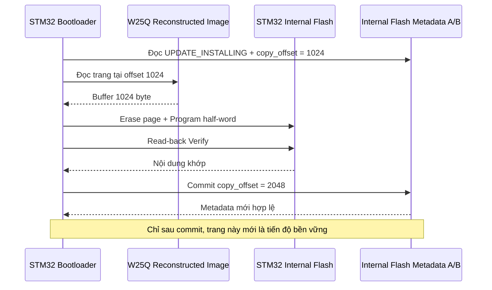

**Phân biệt ba cấp độ xác minh:**

| Cấp | Thời điểm | Cơ chế/ý nghĩa |
|---|---|---|
| **Verify trang** | Sau khi Erase/Program mỗi trang | So sánh byte trong Internal Flash với page buffer. |
| **Verify toàn image đã cài** | Sau khi hoàn tất copy | Kiểm tra CRC của image và hai word vector (MSP/Reset_Handler), kèm kiểm tra Application Jump. |
| **Xác thực an ninh firmware** | Trước Install, ở bước xác thực SDOT | Chữ ký ECDSA P-256 / SHA-256 và kiểm tra điều kiện firmware. |

#### Bước 6. Nếu mất nguồn giữa một trang Flash thì điều gì xảy ra?

Đây là tình huống **quan trọng nhất** khi giải thích Power-loss Recovery trong project.

Ví dụ Bootloader đã hoàn thành **hai trang** và `copy_offset = 2048`. Khi đang Erase hoặc mới Program một phần **trang thứ ba**, thiết bị mất nguồn:

```text
Metadata: UPDATE_INSTALLING, copy_offset = 2048

Trang 1:    [Verified + committed]
Trang 2:    [Verified + committed]
Trang 3:    [Erase/Program dở] <-- MẤT NGUỒN
Trang 4...: [Chưa xử lý]

Sau Reset:
  Bootloader đọc Metadata hợp lệ
     → Boot Decision chọn RESUME_INSTALL
     → Tiếp tục tại offset 2048
     → Erase lại TOÀN BỘ trang 3
     → Program lại trang 3 từ W25Q
     → Verify rồi mới commit offset tiếp theo
```

**Tại sao không Resume đúng byte vừa ghi dở?** Vì tiến độ byte/half-word chưa commit có thể không đáng tin cậy sau mất nguồn. Lặp lại từ **ranh giới trang chưa được xác minh** cho phép xóa sạch phần bị ghi dở và lập trình lại từ bản nguồn đã lưu.

**Tại sao không xóa và ghi lại từ trang 1?** Các trang đã được Verify và được ghi nhận bằng Metadata có thể giữ lại. Cách này tiết kiệm thao tác Flash và thời gian cập nhật, miễn các điều kiện khôi phục và nguồn firmware vẫn hợp lệ.

**Source tương ứng:** `image_installer.c` giữ `copy_offset` ở trang đã xác minh trước đó khi mô phỏng reset trong trang; có các nhánh fault injection như `INSTALL_FAULT_INJECT_OFFSET`/`HIL_FAULT_INSTALL_OFFSET` hỗ trợ kiểm tra trên phần cứng. `BootDecision_Evaluate()` ánh xạ `UPDATE_INSTALLING` sang `BOOT_ACTION_RESUME_INSTALL`.

**Điểm dễ nhầm:** *Power-loss Recovery* không tự động có nghĩa *Rollback*. Nếu vẫn có nguồn candidate hợp lệ và trạng thái cho phép Resume, Bootloader tiếp tục ghi trang chưa hoàn chỉnh. **Rollback** là con đường phục hồi Application cũ khi cần, sử dụng **Backup Image đã xác minh**.

#### Bước 7. Verify toàn image, kiểm tra vector và chuyển sang Trial Boot

Sau khi đã ghi đủ `image_size`, Bootloader chuyển tới `UPDATE_VERIFYING_INSTALL` và chạy xác minh **trên dữ liệu thực tế trong Internal Flash**. Trong hàm `VerifyInstalledApplication()`, code thực hiện các bước:

1. Tính **CRC32** trên số byte của image đã cài, so sánh với `source->image_crc32`.
2. Đọc hai word đầu tại **`APPLICATION_START_ADDRESS`** (Initial MSP và Reset Handler).
3. Kiểm tra vector với `FullImage_ValidateVector()` và `ApplicationJump_Validate()`.
4. Nếu hợp lệ, cho phép tiến tới **`UPDATE_TRIAL_BOOT`**; nếu không, trả trạng thái lỗi tương ứng.

**Tại sao cần cả Verify từng trang lẫn Verify toàn image?** So sánh từng trang phát hiện lỗi cục bộ ngay lúc Program; Verify toàn image kiểm tra kết quả cuối cùng ở mức gói firmware cài đặt và tính khả dụng của vector khởi động. Hai bước bảo vệ hai thời điểm khác nhau.

**Tại sao kiểm tra vector?** Dù byte đã ghi khớp, một image không có MSP/Reset_Handler hợp lệ vẫn không thể Jump an toàn. Xem Chương 6.2 về địa chỉ `0x08006000`, Thumb bit và điều kiện SRAM.

**Cập nhật thành công chưa kết thúc tại đây:** `UPDATE_TRIAL_BOOT` mới là trạng thái **chạy thử**. Application phải **Confirm** để chấp nhận phiên bản mới; nếu thất bại sau các lần thử cho phép thì Bootloader xử lý **Rollback** (Phần 5.5).

#### Bước 8. Metadata A/B cũng phải Erase/Program: khác với ghi Application ở đâu?

Metadata nằm trong **Internal Flash** nhưng có nhiệm vụ khác với firmware image:

| Đặc điểm | Application Image | Metadata A/B |
|---|---|---|
| Vùng | `0x08006000` – `0x0800F7FF` | A: `0x0800F800`; B: `0x0800FC00` |
| Mục đích | Chứa code Application | Lưu state, `copy_offset`, version, generation, CRC32... |
| Đơn vị Erase | 1 KiB/page | Mỗi slot A và B là **một trang 1 KiB** |
| Khi cập nhật | Ghi các trang image ứng viên | Commit bản ghi Metadata mới vào **slot không được chọn** |
| An toàn mất nguồn | Verify trang rồi tiến Checkpoint | Giữ bản Metadata hợp lệ hiện tại cho đến khi bản mới được ghi và kiểm tra |

**Commit Metadata A/B** theo mô tả của repo: đọc hai bản, chọn generation hợp lệ mới nhất, ghi bản mới vào trang cũ/không được chọn, read-back và verify CRC/bytes. Nếu mất nguồn giữa commit, bản được chọn trước đó vẫn có cơ hội tồn tại nguyên vẹn; bản mới ghi dở bị loại do không hợp lệ.

**Giải thích cần phân biệt:** Dù cả hai thao tác đều dùng Internal Flash, việc ghi **Application** thay đổi firmware thực thi, còn việc ghi **Metadata** thay đổi **quyết định boot và tiến độ phục hồi**. Xóa nhầm một trang Metadata có thể làm mất lịch sử cập nhật; xóa nhầm trang Bootloader có thể làm mất đường khởi động. Vì vậy địa chỉ và giới hạn vùng phải là các hằng số/điều kiện rõ ràng.

#### Bước 9. Đọc mã nguồn thật trong repository theo thứ tự nào?

| Thứ tự | File / hàm | Câu hỏi nên tự trả lời |
|---|---|---|
| 1 | `shared/include/memory_map.h` | `APPLICATION_START_ADDRESS`/`APPLICATION_MAX_SIZE` là bao nhiêu? Metadata ở đâu? |
| 2 | `docs/memory-map.md` | Vì sao Application còn 38 KiB, không phải 40 KiB? |
| 3 | `shared/src/install_progress.c` | Offset trung gian được phép có giá trị nào? Trang cuối xử lý thế nào? |
| 4 | `image_installer.c` → `LoadCandidatePage()` | Trang mới lấy từ phân vùng W25Q nào và nạp vào đâu? |
| 5 | `image_installer.c` → `ProgramBufferedApplicationPage()` | Có đúng Unlock → Erase → Program → Lock → Verify không? |
| 6 | `image_installer.c` → `ResumePageCheckpointedCopy()` | `copy_offset` được commit **trước hay sau** khi Verify trang? |
| 7 | `image_installer.c` → `VerifyInstalledApplication()` | Verify CRC và vector ở thời điểm nào? |
| 8 | `docs/metadata-and-boot-decision.md` | Khi reset ở `UPDATE_INSTALLING`, ai chọn `RESUME_INSTALL`? |
| 9 | `node-stm32f103/bootloader/src/boot_manager.c` | Trạng thái đó được điều phối đến nhánh xử lý nào? |

**Đoạn cần tự lần theo khi đọc code:** `ProgramAndVerifyCandidatePage()` → `ProgramBufferedApplicationPage()` → `ResumePageCheckpointedCopy()` → `VerifyInstalledApplication()`; sau đó nối với **Boot State Machine** ở Chương 5.4.

#### Tình huống lỗi thực tế và hướng suy luận

| Hiện tượng | Khả năng cần kiểm tra đầu tiên | Liên hệ source |
|---|---|---|
| `FLASH_ErasePage()` không hoàn tất | Địa chỉ page, lỗi controller, trạng thái khóa/flag | `IMAGE_INSTALLER_FLASH_ERASE_FAILED` |
| `FLASH_ProgramHalfWord()` thất bại | Căn chỉnh, dữ liệu và trạng thái Flash | `IMAGE_INSTALLER_FLASH_PROGRAM_FAILED` |
| Verify một trang sai | Flash vừa ghi không khớp buffer nguồn | `IMAGE_INSTALLER_PAGE_VERIFY_FAILED` |
| CRC toàn image sai | Nội dung ghi cuối cùng khác image nguồn đã chuẩn bị | `IMAGE_INSTALLER_VERIFY_CRC_FAILED` |
| CRC đúng nhưng không Jump | MSP/Reset Handler hoặc điều kiện vector hoặc chuyển quyền điều khiển không hợp lệ | `IMAGE_INSTALLER_VERIFY_VECTOR_FAILED` và Chương 6.2 |
| Reset giữa trang 3 | Trang 3 đang dở, Checkpoint vẫn ở đầu trang 3 | Re-erase/re-program từ `copy_offset` |
| Offset không căn chỉnh ở trang trung gian | Metadata tiến độ không hợp lệ | `InstallProgress_Validate()` |
| Install đủ byte nhưng Application chưa được chấp nhận | Đang ở Trial Boot, chưa Confirm | `UPDATE_TRIAL_BOOT` |
| Nguồn candidate/backup không còn hợp lệ | Không thể Resume/Restore một cách mù quáng | Boot Manager/Installer báo lỗi theo state và chính sách recovery |

> **Lưu ý an toàn khi debug:** Không thử Erase trực tiếp địa chỉ `0x08000000` hoặc các trang `0x0800F800`/`0x0800FC00` trên thiết bị đang chứa firmware quan trọng. Các lệnh thử nghiệm Flash cần dùng vùng thử nghiệm được bảo vệ/ràng buộc đúng địa chỉ và có phương án nạp lại qua SWD.

#### Bài nói khi phỏng vấn: STM32 Internal Flash Programming (khoảng 90 giây)

> Dạ, khi cài firmware mới, STM32 Bootloader của em không ghi thẳng gói SDOT vừa nhận vào Internal Flash. Firmware mới đã được xác thực và chuẩn bị trong vùng Reconstructed Image của External Flash W25Q. Bootloader sao lưu và xác minh Application cũ trước, rồi mới chuyển sang `UPDATE_INSTALLING`.
>
> STM32F103 dùng đơn vị xóa là một trang Internal Flash 1 KiB và đơn vị lập trình là half-word 16-bit. Vì vậy Bootloader đọc dữ liệu firmware mới theo từng trang vào RAM, Unlock Flash, Erase đúng trang Application, Program từng half-word, sau đó Lock và đọc lại để so sánh từng byte.
>
> Khi một trang được ghi và Verify thành công, Bootloader mới lưu `copy_offset` vào Metadata A/B. Nếu thiết bị mất nguồn giữa một trang, sau reset Bootloader đọc Checkpoint và xóa/ghi lại trang chưa hoàn chỉnh thay vì coi nó đã hợp lệ.
>
> Sau khi ghi toàn image, Bootloader kiểm tra CRC32 và vector của Application trong Internal Flash rồi mới cho chạy Trial Boot. Nếu Application xác nhận thành công thì bản cập nhật được chấp nhận; nếu thất bại, hệ thống xử lý Rollback từ Backup đã lưu.

#### Câu hỏi ôn tập: STM32 Internal Flash Programming

| STT | Câu hỏi | Ý chính cần trả lời |
|---:|---|---|
| 1 | Internal Flash khác RAM ở điểm nào? | Flash không mất dữ liệu khi tắt nguồn; ghi/xóa có đơn vị và giới hạn riêng, RAM mất trạng thái sau reset/power-off. |
| 2 | Tại sao Erase trước Program? | NOR Flash không cho phép tùy ý biến bit `0` về `1` bằng Program thông thường. |
| 3 | Đơn vị Erase trên STM32F103 trong project là bao nhiêu? | **1 KiB mỗi trang**. |
| 4 | Đơn vị Program là bao nhiêu? | **Half-word 16-bit**, tương đương 2 byte. |
| 5 | Vì sao không ghi từng byte? | Phải phù hợp đơn vị Program được driver/phần cứng hỗ trợ. |
| 6 | `APPLICATION_START_ADDRESS` là gì? | `0x08006000`. |
| 7 | Application chiếm tối đa bao nhiêu? | **38 KiB**, kết thúc trước `0x0800F800`. |
| 8 | Tại sao phải bảo vệ `0x0800F800`? | Bắt đầu Metadata A; Erase qua ranh giới có thể làm mất trạng thái OTA. |
| 9 | Dữ liệu mới được đọc từ đâu? | **W25Q Reconstructed Image** vào page buffer, trước khi ghi Internal Flash. |
| 10 | Tại sao cần Backup trước Install? | Vì Install ghi đè App cũ; cần bản hợp lệ để Rollback. |
| 11 | `FLASH_Unlock()` và `FLASH_Lock()` có vai trò gì? | Cho phép thao tác ghi rồi khóa lại Flash controller. |
| 12 | Tại sao phải khôi phục PRIMASK? | Giữ nguyên trạng thái maskable interrupt trước thao tác Flash. |
| 13 | Chuyển hai byte thành half-word như thế nào? | Byte thấp ở `i`, byte cao ở `i+1` theo little-endian. |
| 14 | Byte cuối lẻ được xử lý ra sao? | Ghép với byte đệm `0xFF` trước khi Program half-word cuối. |
| 15 | Vì sao Verify ngay sau ghi trang? | Phát hiện lỗi cục bộ trước khi commit Checkpoint. |
| 16 | `copy_offset` được lưu lúc nào? | Chỉ sau khi trang đã ghi và Verify thành công, rồi Metadata commit. |
| 17 | Checkpoint cuối có bắt buộc là bội 1 KiB không? | **Không**; được bằng chính `image_size`. |
| 18 | Mất nguồn giữa trang thì tiếp tục từ đâu? | Từ ranh giới trang chưa được Checkpoint; Erase/Program lại trang đó. |
| 19 | Vì sao Verify toàn image sau khi hoàn tất? | Kiểm tra CRC32 và vector cuối cùng trong Internal Flash. |
| 20 | CRC32 có thay cho chữ ký ECDSA không? | **Không**; CRC phát hiện lỗi dữ liệu, ECDSA xác thực chữ ký. |
| 21 | Verify Installed Image thành công có nghĩa OTA xong chưa? | **Chưa**; cần Trial Boot và Confirm. |
| 22 | Metadata A/B giúp gì nếu mất nguồn trong commit? | Giữ một bản Metadata hợp lệ khác để Bootloader lựa chọn sau reset. |

#### Điểm cần ghi nhớ

1. **Không nhầm Erase 1 KiB của Internal Flash với sector 4 KiB của External Flash W25Q.**
2. **Application chỉ nằm trong `0x08006000`–`0x0800F7FF`**, tuyệt đối không để thao tác cài đặt lấn sang Bootloader/Metadata.
3. **Firmware mới đã được xác thực và chuẩn bị trước khi Install; Backup cũ phải đáng tin cậy trước khi ghi đè.**
4. **Một trang = Erase → Program half-word → read-back Verify**; nếu lỗi, **không tiến `copy_offset`**.
5. **Checkpoint là mốc bền vững**, không phải số byte vừa Program gần nhất trong RAM.
6. **Mất nguồn giữa trang → xóa lại và ghi lại trang đó** theo `copy_offset` đã được lưu; không mặc định Rollback.
7. **Trang cuối có thể ngắn hơn 1 KiB**, và số byte lẻ được đệm bằng `0xFF` khi ghi half-word cuối.
8. **Verify trang ≠ Verify toàn image ≠ xác thực chữ ký SDOT.** Mỗi cấp kiểm tra giải quyết một vấn đề khác nhau.
9. **Install thành công ≠ OTA được Confirm**; còn cần Trial Boot và khả năng Rollback.
10. **Muốn giải thích đúng project, hãy trích dẫn đường đi của hàm trong `image_installer.c`**, không chỉ mô tả các thao tác Flash theo lý thuyết.

#### Các file mã nguồn và tài liệu nên đọc

| File / tài liệu | Vai trò |
|---|---|
| [`docs/memory-map.md`](https://github.com/haikevins/secure-delta-ota-bootloader/blob/main/docs/memory-map.md) | Vùng 24 KiB Bootloader, 38 KiB Application, hai Metadata page 1 KiB. |
| [`shared/include/memory_map.h`](https://github.com/haikevins/secure-delta-ota-bootloader/blob/main/shared/include/memory_map.h) | Hằng số địa chỉ và `INTERNAL_FLASH_PAGE_SIZE`. |
| [`shared/src/install_progress.c`](https://github.com/haikevins/secure-delta-ota-bootloader/blob/main/shared/src/install_progress.c) | Kiểm tra `copy_offset`, tính `PageLength` và `NextCheckpoint`. |
| [`node-stm32f103/bootloader/src/image_installer.c`](https://github.com/haikevins/secure-delta-ota-bootloader/blob/main/node-stm32f103/bootloader/src/image_installer.c) | Nạp page buffer, Erase/Program/Verify, Resume và kiểm tra image sau khi cài. |
| [`docs/metadata-and-boot-decision.md`](https://github.com/haikevins/secure-delta-ota-bootloader/blob/main/docs/metadata-and-boot-decision.md) | Metadata A/B và cách `UPDATE_INSTALLING` chọn `RESUME_INSTALL`. |
| [`docs/boot-state-machine.md`](https://github.com/haikevins/secure-delta-ota-bootloader/blob/main/docs/boot-state-machine.md) | Các state `BACKING_UP`, `INSTALLING`, `VERIFYING_INSTALL`, `TRIAL_BOOT`. |
| [`node-stm32f103/bootloader/src/boot_manager.c`](https://github.com/haikevins/secure-delta-ota-bootloader/blob/main/node-stm32f103/bootloader/src/boot_manager.c) | Điều phối Boot Decision và Image Installer sau reset. |
| [STM32F1 Reference Manual RM0008](https://www.st.com/resource/en/reference_manual/cd00171190-stm32f101xx-stm32f102xx-stm32f103xx-stm32f105xx-and-stm32f107xx-advanced-arm-based-32-bit-mcus-stmicroelectronics.pdf) | Kiến thức nền Flash controller, Page Erase và Half-word Programming của STM32F1. |

> **Tự kiểm tra cuối chương:** Giả sử firmware mới có `image_size = 2501`, thiết bị mất nguồn sau khi ghi **150 byte vào trang thứ ba**, trong khi Metadata vẫn lưu `copy_offset = 2048`. Hãy giải thích: (1) sau reset Bootloader chọn hành động nào, (2) trang nào được Erase lại, (3) vì sao không bắt đầu từ byte thứ 150, (4) lúc nào `copy_offset` trở thành `2501`, và (5) tại sao **Verify Installed Image** vẫn cần thiết sau khi đã Verify từng trang.

---

<a id="chuong-6-4"></a>
### 6.4. W25Q và tầng lưu trữ OTA

#### Sơ đồ tổng quan: Dữ liệu OTA đi qua W25Q như thế nào?

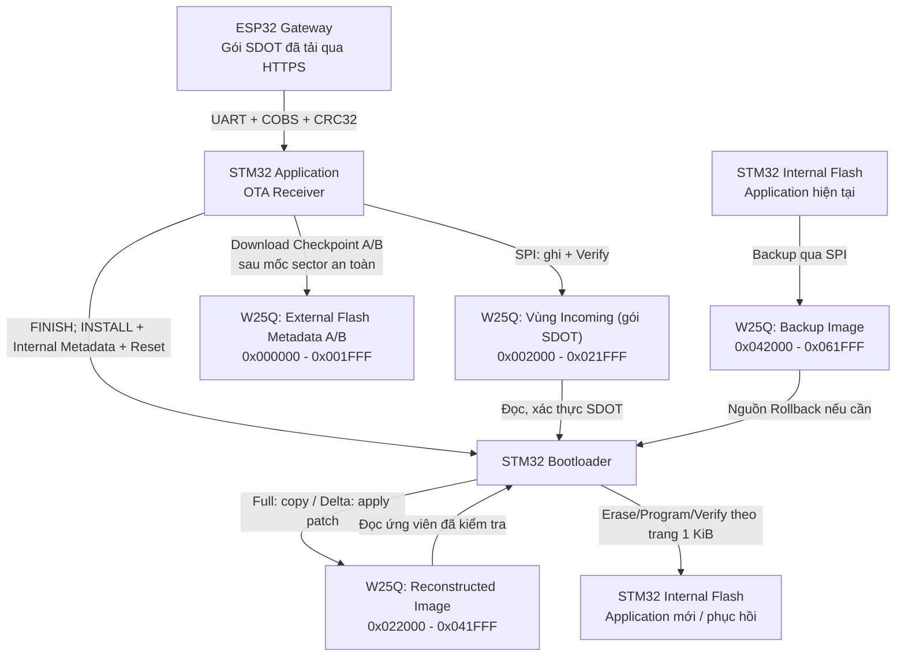

**Bốn nguyên tắc trước khi đọc sâu:**

1. **W25Q là bộ nhớ ngoài, không phải vùng Internal Flash memory-mapped của STM32**: giao tiếp bằng lệnh SPI và địa chỉ W25Q riêng.
2. **Đọc được trực tiếp nhưng không ghi đè tùy ý**: trước khi đổi bit từ `0` thành `1` phải Erase; Page Program chỉ đưa các bit từ `1` thành `0`.
3. **4 KiB ≠ 256 byte**: sector 4 KiB là đơn vị Erase; page 256 byte là ranh giới Program. `ACK` một gói UART không đồng nghĩa với Checkpoint đã lưu bền vững.
4. **Phải chọn đúng phân vùng trước khi thao tác**: driver SPI kiểm tra phạm vi toàn chip; lớp `ExternalFlashStorage_*` còn kiểm tra offset trong **phân vùng**.

#### Bước 1. Xác định đúng chip W25Q, dung lượng, chân nối và chế độ SPI

Trong project, layout logic dành cho **W25Q32 (4 MiB, 32 Mbit, JEDEC `EF 40 16`)**. Driver cũng chấp nhận **W25Q64 (8 MiB, JEDEC `EF 40 17`)** để phát triển trên phần cứng tương thích, nhưng layout OTA vẫn chỉ cho phép sử dụng **4 MiB đầu tiên**. Điều này không có nghĩa các phân vùng tự mở rộng khi cắm W25Q64.

| Thành phần | Giá trị trong repository | Ý nghĩa |
|---|---|---|
| STM32 peripheral | `SPI1` | Master điều khiển W25Q. |
| `SCK` | `PA5` | Xung SPI. |
| `MISO` | `PA6` | W25Q trả dữ liệu về STM32. |
| `MOSI` | `PA7` | STM32 gửi opcode, địa chỉ, dữ liệu. |
| `/CS` | `PB0` | GPIO active-low chọn chip. |
| Chế độ | **SPI Mode 0**, 8-bit, MSB-first | CPOL=0, CPHA=0; software NSS. |
| SPI prescaler | `/4` | Giá trị chia clock trong cấu hình driver, không phải tốc độ MHz cố định. |
| Nguồn | **3.3 V**, GND chung | Không nối tín hiệu 5 V trực tiếp vào thiết bị 3.3 V. |
| `/WP`, `/HOLD` | Giữ HIGH khi dùng chip rời | Tránh vô ý khóa ghi hoặc tạm dừng giao tiếp. |

**Tại sao phải đọc JEDEC ID?** `SpiFlash_Init()` cấu hình GPIO/SPI, dùng lệnh `0x9F` đọc 3 byte ID, chỉ chấp nhận chip tương thích; nếu không nhận dạng được thì trả lỗi và không xem storage là sẵn sàng. Đây là cách tránh tiếp tục Erase/Program khi chip bị thiếu, đứt dây hoặc sai loại. **Không** nên tự kết luận mọi lỗi JEDEC đều do chip hỏng: cần kiểm tra nguồn, `/CS`, SPI mode, wiring và thời điểm clock trước.

**Ví dụ phân biệt:** `EF 40 16` là ba byte ID W25Q32 trong luồng SPI; khi driver ghép thành `uint32_t`, giá trị đọc có dạng `0x00EF4016`. Không được đảo thứ tự byte khi đối chiếu log.

**File cần đọc:** [`spi_flash.c` → `SpiFlash_Init()`, `ReadJedecIdRaw()`, `SpiFlash_IsSupportedJedecId()`](https://github.com/haikevins/secure-delta-ota-bootloader/blob/main/node-stm32f103/common/drivers/spi_flash.c).

#### Bước 2. Những ràng buộc W25Q mà driver phải thực thi

| Thao tác W25Q | Ràng buộc thể hiện trong project |
|---|---|
| `SpiFlash_Read()` | Đọc dữ liệu trong phạm vi chip được chấp nhận. |
| `SpiFlash_Write()` | Chia theo ranh giới **page 256 byte**; không tự Erase; có `PreflightProgrammable()` trước ghi. |
| `SpiFlash_EraseSector()` | Cần địa chỉ căn theo **sector 4 KiB**. |
| Status register | Theo dõi **WIP/WEL** trong quy trình Write Enable và đợi hoàn tất. |
| Storage API | Kiểm tra offset **tương đối trong phân vùng**, tránh tràn qua vùng khác. |

**Điểm cần soi trong mã:** Nếu dữ liệu mới yêu cầu Erase nhưng caller chỉ gọi `SpiFlash_Write()`, driver có thể trả `SPI_FLASH_STATUS_NEEDS_ERASE`; **tầng OTA/storage** chịu trách nhiệm tổ chức lại thao tác theo Checkpoint. Các phần tiếp theo giải thích đường xử lý cụ thể của `spi_flash.c`.

#### Bước 3. Hiểu chuỗi lệnh SPI và vai trò WIP/WEL

Các opcode thực sự được driver sử dụng:

| Opcode | Tên | Vai trò |
|---|---|---|
| `0x9F` | Read JEDEC ID | Nhận diện chip. |
| `0x05` | Read Status Register-1 | Đọc bit trạng thái. |
| `0x06` | Write Enable | Yêu cầu đặt WEL trước ghi/xóa. |
| `0x03` | Read Data | Đọc dữ liệu từ địa chỉ 24-bit. |
| `0x02` | Page Program | Ghi các byte trong **một page**. |
| `0x20` | 4 KiB Sector Erase | Xóa sector được chỉ định. |

**WIP/BUSY** là bit 0 của Status Register-1: `1` nghĩa là chip vẫn bận với thao tác nội bộ; `0` nghĩa là đã sẵn sàng cho bước tiếp. **WEL** là bit 1: `1` nghĩa là latch đã được kích hoạt để cho phép Program/Erase. **WEL không chứng minh rằng dữ liệu đã ghi thành công**; cần đợi WIP hết bận và Verify.

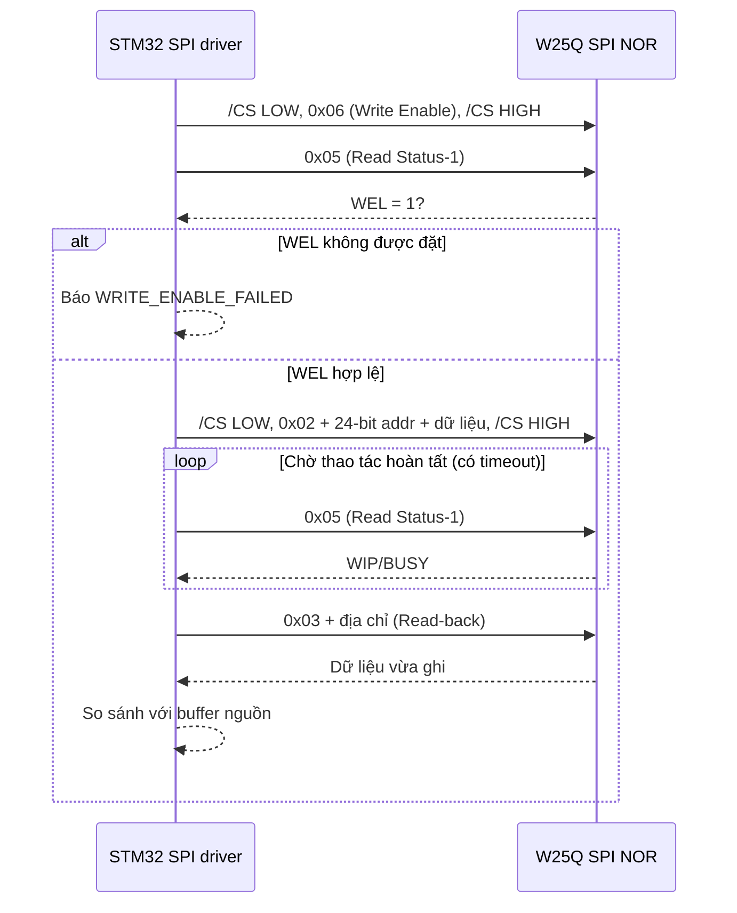

**Lưu ý về `/CS`:** Khi gửi opcode và địa chỉ/dữ liệu của *một transaction*, `/CS` phải ở mức LOW; đưa HIGH để kết thúc transaction. Với Write Enable, driver thực hiện transaction riêng trước lệnh Program/Erase. `/CS` không thể luôn LOW cho mọi lệnh liên tiếp.

**Timeout trong code** là giới hạn số vòng polling (`*_TIMEOUT_LOOPS`), **không được diễn giải thành chính xác số mili giây** vì phụ thuộc CPU/clock/tối ưu hóa. Nếu WIP không trở về 0 trong giới hạn, `WaitReady()` báo `SPI_FLASH_STATUS_BUSY_TIMEOUT`.

#### Bước 4. Phân tích Page Program: chia đúng ranh giới 256 byte và Verify

`SpiFlash_Write(address, data, length)` xử lý theo thứ tự:

1. Kiểm tra đã `Init`, con trỏ, chiều dài và **phạm vi địa chỉ tuyệt đối**.
2. Đọc trước vùng đích bằng `PreflightProgrammable()` để chặn mọi byte cần `0 → 1`.
3. Dùng `ExtFlash_PageChunkLength()` xác định kích thước đoạn **không vượt ranh giới 256 byte**.
4. Gọi `ProgramPageChunk()` cho từng đoạn: `WriteEnable()` → `0x02 + địa chỉ 24-bit + bytes` → `WaitReady()` → `SpiFlash_Verify()`.
5. Chỉ trả thành công khi tất cả các đoạn đều Program và Verify được.

**Ví dụ chạm ranh giới page (mô phỏng đúng quy tắc chia):** bắt đầu tại địa chỉ `0x0000F0`, ghi **40 byte**. Offset trong page là `0xF0 = 240` nên page đầu còn **16 byte**; driver thực hiện 2 đoạn:

```text
Đoạn 1: địa chỉ 0x0000F0, 16 byte → đến 0x0000FF
Đoạn 2: địa chỉ 0x000100, 24 byte → đến 0x000117
```

**Pseudocode (minh họa, không phải mã nguồn chép từ repo):**

```c
bool WriteAcrossPages(uint32_t address, const uint8_t *buffer, uint32_t length)
{
    uint32_t done = 0U;
    while (done < length) {
        uint32_t page_remaining = 256U - ((address + done) & 0xFFU);
        uint32_t chunk = length - done;
        if (chunk > page_remaining) chunk = page_remaining;

        /* Trong code thật: kiểm tra preflight, WEL, status, timeout và verify. */
        if (!ProgramOnePageChunk(address + done, buffer + done, chunk)) return false;
        done += chunk;
    }
    return true;
}
```

`ProgramOnePageChunk()` trong ví dụ là **tên minh họa**; tên hàm thực tế của repo là `ProgramPageChunk()`, còn API gọi từ tầng trên là `SpiFlash_Write()`.

**Vì sao read-back Verify sau mỗi đoạn vẫn chưa đủ để tin tưởng firmware?** Nó chỉ chứng minh dữ liệu lưu khớp dữ liệu đang gửi; **CRC32 toàn SDOT** và **ECDSA P-256/SHA-256** thực hiện ở các bước khác. W25Q không xác thực chữ ký số firmware cho Bootloader.

#### Bước 5. Sector Erase 4 KiB, căn chỉnh địa chỉ và phân biệt Erase Range

`SpiFlash_EraseSector(address)` yêu cầu địa chỉ **được căn chỉnh 4 KiB** (`address % 4096 == 0`) và sector vẫn nằm trong phạm vi chip. Nếu gọi `SpiFlash_EraseSector(0x002100)`, hàm **từ chối**; nó **không lén làm tròn xuống** `0x002000` rồi xóa.

Luồng xóa của driver: validate → `WriteEnable()` và kiểm WEL → gửi `0x20 + 24-bit address` → chờ `WIP=0` có timeout → trả trạng thái. Khác với Page Program, `SpiFlash_EraseSector()` **không tự thực hiện blank-check toàn sector**. Có API riêng `SpiFlash_IsErased()` để đọc và xác nhận các byte đều `0xFF` khi cần.

Ở tầng phân vùng:

- `ExternalFlashStorage_EraseRange(partition, offset, length)` yêu cầu **offset và length là bội số 4 KiB**, đồng thời toàn bộ vùng nằm trong partition; hàm lặp từng sector.
- `ExternalFlashStorage_ErasePartition(partition)` duyệt toàn bộ sector của partition hợp lệ.
- `ExternalFlashStorage_IsErased(partition, offset, length)` gọi xuống driver để kiểm tra vùng trống.

**Ví dụ:** Incoming bắt đầu `0x002000`; xóa một sector đầu bằng `ExternalFlashStorage_EraseRange(INCOMING, 0, 4096)` → xóa địa chỉ `0x002000–0x002FFF`. Nếu yêu cầu xóa từ offset `256`, lớp storage từ chối thay vì tự xóa cả sector.

> **Cảnh báo:** Xóa nhầm sector Metadata hoặc Backup có thể khiến Recovery/Rollback mất dữ liệu. Đừng dùng `ErasePartition()` lên Metadata/Backup như một thao tác “reset” chung khi chưa hiểu trạng thái cập nhật.

#### Bước 6. Đọc bảng phân vùng W25Q: dùng offset tương đối, không nhầm địa chỉ tuyệt đối

**Memory Map triển khai cho không gian `0x000000`–`0x3FFFFF` (4 MiB)**:

| Phân vùng W25Q | Địa chỉ bắt đầu | Địa chỉ kết thúc | Dung lượng | Dữ liệu/ứng dụng |
|---|---:|---:|---:|---|
| External Metadata A | `0x000000` | `0x000FFF` | 4 KiB | Bản ghi bàn giao kiểu cũ + Download Checkpoint A. |
| External Metadata B | `0x001000` | `0x001FFF` | 4 KiB | Bản ghi bàn giao kiểu cũ + Download Checkpoint B. |
| Incoming (gói SDOT) | `0x002000` | `0x021FFF` | 128 KiB | Gói Full/Delta SDOT được nhận từ ESP32. |
| Reconstructed Image | `0x022000` | `0x041FFF` | 128 KiB | Firmware **hoàn chỉnh** chuẩn bị trước Install. |
| Backup Image | `0x042000` | `0x061FFF` | 128 KiB | Bản sao Application đã xác minh + backup header. |
| Update Logs | `0x062000` | `0x071FFF` | 64 KiB | Diagnostics có giới hạn. |
| Reserved | `0x072000` | `0x3FEFFF` | 3636 KiB | Dự trữ, không mặc nhiên dùng OTA. |
| External Flash Self-test | `0x3FF000` | `0x3FFFFF` | 4 KiB | Sector **kiểm thử có xóa phá hủy dữ liệu**. |

**Đặc biệt:** 128 KiB của Backup Image **không có nghĩa** có một image 128 KiB hợp lệ. Layout bên trong phân vùng Backup là:

```text
0x042000 – 0x042FFF : Backup header sector 4 KiB (CRC-protected)
0x043000 – 0x04C7FF : Copy vùng Application 38 KiB
0x04C800 – 0x061FFF : Dự trữ trong Backup partition
```

Tách **header** sang sector riêng giúp nếu mất nguồn giữa commit header, có thể xóa/ghi lại sector `0x042000` mà **không xóa vùng dữ liệu Backup bắt đầu `0x043000`**.

**Khác biệt External Metadata và Internal Metadata:**

| Nhóm | Vị trí | Mục đích |
|---|---|---|
| **External Flash Metadata A/B** | W25Q `0x000000`, `0x001000`, mỗi vùng 4 KiB | Checkpoint nhận UART và bản ghi *bàn giao kiểu cũ*. |
| **Internal Flash Metadata A/B** | STM32 `0x0800F800`, `0x0800FC00`, mỗi vùng 1 KiB | Trạng thái **Boot Decision** quan trọng sau reset, như `UPDATE_ARTIFACT_READY`, `UPDATE_INSTALLING`, `UPDATE_TRIAL_BOOT`. |

Trong **đường cập nhật SDOT ký số mặc định**, lệnh `INSTALL` ghi `UPDATE_ARTIFACT_READY` vào **Internal** Boot Metadata; không được nói rằng chỉ ghi External Metadata là Bootloader tự nhận được yêu cầu cài.

**Trường hợp record cùng sector:** mỗi sector External Metadata dành offset `0x000` cho bản ghi bàn giao kiểu cũ 36 byte và offset `0x100` cho download Checkpoint 40 byte. Vì **Erase là 4 KiB**, lúc commit một loại record, storage layer đọc và giữ lại record còn hợp lệ của loại kia trước khi xóa sector đích. Khi đọc thông tin này hãy nhớ A/B trong External Flash **khác** A/B trong Internal Flash.

#### Bước 7. Tầng lưu trữ bảo vệ phân vùng: `ExternalFlashStorage_*`

Driver `SpiFlash_*` chịu trách nhiệm giao tiếp chip, còn lớp `ExternalFlashStorage_*` nhận `partition + relative offset`. Lớp này tra `g_partitions[]`, kiểm tra offset/length trong phạm vi, tính địa chỉ tuyệt đối và mới gọi SPI driver.

**Ví dụ đúng – ghi 256 byte vào đầu Incoming (minh họa lời gọi API thật, cần dữ liệu đã chuẩn bị và sector đã xóa):**

```c
/* Lời gọi minh họa cách dùng API, không phải trích code của OTA receiver. */
uint8_t packet[256];
/* packet đã được nạp từ dữ liệu nhận và kiểm tra. */
bool ok = ExternalFlashStorage_Write(
    EXTERNAL_FLASH_PARTITION_INCOMING,  /* phân vùng */
    0U,                                /* offset trong phân vùng */
    packet,
    sizeof(packet));
/* Địa chỉ tuyệt đối tương ứng: 0x002000, không phải 0x000000. */
```

**Ví dụ bảo vệ:** vùng Incoming có kích thước `0x20000` (131072 byte). Một yêu cầu `offset=0x1FFF0, length=32` vượt giới hạn thêm 16 byte nên bị `ResolveRange()` từ chối, **không ghi lan sang Reconstructed Image**. Ngay cả khi địa chỉ tuyệt đối vẫn nằm trong chip, nó vẫn **không hợp lệ ở phân vùng Incoming**.

**Các hàm quan trọng:**

| Hàm | Giải thích |
|---|---|
| `ExternalFlashStorage_GetPartition()` | Lấy địa chỉ bắt đầu, dung lượng của partition. |
| `ExternalFlashStorage_Read()` | Đọc dữ liệu trong phạm vi partition. |
| `ExternalFlashStorage_Write()` | Ghi qua driver; **không ngầm Erase**. |
| `ExternalFlashStorage_Verify()` | So sánh với dữ liệu đọc lại. |
| `ExternalFlashStorage_EraseRange()` | Xóa một dải sector đã căn chỉnh 4 KiB. |
| `ExternalFlashStorage_ErasePartition()` | Xóa toàn partition, cần dùng đúng mục đích. |
| `ExternalFlashStorage_IsErased()` | Kiểm tra `0xFF` trên vùng chọn. |

**File cần đọc:** [`external_flash_storage.c`](https://github.com/haikevins/secure-delta-ota-bootloader/blob/main/node-stm32f103/common/storage/external_flash_storage.c), [`ext_flash_layout.c`](https://github.com/haikevins/secure-delta-ota-bootloader/blob/main/shared/src/ext_flash_layout.c) và [`memory_map.h`](https://github.com/haikevins/secure-delta-ota-bootloader/blob/main/shared/include/memory_map.h).

#### Bước 8. STM32 Application nhận SDOT và lưu Checkpoint ở ranh giới sector 4 KiB

Nhận OTA qua UART khác với ghi Flash ngẫu nhiên. Luồng thực tế trong [`ota_receiver.c`](https://github.com/haikevins/secure-delta-ota-bootloader/blob/main/node-stm32f103/application/src/ota_receiver.c) cần xử lý **thứ tự**, **ACK/NACK**, **erase-on-demand** và **resume**:

1. `START` xác nhận thông tin bản cập nhật, kiểm tra giới hạn Incoming, khởi tạo phiên nhận và commit Download Checkpoint.
2. Với `DATA`, Application kiểm tra frame/CRC, `update_id`, `Sequence`, `Offset`.
3. `EnsureIncomingSectorsErased()` xác định sector 4 KiB bị tác động và chỉ xóa sector chưa đánh dấu là đã xóa trong phiên.
4. `ExternalFlashStorage_Write(INCOMING, offset, ...)` ghi vào W25Q; driver chia page và Verify dữ liệu.
5. Sau dữ liệu được xử lý hợp lệ, Application có thể trả `ACK`; khi `next_offset` **đúng ranh giới 4 KiB**, `PersistReceiveBoundaryIfNeeded()` mới commit Checkpoint.
6. Khi reset, Application đọc Download Checkpoint bền vững để biết **offset an toàn**, tái tạo bitmap các sector đã hoàn thành và cho ESP32 `RESUME` từ vị trí đó.
7. `FINISH` tính CRC32 của **toàn bộ Incoming SDOT** và xác nhận đã nhận đủ; `INSTALL` là lệnh riêng để ghi **Internal Boot Metadata** rồi reset.

```mermaid
flowchart TD
    DATA["DATA: offset + payload"] --> CHECK["Kiểm tra ID / Sequence / Offset / CRC"]
    CHECK -->|"Sai"| NACK["NACK / Retry"]
    CHECK -->|"Đúng"| ERASE["Xác định sector 4 KiB<br/>Erase nếu cần"]
    ERASE --> WRITE["Write page chunks 256 B<br/>Read-back Verify"]
    WRITE -->|"Lỗi"| NACK
    WRITE -->|"OK"| BOUND{"next_offset là ranh giới 4 KiB?"}
    BOUND -->|"Có"| PERSIST["Commit Download Checkpoint A/B"]
    BOUND -->|"Không"| ACK["ACK packet"]
    PERSIST --> ACK
    ACK --> NEXT["Tiếp tục DATA / FINISH"]
```

**Ví dụ Resume:** SDOT dài 20 KiB; STM32 đã ACK các packet đến khoảng 10 KiB, nhưng **Checkpoint bền vững gần nhất là 8 KiB**. Mất nguồn khiến byte mới nhận sau Checkpoint không được bảo đảm, dù trước đó có ACK. Khi reset, receiver yêu cầu truyền lại từ **8192**. Sector đang dở cần được xử lý lại đúng chính sách Erase/Write, không được chỉ nối thêm theo offset RAM cũ.

**Phân biệt rõ:** `erased_sector_bitmap` nằm trong **RAM phiên nhận**, còn `DownloadCheckpointRecord` nằm trong **External Flash Metadata A/B**. Khi reset, bitmap có thể được **tái tạo từ số sector hoàn thành** của Checkpoint, không phải do RAM tự giữ được dữ liệu sau mất nguồn.

#### Bước 9. Bootloader sử dụng Reconstructed, Backup và Metadata như thế nào?

| Pha Boot State Machine | Nguồn/đích W25Q | Điều kiện an toàn |
|---|---|---|
| `VERIFYING_CONTAINER` | Đọc **Incoming (gói SDOT)**. | Kiểm tra cấu trúc, chính sách, chữ ký ECDSA và hash liên quan. |
| `VERIFYING_BASE` (Delta) | Đọc firmware gốc từ Internal Application. | Base version/SHA-256 phải đúng trước patch. |
| `PATCHING` | Ghi **Reconstructed Image**. | Full copy payload hoặc Delta tái tạo image; Verify target. |
| `BACKING_UP` | Ghi **Backup Image** từ Internal Application. | Backup theo sector 4 KiB; header/CRC và dữ liệu phải hợp lệ trước khi Install. |
| `INSTALLING` | **Đọc** Reconstructed; ghi **Internal Flash**. | Checkpoint Install **1 KiB**, không dùng nhầm Checkpoint Receive 4 KiB. |
| `ROLLBACK` | **Đọc** Backup; khôi phục **Internal Flash**. | Chỉ phục hồi khi Backup đáng tin cậy; theo tiến độ an toàn. |

**Vì sao phải có ba vùng Incoming/Reconstructed/Backup?** Incoming giữ **gói SDOT chưa được dùng để cài firmware** (đối với Delta đó là *patch*, không phải image hoàn chỉnh). Reconstructed giữ **firmware đích đầy đủ** sau xác minh/tái tạo. Backup giữ **firmware trước đó** để khôi phục nếu Trial Boot thất bại. Gộp cả ba vào một vùng có thể khiến mất nguồn hoặc thao tác Erase làm hỏng nguồn đang cần dùng để phục hồi.

**Cấu trúc Backup:** `BackupImageStorage_CommitHeader()` chỉ Erase header sector, viết record/CRC và đọc lại. Phần Application backup nằm sau offset `0x1000`, nên reset khi commit header có thể xử lý riêng mà không phá bản sao image. Đây là lý do layout dự phòng theo **sector**, không phải chỉ “dành chỗ trống”.

**Đường dữ liệu cần nhớ:** **UART SDOT → W25Q Incoming → Bootloader Verify → W25Q Reconstructed → Backup Internal App vào W25Q → Internal Flash Install → Trial Boot/Confirm hoặc Rollback**.

#### Bước 10. Mất nguồn, xử lý lỗi, self-test và giới hạn kiểm thử

**Mất nguồn khi đang Page Program:** dữ liệu trang hiện tại có thể chưa hoàn chỉnh. Đọc lại/CRC chỉ ra bất nhất; **không được coi page này đã an toàn** nếu Checkpoint chưa commit. Khi Resume, quay về sector an toàn gần nhất theo hợp đồng của receiver.

**Mất nguồn khi Erase sector:** sector đang xóa có thể không còn dữ liệu hợp lệ. Nếu là Incoming chưa Checkpoint, có thể tải và ghi lại; nếu là Backup hoặc Metadata, phải đi qua chính sách recovery của state machine / storage redundant, không tùy tiện coi là `0xFF` toàn sector.

**Mất nguồn khi ghi External Flash Metadata A/B:** code commit vào slot đích và giữ một bản hợp lệ trước đó; hai loại record chia sẻ cùng sector, nên lưu lại record kia khi sector đích bị xóa. Record mới chỉ hợp lệ sau bước đọc lại và kiểm tra CRC/validation. Điều này khác với chỉ ghi một biến trong RAM.

| Hiện tượng | Kiểm tra đầu tiên | Mã/khái niệm liên quan |
|---|---|---|
| `SpiFlash_Init()` thất bại | Nguồn, `/CS`, SPI mode, JEDEC ID | `UNSUPPORTED_DEVICE`, `TRANSFER_TIMEOUT` |
| Erase bị từ chối | Địa chỉ có căn chỉnh 4 KiB? Có nằm trong chip/partition? | `ALIGNMENT_ERROR`, `RANGE_ERROR` |
| Ghi dữ liệu cũ bị từ chối | Có đang yêu cầu đổi `0 → 1` mà chưa Erase? | `SPI_FLASH_STATUS_NEEDS_ERASE` |
| Ghi quá page | Driver có chia page 256 byte? | `ExtFlash_PageChunkLength()` |
| W25Q không hết bận | Trạng thái BUSY/WIP và ngưỡng polling | `SPI_FLASH_STATUS_BUSY_TIMEOUT` |
| Read-back không khớp | Dữ liệu đích, nhiễu tín hiệu, chip/nguồn | `SPI_FLASH_STATUS_VERIFY_FAILED` |
| Ghi Incoming tràn sang Reconstructed | Offset/length vượt giới hạn phân vùng? | `ResolveRange()` phải từ chối |
| ACK đến 10 KiB nhưng Resume 8 KiB | Checkpoint mới chỉ bền vững ở 8 KiB | Receiver `persisted_offset` |
| Backup header lỗi | Chỉ header sector hay dữ liệu Backup cũng lỗi? | `BackupImageStorage_*` |
| Full/Delta xác thực thất bại | Không phải lỗi SPI tất yếu | SDOT Verify (SHA-256/ECDSA) |

**Kiểm thử phần cứng có sẵn trong repo:** tài liệu `docs/external-spi-flash.md` mô tả bài self-test ở sector cuối **`0x3FF000`**: kiểm JEDEC ID → Erase/blank-check → ghi 40 byte từ offset `0xF0` để **cắt qua ranh giới page 256 byte** → Read/Verify → kiểm tra ranh giới partition → Erase/blank-check trở lại. Khi thành công, log có thể chứa `FLASH_SELFTEST_STATUS=0x50415353` và `SPI Flash hardware test: PASS`.

> **Cảnh báo đặc biệt:** Self-test này là **destructive** trong sector `0x3FF000`–`0x3FFFFF`. Chỉ dùng sector đã dành riêng cho test, và khi chạy image self-test cần nạp lại firmware thường theo hướng dẫn repo. Không thử Erase toàn chip hoặc toàn Backup/Metadata chỉ để kiểm tra kết nối.

#### Bài nói khi phỏng vấn: External SPI Flash W25Q (khoảng 90 giây)

> Dạ, trong project Secure Delta OTA Bootloader, em dùng **External SPI NOR Flash W25Q32 4 MiB** làm vùng staging, tái tạo firmware và sao lưu Application. STM32F103 giao tiếp với W25Q bằng **SPI1** trên PA5, PA6, PA7 và dùng PB0 làm chip select. Driver đọc JEDEC ID để xác định chip hợp lệ trước khi cho phép ghi/xóa.
>
> Về nguyên lý, W25Q xóa theo **sector 4 KiB** và lập trình dữ liệu theo các đoạn nằm trong **page 256 byte**. Trước khi Program hoặc Erase, driver gửi Write Enable rồi kiểm tra WEL; sau thao tác, driver polling WIP/BUSY đến khi hoàn thành, có timeout. Khi ghi, driver kiểm tra trước các bit có thể lập trình, chia đúng ranh giới page và đọc lại để Verify; nếu cần chuyển bit từ 0 về 1 thì phải Erase sector trước.
>
> Về phần mềm, em chia W25Q thành các phân vùng **Incoming, Reconstructed, Backup và External Flash Metadata A/B**. STM32 Application nhận gói SDOT từ ESP32 qua UART rồi lưu vào Incoming, có Download Checkpoint theo ranh giới sector 4 KiB để Resume khi reset. Bootloader xác thực SDOT, chuẩn bị image trong Reconstructed, sao lưu firmware cũ vào Backup rồi mới ghi Internal Flash. Như vậy W25Q giúp tách khâu nhận firmware khỏi khâu cài đặt, hỗ trợ Power-loss Recovery và Rollback mà không xóa sớm Application đang chạy.

#### Câu hỏi ôn tập: External SPI Flash W25Q

| STT | Câu hỏi | Ý chính cần trả lời |
|---:|---|---|
| 1 | W25Q trong project là Flash loại gì? | **External SPI NOR Flash**, không phải Internal Flash của STM32. |
| 2 | Dung lượng layout W25Q32 là bao nhiêu? | **4 MiB (32 Mbit)**, địa chỉ `0x000000`–`0x3FFFFF`. |
| 3 | W25Q64 có chạy được không? | Driver chấp nhận JEDEC W25Q64 cho phát triển; layout OTA vẫn chỉ dùng **4 MiB đầu**. |
| 4 | STM32 kết nối W25Q bằng chân nào? | SPI1: **PA5 SCK, PA6 MISO, PA7 MOSI, PB0 /CS**. |
| 5 | SPI Mode của driver là gì? | Mode 0, 8-bit, MSB-first, software NSS, prescaler `/4`. |
| 6 | `0x9F` dùng để làm gì? | Read JEDEC ID để xác định chip. |
| 7 | `0x06` dùng để làm gì? | Write Enable; sau đó kiểm tra WEL. |
| 8 | `0x05` dùng để làm gì? | Đọc Status Register-1 để kiểm WIP và WEL. |
| 9 | WIP/BUSY khác WEL thế nào? | WIP = chip đang bận; WEL = latch cho phép write/erase. |
| 10 | Vì sao Erase trước khi ghi lại? | Program NOR không biến bit `0` thành `1`. |
| 11 | Đơn vị Erase nhỏ dùng trong repo là bao nhiêu? | Sector **4 KiB**, opcode `0x20`. |
| 12 | Đơn vị/ràng buộc Program? | Page **256 byte**; mỗi lệnh không vượt ranh giới page. |
| 13 | Ghi 40 byte từ `0xF0` chia thế nào? | **16 byte** ở page đầu + **24 byte** ở page sau. |
| 14 | `SpiFlash_Write()` có tự Erase không? | **Không**; preflight từ chối nếu cần `0 → 1`. |
| 15 | Vì sao cần `PreflightProgrammable()`? | Phát hiện byte không thể lập trình trước khi bắt đầu ghi dữ liệu. |
| 16 | Sau Program driver làm gì? | Chờ WIP hết bận rồi **read-back Verify**. |
| 17 | `SpiFlash_EraseSector(0x002100)` sẽ thế nào? | Bị từ chối vì không căn chỉnh 4 KiB; không âm thầm làm tròn. |
| 18 | Tại sao cần `ExternalFlashStorage_*`? | Giới hạn thao tác trong partition, tránh ghi tràn vùng khác. |
| 19 | Incoming khác Reconstructed thế nào? | Incoming chứa **SDOT**, Reconstructed chứa **Target Image hoàn chỉnh**. |
| 20 | Backup lưu những gì? | Header riêng và bản copy vùng Application đã xác minh. |
| 21 | Vì sao header Backup nằm sector riêng? | Có thể Erase/commit lại header mà không xóa dữ liệu Backup. |
| 22 | Checkpoint nhận OTA lưu ở đâu? | **External Flash Metadata A/B W25Q**, offset `0x100` trong mỗi sector Metadata. |
| 23 | Internal Flash Metadata A/B khác External Flash Metadata A/B ra sao? | Internal quyết định Boot State Machine; External phục vụ download Checkpoint và bản ghi bàn giao kiểu cũ. |
| 24 | Vì sao ACK 10 KiB vẫn Resume từ 8 KiB? | ACK phiên truyền ≠ Checkpoint bền vững; receiver lưu mốc mỗi sector 4 KiB. |
| 25 | Mất nguồn giữa Page Program cần làm gì? | Không tin dữ liệu dở; phục hồi từ Checkpoint và re-erase/rewrite vùng chưa hoàn tất khi phù hợp. |
| 26 | Check Verify của W25Q có thay ECDSA không? | **Không**; Read-back/CRC là kiểm tra lỗi, ECDSA là xác thực chữ ký SDOT. |
| 27 | Sector cuối được dùng làm gì? | **Self-test destructive** ở `0x3FF000`–`0x3FFFFF`. |
| 28 | WIP timeout có đảm bảo biết Flash hỏng hay không? | Không; báo thao tác chưa hoàn tất theo ngưỡng polling, cần kiểm tra nguồn, clock, chip và tình trạng giao tiếp. |

#### Điểm cần ghi nhớ

1. **W25Q32 4 MiB** là layout chuẩn; **W25Q64** được chấp nhận nhưng không tăng dung lượng layout OTA.
2. **SPI1 PA5/PA6/PA7, PB0 /CS, Mode 0** là cấu hình của project.
3. **Page 256 byte để Program; sector 4 KiB để Erase; Internal STM32 lại xóa trang 1 KiB và Program half-word 16-bit.**
4. **WEL cho phép ghi, WIP/BUSY cho biết đang bận**; cần timeout và Verify trước khi tin dữ liệu.
5. **`SpiFlash_Write()` không tự Erase, không tùy ý chuyển `0 → 1`**; preflight bảo vệ trước khi Program.
6. **Không bao giờ để một Page Program vượt ranh giới 256 byte**; dùng `ExtFlash_PageChunkLength()`.
7. **Các thao tác storage dùng partition + relative offset**; kiểm tra toàn chip chưa đủ để ngăn ghi lan giữa Incoming/Reconstructed/Backup.
8. **External Flash Metadata A/B ≠ Internal Flash Metadata A/B**. SDOT ký số dùng Internal Metadata để bàn giao `INSTALL`.
9. **ACK packet ≠ Checkpoint bền vững**. Download Resume theo mốc sector 4 KiB đã lưu và được xác thực.
10. **Incoming (SDOT) ≠ Reconstructed (firmware mới) ≠ Backup (firmware cũ)**: chia vùng để có nguồn phục hồi độc lập.
11. **Backup header nằm sector riêng** để một lần commit lỗi không xóa nội dung image backup.
12. **Không dùng sector self-test hoặc ErasePartition bừa bãi trên dữ liệu quan trọng**; toàn bộ quy trình phải tôn trọng Boot State Machine.

#### Các file mã nguồn và tài liệu nên đọc

| File / tài liệu | Vai trò và câu hỏi nên tự trả lời |
|---|---|
| [`docs/external-spi-flash.md`](https://github.com/haikevins/secure-delta-ota-bootloader/blob/main/docs/external-spi-flash.md) | Cấu hình SPI, opcode, tính năng bảo vệ và bài self-test. |
| [`docs/memory-map.md`](https://github.com/haikevins/secure-delta-ota-bootloader/blob/main/docs/memory-map.md) | Địa chỉ, kích thước của từng vùng W25Q; Backup header và image copy. |
| [`shared/include/memory_map.h`](https://github.com/haikevins/secure-delta-ota-bootloader/blob/main/shared/include/memory_map.h) | `EXT_FLASH_SIZE`, `EXT_FLASH_PAGE_SIZE`, `EXT_FLASH_SECTOR_SIZE` và các base address. |
| [`shared/src/ext_flash_layout.c`](https://github.com/haikevins/secure-delta-ota-bootloader/blob/main/shared/src/ext_flash_layout.c) | Kiểm tra range, alignment và chia Page Chunk. |
| [`node-stm32f103/common/drivers/spi_flash.c`](https://github.com/haikevins/secure-delta-ota-bootloader/blob/main/node-stm32f103/common/drivers/spi_flash.c) | `SpiFlash_Init/Read/Write/EraseSector/Verify/IsErased`; WEL/WIP, preflight và timeout. |
| [`node-stm32f103/common/storage/external_flash_storage.c`](https://github.com/haikevins/secure-delta-ota-bootloader/blob/main/node-stm32f103/common/storage/external_flash_storage.c) | Partition wrapper, `ResolveRange()`, Erase Range và ngăn truy cập chéo partition. |
| [`node-stm32f103/application/src/ota_receiver.c`](https://github.com/haikevins/secure-delta-ota-bootloader/blob/main/node-stm32f103/application/src/ota_receiver.c) | `EnsureIncomingSectorsErased()`, `PersistReceiveBoundaryIfNeeded()` và Resume. |
| [`node-stm32f103/common/storage/download_checkpoint_storage.c`](https://github.com/haikevins/secure-delta-ota-bootloader/blob/main/node-stm32f103/common/storage/download_checkpoint_storage.c) | Commit Checkpoint A/B, CRC và giữ bản ghi bàn giao kiểu cũ khi xóa sector. |
| [`node-stm32f103/common/storage/update_handoff_storage.c`](https://github.com/haikevins/secure-delta-ota-bootloader/blob/main/node-stm32f103/common/storage/update_handoff_storage.c) | Bản ghi bàn giao kiểu cũ, bảo toàn Checkpoint đang chia sẻ sector. |
| [`node-stm32f103/common/storage/backup_image_storage.c`](https://github.com/haikevins/secure-delta-ota-bootloader/blob/main/node-stm32f103/common/storage/backup_image_storage.c) | Backup header/data riêng sector; Validate và Verify khi commit. |
| [`docs/boot-state-machine.md`](https://github.com/haikevins/secure-delta-ota-bootloader/blob/main/docs/boot-state-machine.md) | Liên hệ Incoming → Reconstructed → Backup → Install → Rollback. |
| [Winbond W25Q32JV Datasheet – trang sản phẩm](https://www.winbond.com/hq/product/code-storage-flash-memory/serial-nor-flash/?__locale=en&partNo=W25Q32JV) | Nguồn tham khảo kiến thức phần cứng, timings, status register và opcode (ngoài repository). |

> **Tự kiểm tra cuối chương:** Giả sử STM32 đang nhận SDOT 20 KiB. Sau khi ACK đến **10 KiB**, mất nguồn; Checkpoint bền vững vẫn ở **8 KiB**. Hãy giải thích (1) W25Q đã lưu những gì và dữ liệu nào được tin, (2) vì sao phải Resume từ 8192 thay vì 10240, (3) sector Incoming nào có thể phải Erase lại, (4) vì sao driver `SpiFlash_Write()` không thể tự ghi đè sector đó nếu đang chứa byte `0`, (5) External Flash Metadata A/B khác Internal Flash Metadata A/B ra sao, và (6) lúc nào Bootloader mới được phép cài image mới vào STM32 Internal Flash.

---

<a id="chuong-6-5"></a>
### 6.5. Giao thức truyền OTA qua UART

#### Sơ đồ tổng quan: Từ gói SDOT trong ESP32 đến bàn giao Bootloader

```mermaid
sequenceDiagram
    autonumber
    participant G as ESP32 Gateway
    participant A as STM32 Application
    participant W as External Flash W25Q
    participant M as Internal Flash Metadata A/B
    participant B as STM32 Bootloader
    G->>A: HELLO / QUERY
    A-->>G: Phiên bản, capability, state, offset
    alt Bắt đầu bản cập nhật mới
        G->>A: START(update_id, size, crc32, version...)
        A-->>G: ACK(next_expected_offset = 0)
    else Tiếp tục bản cập nhật phù hợp
        G->>A: RESUME(update_id, identity)
        A-->>G: ACK(offset bền vững)
    end
    loop Từng DATA packet tối đa 256 B
        G->>A: COBS(DATA + CRC32) + 0x00
        A->>A: Decode, CRC32, sequence, offset
        A->>W: SPI write + read-back verify
        A-->>G: ACK(next_expected_offset) / NACK
    end
    opt Qua mốc sector 4 KiB an toàn
        A->>W: Lưu Download Checkpoint A/B
    end
    G->>A: FINISH
    A->>W: Kiểm tra size và CRC32 toàn SDOT
    A-->>G: ACK(ARTIFACT_READY)
    G->>A: INSTALL
    A->>M: Commit UPDATE_ARTIFACT_READY
    A-->>G: ACK
    A->>B: Reset MCU
    B->>W: Đọc SDOT, xác thực ECDSA/SHA-256
    B->>B: Full/Delta, Backup, Install, Trial Boot
```

**Bốn nguyên tắc quan trọng:**

1. **UART chỉ mang luồng byte**; ranh giới packet và ý nghĩa lệnh do **COBS + protocol** xác định.
2. **CRC32 có hai mức khác nhau**: CRC của **mỗi packet** để phát hiện lỗi truyền và CRC của **toàn bộ gói SDOT** trước `FINISH`. Cả hai **không thay thế ECDSA**.
3. **ACK không đồng nghĩa với Checkpoint bền vững**. Một packet có thể đã ACK, nhưng sau mất nguồn STM32 vẫn yêu cầu truyền lại từ mốc sector 4 KiB trước đó.
4. **`FINISH` khác `INSTALL`**: nhận đủ gói SDOT mới chỉ đạt `ARTIFACT_READY` ở runtime; `INSTALL` mới lưu trạng thái bàn giao vào **Internal Flash Metadata A/B** và reset để Bootloader xác thực/cài đặt.

#### Bước 1. Cấu hình UART được sử dụng trong OTA (không ôn lý thuyết UART)

| Đầu nối | Cấu hình của project |
|---|---|
| STM32 Application | **USART1**, PA9 (TX), PA10 (RX) |
| ESP32 Gateway | **UART2**, GPIO17 (TX), GPIO16 (RX) mặc định |
| Thông số truyền | **115200, 8-N-1**, không RTS/CTS |
| Ghép nối | ESP32 TX → STM32 RX; STM32 TX → ESP32 RX; GND chung |

**Điểm kiểm tra khi đọc code/debug:** Hai bên phải thống nhất UART settings; nhưng **ranh giới OTA packet là của COBS + byte `0x00`**, không phải ranh giới byte UART. Nội dung đáng học sâu trong chương này là **lệnh OTA, framing, CRC32, ACK/NACK, Retry, FINISH/INSTALL, Resume và các lỗi trạng thái**.

#### Bước 2. Đóng khung UART bằng COBS + ký tự phân tách `0x00`

UART tạo ra **chuỗi byte liên tục**, không tự cung cấp ranh giới giữa `HELLO`, `DATA` hay `ACK`. Nếu chỉ chờ timeout giữa các byte để đoán khung, việc chia packet sẽ phụ thuộc tốc độ và độ trễ xử lý.

**Thiết kế repo:** Mỗi raw packet được **COBS encode**, sau đó thêm **một byte `0x00`**:

```text
Raw packet (header | payload | CRC32)
            |
            v
      COBS encode
            |
            v
Các byte đã mã hóa (không có 0x00 bên trong) + byte phân tách 0x00
            |
            v
         UART TX
```

**COBS (Consistent Overhead Byte Stuffing)** biểu diễn dữ liệu để **byte `0x00` không xuất hiện bên trong encoded frame**. Vì vậy, bên nhận gặp `0x00` sẽ biết frame hiện tại kết thúc; sau đó mới decode COBS thành raw packet.

```text
UART RX stream:
[COBS(packet A)][00][COBS(packet B)][00][COBS(packet C)][00]
                 ^                    ^                    ^
          ranh giới frame       ranh giới frame       ranh giới frame
```

| Trường hợp | Hành động phù hợp |
|---|---|
| Nhận byte khác `0x00` | Gom vào frame buffer, kiểm tra giới hạn bộ đệm. |
| Nhận `0x00` | Kết thúc frame, COBS decode, rồi parse/verify packet. |
| COBS decode lỗi | Bỏ frame hiện tại; tiếp tục chờ byte phân tách `0x00` tiếp theo. |
| Buffer vượt giới hạn | Từ chối/bỏ frame, tránh tràn bộ nhớ. |
| Mất vài byte giữa frame | Thường khiến CRC hoặc COBS lỗi; phân tách lại tại `0x00`. |
| Inter-byte timeout | Có thể xóa frame đang dở; **không phải cơ chế framing chính**. |

**Giới hạn có trong protocol:** `OTA_MAX_ENCODED_FRAME = 320` byte, được chọn cho packet có **payload tối đa 256 byte**. Buffer này chứa frame ở tầng UART; nó **không đồng nghĩa** gói SDOT tối đa 320 byte.

**Pseudocode minh họa – bộ gom frame phía nhận** (không sao chép code repo):

```c
/* Pseudocode: phải có kiểm tra giới hạn, timeout và trạng thái đồng bộ. */
void on_uart_byte(uint8_t byte)
{
    if (byte != 0x00) {
        if (frame_length >= OTA_MAX_ENCODED_FRAME) {
            discard_partial_frame();
            return;
        }
        frame_buffer[frame_length++] = byte;
        return;
    }

    if (frame_length == 0) {  /* frame rỗng: bỏ qua */
        return;
    }
    if (cobs_decode(frame_buffer, frame_length, raw_buffer, &raw_length)) {
        process_raw_ota_packet(raw_buffer, raw_length);
    }
    frame_length = 0;
}
```

> **Phân biệt:** **COBS đóng khung**, **CRC32 phát hiện lỗi dữ liệu**, **`Sequence`/`Offset` kiểm soát thứ tự và vị trí**, **ECDSA xác thực gói firmware**. Không cơ chế nào tự thay thế toàn bộ các cơ chế khác.

#### Bước 3. Phân tích cấu trúc packet OTA v1: Header, Payload, CRC32

Một raw packet bao gồm **header cố định 16 byte**, **payload 0–256 byte**, và **packet CRC32 4 byte**. Vì vậy raw packet dài **20–276 byte** (trước khi mã hóa COBS và thêm byte phân tách `0x00`).

```text
+------------------------------+
| Magic            2 byte      | Offset 0   : 0xA55A
+------------------------------+
| Protocol Version 1 byte      | Offset 2   : 1
+------------------------------+
| Command          1 byte      | Offset 3
+------------------------------+
| Update ID        4 byte      | Offset 4
+------------------------------+
| Offset           4 byte      | Offset 8
+------------------------------+
| Sequence         2 byte      | Offset 12
+------------------------------+
| Payload Length   2 byte      | Offset 14  : 0..256
+------------------------------+
| Payload          N byte      | Offset 16  : 0..256 byte
+------------------------------+
| Packet CRC32     4 byte      | Offset 16+N
+------------------------------+
```

| Trường | Mục đích | Nếu không kiểm tra sẽ xảy ra gì? |
|---|---|---|
| `magic = 0xA55A` | Nhận diện loại khung OTA | Có thể parse nhầm byte rác thành packet. |
| `protocol_version = 1` | Kiểm soát tính tương thích | Hai đầu có thể hiểu sai format. |
| `command` | Chọn hành động `DATA`, `START`, `ACK`... | Gọi nhầm thao tác ở sai trạng thái. |
| `update_id` | Gắn packet với đúng phiên cập nhật | Trộn dữ liệu hai release khác nhau. |
| `offset` | Vị trí byte trong toàn bộ gói SDOT | Ghi sai địa chỉ Incoming hoặc thiếu/đè dữ liệu. |
| `sequence` | Theo dõi thứ tự packet | Không phát hiện packet ngoài thứ tự phù hợp. |
| `payload_length` | Số byte payload theo packet | Đọc tràn bộ đệm hoặc tính CRC sai. |
| `payload` | Nội dung lệnh hoặc bytes của SDOT | Nguồn dữ liệu chính của OTA. |
| `packet_crc32` | Phát hiện lỗi raw packet | Có thể chấp nhận packet bị biến dạng. |

**Byte order và serialization:**

- Các số nhiều byte trên dây theo **little-endian**, kể cả CRC32.
- Các trường được **serialize tuần tự từng trường**, **không** gửi thẳng `sizeof(struct)` của C: compiler có thể thêm padding và layout trên hai nền tảng không bắt buộc giống nhau.
- CRC32 tính trên raw bytes từ **`magic` đến byte cuối payload**; **không** tính lên chính trường CRC hoặc encoded COBS.
- Các packet `ACK`, `NACK`, `START`... vẫn dùng cùng **header + CRC32**; chỉ **ý nghĩa payload** thay đổi.

**Ví dụ giải mã một packet có `N = 3`:**

```text
Raw length = 16 + 3 + 4 = 23 byte

magic                 = 0xA55A
protocol_version      = 1
command               = DATA (0x11)
update_id             = 123
sequence              = 0
offset                = 0
payload_length        = 3
payload               = AA BB CC   (dữ liệu minh họa, không phải SDOT hoàn chỉnh)
packet_crc32          = CRC32(raw byte từ magic đến CC)

Wire = COBS(raw packet) + 0x00
```

**Pseudocode minh họa – thứ tự kiểm tra** (không phải API thực tế):

```c
if (raw_size < OTA_PACKET_HEADER_SIZE + OTA_PACKET_CRC_SIZE) reject();
if (read_le16(raw + 0) != 0xA55A) reject();
if (raw[2] != 1) reject();
uint16_t length = read_le16(raw + 14);
if (length > 256) reject();
if (raw_size != 16U + length + 4U) reject();
uint32_t crc_rx = read_le32(raw + 16U + length);
if (crc32(raw, 16U + length) != crc_rx) nack(PACKET_CRC_ERROR);
/* Chỉ sau đó mới kiểm tra command, state, update_id, sequence, offset. */
```

**Câu hỏi thường gặp:** Có COBS rồi thì tại sao vẫn cần CRC32? Vì **COBS không chứng minh nội dung không bị hỏng**; nó chỉ giúp khôi phục ranh giới frame và giải mã. Ngược lại CRC32 không cho biết **packet kết thúc ở đâu** nếu không có framing.

#### Bước 4. Hiểu các lệnh HELLO, QUERY, START, DATA, FINISH và INSTALL

Protocol có **các lệnh điều khiển** và **lệnh dữ liệu**. Khi giải thích trong phỏng vấn, nên đi theo **trình tự thực thi**, không chỉ đọc danh sách command.

| Code | Lệnh | Hướng chính | Chức năng |
|---|---|---|---|
| `0x01` | `HELLO` | Gateway → STM32 | Kiểm tra phiên bản protocol và capabilities. |
| `0x02` | `QUERY` | Gateway → STM32 | Lấy trạng thái, firmware version, tiến độ. |
| `0x10` | `START` | Gateway → STM32 | Bắt đầu phiên nhận gói SDOT. |
| `0x11` | `DATA` | Gateway → STM32 | Chuyển các đoạn SDOT. |
| `0x12` | `FINISH` | Gateway → STM32 | Yêu cầu kiểm tra toàn bộ gói SDOT đã nhận. |
| `0x13` | `ABORT` | Gateway → STM32 | Hủy phiên nhận OTA theo trạng thái cho phép. |
| `0x14` | `RESUME` | Gateway → STM32 | Tiếp tục phiên phù hợp sau gián đoạn. |
| `0x20` | `INSTALL` | Gateway → STM32 | Lưu thông tin bàn giao bền vững rồi reset để chạy Bootloader. |
| `0x21` | `STATUS` | Hai chiều | Hỏi/công bố trạng thái chi tiết. |
| `0x22` | `CONFIRM` | Gateway → STM32 (tùy chọn) | Xác nhận trial image qua Application đang chạy; có cả nhánh tự xác nhận cục bộ. |
| `0x70` | `ACK` | STM32 → Gateway | Lệnh được xử lý/chấp nhận. |
| `0x71` | `NACK` | STM32 → Gateway | Lệnh bị từ chối, có status code. |

**HELLO / QUERY trả về thông tin gì?**

| Trường | Ý nghĩa |
|---|---|
| `protocol_version`, `bootloader_version`, `application_version` | Tương thích protocol và phiên bản đang chạy. |
| `product_id`, `hardware_revision` | Nhận diện sản phẩm/phần cứng. |
| `capability_flags` | Hỗ trợ Full OTA, Delta OTA, Resume, Signature Verify, Rollback. |
| `update_state`, `last_status` | Trạng thái nhận hoặc lỗi gần nhất. |
| `active_update_id` | Định danh phiên đang nhận. |
| `next_expected_offset` | Byte offset cần gửi tiếp. |
| `expected_artifact_size` | Kích thước SDOT mà STM32 đang chờ. |

Protocol quy định kích thước **HELLO/QUERY response payload là 37 byte**. Những thông tin này giúp Gateway quyết định có cần **START_NEW**, **RESUME**, **INSTALL_READY**, **WAIT_TARGET**, hoặc xử lý phiên không tương thích, thay vì gửi DATA ngay khi kết nối.

**START yêu cầu thông tin nào?** Payload dài **24 byte**, bao gồm: `artifact_type` (1 = Full, 2 = Delta), `container_format_version`, `base_version`, `target_version`, `artifact_size`, `artifact_crc32`, `container_header_size` và trường reserved. Gateway còn gắn `update_id` ở **header chung**.

```mermaid
flowchart TD
    Q["HELLO / QUERY"] --> CHECK{"STM32 đang ở trạng thái nào?"}
    CHECK -->|"IDLE, chưa có phiên phù hợp"| START["START phiên mới"]
    CHECK -->|"RECEIVING, identity phù hợp"| RESUME["RESUME tại offset bền vững"]
    CHECK -->|"ARTIFACT_READY đúng gói"| INSTALL["INSTALL, không truyền lại DATA"]
    CHECK -->|"Đang Bootloader xử lý"| WAIT["Chờ / theo dõi kết quả"]
    CHECK -->|"Phiên khác"| POLICY["Xử lý mismatch / abort theo policy"]
    START --> DATA["DATA → ACK/NACK"]
    RESUME --> DATA
    DATA --> FINISH["FINISH: kích thước + CRC gói SDOT"]
    FINISH --> INSTALL
```

> **Không nhầm trạng thái:** `ARTIFACT_READY` sau `FINISH` là trạng thái **runtime của STM32 Application**. `UPDATE_ARTIFACT_READY` là trạng thái **Internal Metadata** được ghi khi `INSTALL`. Trong các trạng thái Bootloader đang xử lý firmware, **không có Application UART receiver chạy để nhận lệnh OTA bình thường**.

#### Bước 5. Xử lý DATA: Sequence, Offset, Update ID và ghi W25Q trước khi ACK

Sau `START`, ESP32 chia **SDOT đã lưu trong Flash cache** thành các DATA packet **1–256 byte** (gói cuối có thể ngắn hơn). Với mỗi packet, STM32 Application phải kiểm tra đầy đủ trước khi ghi vào vùng **Incoming** của W25Q.

**Quy tắc receiver từ protocol:**

1. **Decode COBS** và kiểm tra packet format/CRC32.
2. So `update_id` với phiên nhận hiện hành.
3. `offset` phải bằng `next_expected_offset` (ngoại lệ có quy tắc duplicate hợp lệ).
4. `sequence` bắt đầu từ `0`, tăng từng packet và quay vòng theo **modulo 65536**.
5. Kiểm tra `payload_length` và phạm vi ghi **Incoming Partition**; không ghi qua partition khác.
6. Ghi dữ liệu vào W25Q bằng SPI rồi **đọc lại/kiểm chứng** dữ liệu đã lưu.
7. Chỉ sau khi ghi/verify thành công mới trả **ACK** kèm offset tiếp theo; nếu thất bại trả **NACK** với mã lỗi phù hợp.

```mermaid
flowchart TD
    RX["Nhận DATA frame"] --> FRAME["COBS decode + raw length"]
    FRAME --> CRC{"Packet CRC32 hợp lệ?"}
    CRC -->|Không| NCRC["NACK: PACKET_CRC_ERROR"]
    CRC -->|Có| ID{"update_id, sequence, offset đúng?"}
    ID -->|Không, không phải duplicate| NSEQ["NACK: WRONG_SEQUENCE / WRONG_OFFSET / UPDATE_ID_MISMATCH"]
    ID -->|Duplicate hợp lệ| DUP["ACK offset cũ, không ghi lặp"]
    ID -->|Đúng| SIZE{"Có nằm trong Incoming?"}
    SIZE -->|Không| NSIZE["NACK: IMAGE_TOO_LARGE"]
    SIZE -->|Có| WRITE["SPI write W25Q + read-back verify"]
    WRITE --> VERIFY{"Ghi thành công?"}
    VERIFY -->|Không| NSTORAGE["NACK: STORAGE_ERROR"]
    VERIFY -->|Có| OFFSET["next_expected_offset += payload_length"]
    OFFSET --> CKPT{"Qua mốc sector 4 KiB an toàn?"}
    CKPT -->|Có| PERSIST["Commit Download Checkpoint A/B"]
    CKPT -->|Chưa| ACK["ACK(sequence, next_expected_offset)"]
    PERSIST --> ACK
```

**Ví dụ truyền 3 packet DATA 256 byte:**

```text
ESP32 Gateway                          STM32 Application
DATA seq=0, offset=0,    len=256 ----> Verify + Write W25Q
                                     <---- ACK seq=0, next_offset=256
DATA seq=1, offset=256,  len=256 ----> Verify + Write W25Q
                                     <---- ACK seq=1, next_offset=512
DATA seq=2, offset=512,  len=256 ----> Verify + Write W25Q
                                     <---- ACK seq=2, next_offset=768
```

**Tại sao cần cả `sequence` và `offset`?**

- `sequence` nhận diện **thứ tự packet** trong luồng giao thức (giá trị 16-bit có thể quay vòng).
- `offset` xác định **địa chỉ byte logic** trong toàn bộ SDOT (giá trị 32-bit).
- Không thể chỉ dựa vào `sequence` để xác định nơi ghi khi có gián đoạn hoặc kích thước payload cuối ngắn hơn bình thường.
- `update_id` bảo đảm không vô tình trộn packet của **hai đợt OTA khác nhau**.

**Xử lý DATA trùng:** Nếu ACK bị mất, Gateway có thể gửi lại packet đã được STM32 ghi thành công. Receiver kiểm tra **packet trùng tại offset vừa được xác nhận** và so sánh **bytes với dữ liệu đã lưu**. Nếu đúng, trả lại ACK mà **không ghi lặp**; nếu dữ liệu trùng offset nhưng nội dung khác, trả NACK. Đây là ví dụ **idempotency** ở tầng protocol.

> **Điểm kỹ thuật:** `ACK` có nghĩa bytes DATA đã được ghi và verify theo phiên hiện tại. Nó **không hứa rằng mọi byte trước offset ACK đã được commit vào download Checkpoint** để sống sót qua mất nguồn.

#### Bước 6. ACK/NACK, status code, timeout và Retry

**ACK/NACK payload dài 20 byte** và mang các trường:

```text
status                    u8
update_state              u8
acknowledged_sequence     u16
next_expected_offset      u32
received_size             u32
expected_size             u32
last_error_detail         u32
```

Điều quan trọng là Gateway **không chỉ xem ACK/NACK như đúng/sai**, mà cần kiểm tra `acknowledged_sequence` và **`next_expected_offset`** để biết packet cụ thể nào đã được nhận và dữ liệu tiếp theo phải bắt đầu từ đâu.

**Các mã status quan trọng trong protocol v1:**

| Mã | Tên | Tình huống |
|---|---|---|
| `0x00` | `OK` | Lệnh được chấp nhận. |
| `0x01` | `INVALID_PACKET` | Format hoặc payload length không hợp lệ. |
| `0x02` | `INVALID_STATE` | Gửi lệnh trong trạng thái không cho phép. |
| `0x03` | `WRONG_SEQUENCE` | Sai thứ tự packet. |
| `0x04` | `WRONG_OFFSET` | Sai vị trí cần gửi tiếp. |
| `0x05` | `PACKET_CRC_ERROR` | CRC32 của packet không khớp. |
| `0x06` | `STORAGE_ERROR` | Lỗi Erase/Write/Read W25Q. |
| `0x07` | `IMAGE_TOO_LARGE` | Gói SDOT vượt giới hạn partition. |
| `0x08` | `UPDATE_ID_MISMATCH` | Packet thuộc update khác. |
| `0x09` | `BASE_MISMATCH` | Base của Delta không phù hợp. |
| `0x0A` | `CONTAINER_ERROR` | Container/header validation thất bại. |
| `0x0B` | `SIGNATURE_ERROR` | Xác thực chữ ký thất bại ở công đoạn liên quan. |
| `0x0C` | `VERSION_REJECTED` | Phiên bản đích bị từ chối. |
| `0x0D` | `BUSY` | Đang xử lý công việc khác. |
| `0x0E` | `RETRY_LATER` | Điều kiện tạm thời, có thể thử lại. |
| `0x0F` | `INTERNAL_ERROR` | Lỗi nội bộ không phục hồi theo luồng hiện tại. |

> **Phạm vi:** Đây là **bảng mã status trong đặc tả protocol**; **không có nghĩa mọi mã đều được trả trực tiếp bởi mọi lệnh**. Ví dụ `SIGNATURE_ERROR` gắn với xác thực chữ ký, còn việc xác thực SDOT quyết định Install thuộc **Bootloader**, không phải công việc của receiver với mỗi DATA packet.

**Cấu hình truyền lại trong repository:**

| Tham số | Giá trị |
|---|---|
| `OTA_RESPONSE_TIMEOUT_MS` | **1500 ms** |
| `OTA_MAX_RETRY_COUNT` | **5 lần** |
| DATA payload tối đa | **256 byte** |
| Cách Retry theo protocol | **Gửi lại chính packet đó** trước khi query trạng thái. |
| Sau khi Retry hết | Gửi `QUERY`/`STATUS` để xác định trạng thái thực. |
| Quy tắc tiến độ | **Không tăng offset khi chưa có ACK chứa offset tiếp theo đúng.** |

```text
Gateway gửi DATA seq=8, offset=2048
               |
               v
      Chờ ACK tối đa 1500 ms
        /                  \
    Nhận ACK          Timeout / NACK phù hợp
       |                        |
Kiểm tra seq/offset        Retry cùng packet
       |                        |
Tăng offset               <= 5 lần, rồi QUERY/STATUS
```

**Pseudocode minh họa – stop-and-wait logic:**

```c
for (unsigned retry = 0; retry < OTA_MAX_RETRY_COUNT; ++retry) {
    uart_send_exact_encoded_frame(packet);
    Response r = uart_wait_response(OTA_RESPONSE_TIMEOUT_MS);
    if (r.is_ack && r.sequence == expected_sequence &&
        r.next_expected_offset == expected_next_offset) {
        return TRANSFER_OK;
    }
    if (r.is_fatal_nack) {
        return TRANSFER_REJECTED;  /* không phải mọi NACK đều nên retry */
    }
}
return QUERY_REMOTE_STATE_AND_RECONCILE;
```

**Phân biệt:** Gửi lại **cùng packet** có thể an toàn do phía STM32 có xử lý duplicate. Tự ý sửa `sequence` hoặc chuyển `offset` khi chưa thấy ACK hợp lệ có thể tạo **lỗ hổng dữ liệu** trong SDOT.

#### Bước 7. Download Checkpoint và RESUME khi mất nguồn

**Retry** thường giải quyết lỗi hoặc timeout của **một packet trong phiên đang chạy**. **RESUME** giải quyết trường hợp **phiên nhận bị gián đoạn/reset**, đòi hỏi thông tin tiến độ **được lưu bền vững trên W25Q**.

Repository sử dụng **Download Checkpoint A/B trong External Flash W25Q**, được commit tại các **ranh giới sector 4 KiB** đã nhận và kiểm tra đầy đủ. Sau reset, STM32 đọc Checkpoint hợp lệ mới nhất để báo `next_expected_offset` có thể tin cậy.

**Ví dụ SDOT 20 KiB, đã ACK đến 10 KiB:**

```text
Incoming SDOT trên W25Q
0 KiB       4 KiB       8 KiB      12 KiB      ... 20 KiB
|-----------|-----------|-----------|-----------|---------|
    SEC 0        SEC 1      SEC 2
              checkpoint=8 KiB       ^ ACK đã tới 10 KiB
                                      (chưa checkpoint SEC 2)

Mất nguồn / Reset
     |
     v
STM32 đọc Download Checkpoint hợp lệ: 8192 byte
     |
     v
QUERY / RESUME trả về next_expected_offset = 8192
     |
     v
Gateway truyền lại DATA từ offset 8192
     |
     v
STM32 chuẩn bị lại sector chưa commit rồi Write/Verify
```

| Khái niệm | Phạm vi | Khi reset/mất nguồn |
|---|---|---|
| `ACK` | Packet cụ thể (ví dụ offset 9984 → 10240) | Có thể đã được gửi nhưng **không** phải mốc phục hồi cuối cùng. |
| `next_expected_offset` runtime | Byte đang chờ trong phiên nhận | RAM có thể mất. |
| Download Checkpoint | Sector 4 KiB đã commit trên W25Q | Là mốc Resume bền vững. |
| `update_id` + định danh gói SDOT | Ràng buộc Checkpoint với đúng gói SDOT | Không cho phép lấy Checkpoint của bản cập nhật khác. |
| Internal Flash Metadata A/B | Boot Decision sau `INSTALL` | Không phải nơi ghi ACK cho từng DATA packet. |

**Trình tự RESUME:**

1. Gateway reconnect sau reset, gửi `HELLO/QUERY` để lấy state và `next_expected_offset`.
2. Đối chiếu **`update_id` + thông tin gói SDOT** với bản SDOT đang cache.
3. Nếu trùng phiên và trạng thái phù hợp: gửi `RESUME`.
4. STM32 báo offset **đã Checkpoint**; Gateway truyền từ offset đó, **không giả định ACK gần nhất trước reset vẫn còn hiệu lực**.
5. Receiver đảm bảo sector đang nhận dở được chuẩn bị hợp lệ (Erase/Write lại khi cần), kiểm tra CRC/Offset bình thường.
6. Nếu identity không khớp: trả `UPDATE_ID_MISMATCH`; cần quy trình `START` mới theo policy, **không** dùng lẫn hai gói SDOT.

**Cách giải thích chính xác:** Không phải mỗi mất nguồn đều truyền lại từ đầu. Nhưng cũng **không được tự tiếp tục từ byte 10240 chỉ vì trước đó đã ACK đến 10240**, khi Checkpoint ổn định mới ở byte 8192.

```mermaid
flowchart TD
    REBOOT["STM32 reset giữa RECEIVING"] --> READ["Đọc Download Checkpoint A/B"]
    READ --> VALID{"Checkpoint hợp lệ, identity khớp?"}
    VALID -->|Có| OFFSET["Khôi phục offset sector 4 KiB"]
    VALID -->|Không| NEW["Không nhận offset cũ; cần START/policy mới"]
    OFFSET --> QUERY["Gateway HELLO / QUERY / RESUME"]
    QUERY --> RETX["Truyền lại từ offset persisted"]
    RETX --> WIP["Chuẩn bị sector dở + write/verify"]
    WIP --> RX["Tiếp tục DATA/ACK/FINISH"]
```

> **Phân biệt với Chương 6.3:** Download Checkpoint **4 KiB trong W25Q** phục vụ **nhận SDOT**; Install Checkpoint **1 KiB trên STM32 Internal Flash** phục vụ **ghi firmware mới**. Đây là hai giai đoạn và hai đơn vị lưu tiến độ khác nhau.

#### Bước 8. `FINISH` và `INSTALL`: từ UART receiver đến Bootloader

Sau khi gửi đủ các packet, **ESP32 Gateway không được hiểu rằng SDOT đã sẵn sàng cài đặt chỉ vì DATA cuối cùng được ACK**. Vẫn cần xác minh **toàn bộ gói SDOT**.

**`FINISH (0x12)` thực hiện:**

1. Kiểm tra `received_size == expected_artifact_size`.
2. Tính/đối chiếu **CRC32 của toàn SDOT trong Incoming**.
3. Nếu đúng, chuyển receiver runtime sang **`ARTIFACT_READY`**.
4. **Chưa** ghi `UPDATE_ARTIFACT_READY` vào Internal Boot Metadata, **chưa** reset, **chưa** install.

**`INSTALL (0x20)` thực hiện trên luồng SDOT ký số mặc định:**

1. Yêu cầu payload rỗng, receiver đang `ARTIFACT_READY`, `update_id` khớp và `target_version` hợp lệ/nonzero.
2. Kiểm tra dấu hiệu định dạng **SDOT magic** đủ để bàn giao; **Application chưa xác thực chữ ký ECDSA hoặc kiểm tra target vector để tin cậy cài đặt**.
3. Commit **Internal Flash Metadata A/B** thành **`UPDATE_ARTIFACT_READY`**, kèm `pending_version`, `active_update_id`, kích thước gói SDOT tương ứng.
4. Gửi ACK hoàn chỉnh cho Gateway rồi **reset MCU**.
5. Bootloader đọc Metadata, đọc Incoming SDOT từ W25Q và **xác thực ECDSA P-256/SHA-256**, kiểm tra Full/Delta/versions, Backup, Install, Trial Boot.

```text
ESP32                         STM32 Application               STM32 Bootloader
  |                                  |                               |
  |------ DATA cuối ---------------> | Write + Verify W25Q           |
  |<----- ACK ---------------------- |                               |
  |------ FINISH ------------------> | Size + CRC32 gói SDOT         |
  |<----- ACK (ARTIFACT_READY) ----- |                               |
  |------ INSTALL -----------------> | Commit Internal Flash Metadata A/B  |
  |<----- ACK ---------------------- | Reset MCU ------------------> |
  |                                  |               Verify SDOT, Install, Trial
```

**Một ngoại lệ cần nhận diện:** Repository có đường xử lý **unsigned legacy** chỉ khi chủ động bật `SECURE_CONTAINER_ALLOW_UNSIGNED_LEGACY`; đường này **tắt trong secure build mặc định**. Vì vậy khi phỏng vấn phải ưu tiên mô tả **signed SDOT → Internal Flash Metadata A/B → Bootloader Verify**, không trình bày legacy như đường chạy mặc định.

**Về `CONFIRM`:** Protocol định nghĩa lệnh `CONFIRM (0x22)` tùy chọn khi **Trial Application đang chạy**, nhưng thiết kế cũng có **local automatic confirmation**. Đừng nói Gateway luôn phải gửi CONFIRM thì firmware mới mới được chấp nhận.

**Về `UPDATE_FAILED`:** Nếu Bootloader đã persist `UPDATE_FAILED`, luồng Boot Decision chọn **STAY_RECOVERY**; **không có UART OTA receiver tự động khởi chạy trong Bootloader để nhận START từ xa**. Khả năng receiver Application chấp nhận local FAILED không đồng nghĩa với Bootloader recovery service.

#### Bước 9. Vai trò của Gateway: Flash cache, transfer plan và phân ranh giới tin cậy

Ở phía ESP32, gói SDOT được **tải qua HTTPS vào persistent Flash cache**, kiểm tra kích thước/CRC, rồi mới phát sang STM32. Điều này tránh vừa nhận dữ liệu Internet vừa giả định có thể stream thẳng xuống thiết bị với tốc độ và độ ổn định tùy ý.

**Luồng cấp hệ thống của Gateway:**

```mermaid
flowchart TD
    M["MQTTS: lệnh update"] --> HTTPS["HTTPS GET gói SDOT"]
    HTTPS --> CACHE["Flash cache ESP32<br/>đọc lại + CRC32"]
    CACHE --> UART["UART OTA transfer manager"]
    UART --> QUERY["QUERY trạng thái STM32"]
    QUERY --> PLAN{"Transfer plan"}
    PLAN -->|START_NEW| SEND["START + DATA"]
    PLAN -->|RESUME| SEND
    PLAN -->|INSTALL_READY| INSTALL["INSTALL"]
    PLAN -->|ALREADY_TARGET| DONE["Không tải lại xuống STM32"]
    PLAN -->|WAIT_TARGET| WAIT["Chờ kết quả Bootloader/Trial"]
    PLAN -->|ABORT_FOREIGN / ERROR| ERROR["Xử lý phiên khác / lỗi"]
    SEND --> FINISH["FINISH"]
    FINISH --> INSTALL
    INSTALL --> WAIT
    WAIT --> STATUS["Báo status / progress qua MQTTS"]
```

Theo `gateway-esp32/README.md`, bộ chọn transfer plan có các kết quả: `ALREADY_TARGET`, `START_NEW`, `RESUME`, `INSTALL_READY`, `WAIT_TARGET`, `ABORT_FOREIGN`, `ERROR`. Hàm `UartOta_TransferInstallAndWait()` điều phối truyền, cài đặt và chờ mục tiêu **Confirmed** hoặc kết quả thất bại/Rollback.

| Tầng | Đảm bảo chính | **Không** thay thế điều gì? |
|---|---|---|
| MQTTS | Nhận lệnh cập nhật, tiến độ, trạng thái qua TLS | Không mang dữ liệu SDOT dưới dạng lệnh MQTT. |
| HTTPS + ESP32 cache | Tải đúng byte và lưu gói SDOT hoàn chỉnh | Không quyết định cuối cùng firmware có đáng tin để cài hay không. |
| UART + COBS | Truyền/framing giữa hai MCU | Không tự đảm bảo byte không hỏng. |
| UART packet CRC32 | Phát hiện lỗi từng packet | Không xác thực nguồn phát hành. |
| FINISH: CRC32 gói SDOT | Phát hiện lỗi toàn SDOT đã nhận | Không xác thực chữ ký số. |
| STM32 Bootloader ECDSA + SHA-256 | Xác thực SDOT và kiểm tra tính toàn vẹn có ràng buộc khóa | Không tự sửa được lỗi vật lý UART hoặc nguồn điện. |

> **Điểm bảo mật quan trọng:** Không được gọi `CRC32` là “chữ ký” hay “xác thực firmware”. Nếu kẻ tấn công thay dữ liệu và tính lại CRC, CRC vẫn có thể khớp; chữ ký ECDSA dựa trên **Public Key tin cậy** ở Bootloader mới giúp kiểm tra nguồn phát hành của gói SDOT.

#### Bước 10. Debugging, fault injection và checklist kiểm thử UART OTA

Để debug đúng, nên quan sát **cả hai phía** và phân biệt lỗi ở **UART physical**, **framing/CRC**, **protocol state**, **W25Q storage**, **Bootloader verification**.

| Triệu chứng | Tầng cần kiểm tra trước | Cách kiểm tra |
|---|---|---|
| Không có HELLO/QUERY reply | Dây/chân/baud/USART | Kiểm tra TX↔RX, GND, 115200 8-N-1, cấu hình PA9/PA10/GPIO17/GPIO16. |
| Dữ liệu byte lộn xộn | Clock/baud, mức điện áp, framing | Logic analyzer UART, stop bit, lỗi ORE/FE nếu có logging. |
| COBS decode lỗi | Frame bị hỏng/tràn/ghép sai | Xem `0x00`, chiều dài frame, buffer 320 B. |
| Packet CRC lỗi lặp lại | Lỗi truyền/serialize/CRC scope | So raw byte trước COBS, endian CRC, phạm vi `magic..payload`. |
| `WRONG_SEQUENCE` | Sai sequence khi Retry/Resume | Log sequence sent/ACK và kế hoạch chuyển phiên. |
| `WRONG_OFFSET` | Gateway nhảy offset hoặc stale ACK | So `next_expected_offset` nhận từ STM32 và offset thực gửi. |
| `UPDATE_ID_MISMATCH` | Hai đầu không cùng gói SDOT | Kiểm tra update_id và identity từ START/RESUME. |
| `STORAGE_ERROR` | W25Q Erase/Write/Verify | Kiểm tra sector chưa erased, phân vùng Incoming, WIP/WEL và SPI. |
| ACK bị mất | Timeout/ACK framing | Retry **cùng packet**; STM32 xử lý duplicate hợp lệ. |
| Reset rồi phải gửi lại dữ liệu | Checkpoint chưa tới ranh giới 4 KiB | So ACK runtime với offset persisted sau QUERY. |
| `FINISH` không qua | Thiếu byte hoặc CRC toàn bộ gói SDOT sai | Đọc lại SDOT Incoming, kiểm tra size/CRC cache. |
| `INSTALL` bị NACK | Sai state/update_id/payload/target_version | Phân biệt `ARTIFACT_READY` runtime với `UPDATE_ARTIFACT_READY` Metadata. |
| Install xong nhưng Trial thất bại | Không còn lỗi UART đơn thuần | Kiểm tra Bootloader state, image verify, vector/trial/rollback. |

**Kịch bản kiểm thử đề xuất** (đây là **checklist bổ sung để luyện tập**, không khẳng định toàn bộ đã có test riêng trong repository):

1. **Happy path:** SDOT hợp lệ → START → nhiều DATA → FINISH → INSTALL → Bootloader Trial/Confirm.
2. **Packet CRC sai:** đảo 1 bit trong DATA, giữ CRC cũ → receiver từ chối, không tăng offset.
3. **COBS hỏng:** gửi frame thiếu byte phân tách `0x00` hoặc mã COBS lỗi → bỏ frame, đồng bộ lại ở `0x00`.
4. **Duplicate DATA:** làm mất ACK sau khi Write/Verify rồi gửi lại cùng packet → ACK idempotent, không ghi lặp mù quáng.
5. **Sequence/Offset sai:** gửi `seq` hoặc `offset` nhảy cóc → NACK, không làm hỏng Incoming.
6. **Update ID khác:** RESUME bằng id của gói SDOT khác → `UPDATE_ID_MISMATCH`.
7. **Mất nguồn ở 10 KiB:** Checkpoint 8 KiB → QUERY/RESUME từ 8192; truyền lại phần chưa Checkpoint.
8. **FINISH thiếu dữ liệu:** số byte nhận nhỏ hơn expected size → không được ARTIFACT_READY.
9. **FINISH CRC sai:** đủ size nhưng CRC gói SDOT không khớp → không được INSTALL.
10. **INSTALL quá sớm:** chỉ mới RECEIVING → từ chối `INVALID_STATE`.
11. **Reset khi bàn giao yêu cầu INSTALL:** kiểm tra Metadata A/B còn có bản hợp lệ và Boot Decision không nhầm firmware chưa xác thực thành firmware đã Confirm.
12. **Không đánh đồng security:** gói bị sửa và CRC được tính lại vẫn phải bị Bootloader từ chối nếu chữ ký SDOT không hợp lệ.

**Quan sát tối thiểu nên ghi log trong test:** `update_id`, command, `sequence`, `offset`, `payload_length`, `status`, `next_expected_offset`, runtime state, Checkpoint offset, kết quả `FINISH`, trạng thái Bootloader sau `INSTALL`. Tránh log nguyên private key, credentials hoặc dump firmware nhạy cảm trong môi trường production.

**Pseudocode minh họa – phép tính throughput:**

```text
115200 bps với UART 8-N-1 => tối đa ~11520 byte UART/s (trần vật lý)
DATA 256 B: raw = 16 B header + 256 B payload + 4 B CRC = 276 B
COBS + 0x00 tăng một lượng nhỏ so với raw.
Thời gian wire riêng một DATA frame xấp xỉ 24 ms, chưa tính ACK,
Flash write/verify, sector erase, xử lý MCU, Wi-Fi hoặc các lần Retry.
```

> **Không suy ra benchmark thực tế từ phép tính trên.** Thông lượng đo được phải dùng test/hardware log và bao gồm chi phí theo từng packet, thao tác W25Q và thời gian chờ phản hồi.

#### Bài nói khi phỏng vấn (khoảng 90 giây)

> **UART Communication & OTA Protocol:** Trong project của em, ESP32 Gateway truyền gói cập nhật SDOT xuống STM32F103 qua UART 115200 8-N-1. Ở STM32 dùng USART1 PA9/PA10, phía ESP32 mặc định dùng UART2 GPIO17/GPIO16.
>
> Vì UART chỉ truyền một luồng byte, em dùng **COBS kết hợp byte `0x00`** để đóng khung packet. Mỗi packet có header 16 byte, payload tối đa 256 byte và CRC32 4 byte. STM32 kiểm tra định dạng, CRC, Update ID, Sequence và Offset trước khi ghi dữ liệu vào vùng Incoming của External Flash W25Q.
>
> Khi ghi và kiểm tra dữ liệu thành công, STM32 mới trả **ACK**; nếu có lỗi thì trả **NACK**, và Gateway có cơ chế Retry với timeout 1500 ms và giới hạn 5 lần. Đặc biệt, em phân biệt ACK theo packet với **Download Checkpoint** được lưu sau các mốc sector 4 KiB. Vì vậy nếu mất nguồn, Gateway có thể dùng `QUERY/RESUME` để tiếp tục từ offset bền vững thay vì truyền lại toàn bộ hoặc tin nhầm ACK cũ.
>
> Sau khi gửi đủ dữ liệu, Gateway gửi `FINISH` để kiểm tra kích thước và CRC32 của toàn bộ SDOT, đưa receiver vào `ARTIFACT_READY`. Tiếp theo, `INSTALL` mới commit Internal Flash Metadata A/B rồi reset để Bootloader xác thực chữ ký ECDSA P-256 và cài firmware. Như vậy, UART bảo đảm quá trình vận chuyển có kiểm tra lỗi, còn **Bootloader là nơi quyết định tính tin cậy của firmware**.

#### Câu hỏi ôn tập (30 câu kèm ý chính)

| # | Câu hỏi | Ý chính cần trả lời |
|---:|---|---|
| 1 | UART bất đồng bộ nghĩa là gì? | Không có clock chung; hai đầu thống nhất baud/format để lấy mẫu byte. |
| 2 | `115200 8-N-1` có nghĩa gì? | 115200 baud; 8 data bit, no parity, 1 stop bit. |
| 3 | STM32 và ESP32 dùng UART nào, chân nào? | STM32 USART1 PA9/PA10; ESP32 mặc định UART2 GPIO17/GPIO16. |
| 4 | Vì sao phải nối TX ↔ RX chéo và chung GND? | TX bên này đi vào RX bên kia; GND làm tham chiếu điện áp logic chung. |
| 5 | Vì sao không truyền SDOT trực tiếp bằng “raw UART stream” không framing? | Không biết ranh giới command/packet; dễ mất đồng bộ khi lỗi byte. |
| 6 | COBS giải quyết vấn đề gì? | Loại `0x00` trong encoded frame để dùng `0x00` làm byte phân tách frame. |
| 7 | Có COBS rồi còn cần CRC32 không? | Có; COBS chỉ framing, không bảo đảm nội dung packet đúng. |
| 8 | Raw packet lớn nhất bao nhiêu byte? | 16 header + 256 payload + 4 CRC = **276 B**. |
| 9 | Vì sao encoded frame buffer là 320 byte? | Dự phòng kích thước sau COBS và framing cho packet max payload 256 B. |
| 10 | Vì sao không gửi thẳng `sizeof(OtaPacket_t)`? | Struct padding/ABI; wire phải serialize theo quy ước byte và length. |
| 11 | CRC32 tính trên phần nào? | Từ magic đến cuối payload raw; bỏ trường CRC và lớp COBS. |
| 12 | `magic`, `protocol_version` dùng để làm gì? | Nhận diện protocol và kiểm tra tương thích. |
| 13 | `update_id` khác `sequence` như thế nào? | Update ID nhận diện phiên OTA; sequence theo dõi thứ tự packet trong phiên. |
| 14 | `offset` khác `sequence` thế nào? | Offset là vị trí byte trong gói SDOT; sequence là thứ tự packet 16-bit. |
| 15 | Trước khi gửi DATA cần HELLO/QUERY để làm gì? | Lấy phiên bản, capability, state và offset, chọn START/RESUME/INSTALL. |
| 16 | START payload chứa thông tin quan trọng nào? | Loại gói SDOT, base/target version, size, CRC32 gói SDOT, container format/header size. |
| 17 | Nếu dữ liệu DATA có CRC sai, STM32 làm gì? | Không commit packet; trả status `PACKET_CRC_ERROR`/NACK. |
| 18 | Vì sao ACK sau khi ghi và verify W25Q? | Không xác nhận trước khi bytes đã được lưu và kiểm tra. |
| 19 | Nếu ACK của DATA bị mất nhưng STM32 đã ghi? | Gateway retry cùng packet; STM32 nhận diện duplicate hợp lệ và ACK lại. |
| 20 | Retry có được tự tăng `offset` không? | Không; chỉ tăng khi ACK đúng sequence/next expected offset. |
| 21 | Timeout và số retry mặc định? | **1500 ms**, **5 lần**. |
| 22 | Retry khác Resume? | Retry xử lý packet/timeout; Resume phục hồi phiên sau reset từ Checkpoint bền vững. |
| 23 | Đã ACK 10 KiB, Checkpoint 8 KiB, reset thì gửi từ đâu? | Từ **8192 byte**, không phải offset ACK cuối. |
| 24 | Download Checkpoint nằm đâu? | External W25Q Metadata A/B; commit sau mốc sector 4 KiB an toàn. |
| 25 | Download Checkpoint khác Install Checkpoint? | Download ở W25Q, mốc 4 KiB; Install Internal Flash mốc trang 1 KiB. |
| 26 | `FINISH` kiểm tra gì? | Received size và CRC32 toàn SDOT. |
| 27 | `FINISH` thành công đã khiến Bootloader install chưa? | Chưa; mới `ARTIFACT_READY` runtime, chờ `INSTALL`. |
| 28 | `INSTALL` làm gì và ai verify chữ ký SDOT? | Application commit Internal Metadata + ACK + reset; Bootloader xác thực ECDSA/SHA-256. |
| 29 | `CONFIRM` có bắt buộc do ESP32 gửi qua UART không? | Không; là optional wire path, có local automatic confirmation. |
| 30 | Bootloader ở `UPDATE_FAILED` có tiếp nhận START qua UART tự động không? | Không; persisted FAILED dẫn tới `STAY_RECOVERY`, không có UART recovery service trong boot path hiện tại. |

#### Điểm cần ghi nhớ

1. **STM32 USART1 PA9/PA10 ↔ ESP32 UART2 GPIO17/GPIO16**, mặc định **115200 8-N-1**, chung GND và TX/RX nối chéo.
2. **UART là byte stream**: `COBS(raw_packet) + 0x00` tạo ranh giới frame. COBS decode lỗi thì bỏ frame và đồng bộ tại byte phân tách `0x00` tiếp theo.
3. **Raw packet = 16-byte header + 0–256-byte payload + 4-byte CRC32**; maximum raw 276 B, maximum encoded frame buffer 320 B.
4. **Các trường nhiều byte là little-endian**; serialize theo wire format, không gửi trực tiếp C `struct` có padding.
5. **CRC32 tính trên raw magic→payload**; không tính chính CRC hay byte COBS; CRC phát hiện lỗi, **không xác thực nguồn phát hành**.
6. **Update ID, Sequence, Offset** có ba vai trò khác nhau; receiver phải kiểm tra cả ba trước khi Write W25Q.
7. **Chỉ ACK sau Write/Verify**; xử lý duplicate DATA theo dữ liệu đã lưu để Retry không gây ghi lặp sai.
8. **Timeout 1500 ms, tối đa 5 retry**, gửi lại cùng packet; không tăng offset khi chưa có ACK hợp lệ.
9. **ACK ≠ Download Checkpoint**; Checkpoint receiver lưu tại **ranh giới sector 4 KiB**; mất nguồn có thể phải truyền lại phần đã từng ACK.
10. **`FINISH` xác minh toàn SDOT bằng size/CRC và đưa runtime lên ARTIFACT_READY**, nhưng **không** reset và không tự install.
11. **`INSTALL` commit Internal Flash Metadata A/B rồi reset**; chỉ **Bootloader** mới xác thực SDOT ký số trước khi cài đặt.
12. **Signed SDOT mặc định**, unsigned legacy chỉ khi bật compile-time opt-in; `UPDATE_FAILED` phía Bootloader không tự có dịch vụ UART recovery.
13. **ESP32 không phải trust anchor cuối cùng**; TLS, cache, UART CRC và ECDSA giải quyết các lớp vấn đề khác nhau.
14. **Mức trần 115200 bps không phải throughput OTA thực tế**; phải tính packet overhead, ACK, Flash time, Retry và đo trên phần cứng.

#### Các file mã nguồn và tài liệu nên đọc

| File / tài liệu | Vai trò và câu hỏi nên tự trả lời |
|---|---|
| [`docs/uart-ota-protocol.md`](https://github.com/haikevins/secure-delta-ota-bootloader/blob/main/docs/uart-ota-protocol.md) | Đặc tả UART v1: framing, wire format, command, retry, state, security. |
| [`shared/include/ota_protocol.h`](https://github.com/haikevins/secure-delta-ota-bootloader/blob/main/shared/include/ota_protocol.h) | Magic, version, header/payload/CRC size, maximum encoded frame, enum command. |
| [`node-stm32f103/application/src/ota_receiver.c`](https://github.com/haikevins/secure-delta-ota-bootloader/blob/main/node-stm32f103/application/src/ota_receiver.c) | Luồng STM32 Application: command handling, DATA → W25Q, Checkpoint, FINISH, INSTALL. |
| [`gateway-esp32/README.md`](https://github.com/haikevins/secure-delta-ota-bootloader/blob/main/gateway-esp32/README.md) | Cache, transfer-plan selector, MQTTS/HTTPS/UART pipeline, timeout và cấu hình chân. |
| [`gateway-esp32/components/uart_ota/include/uart_ota_protocol.h`](https://github.com/haikevins/secure-delta-ota-bootloader/blob/main/gateway-esp32/components/uart_ota/include/uart_ota_protocol.h) | Header giao thức phía ESP32; đối chiếu field/command/constants với STM32. |
| [`node-stm32f103/common/storage/download_checkpoint_storage.c`](https://github.com/haikevins/secure-delta-ota-bootloader/blob/main/node-stm32f103/common/storage/download_checkpoint_storage.c) | Lưu Checkpoint receiver bền vững và bảo vệ thông tin phiên nhận sau mất nguồn. |
| [`docs/external-spi-flash.md`](https://github.com/haikevins/secure-delta-ota-bootloader/blob/main/docs/external-spi-flash.md) | Giới hạn W25Q, sector 4 KiB, quy tắc Write/Erase/Verify và phân vùng Incoming. |
| [`docs/boot-state-machine.md`](https://github.com/haikevins/secure-delta-ota-bootloader/blob/main/docs/boot-state-machine.md) | Nối từ ARTIFACT_READY đến VERIFYING_CONTAINER, INSTALLING, TRIAL_BOOT, Rollback. |

> **Tự kiểm tra cuối chương:** ESP32 có gói SDOT 20 KiB. STM32 ACK toàn bộ DATA đến offset **10240**, nhưng Checkpoint mới chỉ lưu **8192**. Mất nguồn, sau đó ESP32 gửi `QUERY` và nhận lại offset **8192**. Hãy giải thích (1) vì sao ACK 10240 trước reset không được dùng làm mốc Resume, (2) các packet nào phải truyền lại, (3) receiver xử lý sector W25Q chưa commit như thế nào, (4) nếu ACK của một packet được ghi thành công lại bị mất thì cơ chế duplicate hoạt động ra sao, (5) `FINISH` khác `INSTALL` ở chỗ nào, và (6) khi nào ECDSA P-256 mới quyết định firmware có được phép cài đặt.

---

<a id="chuong-6-6"></a>
### 6.6. Driver truy cập W25Q trong source code

> **Phạm vi:** Không ôn lại SPI Master/Slave, CPOL/CPHA, clock, TXE/RXNE/BSY hay cách truyền từng bit. Chương này chỉ theo dõi **đường gọi hàm truy cập W25Q** của STM32 Application và Bootloader. Ràng buộc bộ nhớ W25Q được phân tích tại [6.4](#chuong-6-4).

#### 1. Khởi tạo chip và kiểm tra nhận diện

`SpiFlash_Init()` trong `node-stm32f103/common/drivers/spi_flash.c` cấu hình **SPI1**, chọn chip bằng **PB0**, đọc JEDEC ID với opcode **`0x9F`** và chỉ chấp nhận **W25Q32 (`EF 40 16`)** hoặc **W25Q64 (`EF 40 17`)**. Với W25Q64, layout OTA vẫn chỉ sử dụng **4 MiB đầu tiên** theo cấu hình project.

**Cấu hình để đối chiếu source:** PA5 SCK, PA6 MISO, PA7 MOSI, PB0 `/CS`; Mode 0, 8 bit, MSB-first, prescaler `/4`, NSS phần mềm. Đây là giá trị cấu hình thực tế, không phải bài học về ngoại vi SPI.

#### 2. Đường xử lý lệnh W25Q

| Lệnh/hàm | Vai trò trong OTA | Điều cần kiểm tra |
|---|---|---|
| `SpiFlash_Read()` — opcode `0x03` | Đọc SDOT, dữ liệu tái tạo hoặc Backup | Phạm vi địa chỉ và dữ liệu trả về |
| `SpiFlash_Write()` — opcode `0x02` | Ghi Incoming/Reconstructed/Backup | Chia theo ranh giới 256 B, preflight, Verify |
| `SpiFlash_EraseSector()` — opcode `0x20` | Chuẩn bị sector cho dữ liệu mới | Căn chỉnh 4 KiB và xử lý lỗi |
| Write Enable — opcode `0x06` | Cho phép Erase/Program | Kiểm tra WEL sau khi gửi lệnh |
| Read Status — opcode `0x05` | Chờ Flash hoàn tất thao tác | WIP/BUSY và giới hạn polling |
| `SpiFlash_Verify()` | Đọc lại dữ liệu đã ghi | Chỉ báo lỗi byte, không xác thực ECDSA |

**Thứ tự điển hình trong driver:** Validate range → Write Enable → kiểm tra WEL → Erase/Program → chờ WIP hết bận → Read-back Verify. `SpiFlash_Write()` **không tự xóa sector**. Giá trị `*_TIMEOUT_LOOPS` là ngân sách vòng polling, không phải thời gian mili-giây chính xác.

#### 3. Phân tầng API trong repository

```text
STM32 Application / Bootloader
  → ExternalFlashStorage_Read/Write/EraseRange(partition, offset, ...)
  → Kiểm tra phạm vi partition + chuyển offset sang địa chỉ W25Q tuyệt đối
  → SpiFlash_Read/Write/EraseSector/Verify(...)
  → Driver SPI1 giao tiếp W25Q
```

`ExternalFlashStorage_*` biết phân vùng OTA và giới hạn offset; `SpiFlash_*` biết opcode và ràng buộc thiết bị. **Không** đánh đồng driver SPI với tầng xác thực gói SDOT hoặc Boot Decision.

**Ví dụ địa chỉ:** Nếu Incoming có base `0x002000`, ghi ở offset `0x0100` của phân vùng thì địa chỉ W25Q là `0x002100`. Lớp storage phải từ chối ghi vượt khỏi Incoming thay vì tràn sang Reconstructed Image.

#### 4. Các tình huống cần theo dõi trong code

| Tình huống | Cách kiểm tra liên quan đến project |
|---|---|
| JEDEC ID không hợp lệ | `SpiFlash_Init()` không đánh dấu driver sẵn sàng; không tiếp tục ghi OTA |
| W25Q còn BUSY | `WaitReady()` giới hạn polling; không mặc định thao tác đã xong |
| Ghi yêu cầu xóa | `PreflightProgrammable()` từ chối nếu dữ liệu không thể program trực tiếp |
| Reset giữa Page Program | Phân tích `Download Checkpoint`/Backup Checkpoint, không tin trang ghi dở |
| Ghi tràn partition | `ExternalFlashStorage_*` kiểm tra phạm vi trước khi xuống driver |

**Mã nguồn nên đọc:** `node-stm32f103/common/drivers/spi_flash.c`, `node-stm32f103/common/storage/external_flash_storage.c`, `node-stm32f103/application/src/ota_receiver.c`, `node-stm32f103/bootloader/src/image_installer.c`.

**Đọc tiếp:** [6.4 – W25Q và phân vùng OTA](#chuong-6-4), [6.5 – Giao thức OTA](#chuong-6-5), [6.9 – Metadata/Checkpoint](#chuong-6-9).

---

<a id="chuong-6-7"></a>
### 6.7. Full OTA, Delta OTA & JojoDiff

#### Sơ đồ tổng quan: Một firmware đích, hai cách cập nhật

```mermaid
flowchart TD
    BASE["Application v1<br/>base.bin"] --> DIFF["JojoDiff-compatible generator<br/>tools/jojodiff_patch.py"]
    TARGET["Application v2<br/>target.bin"] --> DIFF
    TARGET --> FULL["Full OTA payload<br/>toàn bộ v2"]
    DIFF --> PATCH["Delta OTA payload<br/>patch v1 → v2"]
    PATCH --> CHECK["Host round-trip<br/>apply_patch(v1, patch) == v2"]
    CHECK --> DELTA_SDOT["Ký Delta SDOT"]
    FULL --> FULL_SDOT["Ký Full SDOT"]
    DELTA_SDOT --> POLICY["Chỉ phát hành Delta nếu<br/>tiết kiệm SDOT đạt ngưỡng"]
    FULL_SDOT --> RELEASE["Immutable Release + Manifest ký số"]
    POLICY --> RELEASE
    RELEASE --> SERVER["Release Server<br/>chọn gói cập nhật phù hợp"]
    SERVER --> ESP["ESP32: HTTPS tải SDOT<br/>UART truyền tới STM32"]
    ESP --> INCOMING["W25Q Incoming SDOT"]
    INCOMING --> VERIFY["STM32 Bootloader<br/>Verify chữ ký + policy"]
    VERIFY --> TYPE{"Full hay Delta?"}
    TYPE -->|"Full"| COPY["Copy payload đầy đủ"]
    TYPE -->|"Delta"| BASE_CHECK["Verify active base<br/>version + SHA-256"]
    BASE_CHECK --> APPLY["Apply patch<br/>JANPatch-compatible"]
    COPY --> RECON["W25Q Reconstructed Image"]
    APPLY --> RECON
    RECON --> HASH["Target SHA-256 + CRC32<br/>+ vector validation"]
    HASH --> READY["UPDATE_IMAGE_READY"]
    READY --> BACKUP["Backup → Install → Trial Boot"]
```

| Thành phần | Dữ liệu nhận/xử lý | Trách nhiệm chính |
|---|---|---|
| **Developer/CI** | `base.bin`, `target.bin` | Build firmware, tạo Full/Delta, kiểm tra round-trip, ký SDOT. |
| **Release tooling** | `*.full.sdot`, `*.delta.sdot`, Manifest | Quyết định có phát hành Delta theo tỷ lệ tiết kiệm; tạo release bất biến. |
| **Release Server** | Thông tin release và phiên bản thiết bị | Phân phối gói cập nhật phù hợp; Full là phương án thay thế khi không có Delta phù hợp. |
| **ESP32 Gateway** | **SDOT** (không phải target firmware raw) | HTTPS tải/caching, truyền qua UART; không tự cài hay quyết định tin cậy cuối cùng. |
| **STM32 Application** | SDOT nhận từ UART | Lưu vào **Incoming** W25Q, xác minh nhận đủ và bàn giao bằng `INSTALL`. |
| **STM32 Bootloader** | Signed SDOT, base firmware, Target Image | Verify SDOT; với Delta kiểm tra exact-base; tạo **Reconstructed** và Verify trước Install. |

---

#### Bước 1. Phân biệt Full OTA, Delta OTA, Base Image và Target Image

**Full OTA** có payload là **toàn bộ firmware mới**. **Delta OTA** có payload là **Delta Patch**, mô tả cách biến đổi một firmware cũ xác định thành firmware mới. Cả hai đều được gửi trong container **SDOT đã ký**.

```text
Thiết bị đang chạy Application v1

Full OTA:
    SDOT chứa toàn bộ application-v2.bin
      → Verify SDOT
      → Copy v2 vào Reconstructed Image
      → Verify target → Backup → Install

Delta OTA:
    SDOT chứa patch tạo từ application-v1.bin và application-v2.bin
      → Verify SDOT
      → Verify đúng base v1 (version + SHA-256)
      → Apply patch(v1, patch) → Reconstructed v2
      → Verify target → Backup → Install
```

| Tiêu chí | Full OTA | Delta OTA |
|---|---|---|
| Payload SDOT | Target Image hoàn chỉnh | Patch JojoDiff-compatible |
| Có cần firmware gốc giống bản build? | Không | **Có, khớp chính xác** |
| Kiểm tra `base_version`/`base_image_sha256` | Quy tắc Full: `base_version = 0`, base hash = 0 | Bắt buộc version và SHA-256 đúng |
| Dung lượng truyền | Gần kích thước target + overhead SDOT | Patch + overhead SDOT; có thể nhỏ hơn, nhưng **không được bảo đảm** |
| Tái tạo firmware mới | Copy payload vào Reconstructed | Apply patch rồi ghi ra Reconstructed |
| Chế độ persisted chuẩn bị image | `UPDATE_PATCHING` | `UPDATE_PATCHING` |
| Sau tái tạo | Kiểm tra Target SHA-256/CRC/vector | Kiểm tra Target SHA-256/CRC/vector |
| Khi không đủ điều kiện | Không cài bản cập nhật có chữ ký/chính sách không hợp lệ | Không áp dụng patch trên base sai; yêu cầu một Full OTA phù hợp từ quy trình phát hành |

**Ví dụ thực tế:** `application-v1.bin` và `application-v2.bin` chỉ khác một ít logic, nên bản patch **có thể** nhỏ hơn đáng kể. Nhưng nếu firmware mới thay đổi bố cục nhiều, patch cũng có thể lớn, khi đó Full OTA thích hợp hơn.

> **Phân biệt quan trọng:** **Delta Patch không phải firmware chạy được.** File patch **không có ý nghĩa độc lập** nếu thiếu đúng Base Image và bộ giải mã tương thích. Chỉ **Reconstructed Image** sau khi áp dụng và xác minh mới là firmware đích có thể cài đặt.

---

#### Bước 2. Binary Diff hoạt động như thế nào? Vì sao phải dùng đúng Base Image?

**Binary Diff** là quá trình so sánh hai chuỗi byte (firmware v1 và v2), từ đó tạo chuỗi chỉ dẫn để dựng lại v2. Khác với Git diff ở mức dòng text, patch của project làm việc ở **byte-level**.

**Ví dụ minh họa đơn giản** (không phải kết quả byte thực từ công cụ):

```text
Base  v1:  A B C D E F G H
Target v2: A B X Y E F G H Z

Ý tưởng patch:
  EQL 2      → Sao chép A B từ Base
  MOD X Y    → Thay C D bằng X Y
  EQL 4      → Sao chép E F G H từ Base
  INS Z      → Chèn Z vào Target

Kết quả reconstructed: A B X Y E F G H Z
```

| Thuật ngữ | Ý nghĩa |
|---|---|
| **Base Image** | Firmware đúng phiên bản, đúng byte được sử dụng khi tạo patch ở host. |
| **Target Image** | Firmware sau khi tái tạo, phải **đúng từng byte** với file target đã phát hành. |
| **Base Version** | Số phiên bản làm điều kiện lọc nhanh trước khi apply. |
| **Base SHA-256** | Dấu vân tay của **nội dung Base Image**; khắc phục trường hợp cùng số version nhưng binary khác. |
| **Target SHA-256** | Dấu vân tay của firmware sau khi tái tạo/copy; phải khớp trước Install. |
| **Round-trip** | Thử lại `apply_patch(base, generated_patch)` ngay ở host và so với `target`. |

**Tình huống sai base:** Hai thiết bị cùng báo `v1`, nhưng một thiết bị dùng firmware build từ mã nguồn cũ với flag compiler khác. Nội dung `.bin` có thể khác, nên **Base SHA-256 khác**. Nếu chỉ kiểm tra `base_version`, một patch áp dụng lên sai byte có thể tạo firmware lỗi. Vì vậy Bootloader kiểm tra **cả version và SHA-256** trước khi patch.

**Tại sao không chỉ dựa vào Target SHA-256 sau patch?** Vì kiểm tra Base sớm giúp từ chối một đầu vào không tương thích trước khi tốn thời gian erase/reconstruct; Target SHA-256 là **hàng rào cuối** để khẳng định image mới chính xác.

---

#### Bước 3. Cấu trúc JojoDiff-compatible Patch: EQL, MOD, INS, DEL và BKT

Trong repository, file [`tools/jojodiff_patch.py`](https://github.com/haikevins/secure-delta-ota-bootloader/blob/main/tools/jojodiff_patch.py) tạo/đọc một **subset tương thích JojoDiff/JANPatch**. Đây là **tool Python tích hợp sẵn**, không nhất thiết gọi executable `jdiff` bên ngoài.

| Operation | Byte opcode | Tác dụng lên con trỏ Base | Tác dụng lên Target | Có dùng khi tạo patch hiện tại? |
|---|---:|---|---|---|
| `EQL` | `0xA3` | Tiến `n` byte | Copy `n` byte sang target | **Có** |
| `MOD` | `0xA6` | Tiến theo số byte được thay | Ghi literal mới | **Có** |
| `INS` | `0xA5` | Không tăng vì đây là chèn mới | Ghi literal mới | **Có** |
| `DEL` | `0xA4` | Bỏ qua `n` byte Base | Không ghi vào target | **Có** |
| `BKT` | `0xA2` | Lùi `n` byte | Không ghi vào target | **Không phát sinh trong generator hiện tại**; parser/applicator vẫn hỗ trợ |

`0xA7` là byte **ESC** giới thiệu opcode; khi literal data thực sự chứa `0xA7`, công cụ escape thành `0xA7 0xA7` để không bị hiểu là opcode.

```text
Các phần tử trong patch stream (sơ lược):
  ESC(0xA7) + OP(0xA3 EQL) + encoded_length
  ESC(0xA7) + OP(0xA6 MOD) + literal_bytes
  ESC(0xA7) + OP(0xA5 INS) + literal_bytes
  ESC(0xA7) + OP(0xA4 DEL) + encoded_length

Lưu ý: Đây là mô tả ý nghĩa, không phải hexdump chuẩn của một patch cụ thể.
```

**Chú ý phần Length:** `EQL`/`DEL` mang độ dài được encode theo biến thể của format. Không được mặc định mỗi operation luôn chiếm 2 byte hoặc length được lưu little-endian. Repository có hai hàm **`encode_length()`** và **`decode_length()`** để xử lý đúng theo format.

**Vì sao generator hiện tại không cần BKT?** Thuật toán lấy các **matching blocks theo thứ tự tăng** từ `difflib.SequenceMatcher(autojunk=False)`; các vị trí Base đi theo thứ tự nên không cần lùi con trỏ. `apply_patch()` vẫn có nhánh nhận `BKT` để tương thích các patch hợp lệ từ nguồn khác.

> **Phân biệt thuật toán và format:** **JojoDiff-compatible** mô tả **định dạng patch mà bộ apply hiểu**; đoạn Python trong repo dùng `SequenceMatcher` để **chọn khối khớp**, chứ không khẳng định nó đang chạy nguyên thuật toán tìm kiếm của binary JojoDiff gốc. Khả năng tương thích khi apply phải được kiểm tra bằng round-trip/tests.

---

#### Bước 4. Release tooling tạo Delta Patch và kiểm tra Round-trip

Luồng host trong [`tools/release.py`](https://github.com/haikevins/secure-delta-ota-bootloader/blob/main/tools/release.py) có bước quan trọng:

```python
# Trích ý tưởng từ release.py: cấu trúc cô đọng, không phải bản chép nguyên văn.
patch, stats = generate_patch(base, target, autojunk=False)

if apply_patch(base, patch) != target:
    raise ReleaseError("delta generator round-trip failed")
```

Các bước xử lý:

1. Developer/CI build ra **target `.bin`** đúng vùng Application, bao gồm vector table hợp lệ.
2. Tool nhận **base `.bin` chính xác** của release trước (nếu tạo Delta).
3. `generate_patch(base, target, autojunk=False)` tạo patch và thống kê EQL/MOD/INS/DEL.
4. `apply_patch(base, patch)` tái tạo thử target ở host.
5. So sánh **toàn bộ bytes** với `target` trước khi cho phép đóng gói Delta SDOT.
6. Nếu round-trip thất bại: release **dừng** thay vì phát hành patch có vấn đề.

**Có thể luyện tập độc lập với hai file nhị phân bất kỳ** bằng giao diện CLI của tool:

```bash
# Bài luyện tập host: không tạo SDOT ký số, chỉ tạo và thử patch.
python3 tools/jojodiff_patch.py generate base.bin target.bin update.patch
python3 tools/jojodiff_patch.py inspect update.patch --source-size 1000
python3 tools/jojodiff_patch.py apply base.bin update.patch rebuilt.bin

# So sánh nội dung (Linux)
cmp target.bin rebuilt.bin
sha256sum target.bin rebuilt.bin
```

> **Lưu ý:** `--source-size 1000` **chỉ là số minh họa**. Khi chạy thật, phải thay bằng **kích thước byte của `base.bin`**. Để tạo SDOT release hợp lệ, file target/base còn phải thỏa điều kiện Application STM32 (MSP, Reset Handler, giới hạn vùng nhớ), và phải dùng quy trình ký release riêng.

**Câu hỏi hay gặp:** Nếu host đã round-trip thành công, tại sao STM32 vẫn cần Target SHA-256? Vì **môi trường khác nhau**: transport, W25Q, base thực tế, thuật toán apply nhúng và mất nguồn có thể làm target trên thiết bị khác kết quả host. Round-trip không thay thế xác minh tại thiết bị.

---

#### Bước 5. Chọn phát hành Full/Delta theo Signed-SDOT Savings

Repository **luôn tạo Full SDOT**. Khi có Base Image hợp lệ, tool **có thể tạo Delta SDOT**, nhưng chỉ đưa Delta vào release nếu vượt **ngưỡng tiết kiệm mặc định 20%**.

```text
              target v2 (.bin)
                    |
              Build Full SDOT  -----------------+
                    |                           |
               Bắt buộc                        |
                                                |
        base v1 + target v2                     |
                    |                           |
            Generate Delta Patch                |
                    |                           |
               Round-trip OK?                   |
                    |                           |
              Build Delta SDOT                  |
                    |                           |
      savings = 1 - len(delta_sdot)/len(full_sdot)
                    |                           |
             +------+-------+                   |
             |              |                   |
          ≥ 20%           < 20%                 |
             |              |                   |
     Publish Delta      Không đưa Delta          |
             |         vào release              |
             +---------------+-------------------+
                             |
                 Signed Manifest + Release
```

**Công thức lựa chọn mà repo áp dụng**:

```text
signed_savings_percent = (1 - delta_sdot_size / full_sdot_size) × 100%
```

Đây là **savings của cả SDOT đã ký** (Header + Payload + Signature), không chỉ là `1 - raw_patch_size/target_size`.

**Ví dụ minh họa:** Nếu Full SDOT = 20.0 KiB, Delta SDOT = 18.0 KiB thì tiết kiệm 10%; dù patch hoạt động chính xác, chính sách mặc định **không phát hành Delta** vì chưa đạt 20%. Full SDOT vẫn có mặt.

**Quy tắc khác được thực thi:** Nếu cung cấp Base, `base_version > 0` và `target_version > base_version`. Tất cả gói SDOT bị giới hạn bởi phân vùng **Incoming 128 KiB** và Application target trong vùng **38 KiB**. Thư mục release sau khi tạo là **immutable**, công cụ không overwrite release đã tồn tại.

**Phân biệt ba cấp quyết định:**

- **Release tooling:** Có xuất bản Delta hay không dựa trên **dung lượng** và các điều kiện build/round-trip.
- **Release Server:** Có cung cấp Delta cho thiết bị nào hay không dựa trên thông tin phiên bản và các gói cập nhật hiện có.
- **STM32 Bootloader:** Có **chấp nhận và cài** SDOT hay không dựa trên **xác thực, policy, exact-base và target validation**; đây mới là trust boundary cuối.

---

#### Bước 6. SDOT v1 + SCX1: Gói Full/Delta đều được ký số

Cả Full và Delta đều dùng **Secure Delta OTA Container (SDOT) v1 + SCX1**:

```text
+----------------------------------------------+
| SDOT fixed header: 120 bytes                 |
| - magic / version / product / hw revision     |
| - image_type: FULL hoặc DELTA                 |
| - base_version / target_version              |
| - payload_size / target_image_size           |
| - target_load_address                        |
| - base_image_sha256 / target_image_sha256     |
| - payload_crc32 / signature algorithm        |
+----------------------------------------------+
| SCX1 extension: 20 bytes                     |
| - key_id / base_image_size                   |
| - target_image_crc32                         |
+----------------------------------------------+
| Payload:                                     |
|   Full = target Application bytes            |
|   Delta = JojoDiff-compatible patch bytes    |
+----------------------------------------------+
| ECDSA P-256 signature: 64 bytes              |
|   raw r[32] || s[32]                         |
+----------------------------------------------+
```

| Trường | Full SDOT | Delta SDOT |
|---|---|---|
| `image_type` | `FW_IMAGE_FULL` (`1`) | `FW_IMAGE_DELTA` (`2`) |
| `base_version` | `0` | Version của base, phải khớp active version |
| `base_image_sha256` | 32 byte 0 | SHA-256 trên **Base Image bytes** |
| `base_image_size` (SCX1) | `0` | Size của Base Image dùng khi tính hash |
| `payload_size` | Số byte firmware target | Số byte patch |
| `target_image_size` | Size của target | **Vẫn là size target hoàn chỉnh**, không phải size patch |
| `target_image_sha256` | SHA-256 của target | SHA-256 của **target sau tái tạo** |
| `target_image_crc32` (SCX1) | CRC32 target | CRC32 target |
| `signature` | ECDSA trên canonical header + full payload | ECDSA trên canonical header + patch payload |

**Tổng kích thước SDOT profile hiện hành**:

```text
SDOT_size = 120-byte fixed header + 20-byte SCX1
          + payload_size + 64-byte raw ECDSA signature
          = payload_size + 204 bytes
```

**SHA-256 của Base/Target không đồng nghĩa đã ký file `.bin` riêng.** Chữ ký SDOT bao phủ canonical header (có Base SHA-256 và Target SHA-256) **và payload**. STM32 Bootloader dùng Public Key tin cậy để xác minh đúng nội dung do bên phát hành ký. **Private Key không nằm trên ESP32 hoặc STM32**.

**Quan trọng:** `payload_crc32` phát hiện hỏng dữ liệu payload nhưng **không chứng minh ai phát hành**. `target_image_sha256` đảm bảo ảnh tái tạo đúng byte mong đợi **khi** giá trị hash trong header được bảo vệ bởi chữ ký đã xác minh. Để học chuyên sâu về ECDSA, tiếp tục ở **Chương 6.8**.

> **Cảnh báo về format cũ:** Tài liệu repo còn nhắc tới engineering envelope `D13P` và đường Full raw không ký ở các giai đoạn thử nghiệm. **Đó không phải đường cập nhật bảo mật mặc định.** Signed SDOT v1 + SCX1 là format sử dụng trong secure build; nhánh legacy bị tắt mặc định (`SECURE_CONTAINER_ALLOW_UNSIGNED_LEGACY=0`). Không được nhầm `D13P` là header bắt buộc bên trong Delta SDOT hiện tại.

---

#### Bước 7. Từ Release Server qua ESP32 đến Incoming W25Q: Truyền cái gì?

Luồng phát hành và truyền xuống thiết bị:

```mermaid
sequenceDiagram
    participant CI as Developer / CI
    participant SRV as Release Server
    participant ESP as ESP32 Gateway
    participant APP as STM32 Application
    participant NOR as External W25Q
    participant BL as STM32 Bootloader
    CI->>SRV: Deploy signed Full/Delta SDOT + signed Manifest
    SRV-->>ESP: MQTTS update command (URL/kích thước/CRC gói SDOT)
    ESP->>SRV: HTTPS GET gói SDOT đã chọn
    SRV-->>ESP: SDOT binary
    Note over ESP: Cache complete SDOT; verify size/CRC
    ESP->>APP: UART START / DATA / FINISH / INSTALL
    APP->>NOR: Write SDOT into Incoming + checkpoint
    APP-->>ESP: ACK / NACK / resume offset
    APP->>BL: Persist UPDATE_ARTIFACT_READY + reset
    BL->>NOR: Read signed SDOT, reconstruct target
    Note over BL: Verify signature, exact base (Delta), target hash
```

- **MQTTS** gửi lệnh cập nhật/trạng thái; **không** mang toàn bộ patch hay firmware image.
- **HTTPS** chuyển **gói SDOT**, không nhất thiết là `application-v2.bin` raw.
- **UART** chuyển **byte của SDOT** dưới dạng DATA packets với COBS/CRC/ACK/Retry; không giải mã JojoDiff tại Gateway.
- **Incoming W25Q** lưu **SDOT**. **Reconstructed W25Q** lưu **Target Image hoàn chỉnh** sau khi Bootloader xử lý.
- **STM32 Application** không tự xác thực chữ ký ECDSA để cấp quyền cài; **STM32 Bootloader** làm bước đó sau `INSTALL + reset`.

**Tại sao lựa chọn Full/Delta ở Server không đủ an toàn?** Vì dữ liệu thực ở thiết bị có thể khác dự kiến, và trung gian mạng không được là người có quyền quyết định cuối. Bởi vậy, dù Server báo một gói Delta hợp lệ, Bootloader vẫn phải kiểm tra exact-base và chữ ký.

**Full fallback:** Có Full SDOT trong release giúp hệ thống **có lựa chọn cập nhật** khi không có Delta cho phiên bản gốc. Nếu STM32 từ chối Delta vì **base hash sai**, bản Bootloader hiện tại **không tự động tải Full qua mạng**; cần luồng điều phối/phát hành một yêu cầu cập nhật Full SDOT hợp lệ để thử lại. Đừng nói “cứ Delta fail là MCU tự chuyển Full” khi source không có hành vi đó.

---

#### Bước 8. STM32 Bootloader tái tạo Target Image: Full và Delta cùng đi qua `UPDATE_PATCHING`

Trong [`secure_container.c`](https://github.com/haikevins/secure-delta-ota-bootloader/blob/main/node-stm32f103/bootloader/src/secure_container.c), quy trình kiểm tra/chuẩn bị image thực tế gồm các hàm đáng chú ý:

| Hàm | Vai trò |
|---|---|
| `SecureContainer_LoadVerifiedInfo()` | Đọc SDOT, kiểm tra định dạng/key ID, CRC payload và ECDSA; với Full còn đối chiếu payload SHA-256 ngay. |
| `ValidateMetadataPolicy()` | Kiểm tra `active_update_id`, số byte nhận, version mới phải lớn hơn active và Delta `base_version` phải khớp. |
| `ValidateBase()` | Với Delta, tính SHA-256 trên **active Application** trong Internal Flash theo `base_image_size` rồi so với Base SHA-256. |
| `EraseReconstructed()` | Xóa vùng Reconstructed theo ranh giới sector W25Q trước khi tạo target mới. |
| `CopyFullPayload()` | Với Full, đọc payload từ Incoming và ghi sang Reconstructed bằng buffer 256 byte. |
| `ApplyDeltaPayload()` | Với Delta, dựng `JanpatchPortStream_t` và gọi `JanpatchPort_ApplyStream()` để tái tạo target. |
| `VerifyReconstructed()` | Kiểm tra Target SHA-256, Target CRC32 và vector table của image vừa tạo. |
| `SecureContainer_Process()` | Điều phối state transitions; chỉ commit `UPDATE_IMAGE_READY` sau tất cả các kiểm tra trên thành công. |

```mermaid
flowchart TD
    READY["UPDATE_ARTIFACT_READY"] --> CONTAINER["VERIFYING_CONTAINER<br/>SDOT signature + policy"]
    CONTAINER --> Q{"image_type?"}
    Q -->|"Delta"| BASE["UPDATE_VERIFYING_BASE<br/>base_version + Base SHA-256"]
    Q -->|"Full"| PATCH["UPDATE_PATCHING"]
    BASE -->|"Base khớp"| PATCH
    PATCH --> ERASE["Erase Reconstructed<br/>theo sector W25Q"]
    ERASE --> KIND{"Full hay Delta?"}
    KIND -->|"Full"| COPY["CopyFullPayload()"]
    KIND -->|"Delta"| APPLY["JanpatchPort_ApplyStream()"]
    COPY --> VERIFY["VerifyReconstructed()<br/>SHA-256 + CRC32 + vectors"]
    APPLY --> VERIFY
    VERIFY -->|"PASS"| IMG["UPDATE_IMAGE_READY"]
    IMG --> BK["Backup active Application"]
    CONTAINER -.->|"Từ chối gói SDOT"| IDLE["UPDATE_IDLE<br/>App cũ được giữ nguyên"]
    VERIFY -.->|"Mismatch / failure"| ERR["Reject / Recovery theo trạng thái lỗi"]
```

**Mã giả để nhớ logic** (không phải đoạn C copy từ repository):

```c
/* PSEUDOCODE: diễn giải hành vi được đối chiếu từ secure_container.c */
verify_signed_sdot_and_policy(incoming);

if (sdot.type == DELTA) {
    verify_base_version(active_version);
    verify_sha256(internal_active_image, sdot.base_sha256);
}

persist_state(UPDATE_PATCHING);
erase_reconstructed_partition(target_size);

if (sdot.type == FULL) {
    copy_full_payload_to_reconstructed();
} else {
    apply_jojodiff_patch_to_reconstructed();
}

verify_target_sha256_crc_and_vectors();
persist_state(UPDATE_IMAGE_READY);
/* Chỉ sau đó mới Backup → Install → Trial Boot. */
```

**Chi tiết quan trọng về không gian bộ nhớ:** Patch có thể rất nhỏ, nhưng đầu ra là **Target Image đầy đủ**. `UPDATE_PATCHING` tạo target vào vùng **Reconstructed** của W25Q, **không** ghi đè trực tiếp Application đang chạy ở Internal Flash. Sau `UPDATE_IMAGE_READY`, Bootloader còn **Backup** firmware cũ trước khi Install vào Internal Flash.

**Đừng nhầm `UPDATE_PATCHING` chỉ dành cho Delta.** Trong code bảo mật hiện tại, đây là trạng thái **chuẩn bị target** của **cả hai** đường Full và Delta. Full vẫn cần Copy và Verify để áp dụng cùng cơ chế an toàn.

---

#### Bước 9. Mất nguồn, sai Base, patch hỏng: Recovery và kiểm thử

| Tình huống | Điều hệ thống cần kiểm tra | Hành vi trong luồng hiện tại |
|---|---|---|
| Delta được tạo cho `v1-A`, thiết bị có `v1-B` cùng version | Base SHA-256 | **Reject**, không apply patch sai Base. |
| `target_version <= active_version` | Anti-downgrade policy | Không chấp nhận cập nhật đó. |
| Patch bị lỗi/truncated nhưng UART frame CRC vẫn hợp lệ | Signed SDOT CRC/signature và giới hạn Patch | Không coi là firmware có thể cài; reject ở verify/patch. |
| Signature ECDSA bị sửa | ECDSA verify tại STM32 | Reject; giữ firmware đang chạy. |
| Power-loss trong `UPDATE_PATCHING` | Persisted state và dữ liệu Reconstructed | Sau reset, re-verify, **erase Reconstructed và tái tạo lại**, không giả định patch dở là hợp lệ. |
| Target Image hash không đúng sau apply | Target SHA-256/CRC/vector | Reject; không chuyển `UPDATE_IMAGE_READY`. |
| Patch rất lớn / không đạt ngưỡng tiết kiệm | Chính sách release 20% | Không xuất bản Delta; dùng Full SDOT nếu đủ điều kiện. |
| Đã `UPDATE_IMAGE_READY`, mất nguồn trong Install | Metadata + Checkpoint | Đây là cơ chế phục hồi **Install** ở Chương 6.3/6.9, không phải chạy lại Delta tùy tiện nếu đã bước sang giai đoạn khác. |
| Firmware đã install nhưng Trial không xác nhận | Trial Boot / backup | Rollback từ Backup theo chính sách, không phải “Undo patch” byte-level. |

**Phân biệt ba tình huống thường bị gộp sai:**

1. **Retry/Resume UART**: xử lý sự cố khi đang **truyền SDOT** (`6.5`), có download Checkpoint.
2. **Restart `UPDATE_PATCHING`**: xử lý sự cố khi đang **tái tạo Target Image**; Bootloader dựng lại đầu ra từ nguồn đã xác thực.
3. **Rollback**: khi firmware đã cài không hoạt động đúng, **khôi phục Backup Image**; không phải chạy thuật toán patch ngược.

**Minh họa mất nguồn trong `PATCHING`:** Device đang chạy v1, patch từ v1 → v2 đã được kiểm tra, Bootloader đang ghi target v2 vào Reconstructed W25Q thì reset. Lúc đó firmware v1 ở Internal Flash chưa bị xóa. Lần khởi động sau, state persisted là `UPDATE_PATCHING`: Bootloader kiểm tra lại SDOT và Base, xóa đầu ra dang dở rồi tái tạo; chỉ chuyển sang Backup khi Target SHA-256 hợp lệ.

> **Giới hạn cần nói đúng:** HIL của repo xác nhận các kịch bản đã ghi nhận, nhưng không có nghĩa mọi lỗi Flash, mọi tổ hợp mất nguồn hoặc mọi thiết bị đều được bảo đảm tuyệt đối. Bản phát hành mặc định **không có production trust anchor đã provision**; khi thử trên phần cứng cần có quy trình provision khóa tin cậy phù hợp.

---

#### Bước 10. Đọc benchmark đúng cách và đánh giá lợi ích Delta OTA

Repository có **hai bộ số liệu khác nhau theo compiler/build**. Không nên lấy kích thước bên Clang rồi ghép tỷ lệ bên GCC.

| Metric | **Clang reference** đã lưu | **GCC run** ghi nhận trong Results Report |
|---|---:|---:|
| Base Image | **11,264 B** | Không nêu size Base trong bảng tóm tắt GCC |
| Target Image | **11,276 B** | Ghi nhận Application v2 Flash **9,648 B** |
| Raw Delta Patch | **970 B** | **1,242 B** |
| Signed Delta SDOT | **1,174 B** | **1,446 B** |
| Signed Full SDOT | **11,480 B** | **9,852 B** |
| Raw savings | **91.40%** | **87.13%** |
| Signed savings | **89.77%** | **85.32%** |
| Hardware HIL | **9/9 PASS** | **9/9 PASS** trong report |

**Cách kiểm tra số liệu Clang**:

```text
Target image v2           = 11,276 bytes
Signed Full SDOT          = 11,276 + 204 = 11,480 bytes
Raw JojoDiff Patch        =    970 bytes
Signed Delta SDOT         =    970 + 204 =  1,174 bytes

Signed savings            = (1 - 1,174 / 11,480) × 100%
                          ≈ 89.77%
Raw savings               = (1 - 970 / 11,276) × 100%
                          ≈ 91.40%
```

**Cách kiểm tra số liệu GCC**:

```text
Signed Full SDOT          = 9,852 bytes
Signed Delta SDOT         = 1,446 bytes
Signed savings            = (1 - 1,446 / 9,852) × 100%
                          ≈ 85.32%
```

| Phép đo | Dùng để trả lời điều gì? |
|---|---|
| **Raw patch savings** | Thuật toán diff tạo patch ngắn hơn target bao nhiêu? |
| **Signed SDOT savings** | Gói SDOT đã ký thực sự được phân phối tiết kiệm bao nhiêu? |
| **Firmware footprint** | Bootloader/Application còn vừa Internal Flash và SRAM không? |
| **Giới hạn dung lượng vùng Incoming** | Gói SDOT đã ký có nằm trong giới hạn Incoming W25Q không? |
| **HIL/fault injection** | Trong các kịch bản đã kiểm thử, trạng thái và firmware cuối có phục hồi đúng không? |

**Thử nghiệm nên làm khi học tiếp:** Thay đổi ít source code rồi build firmware mới, tạo patch và đo savings; tiếp tục thay đổi lớn (hoặc thay toolchain/optimization) rồi đo lại. So sánh **Signed savings**, không chỉ raw patch. Luôn kiểm tra `cmp`/hash của output sau round-trip và xem trạng thái target trên thiết bị.

**Lệnh đối chiếu project:**

```bash
# Cần toolchain/phụ thuộc đúng với repo; kết quả tùy môi trường.
make benchmark TOOLCHAIN=gcc

# Chạy kiểm tra tổng hợp trước khi tin vào release pipeline.
make check TOOLCHAIN=gcc

# Lệnh release mẫu khi có đúng 2 file Application, signing key bảo mật
# và URL HTTPS hợp lệ; ví dụ này không tự gửi lên server.
python3 tools/release.py \
  --target /path/to/application-v2.bin \
  --target-version 2 \
  --base /path/to/application-v1.bin \
  --base-version 1 \
  --key /secure/location/firmware-signing.pem \
  --key-id 0x14000001 \
  --base-url https://firmware.example \
  --channel stable
```

**Không nhầm “Release thành công” với “OTA thành công”:** Host tạo và ký release chỉ mới chứng minh công cụ tạo các tệp phát hành; còn phải phân phối, nhận, xác thực, tái tạo, Backup, Install, Verify và Trial/Confirm trên thiết bị.

---

#### Bài nói khi phỏng vấn (khoảng 90 giây)

> Dạ, trong project **Secure Delta OTA Bootloader**, em triển khai đồng thời Full OTA và Delta OTA. Full OTA mang toàn bộ firmware mới, còn Delta OTA chỉ mang một patch mô tả thay đổi từ đúng firmware gốc sang firmware mới, vì vậy có thể giảm dữ liệu cần truyền qua mạng và UART.
>
> Ở phía Developer/CI, hệ thống sử dụng công cụ tạo patch tương thích JojoDiff từ hai file firmware base và target, sau đó thử áp dụng lại patch để đảm bảo kết quả khớp chính xác target. Release luôn có Full SDOT; Delta SDOT chỉ được đưa vào nếu mức tiết kiệm trên **gói đã ký** đạt ngưỡng cấu hình, mặc định 20%. Cả hai loại gói cập nhật đều được đóng gói SDOT và ký ECDSA P-256.
>
> Khi ESP32 truyền SDOT xuống STM32, Application lưu gói vào W25Q. Sau reset, Bootloader xác thực chữ ký và policy. Với Delta, Bootloader còn kiểm tra base version và **Base SHA-256** trước khi apply patch. Cả Full và Delta đều đi qua trạng thái `UPDATE_PATCHING` để chuẩn bị Target Image trong phân vùng Reconstructed. Sau khi kiểm tra **Target SHA-256**, Bootloader mới Backup firmware cũ và Install bản mới.
>
> Điểm em chú ý nhất là **không ghi đè Application đang chạy khi đang patch**. Nếu mất nguồn trong lúc tái tạo, Bootloader có thể làm lại bước chuẩn bị image; nếu firmware mới không Confirm sau Trial Boot thì dùng Backup để Rollback. Với bản build GCC đã ghi nhận, Signed Delta tiết kiệm khoảng **85,32%** so với Signed Full.

---

#### Câu hỏi ôn tập Chương 6.7 (30 câu, kèm ý chính)

| # | Câu hỏi | Ý chính cần trả lời |
|---:|---|---|
| 1 | Full OTA và Delta OTA khác nhau ở đâu? | Full gửi target hoàn chỉnh; Delta gửi patch cần đúng base. |
| 2 | Delta Patch có chạy trực tiếp trên STM32 được không? | Không; phải dựng lại Target Image hoàn chỉnh. |
| 3 | Vì sao firmware chỉ thay vài dòng code nhưng patch có thể không nhỏ? | Binary phụ thuộc linker, compiler, layout, optimization; byte thay đổi có thể lan rộng. |
| 4 | Base Image là gì? | Binary gốc chính xác đã được dùng khi tạo patch. |
| 5 | Tại sao cùng `base_version` chưa đủ? | Có thể có binary khác nhau cùng số version; phải kiểm tra SHA-256. |
| 6 | Base SHA-256 được kiểm tra trên dữ liệu nào? | Active Application trong Internal Flash, đúng `base_image_size`. |
| 7 | Target SHA-256 được kiểm tra khi nào? | Sau copy/apply vào Reconstructed, trước Backup/Install. |
| 8 | JojoDiff-compatible ở đây nghĩa là gì? | Format patch tương thích bộ apply; generator Python dùng SequenceMatcher. |
| 9 | `EQL` làm gì? | Copy một dải byte từ Base sang Target. |
| 10 | `MOD` khác `INS` thế nào? | MOD ghi literal và tiến Base; INS ghi literal nhưng không tiến Base. |
| 11 | `DEL` và `BKT` khác nhau thế nào? | DEL bỏ qua Base theo chiều tiến; BKT lùi con trỏ Base. |
| 12 | Vì sao generator không cần `BKT`? | Matching blocks được xử lý theo thứ tự tăng, không tạo lệnh lùi. |
| 13 | Byte ESC có tác dụng gì? | Phân biệt operation với literal data; literal ESC được escape. |
| 14 | Round-trip là gì? | `apply_patch(base, patch) == target` kiểm tra tính đúng đắn trước release. |
| 15 | Round-trip PASS đã thay thế Verify ở STM32 chưa? | Chưa; phải Verify trên dữ liệu truyền/lưu/base/đầu ra thực ở MCU. |
| 16 | Full OTA có bắt buộc một Base Image không? | Không; Full SDOT dùng `base_version=0` và base hash bằng 0. |
| 17 | Khi nào release tạo Delta OTA? | Có base đúng và signed savings đạt ngưỡng (mặc định 20%). |
| 18 | Ngưỡng 20% được tính trên raw patch hay signed SDOT? | **Signed Delta SDOT so với Signed Full SDOT**. |
| 19 | Vì sao Signed savings nhỏ hơn Raw savings? | Cả hai container mang thêm header SCX1 và chữ ký; overhead chiếm tỷ lệ lớn hơn với patch nhỏ. |
| 20 | Kích thước overhead SDOT profile hiện hành? | 120 + 20 + 64 = **204 byte**. |
| 21 | Ai tạo và giữ Private Key ký firmware? | Phía phát hành an toàn; không có trên ESP32/STM32. |
| 22 | ESP32 có áp dụng JojoDiff patch không? | Không trong luồng hiện tại; Gateway vận chuyển gói SDOT. |
| 23 | Firmware target được tái tạo ở đâu? | Phân vùng Reconstructed Image trên W25Q. |
| 24 | Full OTA có đi qua `UPDATE_PATCHING` không? | Có; Full copy, Delta apply patch. |
| 25 | Vai trò của `JanpatchPort_ApplyStream()` là gì? | Áp dụng Delta Patch thành Target Image, kiểm tra tiến độ input/output. |
| 26 | Mất nguồn giữa `PATCHING` xử lý sao? | Re-verify, erase Reconstructed và tái tạo lại từ nguồn hợp lệ. |
| 27 | Delta bị reject vì base hash sai, Bootloader có tự tải Full không? | Không; cần release/orchestration phát yêu cầu Full SDOT mới phù hợp. |
| 28 | Anti-rollback khác Rollback thế nào? | Anti-downgrade chặn version cũ; Rollback khôi phục bản đã Backup. |
| 29 | Mốc benchmark GCC và Clang signed savings? | GCC **85,32%**; Clang tham chiếu **89,77%**; không trộn hai run. |
| 30 | Sau `UPDATE_IMAGE_READY` đã coi OTA thành công chưa? | Chưa; còn Backup, Install, Verify, Trial Boot và Confirm. |

---

#### Điểm cần ghi nhớ

1. **Full OTA = target firmware đầy đủ; Delta OTA = patch từ đúng base sang target.**
2. **Delta không phải firmware chạy được**; kết quả apply mới tạo thành Target Image.
3. **Base version + Base SHA-256** là điều kiện exact-base; trùng version **không đồng nghĩa** trùng binary.
4. **`tools/jojodiff_patch.py` dùng `SequenceMatcher(autojunk=False)`** và tạo lệnh EQL/MOD/INS/DEL. Generator không phát sinh BKT, nhưng applicator có hỗ trợ.
5. **Host phải round-trip** patch (`apply_patch(base, patch) == target`) trước khi ký/phát hành.
6. **Release luôn tạo Full SDOT**; Delta được thêm khi signed savings vượt ngưỡng cấu hình, mặc định **20%**.
7. **Signed savings khác Raw savings**. Với SDOT v1 + SCX1 hiện hành, overhead là **204 byte** ngoài payload.
8. **SDOT chứa Header + SCX1 + Payload + ECDSA signature**; Full payload là firmware, Delta payload là patch.
9. **Không truyền private signing key** cho ESP32 hoặc STM32; STM32 Bootloader xác thực bằng Public Key tin cậy đã provision.
10. **MQTTS chỉ gửi lệnh**, **HTTPS tải SDOT**, **UART vận chuyển SDOT**, **SPI lưu/đọc SDOT trên W25Q**.
11. **`UPDATE_PATCHING` áp dụng cho cả Full và Delta** trong secure path; Full `CopyFullPayload()`, Delta `ApplyDeltaPayload()`.
12. **Trước khi xóa Internal Flash**, cần có Target Image được Verify và Backup firmware cũ hợp lệ.
13. **Mất nguồn trong `PATCHING` thì tái tạo lại an toàn**, không dùng Reconstructed dở dang; đây là Recovery, **không phải Rollback**.
14. **Full fallback là cơ chế có gói Full OTA thay thế**; không được khẳng định Bootloader tự tải lại Full khi Delta bị reject.
15. **Số liệu phải gắn nguồn/toolchain:** GCC signed savings **85,32%**, Clang reference **89,77%**; trong dữ liệu repo có **9/9 HIL PASS** cho các kịch bản đã ghi nhận.
16. **Patch nhỏ không đồng nghĩa patch an toàn**: phải xác thực chữ ký, chính sách phiên bản, Base SHA-256, Target SHA-256 và kiểm tra quá trình cài đặt.

#### Các file mã nguồn và tài liệu nên đọc

| File / tài liệu | Vai trò và câu hỏi nên tự trả lời |
|---|---|
| [`tools/jojodiff_patch.py`](https://github.com/haikevins/secure-delta-ota-bootloader/blob/main/tools/jojodiff_patch.py) | **Đọc đầu tiên:** `generate_patch`, `_emit_gap`, `encode_length`, `apply_patch`, `inspect_patch`. Vì sao không phát sinh BKT? |
| [`tools/release.py`](https://github.com/haikevins/secure-delta-ota-bootloader/blob/main/tools/release.py) | `generate_patch` → round-trip → `build_sdot` → tính **signed savings** và áp ngưỡng 20%. Vì sao Full luôn có? |
| [`tools/secure_container.py`](https://github.com/haikevins/secure-delta-ota-bootloader/blob/main/tools/secure_container.py) | `pack_header`, `build_container`: base/target hash, version và signature raw `r||s`. |
| [`docs/firmware-container.md`](https://github.com/haikevins/secure-delta-ota-bootloader/blob/main/docs/firmware-container.md) | SDOT fixed 120 B + SCX1 20 B + payload + ECDSA 64 B; Full/Delta rules; legacy `D13P` không phải secure path. |
| [`docs/release-process.md`](https://github.com/haikevins/secure-delta-ota-bootloader/blob/main/docs/release-process.md) | Bước tạo release, ký Manifest, verify và public; signing-key policy. |
| [`node-stm32f103/bootloader/src/secure_container.c`](https://github.com/haikevins/secure-delta-ota-bootloader/blob/main/node-stm32f103/bootloader/src/secure_container.c) | **Đọc trọng tâm MCU:** `SecureContainer_Process`, `ValidateBase`, `CopyFullPayload`, `ApplyDeltaPayload`, `VerifyReconstructed`. |
| [`node-stm32f103/bootloader/src/boot_manager.c`](https://github.com/haikevins/secure-delta-ota-bootloader/blob/main/node-stm32f103/bootloader/src/boot_manager.c) | Vì sao xử lý signed SDOT là nhánh ưu tiên và legacy bị khóa mặc định. |
| [`docs/boot-state-machine.md`](https://github.com/haikevins/secure-delta-ota-bootloader/blob/main/docs/boot-state-machine.md) | State transitions: `VERIFYING_CONTAINER`/`VERIFYING_BASE`/`PATCHING`/`IMAGE_READY`; reset-safe restart. |
| [`docs/architecture.md`](https://github.com/haikevins/secure-delta-ota-bootloader/blob/main/docs/architecture.md) | Phân định Developer/CI, Release Server, ESP32, STM32 App, Bootloader, W25Q. |
| [`benchmarks/reference.md`](https://github.com/haikevins/secure-delta-ota-bootloader/blob/main/benchmarks/reference.md) | Số liệu Clang tham chiếu: raw/signed sizes và signed savings 89,77%. |
| [`docs/results-report.md`](https://github.com/haikevins/secure-delta-ota-bootloader/blob/main/docs/results-report.md) | Số liệu GCC 85,32%, chứng cứ HIL 9/9 và cách diễn giải kết quả. |
| [`scripts/benchmark.py`](https://github.com/haikevins/secure-delta-ota-bootloader/blob/main/scripts/benchmark.py) | Cách tái lập footprint, kích thước gói cập nhật, savings theo toolchain. |
| [`docs/hil-results.md`](https://github.com/haikevins/secure-delta-ota-bootloader/blob/main/docs/hil-results.md) | Kiểm thử reset trong reconstruction, backup/install/rollback và security-negative. |

> **Tự kiểm tra cuối chương:** Thiết bị A và B đều đang báo **v1**. Release chứa **Delta SDOT v1→v2** được tạo từ firmware gốc của thiết bị A, cùng **Full SDOT v2**. Thiết bị B có firmware v1 được build khác nên Base SHA-256 không khớp. Hãy giải thích: (1) vì sao Server có thể chọn Delta nhưng Bootloader B vẫn từ chối, (2) cần kiểm tra trường nào của SDOT, (3) vì sao không được apply patch chỉ theo version, (4) tại sao **không** được tự cài Full không có chữ ký/chính sách phù hợp, (5) ai có thể điều phối yêu cầu Full mới, (6) Full có đi qua `UPDATE_PATCHING` không, (7) Target Image được đặt ở đâu, (8) mất nguồn khi đang tạo Reconstructed xử lý thế nào, (9) phân biệt Recovery với Rollback, và (10) tính signed savings nếu Full SDOT 11,480 B còn Delta SDOT 1,174 B. Cuối cùng, mở `tools/release.py` và `secure_container.c` để chỉ ra các hàm tương ứng với câu trả lời.

---


<a id="chuong-6-8"></a>
### 6.8. Cryptography & Firmware Security

#### Sơ đồ tổng quan: Chuỗi tin cậy của một bản OTA

```mermaid
flowchart TD
    CI["Developer/CI<br/>Firmware v2 / Delta Patch"] --> PACK["Đóng gói SDOT<br/>Fixed Header 120 B + SCX1 20 B + Payload"]
    PRIVATE["Private Key P-256<br/>CHỈ ở môi trường ký"] --> SIGN["SHA-256 + ECDSA ký<br/>Header 140 B + Payload"]
    PACK --> SIGN
    SIGN --> RELEASE["SDOT + Signature 64 B<br/>Manifest ký số"]
    RELEASE --> SERVER["Release Server<br/>HTTPS + MQTTS"]
    SERVER --> ESP["ESP32 Gateway<br/>cache + UART"]
    ESP --> APP["STM32 Application<br/>nhận SDOT vào W25Q Incoming"]
    APP --> BOOT["STM32 Bootloader<br/>đọc Metadata + SDOT"]
    PUBLIC["Trust Anchor: Public Key 64 B<br/>key_id provisioned trong Bootloader"] --> VERIFY["Verify SDOT<br/>CRC32 + SHA-256 + ECDSA"]
    BOOT --> VERIFY
    VERIFY --> POLICY["Kiểm tra target_version > active_version<br/>Product ID + HW Revision + địa chỉ"]
    POLICY --> TYPE{"Full / Delta?"}
    TYPE -->|Full| FULL["Copy Payload → Reconstructed"]
    TYPE -->|Delta| BASE["Kiểm tra Base Version + Base SHA-256<br/>Apply Patch → Reconstructed"]
    FULL --> TARGET["Verify Target SHA-256 + CRC32 + Vector"]
    BASE --> TARGET
    TARGET --> SAFE["Backup hợp lệ → Install → Trial Boot"]
    VERIFY -.->|Sai chữ ký / thiếu Trust Anchor| REJECT["Reject, không Install"]
    POLICY -.->|Sai chính sách| REJECT
    BASE -.->|Sai Base| REJECT
```

**Ghi nhớ ranh giới tin cậy:** **Developer/CI** nắm private key để **phát hành**; **STM32 Bootloader** nắm public key đáng tin để **xác minh**. ESP32, UART, HTTPS và Release Server giúp vận chuyển/phân phối; **không phải thành phần quyết định cuối cùng gói firmware nào được phép cài**.

| Cơ chế | Bảo vệ điều gì? | Có xác thực người phát hành không? | Vai trò trong project |
|---|---|---|---|
| **COBS** | Đóng khung packet trên UART | Không | Giúp tách khung dữ liệu. |
| **CRC32** | Phát hiện lỗi dữ liệu do truyền/lưu trữ | **Không** | Kiểm tra packet, SDOT payload, Metadata/target CRC. |
| **SHA-256** | Tạo hash 256 bit của bytes | **Không, nếu hash không được xác thực** | Hash vùng dữ liệu được ký; Base/Target Image. |
| **ECDSA P-256** | Kiểm tra tính xác thực và toàn vẹn dữ liệu đã ký | **Có, khi public key được tin cậy** | Xác thực SDOT trước Install. |
| **HTTPS/TLS** | Bảo vệ kênh truyền ESP32 ↔ Server | Có ở mức xác thực server/TLS phù hợp | Bảo vệ khi tải gói; không thay chữ ký Bootloader. |
| **Anti-rollback policy** | Chặn cài bản có version không tăng | Không tự xác thực gói SDOT | Kiểm tra `target_version` so với `active_version`. |
| **Trial Boot / Rollback** | Giảm rủi ro firmware mới không chạy | Không phải chữ ký số | Chấp nhận hoặc khôi phục bản backup. |

---

#### Bước 1. Xác định Threat Model và Trust Boundary của project

Khi nói "firmware security", trước hết phải biết **ai có thể bị giả mạo, loại dữ liệu nào có thể bị thay đổi và thành phần nào được quyền quyết định**.

**Tài sản cần bảo vệ** theo `docs/threat-model.md`:

1. **Bootloader code và embedded public key**: nếu Bootloader hoặc Trust Anchor bị thay đổi, đường kiểm tra chữ ký không còn đáng tin.
2. **Active Application**: phải là firmware tương thích và được chấp nhận qua quy trình xác thực.
3. **Update Metadata và Backup**: giúp phục hồi khi lỗi, nhưng bản thân chúng không thay thế xác thực chữ ký.
4. **Signing Private Key tại môi trường phát hành**: bị lộ khóa là sự cố nghiêm trọng vì kẻ tấn công có thể tạo chữ ký được Bootloader chấp nhận.
5. **Version policy và khả năng cập nhật**: cần ngăn downgrade không được phép và tránh làm thiết bị không thể phục hồi.

**Sơ đồ phân chia quyền tin cậy**:

```text
Trusted release environment
    Private Signing Key ── Sign SDOT / Manifest
                           |
                           v
Untrusted or semi-trusted distribution path
    Release Server ── HTTPS/MQTTS ── ESP32 ── UART ── W25Q Incoming
                                                     |
                                                     v
Final installation trust boundary
    STM32 Bootloader + provisioned Public Key
        ├── Validate SDOT format / product / version
        ├── Xác minh chữ ký trên giá trị băm (ECDSA P-256)
        ├── Verify exact base + reconstructed target
        └── Only then proceed toward Backup / Install
```

**Tình huống phỏng vấn:** Nếu ESP32 bị sửa phần mềm và truyền một gói SDOT giả đến STM32, điều gì xảy ra? ESP32 có thể gửi bytes sai, nhưng **nếu Bootloader có Trust Anchor hợp lệ và đường verify không bị bypass**, chữ ký không hợp lệ sẽ bị từ chối; CRC đúng vẫn không đủ để cài đặt.

> **Giới hạn đã ghi trong repo:** Không khẳng định project chống được **physical invasive attacks, debug-port/RDP policy attacks, key leak ở môi trường ký, network DoS** hoặc đảm bảo **firmware confidentiality**. Những phạm vi này được đặt *out of scope* trong Threat Model. Một thiết bị có signed OTA **không tự động đồng nghĩa** có immutable hardware Root of Trust hoặc Secure Boot phần cứng.

---

#### Bước 2. CRC32 khác SHA-256 ở đâu? Vì sao Hash một mình chưa đủ?

**CRC32** là kiểm tra lỗi nhanh, phù hợp cho UART/W25Q. **SHA-256** là hàm hash mật mã: nhận dữ liệu bất kỳ và tạo **giá trị băm 32 byte (256 bit)**. Giá trị băm giúp phát hiện nội dung khác nhau với xác suất va chạm cực thấp trong giả định an toàn của SHA-256.

```text
Dữ liệu Payload A  ── CRC32 ──> 4 bytes     (phát hiện lỗi dữ liệu)
Dữ liệu Payload A  ── SHA256 ──> 32 bytes   (fingerprint mật mã)

Attacker sửa Payload A thành Payload B:
    • Có thể tính lại CRC32(B) để CRC vẫn khớp.
    • Có thể tính lại SHA256(B) nếu hash được gửi kèm mà không có bảo vệ.
    • Không thể tạo ECDSA signature hợp lệ cho B nếu không có signing key,
      giả định ECDSA và thiết bị xác thực được triển khai an toàn.
```

**Trong repository**, Bootloader sử dụng streaming hash qua dữ liệu trong Incoming W25Q. Trong `secure_container.c`, `HashAndCrcPayload()`:

- Khởi tạo một SHA-256 context cho **signed region** và một context cho **payload**.
- Đưa **140 byte SDOT header** vào context của signed region.
- Đọc payload từng chunk **256 byte**; cập nhật cả SHA-256 và CRC32.
- Tạo `signed_digest = SHA256(header || payload)`, đồng thời tính payload hash và `payload_crc32`.
- So sánh payload CRC trước, rồi dùng `signed_digest` để xác minh ECDSA.

**Mã giả minh họa**:

```c
// Pseudocode khái niệm, không chép nguyên văn repository.
Sha256_Init(&signed_ctx);
Sha256_Update(&signed_ctx, header140, 140);

while (offset < payload_size) {
    size_t n = read_incoming_chunk(offset, buffer, 256);
    Sha256_Update(&signed_ctx, buffer, n);
    crc = CRC32_Update(crc, buffer, n);
    offset += n;
}
Sha256_Final(&signed_ctx, signed_digest);

if (crc != signed_header.payload_crc32) reject();
if (!ECDSA_Verify(trusted_public_key, signed_digest, signature)) reject();
```

**Vì sao SHA-256 dạng streaming?** STM32F103 chỉ có SRAM hạn chế; không cần nạp toàn bộ firmware lên RAM để hash. Hash được tính theo các chunk, kết quả cuối vẫn là hash của chuỗi byte liên tục theo đúng thứ tự.

**Phân biệt ba hash quan trọng:**

| Tên trong luồng | Tính trên bytes nào? | Thời điểm kiểm tra |
|---|---|---|
| **Giá trị băm của vùng dữ liệu được ký** | **140-byte header + Payload SDOT** | Trước khi xác thực ECDSA. |
| **Base SHA-256** | Firmware gốc thật đang nằm ở Internal Flash | **Chỉ Delta**, trước khi Apply Patch. |
| **Target SHA-256** | Firmware mới hoàn chỉnh trong Reconstructed | Sau Copy Full hoặc Apply Delta, trước Backup/Install. |

> **Điểm dễ nhầm:** `target_image_sha256` là một **trường nằm trong header đã ký**. Nó trở thành giá trị mong đợi đáng tin **sau khi** chữ ký hợp lệ. Không dùng `SHA256(image) == SHA256_field` làm bằng chứng về người phát hành nếu `SHA256_field` có thể bị thay bởi kẻ tấn công.

---

#### Bước 3. ECDSA P-256: Private Key ký, Public Key xác minh

**ECDSA** là thuật toán chữ ký số bất đối xứng. **P-256** là elliptic curve sử dụng cặp khóa liên quan với nhau về toán học. Trong project:

| Thành phần | Nơi nên tồn tại | Mục đích |
|---|---|---|
| **Private Key** | Host ký firmware / môi trường CI được bảo vệ | Tạo signature cho SDOT/Manifest. |
| **Public Key** | STM32 Bootloader (`trusted_key.h`) và hệ thống xác minh release | Xác minh signature. |
| **Key ID** | Header extension và cấu hình Bootloader | Định danh khóa được phép sử dụng; **không** chứng minh tính xác thực riêng lẻ. |
| **Giá trị băm SHA-256** | Tính trên vùng signed bytes | Đầu vào được ECDSA ký/xác minh. |
| **Signature** | Cuối file SDOT | `r[32] || s[32]`, tổng **64 byte**. |

**Sơ đồ ký/xác thực**:

```mermaid
sequenceDiagram
    participant CI as Developer/CI
    participant Key as Signing Private Key
    participant Server as Release/ESP32/UART
    participant BL as STM32 Bootloader
    participant Pub as Trusted Public Key
    CI->>CI: Serialize canonical Header 140 B + Payload
    CI->>CI: Giá trị băm = SHA-256(Signed Bytes)
    CI->>Key: ECDSA P-256 Sign(Giá trị băm)
    Key-->>CI: Signature raw r||s (64 B)
    CI->>Server: Header + Payload + Signature
    Server->>BL: SDOT (có thể đã đi qua W25Q Incoming)
    BL->>BL: SHA-256(Header 140 B + Payload)
    BL->>Pub: ECDSA Verify(Giá trị băm, Signature)
    Pub-->>BL: Valid / Invalid
    alt Valid + policy + target checks PASS
       BL->>BL: Prepare Image / Backup / Install
    else Invalid
       BL->>BL: Từ chối gói SDOT
    end
```

**Tại phía host**, `tools/secure_container.py` dùng OpenSSL `dgst -sha256 -sign` để tạo chữ ký dạng **DER**, sau đó chuyển thành **raw 64-byte `r||s`**. Khi tự kiểm tra release, công cụ chuyển raw về DER rồi gọi OpenSSL verify. **Chữ ký trên file SDOT không phải chữ ký DER variable length**.

**Ví dụ kiểm tra bằng OpenSSL ở host (minh họa độc lập, không phải lệnh release bắt buộc):**

```bash
# Ký một tệp đã chuẩn bị ở host; lệnh này xuất DER, không phải SDOT raw r||s.
openssl dgst -sha256 -sign signing-private.pem -out signature.der signed-region.bin
openssl dgst -sha256 -verify signing-public.pem \
  -signature signature.der signed-region.bin
```

**Lưu ý:** `signed-region.bin` là **header + payload**, không chứa 64-byte chữ ký cuối. Dùng trực tiếp `signature.der` làm trailer SDOT sẽ không đúng định dạng của repo; `tools/secure_container.py` thực hiện bước chuyển DER ↔ raw.

**Câu hỏi phỏng vấn:** Public key bị lộ có sao không? **Không cần giữ bí mật public key**. Tuy nhiên, **tính toàn vẹn của khóa được tin cậy** phải được bảo vệ. Ngược lại, **lộ private key** cho phép tạo chữ ký giả được chấp nhận nếu không có cơ chế thu hồi/thay khóa phù hợp.

---

#### Bước 4. Signed SDOT v1 + SCX1: Chính xác dữ liệu nào được ký?

Repository dùng định dạng **SDOT v1**, kèm extension bắt buộc **SCX1**. Tất cả trường số nguyên trong header được serialize theo **little-endian** theo đặc tả. Không được hash nguyên `struct` C tùy padding/alignment; cần dùng **canonical bytes**.

```text
+-----------------------------------------------------+
| Fixed SDOT Header: 120 bytes                        |
| magic, format_version, product_id, hardware_rev,     |
| image_type, flags, base_version, target_version,     |
| size, address, Base SHA-256, Target SHA-256, CRC32,  |
| hash/signature algorithm, signature size ...        |
+-----------------------------------------------------+
| SCX1 Extension: 20 bytes                            |
| extension magic/version/size, key_id, base_size,     |
| target_image_crc32                                  |
+-----------------------------------------------------+
| Payload: Full Firmware hoặc JojoDiff Delta Patch    |
|             kích thước thay đổi                     |
+-----------------------------------------------------+
| ECDSA P-256 Signature: 64 bytes                     |
| big-endian r[32] || big-endian s[32]                |
+-----------------------------------------------------+

SIGNED BYTES = Fixed 120 + SCX1 20 + Payload
SIGNATURE   = ECDSA_SIGN(SHA256(SIGNED BYTES))
TOTAL SIZE  = 140 + payload_size + 64
```

**Các trường ảnh hưởng bảo mật:**

- `product_id`, `hardware_revision`: chặn firmware dành cho board khác.
- `target_load_address`, `target_image_size`: chặn image nằm ngoài vùng Application và lỗi giới hạn bộ nhớ.
- `base_version`, `base_image_sha256`, `base_image_size`: điều kiện exact-base cho Delta.
- `target_version`, `target_image_sha256`, `target_image_crc32`: điều kiện phiên bản và xác minh Target Image.
- `key_id`: đối chiếu với khóa công khai đã provision.
- `payload_crc32`: phát hiện lỗi payload, **không phải chữ ký**.
- `signature_algorithm = ECDSA P-256`, `hash_algorithm = SHA-256`, `signature_size = 64`: định dạng bảo mật được hỗ trợ.

**Các trạng thái cần phân biệt**:

| Trường hợp | Hậu quả đúng |
|---|---|
| Thay 1 byte payload nhưng giữ signature | Hash signed region thay đổi → signature invalid (và CRC có thể sai). |
| Thay `target_version` trong header nhưng giữ signature | Signed bytes thay đổi → signature invalid. |
| Tự sửa `payload_crc32` cho khớp payload đã sửa | CRC pass được nhưng signature vẫn invalid. |
| Thay `key_id` trong SCX1 | `key_id` không khớp hoặc chữ ký bị phá. |
| Nối thêm bytes sau signature | Container parser kiểm tra `total_size` và từ chối nếu không đúng. |
| Dùng `FW_SIGNATURE_ED25519` | Đây là enum dành chỗ; **verifier Ed25519 không được triển khai** trong signed profile hiện tại. |
| Cố dùng unsigned `D13P` cũ | Legacy scaffolding **không phải secure release mặc định**. |

**Nguồn:** `docs/firmware-container.md`, `tools/secure_container.py`, `shared/src/firmware_container.c`. Định dạng có `header_size = 140`, signature 64 byte; `FW_SIGNATURE_ED25519` không chứng minh firmware hỗ trợ Ed25519. Các flag nén/mã hóa/bootloader self-update **không được bật** trong format v1 hiện tại.

---

#### Bước 5. Trust Anchor & Key Provisioning: Vì sao bản clone mới không cài Secure OTA ngay?

**Trust Anchor** là khóa công khai mà thiết bị được cấu hình để tin tưởng **trước khi** nhận firmware cập nhật. Không thể chỉ gửi một public key mới kèm SDOT rồi yêu cầu Bootloader tin key đó, vì kẻ tấn công cũng có thể làm vậy.

Trong file `node-stm32f103/bootloader/include/trusted_key.h` của repository mặc định:

```c
// Trích các tên/giá trị chính có trong repository (bỏ phần định nghĩa mảng dài).
#define TRUSTED_KEY_PROVISIONED 0U
#define TRUSTED_KEY_ID 0UL
static const uint8_t g_trusted_public_key[64] = { /* toàn 0 */ };
```

**Đây là trạng thái CHƯA provision**, không phải một khóa ký production. `SecureContainer_LoadVerifiedInfo()` từ chối với `SECURE_CONTAINER_UNPROVISIONED_KEY` nếu `TRUSTED_KEY_PROVISIONED == 0`. Vì vậy:

1. Có triển khai chức năng xác thực ECDSA **không đồng nghĩa bản build mặc định đã sẵn sàng nhận update ký số**.
2. Muốn thử nghiệm cần **provision test public key** phù hợp; HIL có thể tạo/provision test key tạm thời.
3. Muốn triển khai production phải **provision khóa được ủy quyền** trước, bảo vệ Bootloader và private key theo quy trình vận hành phù hợp.

**Công cụ `tools/keytool.py`** hỗ trợ đọc public point của P-256 và sinh `trusted_key.h` với:

- `TRUSTED_KEY_PROVISIONED = 1U`.
- `TRUSTED_KEY_ID` là một `uint32_t` khác 0.
- `g_trusted_public_key[64]` chứa **X[32] || Y[32]**, **không chứa byte `0x04` prefix** của uncompressed EC point.

**Ví dụ phát hành key trong môi trường kiểm thử (đường dẫn là minh họa, không lưu private key vào repo):**

```bash
# Dùng private/public key P-256 được quản lý ngoài repository.
python3 tools/keytool.py /secure/test-signing.pem \
  --key-id 0x14000001 \
  --output node-stm32f103/bootloader/include/trusted_key.h

# Sau đó build và flash BOOTLOADER đã nhúng trust anchor tương ứng.
# Không đưa test private key vào bản phát hành production.
```

**Quá trình kiểm tra Trust Anchor trên STM32**:

```text
Bootloader có TRUSTED_KEY_PROVISIONED = 1?
    | No  → Reject UNPROVISIONED_KEY
    | Yes
    v
SCX1.key_id == TRUSTED_KEY_ID?
    | No  → Reject KEY_ID_MISMATCH
    | Yes
    v
Verify ECDSA with g_trusted_public_key[64]
    | Fail → Reject SIGNATURE_INVALID
    | Pass → Continue version/base/target validation
```

> **Không suy diễn tính năng chưa có:** `key_id` hỗ trợ nhận dạng khóa, **không tự động là hệ thống key rotation**, thu hồi khóa, multiple trusted keys hay secure element. Repo chỉ thể hiện cấu hình Trust Anchor và kiểm tra matching key ID cho signed SDOT hiện tại. **Secure Bootloader tự nâng cấp** nằm ngoài phạm vi.

---

#### Bước 6. Phân tích STM32 Bootloader: Thứ tự kiểm tra trước khi Install

**Luồng cụ thể trong `SecureContainer_LoadVerifiedInfo()` + `SecureContainer_Process()`**:

```mermaid
flowchart TD
    A["INSTALL → Metadata ARTIFACT_READY<br/>Reset vào Bootloader"] --> B["W25Q Incoming + đọc SDOT header"]
    B --> C{"Trusted key provisioned?"}
    C -->|Không| REJECT["Từ chối gói SDOT<br/>không ghi đè Application"]
    C -->|Có| D["Parse Header + SCX1<br/>bounds, product, hardware, algorithms"]
    D --> E{"SCX1.key_id == Trusted key ID?"}
    E -->|Không| REJECT
    E -->|Có| F["Hash Header + Payload<br/>CRC32 Payload"]
    F --> G{"CRC32 hợp lệ?"}
    G -->|Không| REJECT
    G -->|Có| H["Xác minh chữ ký ECDSA P-256<br/>Trusted Public Key"]
    H -->|Sai chữ ký| REJECT
    H -->|Đúng| I["Metadata + Anti-rollback policy<br/>target_version > active_version"]
    I --> J{"Full hay Delta?"}
    J -->|Delta| K["base_version khớp active<br/>Base SHA-256 khớp Internal Flash"]
    J -->|Full| L["Copy Payload vào Reconstructed"]
    K --> M["Apply patch → Reconstructed"]
    L --> N["Target SHA-256 + CRC32 + Vector"]
    M --> N
    N --> O["IMAGE_READY → Backup → Install"]
    I -.->|Sai policy| REJECT
    K -.->|Sai base| REJECT
    N -.->|Sai target| REJECT
```

**Một số hàm/cấu trúc quan trọng**:

| Thành phần trong code | Ý nghĩa |
|---|---|
| `FirmwareContainer_Parse()` | Parse field little-endian, kiểm tra magic, version, kích thước, loại firmware, product/hardware, thuật toán và tổng chiều dài. |
| `HashAndCrcPayload()` | Tính SHA-256 của **header + payload**, payload hash và payload CRC32 bằng streaming đọc W25Q. |
| `EcdsaP256_VerifyDigest()` | Xác minh chữ ký raw `r||s` trên giá trị băm của vùng dữ liệu được ký bằng trusted public key. |
| `ValidateMetadataPolicy()` | Khớp Metadata transfer, chặn `target_version <= active_version`, kiểm tra base version theo loại OTA. |
| `ValidateBase()` | Delta: tính hash firmware gốc ở `APPLICATION_START_ADDRESS` và so sánh với header đã ký. |
| `CopyFullPayload()` / `ApplyDeltaPayload()` | Chuẩn bị Target Image tại W25Q Reconstructed, không cài trực tiếp từ SDOT vào Internal Flash. |
| `VerifyReconstructed()` | So sánh Target SHA-256 + CRC32 + kiểm tra Vector Table sau khi tái tạo. |

**Điểm cần nhớ khi mô tả thứ tự:** `FirmwareContainer_Parse()` kiểm tra nhiều giới hạn định dạng trước verify; `SecureContainer_LoadVerifiedInfo()` kiểm tra Trust Anchor, `key_id`, CRC rồi ECDSA. **Quy tắc `target_version <= active_version` được thực thi bởi `ValidateMetadataPolicy()` trong `SecureContainer_Process()` sau bước LoadVerifiedInfo**. Không nhầm đặc tả thứ tự khái quát trong tài liệu với call order cụ thể của mã nguồn.

**Ví dụ gọi hàm dạng giản lược**:

```c
// Minh họa logic ở mức điều phối, không phải source nguyên văn.
if (SecureContainer_LoadVerifiedInfo(received_size, &info) != OK)
    return REJECT;
if (ValidateMetadataPolicy(&info, &metadata) != OK)
    return REJECT;
if (info.header.image_type == DELTA && ValidateBase(&info) != OK)
    return REJECT;

// Build reconstructed target, verify target image then backup/install.
if (PrepareTargetImage(&info) != OK || VerifyReconstructed(&info) != OK)
    return REJECT;
return READY_FOR_BACKUP;
```

> **Vì sao CRC trước ECDSA?** CRC có thể sàng lọc dữ liệu bị hỏng nhanh, giảm công việc cryptography cho dữ liệu nhận lỗi. Nhưng **chỉ signature hợp lệ cùng policy và target verification** mới dẫn đến quyết định cho phép cài đặt.

---

#### Bước 7. Anti-rollback vs Rollback vs Anti-downgrade

Đây là ba khái niệm dễ nhầm trong phỏng vấn:

| Thuật ngữ | Ý nghĩa | Ví dụ |
|---|---|---|
| **Anti-rollback / Anti-downgrade (update policy)** | Từ chối **cài đặt** release không mới hơn phiên bản đang được chấp nhận. | `active_version = 5`, SDOT target = 4 → Reject. |
| **Rollback (recovery)** | Khi firmware mới không hoạt động, khôi phục **bản Backup hợp lệ** đã có trước cập nhật. | Cài v6, Trial Boot thất bại → khôi phục v5. |
| **Power-loss Recovery** | Tiếp tục hoặc làm lại bước cập nhật từ Metadata/Checkpoint an toàn sau mất nguồn. | Đang cài v6 mất điện → tiếp tục từ page an toàn. |

**Điều kiện thật trong `ValidateMetadataPolicy()`**:

```c
// Dòng điều kiện có trong repository; diễn giải một phần chức năng.
if (info->header.target_version <= metadata->active_version) {
    return SECURE_CONTAINER_VERSION_REJECTED;
}
```

Ngoài ra:

- **Full OTA**: `base_version = 0` (và header có base hash/size bằng 0).
- **Delta OTA**: `base_version == active_version`, và kiểm tra thêm **Base SHA-256** trên đúng bytes gốc.
- Khi firmware mới còn ở **Trial Boot**, `active_version` vẫn là **firmware đã xác nhận trước đó**, không nhảy thành target chỉ vì Install hoàn tất.
- Khi **CONFIRMED**, hệ thống mới cập nhật `active_version` để ghi nhận phiên bản được chấp nhận.

**Bảng ví dụ**:

| `active_version` | `target_version` trong SDOT | Dự kiến theo policy |
|---:|---:|---|
| 3 | 4 | Có thể tiếp tục nếu chữ ký, product, base và target hợp lệ. |
| 3 | 3 | **Reject** vì target không tăng. |
| 3 | 2 | **Reject** downgrade. |
| 3 | 5 | Full có thể hợp lệ; Delta còn cần exact-base tương ứng. |

**Giới hạn cần nói rõ:** Cơ chế đang mô tả so sánh với `active_version` trong **Metadata**; repository không chứng minh có **fuse monotonic counter**, immutable hardware security state hoặc khả năng chống mọi hình thức chỉnh sửa phần cứng/metadata. Đừng mô tả policy này như Anti-rollback cấp phần cứng.

---

#### Bước 8. Manifest Signature, HTTPS và SDOT Signature: Có phải cùng một lớp bảo vệ?

**Không.** Chúng bảo vệ các điểm khác nhau trong chuỗi phát hành:

```text
Developer/CI
  ├── Build Full/Delta SDOT đã ký
  └── Build Manifest + manifest.json.sig
          |
          v
Release Server
  ├── Xác minh/phát hành gói SDOT/Manifest
  └── MQTTS gửi lệnh có URL, size, CRC32
          |
          v
ESP32 Gateway
  ├── HTTPS GET SDOT
  ├── TLS + size + CRC32 + cache
  └── UART (COBS + CRC32)
          |
          v
STM32 Application
  └── SDOT vào Incoming W25Q + FINISH / INSTALL
          |
          v
STM32 Bootloader
  ├── Verify SDOT signature bằng Trust Anchor
  └── Policy + Reconstruct + Verify Target → Install
```

| Cơ chế | Chủ thể sử dụng | Ý nghĩa | **Không nên kết luận** |
|---|---|---|---|
| **Manifest signature** | Release pipeline/server | Bảo vệ thông tin bản phát hành và file được phân phối. | STM32 bắt buộc tải/parse Manifest. |
| **HTTPS/TLS** | ESP32 ↔ HTTPS Server | Bảo vệ quá trình tải SDOT và xác thực server trong luồng cấu hình. | Firmware chắc chắn được phép cài nếu HTTPS thành công. |
| **MQTTS** | Server ↔ ESP32 | Kênh lệnh và trạng thái cập nhật. | Chữ ký firmware nằm trong MQTT command. |
| **UART CRC32** | ESP32 ↔ STM32 | Phát hiện lỗi truyền gói. | Chứng minh firmware do nhà phát hành hợp lệ ký. |
| **Signed SDOT** | STM32 Bootloader | **Bằng chứng mật mã trực tiếp** để quyết định tin cậy của gói SDOT. | Firmware được mã hóa, không thể bị đọc trộm. |

**Mốc rất hay bị nhầm:** Trong luồng hiện tại, ESP32 nhận **URL SDOT từ lệnh MQTTS**; không cần tự phân tích Manifest để chọn Full/Delta. **Release Server** lựa chọn theo thông tin release và phiên bản hiện tại, nhưng **Bootloader kiểm tra độc lập** trước khi install.

**Tình huống:** Có MITM khiến ESP32 tải nhầm một SDOT hợp lệ của sản phẩm khác. Kênh mạng có thể lỗi cấu hình, nhưng SDOT có `product_id`/`hardware_revision` đã ký và parser Bootloader từ chối nếu không trùng thiết bị mục tiêu. Nếu SDOT cùng sản phẩm nhưng cũ, `target_version <= active_version` phải bị từ chối.

---

#### Bước 9. Threats, Negative Testing và phản ứng khi xác thực thất bại

**Tập tình huống kiểm thử bảo mật cần nắm** (các ca minh họa để học; không khẳng định mọi ca đã có HIL riêng):

| Ca thử | Thao tác | Kỳ vọng an toàn |
|---|---|---|
| S1. Payload corruption | Lật 1 bit trong payload SDOT | CRC32 sai hoặc signature/hash sai → Reject. |
| S2. Forged payload CRC | Sửa payload và tính lại CRC32 | CRC pass không cứu được signature → Reject. |
| S3. Modified signed version | Sửa `target_version` sau khi ký | Signature invalid hoặc policy reject → không install. |
| S4. Wrong key ID | Dùng SCX1 `key_id` khác `TRUSTED_KEY_ID` | `KEY_ID_MISMATCH`. |
| S5. Wrong signing key | Chữ ký của khóa không được trust | `SIGNATURE_INVALID`. |
| S6. Unprovisioned device | Bootloader stock `TRUSTED_KEY_PROVISIONED=0` | `UNPROVISIONED_KEY` → không install. |
| S7. Wrong Product/HW | `product_id` hoặc `hardware_revision` khác | Header/parser reject. |
| S8. Downgrade | `target_version <= active_version` | `VERSION_REJECTED`. |
| S9. Wrong Delta base | Version khớp nhưng Base SHA-256 khác | `BASE_HASH_MISMATCH` → không apply patch. |
| S10. Correctly signed but broken Target | Gói có target không đạt Target SHA/vector | Reject trước backup/install. |
| S11. Truncated/extra SDOT bytes | `artifact_size` sai | Parser reject total-length. |
| S12. Power loss during reconstruction | Reset giữa `UPDATE_PATCHING` | Khởi động lại từ state bền vững, replay preparation và verify trước Image Ready. |

**Quy tắc phản ứng trên thiết bị:**

- Reject ở giai đoạn incoming validation/prepare khi firmware cũ còn hợp lệ thường đưa Metadata về `UPDATE_IDLE`, ghi `last_error` và giữ Application cũ.
- Không suy ra rằng mọi lỗi đều dẫn đến `ROLLBACK`. **Rollback** chủ yếu có ý nghĩa sau khi đã cài và cần khôi phục bản backup.
- Nếu lỗi nghiêm trọng ở giai đoạn khác đưa vào `UPDATE_FAILED`, logic boot hiện tại có thể ở `BOOT_ACTION_STAY_RECOVERY`; **không mặc nhiên có UART recovery handler** để cập nhật từ xa.
- Với gói SDOT có chữ ký sai, **không được bypass verification để “cho dễ demo”**, không tự bật unsigned legacy branch làm đường production.

**Source cần theo khi debug:** `SECURE_CONTAINER_*` error code trong `secure_container.h`, nhánh `Reject()` và `SecureContainer_Process()` trong `secure_container.c`, `BootDecision_Evaluate()`/`BootManager_Run()` cho policy sau reset. Khi thử nghiệm, ghi lại case, SHA-256 của gói SDOT, vị trí lỗi và `active_version` trước/sau để chứng minh **Application đã được bảo vệ**.

**Lưu ý an toàn về demo:** Bản repo checkout mặc định **không provision production key**. Muốn đo end-to-end secure OTA cần thiết bị đã nhúng public key thử nghiệm hoặc public key có thẩm quyền; không được tuyên bố **SDOT đã cài được trên stock image chưa provision**.

---

#### Bước 10. Source Code Walkthrough, bảo vệ Private Key và giới hạn của giải pháp

**Đọc mã theo luồng để giải thích được trong phỏng vấn**:

```text
tools/release.py
  └── tools/secure_container.py
          ├── pack_header()       → 120 B fixed + 20 B SCX1
          ├── sign_ecdsa_p256()   → SHA-256 + ECDSA P-256
          ├── der_to_raw_ecdsa()  → Signature raw r||s 64 B
          └── build_container()   → Signed SDOT

node-stm32f103/bootloader/include/trusted_key.h
  └── provisioned flag + key_id + public key X||Y

shared/src/firmware_container.c
  └── FirmwareContainer_Parse() → validate header + extension

node-stm32f103/bootloader/src/secure_container.c
  ├── SecureContainer_LoadVerifiedInfo()
  │     ├── key provisioned?
  │     ├── parse Header / compare key_id
  │     ├── HashAndCrcPayload()
  │     └── EcdsaP256_VerifyDigest()
  └── SecureContainer_Process()
        ├── ValidateMetadataPolicy() → anti-downgrade
        ├── ValidateBase() (Delta)
        ├── CopyFullPayload() / ApplyDeltaPayload()
        └── VerifyReconstructed() → IMAGE_READY
```

**Bảo vệ Signing Private Key tại release pipeline theo `docs/release-process.md`:**

- Không commit private key vào Git; không đưa private key vào ESP32/STM32.
- `tools/release.py` từ chối private key nằm bên trong repository; trên POSIX yêu cầu quyền file key tối thiểu tương ứng **`0600` hoặc chặt hơn**.
- CI production signing giới hạn trong environment bảo vệ **`firmware-production`**; khóa CI tạm thời trong thư mục runner và được xóa sau job.
- Publisher/CI production kiểm tra fingerprint SHA-256 của public key được ủy quyền (SPKI) để tránh phát hành bằng nhầm khóa.
- Build release phải có **Manifest ký số** và file output bất biến trước khi publish; **đừng xem HTTP upload là công đoạn tạo signature**.

**Ranh giới triển khai thật (phải nói trung thực):**

| Đã được mô tả/triển khai trong repo | Không được khẳng định từ repo |
|---|---|
| SDOT v1 + SCX1 có ECDSA P-256/SHA-256 và Anti-downgrade policy. | Payload đã được **mã hóa** hoặc không thể đọc trộm. |
| Bootloader xác thực SDOT trước chuẩn bị/install; target hash được verify. | Hardware Secure Boot/immutable ROM Root of Trust hoàn chỉnh. |
| `trusted_key.h` và `keytool.py` hỗ trợ key provisioning qua build. | Stock checkout đã có **production key hợp lệ**. |
| Có firmware Backup, Trial Boot, Rollback cho failure recovery. | Chống mọi tấn công xâm nhập vật lý, debug port, key compromise. |
| Có `key_id` và kiểm tra matching key. | Đã hỗ trợ key rotation/revocation/multi-key lifecycle hoàn chỉnh. |
| Format mặc định yêu cầu signed SDOT; unsigned legacy disabled. | Có encrypted/compressed firmware/secure Bootloader self-update. |

**Kiến thức mở rộng (không tự nhận là tính năng repo):** Nếu muốn tiến tới production hardening, có thể cân nhắc **bảo vệ flash/option bytes, RDP & debug lifecycle, quản trị khóa trong HSM, key rotation/revocation, secure element, hardware Root of Trust, audit CI**. Đây là **hướng mở rộng**; không gộp vào danh sách tính năng đã có.

---

#### Bài nói khi phỏng vấn (khoảng 90 giây)

> Dạ, ở project Secure Delta OTA Bootloader, em dùng **SHA-256 kết hợp ECDSA P-256** để kiểm tra tính toàn vẹn và nguồn phát hành firmware. Phía Developer/CI dùng **Private Key** để ký dữ liệu gồm **SDOT header và payload**; chữ ký được lưu dạng **64 byte r||s** ở cuối container.
>
> Khi ESP32 tải SDOT qua HTTPS và truyền xuống STM32 qua UART, **CRC32** giúp phát hiện lỗi truyền/lưu trữ, nhưng **CRC không chứng minh được firmware hợp lệ**. STM32 Application chỉ tiếp nhận và lưu SDOT vào W25Q; quyết định bảo mật cuối cùng thuộc về STM32 Bootloader.
>
> Sau khi reset, Bootloader kiểm tra cấu trúc SDOT, product/hardware, đối chiếu **Trust Anchor** và `key_id`, tính SHA-256 trên **header và payload** rồi xác thực chữ ký ECDSA P-256 bằng **Public Key** được provision. Sau đó Bootloader áp chính sách chống downgrade, yêu cầu `target_version` phải lớn hơn `active_version`.
>
> Nếu là Delta OTA, Bootloader kiểm tra thêm **Base Version và Base SHA-256** trước khi apply patch. Firmware mới sau tái tạo phải vượt qua **Target SHA-256, CRC32 và Vector validation**. Chỉ khi hợp lệ hệ thống mới Backup rồi Install và đưa Application vào Trial Boot.
>
> Em cũng phân biệt rõ **Anti-rollback** là từ chối bản cập nhật cũ không được phép, còn **Rollback** là phục hồi Backup nếu firmware mới lỗi. Một giới hạn quan trọng của repository là **public key production chưa được provision mặc định**; vì vậy cần cấu hình Trust Anchor phù hợp trước khi demo secure installation thật.

#### Câu hỏi ôn tập Chương 6.8 (30 câu, kèm ý chính)

| # | Câu hỏi | Ý chính cần trả lời |
|---:|---|---|
| 1 | Cryptography được dùng để đạt mục tiêu gì trong OTA? | Xác thực nguồn phát hành và tính toàn vẹn của dữ liệu đã ký trước khi cài. |
| 2 | CRC32 khác SHA-256 thế nào? | CRC phát hiện lỗi không có bảo mật mật mã; SHA-256 là hash 256-bit. |
| 3 | Chỉ SHA-256 có đủ xác thực firmware không? | Không, attacker có thể thay cả image và hash nếu hash không được ký/bảo vệ. |
| 4 | ECDSA P-256 là gì? | Thuật toán chữ ký số bất đối xứng dùng đường cong P-256. |
| 5 | Private Key dùng để làm gì và đặt ở đâu? | Ký gói SDOT ở môi trường phát hành; không đưa xuống MCU/ESP32. |
| 6 | Public Key dùng để làm gì? | Bootloader dùng làm Trust Anchor để verify signature. |
| 7 | Public Key cần được giữ bí mật không? | Không; nhưng phải bảo vệ tính toàn vẹn và nguồn cấp khóa đáng tin. |
| 8 | Trust Anchor là gì? | Khóa công khai được thiết bị tin cậy từ trước qua provisioning. |
| 9 | `TRUSTED_KEY_PROVISIONED = 0` có nghĩa gì? | Bản mặc định chưa provision, từ chối cài SDOT bảo mật. |
| 10 | `key_id` có thay được Public Key không? | Không; chỉ định danh để chọn/kiểm tra khóa, không tự xác thực. |
| 11 | Public Key được lưu trong định dạng nào? | Raw 64 B `X[32] || Y[32]` của P-256 trong `trusted_key.h`. |
| 12 | Signature SDOT có định dạng gì? | 64 B `r[32] || s[32]` big-endian, không phải DER. |
| 13 | Vì sao Python phải chuyển DER sang raw? | OpenSSL ký ra DER; SDOT yêu cầu raw 64 byte cố định. |
| 14 | Những bytes nào được ký? | Fixed 120 B + SCX1 20 B + Payload; không tính signature trailer. |
| 15 | Vì sao không hash một C struct tùy tiện? | Padding/alignment có thể khác canonical serialized bytes. |
| 16 | SHA-256 signed region có bao gồm `target_version` không? | Có vì `target_version` thuộc Header đã ký. |
| 17 | SHA-256 signed region khác Target SHA-256 thế nào? | Header+payload để verify signature; target hash kiểm tra image đầy đủ đã dựng. |
| 18 | `payload_crc32` khớp có đủ cài không? | Không; còn chữ ký, policy, base/target và backup/install checks. |
| 19 | Vì sao dùng streaming SHA-256? | Đọc W25Q theo chunk nhỏ; không cần RAM giữ cả firmware. |
| 20 | STM32 Application có quyết định chữ ký không? | Không; Bootloader thực hiện authenticated install decision. |
| 21 | MQTTS/HTTPS có thay chữ ký ECDSA không? | Không; transport security khác xác thực nguồn phát hành của gói cập nhật. |
| 22 | Manifest signature khác SDOT signature thế nào? | Manifest mô tả release; SDOT signature bảo vệ gói SDOT mà Bootloader xác thực trước khi cài firmware. |
| 23 | Anti-rollback policy của repo dùng điều kiện nào? | `target_version > active_version`. |
| 24 | Anti-rollback khác Rollback thế nào? | Policy ngăn downgrade; Rollback khôi phục Backup khi Trial Boot lỗi. |
| 25 | Tại sao Delta cần Base SHA-256? | Xác nhận exact bytes gốc, không chỉ cùng số version. |
| 26 | Vì sao Target SHA-256 được verify sau apply patch? | Chứng minh Reconstructed Image đúng với hash đã ký. |
| 27 | Ký bằng sai key nhưng CRC đúng sẽ ra sao? | ECDSA verify fail → reject. |
| 28 | Sửa product ID hoặc target version có thể “qua mặt” không? | Không nếu signature/policy được enforce; signed region bị thay đổi. |
| 29 | Repo đã chống mọi hardware attack và mã hóa payload chưa? | Chưa; các phạm vi đó được ghi rõ là ngoài phạm vi. |
| 30 | Thiết bị cần gì trước khi chạy secure OTA thực tế? | Provision Public Key/Key ID tin cậy, ký bằng Private Key tương ứng, đảm bảo policy và quy trình release. |

#### Điểm cần ghi nhớ

1. **CRC32 không phải xác thực mật mã.** CRC kiểm tra lỗi UART/Flash; attacker có thể tính CRC mới.
2. **SHA-256 là hash, không phải chữ ký.** Giá trị hash chỉ đáng tin khi được bảo vệ bằng signature hoặc kênh tin cậy khác.
3. **ECDSA P-256 ký bằng Private Key và verify bằng Public Key.** Private key không bao giờ cần nằm trên ESP32/STM32.
4. **Trust Anchor phải được provision trước.** `TRUSTED_KEY_PROVISIONED = 0` mặc định làm secure installation bị từ chối.
5. **Key ID không thay thế chữ ký.** `key_id` xác định khóa dự kiến; ECDSA mới xác thực tính hợp lệ.
6. **Signed bytes = 140-byte canonical header + payload.** Signature 64-byte raw `r||s` nằm cuối và không tự được đưa vào signed bytes.
7. **Header cũng được ký.** `product_id`, `hardware_revision`, `target_version`, các hash/size và `key_id` không thể bị đổi mà giữ signature hợp lệ.
8. **Streaming SHA-256 theo 256-byte chunk** phù hợp giới hạn SRAM của STM32F103.
9. **CRC pass chưa đủ.** Phải vượt qua ECDSA Verify và tất cả policy, base/target checks.
10. **Anti-rollback policy của repo**: không chấp nhận `target_version <= active_version`.
11. **Rollback không mâu thuẫn Anti-rollback.** Phục hồi backup sau Trial Boot lỗi là một quy trình khác với cài SDOT downgrade.
12. **Delta cần exact-base:** đúng version **và** Base SHA-256 trước khi apply patch.
13. **Target Image chỉ hợp lệ** sau Target SHA-256 + CRC32 + Vector validation.
14. **Firmware cũ chưa bị ghi đè ở giai đoạn xác thực SDOT**; chuẩn bị Reconstructed và Backup trước Install.
15. **HTTPS/TLS, MQTTS và UART** là tầng phân phối; **STM32 Bootloader** là ranh giới tin cậy cuối cùng.
16. **SDOT ký số không đồng nghĩa firmware được mã hóa** hoặc có hardware Secure Boot bất khả xâm phạm.
17. **Không tự khẳng định production key đã cấu hình.** File `trusted_key.h` mặc định trong repo vẫn unprovisioned.
18. **Repo có Threat Model chỉ rõ out-of-scope**: physical invasive attacks, RDP policy, key compromise, confidentiality, secure Bootloader self-update, hardware secure element, DoS.
19. **Không bật unsigned legacy path** để thay thế secure release mặc định.
20. **Kiểm tra code thật** bằng `SecureContainer_LoadVerifiedInfo()`, `SecureContainer_Process()`, `ValidateMetadataPolicy()` và `VerifyReconstructed()`.

#### Các file mã nguồn và tài liệu nên đọc

| File / tài liệu | Vai trò và câu hỏi cần tự trả lời |
|---|---|
| [`docs/threat-model.md`](https://github.com/haikevins/secure-delta-ota-bootloader/blob/main/docs/threat-model.md) | Tài sản, ranh giới tin cậy, tấn công được xử lý và các phạm vi ngoài thiết kế. |
| [`docs/firmware-container.md`](https://github.com/haikevins/secure-delta-ota-bootloader/blob/main/docs/firmware-container.md) | Cấu trúc SDOT v1 + SCX1, signed region, thuật toán được hỗ trợ, trust anchor. |
| [`tools/secure_container.py`](https://github.com/haikevins/secure-delta-ota-bootloader/blob/main/tools/secure_container.py) | `pack_header`, `sign_ecdsa_p256`, `der_to_raw_ecdsa`, `build_container`: Host ký bytes nào? |
| [`tools/keytool.py`](https://github.com/haikevins/secure-delta-ota-bootloader/blob/main/tools/keytool.py) | Tạo `trusted_key.h`, định dạng public point 64 byte, `TRUSTED_KEY_ID`. |
| [`node-stm32f103/bootloader/include/trusted_key.h`](https://github.com/haikevins/secure-delta-ota-bootloader/blob/main/node-stm32f103/bootloader/include/trusted_key.h) | Vì sao stock clone chưa thể secure-install? |
| [`shared/src/firmware_container.c`](https://github.com/haikevins/secure-delta-ota-bootloader/blob/main/shared/src/firmware_container.c) | Little-endian parser, product/HW, overflow/length checks. |
| [`node-stm32f103/bootloader/src/secure_container.c`](https://github.com/haikevins/secure-delta-ota-bootloader/blob/main/node-stm32f103/bootloader/src/secure_container.c) | `HashAndCrcPayload`, `SecureContainer_LoadVerifiedInfo`, `ValidateMetadataPolicy`, `ValidateBase`, `VerifyReconstructed`. |
| [`docs/release-process.md`](https://github.com/haikevins/secure-delta-ota-bootloader/blob/main/docs/release-process.md) | Chính sách private key, CI signing, Manifest signature và bước publish. |
| [`docs/metadata-and-boot-decision.md`](https://github.com/haikevins/secure-delta-ota-bootloader/blob/main/docs/metadata-and-boot-decision.md) | `active_version`/boot policy, recovery khi lỗi, `UPDATE_FAILED`. |
| [`docs/boot-state-machine.md`](https://github.com/haikevins/secure-delta-ota-bootloader/blob/main/docs/boot-state-machine.md) | Các trạng thái verifying, patching, image ready, Trial Boot, Rollback. |
| [`server/app/services/firmware_service.py`](https://github.com/haikevins/secure-delta-ota-bootloader/blob/main/server/app/services/firmware_service.py) | Server chọn Full/Delta theo version; tại sao Bootloader phải kiểm tra lại? |

> **Tự kiểm tra cuối chương:** Thiết bị có `active_version = 5`, Bootloader chưa provision public key. Server gửi Signed Delta SDOT từ v5 → v6, Payload và CRC đều đúng. (1) Thiết bị có được phép cài ngay không? (2) Nếu provision khóa đúng nhưng chữ ký sai, điều gì xảy ra? (3) Nếu chữ ký hợp lệ mà Base SHA-256 sai, đến giai đoạn nào bị từ chối? (4) Nếu Target Image tái tạo sai 1 byte, phép kiểm tra nào chặn Install? (5) Nếu update lên v6 thành công nhưng Trial Boot thất bại, việc Rollback về v5 có phải lỗ hổng của Anti-rollback không? (6) Có thể thay `key_id` ở SCX1 để tin một khóa bất kỳ không? (7) Vì sao không thể nói `HTTPS + CRC32` tương đương firmware signing? (8) Repo đã chứng minh hardware root of trust chưa? Hãy mở `trusted_key.h`, `secure_container.c` và `docs/threat-model.md` để đối chiếu từng câu trả lời.

---


<a id="chuong-6-9"></a>
### 6.9. Metadata, Checkpoint & Fault Tolerance

#### Sơ đồ tổng quan: Ba lớp trạng thái trong Secure Delta OTA

```mermaid
flowchart TD
    RX["STM32 Application<br/>Nhận UART DATA"] --> EXT["External W25Q Metadata A/B<br/>Download checkpoint + bản ghi bàn giao kiểu cũ"]
    RX -->|"INSTALL: commit trạng thái + reset"| INT["Internal Flash Metadata A/B<br/>BootMetadata_t + CRC32 + generation"]
    INT --> BOOT["STM32 Bootloader<br/>BootDecision_Evaluate"]
    BOOT -->|"ARTIFACT_READY"| VERIFY["Xác thực SDOT + tái tạo ảnh mới"]
    VERIFY -->|"IMAGE_READY"| BACK["BACKING_UP<br/>Checkpoint 4 KiB"]
    BACK --> INSTALL["INSTALLING<br/>Checkpoint 1 KiB"]
    INSTALL --> TRIAL["TRIAL_BOOT"]
    TRIAL -->|"CONFIRMED"| IDLE["IDLE: chấp nhận bản mới"]
    TRIAL -->|"hết lượt thử"| ROLL["ROLLBACK<br/>Checkpoint 1 KiB"]
    ROLL --> IDLE
    BOOT -.->|"Mất nguồn / reset"| INT
```

**Điểm cốt lõi:** Trạng thái `ARTIFACT_READY` đầu tiên thuộc **runtime receiver** sau `FINISH`; khi `INSTALL`, Application mới commit `UPDATE_ARTIFACT_READY` vào **Internal Flash Metadata A/B** và reset. External W25Q Metadata A/B **không được đánh đồng** với hai trang boot-critical trong Internal Flash.

#### Bước 1. Phân biệt Metadata, Checkpoint và giao dịch bền vững

| Thuật ngữ | Nội dung | Câu hỏi nó trả lời |
|---|---|---|
| **Metadata** | Bản ghi điều khiển trạng thái cập nhật, version, update ID, offset, số lần trial, lỗi | "Hệ thống đang ở bước nào và được phép làm gì tiếp?" |
| **Checkpoint** | Mốc tiến độ đã **hoàn thành, kiểm tra và lưu bền vững** | "Sau reset được phép bắt đầu lại từ đâu?" |
| **Generation** | Bộ đếm phiên bản của record Metadata | "Trong hai bản A/B hợp lệ, bản nào mới hơn?" |
| **CRC32 record** | Phát hiện record bị hỏng/ghi dở | "Có thể tin cấu trúc record này không?" |
| **Boot Decision** | Hàm đánh giá state + tính hợp lệ của Application để chọn action | "Nên jump, resume, Rollback hay stay recovery?" |
| **Idempotency** | Làm lại từ mốc an toàn mà không gây hậu quả sai | "Nếu thao tác đã thực hiện một phần, lặp lại có an toàn không?" |

**Ví dụ ngắn:** STM32 đang Install image mới và vừa Verify xong trang thứ 5. Nếu mất điện khi ghi trang thứ 6, **Metadata state** vẫn là `UPDATE_INSTALLING`; **Checkpoint** chỉ cho biết 5 trang đã hoàn thành. Bootloader không được tin nội dung trang thứ 6, phải **Erase + Program + Verify lại** trang chưa Checkpoint.

**Tính bền vững không đồng nghĩa atomic cho cả OTA:** Mỗi lần commit Metadata chỉ bảo vệ bước ghi *record*; cả OTA kéo dài qua nhiều state và nhiều Flash operation. Thiết kế an toàn dùng **giao dịch nhỏ, có thứ tự, có thể tiếp tục** thay vì hứa rằng toàn bộ OTA được cập nhật một cách nguyên tử.

#### Bước 2. Xác định vị trí hai nhóm Metadata A/B

**A. Internal Flash: boot-critical Metadata A/B**

| Trang | Địa chỉ | Dung lượng | Vai trò |
|---|---|---:|---|
| Metadata A | `0x0800F800` | 1 KiB | Bản ghi `BootMetadata_t` độc lập |
| Metadata B | `0x0800FC00` | 1 KiB | Bản ghi dự phòng, được ghi xen kẽ |

Hai trang là hai **đơn vị Erase riêng biệt**. Nếu cùng nằm trong một trang 1 KiB, xóa trang sẽ hủy cả hai bản — mất ý nghĩa dự phòng. Phân vùng Application vì vậy chỉ còn **38 KiB** bên cạnh Bootloader 24 KiB.

**B. External W25Q: hai sector Metadata A/B khác**

| Sector | Địa chỉ gốc | Dung lượng | Các loại record được tài liệu nêu |
|---|---|---:|---|
| External Metadata A | `0x000000` | 4 KiB | Bản ghi bàn giao yêu cầu INSTALL kiểu cũ + download Checkpoint |
| External Metadata B | `0x001000` | 4 KiB | Bản dự phòng các record tương ứng |

Theo tài liệu State Machine, mỗi sector External Metadata có **bản ghi bàn giao 36 byte tại offset `0x000`** và **download Checkpoint record 40 byte tại offset `0x100`**. Lớp storage giữ record còn lại khi cần Erase sector 4 KiB. Trong **signed-SDOT `INSTALL` hiện tại**, yêu cầu cài đặt được persist vào **Internal Metadata**; cơ chế bàn giao qua External Flash là đường cũ/tùy chọn, không được nói rằng mọi lần Install bắt buộc dùng bản ghi bàn giao trên External Flash.

```text
Internal Flash (STM32)               External W25Q (SPI NOR)
0x0800F800 Metadata A 1 KiB           0x000000 External Metadata A 4 KiB
0x0800FC00 Metadata B 1 KiB           0x001000 External Metadata B 4 KiB
    State + policy + generation           Download checkpoint + bản ghi bàn giao kiểu cũ
```

**Câu hỏi phỏng vấn:** *"Tại sao Metadata nội dùng page 1 KiB mà external dùng sector 4 KiB?"* — Vì hai chip có **đơn vị erase khác nhau**; bố trí dự phòng phải phù hợp đặc tính Flash vật lý.

#### Bước 3. Đọc cấu trúc `BootMetadata_t`: trạng thái, version và tiến độ

Theo [`docs/boot-state-machine.md`](https://github.com/haikevins/secure-delta-ota-bootloader/blob/main/docs/boot-state-machine.md), record boot-critical có các trường sau (thứ tự giản lược giữ theo tài liệu):

```c
typedef struct {
    uint32_t magic;
    uint32_t generation;
    uint32_t metadata_version;
    uint32_t state;
    uint32_t active_version;
    uint32_t pending_version;
    uint32_t active_update_id;
    uint32_t received_size;
    uint32_t expected_size;
    uint32_t copy_offset;
    uint32_t boot_attempts;
    uint32_t last_error;
    uint32_t crc32;
} BootMetadata_t;
```

| Trường | Ý nghĩa cần giải thích | Lỗi nếu dùng sai |
|---|---|---|
| `magic`, `metadata_version` | Nhận diện format đã biết | Đọc rác Flash thành record hợp lệ |
| `generation` | Thứ tự commit A/B | Chọn bản cũ sau mất nguồn |
| `state` | Điều kiện Boot Decision | Jump khi đang Install dở |
| `active_version` | **Phiên bản đã Confirm**, không nhất thiết là image đang chạy Trial | Promoted version trước thời điểm được xác nhận |
| `pending_version` | Phiên bản đang chờ Confirm | Không biết version đích |
| `active_update_id` | Gắn tiến trình vào một lần cập nhật | Trộn các bản OTA |
| `received_size`/`expected_size` | Kiểm soát tiến độ/kích thước | Tin gói SDOT chưa nhận đủ dữ liệu |
| `copy_offset` | Checkpoint theo giai đoạn sao chép/ghi | Bỏ qua vùng chưa được Verify |
| `boot_attempts` | Số lần đã thử jump Trial Boot | Reset loop vô hạn |
| `last_error` | Chẩn đoán lỗi | Mất dấu nguyên nhân phục hồi |
| `crc32` | Phát hiện hỏng Metadata | Nhận record ghi dở |

**Quan trọng:** CRC32 bảo vệ *tính nguyên vẹn do lỗi* của record, không là MAC/chữ ký bảo mật. Đây là lý do signed SDOT vẫn cần **SHA-256 + ECDSA P-256** riêng biệt (6.8).

#### Bước 4. Thuật toán đọc A/B và chọn `generation` mới nhất

```mermaid
flowchart TD
    START["Reset → Load Metadata"] --> A["Đọc Slot A, kiểm tra magic/version/state/progress/CRC"]
    A --> B["Đọc Slot B, kiểm tra tương tự"]
    B --> BOTH{"Có bản hợp lệ?"}
    BOTH -->|"Không"| DEF["Khởi tạo mặc định UPDATE_IDLE<br/>APPLICATION_VERSION"]
    BOTH -->|"Có"| NEW["Chọn newest valid generation<br/>có quy tắc wrap-around"]
    DEF --> FIRST["First boot: cố gắng commit bản đầu vào A"]
    NEW --> DEC["BootDecision_Evaluate"]
    FIRST --> DEC
```

**Quy tắc cụ thể trong repository:** `generation = 0` là không hợp lệ. Bình thường tăng thêm 1; khi từ `0xFFFFFFFF` sẽ quay về `1`, **không dùng 0**. Việc so sánh sử dụng **signed modular subtraction** để có thể nhận ra `1` mới hơn `0xFFFFFFFF` khi wrap-around; không đơn thuần so sánh `>` trên `uint32_t`.

**Ví dụ:** A hợp lệ `generation = 41`; B hợp lệ `generation = 42` → chọn **B**. A có CRC sai, B hợp lệ 42 → chọn **B**. Cả hai sai → tạo record mặc định; ở lần boot đầu, Bootloader tìm cách commit nó sang A. Tài liệu còn mô tả **fallback RAM-default cho boot hiện tại** nếu lưu Metadata lỗi nhưng vector Application đang có hợp lệ; không nên suy diễn rằng việc này bỏ qua mọi kiểm tra an toàn khác.

```c
/* Pseudocode: không phải tên hàm API được bảo đảm nguyên văn */
Metadata a = read_slot(A);
Metadata b = read_slot(B);
if (valid(a) && valid(b)) selected = newer_modulo(a, b);
else if (valid(a))          selected = a;
else if (valid(b))          selected = b;
else                        selected = make_first_boot_defaults();
```

**Không chọn newest bằng generation đơn độc:** `magic`, `version`, `CRC`, `state/progress invariants` phải hợp lệ **trước khi** đem hai record so sánh.

#### Bước 5. Quy trình Commit: ghi slot còn lại, CRC cuối, Verify rồi mới công nhận

Quy tắc **A/B Copy-on-Write** của hệ thống:

```mermaid
flowchart TD
    CUR["Đọc A/B → chọn slot đang hợp lệ và mới nhất"] --> OTHER["Chọn slot đối diện / slot lỗi"]
    OTHER --> NEXT["Tạo record với generation mới<br/>Finalize CRC"]
    NEXT --> ER["Erase trang đích 1 KiB"]
    ER --> PROG["Program half-word 16 bit<br/>CRC32 là field cuối"]
    PROG --> READ["Readback toàn bộ record"]
    READ --> CHECK{"CRC + Validate + byte compare?"}
    CHECK -->|"Đúng"| COMMIT["Bản mới trở thành record được chọn khi load lại"]
    CHECK -->|"Lỗi"| RETAIN["Bản cũ không bị xóa<br/>Báo commit/verify failure"]
```

**Tại sao chương trình đặt `crc32` ở cuối struct?** Trong `MetadataStorage_ProgramSlot()`, driver ghi **half-word** theo thứ tự từ đầu record đến cuối. Mất nguồn giữa trang thường để lại record mới có CRC chưa được ghi hoàn chỉnh hoặc không khớp. Lần boot sau bỏ qua record đó; slot trước vẫn còn nguyên.

**Pseudocode trình bày khi phỏng vấn:**

```c
/* Minh họa logic, không sao chép chính xác code repository */
int commit_metadata(const BootMetadata_t *request) {
    BootMetadata_t old = load_newest_valid();
    BootMetadata_t next = *request;
    next.generation = next_generation(old.generation);
    next.crc32 = crc32_of_fields_before_crc(next);
    int target = inactive_or_invalid_slot();
    if (!erase_page(target)) return FAIL;
    if (!write_halfwords_including_crc_last(target, next)) return FAIL;
    BootMetadata_t readback = read_record(target);
    if (!validate(readback) || memcmp(&next, &readback, sizeof(next))) return FAIL;
    return SUCCESS;
}
```

**Không đồng nhất CRC cuối với atomic hardware write:** Việc ghi vẫn có thể bị gián đoạn. Độ an toàn đến từ **đủ 3 điều kiện**: slot cũ không bị đụng tới, record mới phải hoàn chỉnh và hợp lệ, readback được kiểm tra trước khi sử dụng.

#### Bước 6. Boot Decision sau reset: state quyết định action, không phải đoán từ Reset Cause

`BootDecision_Evaluate()` là hàm **host-testable**, tách logic policy khỏi thao tác ngoại vi. `BootManager_Run()` thực thi action, commit state sau mỗi chuyển trạng thái hoàn tất và **đánh giá lại**. Những ánh xạ quan trọng:

| Persistent state | Boot Action chính | Lý do |
|---|---|---|
| `UPDATE_IDLE` | `BOOT_ACTION_JUMP_ACTIVE` nếu vector hợp lệ | Không có update đang chờ |
| `UPDATE_RECEIVING` | `BOOT_ACTION_RESUME_DOWNLOAD` | Application tiếp tục nhận UART |
| `UPDATE_ARTIFACT_READY` | `BOOT_ACTION_PROCESS_ARTIFACT` | Bắt đầu xác thực SDOT |
| `UPDATE_VERIFYING_CONTAINER`, `UPDATE_VERIFYING_BASE` | Restart validation | Không dùng dữ liệu đã verify nửa chừng |
| `UPDATE_PATCHING` | Restart patch | Reconstructed có thể dở dang |
| `UPDATE_IMAGE_READY`, `UPDATE_BACKING_UP` | Continue Backup | Source target đã chuẩn bị |
| `UPDATE_INSTALLING` | Resume Install | Không nhảy vào Application ghi dở |
| `UPDATE_VERIFYING_INSTALL` | Re-run Verify | Không tin kết quả verify chưa commit |
| `UPDATE_TRIAL_BOOT` | Boot Trial / Resume Rollback theo giới hạn | Bảo vệ khỏi reset loop |
| `UPDATE_CONFIRMED` | Finalize Confirmation | Chấp nhận `pending_version` |
| `UPDATE_ROLLBACK` | Resume Rollback | Khôi phục Backup |
| `UPDATE_FAILED` | `BOOT_ACTION_STAY_RECOVERY` | Không tự jump hoặc nhận UART START từ Application |

> **Giới hạn cần nói đúng:** `UPDATE_FAILED` trong bản hiện tại **không có UART recovery service** để chờ `START` từ ESP32; Bootloader vào vòng chẩn đoán/LED. Không dùng lời hứa *"server sẽ tự push lại firmware"* cho trạng thái này.

#### Bước 7. Download Checkpoint trên W25Q: ACK khác mốc Resume

**Giả sử SDOT dài 20 KiB:**

```text
ESP32 đã gửi DATA tới offset 10 KiB
STM32 đã ACK một số packet sau offset 8 KiB
External Download Checkpoint cuối hợp lệ: 8 KiB
             ↓ reset bất ngờ
Boot lại → chọn checkpoint bền vững 8 KiB
→ chuẩn bị/xóa lại sector Incoming chưa được checkpoint
→ QUERY/RESUME từ offset 8192; gửi lại phần cần thiết
```

| Cơ chế | Khi nào cập nhật | Khả năng tồn tại sau reset |
|---|---|---|
| **ACK** | Khi một packet đã được xử lý trong phiên truyền hiện tại | Không đảm bảo record ACK gần nhất còn bền vững |
| **Download Checkpoint** | Theo ranh giới **sector W25Q 4 KiB** đã hoàn tất | Có; lưu redundant record trên external Metadata |
| **`next_expected_offset`** | Trả cho Gateway khi QUERY/RESUME | Sau reset phải tính từ Checkpoint đã phục hồi |

**Lưu ý thiết kế:** Resume theo Checkpoint là **bảo thủ**: có thể truyền lại vài KiB từng được ACK, nhưng không bỏ qua dữ liệu chưa chắc chắn. Trong cơ chế nhận DATA, cần kiểm tra `update_id`, offset, sequence và CRC để tránh xử lý packet cũ/nhầm phiên.

#### Bước 8. Power-loss Recovery ở từng giai đoạn và Checkpoint an toàn

| Giai đoạn | Vùng có thể đang thay đổi | Mốc khôi phục / hành vi |
|---|---|---|
| **RECEIVING** | W25Q Incoming | Checkpoint **4 KiB**; phục hồi offset và nhận tiếp |
| **VERIFYING_CONTAINER / VERIFYING_BASE** | Thông tin kiểm tra runtime | Làm lại việc xác thực, không tin tiến trình RAM |
| **PATCHING** | W25Q Reconstructed | Erase vùng Reconstructed và **tái tạo lại từ đầu**, Verify Target SHA-256 |
| **BACKING_UP** | W25Q Backup | Tiếp tục từ mốc **sector 4 KiB** an toàn; Verify Backup |
| **INSTALLING** | Internal Application | Mốc **trang 1 KiB** đã Verify; xóa/ghi lại trang chưa hoàn thành |
| **VERIFYING_INSTALL** | Chỉ đọc image đã Install | Chạy lại Verify đầy đủ |
| **TRIAL_BOOT** | Application candidate | Attempt đã persist trước jump; Confirm hoặc Rollback |
| **Rollback** | Internal Application | Khôi phục từng **trang 1 KiB**, Checkpoint sau Verify |

**Phân biệt:** Mất nguồn ở `PATCHING` khi Internal Application còn nguyên thường là **restart patch**, không phải `ROLLBACK`. Mất nguồn giữa `INSTALLING` cần **resume Install**; chỉ phục hồi Backup khi điều kiện lỗi/chính sách yêu cầu. `ROLLBACK` là cơ chế khôi phục firmware đã được Backup, không phải tên chung cho mọi lần reset.

#### Bước 9. Idempotency: làm lại trang chưa xác nhận vẫn cho kết quả đúng

Một Flash page đang ghi có thể chứa **một phần bytes mới**, phần còn lại cũ hoặc vừa bị xóa. Bootloader không thể coi nó là trang hoàn chỉnh chỉ vì đã gọi hàm Program.

```text
Trang Internal 1 KiB
    Erase → Program từng half-word → Readback/Verify → Commit checkpoint
                                 ↑ mất điện ngay đây?
Sau reset:
    Checkpoint vẫn ở trang trước
    → Erase lại chính trang chưa checkpoint
    → Program từ Reconstructed Image đã xác minh
    → Verify → Commit checkpoint tiếp theo
```

**Bất biến (invariant) quan trọng:** `checkpoint = X` phải ngụ ý **mọi đơn vị trước X đã được xử lý và Verify**. Nếu commit trước Verify, một lần reset có thể khiến hệ thống **bỏ qua dữ liệu hỏng vĩnh viễn**.

**Ví dụ Install:** Application bắt đầu `0x08006000`; mỗi trang 1 KiB. Nếu đã ghi và commit 3 trang, địa chỉ tiếp tục tương ứng `0x08006C00`; đây là **ví dụ tính toán**, không phải dump thực tế. Trang kế tiếp phải được erase/program/verify nguyên vẹn.

**Ví dụ Backup:** W25Q sector 4 KiB là đơn vị recovery của Backup; không lấy Checkpoint Install 1 KiB áp vào logic W25Q một cách máy móc.

#### Bước 10. Fault Tolerance, illegal transitions và giới hạn bảo đảm

**Ba cấp độ lỗi cần phân biệt:**

1. **Transport error:** UART packet CRC/offset sai, MQTT gián đoạn, HTTPS thiếu bytes → retry/resume hoặc từ chối update mà **chưa ghi đè active image**.
2. **Storage/power interruption:** mất nguồn giữa record, Patch, Backup, Install, Rollback → A/B Metadata + Checkpoint + replay từ nguồn còn hợp lệ.
3. **Semantic/security failure:** chữ ký sai, Base SHA-256 sai, Target Image sai, state illegal → từ chối/đi nhánh recovery thích hợp; **không vì retry mà bỏ qua verify**.

**Một số chuyển trạng thái bị cấm (theo state machine):**

| Trường hợp | Vì sao phải chặn? |
|---|---|
| DATA khi không `RECEIVING` | Không có phiên nhận hợp lệ |
| INSTALL khi vẫn `RECEIVING` | SDOT chưa được FINISH và kiểm tra |
| PATCHING trước signature/base checks | Dùng nguồn không đáng tin |
| INSTALLING khi Backup chưa Verify | Mất đường Rollback |
| CONFIRMED khi chưa Trial Boot | Chấp nhận image chưa được thử |
| Xóa Backup trước Confirm | Không còn image khôi phục |
| Nhận `update_id` khác khi đang nhận mà không cleanup/ABORT | Trộn gói/Metadata |

**Lưu ý security:** Bản ghi có CRC hợp lệ không chứng minh không bị **sửa có chủ ý** bởi tác nhân kiểm soát Flash. Repo không tuyên bố chống được mọi can thiệp vật lý hay có hardware Root of Trust.

#### Bài nói khi phỏng vấn (khoảng 90 giây)

> **Metadata, Checkpoint & Fault Tolerance:** Trong project Secure Delta OTA, em sử dụng Metadata để Bootloader xác định trạng thái cập nhật sau mỗi lần reset, còn Checkpoint để lưu tiến độ đã thực hiện và kiểm tra thành công.
>
> Trên STM32, Metadata được lưu thành hai bản A/B ở hai trang Internal Flash 1 KiB riêng biệt. Mỗi lần cập nhật, hệ thống chọn bản hợp lệ mới nhất bằng magic, version, CRC32 và generation, sau đó ghi record mới vào trang còn lại, đọc lại để Verify. Nếu mất nguồn khi ghi record mới, bản cũ vẫn được giữ.
>
> Tiến độ OTA được phục hồi theo đơn vị phù hợp: nhận SDOT và Backup dùng Checkpoint 4 KiB trên W25Q; Install và Rollback dùng Checkpoint 1 KiB theo trang Internal Flash. Với trang ghi dở, Bootloader xóa và ghi lại từ nguồn đã được xác minh, thay vì giả định trang đó hợp lệ.
>
> Khi boot lại, Bootloader đọc Metadata, gọi Boot Decision để quyết định tiếp tục nhận, xác thực, patch, backup, install, trial hay Rollback. Nhờ vậy, mất điện không đồng nghĩa lập tức Rollback, mà hệ thống thực hiện đúng hành động phục hồi tương ứng trạng thái.

#### Tình huống debug nên tự giải thích

| Tình huống | Điều cần kiểm tra đầu tiên | Kết quả hợp lý |
|---|---|---|
| Cắt điện giữa commit Metadata B | CRC/generation bản A và B | Chọn record cũ hợp lệ, không tin B chưa Verify |
| Reset lúc Gateway đã ACK 10 KiB | Checkpoint download an toàn | Có thể Resume từ 8 KiB và gửi lại đoạn đã ACK |
| Reset giữa Apply Delta | State `PATCHING`, nguồn SDOT hợp lệ | Erase/replay Reconstructed; Verify Target |
| Reset giữa Backup | Checkpoint sector 4 KiB, active image | Không ghi đè active trước Backup Verify |
| Reset giữa Program trang 1 KiB | Checkpoint page, Reconstructed Image | Re-erase/re-program page chưa hoàn thành |
| Reset giữa Restore v1 | State `ROLLBACK`, Backup + offset | Resume restore idempotent |
| 2 bản Internal Metadata đều lỗi | Default/First-boot policy, vector app | Không diễn giải thành tự động cho phép firmware bất kỳ |
| `UPDATE_FAILED` | `BootDecision_Evaluate`, LED diagnostics | `STAY_RECOVERY`, không có UART START recovery mặc định |

#### Câu hỏi ôn tập Chương 6.9 (30 câu, kèm ý chính)

| # | Câu hỏi | Ý chính cần trả lời |
|---:|---|---|
| 1 | Metadata khác Checkpoint thế nào? | Trạng thái/điều khiển vs tiến độ durable đã Verify. |
| 2 | Vì sao cần Metadata A/B? | Bảo toàn một bản nếu mất nguồn trong lúc cập nhật bản kia. |
| 3 | Metadata A/B nằm ở đâu? | Internal `0x0800F800` và `0x0800FC00`, mỗi trang 1 KiB. |
| 4 | External Flash Metadata A/B có giống Internal Flash Metadata A/B không? | Không; hai sector W25Q chứa download Checkpoint/bản ghi bàn giao riêng. |
| 5 | Vì sao dùng hai trang Erase tách biệt? | Xóa bản đích không làm mất bản đang hợp lệ. |
| 6 | Metadata record gồm những nhóm trường nào? | Nhận dạng, generation, state, version, update ID, progress, boot attempts, lỗi, CRC. |
| 7 | `active_version` cập nhật sau Install hay sau Confirm? | Sau `CONFIRMED` được Bootloader finalize. |
| 8 | `pending_version` dùng để làm gì? | Lưu version ứng viên trong quá trình cập nhật/trial. |
| 9 | `boot_attempts` phải lưu ở đâu? | Persistent Metadata, trước mỗi trial jump. |
| 10 | Vì sao không dùng RAM để lưu state OTA? | RAM không được bảo đảm còn sau reset/mất nguồn. |
| 11 | `generation = 0` có hợp lệ không? | Không theo chính sách trong repo. |
| 12 | Wrap generation xử lý thế nào? | `0xFFFFFFFF` → `1`, thứ tự dùng modular comparison. |
| 13 | CRC32 của Metadata chứng minh gì? | Phát hiện corrupt/torn record; không xác thực chữ ký. |
| 14 | Thứ tự commit A/B quan trọng nhất? | Ghi slot còn lại → readback/validate/compare → mới chọn. |
| 15 | Vì sao CRC là field cuối struct? | Ghi dở có xu hướng làm record mới không vượt validate. |
| 16 | Nếu cả A/B hỏng? | Tạo defaults/first-boot theo chính sách; cần check vector/app. |
| 17 | `BootDecision_Evaluate()` làm gì? | Map state + app validity → action, tách khỏi peripheral. |
| 18 | Ai dispatch action Boot Decision? | `BootManager_Run()`. |
| 19 | `UPDATE_RECEIVING` boot làm gì? | Resume download bằng active Application nếu hợp lệ. |
| 20 | `UPDATE_PATCHING` sau reset làm gì? | Restart preparation/reconstruction và target verify. |
| 21 | Vì sao Checkpoint download 4 KiB? | Phù hợp sector erase của W25Q. |
| 22 | Vì sao Checkpoint install 1 KiB? | Phù hợp trang Internal Flash STM32F103. |
| 23 | ACK packet có bằng Checkpoint không? | Không; ACK là session-level, Checkpoint là persistent. |
| 24 | Vì sao phải Verify rồi commit Checkpoint? | Không bỏ qua trang/sector chưa thực sự hoàn chỉnh. |
| 25 | Idempotency nghĩa là gì trong Install? | Lặp lại erase/program trang chưa Checkpoint vẫn an toàn. |
| 26 | Mất nguồn lúc Patch có phải Rollback? | Không mặc định; thường restart Patch khi active còn nguyên. |
| 27 | Mất nguồn giữa Rollback xử lý sao? | Resume restore theo Checkpoint 1 KiB. |
| 28 | Tại sao không Confirm trực tiếp từ `INSTALLING`? | Chưa Verify Install và Trial Boot. |
| 29 | `UPDATE_FAILED` có UART recovery sẵn không? | Không; `STAY_RECOVERY`, LED loop. |
| 30 | 9/9 HIL PASS chứng minh gì với fault tolerance? | Những 9 kịch bản được ghi nhận, không phải mọi kiểu fault. |

#### Điểm cần ghi nhớ

1. **Metadata quyết định state/action; Checkpoint quyết định vị trí tiếp tục.**
2. **Internal Flash Metadata A/B** là hai trang Erase **1 KiB** tại `0x0800F800`/`0x0800FC00`; **External Flash Metadata A/B** là hai sector **4 KiB** trên W25Q.
3. **Commit luôn ghi vào slot không được chọn**, Program record có CRC ở cuối, Readback + Validate + byte-compare trước khi công nhận.
4. **`generation` không phải chỉ là số lớn hơn:** wrap-around `0xFFFFFFFF → 1`, so sánh modular, `0` invalid.
5. **CRC32 không phải chữ ký số** và không thay thế Secure Container.
6. **Download/Backup 4 KiB; Install/Rollback 1 KiB** là các đơn vị khôi phục theo Flash vật lý.
7. **ACK ≠ Checkpoint:** reboot có thể cần gửi lại bytes đã từng ACK.
8. **Mốc Checkpoint chỉ tiến sau khi dữ liệu được Verify.**
9. **Idempotency** bảo đảm thao tác lặp từ Checkpoint không biến image chưa hoàn chỉnh thành hợp lệ.
10. **Power-loss Recovery ≠ Rollback:** mỗi state có hành động phục hồi khác nhau.
11. **Trial Boot chỉ chính thức thành active sau Confirm**; đếm lần thử được persist trước Jump.
12. **`UPDATE_FAILED` → `STAY_RECOVERY`**, không có remote UART `START` sẵn trong Bootloader hiện tại.

#### Các file mã nguồn và tài liệu nên đọc

| File / tài liệu | Mục đích đối chiếu |
|---|---|
| [`docs/metadata-and-boot-decision.md`](https://github.com/haikevins/secure-delta-ota-bootloader/blob/main/docs/metadata-and-boot-decision.md) | Record commit A/B, generation, first boot, mapping state/action. |
| [`shared/include/boot_metadata.h`](https://github.com/haikevins/secure-delta-ota-bootloader/blob/main/shared/include/boot_metadata.h) | Struct và quy tắc Metadata. |
| [`node-stm32f103/bootloader/storage/metadata_storage.c`](https://github.com/haikevins/secure-delta-ota-bootloader/blob/main/node-stm32f103/bootloader/storage/metadata_storage.c) | `MetadataStorage_Load()`, `MetadataStorage_Commit()`, Program/Readback/Verify. |
| [`node-stm32f103/bootloader/src/boot_decision.c`](https://github.com/haikevins/secure-delta-ota-bootloader/blob/main/node-stm32f103/bootloader/src/boot_decision.c) | Pure Boot Decision, map state → action. |
| [`node-stm32f103/bootloader/src/boot_manager.c`](https://github.com/haikevins/secure-delta-ota-bootloader/blob/main/node-stm32f103/bootloader/src/boot_manager.c) | Dispatch action + re-evaluate committed state. |
| [`node-stm32f103/application/src/ota_receiver.c`](https://github.com/haikevins/secure-delta-ota-bootloader/blob/main/node-stm32f103/application/src/ota_receiver.c) | UART Receive, FINISH/INSTALL và Resume. |
| [`node-stm32f103/bootloader/src/secure_container.c`](https://github.com/haikevins/secure-delta-ota-bootloader/blob/main/node-stm32f103/bootloader/src/secure_container.c) | Restart Patch, Verify Target Image. |
| [`node-stm32f103/bootloader/src/image_installer.c`](https://github.com/haikevins/secure-delta-ota-bootloader/blob/main/node-stm32f103/bootloader/src/image_installer.c) | Backup, Install, Rollback theo Checkpoint. |
| [`shared/src/install_progress.c`](https://github.com/haikevins/secure-delta-ota-bootloader/blob/main/shared/src/install_progress.c) | Theo dõi/check progress cho Install. |
| [`docs/boot-state-machine.md`](https://github.com/haikevins/secure-delta-ota-bootloader/blob/main/docs/boot-state-machine.md) | Bất biến state, power-loss guarantees và illegal transitions. |
| [`VALIDATION.md`](https://github.com/haikevins/secure-delta-ota-bootloader/blob/main/VALIDATION.md) | Bằng chứng kiểm tra Checkpoint, Metadata, HIL, các giới hạn tuyên bố. |

> **Tự kiểm tra cuối chương:** Metadata A đang hợp lệ với `generation=22`, state `UPDATE_INSTALLING`, Checkpoint ba trang; Bootloader bắt đầu ghi trang thứ tư rồi mất nguồn khi mới Program 600 byte. Trong lúc reset, một lần ghi Metadata B mới cũng bị ngắt. Hãy giải thích: (1) chọn record A hay B, (2) có được nhảy vào firmware mới không, (3) trang thứ tư xử lý thế nào, (4) nguồn Image mới lấy từ đâu, (5) Checkpoint tiến lên khi nào, (6) nếu nguồn Reconstructed không còn hợp lệ thì điều kiện nào cho phép Rollback, và (7) vì sao CRC32 của Metadata không thay thế SHA-256 + ECDSA của firmware.

---

<a id="chuong-6-10"></a>
### 6.10. Trial Boot, Debugging & Testing

#### Sơ đồ tổng quan: Từ Trial Boot đến bằng chứng kiểm thử

```mermaid
flowchart TD
    INSTALL["Verify Install PASS"] --> STATE["Commit UPDATE_TRIAL_BOOT"]
    STATE --> ATTEMPT["TrialBoot_PrepareAttempt<br/>Persist boot_attempts trước Jump"]
    ATTEMPT --> IWDG["TrialBoot_StartWatchdog<br/>IWDG chạy"]
    IWDG --> JUMP["ApplicationJump_Execute"]
    JUMP --> HEALTH{"Application đạt health criterion?"}
    HEALTH -->|"Có"| CONF["UPDATE_CONFIRMED + Reset"]
    CONF --> FINAL["Bootloader finalize → IDLE / version mới"]
    HEALTH -->|"Không / watchdog reset"| RESET["Reset → Boot Decision"]
    RESET --> LIMIT{"Đã đủ số lần Trial?"}
    LIMIT -->|"Chưa"| ATTEMPT
    LIMIT -->|"Đủ"| ROLL["UPDATE_ROLLBACK → restore Backup"]
    ROLL --> IDLE["IDLE: firmware trước đó"]
    TEST["Fault Injection / HIL / Debugger"] -.-> STATE
    TEST -.-> RESET
    TEST -.-> ROLL
```

**Điểm cốt lõi:** **Watchdog không quyết định phiên bản nào được cài**, cũng không tự thực hiện Rollback. Watchdog tạo reset nếu chương trình không đáp ứng; **Metadata + Boot Decision + ImageInstaller** mới quyết định Trial lại hay phục hồi image cũ.

#### Bước 1. Vai trò IWDG trong Trial Boot của project

Bootloader chỉ cho firmware ứng viên chạy khi đã ghi `UPDATE_TRIAL_BOOT` và lưu bền vững `boot_attempts`. `TrialBoot_StartWatchdog()` bật IWDG trước `ApplicationJump_Execute()`; nếu firmware không Confirm và bị reset, Bootloader đọc lại Metadata để quyết định thử tiếp hay Rollback.

**Điều cần phân biệt:** IWDG không tự sao chép Backup và không chứng minh nguyên nhân lỗi; đoạn code thực sự quyết định Rollback nằm ở **Boot Decision/Trial Boot/Image Installer**. Chương này tập trung vào **hàm, dấu vết trạng thái và kết quả kiểm thử**, không ôn nguyên lý timer/LSI.

#### Bước 2. Phân tích `TrialBoot_StartWatchdog()` theo source thực tế

Source repository trong `trial_boot.c` cấu hình:

| Cấu hình | Giá trị trong source | Ý nghĩa |
|---|---|---|
| Watchdog | **IWDG** | Independent Watchdog |
| Prescaler | **64** | Chia tần số LSI |
| Reload | **3000** | Giá trị nạp bộ đếm |
| Khởi động | `IWDG_Enable()` | Watchdog chạy cho **Trial Boot** |

**Ví dụ từ source (rút gọn ý chính):**

```c
/* Minh họa trích ý; xem trial_boot.c để đọc nguyên văn */
IWDG_WriteAccessCmd(IWDG_WriteAccess_Enable);
IWDG_SetPrescaler(IWDG_Prescaler_64);
IWDG_SetReload(3000U);
IWDG_ReloadCounter();
IWDG_Enable();
```

**Tính thời gian xấp xỉ:** Nếu lấy LSI danh định khoảng **40 kHz**, cửa sổ watchdog xấp xỉ `(3000 + 1) × 64 / 40000 ≈ 4,8 s`. Đây **không phải lời cam kết deadline chính xác**: LSI có sai số, và thời gian thực phụ thuộc clock/reload behavior; cần đo/kiểm chứng trên board.

**Trình tự thực tế theo `boot_manager.c`:**

```text
BootDecision = BOOT_ACTION_BOOT_TRIAL
        ↓
TrialBoot_PrepareAttempt()       [commit boot_attempts trước jump]
        ↓
BootManager_ShowStartupWindow()
        ↓
TrialBoot_StartWatchdog()       [IWDG được bật]
        ↓
ApplicationJump_Execute()       [chạy image ứng viên]
```

**Tại sao Commit Attempts trước Jump?** Nếu MCU reset ngay sau Jump, số lần thử vẫn đã được lưu, cho phép Bootloader chặn boot loop. Nếu đợi Application Confirm mới tăng thì firmware hỏng có thể reset mãi mà không bị tính lượt.

#### Bước 3. Trial Boot, Confirm và Rollback: ai chịu trách nhiệm?

| Giai đoạn | Thành phần thực hiện | Điều kiện / kết quả |
|---|---|---|
| Verify Install PASS | Bootloader | Candidate image đã ghi và kiểm tra hợp lệ |
| `UPDATE_TRIAL_BOOT` | Bootloader | Backup cũ vẫn cần được giữ |
| Tăng `boot_attempts` | `TrialBoot_PrepareAttempt()` | Persist trước mỗi Trial Jump |
| Bật IWDG, Jump | Bootloader | Application phải đạt health criterion và Confirm |
| Health check | STM32 Application | Chạy các bước khởi tạo và main loop |
| `UPDATE_CONFIRMED` | Application | Commit state, reset quay lại Bootloader |
| Finalize | `TrialBoot_FinalizeConfirmation()` | `active_version = pending_version`, reset thông tin pending, về `UPDATE_IDLE` |
| Hết lần Trial | Boot Decision + Installer | Rollback từ Backup Image đã kiểm tra |

**Thông số của repository:** giới hạn **3 lần Trial Boot chưa xác nhận**. Automatic confirmation sau khoảng **750 ms main-loop liveness** (qua `TrialConfirmation_Init()`, `TrialConfirmation_Process(now_ms)`, rồi Confirm/Reset). Đây là **kiểm tra khởi động cơ bản**, không phải self-test đầy đủ của mọi chức năng phần cứng/sản phẩm.

**Câu hỏi phỏng vấn hay:** *"750 ms có đảm bảo Application khỏe không?"* — Không. Nó cho thấy một số đường khởi tạo và main loop đã chạy. Một thiết kế production có thể yêu cầu cảm biến, network, task quan trọng, NVM, self-test hoặc heartbeat đạt các điều kiện mạnh hơn **trước khi Confirm**, nhưng không được nói repo hiện tại đã làm toàn bộ việc đó.

**Cũng cần phân biệt:** `Rollback` có nghĩa trở lại firmware Backup đã được chấp nhận, còn `anti-rollback` là chính sách hạn chế **cài đặt bản cũ không được phép**; Rollback có kiểm soát sau Trial thất bại **không tự động** là lỗ hổng downgrade.

#### Bước 4. Đọc bằng chứng debug của project (không ôn công cụ SWD/GDB)

Khi một lần OTA không khởi động đúng, cần kiểm tra **đúng ELF**, vị trí `PC`, hai word vector tại `0x08006000`, hai vùng Metadata `0x0800F800`/`0x0800FC00` và trạng thái `SCB->VTOR` để xác định hỏng ở Jump, Install hay Boot Decision.

**Điểm tra cứu trong repo:** `make dump-metadata` hỗ trợ đọc trạng thái bền vững trên board; `docs/boot-jump.md` mô tả dấu hiệu Application đã vào đúng Reset Handler. Với `UPDATE_FAILED`, nhánh hiện tại là STAY_RECOVERY/LED fatal, không tự chạy UART receiver của Application.

**Lưu ý phân tích:** Cấu hình debugger hay breakpoint có thể làm đổi thời điểm xuất hiện lỗi; không suy ra vấn đề bảo mật đã được xử lý chỉ vì debug được. Không khẳng định repo đã khóa SWD/RDP ở production.

#### Bước 5. Debugging theo hướng state-first, data-first

Khi OTA thất bại, nên thu thập bằng chứng theo thứ tự:

```mermaid
flowchart TD
    FAIL["Thiết bị reset / OTA thất bại"] --> INFO["Lấy logs, update_id, thời điểm reset"]
    INFO --> META["Dump Metadata A/B<br/>state, generation, boot_attempts, last_error"]
    META --> IMAGE["Kiểm tra version, vector, CRC/hash của image"]
    IMAGE --> PATH{"Lỗi thuộc nhánh nào?"}
    PATH -->|"Receive"| RX["UART packet, ACK/NACK, W25Q checkpoint"]
    PATH -->|"Validation/Patch"| SIGN["SDOT signature, base/target hash"]
    PATH -->|"Install/Rollback"| FLASH["page/sector checkpoint, readback"]
    PATH -->|"Trial"| TRIAL["IWDG, attempts, confirm, PC/HardFault"]
    RX --> WITNESS["Tái lập + kiểm tra bất biến"]
    SIGN --> WITNESS
    FLASH --> WITNESS
    TRIAL --> WITNESS
```

**Bốn giá trị thường cần trước tiên:** `state`, `generation`, `boot_attempts`, `last_error`. Đặt cạnh `active_version`, `pending_version` và `copy_offset` để xác định chuyện gì xảy ra **trước** và **sau** lần reset.

**LED diagnostics trong tài liệu:** 1–6 nhịp cho lý do vector ứng dụng không hợp lệ; 8 nhịp cho lỗi load/storage Metadata nghiêm trọng; 9 nhịp cho BootManager không hoàn thành/dispatch action và ở vòng Recovery; năm nhịp nhanh rồi heartbeat ứng dụng là boot thành công. Không phải **mọi** trạng thái khác `IDLE` đều hiển thị chín nhịp.

**Ví dụ chẩn đoán:** `state=UPDATE_TRIAL_BOOT`, `boot_attempts=2`, `pending_version=2`, active vẫn là 1 → không được kết luận v2 đã Confirm. Nếu tiếp tục không Confirm và đạt giới hạn, phải quan sát state chuyển `ROLLBACK`, Backup còn nguyên và kết quả khôi phục đúng.

#### Bước 6. Fault Injection: có điều kiện, có witness, có bất biến

**Fault Injection** trong repository được mô tả là **deterministic reset hooks** và lỗi mạng/bảo mật có chủ đích, không chỉ là ngắt nguồn tùy ý rồi nhìn LED. Kiểm thử cần chứng minh **fault đã thực sự xảy ra tại điểm mong muốn**.

| Điểm inject | Hỏng hóc mô phỏng/điều khiển | Bất biến phải giữ |
|---|---|---|
| Trong `PATCHING` | Reset giữa reconstruction | Active image không bị ghi đè; patch replay + hash valid |
| Sau Backup Checkpoint | Reset giữa backup | Resume đúng mốc, Verify Backup trước Install |
| Giữa Internal Flash page | Reset/torn page trong install | Erase/Program lại trang chưa Checkpoint; image cuối đúng |
| Trong Restore | Reset giữa Rollback | Tiếp tục khôi phục đúng ảnh cũ |
| MQTT sau khi nhận lệnh | Mất kết nối broker | Reconnect, không nhận trùng OTA đã accepted |
| HTTPS tải dở | Gói SDOT bị tải thiếu | Không gửi `INSTALL` cho image thiếu bytes |
| SDOT sai chữ ký | Thay đổi signature nhưng transport CRC hợp lệ | Bootloader từ chối, v1 còn nguyên |
| Candidate không Confirm | Ứng dụng thử không khỏe | 3 lần thất bại → Rollback về v1 |

**Phân biệt kiểm thử fault và kiểm thử chức năng thông thường:** Một ca `install-midpage-reset` chỉ có ý nghĩa nếu script/log cho thấy reset xảy ra **giữa trang**, không phải vì code test không đi vào nhánh inject mà cuối cùng tình cờ cũng boot được.

**Witness được `VALIDATION.md` ghi:** ví dụ generation ở `patch-reset`, `backup-reset`, `install-midpage-reset` lớn hơn control một đơn vị; `mqtt-drop-after-accepted` có generation bằng control; `rollback-reset` cao hơn `rollback-control` một đơn vị. Đây là **bằng chứng đường fault đã được thực thi** trong bộ kiểm thử hiện có, không phải quy luật chung cho mọi lần reset.

#### Bước 7. Phân tích chính xác ma trận HIL 9/9 của repo

`VALIDATION.md` ghi **9/9 kịch bản physical HIL PASS**. Bảng dưới giữ **đúng tên scenario** và diễn giải kết quả mà báo cáo đã công bố:

| # | Scenario | Đầu vào / điều kiện | Bất biến / kết quả PASS |
|---:|---|---|---|
| 1 | `control-secure-delta` | Signed v1 → v2 Delta bình thường | v2 được Confirm |
| 2 | `patch-reset` | Reset lúc dựng Reconstructed | Replay an toàn; active không hỏng |
| 3 | `backup-reset` | Reset sau mốc backup Checkpoint | Backup tiếp tục và OTA hoàn thành |
| 4 | `install-midpage-reset` | Reset giữa trang Internal Flash | Ghi dở được Erase/Replay an toàn |
| 5 | `mqtt-drop-after-accepted` | Ngắt MQTT sau accepted command | Kết nối lại, không nhận trùng OTA |
| 6 | `https-truncate` | Gói SDOT tải qua HTTPS bị cắt ngắn | Không Install; image cũ nguyên |
| 7 | `tampered-signature` | Sửa ECDSA signature, CRC vận chuyển hợp lệ | Bootloader reject; giữ v1 |
| 8 | `rollback-control` | Candidate ký hợp lệ nhưng unhealthy | 3 trial thất bại → khôi phục đúng v1 |
| 9 | `rollback-reset` | Reset giữa restore Backup | Resume Rollback; khôi phục v1 chính xác |

**Bằng chứng cuối chuỗi test:** sau `rollback-reset`, tài liệu ghi `generation=74`, `state=0 (IDLE)`, `active_version=1`, `pending_version=0`, `boot_attempts=0`, `last_error=0x0008B003` và **Application v1 byte-for-byte = PASS**. `last_error` được cố ý giữ để phục vụ chẩn đoán kể cả khi đã hồi phục.

**Cách nói đúng khi phỏng vấn:** *"Repo có 9/9 kịch bản HIL xác định trước đạt PASS, bao gồm reset giữa Patch/Backup/Install/Rollback, lỗi kết nối, chữ ký bị sửa và Trial Boot thất bại."* Không nên nói *"đã chứng minh an toàn với mọi kiểu mất điện/thiết bị"* hoặc *"đã kiểm chứng sản xuất hàng loạt"*.

#### Bước 8. Tầng kiểm thử: Static, Host, Firmware Build, HIL và Security

| Tầng | Kiểm tra cái gì? | Điều chưa chứng minh được |
|---|---|---|
| **Static/source contracts** | File/cấu hình, test fixtures, syntax, trạng thái repo | MCU thật không treo khi cấp nguồn nhiễu |
| **Host/tooling** | JojoDiff round-trip, release, Metadata logic độc lập, protocol | Timing/erase behavior của hardware |
| **Cross-compile STM32** | Code build, cảnh báo compiler, memory footprint | Firmware tự chạy ổn trên board |
| **Benchmark** | Size, signed savings, budget Flash/RAM | OTA chắc chắn không lỗi ở thực địa |
| **HIL** | Các flow thiết bị/ESP32/W25Q có fault có kiểm soát | Tất cả corner case chưa thử |
| **Negative security** | Tamper chữ ký, key/policy sai | Bảo vệ trước phá chip, lấy key, DoS |

**Pipeline kiểm thử tái lập được ghi ở `VALIDATION.md`:**

```bash
# Static checks
python3 scripts/project_check.py --static-only

# Build warning-clean (GNU Arm GCC)
make warning-check TOOLCHAIN=gcc

# Kiểm tra tích hợp
make check TOOLCHAIN=gcc

# Đo benchmark mới
make benchmark TOOLCHAIN=gcc

# Dump trạng thái Metadata trên board (cần môi trường phần cứng)
make dump-metadata
```

**Chạy physical HIL** trong repo yêu cầu chuẩn bị ESP-IDF, OpenOCD, Wi-Fi và thông số board, ví dụ:

```bash
source ~/esp/esp-idf/export.sh
export STM32_OPENOCD=/usr/bin/openocd
export STM32_OPENOCD_SCRIPTS=/usr/share/openocd/scripts

make hil-test \
  TOOLCHAIN=gcc \
  ESP32_PORT=/dev/ttyUSB0 \
  WIFI_SSID="your-ssid" \
  WIFI_PASSWORD="your-password" \
  SDOTA_HOST_IP=<PC_LAN_IP>
```

**Lưu ý:** Đây là hướng dẫn từ tài liệu, không phải khẳng định lệnh sẽ chạy được trên mọi PC. Cần board/probe/ESP32, cài toolchain, môi trường broker/server và cấu hình đúng. Không nên chạy destructive Flash test trên thiết bị chứa dữ liệu cần giữ mà chưa xem phạm vi xóa. Repo có sector cuối W25Q dành riêng cho self-test destructive.

#### Bước 9. Đọc benchmark chính xác: GCC khác Clang và raw khác signed

**Hiệu quả Delta OTA nên đo theo số byte của gói SDOT thực tế, không chỉ patch raw:**

```text
Savings (%) = (Signed Full Size - Signed Delta Size)
              / Signed Full Size × 100
```

Dữ liệu từ [`VALIDATION.md`](https://github.com/haikevins/secure-delta-ota-bootloader/blob/main/VALIDATION.md):

| Môi trường đã ghi nhận | Signed Full SDOT | Signed Delta SDOT | Signed savings |
|---|---:|---:|---:|
| **GCC – user-verified local run** | 9.852 B | 1.446 B | **85,32%** |
| **Clang – checked-in reference** | 11.480 B | 1.174 B | **89,77%** |

**Vì sao GCC và Clang khác nhau?** Binary layout/optimization và byte pattern ảnh hưởng trực tiếp đến sự khác biệt giữa hai firmware; patch size có thể thay đổi theo toolchain. Kết quả không được gộp thành một tỷ lệ "cố định của thuật toán".

**Các giới hạn benchmark quan trọng:**

- Bootloader Flash budget: **24.576 B**; Application Flash budget: **38.912 B**; SRAM tổng: **20.480 B**.
- `make benchmark` kiểm tra cả `ELF sections`, raw patch round-trip, kích thước gói SDOT đã ký và giới hạn dung lượng.
- Ngưỡng lựa chọn Delta trong release là **signed savings tối thiểu 20%**; không phải 20% của mạng thực tế trong mọi tình huống.
- Thời gian thực thi trong báo cáo tham chiếu chỉ để tham khảo, không được dùng làm deadline sản phẩm nếu chưa có acceptance criterion riêng.
- **Không được dùng 9/9 HIL để khẳng định benchmark đạt trên mọi thiết bị hoặc mọi firmware.**

#### Bước 10. Testing Strategy, giới hạn và đề xuất hardening production

**Khi cần tự lên kế hoạch test cho một phiên bản mới**, chia thành các trục độc lập:

1. **Trục state:** `RECEIVING`, `PATCHING`, `BACKING_UP`, `INSTALLING`, `VERIFYING_INSTALL`, `TRIAL_BOOT`, `ROLLBACK`, `FAILED`.
2. **Trục vị trí fault:** trước Erase, giữa Erase, giữa Program, sau Verify nhưng trước Commit, giữa Metadata A/B commit.
3. **Trục dữ liệu:** Full vs Delta, Base SHA mismatch, target mismatch, wrong Product/HW, wrong signing key, CRC lỗi.
4. **Trục thời gian/điều kiện:** watchdog expires, UART retry timeout, MQTT reconnect, HTTPS truncated, điện áp yếu, reset lặp.
5. **Trục kết quả:** `state` hợp lệ, version đúng, copy_offset không nhảy quá dữ liệu Verify, active/backup được bảo toàn, không boot unsigned.

**Đây là đề xuất mở rộng kiểm thử, không phải danh sách ca tất cả đã chạy trong repo.** Không nên trình bày các đề xuất như thành tựu đã đo.

**Những giới hạn được báo cáo rõ trong `VALIDATION.md`:** chưa tuyên bố chống tấn công vật lý xâm lấn, compromise signing environment, network DoS, firmware confidentiality, **production RDP/debug lock**, secure Bootloader self-update hoặc hardware secure-element key storage. Việc thử thêm brownout/EMI, endurance, stress nhiều thiết bị, health check chuyên sâu là hướng cải thiện hợp lý nhưng không được tự nhận đã thực hiện.

**Bài học khi debug:** Mỗi fault test phải có **kết quả cuối + witness chứng minh fault xảy ra + bất biến đã kiểm tra**. Một PASS chỉ vì thiết bị boot được là **chưa đủ** để chứng minh đúng đường recovery.

#### Bài nói khi phỏng vấn (khoảng 90 giây)

> **Watchdog, Debugging & Testing:** Trong project Secure Delta OTA, sau khi cài firmware mới và Verify thành công, Bootloader chưa chấp nhận ngay mà chạy Application ở chế độ Trial Boot.
>
> Trước khi Jump, Bootloader lưu số lần thử vào Metadata, sau đó bật Independent Watchdog. Nếu Application chạy đến điều kiện xác nhận, nó commit trạng thái CONFIRMED rồi reset để Bootloader finalize phiên bản mới. Nếu Application treo hoặc reset liên tục, số lần thử được tính qua các lần khởi động; vượt giới hạn ba lần thì Bootloader dùng bản Backup để Rollback.
>
> Để kiểm tra độ tin cậy, repository có pipeline static check, warning-clean build, benchmark và thử nghiệm HIL có fault injection. Báo cáo phần cứng ghi 9 trên 9 kịch bản PASS, gồm reset khi Patch, Backup, Install và Rollback, lỗi MQTT/HTTPS, chữ ký bị sửa và Application mới không xác nhận.
>
> Em phân biệt rõ kết quả đo: GCC giảm 85,32% dung lượng signed SDOT, còn báo cáo Clang tham chiếu giảm 89,77%. Những kết quả này chứng minh các kịch bản đã kiểm tra chứ không thay thế kiểm thử độ bền và hardening cho production.

#### Tình huống debug và câu hỏi nhà tuyển dụng có thể hỏi sâu

| Hiện tượng | Cách khoanh vùng | Chứng cứ cần có |
|---|---|---|
| Trial v2 lặp reset | `boot_attempts`, Confirm path, IWDG, HardFault registers | Lượt thử tăng và Rollback sau ngưỡng |
| `install-midpage-reset` PASS nhưng page sai | Kiểm tra readback/Checkpoint & image hash | So sánh byte và Checkpoint trước/sau fault |
| Metadata generation tăng bất ngờ | Dump A/B, đối chiếu fault witness | Xác định commit nào xảy ra |
| MQTT lỗi nhưng OTA lặp lại | `update_id`, broker reconnect, ESP32 dedup | Không có lần accepted update thứ hai |
| Signature tampered vẫn cài được | Kiểm tra Trust Anchor và secure path | Lỗi bảo mật nghiêm trọng; test phải FAIL |
| Watchdog quá nhanh | LSI sai số, prescaler/reload, thời gian startup | Đo deadline thực trên hardware |
| PC ở HardFault | Stack frame, CFSR/HFSR, MSP, VTOR | Root cause cụ thể thay vì chỉ tăng timeout |
| Benchmark khác báo cáo | Toolchain/version/build flags/tệp ELF | Không so 2 con số khác điều kiện như một phép đo |

#### Câu hỏi ôn tập Chương 6.10 (30 câu, kèm ý chính)

| # | Câu hỏi | Ý chính cần trả lời |
|---:|---|---|
| 1 | IWDG là gì? | Watchdog dùng LSI; có thể reset khi không được phục vụ đúng thời hạn. |
| 2 | IWDG khác SysTick ở đâu? | Independent clock + reset protection vs tick/timekeeping. |
| 3 | Source cấu hình IWDG thế nào? | Prescaler 64, Reload 3000, enable trước Trial Jump. |
| 4 | Timeout IWDG có đúng 4,8 s luôn không? | Không; tính xấp xỉ theo LSI 40 kHz, thực tế có sai số. |
| 5 | Ai bật IWDG? | Bootloader qua `TrialBoot_StartWatchdog()` trước Trial Jump. |
| 6 | Vì sao persist attempts trước Jump? | Reset bất ngờ vẫn bị đếm, tránh infinite trial loop. |
| 7 | Max Trial Boot của repo là bao nhiêu? | 3 lần chưa Confirm. |
| 8 | 750 ms xác nhận điều gì? | Main-loop liveness tối thiểu, không phải self-test đầy đủ. |
| 9 | Khi Application Confirm thì ai đổi active version? | Bootloader finalize `UPDATE_CONFIRMED`. |
| 10 | Watchdog tự Rollback được không? | Không; reset + Boot Decision + Installer mới Rollback. |
| 11 | `active_version` trong Trial là gì? | Version đã Confirm trước đó, chưa promote candidate. |
| 12 | Candidate crash cả 3 lượt dẫn đến gì? | Rollback từ Backup đã xác minh. |
| 13 | SWD dùng để làm gì? | Debug core: registers, memory, halt, breakpoint. |
| 14 | OpenOCD và GDB khác vai trò thế nào? | GDB client, OpenOCD debug server/adapter interface. |
| 15 | Vì sao dùng đúng ELF khi debug? | Symbol và địa chỉ phải khớp binary đang chạy. |
| 16 | Kiểm tra 2 word đầu Application vector để làm gì? | MSP và Reset Handler. |
| 17 | Khi HardFault nên đọc gì? | PC/LR/stack frame, CFSR/HFSR, MSP, VTOR. |
| 18 | `make dump-metadata` giúp gì? | Xem state/generation/attempt/error persistent. |
| 19 | Fault injection khác reset ngẫu nhiên thế nào? | Chọn điểm lỗi + witness + invariant có thể lặp lại. |
| 20 | `patch-reset` phải chứng minh điều gì? | Patch replay an toàn và active không hỏng. |
| 21 | `install-midpage-reset` kiểm tra gì? | Torn page được erase/program lại đúng. |
| 22 | `rollback-reset` kiểm tra gì? | Resume restore và v1 byte-for-byte đúng. |
| 23 | `https-truncate` phải chặn gì? | Không cài gói SDOT thiếu byte. |
| 24 | `tampered-signature` có ý nghĩa gì? | Transport CRC có thể đúng nhưng ECDSA vẫn phải từ chối. |
| 25 | Vì sao cần fault witness? | Chứng minh hook thực sự xảy ra, không PASS giả. |
| 26 | Repo ghi nhận bao nhiêu HIL PASS? | 9/9 kịch bản xác định trước. |
| 27 | 9/9 PASS có nghĩa production-ready? | Không; chỉ chứng minh phạm vi test đã ghi nhận. |
| 28 | Signed Delta savings GCC là bao nhiêu? | 85,32% (các gói SDOT đã ký trong run đã ghi). |
| 29 | Clang reference signed savings là bao nhiêu? | 89,77%; không trộn với GCC. |
| 30 | Một hạn chế production còn thiếu? | RDP/debug hardening, physical attack, secure element, health check sâu... |

#### Điểm cần ghi nhớ

1. **Watchdog chỉ tạo điều kiện reset**; chính **Metadata + Boot Decision** quyết định Trial/Confirm/Rollback.
2. IWDG trong source dùng **prescaler 64, reload 3000**; thời hạn 4,8 s chỉ là **ước lượng** theo LSI danh định.
3. **`boot_attempts` phải commit trước Jump**, tối đa **3 lượt Trial chưa Confirm**.
4. Automatic Confirm sau **~750 ms main loop** là health gate tối thiểu, không phải full functional test.
5. **Install thành công ≠ Confirm**; `active_version` chỉ được đổi khi Bootloader finalize Confirm.
6. **SWD/GDB/OpenOCD** dùng để đọc ngữ cảnh CPU và state, không thay cho kiểm thử chạy tự do trên hardware.
7. **Fault Injection phải có witness**, không chỉ kết quả cuối tình cờ đúng.
8. **HIL 9/9 PASS** là số liệu của **9 kịch bản có tên trong VALIDATION**, không phải độ tin cậy 100%.
9. **GCC signed savings 85,32%**; **Clang reference 89,77%**, đo trên signed SDOT ở điều kiện build khác nhau.
10. `make check`, `make warning-check`, `make benchmark`, `make hil-test` kiểm tra **các tầng khác nhau** của chất lượng.
11. Những giới hạn production như **RDP/SWD protection, secure element và physical tamper resistance** không được coi là đã kiểm chứng.
12. **Debug phải bám state, offset, generation, update ID, error code và bằng chứng readback**, thay vì chỉ nhìn watchdog reset rồi đoán lỗi.

#### Các file mã nguồn và tài liệu nên đọc

| File / tài liệu | Mục tiêu và câu hỏi khi mở source |
|---|---|
| [`node-stm32f103/bootloader/src/trial_boot.c`](https://github.com/haikevins/secure-delta-ota-bootloader/blob/main/node-stm32f103/bootloader/src/trial_boot.c) | `TrialBoot_PrepareAttempt()`, `TrialBoot_FinalizeConfirmation()`, `TrialBoot_StartWatchdog()`. |
| [`node-stm32f103/bootloader/src/boot_manager.c`](https://github.com/haikevins/secure-delta-ota-bootloader/blob/main/node-stm32f103/bootloader/src/boot_manager.c) | Khi nào bật IWDG, Jump Trial, xử lý lỗi; LED diagnostics. |
| [`docs/boot-state-machine.md`](https://github.com/haikevins/secure-delta-ota-bootloader/blob/main/docs/boot-state-machine.md) | Attempt policy, health gate 750 ms, state transitions. |
| [`docs/metadata-and-boot-decision.md`](https://github.com/haikevins/secure-delta-ota-bootloader/blob/main/docs/metadata-and-boot-decision.md) | Kiểm tra A/B, Boot Decision, LED pulse reasons. |
| [`docs/hil-results.md`](https://github.com/haikevins/secure-delta-ota-bootloader/blob/main/docs/hil-results.md) | 9 scenario PASS và dữ liệu công bố từng tình huống. |
| [`VALIDATION.md`](https://github.com/haikevins/secure-delta-ota-bootloader/blob/main/VALIDATION.md) | Main commands, fault witnesses, benchmark GCC/Clang, evidence limits. |
| [`REPORT.md`](https://github.com/haikevins/secure-delta-ota-bootloader/blob/main/REPORT.md) | Tóm tắt kỹ thuật và các giả định/giới hạn triển khai. |
| [`docs/results-report.md`](https://github.com/haikevins/secure-delta-ota-bootloader/blob/main/docs/results-report.md) | Tổng hợp benchmark/hardware result. |
| [`benchmarks/reference.json`](https://github.com/haikevins/secure-delta-ota-bootloader/blob/main/benchmarks/reference.json) | Các số tham chiếu Clang và điều kiện phép đo. |
| [`scripts/benchmark.py`](https://github.com/haikevins/secure-delta-ota-bootloader/blob/main/scripts/benchmark.py) | Cách tính footprint/savings, check limits và round-trip. |
| [`scripts/project_check.py`](https://github.com/haikevins/secure-delta-ota-bootloader/blob/main/scripts/project_check.py) | Static/project closure checks. |
| [`.github/workflows/build.yml`](https://github.com/haikevins/secure-delta-ota-bootloader/blob/main/.github/workflows/build.yml) | `warning-check`, `check`, `benchmark` trong CI. |
| [`docs/external-spi-flash.md`](https://github.com/haikevins/secure-delta-ota-bootloader/blob/main/docs/external-spi-flash.md) | Sector self-test và lưu ý vùng Flash kiểm thử phá hủy. |

> **Tự kiểm tra cuối chương:** Một firmware v2 đã được Install và Verify, Bootloader chuyển `UPDATE_TRIAL_BOOT`. Ứng dụng v2 treo trước khi xác nhận và IWDG reset. Hãy mô tả: (1) `boot_attempts` được commit ở đâu và lúc nào, (2) vì sao `active_version` chưa đổi, (3) các lần reset tiếp theo dẫn đến Rollback ra sao, (4) dữ liệu nào trên Backup phải còn hợp lệ, (5) cách dùng `make dump-metadata`, SWD/GDB để kiểm chứng, (6) cần witness gì nếu mô phỏng fault, và (7) vì sao **9/9 HIL PASS** không đồng nghĩa firmware production đã chống được mọi lỗi phần cứng/tấn công vật lý.

---

<a id="phan-7"></a>
## Phần 7. Câu hỏi phỏng vấn trọng tâm

> **Cách sử dụng:** Trả lời bằng lời của mình trước, sau đó đối chiếu với Phần 4–6. Các bảng hỏi đáp theo từng luồng vẫn được giữ nguyên ở **Phần 4**.

| Nhóm | Câu hỏi trọng tâm | Hướng trả lời cần nắm |
|---|---|---|
| Tổng quan | Vì sao tách ESP32 Gateway và STM32? | Kết nối mạng và vận chuyển tách khỏi xác thực/cài đặt firmware. |
| Kiến trúc | Vì sao gói SDOT phải lưu vào External Flash W25Q? | Tách giai đoạn tải khỏi ghi Internal Flash; cần vùng Incoming, Reconstructed, Backup. |
| Release | Vì sao có cả Full OTA và Delta OTA? | Full không cần đúng base; Delta tiết kiệm dữ liệu nhưng cần kiểm tra base. |
| Release | Manifest khác SDOT thế nào? | Manifest mô tả release; SDOT chứa payload và chữ ký cập nhật. |
| Network | Tại sao dùng cả MQTTS và HTTPS? | MQTTS điều khiển/thông báo; HTTPS truyền gói SDOT. |
| UART | COBS và CRC32 giải quyết hai vấn đề nào? | Đóng khung và phát hiện lỗi dữ liệu. |
| UART | Nếu mất ACK sau khi STM32 đã ghi một DATA packet? | ESP32 Retry; STM32 xử lý dữ liệu trùng/offset theo protocol. |
| Recovery | Resume khác Retry ở điểm nào? | Retry xử lý packet; Resume phục hồi từ Checkpoint sau gián đoạn. |
| Boot | STM32 biết phải Boot App hay xử lý cập nhật bằng cách nào? | Metadata A/B + `BootDecision_Evaluate()`. |
| Boot | Vì sao phải cập nhật Metadata rồi mới reset? | Truyền trạng thái bền vững từ Application sang Bootloader. |
| Bảo mật | Vì sao chỉ dùng SHA-256 là chưa đủ? | Hash tự nó không chứng minh được ai phát hành; cần chữ ký số tin cậy. |
| Bảo mật | Anti-rollback khác Rollback thế nào? | Ngăn downgrade không được phép vs khôi phục Backup đã chấp nhận. |
| Delta | Vì sao phải kiểm tra Base SHA-256? | Patch chỉ hợp lệ trên đúng firmware gốc. |
| Flash | Vì sao phải Erase trước Program và Verify sau Program? | Đặc tính NOR Flash và kiểm tra dữ liệu đã ghi. |
| Recovery | Mất nguồn khi Install giữa một trang thì sao? | Dùng Checkpoint 1 KB; xóa và ghi lại trang chưa Verify. |
| Metadata | Mất nguồn khi ghi Metadata mới thì sao? | Chọn bản A/B hợp lệ, generation mới nhất và CRC32 đúng. |
| Trial | Install thành công đã đồng nghĩa Confirm chưa? | Chưa; phải chạy Trial Boot và Application xác nhận. |
| Trial | Application mới reset liên tục sẽ ra sao? | Tiêu thụ lần Trial Boot; tối đa 3 lần chưa Confirm thì Rollback. |
| Giới hạn | `UPDATE_FAILED` có nhận OTA mới qua UART ngay không? | Không; bản hiện tại ở `STAY_RECOVERY`, không phải UART recovery service. |
| Kiểm thử | 9/9 HIL chứng minh được điều gì, chưa chứng minh được điều gì? | 9 kịch bản đã ghi nhận thành công; không suy ra mọi tình huống hay độ bền vô hạn. |

**Ba câu hỏi về kinh nghiệm cá nhân cần chuẩn bị riêng:** (1) Em trực tiếp triển khai phần nào? (2) Lỗi khó nhất em đã debug và cách xác minh bản sửa? (3) Nếu triển khai production, em sẽ cải thiện điều gì? Hãy trả lời theo **trải nghiệm thực tế**, không suy diễn từ tài liệu.

---

---

> **Tài liệu repository:** [README](https://github.com/haikevins/secure-delta-ota-bootloader) · [Boot State Machine](https://github.com/haikevins/secure-delta-ota-bootloader/blob/main/docs/boot-state-machine.md) · [Metadata & Boot Decision](https://github.com/haikevins/secure-delta-ota-bootloader/blob/main/docs/metadata-and-boot-decision.md)
